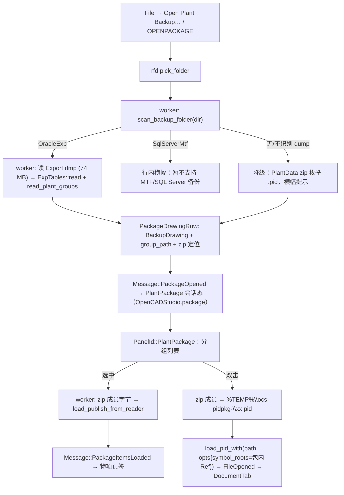

# 备份数据包接入：图纸列表 + 图纸属性 + 从包开图（Oracle exp 路径）

> 日期：2026-10-16
> 范围：SmartPlant 备份数据包（`Export.dmp` + `Manifest.txt` + `PlantData~2~*.zip` + `RefData~4~*`）接入 OpenCADStudio 桌面版——扫描成图纸列表、查看图纸属性与图内物项、双击开图。
> 方式：本方案经 grill 两轮问答定案（决策见 §3 D1–D10）。
> 承接：
> - `pid-parse` AGENTS.md / `src/backup/` / `src/publish/`（备份包读取与 publish 管线，`backup` feature）
> - OCS `src/io/pid/`（既有 `.pid` 导入）、`src/ui/window/sheet_set.rs`（列表面板先例）、`src/ui/dock.rs`（`PanelId`）
> - 上一轮 spec `.kiro/specs/pid-import-next-round/`（其「网页 `.pid` / `load_pid_from_bytes`」只在未合并分支 `pid-web-open` 上，本方案不依赖它）

## 1. 已确证的事实（调查结论，非假设）

### 1.1 语料

| 路径 | 形态 | Export.dmp | 用途 |
|---|---|---|---|
| `D:\work\cad\pid-test-data\` | Oracle exp 备份目录 | 74 489 856 B（约 74.5 MB） | 真机手工验收 |
| `pid-parse/test-file/backup-test/DWG-0202GP06-01_p\` | Oracle exp 备份目录 | 8 802 304 B | 集成测试语料（软跳过惯例） |
| `pid-parse/test-file/backup-test/TEST02_p\` | Oracle exp 备份目录 + `extracted/Export.mdf` 等派生物 | — | 参考；MDF 不在本单范围 |

`pid-test-data` 与 `DWG-0202GP06-01_p` 目录形态一致（`PlantData~2~711.zip`、`RefData~4~680..809`、`Ref\Symbols\` 已解压符号树）。

### 1.2 pid-parse 侧可用 API（`backup` feature，当前默认开）

- 探测：`backup::scan_backup_folder(dir) -> io::Result<BackupFolderScan>`（`backup/folder.rs:168`）。返回 `manifest`、`export: Option<ExportDumpScan>`（`ExportDumpFormat::{SqlServerMtf, OracleExp, Unrecognized}`）、`plant_data: Vec<PlantDataFile>`、`refdata`、`problems`。ZIP 只读中央目录索引，不解压载荷。
- 图纸清单（Oracle 路）：`publish::oracle_exp::ExpTables::read(&dump_bytes)`（`oracle_exp.rs:152`）→ `drawings() -> Result<Vec<BackupDrawing>>`（:203）。`BackupDrawing { id, id_key, name, path, path_key, drawing_number, plant_group_id }`（:411-426）。
- 工厂分组：`read_plant_groups(dump) -> Vec<PlantGroup { id, name, parent_id }>`（:463）、`plant_group_path(groups, id) -> "SQPlant \ 00 \ 00"`（:496）。
- 路径折叠：`backup_path_key("\\00\\00\\x.pid") == "00/00/x.pid"`（:444）、`backup_uid_key`（:450）。
- zip 成员名解码：`publish::backup_package::decode_zip_entry_name(&[u8]) -> String`（`backup_package.rs:654`，`pub`；GBK/CP936 兜底）。
- 图内物项：`publish::pid_load::load_publish_from_reader<R: Read+Seek>(reader, drawing_name) -> Result<PidPublishDrawing, PidLoadError>`（`pid_load.rs:743`）——`cfb` 直接接受 zip 成员字节的 `Cursor`，无需落盘。`PidPublishDrawing { items, process_points, branch_points, ports, connectivity_ends, exp_relations, opc_points, pipelines, representations, stats }`；`PidPublishItem { uid, model_item_type, class, attributes: Vec<PidPublishAttribute{interface,name,value,source}> }`。
- 全部同步 API，无 async。

### 1.3 OCS 侧现状

- `pid-parse = { path = "../pid-parse" }` 在 `[target.'cfg(not(target_arch = "wasm32"))'.dependencies]`（`Cargo.toml:145`），**默认 feature = `backup` 已链入**（即 oxidized-mdf GPL-3.0 已在 native 二进制里——见 D5）。wasm32 无此依赖。
- `.pid` 导入：`io::pid::load_pid(path)` / `load_pid_with(path, &PidImportOptions)`（`src/io/pid/mod.rs:414/455`）。`PidImportOptions` 现仅 `paper_style_scale: f64`（`Copy`）。符号库：`discover_symbol_library(path)`（`symbols.rs:554`）+ `PID_SYMBOL_LIBRARY` 环境变量 + 向上走查。
- 面板先例：`SheetSetManager`（`src/ui/window/sheet_set.rs`）——会话态、图纸列表、选中、`DrawingCache`、worker 线程加载。`PanelId` 枚举在 `src/ui/dock.rs:105`，`panel_body` 分发在 `src/app/dock/view.rs:370-445`。
- 文件打开管线：`Message::OpenFile` → `pick_open_path` → `OpenPathPicked` → `open_path_with_phase`（worker 线程 + `OpenProgressState` 阶段 + `catch_unwind`）→ `FileOpened` → `DocumentTab`。`opening` 是单槽 + `pending_opens` 队列。`.pid` 在 `is_read_only_source_path`（保存走另存）。
- `recent_files` 在 `AppConfig`（`src/app/config.rs`），settings.json 持久化。
- 新测试文件要登记 `Cargo.toml [[test]]`（`autotests = false`）。
- i18n：Fluent，`tr!`/`t!`/`tf!`，21 个 `locales/*/opencadstudio.ftl`，`--lib i18n::tests` 是门禁。

### 1.4 缺口（要补的）

| 缺口 | 位置 | 处置 |
|---|---|---|
| `BackupDrawing` 只投影 6 列；图签/类别/日期等 `T_DRAWING` 列没带出来 | pid-parse `oracle_exp.rs` | 上游任务 P2：扩投影或加 `drawing_rows()` |
| `PidImportOptions` 没有显式符号库根；临时目录里的 `.pid` 走查不到包内 `Ref\Symbols` | OCS `io/pid` | OCS 任务：options 加 `symbol_roots`（`Copy` 要放掉） |
| `backup` feature 把 rusqlite+oxidized-mdf(GPL-3.0) 与 Oracle 路绑在一起 | pid-parse `Cargo.toml` | 上游任务 P1：拆 `backup-exp`/`backup-mdf` |
| zip 成员→临时文件→`load_pid` 的接缝 | OCS 新增 `io::plant_package` | OCS 任务 |

## 2. 做 / 不做

**做**
- File 菜单 + `OPENPACKAGE` 命令族开备份目录（`rfd::pick_folder`），worker 线程扫描 + 读 `Export.dmp`。
- `PanelId::PlantPackage` 单面板：按 plant group 分组的图纸列表 + 下方详情区（「图纸属性」「物项」两页签）。
- 选中图纸 → 后台 `load_publish_from_reader` 懒加载物项表（按 drawing key 缓存，行级 loading/failed 状态）。
- 双击图纸 → zip 成员（或散放 `.pid`）落到 `%TEMP%\ocs-pidpkg-<hash>\` → `load_pid` 开成普通只读源 `DocumentTab`；符号库根指向包内参考数据。
- `backup` feature 拆分 + OCS 换成 `default-features = false, features = ["backup-exp"]`（摘除 GPL 依赖）。
- `recent_packages` 进 `AppConfig`；扫描 `problems` 与降级态在面板横幅可见。

**不做（登记）**
- SQL Server MTF / `Export.mdf` 路径（探测到给「暂不支持」提示；二期）。
- wasm32 / 网页版（`backup` 依赖编不了 wasm；将来若要有「native 预转 JSON/_Data.xml → web 消费」旁路）。
- 从 OCS 批量 publish 写 `_Data.xml`（`publish_backup_package` 留 CLI）。
- 备份包写回、图纸在包内的原地编辑（`.pid` 本就只读源，另存到包外）。
- 多包并行会话（`Option<PlantPackage>` 单会话；再开新包替换旧会话）。

## 3. 决策表（⭕ = 本轮已拍板）

| # | 决策 | 结论 |
|---|---|---|
| D1 | 输入范围 | ⭕ Oracle exp 目录 v1；`scan_backup_folder` 探测，`SqlServerMtf` → 「暂不支持」，缺/不识别 dump → 降级按 zip 枚举 `.pid` + 横幅 |
| D2 | 数据范围 | ⭕ 图纸列表（plant group 分组）+ 图纸元数据 + 图内物项/位号表；不做完整工厂树 |
| D3 | 开图 | ⭕ zip 成员 → 临时文件 → `load_pid`；不显式依赖 `pid-web-open` 的字节路 |
| D4 | 平台 | ⭕ 仅 native，`#[cfg(not(target_arch = "wasm32"))]` 全门 |
| D5 | GPL 摘除 | ⭕ pid-parse 拆 `backup` = `["backup-exp","backup-mdf"]`（伞保持默认）；OCS 换 `default-features = false, features = ["backup-exp"]` |
| D6 | 工作区 | ⭕ 主工作树新分支 `pid-backup-package`；pid-parse 在 `codex/phase32c-bundle-closeout` 上直接改 |
| D7 | UI | ⭕ 单面板（分组列表 + 详情两页签），照 `SheetSetManager`/`pid_legend_list` 惯例 |
| D8 | 物项加载 | ⭕ 选中即后台懒加载，`id_key` 缓存，行级状态 |
| D9 | 测试 | ⭕ 合成 `BackupFolderScan` 单测 + `../pid-parse/test-file/backup-test/DWG-0202GP06-01_p` 软跳过集成 + `pid-test-data` 手工验收 |
| D10 | 流程 | ⭕ 本文档交付后等批，不直接实施 |

## 4. 架构

### 模块划分（名字暂定）

| 层 | 文件 | 职责 |
|---|---|---|
| pid-parse 上游 | `Cargo.toml` + `lib.rs` cfg + `publish/model.rs` `PublishError` | P1 feature 拆分；`oracle_exp.rs` P2 投影扩展 |
| OCS io | `src/io/plant_package.rs`（或 `io/plant_package/`） | `scan_package`、`PackageDrawingRow` 构建、zip 成员读取/GBK 名解码、临时文件缓存、符号根收集 |
| OCS app | `src/app/mod.rs`（`package: Option<PlantPackage>`）、`src/app/update/`、`src/app/commands/` | Message 流、`OPENPACKAGE` 命令族、recent_packages |
| OCS ui | `src/ui/window/plant_package.rs` + `src/ui/dock.rs` + `app/dock/view.rs` | `PanelId::PlantPackage`、列表视图、详情页签、横幅 |

## 5. 任务分解

### 阶段 A · pid-parse 上游（`codex/phase32c-bundle-closeout`）

- **P1 feature 拆分**：`backup = ["backup-exp","backup-mdf"]` 伞保持默认。
  - `backup-exp`（OCS 消费面）：`dep:zip`、`dep:sha2`、`dep:log`；模块 `backup::{folder, manifest, mtf(仅探测), zip_index, refdata, datamap, text_scan}` + `publish::{oracle_exp, model, xml_writer, pid_writer, pid_load, pipeline, backup_package, diff}`。
  - `backup-mdf`：`dep:rusqlite`、`dep:oxidized-mdf`、`dep:env_logger`；模块 `backup::{boot_page, mdf_page, msci, syscatalog}` + `publish::{mdf_load, sqlite_load}` + bins `pid_backup_extract`/`pid_backup_probe`/`pid_msda_probe`（`pid_inspect`、`pid_publish_xml` 按实际依赖归位）。
  - `PublishError::Sqlite/Mdf` 变体随 `backup-mdf` cfg。
  - 验收：`cargo check --no-default-features --features backup-exp` 的依赖树里**没有** `oxidized-mdf`/`rusqlite`（`cargo tree -e no-dev` 核对）；五道 pre-commit 门禁全绿；`--no-default-features`（wasm 面）不受影响。
- **P2 T_DRAWING 投影扩展**：`ExpTables` 加每图整行投影（`drawing_rows()` 返回 `BTreeMap` 或扩 `BackupDrawing` 字段：DocumentCategory/DocumentType/Template/DateCreated 等）。含合成字节单测 + 语料测试软跳过。
- **P3 CHANGELOG + task_plan** 按仓例更新。

### 阶段 B · OCS io 层

- **T1** `io::plant_package`：`PackageIndex { scan, drawings: Vec<PackageDrawingRow>, groups, problems, degraded }`；`PackageDrawingRow { id_key, name, drawing_number, group_path, locator: Zip{file,member}|Loose(path), item_state }`。
- **T2** zip 定位：`backup_path_key(path)` ↔ 成员名 `decode_zip_entry_name` 配对；散放 `PlantData~2~*` 目录直读。配对失败行内标「无图体」。
- **T3** 临时缓存：`<temp>/ocs-pidpkg-<路径hash>/`；成员按需解压（open/物项共用）；会话关/退盘清理（best-effort）。
- **T4** 符号根：优先包内已解压 `Ref\Symbols`；否则把 `RefData~4~*.zip` 中含 `.sym` 的成员按需解到缓存目录。`PidImportOptions` 加 `symbol_roots: Option<Vec<PathBuf>>`（放掉 `Copy`），`discover_symbol_library` 先吃显式根再走环境变量/走查。

### 阶段 C · OCS app/UI 层

- **T5** Message 流：`OpenPackage` → `PackagePathPicked` → worker `scan_package` → `PackageOpened(Result)`；`PackageSelectDrawing(id_key)` → 已缓存即用，否则 worker `load_publish_from_reader` → `PackageItemsLoaded`；`PackageOpenDrawing(id_key)` → 走 `open_path_with_phase` 同款进度态 → `FileOpened`。
- **T6** `PanelId::PlantPackage`：枚举 + 图标（复用 `sheetset.svg` 或 `content_browser.svg` 暂定）+ 默认宽 ~300 + `panel_body` 臂 + `ui/window/plant_package.rs` 视图（分组可折叠列表、详情两页签、问题横幅、行内 loading/失败标）。
- **T7** 物项表：`PidPublishItem` → 行（`model_item_type`/`class`/`uid` 摘示）+ 选中物项属性栅格（`interface`/`name`/`value` 三列，`PidValueSource` 着色或角标）。
- **T8** 入口与持久：File 菜单项、`OPENPACKAGE` 命令族注册 `dispatch_families`、`recent_packages`（上限同 recent_files）、i18n 全 21 locale 新键（en 先落文，其余复制英文占位）。
- **T9** 打开即 `current_path` = 临时 `.pid`（只读源，另存走既有路径）；`tab_title` 用图纸 `name`。

### 阶段 D · 验证

- **T10** 测试：`tests/plant_package.rs`（登记 `[[test]]`）——行构建/配对/降级用合成 `BackupFolderScan` 形数据；`../pid-parse/test-file/backup-test/DWG-0202GP06-01_p` 软跳过集成（列表非空、选中出物项、双击文档非空）。
- **T11** 门禁：`cargo check --lib --tests --examples`；`cargo check --locked --target wasm32-unknown-unknown`（web-check 镜像，确认零新增 wasm 面）；`cargo test --test plant_package` + `--lib io::pid` + `--lib i18n::tests`；`cargo fmt`。
- **T12** 真机：`D:\work\cad\pid-test-data` 手工验收——列表分组、物项表、双击开图（符号在位）、74.5 MB dump 的扫描耗时记入 evidence `docs/evidence/2026-10-16-pid-backup-package/`。

## 6. 风险与注意

- **Export.dmp 体量**：74.5 MB 一次读入 + `ExpTables::read` 按表扫字节；桌面可接受但要在 worker 上做，解析出的 `ExpTables` 驻留会话（~百 MB 级内存量级先实测，超量再议流式）。失败路径：dump 读不出 → 降级 zip 枚举。
- **`opening` 单槽**：包内开图复用 `open_path_with_phase` 管线，进 `pending_opens` 队列排队，不旁路。
- **与 `pid-web-open` 的冲突点**：`Cargo.toml` pid-parse 行、`io/mod.rs`、`io/pid/mod.rs` 是已知热点；本分支只动 native 行与 `PidImportOptions`，合并时本分支侧保留 wasm32 行。
- **MTF 探测**：`ExportDumpFormat::SqlServerMtf` 命中只提示，不尝试 `mdf_load`（feature 都不在）。
- **物项解析成本**：单图 `load_publish_from_reader` ≈ 一次 `.pid` 解析（百毫秒级）；懒加载串行 worker，快速连点靠缓存去重 + 过期丢弃（选中项变了丢旧结果）。

## 7. 术语

- **备份数据包**：SmartPlant 桌面工具产出的备份目录（`Export.dmp`/`Manifest.txt`/`PlantData~2~*.zip`/`RefData~4~*`）。
- **Oracle exp 包**：`Export.dmp` 为 Oracle 导出文本流的包（本次实测语料的形态）。
- **MTF/SQL Server 包**：`Export.dmp` 为磁带格式包 SQL Server MDF 的包（v1 提示不支持）。
- **图纸行**：`PackageDrawingRow` = `BackupDrawing`（库登记）+ 图体定位（zip 成员/散放文件）+ 物项加载态。

## 8. 进度 / 门禁记录

> 2026-10-19 补记。实施在工作树 `ocs-pkg-1016`（分支 `pid-backup-package`，父 `fd3998788`），非计划里的「主工作树新分支」——D6 的落点是同名分支挂独立工作树。

- **阶段 A（pid-parse，`codex/phase32c-bundle-closeout`）**：P1 feature 拆分与 P2 `BackupDrawing` 扩字段（`description`/`title`/`revision`/`version`/`document_type`/`document_category`/`item_status`/`template`/`design_phase`/`project_number`/`date_created`/`drawing_date`）都已落，含在 `ea15e5d` 里。OCS 侧 `Cargo.toml` 已换 `default-features = false, features = ["backup-exp"]`，`Cargo.lock` 净删 206 行（oxidized-mdf/rusqlite 出树）。
- **阶段 B/C（OCS）**：压成一个提交 `e2856363d`「P&ID: browse SmartPlant backup packages (Oracle exp) (pid-cad#5)」，`+1664/−215`、21 文件。T1–T9 全在里面：`io/plant_package.rs`（733 行，含 7 个模块内单测）、`PidImportOptions.symbol_roots`（Copy 已放掉）、`Message::PlantPackage` 流、`PanelId::PlantPackage`（FOLDER 图标、宽 300）、`ui/window/plant_package.rs`（484 行）、`OPENPACKAGE`/`PLANTPACKAGE`/`PLANTPACKAGECLOSE` 命令族、`AppConfig.packages` 最近包列表、File 菜单项。
- **i18n 偏差**：T8 写的「21 locale 新键」没走 `tr!` 键路——实现用的是 `t!`/`tf!` 源串兼容路（`locale_catalog::message_attribute` 查表、查不到回退英文原文），零新增 ftl 键；`--lib i18n::tests` 60/60 绿，门禁不挡。未入源目录的串在非英文界面显示英文。
- **T10/T11（提交 `129eb3e43`）**：新增 `tests/plant_package.rs`（已登记 `[[test]]`，`autotests = false` 下必需），软跳过 `../pid-parse/test-file/backup-test/DWG-0202GP06-01_p`：配对/解出/`load_pid_with`+`symbol_roots` 导入/物项懒加载/无 dump 降级目录共 **5/5 过**。门禁跑出来的真问题并已修：`tests/pid_import.rs:4028` 的 `PidImportOptions` 字面量缺 `symbol_roots`，`--tests` 编译断裂，补 `..Default::default()`。
- **门禁数字（2026-10-19，`ocs-pkg-1016`）**：`cargo check --lib --tests --examples` 绿（两条既有告警在非本分支文件：`io/plot.rs` `target_dpi`、`command.rs:5182` unused `Task`）；`cargo check --locked --target wasm32-unknown-unknown` 绿（清单级 unused-dependency 告警为上游既有，零新增 wasm 面，`io/mod.rs:34` 已 cfg 门）；`cargo test --lib i18n::tests io::pid` 60/60；触碰文件 rustfmt 干净（`ocs_save` drift 属上游）。
- **T12 部分**：`real_package_acceptance -- --ignored` 对 `D:\work\cad\pid-test-data` **过**——74 489 856 B dump、`T_GLOBALDRAWING` 53 行、`load_package` 自报约 0.08 s（包内 `Ref` 符号树已在盘上，不碰 RefData 解压）。**GUI 人工验收未做**：分组列表/属性页签/双击开图的画面核对需要人在机器前，见 `docs/evidence/2026-10-16-pid-backup-package/README.md`。
- **落地前注意**：分支落后 main 2 个提交（`d6c065978`、`f37fc2628`，都碰 `src/io/pid/`），合并前先解；`pid-parse` 检出带另一会话未提交的 igtextbox 改动，本次所有数字是在该实情下跑出来的。
