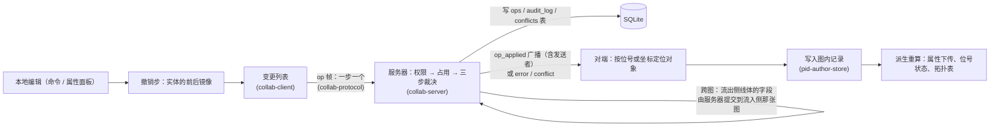
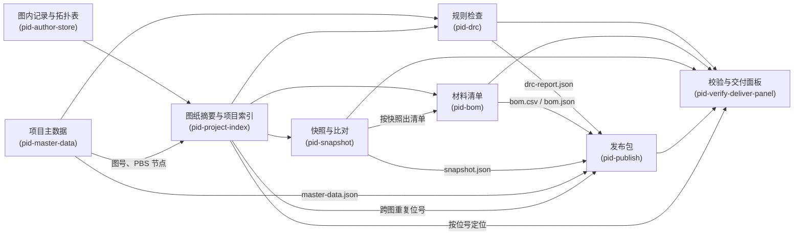

# P&ID 协同绘图开发方案 · 第 0 步：假设与能力地图

> 日期：2026-11-16
> 状态：**已确认**（2026-11-16：范围含阶段 3 的七个新模块，阶段 4 只列概要，文档放本目录）。各模块规格写完后，本文有几处按规格对齐过，见文末「修订记录」。
> 方法：`spec-driven-development`（规格 → 计划 → 任务 → 实现，每一步确认后才进下一步）。一个要求里包含多块可以单独验收的能力时，它要求先出这张地图。
> 基线：`main @ 9b5327f96`（本地，比 `fork/main @ 144d2c643` 多 31 个提交，未推送）。
> 现行计划：`docs/plans/2026-11-16-pid-platform-next-steps-plan.md`（已批准，决议 D1–D5）。本方案不推翻它，只把它写细：数据长什么样、怎么传、剩下的活怎么拆。

## 1. 我的假设

这些假设已确认，各模块规格按它们写。

1. **范围**是现行计划里还没做完的部分（阶段 2 的收口、阶段 3 的项目数据 / 规则检查 / 材料清单与发布 / 面板），加上已经做完的部分的数据契约如实成文。阶段 4（图例标准、存量图接管、标准互操作）只列概要，不写规格。
2. **已完成的模块按现状记录，不重新设计。** 数据格式以代码为准，规格里每一项都标出处（文件与函数）；与旧文档不一致的地方写明以哪个为准。
3. **已定的约束继续有效**：桌面脱机优先；校验与交付合成一个多页签面板；协同协议不加消息类型、只加可选键；桌面端传输层保持同步（不引入异步运行时）；不引入 Docker / Postgres / Redis 等外部服务；构建不用 `sccache`；`docs/pid-platform/design/pid-platform.pen` 不提交；推送前先汇报、经你确认。2026-11-17 补：「桌面脱机优先」原来只指没有服务器也能单机用；离线时的修改在重新连上后同步，写在 `SPEC-collab-offline-sync.md`（2026-11-17 已确认），协议上只加可选键和错误码。
4. **文档位置**：`docs/plans/2026-11-16-pid-dev-spec/`（本目录）。不放仓库根目录的 `SPEC.md` / `tasks/`，因为这个仓库是上游项目的分叉，计划文档一直放在 `docs/plans/`。中文撰写，键名与标识符保持英文原样。
5. **任务要能分给不同的会话同时做**：每个任务一次专注的会话能做完，不超过约 5 个文件，写明输入输出的数据格式、验收条件、验证命令、依赖的任务，以及能与谁并行。
6. **做法不变**：每个任务先写失败的测试再实现，独立提交；门禁沿用现在的读数（桌面端全部单元测试、`clippy` 告警数 630 / 965 不增（换新编译器后是 656 / 1051，见 `todo.md` 固定门禁第 3 条）、格式无新增不一致、协同两个 crate 的测试）。
7. **新模块的需求依据**是 `docs/pid-platform/requirements/50-data-and-rule-engine.md`（REQ-DATA-001–016）、`60-deliverables-and-publish.md`（REQ-DELV-001–011）与 PRD 的 P2 退出指标（规则 ≥ 20 条、本计划内置 ≥ 24 条；2,000 对象全量检查 ≤ 60 秒；材料清单每个「类型编码 + 位号」至多一行；严重违规 100% 拦截）。规格里逐条对上。
8. **写方案期间不改代码。** T2.4 ③（大属性符号）与 ④（全量复验、结项文档）排进任务清单，等规格与任务都确认后再做。要我先把它们做掉也可以，说一声。

## 2. 能力地图

| 模块 id | 负责什么 | 依赖 | 现状 |
|---|---|---|---|
| `pid-author-store` | 图纸内的 P&ID 语义数据：每个实体的 `PID_AUTHOR` 记录、属性与覆盖标记、超 2 KB 溢出到 XRecord、四个图级表（类型库 / 位号规则 / 拓扑 / 连接符）、位号来源、属性下传链 | —（绘图内核） | 已完成（P1：`VAL-SEM` 39、`VAL-DRAW` 31、`VAL-PIPE` 32 全过） |
| `collab-protocol` | 线上契约：客户端 6 种帧、服务器 10 种帧、`op` 载荷与 11 种变更的报文体、错误码、三步裁决、三级权限、位号占用、跨图连接符跟随（`crates/ocs_collab`） | — | 已完成；最近新增三个可选键：`hello.existing_tags`（`1682b84c3`）、`set_property.overrides` 与 `set_tag.tag_source`（`9b5327f96`） |
| `collab-server` | 协同服务器：HTTP 控制面（10 条路由）、WebSocket 数据面、SQLite 10 张表、`op` 受理管线、冲突条目与裁决、审计、重连补发、跨图派生 `op`（`crates/ocs_collab_server`） | `collab-protocol` | 已完成 |
| `collab-client` | 桌面端：同步传输线程、会话状态、发件队列（一次一个 `op` 在途）、离线排队与重连对账、被拒撤回、只读闸、占用；本地一步 → 变更 → `op`；`op_applied` → 定位对象 → 写入 → 派生重算（`src/app/collab/`） | `pid-author-store`、`collab-protocol` | 已完成，差两项：大属性符号新建（T2.4 ③）、全量复验与结项（T2.4 ④） |
| `pid-master-data` | 项目主数据：图例标准锁定、公称直径表、管道等级（含允许的直径范围）、绝热等级、介质代码、装置分区节点；图内一份，项目目录可共享一份 | `pid-author-store` | 未开始（T3.1 前半） |
| `pid-project-index` | 图纸摘要与脱机项目索引：把一张图读成一份不依赖句柄的摘要（对象、线段、连接符、端口），连通关系由坐标推出；扫描图纸目录里的各张图，给出全项目的重复位号与跨图连接；按位号定位；`PIDINDEX` / `PIDLOCATE` | `pid-author-store`、`pid-master-data`（项目文件里的图号与 PBS 节点） | 未开始（T3.1 后半） |
| `pid-drc` | 设计规则检查：规则模型与规则包文件、内置 41 条规则（需求的 25 条加计划多出的 16 条）、执行器、结果模型、豁免、三种触发（按需 / 保存前 / 发布前）、`PIDCHECK`、REST 与 MCP | `pid-author-store`、`pid-master-data`、`pid-project-index` | 未开始（T3.2） |
| `pid-bom` | 材料清单：按「类型编码 + 位号」唯一聚合、数量公式、CSV / XLSX / JSON 导出、`PIDBOM` | `pid-project-index`、`pid-master-data`（PBS 节点）；「按快照出清单」这一个入口另依赖 `pid-snapshot` | 未开始（T3.3 之一） |
| `pid-snapshot` | 版本快照与比对：快照文件（存在图纸目录下，不写进图）、比对结果（新增 / 删除 / 修改三组，修改再分属性、位置、长度、管件、连接、对端；计划要的五类差异都在内）、`PIDSNAPSHOT` / `PIDDIFF` | `pid-project-index`（图纸摘要、连通图） | 未开始（T3.3 之二） |
| `pid-publish` | 发布包：发布前提（已保存、无未存修改、文件没被别人改、不是只读会话、目标目录可用）与四项门禁（未豁免的错误为 0、重复位号为 0、主数据读得出、项目里的图都读得出）、包内十一个文件与校验和清单、原子生成、`PIDPUBLISH` | `pid-drc`、`pid-bom`、`pid-snapshot`、`pid-project-index`、`pid-master-data` | 未开始（T3.3 之三） |
| `pid-verify-deliver-panel` | 「校验与交付」停靠面板：规则检查 / 材料清单 / 快照与发布三个页签；面板状态可读（`pid_verify_panel`），按钮可由自动化接口驱动（现有的 `action` 操作）；点一条结果定位到对象并在属性表标出相关字段；`PIDVERIFY` | `pid-drc`、`pid-bom`、`pid-snapshot`、`pid-publish`、`pid-project-index`（定位） | 未开始（T3.4） |

依赖没有环。每个模块对外的数据契约写在它自己的规格里，用它的模块只引用、不重写。

### 构建顺序

1. `pid-author-store` → `collab-protocol` → `collab-server` 与 `collab-client`（这四个已建成，规格是按现状补记）
2. `collab-client` 的两项收口（T2.4 ③、④）→ 检查点：228 条验收契约全部闭环，结项文档更新
3. `pid-master-data` → `pid-project-index`
4. `pid-drc`、`pid-bom`、`pid-snapshot`（三个都只吃图纸摘要，可以同时做；唯一的交叉是材料清单的「按快照出清单」入口，排在快照之后）
5. `pid-publish` → `pid-verify-deliver-panel`

可以并行的地方：第 4 步的三个模块；第 2 步与第 3 步（改的文件不重叠）。现行决议 D1 定的是「先收官协同再进阶段 3」，默认照它串行；要不要放开，在计划阶段由你定。

## 3. 每份规格要定下的数据契约

每份模块规格里有两节是固定的：**数据格式**（字段、类型、取值、示例、存在哪里）和**数据怎么传**（谁产生、谁消费、经过什么：函数调用 / 图内记录 / 文件 / WebSocket 帧 / REST，以及顺序与失败时怎么办）。下表是各规格要写清的格式清单。

| 模块 | 要写清的数据格式 |
|---|---|
| `pid-author-store` | `PID_AUTHOR` 扩展数据的九个键与编码；`props` 的 JSON 形状与覆盖标记 `__overrides`；超 2 KB 时的溢出记录（键名、分片）；图级 XRecord 的条目布局；拓扑表 JSON（管线 / 管路 / 管段 / 管件 / 连接符）；`tag_source`、`tag_status` 的取值；五个下传字段与下传规则 |
| `collab-protocol` | 每种帧的 JSON；`op` 载荷（一步一个 `op`，首条变更是载荷本身，其余在 `changes` 下）；11 种变更各自的键（含符号的放置信息、管路的零件清单 `run`、连接符的配对键、`reassigned_from`、`overrides`、`tag_source`）；对象怎么称呼（有位号按位号，没有的按所属与坐标）；错误码表；裁决规则（合并 / 让位 / 并列成冲突 / 拓扑先后 / 对象已删 / 被引用 / 重复流入） |
| `collab-server` | 10 张表的列；每条 HTTP 路由的请求与应答；审计行；`ops` 表存的是广播出去的 `changes` 原文，重启时怎么重放回内存模型；启动参数 |
| `collab-client` | 会话状态与队列里的记录（待答复的 `op`、被拒记录、已落地的远端变更）；三个设置项（`PIDCOLLAB SERVER` / `USER` / `DRAWING`，存在设置文件里）；桌面端 REST `/api/v1/collab/status` 的应答；两条主流程（发出与收到）以及建连、重连补发、被拒撤回、撤销重做后的重放 |
| `pid-master-data` | 主数据的 JSON（四张取值表、PBS 节点、图例标准、修订号）；图内记录 `PID_AUTHOR_MASTERDATA`；项目文件 `pid-project.json`（另带各图的图号与 PBS 节点）；两处都有时用哪一份 |
| `pid-project-index` | 图纸摘要、连通图、项目索引的 JSON；扫描哪些文件、何时重读；定位请求 |
| `pid-drc` | 规则包文件（启停、严重度、作用域、表达式）；检查结果（发布包里的 `drc-report.json` 就是它）；豁免记录 `PID_AUTHOR_DRC_WAIVERS`；REST `/api/v1/pid/check` 的请求与应答 |
| `pid-bom` | 清单行与管道汇总的字段；`bom.csv` 的列；`bom.json` |
| `pid-snapshot` | 快照文件与目录清单 `index.json`；比对结果 |
| `pid-publish` | 发布包目录布局；`manifest.json`（校验和）；`topology.json`；门禁结果 |
| `pid-verify-deliver-panel` | 面板状态（`pid_verify_panel` 的应答）；驱动动作（`action` 操作里 `value` 的写法）；控件位置标识；属性表高亮请求 |

## 4. 数据怎么流（总图）

协同这条链（已建成）：

校验与交付这条链（要新建）：

## 5. 本目录将产出的文档与确认点

| 步骤 | 产出 | 确认 |
|---|---|---|
| 第 0 步 | `00-capability-map.md`（本文） | 已确认 |
| 规格 | `01-shared-conventions.md`（各模块共用：技术栈、命令、目录、代码风格、测试策略、边界），以及每个模块一份 `SPEC-<模块 id>.md`（目标、数据格式、数据怎么传、成功标准、不在范围、待决问题） | 已确认（2026-11-16）：39 条待决问题都按各规格的「建议」定，汇总见 `plan.md` §3 |
| 计划与任务 | `plan.md`（阶段、依赖图、风险、可并行项、检查点）与 `todo.md`（逐个任务：做什么、验收、验证命令、依赖、改哪些文件、规模） | 已确认（2026-11-16）：5 个阶段、67 个任务、18 个检查点；串行做，可选任务不加，见 `plan.md` §11。2026-11-17 加了离线同步，变成 80 个任务、20 个检查点，这一部分也已确认（2026-11-17）：六件事都按建议定，见 `plan.md` §12 |
| 实现 | 按 `todo.md` 逐个做，每个任务先红后绿、独立提交 | **现在**：从 `CC-1` 开始。每个检查点汇报；推送前确认 |

## 6. 不在本方案范围（先记下，不做）

- 阶段 4：四套图例标准与符号编辑器、100 张存量图批量接管、ISO 15926 / CFIHOS 导出与三通道自动化。阶段 3 验收后另开方案。
- T1.3（`pid-parse` / `pid-plot` 依赖升级）：等它的发布线合入后触发，不排进本方案的阶段。
- 已有对象的几何修改（移动符号、拖动线段）进入协同：协议里一直没有，这次也不加。
- 协同连接配置的图形界面：保持 `PIDCOLLAB` 命令行方式（决议 D4）。

## 7. 当时请你定的三件事（已定）

1. **范围**：阶段 3 的七个新模块一起写规格；阶段 4 只列概要。
2. **文档位置**：`docs/plans/2026-11-16-pid-dev-spec/`。
3. 模块的切法、依赖、顺序：按 §2，没有改动。

## 8. 修订记录

确认之后、各模块规格写完时，按规格对齐了下面几处。模块的切法和构建顺序没有变。

- `pid-snapshot` 的依赖由 `pid-author-store` 改为 `pid-project-index`：快照存的就是图纸摘要，不另读一遍图。差异的分法按规格写成「三组，修改再分六种」。
- `pid-publish` 的「两道硬门禁」写成「发布前提 + 四项门禁」：计划要的两道（错误为 0、重复位号为 0）都在，另加「主数据读得出」「项目里的图都读得出」，否则前两道的结论不可靠。依赖补上 `pid-project-index`、`pid-master-data`。
- `pid-drc` 的内置规则数由「≥ 24 条」写成 41 条（需求的 25 条加计划多出的 16 条）；补上豁免。
- `pid-bom` 的导出补上 XLSX；依赖补上 `pid-master-data`（按 PBS 节点圈范围）；「按快照出清单」这一个入口依赖 `pid-snapshot`，所以构建顺序第 4 步加了一句说明。
- `pid-project-index` 的说明写具体了：它同时负责「图纸摘要」，后面几个模块都只吃摘要。
- `pid-verify-deliver-panel` 的对外方式写具体了（读面板状态的操作、现有的 `action` 操作、命令 `PIDVERIFY`），依赖补上 `pid-project-index`。
- §3 的格式清单、§4 的第二张图按上面几条同步。

2026-11-16，规格确认之后、写计划与任务时：

- 各模块规格的待决问题（共 39 条）都按「建议」定下，各规格和共用约定的状态改为已确认；§5 的确认状态同步。
- `SPEC-pid-drc.md` §4.3 补一条：不含 P&ID 对象的图保存时不过规则闸（新口径，随计划一起确认）；§6 第 5 条注明 `DR-016` 怎么测。
- `SPEC-pid-verify-deliver-panel.md` §3.5 的例子把属性名 `介质` 改成 `流体介质`。
- 计划与任务清单确认（答复「按推荐继续」）：`plan.md` §11 的六件事都按建议定。本目录的文档在动代码之前单独提交一次，不推送。

2026-11-17，按「离线的情况下也要能使用，上线了之后要进行同步」修订（2026-11-17 **已确认**，定下来的事见 `plan.md` §12）：

- 新增规格 `SPEC-collab-offline-sync.md`。它不是新模块，是 `collab-client`、`collab-protocol`、`collab-server` 三个已有模块上的一块补强，另在 `pid-publish` 上加一道协同前提。模块的切法和构建顺序没有变。
- `todo.md` 加 `OFF-1` – `OFF-13`（67 → 80 个任务）；`plan.md` 相应改了阶段表、依赖、检查点（18 → 20 个）、风险，并加了 §12。
- `SPEC-collab-client.md`、`SPEC-collab-protocol.md`、`SPEC-collab-server.md`、`SPEC-pid-publish.md` 各加了指向新规格的句子，原文没有删改。
- §1 第 3 条的「桌面脱机优先」补了一句说明；§5 的任务数和检查点数同步。
- 这次修订的确认（答复「都按建议定，那批改动交给你接着做」）：`plan.md` §12 的六件事都按建议定，各文档里这一部分的状态改为已确认；主目录里那批没提交的离线改动交给我接着做，从 `OFF-1` 开始。改状态的这几份文档在动代码之前单独提交一次，不推送。
