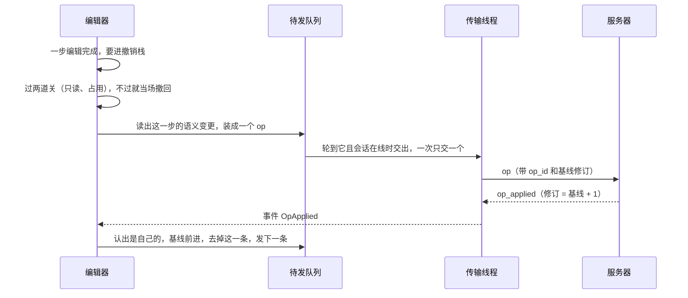
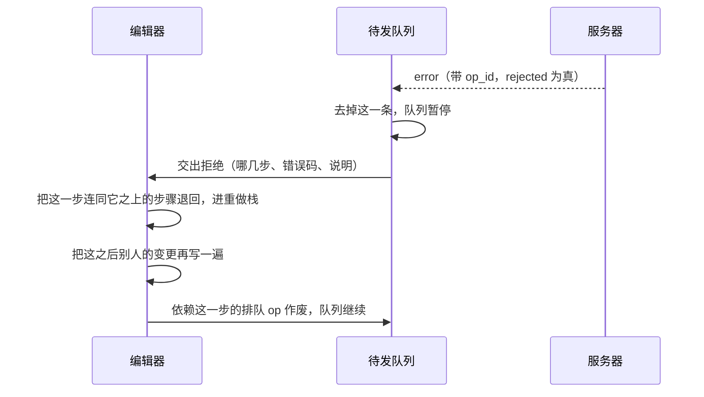
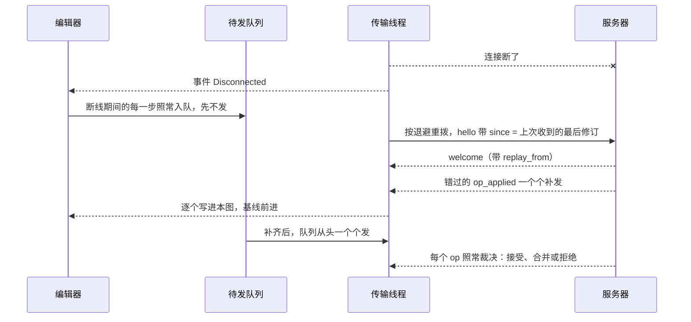

# SPEC：桌面协同客户端（`collab-client`）

> 状态：**已建成，按现状记录**。§8 的两项收尾都已做完：T2.4 ③ 是 `CC-1`、`CC-2`（记录见 §10.1、§10.2），T2.4 ④ 是 `CC-7` 全量复验和 `CC-8` 状态文档结项（2026-11-20）。基线 `main @ 9b5327f96`。以代码为准，每项标了出处。
> 线上消息的形状见 `SPEC-collab-protocol.md`，服务器怎么判见 `SPEC-collab-server.md`。这里只写桌面端自己的：怎么连、本地一步编辑怎么变成 `op`、别人的 `op` 怎么写进本图、出错时怎么收场。
> 2026-11-17：离线使用与上线后同步（队列随图保存、加入时核对、重开后撤回、未同步清单）另写在 `SPEC-collab-offline-sync.md`，**已确认**（2026-11-17）。本文与它不一致的地方以它为准，受影响的地方各加了一句指向它（都以「2026-11-17：」开头）。

## 1. 目标

让桌面编辑器在画 P&ID 时做三件事：

1. 把本人的每一步编辑（撤销栈里的一步）说给房间听；
2. 把房间里别人的编辑写进本图；
3. 出了岔子（被服务器拒绝、断线、只读、位号被别人占用）时把本图收拾回「与房间一致」，收拾不了就明说。

没配服务器地址时什么都不做：不连网、不起线程，编辑器与单机版完全一样（离线优先，`VAL-CLI-017`）。

代码都在 `src/app/collab/`：

| 文件 | 管什么 |
|---|---|
| `mod.rs` | 会话状态 `State`、界面事件 `CollabEvent`、待发队列、状态接口的内容 |
| `transport.rs` | 一条专用线程：连接、发 `hello`、心跳、读写帧、断线重连 |
| `messages.rs` | 把服务器的帧读成界面事件 |
| `broadcast.rs` | 一步编辑 ↔ 语义变更（符号、位号、属性） |
| `pipes.rs`、`connectors.rs` | 管线、管路、管件、页间连接符的变更 |
| `apply.rs` | 接到编辑器上：发出、落地、撤回被拒的步骤、只读与占用把关 |
| `claims.rs` | `PIDCOLLAB` / `PIDCLAIM` / `PIDRELEASE` 命令、面板数据、占用着色 |
| `collab_*.rs`（四个） | 场景测试：离线排队、上报位号、管线变更、跨图连接符 |

面板在 `src/ui/window/pid_collab.rs`。步骤进撤销栈时的把关和发出在 `src/app/history.rs`。`transport.rs` 和 `messages.rs` 只在桌面版编译；网页版没有协同。

传输代码是同步的：`tungstenite` 加一条 `std::thread`，用容量 64 的通道把事件交给界面。`src/app/collab/` 下不许出现异步写法，有测试守着（`VAL-CLI-019`）。

验收状态：

- 相关契约：`VAL-CLI` 20 条（客户端）、`VAL-CONF` 18 条（冲突）、`VAL-CROSS` 12 条（跨区流程）。
- 状态文档（`docs/plans/2026-11-10-mission-p1-collab-status.md`）停在 `ea7f4357b`。当时：客户端八个端到端场景 110 项全过，但 `VAL-CLI` 20 条记的是「13 条成立、7 条部分成立」，没有重新定状态；冲突三场景 61 项全过；跨区流程 12 条里 9 条成立，003、008、009 当时没做。
- 那之后的提交把这三条做了（管线广播 = 003，离线排队与重连对账 = 008，跨图连接符 = 009），还加了上报本图已有位号、覆盖标记与位号来源随变更走。这些都有单元测试，但**还没有做过全量端到端复验**，状态文档也没更新。这是 §8 的第二项任务。
- 单元测试：上表这些文件加面板共 239 个，全绿（含在桌面端 `--lib` 通过的 6865 个里）。只跑协同模块：`cargo test --offline --locked --lib app::collab`。

## 2. 怎么连

### 2.1 四项设置

来源有两处：启动参数只管本次运行，设置文件管以后每次。两边都给了时启动参数说了算（`src/cli.rs`、`src/app/mod.rs` 的启动段）。

| 设置 | 启动参数 | 设置文件键 | 命令 | 说明 |
|---|---|---|---|---|
| 服务器地址 | `--collab <URL>` | `server_url` | `PIDCOLLAB SERVER <URL>`；`PIDCOLLAB SERVER OFF` 清掉 | 只认 `ws://主机:端口/ws`（`wss://` 不认）。空着就是不开协同 |
| 用户号 | `--user <号>` | `user_id` | `PIDCOLLAB USER <号>` | `hello` 里报的 `user_id`，一个词 |
| 图号 | `--drawing <号>` | `drawing_id` | `PIDCOLLAB DRAWING <号>` | 房间名。没给时取打开的文件名（去掉扩展名） |
| 会话模式 | `--collab-mode <模式>` | `mode` | 无 | `协同编辑`（默认）、`单人编辑`、`只读` |

设置文件是 `<配置目录>/OpenCADStudio/settings.json` 的 `collab` 段（`src/app/config.rs` 的 `CollabConfig`）：

```json
{
  "collab": {
    "server_url": "ws://127.0.0.1:3240/ws",
    "user_id": "u1",
    "drawing_id": "D-1001",
    "mode": ""
  }
}
```

设置文件是明文，所以不存任何口令或令牌（现在也没有登录验证）。地址里如果带了 `@` 前的凭据部分，在日志、命令行和状态接口里显示时会去掉（`mod.rs` 的 `shown_address`）。

### 2.2 会话什么时候起、管哪张图

- **启动时**：有服务器地址就去连。带文件启动时，会话是给那个文件的：等它加载出来再发 `hello`（最多等 20 秒），因为 `hello` 要带上这张图已有的位号（§4.5）。
- **启动后**：本次运行还没有服务器地址时，用 `PIDCOLLAB SERVER / USER / DRAWING` 补设置。每补一项就检查一次：地址、用户号都有了，且最前面是一张打开的图，就在这张图上起会话；还缺什么会在命令行说明（`claims.rs` 的 `start_saved_session`）。图号没给时取文件名；图还没有文件名时必须先用 `PIDCOLLAB DRAWING` 指定。
- **一次运行里会话一旦起来就不变**：本次运行已经有了服务器地址（启动参数给的、设置文件里的，或者刚用命令起的）之后，再改这几项只是存进设置文件，命令行提示「本次运行的会话不变，下次启动生效」。也没有「断开」命令，`PIDCOLLAB OFF` 只是把面板藏起来。见 §9 的 C2。
- **一个会话只管一张图**（`apply.rs` 的 `collab_tab`）。带文件启动：显示那个文件的标签页。否则：第一次用到时最前面的那张图。之后不管哪个标签页在前，会话都只认这一张：别的标签页的编辑不会发出去，别人的变更也只写这一张。这个标签页关掉后，会话就没有图了，不会换到别的图上。

### 2.3 命令

> 2026-11-17：另加四个子命令 `PIDCOLLAB UNSYNCED`、`UNSYNCED CLEAR`、`EXPORT <路径>`、`DETACH`，见 `SPEC-collab-offline-sync.md` §4.5，已确认。

| 命令 | 作用 |
|---|---|
| `PIDCOLLAB` 或 `PIDCOLLAB ON` | 显示协同面板 |
| `PIDCOLLAB OFF` | 隐藏协同面板（不影响会话） |
| `PIDCOLLAB SERVER <ws://主机:端口/ws>`、`PIDCOLLAB SERVER OFF` | 设置 / 清掉服务器地址，立即存进设置文件 |
| `PIDCOLLAB USER <号>`、`PIDCOLLAB DRAWING <号>` | 设置用户号、图号（都只接受一个词），立即存进设置文件 |
| `PIDCOLLAB SERVER`、`PIDCOLLAB USER`、`PIDCOLLAB DRAWING`（不带值） | 显示已保存的值 |
| `PIDCLAIM <位号>` | 占用一个位号：别人改不了带这个位号的对象 |
| `PIDRELEASE <位号>` | 释放占用 |

### 2.4 时间参数与日志

出处：`transport.rs` 开头的常量。

| 项 | 值 |
|---|---|
| 连接超时 | 3 秒 |
| 读超时（也是循环的节拍） | 100 毫秒 |
| 心跳间隔 | 15 秒（服务器默认 90 秒没心跳才判失效） |
| 重连等待 | 200 毫秒起，每失败一次翻倍，最多 5 秒；连上过一次就从头算 |
| 等界面报位号 | 最多 20 秒 |
| 退出时等线程收尾 | 最多 3 秒 |

传输线程把连接、断开、重连、退出写到标准错误，每行形如 `[collab] t=<毫秒时间戳> <内容>`。环境变量 `OCS_COLLAB_LOG` 管每一帧写不写：`quiet`（或 `off`、`0`）不写帧；`frames`（或 `frame`、`2`）把每一帧的原文和一句解读都写；其他值或不设，只写解读。

## 3. 数据格式

### 3.1 会话状态（状态接口的内容）

`GET /api/v1/collab/status`（对应操作 `collab_status`）。出处：`mod.rs` 的 `status_json`。示例按字段定义手写：

```json
{
  "ok": true,
  "configured": true,
  "connected": true,
  "server_url": "ws://127.0.0.1:3240/ws",
  "user_id": "u1",
  "drawing_id": "D-1001",
  "session_id": "s-0b6f...",
  "base_revision": 42,
  "peers": [
    { "session_id": "s-9a2e...", "user_id": "u2", "display_name": "李工" }
  ],
  "online": 2,
  "claims": { "P-1001": "u2" },
  "claim_expiry": { "P-1001": 1794832000 },
  "readonly": false,
  "readonly_level": null,
  "readonly_holder": null,
  "readonly_holder_user": null,
  "reconnect_attempts": 0,
  "last_error": null,
  "last_claim_message": null,
  "applied_ops": 17,
  "pending_remote": 0,
  "last_apply_error": null,
  "document_id": 3,
  "diverged": null,
  "queued_ops": 0,
  "catching_up": null,
  "rejections": [],
  "conflicts": []
}
```

| 字段 | 含义 |
|---|---|
| `configured` | 配了服务器地址 |
| `connected`、`session_id` | 会话是否在线；服务器给的会话号（不在线时为空） |
| `base_revision` | 本图已经跟到房间的第几个修订 |
| `peers`、`online` | 房间里的其他人；连自己在内的人数（不在线时为 0） |
| `claims`、`claim_expiry` | 位号 → 占用者用户号；位号 → 到期时间（Unix 秒） |
| `readonly`、`readonly_level` | 本会话是否只读；是哪一层判的（`role` / `pbs` / `state`） |
| `readonly_holder`、`readonly_holder_user` | 持有编辑权的会话号；对应的用户 |
| `reconnect_attempts`、`last_error` | 连续重连次数；最近一次出错的说明 |
| `last_claim_message` | 最近一次占用 / 释放的结果 |
| `applied_ops`、`pending_remote` | 已写进本图的别人的 `op` 数；还没写进去的数（图没打开时会积着） |
| `last_apply_error` | 最近一次「别人的变更没写进来」的原因 |
| `document_id` | 会话管的那个标签页的编号（还没定时为空） |
| `diverged` | 本图与房间已不一致时，这里是原因；一致时为空 |
| `queued_ops` | 本人还没得到服务器答复的 `op` 数（线上那一个加排在后面的） |
| `catching_up` | 重连后正在补齐错过的变更时，要补到的修订号 |
| `rejections` | 最近 8 条「服务器拒绝了哪一步、怎么收场的」（§3.4） |
| `conflicts` | 等待裁决的冲突：`conflict_id`、`object_ref`、`field`、`value_a`、`value_b` |

这些都只在内存里，不写盘。写盘的只有 §2.1 的四项设置。（2026-11-17：状态接口另加四个字段，图里另存三条记录，见 `SPEC-collab-offline-sync.md` §4.1、§4.5，已确认。）

### 3.2 待发队列的一条

出处：`mod.rs` 的 `Outgoing`。本人每一步编辑在队列里占一条，直到服务器答复。

| 字段 | 含义 |
|---|---|
| `op_id` | `op-<会话号>-<序号>`。收到房间广播时靠它认出「这是我自己的」，不再写一遍 |
| `payload` | 线上 `op` 的内容（协议规格 §4） |
| `base_revision` | 做这一步时本图所在的修订 |
| `steps` | 它代表撤销栈里的哪几步（被拒时靠它找回这一步） |
| `on` | 是把步骤加到图上（正常编辑、重做）还是从图上拿掉（撤销） |
| `sent` | 是否已经在线上等答复。同一时刻最多一条为真 |
| `label` | 这一步叫什么，提示时用 |

**队列只在内存里。** 程序退出时没发出去的就丢了，退出前不提醒（§9 的 C1）。（2026-11-17：改为队列随图保存、退出前提醒，每条另记是谁排的、什么时候排的和反向修改，见 `SPEC-collab-offline-sync.md` §4.1、§5.6，已确认。）

### 3.3 一步编辑读成哪些变更

撤销栈里的一步存着「每个被动过的实体改前、改后的样子」。发送时从这些前后影像读出语义变更，管线和连接符另外参考这一步做完后的图（`broadcast.rs` 的 `collect_step_changes`）。

| 这一步里发生了什么 | 读出的变更 | 出处 |
|---|---|---|
| 多了一个独立符号（有位号、不属于管线） | `insert_symbol` | `placed_symbol` |
| 少了一个独立符号 | `delete_object` | `erased_symbol` |
| 对象的位号变了 | `set_tag`：按旧位号称呼对象，带位号来源 `tag_source` | `changes_of` |
| 对象的属性值变了、没了，或覆盖标记变了 | 每个字段一条 `set_property`（没了的值为空串；对象带覆盖标记时附 `overrides`） | `changes_of` |
| 管线、管路、管件有变化 | `create_pipe_line` / `add_pipe_run` / `insert_fitting` / `update_pipe_run` | `pipes.rs` 的 `statements` |
| 页间连接符有变化 | `create_connector` / `delete_connector` | `connectors.rs` 的 `statements` |
| 被动的对象本来没有位号 | 什么都不说（别人没法称呼它） | `changes_of` |
| 对象的属性超过 2 KB | 新建时属性发空；改属性不发。**这是缺口**，见 §8.1。（新建这一半已补，见 §10.1；改属性这一半已补，见 §10.2） | `placed_symbol`、`changes_of` |
| 只动了几何（移动符号、拖管段） | 什么都不说（几何不在协议里，§7） | — |

- 同一件事只说一次：一条管线改名会动它的每个实体，读出来合成一条变更，附上所有实体的句柄（`stated_once`）。
- 一步 = 一个 `op`：第一条变更是 `op` 的本体，其余放在 `changes` 里（`payload_for`）。服务器对一个 `op` 整体判，所以一步不会只落地一半。
- 撤销这一步时，把同样的影像反过来读（`collect_undone_step_changes`）。

### 3.4 拒绝记录

服务器整步拒绝一个 `op` 后，客户端记一条（`apply.rs` 的 `take_back_rejected`），留最近 8 条，经状态接口的 `rejections` 可读：

```json
{
  "op_id": "op-s-0b6f...-12",
  "code": "OBJECT_DELETED",
  "label": "PIDSETPROP",
  "outcome": "已撤回",
  "steps_moved": 1,
  "ops_dropped": 0,
  "message": "对象已被删除"
}
```

`outcome` 取值：`已撤回`、`已恢复`（被拒的是一次撤销）、`本图已经是房间里的样子，不需要再动`、`它不对应撤销栈里的一步，没有撤回`、`协同的图纸已不在，没有可撤回的`，以及两种撤不干净的情形（§4.3）。`steps_moved` 是一共退了几步，`ops_dropped` 是队列里跟着作废了几个。

## 4. 数据怎么传

### 4.1 本地一步 → `op` → 答复



- 所有编辑（命令、属性面板、夹点、从符号库拖放、REST 写入）最后都变成撤销栈里的一步，经过同一个入口 `push_undo_entry`（`src/app/history.rs`）。把关和发出都在那里，所以不会有「某个命令忘了广播」。
- 下面几种情形这一步不发（`apply.rs` 的 `broadcast_changes`）：本次运行从没有过会话；这一步是在写别人的变更；这一步是在撤回被拒的步骤；不是会话那张图；读不出任何语义变更；会话只读（此时命令行警告「本地的 N 项变更没有广播，本图与其他人的图已不一致」）。（2026-11-17：图里有同步记录时，没发出去的语义修改要记进图里，下次加入按不一致处理，见 `SPEC-collab-offline-sync.md` §5.1，已确认。）
- 一次只有一个 `op` 在线上（`mod.rs` 的 `pump`）。发下一个的条件：会话在线、不在补齐中、没有标「不一致」、没有正在收拾被拒的步骤、前一个已得到答复。发出的基线取「做这一步时的修订」和「房间当前修订」里小的那个。
- 命令行提示三种：`协同：已广播 N 项变更`；`协同：N 项变更已排队，前面还有 n 步在等服务器答复`；`协同：未连接服务器，这一步已排队（共 n 步），重新连上后提交`。

### 4.2 别人的 `op` → 本图

出处：`mod.rs` 的 `State::apply`（`OpApplied`）、`apply.rs` 的 `apply_remote_changes`。

1. 修订号必须正好是本地基线加 1。小于等于基线的丢掉（已经见过）；跳号则标「不一致」（「收到修订 N，本地基线是 M：中间的变更没有收到」）。
2. 别人的 `op` 先放进等待列表，同一帧里写进会话那张图。图还没打开（或已关掉）时留在列表里，每帧再试。
3. 写之前，本人还开着的一步先收尾并照常发出，免得把别人的改动记成自己这一步的一部分。
4. 按 `op` 里的顺序逐项写：

| 变更 | 怎么写 |
|---|---|
| 改位号、改属性 | 按位号找对象（`broadcast::resolve`：以位号为准；发送者给的句柄只有在它们都带着这个位号时才用），写进对象的记录 |
| 新建符号 | 总是新建一个，不管本图有没有同位号的（重号由服务器改派）。用 `PidAuthor::store` 写入，属性放实体还是放扩展字典由它按 2 KB 阈值决定。符号块本机符号库里没有就算写不进 |
| 删除对象 | 按位号找到后删。管路连同它的管段和管件一起删 |
| 管线、管路、连接符 | 把本图改成变更描述的样子（`pipes.rs`、`connectors.rs`） |

5. 写完后本图自己推导余下的：管线字段下传到管路和管段，位号标签和重号状态刷新（`settle_remote_writes`）。
6. 别人的变更**不进本人的撤销栈**，也不清本人的重做栈。它们另记一本账（`remote_log`），§4.6 要用。
7. 写不进去的（种类读不懂、位号在本图里对不上一个对象、符号库里没有）：那一项跳过，其余照写；本图标「不一致」，命令行警告「本图与房间已不一致，此后的本地修改不再提交；请取得最新图纸后重新打开」。

自己的 `op` 被广播回来时只推进基线，不再写一遍。唯一的例外：服务器给自己新建的符号换了位号（`reassigned_from`），这时把本图那个符号改成新位号。

### 4.3 被拒 → 撤回

出处：`apply.rs` 的 `settle_rejected_ops`、`take_back_rejected`；`mod.rs` 的 `Refused::account`。



- 退回的步骤在重做栈里，可以重做；重做时作为新的 `op` 发出。
- 连同「它之上的步骤」一起退，是因为那些步骤房间都还没见过（一次只发一个）。
- 队列里排在后面的：动到被拒步骤的、建在它之上的作废；与它无关的照发。
- 命令行说明：`协同：服务器没有接受「<步骤名>」（<码>：<说明>）：已撤回，连同它之后的 n 步（可以重做）`。同时记一条拒绝记录（§3.4）。
- 两种撤不干净的情形，标「不一致」：这一步已不在撤销栈里；它之后有一次撤销或重做把被拒的步骤和房间已有的步骤一起动了。（2026-11-17：重开程序后恢复的步骤不在撤销栈里，改为按队列里存的反向修改撤回，见 `SPEC-collab-offline-sync.md` §5.4，已确认。）
- `error` 带 `op_id` 但不带 `rejected`（例如一步里只有一部分字段让路）：这一步留在图里，只在命令行说一句。让路的字段在本图里已经是胜出的值，因为胜出者的 `op_applied` 先到、已经写进来了。

### 4.4 断线 → 排队 → 重连补齐



- 断线后：会话号、在场名单、占用表清空；**只读标记保留**（断线期间仍不许写）；队列里的 `op` 全部标回「未发」。
- 排队的前提是本次运行连上过。从没连上过的不排队：第一次加入时，本图被当成与房间一致（§7）。（2026-11-17：图里有同步记录时，没连上也排队，加入时要核对，见 `SPEC-collab-offline-sync.md` §5.1、§5.2，已确认。）
- `hello` 里的 `since` 只在服务器地址和图号都没变时才带（`transport.rs` 的 `Seen`）。
- `welcome` 回来后分三种情形（`State::apply` 的 `Connected`）：

| 情形 | 客户端做什么 |
|---|---|
| 带 `replay_from`，且等于本地基线 | 基线不动，进入「补齐」：等服务器补发的 `op_applied` 逐个写完，期间不发自己的 `op` |
| 不带 `replay_from`，房间修订比本地高 | 标「不一致」（「断线期间房间从修订 X 走到了 Y，其间的变更本图没有收到」） |
| 房间修订不比本地高（相等，或服务器重新开始过） | 基线取房间的，照常继续 |

- 补齐中如果看到「自己上一个会话发出、房间其实已经收下」的 `op`：不重发。
- 每次 `welcome` 都把只读标记清掉，由服务器按当时的权限重新说一遍。
- 服务器说这个会话已经失效时，客户端断开并重新加入，走的也是这条路。
- 退出程序时发关闭帧，服务器立刻收回会话，不用等心跳超时（`VAL-CLI-016`）。关闭帧可能到不了服务器的一种情形，见 §10.3「没有改的」。

### 4.5 上报本图已有的位号

为什么：服务器不存图纸，只从操作日志推出房间里有哪些位号。本图里早就有、但从没经过服务器的位号，服务器不知道，别人新建符号时可能撞号。所以每次 `hello` 都带上本图已有的位号（`existing_tags`）。

- 每次拨号前，传输线程问界面要位号表（事件 `TagsWanted`），界面按会话那张图回答（`apply.rs` 的 `answer_collab_tags`）：

| 会话那张图 | 回答 |
|---|---|
| 在 | 它的位号表。答之前先把等着的别人的变更写完，并等本人还开着的一步收尾 |
| 已关掉 | 空表 |
| 还没加载出来 | 等；等到启动时要开的文件都开完还没有，就让传输线程别等了 |
| 会话还没定下管哪张图 | 让传输线程别等 |

- 「别等」或等满 20 秒时，先不带位号加入。之后界面有了非空的位号表，传输线程**主动断开再加入一次**（`hello` 是唯一能带位号的帧），加入后把原来的占用重新申请一遍。断开之前要等服务器收下关闭帧，见 §10.3。
- 位号表按「房间上次听到本图时的样子」算（`broadcast.rs` 的 `existing_tags`）：还没得到答复的步骤不算数。那一步新建的符号不列（列了的话，等这一步到服务器时位号已被占，服务器会给自己的符号改号）；那一步改掉或删掉的对象按旧位号列。

### 4.6 撤销 / 重做与别人的变更

- 撤销只撤本人的步骤，从不撤同事的。
- 撤销 / 重做本身也是一次写入：作为一个新的 `op` 发出，同样要过只读和占用两道关。
- 撤销会把涉及的实体恢复成旧样子，可能盖掉别人后来对同一实体的改动。所以撤销 / 重做之后，把那一步之后别人的变更再写一遍（`apply.rs` 的 `history_guard`、`replay_remote_after`，调用处在 `src/app/history.rs`）。属性超过 2 KB 的对象在这条路径上怎么读「撤销前」的属性，见 §10.2。

### 4.7 本地的两道关：只读与占用

**只读**（收到 `readonly_downgrade` 之后）：

- 命令关（提前挡一下，`readonly_refuses_command`）：只放行白名单里的查看类命令（`READONLY_ALLOWED`：缩放平移、查询、选择、图层线型查看、`PIDTAG <位号>` 定位、`PIDLEGEND REPORT / LIST / EXPORT`、`PIDTOPOLOGY`、`PIDPLOT`、`PLOT`、`SAVEAS`、协同命令等）。**不在名单里的一律拒绝，新加的命令默认被拒绝**。
- 步骤关（真正的锁，`refuses_step`）：任何一步到了进撤销栈的入口，只要会话只读、改的是会话那张图、这一步确实改了图（只动视图的不算），就当场撤回：不进撤销栈，不动重做栈，不发给房间（`history.rs` 的 `take_back_refused_step`）。
- 拒绝时：命令行报错并带错误码。状态层判的只读是 `COLLAB_READONLY`，角色层 / PBS 层是 `PERM_DENIED_ROLE` / `PERM_DENIED_PBS`；经 REST 写入的得到 403 和同一个码（`src/rest.rs`）。同时给服务器发一条 `attempt`（目标位号加尝试的内容），服务器记进审计。
- 只管会话那张图，旁边打开的别的图不受限。

**占用**：

- 一步改到了别人占用的位号（改前或改后带这个位号的对象，包括移动和删除），当场撤回，报 `CLAIM_HELD`，并发 `attempt`（`claim_against`）。
- 客户端知道的占用不全：只有加入时已有的，和自己申请被拒时得知的（占用成功不广播）。漏掉的由服务器整步拒绝，再按 §4.3 撤回。结果一样，只是慢一拍。

## 5. 对外接口

| 接口 | 内容 |
|---|---|
| 命令 | §2.3 |
| 启动参数、设置文件、环境变量 | §2.1、§2.4 |
| REST | `GET /api/v1/collab/status`（§3.1）。写入类接口在只读会话里返回 403 |
| 面板「协同」（`PanelId::PidCollab`） | 连接状态；「已不一致」「只读」徽标和原因；在线用户（本机在前，编辑权持有者有标记）；待裁决的冲突（只显示「对象 · 字段」和两个值）；位号占用列表（可折叠，每行有「占用」或「释放」按钮）；最近一次占用结果。没配服务器时显示「未配置」和怎么配 |
| 画布 | 别人占用的位号所在的实体染成占用色，只染会话那张图 |

面板没有自己的状态，全部内容由会话状态算出（`claims.rs` 的 `refresh_collab_view`）。面板各块在屏幕上的位置可以按编号查到（`pid-collab-panel`、`pid-collab-row-<位号>` 等），自动化验证用。

## 6. 成功标准

现状已满足，都有单元测试：

- 没配服务器时没有任何网络活动。
- 本地每一步恰好一个 `op`；自己的 `op` 不会被再写一遍。
- 别人的变更写到会话那张图，而不是最前面的那张。
- 被拒的步骤被撤回，撤回后本图与房间一致。
- 断线期间的步骤重连后提交；错过的变更补齐。
- 只读会话改不了会话那张图，每次尝试服务器都有记录。
- 撤销不会撤掉别人的改动。
- 本图跟不上房间的每种已知情形都会被标记并明说（例外见 §7、§8.1）。
- 退出时服务器立刻收回会话。

还没满足的（§8 做完才算）：228 条契约全部有端到端证据；属性超过 2 KB 的对象在两端一致。

## 7. 不在范围与已知限制

- **已有对象的几何不广播。** 移动符号或连接符、拖动或拉伸管段和管件、只删管线的一部分线段，别人那边不会动（协议规格 §9）。
- **没有初始同步。** 第一次加入时，本图被当成与房间一致，不检查。所有人必须从同一份文件开始。（2026-11-17：图里有同步记录时加入要核对；没有记录的图仍是这样，见 `SPEC-collab-offline-sync.md` §5.2、§9 的 L1，已确认。）
- **「不一致」标记只设不清。** 标上之后本地修改不再提交，直到退出程序。没有重新同步的命令（§9 的 C1）。（2026-11-17：标记改为随图保存，重开后仍然不一致；能列出、导出没同步上的修改，见 `SPEC-collab-offline-sync.md` §5.5，已确认。）
- **一次运行一个会话、一张图**，起来后不能改、不能退（§9 的 C2）。
- **待发队列不写盘。** 断线期间排队的步骤，没等到重连就退出程序的话，房间永远不知道；退出时不提醒。（2026-11-17：改为队列随图保存、重开后接着提交、退出时提醒，见 `SPEC-collab-offline-sync.md` §5.1、§5.3、§5.6，已确认。）
- **冲突只能看，不能在桌面端裁决。** 裁决要直接调服务器的 `POST /conflicts/{id}/resolve`（§9 的 C4）。服务器默认配置下不产生冲突条目。
- 占用成功不广播：已在房间里的人看不到别人新占用了什么，直到自己撞上。
- 只有 `ws://`，不加密，没有登录验证：用户号是自报的。
- 网页版没有协同。

## 8. 剩余任务（阶段 2 收尾）

阶段 2 的 T2.4 有四项收尾，前两项（上报已有位号、覆盖标记与位号来源）已经做完并提交。剩下两项：

### 8.1 属性超过 2 KB 的对象（T2.4 ③）

> **2026-11-16**：下面「要做的」第 1 项已实现（`CC-1`），连同管线这一路的同类缺口，记录见 §10.1。第 2 项已实现（`CC-2`），记录见 §10.2。本节其余文字是实现前的原样。

**现状（代码事实）：**

- 一个对象的属性文本超过 2048 字节时，不存在实体自己身上，而是存到扩展字典的一条记录里（`PID_AUTHOR_ENTITY_<句柄>`），实体上只留一个指向它的键（`SPEC-pid-author-store.md`）。
- 发送时读的是实体的前后影像，影像里没有这部分属性。于是：
  - 新建这样的符号时，`insert_symbol.props` 发出去是空对象（`placed_symbol`）；
  - 之后改它的属性，不发 `set_property`，也没有任何提示（`changes_of`）。改位号照常发。
- 接收端没有问题：写入时自己按 2 KB 阈值决定放哪里。

计划原文只提了「新建」这一处。「之后改属性也不发」是这次读代码发现的第二处，要不要一起补见 §9 的 C3。

**要做的：**

1. 新建：读变更时手里有这一步做完后的图（`collect_step_changes`）。对属性溢出的新符号，改从图里读完整属性，`insert_symbol.props` 带全。
2. （若 C3 定为一起补）改属性：「改后」从图里读；「改前」影像里没有，要另找来源。做法在拆任务时定，先查撤销步骤能不能顺带存下溢出记录改前的文本。
3. 协议不改：`props` 本来就是一个对象，`set_property` 本来就是一个字段一条。

**验收（先写测试，先红后绿）：**

- 读变更：一步里新建属性超过 2 KB 的符号，读出的 `insert_symbol` 的 `props` 含全部字段。
- 写入：收到 `props` 超过 2 KB 的 `insert_symbol`，本图对象的属性逐项相等，且同样存在扩展字典里。
- 两端往返（用现有场景测试的双端夹具）：A 新建 → B 写入 → 两图该对象读出的记录相等；服务器的对象读回里这些字段都在。
- （若一起补）A 改这类对象的一个属性 → B 的该字段跟着变，其余字段不动。

涉及文件：`src/app/collab/broadcast.rs`（`placed_symbol`、`changes_of`、`collect_step_changes`）及其测试；若一起补，可能还有 `src/app/history.rs`。

### 8.2 全量复验与结项（T2.4 ④）

**要做的：**

1. 重跑工作区全部单元测试（门禁命令见 `01-shared-conventions.md`）。
2. 重跑端到端场景：客户端八场景（110 项）、冲突三场景（61 项）、跨区流程 12 个场景。
3. 把状态文档更新到 228/228，补上 `ea7f4357b` 之后的内容：离线排队、管线广播、跨图连接符、`existing_tags`、`overrides`、`tag_source`，以及 §8.1。
4. 请用户确认服务器规格 S2 里四处尚未确认的实现选择。

**端到端脚本的现状：**脚本都在仓库外面。

| 范围 | 位置 | 现有脚本 |
|---|---|---|
| 客户端场景 | `D:\scratch\m6-validation\` | `t00_smoke`、`t01_seed`、`t10_broadcast`、`t11_same_user`、`t20_session`、`t21_claims`、`t22_ttl`、`t23_stale`、`t24_reconnect`、`t25_offline`，总入口 `run_all.ps1` |
| 冲突场景 | `D:\scratch\m7-validation\` | `c01_field_merge`、`c02_object_topology`、`c03_resolution` |
| 跨区流程 | `D:\scratch\m7-validation\`，总入口 `run_cross.ps1` | `x01`、`x02`、`x04`、`x05`、`x06`、`x07`、`x10`、`x12`；另在 `D:\scratch\ocs-collab-ops\e2e\scripts\m7\` 有 `y09_connector_cross_drawing` |

按文件名看，跨区流程的 003（管线广播）、008（离线排队）、11 没有单独的脚本。复验的第一步是逐条对照 12 个场景，确认每条由哪个脚本覆盖，缺的补上。要不要把脚本收进仓库见 §9 的 C5。

**验收：**

- 228 条契约每条都有证据：跑的是什么命令、输出在哪里。
- 不过的，要么修好，要么记为已知限制并经用户同意。不允许有「没跑」却算过的。
- 状态文档的结论与证据一致，写明复验所在的提交号。

## 9. 待决问题

> **2026-11-16 已定**：本节各条都按「建议」一栏执行。C3、C5 本轮做（任务 `CC-2`、`CC-5`）；C1、C2、C4 本轮不做，记为已知限制，写进阶段 4 提纲。§8 的两项收尾任务拆成了 `todo.md` 阶段 A 的 `CC-1` – `CC-8`。汇总见 `plan.md` §3。

| # | 问题 | 建议 |
|---|---|---|
| C1 | **本图与房间对不上时没有恢复手段。** 三种来源：① 运行中被标为「不一致」（修订跳号、别人的变更写不进来、被拒的步骤撤不干净），标记只设不清；② 第一次加入时本图与房间本来就不一样，不检查；③ 断线排队的步骤没提交就退出了程序。现在的出路只有一条：所有人从同一份最新文件重新开始 | 完整的「重新同步」（从服务器取整张图的语义状态，在本图重建）工作量接近一个新模块，建议本轮不做，记为已知限制，列进阶段 4 提纲。如果希望本轮先防一手，最便宜的是针对 ③：退出时队列里还有没提交的步骤就提示一次（一个小任务）。2026-11-17：③ 和「看不到哪些没同步上」改由 `SPEC-collab-offline-sync.md` 处理（`OFF-1` – `OFF-13`，已确认）；① 的标记改为随图保存；② 只对图里有同步记录的图核对（库标识和修订号，不核对内容），没有记录的图仍不检查；完整的重新同步仍不做 |
| C2 | **一次运行里会话不能改、不能退。** 换服务器、换图、退出协同都要重启程序 | 本轮不做，与 C1 一起列进阶段 4 提纲（「会话管理与重新同步」）。重启程序能解决，不挡试用 |
| C3 | **属性超过 2 KB 的对象，之后改属性也不广播，且没有提示。** 计划里的 T2.4 ③ 只写了「新建」 | 并入 T2.4 ③ 一起补。只补新建的话，这类对象建完第一次改属性两端就又不一样了，而且没人知道。如果暂时不补，至少要在发送端给一句命令行警告 |
| C4 | **桌面端没有冲突裁决的入口。** 面板只列出冲突 | 本轮不做。服务器默认不产生冲突条目（并列窗口为 0），只有打开并列窗口才用得上。列进阶段 4 提纲 |
| C5 | **端到端脚本在仓库外面**，换一台机器或清了临时目录就没法复验 | 在 T2.4 ④ 里把脚本收进仓库（建议 `scripts/collab-e2e/`），日志和截图不收。收之前检查脚本和种子文件里没有本机路径以外的敏感内容 |

与服务器规格的 S1（监听地址）的关系：客户端这边不用改，`ws://<别的机器>:<端口>/ws` 本来就能拨；当时连不上是因为服务器只听本机。服务器已加 `--bind`（`CC-3`，2026-11-17，见 `SPEC-collab-server.md` §2 与 §9.1）；两台机器上的协同流程还没有实际跑过。

## 10. 实现记录

实现时与上文不一致、或上文没写到的地方记在这里（`todo.md` 固定门禁第 7 条）。上文各节保持定稿时的原样，只在受影响的地方加一句指向这里。

### 10.1 `CC-1`：属性超过 2 KB 的对象，新建时带全属性（2026-11-16）

**按 §8.1 第 1 项做的（提交 `0744f67b2`）。** `broadcast.rs` 新增 `fill_overflowed_props`；`collect_step_changes` 和 `collect_undone_step_changes` 读完影像后各调一次，属性溢出的新符号改从图里读全。`placed_symbol` 和 `changes_of` 没动：只凭影像读时仍然发空属性。接收端和协议没动。

**§8.1 没写到、实现时发现并补上的（紧接其后的提交，主题「协同大属性对象（CC-1 补）」）。** §8.1 只说了符号。管线这一路有同样的缺口，共三处，都在 `pipes.rs`：

| 对象 | 出现在哪条语句里 | 原来 | 现在 |
|---|---|---|---|
| 管线 | `create_pipe_line` 的 `props` | 属性溢出时发空对象 | 从图里读全 |
| 管路 | 管路账的 `run.props` 和 `run.overrides`（`add_pipe_run`、`insert_fitting`、`update_pipe_run` 都带这份账） | 属性溢出时两项都发空 | 从图里读全 |
| 管件 | 管路账里的 `run.fittings[i].props` | 属性溢出时发空对象 | 从图里读全 |

这三处手里本来就有图（`statements(doc, …)`），改动只是把「属性不在实体自己的记录里就当没有」换成用 `props_of` / `overrides_of` 读（它们走 `PidAuthor::load`）。协议不改，接收端不改。页间连接符这一路（`connectors.rs`）本来就是这样读的，没有这个缺口。

**改之前的后果。** 接收端只在新建管线段、管路主体、管件时写属性，已有的不覆盖，所以空属性不会清掉对端已有的值；后果限于新建（含撤销一次删除、重做）时对端拿到的属性不全。管路多一层：账里不带属性时，接收端当作「没给账」，改用所属管线的继承值，结果和发送端不一样。服务器的对象表里，管线缺这些字段。

**没有改的。** 图里没有这个实体、或溢出记录不在时，照旧发空属性，不报错。符号和管线各有一个测试钉住这一点。

**测试。** `src/app/collab/collab_large_props.rs`，过滤名 `collab_large_props`，共 11 个：前 6 个是符号（`CC-1` 本体），后 5 个是管线、管路、阀门（补丁）。

**对上文的影响。** §3.3 表里「对象的属性超过 2 KB」一行的前半句（新建时属性发空）不再成立；后半句（改属性不发）在 `CC-2` 做完之前仍然成立。

### 10.2 `CC-2`：属性超过 2 KB 的对象，之后改属性也广播（2026-11-16 至 17）

**前提先验证了。** 任务要求第一步先确认：改这类对象的一个属性，产生的步骤里带着溢出记录改前的内容。成立。步骤的 `structure` 是整份结构副本（`StructureSnapshot::Full`），溢出记录在里面；每次应用步骤时它和图里的结构对调，所以它存的总是图不在的那一侧：做完后是改前的，撤销后是改后的，重做后又换回改前的。测试 `…_a_step_that_changes_one_keeps_the_records_of_its_other_side` 钉住这一点。

**按 §8.1 第 2 项做的。** 读一步的变更时，前后两侧的属性各从它所在的地方读出来，再逐字段比，和属性在影像里时走同一段比较：

| 哪一侧 | 属性在影像里 | 属性溢出 |
|---|---|---|
| 图现在所在的一侧 | 读影像 | 读图里的溢出记录 |
| 这一步离开的一侧 | 读影像 | 读步骤存的另一侧结构（`DeltaSnapshot::records_across`） |

做完一步、撤销、重做三处都这样读，只是「现在」和「离开」对应的影像相反。任何一侧读不到，就和原来一样不说属性（改位号照常说）：读不到不等于没有属性，不能发成「全部清空」。

改动的地方：

- `broadcast.rs`：新增枚举 `Left`，表示离开的那一侧的溢出属性在哪；`collect_step_changes`、`collect_undone_step_changes` 各加第三个参数 `left`；比较逻辑挪进 `changes_between`，`changes_of` 成为它「只凭影像」的包装。原来的 `collect_undone_changes`（只凭影像、反向读）这样改完只剩一个单元测试在用，删掉了；那个测试（`an_undone_step_states_the_change_backwards`）改为调 `collect_undone_step_changes`，断言不变。
- `tab_document.rs`：`DeltaSnapshot::records_across`、`StructureSnapshot::whole`。
- `history.rs`：撤销、重做两处调用。`apply.rs`：`broadcast_history_delta`。
- 协议没改，接收端没改。

**任务文字没写到、实现时发现并一起做了的。**

1. **第四处收集点。** 任务文字列了三处。还有一处：同事在这一步之后改过东西时，撤销 / 重做不用步骤的影像，而是拿「撤销前的图」和「重放同事变更之后的图」来比（§4.6，`apply.rs` 的 `replay_remote_after`）。这时「撤销前」的溢出属性不在任何步骤里：同事的变更不产生本地步骤，而撤销会把图里的记录整份换掉。做法是撤销前先从图里把它读出来带着：`HistoryGuard` 加 `kept` 字段，`history_guard` 填，`replay_remote_after` 用 `Left::Read` 交给收集函数。测试 `…_past_a_peer_s_change` 覆盖这条路径；实现时先让 `kept` 留空跑了一遍，只有这个测试失败、且败在撤销之后那一句，填上后通过。
2. **`src/pid/persist.rs` 加了两个函数。** 这个文件不在任务的文件清单里；读写溢出记录的函数原来是这个模块私有的，要给步骤的结构副本用只能在这里开口。各带一个单元测试。
   - `PidAuthor::overflowed_props(doc, entity)`：按影像里的键到 `doc` 读溢出记录，`doc` 可以是不带实体的结构副本。
   - `PidAuthor::write_overflowed_props(doc, handle, props)`：把属性写回实体的记录所指的溢出记录，实体自己的记录不动；实体不在、没有记录或没有溢出时不写，返回 `false`。第 4 项用。
3. **相邻一行的格式。** `broadcast_history_delta` 里原有的一行超宽调用按 rustfmt 的结果换了行。格式门禁按「不新增差异」算，这一行紧挨着改动，不换行会被算成新增。
4. **撤销 / 重做不带走别的对象的属性（第五处改动）。** 第 1 项做完后复查时想到的隐患，先写测试确认存在，再修。
   - **隐患。** 改大属性对象的步骤存整份结构副本，撤销时整份换回：图里所有对象的溢出记录都回到这一步之前，不只是这一步自己的对象。同事在这一步之后写进溢出记录的属性不在任何本地步骤里，跟着被换掉：对象的记录还指着溢出记录，记录却没了，或者是旧的。随后重放同事的变更，是在读不到属性的基础上改一个字段再存，其余字段就丢了；第 1 项的收集点还会把丢掉的字段当成「删除」发给房间。
   - **确认。** 三个两端用例，保护加上之前都失败：

     | 场景 | 本端撤销自己的步骤之后 |
     |---|---|
     | 同事把另一个符号的属性改到超过 2 KB | 说出 6 条变更：该说的 1 条，加上另一个符号 5 个字段被删 |
     | 同事新放了一个带 60 个属性的符号 | 那个符号在本端的属性全没了（没有误报） |
     | 一次撤销两步，较新的一步改过另一个符号 | 说出 7 条：该说的 2 条，加上 5 条误删 |

   - **做法。** 有 `HistoryGuard` 的撤销 / 重做里，每应用完一步做一次：`apply.rs` 新增 `keep_props_ahead_of_peers`，`history.rs` 撤销、重做两个循环里紧跟 `apply_delta_state` 各调一次。这一步刚换下来的那份结构里，凡是不属于这一步的对象（不在 `DeltaSnapshot::entities` 里）的溢出属性，和换上来的不一样、或者换上来的里面没有的，写回去。只写溢出记录，对象自己的记录和影像不动。这一步自己的对象以这一步的结果为准，同事之后对它们的改动照旧由重放补上。
   - **句柄。** 写回可能要新建记录。写之前把句柄种子抬到撤销前图的下一个句柄（`HistoryGuard` 的 `next_handle`），不占用同事的对象已经用掉的句柄；理由和 `keep_structure_ahead_of_peers` 相同。
   - **为什么每一步之后做，而不是全部撤销完再从 `kept` 恢复。** 一次撤销多步时，较新的一步可能正好改过那个对象（上表第三行），撤销前读到的值不是它该回到的值。每一步之后做，取到的总是这一步不该动的那一份。
   - **「不属于这一步」靠什么认定。** 本地改溢出属性只有 `PidAuthor::store` 一条路，它每次都重写实体自己的记录（`set_entity_xdata`），所以被这一步改过属性的实体一定在这一步的影像列表里。以后若有代码绕过 `store` 直接写溢出记录，这条认定要回来补。

**没有改、仍然成立的限制。**

- 只凭影像读的 `collect_changes` / `changes_of` 行为不变：属性溢出的一侧仍然不说属性。运行时还剩一处在用：步骤被本地的只读关或占用关拒绝时，用它写拒绝记录里「这一步想做什么」（`history.rs` 的 `take_back_refused_step`）。所以大属性对象改属性被拒时，记录里写的是步骤名，不是具体字段。拒绝本身不受影响：占用按位号判，位号从不溢出。
- 步骤没有存整份结构副本、而是逐条对象差异（`StructureSnapshot::Objects` 等）时，`records_across` 退回用图自己的记录。如果那一步恰好改了溢出记录，两侧会读成一样，结果是不说属性：不会说错，但会漏。现在改 P&ID 属性的命令（`src/app/commands/pidprops.rs`）经 `push_undo_snapshot` 记步，存的是整份副本，走不到这里；以后若有入口改用增量记步来改属性，要回来补。
- 属性从超过 2 KB 改回以内时，旧的溢出记录留在图里不删（`PidAuthor::store` 原有行为）。读变更不受影响：这一侧以影像为准。
- 第 4 项的保护只在有 `HistoryGuard` 时运行，也就是这一步之后的重放日志里有同事的变更时。下一条是它照不到的情形。
- **原有缺陷，本任务没有修：同事放置符号不进重放日志。** `apply.rs` 的 `write_remote_structure` 里，删除记进 `applied.resolved`，放置不记（改属性、管线语句在各自的地方也都记）。所以某一步之后同事只放过符号、没有别的变更时，撤销这一步不会有 `HistoryGuard`，`keep_structure_ahead_of_peers` 和第 4 项都不运行。这一步若存了整份结构副本，换回之后：
  - 同事的符号不再列在模型空间里；
  - 它的溢出属性没了；
  - 图的下一个句柄退回去，本端下一个新对象拿到和它相同的句柄，把它顶掉。

  取证用的是一个临时测试（没有提交），在本任务的改动之上跑的；涉及的两段代码（放置分支、`history_guard` 的条件）本任务没有改。复现：两端都有一个大属性符号；本端改它一个属性；同事放一个带 60 个属性的符号；本端撤销。读到的是：重放日志 0 条；同事符号的属性 60 → 0；模型空间列表从有到无；下一个句柄等于它的句柄；本端再放一个符号，拿到这个句柄，同事的符号从图里消失。列表和句柄两项按代码看与属性大小无关，没有另外取证。要撞上还需要被撤销的那一步存了整份结构副本：普通的放置步骤不存（`align_added_entity_structure` 把新增实体带来的结构差异抹平了），改过溢出记录、新建过块定义之类的步骤才存。
- **原有行为，本任务没有动：一次重做多步，较新的一步可能被同事较早的改动盖掉。** `history_guard` 取这几步里最低的标记，`replay_remote_after` 把在它之后的同事变更全部再写一遍，其中包括比较新那一步还早的。观测（临时测试，没有提交；大属性、小属性各一组，结果相同）：本端改符号甲的一个属性 → 同事改符号乙的「备注」→ 本端再改符号乙的「备注」→ 本端一次撤销两步，「备注」是同事的值（对）。之后：

  | 怎么重做 | 本端「备注」 | 向房间说了「备注」吗 | 两端 |
  |---|---|---|---|
  | 一次重做两步 | 仍是同事的值，本端第二步没有恢复 | 没有 | 一致（都是同事的值） |
  | 一次一步，分两次 | 本端的值 | 说了 | 一致（都是本端的值） |

  丢的是本端那一步重做，两端没有分叉。与属性大小无关。第 4 项「一次撤销两步」的用例因此只断言撤销。

**测试。** `src/app/collab/collab_large_props.rs`，过滤名 `collab_large_props`，新增 13 个，共 24 个：

| 数量 | 测什么 | 写于 |
|---|---|---|
| 1 | 前提：步骤存着另一侧的溢出记录 | 实现前 |
| 6 | 两端用例：改一个属性；撤销、重做；从 2 KB 以内改到超过；从超过改回以内；隔着同事的改动撤销、重做；管线上改属性 | 实现前 |
| 3 | 只测读取：两侧记录都给；给的是撤销前读到的；任何一侧读不到（含改位号仍然照说） | 随实现 |
| 3 | 两端用例，第 4 项：同事把另一个符号的属性改到超过 2 KB 之后撤销、重做；同事新放一个大属性符号之后撤销、重做；一次撤销两步 | 第 4 项的保护之前 |

先红的记录：

- 实现前跑的一遍：18 个里 12 过、6 败——原有 11 个和前提测试过，6 个两端用例败。
- 第 4 项的保护加上之前跑的一遍：前 21 个过，第 4 项的 3 个败。当时文件里还有上面说的那个取证用的临时测试，它以失败结束来打印读数，所以日志上是 25 个里 21 过、4 败。

`src/pid/persist.rs` 另加 2 个单元测试（`pid_author_overflowed_props_read_from_a_structure_snapshot`、`pid_author_overflowed_props_written_back_where_the_record_points`），都是随实现写的。

**对上文的影响。** §3.3 表里「对象的属性超过 2 KB」一行不再成立；§8.1「现状」里说的两个后果都已补上；§9 的 C3 已做完。

### 10.3 为上报位号而离开会话时，等服务器收下关闭帧（2026-11-17）

**缺陷。** §4.5 最后一种情形（先不带位号加入，之后主动断开再加入一次）里，离开之前刚发出的占用申请，重新加入之后要不回来：新会话再申请同一个位号，被拒，答复里的占用人是本机刚离开的那个会话；要等旧会话心跳超时（90 秒）才申请得到。写 `CC-6` 第 ④ 步的端到端断言时发现的（`scripts/collab-e2e/x10_concurrent_insert.py`）。

**怎么走到。** 启动时不带图 → 会话连上（没有图，不带位号）→ 打开一张已有位号的图 → 申请占用其中一个位号。申请是这张图第一次被用到：界面这时说出位号表，传输线程发出 `claim` 之后紧接着离开。

**原因。** 离开时原来的做法是发出关闭帧就放掉连接。服务器这时还在处理刚到的 `claim`，随后把 `claim_granted` 写进一条对方已经关掉的连接；在 Windows 上这一写使连接被重置，排在后面还没读的关闭帧跟着丢掉（单元测试里的假服务器读到的是错误 10053；真服务器的日志里没有「入站 close 帧」那一行）。服务器只有读到关闭帧才立刻收回会话；连接断了不算，会话和它的占用留到心跳超时（`VAL-SRV-027`，这一条没有动）。于是旧会话带着那个占用活着，新会话申请不到。

**做法。** `transport.rs` 新增 `leave`：发出关闭帧之后接着读，读到下面任何一种为止——服务器回的关闭帧、连接结束、上限 `LEAVE_WAIT`（2 秒）到、程序在退出或界面那头已经不收事件。只用在「为上报位号而离开」这一处。

- 途中读到的帧写进日志（`离开途中收到 …：不交给界面`），不交给界面。重新加入之后，界面会把自己申请过的占用再申请一遍，房间里错过的变更由 `hello` 的 `since` 补齐，占用表和成员表由 `welcome` 重新给出；旧会话的答复这时已经不作数。界面看到的和改之前一样：改之前这些帧随连接一起丢掉。
- 服务器一直不收时最多等 2 秒，之后照常重新加入；那时旧会话仍要等心跳超时，和改之前一样。
- 服务器没有改，协议没有改，界面一侧（`mod.rs`）没有改。

**读数。**

| | 改之前 | 改之后 |
|---|---|---|
| 单元测试，过滤名 `collab_existing_tags` | 34 个里 33 过、1 败（新写的第一个测试） | 35 个全过 |
| `x10_concurrent_insert.py` 单独执行 | 27 过 / 2 败（`T2.4-claim-after-rejoin` 的后两项） | 29 过 / 0 败 |
| 同一场景的服务器日志 | 没有「入站 close 帧」；重新加入时 `peers=3 claims=1`（旧会话和它的占用还在）；再申请得到 `claim_denied` | 有「入站 close 帧 … -> 会话判失效」；重新加入时 `peers=2 claims=0`；再申请得到 `claim_granted` |
| 同一场景的客户端日志 | 发出 `claim` 的同一毫秒断开 | 离开途中收到旧会话的 `claim_granted`（只记日志），发出 `claim` 之后 1 毫秒断开 |

**测试。** `transport.rs` 的 `mod tests`，两个，名字都以 `collab_existing_tags_` 开头：

- `…_a_session_left_to_tell_them_is_over_before_the_next_starts`（先写，改之前失败）。假服务器收到 `claim` 后，等客户端的关闭帧已经发出才回 `claim_granted`，然后读关闭帧。断言：服务器读到了关闭帧；读到时客户端还在线上，没有先挂断；界面没有收到旧会话的 `ClaimGranted`；第二次 `hello` 带着位号。
- `…_a_server_that_does_not_take_the_goodbye_holds_the_leave_only_so_long`（随实现写）。假服务器对第一条连接不再读。断言：等满设定的上限（测试里设成 600 毫秒）才断开，不超过上限加 5 秒；之后照常重新加入并带着位号。

**没有改的。**

- 退出程序时的离开（§4.4 末尾，`VAL-CLI-016`）还是发出关闭帧就放掉连接。按代码看有同样的弱点：退出那一刻服务器正好有答复在路上时，关闭帧可能丢，会话和占用留到心跳超时。没有复现过，也没有改：改它会让退出多等，不在这次修的范围里。
- 其它断开的地方没有动：服务器已不认这个会话而重新加入、服务器先关闭、读写出错。这些情形里会话已经被服务器收回，或者连接已经坏了，等也等不来什么。
- 非 Windows 系统上「写进对方已关闭的连接」的后果可能不同（关闭帧也许还读得到），没有验证。第一个测试里「读到关闭帧时客户端还在线上」这一条不依赖这个后果。

**对上文的影响。** §4.5「主动断开再加入一次」里的断开，现在是发出关闭帧、等服务器收下之后才断开。
