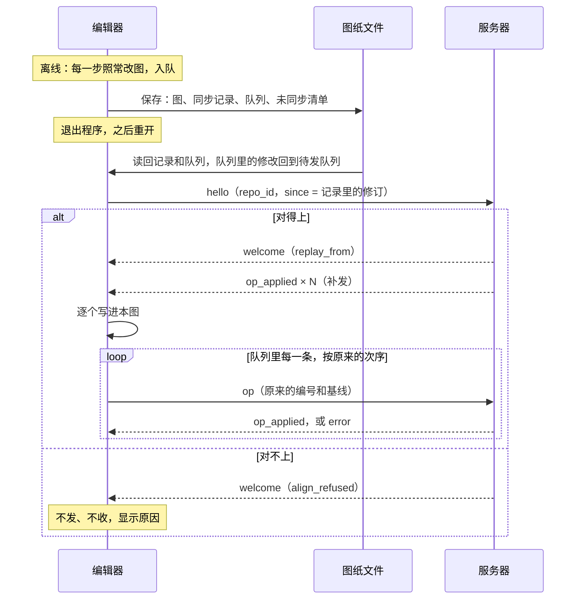

# SPEC：离线使用与上线后同步（`collab-offline-sync`）

> 日期：2026-11-17
> 状态：**已确认**（2026-11-17）。按 2026-11-17 的答复「按推荐方案继续」写成，范围是审核意见里的档 B。§10 的 6 件事都按建议定了；那批没提交的离线改动交给我接着做，从 `OFF-1` 开始。
> 需求依据：`docs/pid-platform/requirements/70-collaboration-and-permissions.md` 的 `REQ-COLL-014`（断线期间的排队与重连后的补发）和 `REQ-COLL-015`（加入时的图纸对齐）。`REQ-COLL-016`（身份、登记、加密传输）不在本文范围。
> 相关规格：`SPEC-collab-client.md`、`SPEC-collab-protocol.md`、`SPEC-collab-server.md`、`SPEC-pid-publish.md`。这几份里与本文不一致的地方以本文为准，各自加了一句指向这里。
> 任务：`todo.md` 的 `OFF-1` – `OFF-13`，排在 `CC-7` 之前。
> 取证情况：本文是读文档和代码写的，没有编译，也没有跑测试。标了「读代码」的结论都还没有用测试证实，对应任务的第一步先写证实它的测试。

## 1. 目标

离线时照常画图和保存；重新连上服务器后，离线期间的修改自动提交，别人的修改自动补上；提交不了的每一条都有交代。

拆成三条，后面的格式和流程都为它们服务：

1. **不连服务器照常用。** 带着同步记录的图，没有服务器时打开、绘制、保存都与普通图一样（`REQ-COLL-015` 验收 4）。
2. **连上之后，每一条离线修改都有结局。** 生效、让位、被拒绝并撤回、进入冲突条目，四种之一（`REQ-COLL-014` 验收 4）。中间退出过程序、重开过几次，结局都一样。
3. **拿不准就拒绝。** 只要不能确定本图与服务器上的一致，就按不一致处理并说明原因，不默认一致。不一致的图有出路：能列出、导出没同步上的修改，换一份最新图纸后照着重做。

## 2. 范围

### 2.1 管哪几种离线

| 情形 | 已提交的代码（`130dda683`） | 本文做完之后 |
|---|---|---|
| 没配服务器，单机用 | 能用 | 一样 |
| 用着用着断线，同一次运行里重连 | 修改排队；重连后补齐别人的、提交自己的 | 一样 |
| 断线后退出程序，之后再打开；中间可以多次开关和保存 | 排队的修改丢掉，不提醒；重新加入时不核对 | 队列随图保存，重开后接着提交；加入时核对 |
| 开程序时就连不上服务器 | 修改不排队；之后连上，本图被当成与服务器一致 | 图里有同步记录就排队，连上后提交 |
| 几个人同时离线，先后回来 | 同一次运行里可以；重开过的同上一行 | 按回来的先后提交；后回来的可能有几步被拒，被拒的撤回 |
| 图里没有同步记录（从没同步过） | 加入时被当成与服务器一致 | 不变，见 §9 的 L1 |

「离线」主要指哪一种（审核意见第五节第 2 条），2026-11-17 定了：上面几种都管（§10 第 5 条），`OFF-7`、`OFF-8` 都要做。

### 2.2 同步什么，不同步什么

同步的：会话那张图上带位号对象的修改。协议规格 §4.3 的十一种变更里，客户端会发的有十种：新建符号、删除对象、改位号、改属性、新建管线、加管路、插管件、改管路、新建连接符、删除连接符。第十一种（连接符配对）只由服务器发。

不同步的，离线和在线都一样：

- 只动位置的修改（移动符号、拖管段）。
- 会话那张图以外的图。一次运行只管一张图（客户端规格 §2.2）。
- 主数据、规则检查的豁免与规则启停、快照、发布包。阶段 B – E 的规格都写着在本机完成、不经协同服务器。

「同步」要不要包括后面这几项（审核意见第五节第 3 条），2026-11-17 也定了：不包括（§10 第 5 条）。要包括就是审核意见里的档 C，要另开方案。

## 3. 现状

### 3.1 已提交的

断线排队、重连补齐、按次序提交、被拒撤回都有，范围是同一次运行（客户端规格 §4.3、§4.4，端到端场景 `y08_offline_reconcile`）。队列只在内存里，图纸文件里没有任何同步记录。

### 3.2 没提交的那批改动

主目录里有一批没有提交的离线改动：19 个代码文件，加一份设计说明 `docs/plans/2026-11-17-collab-offline-mode.md`。它不是本清单的任务做出来的，写本文时没有动它（`OFF-1` 已于 2026-11-18 把它按原样入库，见 §11.1）。它做了这些：

- 图里加两条记录：`PID_AUTHOR_COLLAB`（图号、服务器库标识、已应用到的修订）和 `PID_AUTHOR_COLLAB_QUEUE`（排队的修改）。只写进存盘的那一份，不动正在编辑的图。
- 服务器的库有了标识 `repo_id`，存在库里；`hello` 和 `welcome` 都带它。
- 加入时核对：库标识不符（`REPO_MISMATCH`）、本地修订领先（`REVISION_AHEAD`）、日志不够补发（`REPLAY_GAP`）时，服务器在 `welcome` 之后发一条新消息 `align_refused`，客户端标「不一致」并停止提交。
- 图里有记录时，开程序后还没连上就按「以前连上过」对待：修改排队，队列里的修改重开后回到待发队列。`REQ-COLL-014` 验收 2 写的「从来没有连上过服务器的客户端不排队」，此后要读成「图里没有同步记录、本次运行也没连上过」。

那份设计说明原来有两处与它自己的代码不符，本文按代码写（`OFF-1` 入库时已经在说明里改正，见 §11.1）：

- 记录的键名是 `drawing_id`、`repo_id`、`revision`（`src/pid/collab_state.rs`），不是说明里写的 `drawing`、`repo`、`rev`。
- 保存时写进图里的是队列的全部条目，包括已经发出、还在等答复的那一条（`src/app/update/file.rs` 的 `write_collab_state_into_snapshot`），不是只写没发出的。

### 3.3 还缺什么

加上那批改动之后，离「§1 的三条」还差下面这些。G1 – G8 都是读代码得出的。

| # | 缺口 | 出处 | 后果 | 任务 |
|---|---|---|---|---|
| G1 | 服务器说「对不上」之前，客户端可能已经发出一步 | `src/app/collab/mod.rs`：处理 `welcome` 的最后会发队首，而拒绝是后一条消息；`crates/ocs_collab_server/src/ws.rs` 对被拒的会话没有记号，发来的 `op` 照常裁决 | 一份对不上的图的修改可能进入房间。发生在本地修订领先、或库标识不符而对方修订不高于本图时 | `OFF-2` |
| G2 | 对不上之后，房间的修改仍然写进本图；存盘会把图里的记录改成拒绝它的那个库的标识和修订 | `src/app/collab/apply.rs` 的 `apply_remote_changes` 不看不一致标记；`write_collab_state_into_snapshot` 用的是 `welcome` 给的库标识和房间修订 | 下次连同一台服务器会被当成一致；连回原来的服务器反而对不上 | `OFF-2` |
| G3 | 离线时生成的修改编号会重复 | `src/app/collab/transport.rs` 的 `next_op_id`、`mod.rs` 的 `seed_file_state`：还没连上时编号是 `op-file-<库标识>-<序号>`，序号每次启动从 1 数起 | 客户端按编号认「这是我发的」，同号的一起从队列里删掉（`mod.rs` 的 `answered`）。同一个人连续两次离线开关程序、或两个人同时离线，都会有修改不再提交，而且不标不一致 | `OFF-3` |
| G4 | 服务器不按编号去重；队列不记是谁排的 | `crates/ocs_collab_server/src/ops.rs`、`store.rs` 里没有按 `op_id` 查重；`src/pid/collab_state.rs` 的 `QueuedOp` 没有用户字段 | 同一份带队列的图在两台机器上打开，同一条修改可能生效两次；把图拷给同事，同事会替你提交 | `OFF-3`、`OFF-4` |
| G5 | 「不一致」标记不随图保存 | `write_collab_state_into_snapshot` 不看这个标记；`src/pid/collab_state.rs` 的记录里没有这一项 | 标了不一致的图保存、重开之后，记录对得上就被当成一致，队列又开始提交 | `OFF-5` |
| G6 | 图里有同步记录，修改却没有排上队 | `src/app/collab/apply.rs` 的 `broadcast_changes`：改的不是会话那张图、记录的图号与会话的图号不同、本次运行没配协同、只读会话里漏进来的修改，都直接返回 | 下次加入时记录对得上，被当成一致；服务器只核对库标识和修订号，不核对内容 | `OFF-5` |
| G7 | 写图纸文件的出口不都写同步记录 | 经接口保存的那条路（`src/app/automation.rs` 的 `save_verified_request`）自己写文件，不写记录 | 文件里留着打开时的旧记录和旧队列，而图的内容已经往前走了 | `OFF-6` |
| G8 | 重开后被拒的修改撤不回 | `src/app/collab/apply.rs` 的 `take_back_rejected`：恢复的条目没有撤销步骤，直接标不一致 | 离线几天回来，有一步被拒，整张图停止同步 | `OFF-7`、`OFF-8` |
| G9 | 不一致之后没有出路，也看不到哪些修改没同步上 | 客户端规格 §7、§9 的 C1 | 只能所有人从同一份最新文件重新开始，没同步上的修改靠人记。标记随图保存（G5）之后，连「以其中一份为准重新开始」也要有办法去掉那份图上的标记 | `OFF-9` |
| G10 | 退出不提醒，面板不显示排队的步数（只有状态接口的 `queued_ops` 有） | 客户端规格 §3.2；`src/ui/window/pid_collab.rs` 的 `CollabView` | 不知道同事手里还没有自己的修改 | `OFF-10` |
| G11 | 服务器的库打不开时照常接受会话；从备份恢复后库标识不变 | `crates/ocs_collab_server/src/main.rs`、`lib.rs` 的 `AppState::new` | 见 §6 | `OFF-11` |
| G12 | 发布没有「已同步」这道闸 | `SPEC-pid-publish.md` §3.4 | 离线着、有没提交的修改、已经不一致的图都能发布 | `PUB-1` – `PUB-4`、`PUB-6` |
| G13 | 整条路没有验证 | 那批改动只有程序内的测试，没有起真实服务器和桌面端的场景 | 补齐后两端是否相同没有比对；DXF 出口没试 | `OFF-12`、`OFF-13` |

## 4. 数据格式

### 4.1 图里的三条记录

三条都用 `src/pid/graph_data.rs` 现有的图级记录机制，挂在模型空间块记录的扩展字典下。只写进存盘的那一份，不动正在编辑的图：不让图显得被改过，也不进撤销栈。前两条是那批改动已有的，这里加了几个可选的键；第三条是新的。旧版本写的记录没有这些键，读的时候按「没有」处理。

**`PID_AUTHOR_COLLAB`：这份图上一次对到了哪里。** 一项：

```json
{
  "drawing_id": "PID-1101",
  "repo_id": "3f0c9a52-...",
  "revision": 12,
  "diverged": { "code": "UNQUEUED_EDITS", "message": "...", "at": 1794900000 }
}
```

- 前三项不变：图号、服务器库标识、本图跟到的修订号。
- `diverged` 是新加的，可选。有它，表示这份图已经知道与服务器上的不一样，下次加入不再按一致申报。写上之后不自动清除；要去掉只有 `PIDCOLLAB DETACH`（§4.5），它把三条记录一起去掉。`at` 是 Unix 秒。
- `diverged.code` 的取值：

| 码 | 什么时候写 |
|---|---|
| `UNQUEUED_EDITS` | 图里有同步记录，却做了没有排上队的语义修改（§5.1） |
| `REMOTE_UNAPPLIED` | 别人的修改写不进本图：对象没有、有好几个，或者变更种类不认识（协议规格 §7 第 3 条） |
| `REVISION_GAP` | 收到的修订不连续，中间有没收到的修改 |
| `ROLLBACK_FAILED` | 被拒的修改撤不回，或者撤不干净（§5.4） |

**`PID_AUTHOR_COLLAB_QUEUE`：还要提交的修改。** 一项一条，顺序就是提交的顺序：

```json
{
  "op_id": "op-r-5d2e1c07-...-7",
  "payload": { "kind": "set_property", "object_ref": "P-1001", "field": "设计压力", "value": "1.6MPa" },
  "base_revision": 12,
  "on": true,
  "label": "PIDSETPROP",
  "user_id": "u1",
  "queued_at": 1794900000,
  "inverse": [ { "kind": "set_property", "object_ref": "P-1001", "field": "设计压力", "value": "1.0MPa" } ]
}
```

- 前五项是那批改动已有的，含义不变。
- `user_id`：谁排的。`queued_at`：什么时候排的，Unix 秒。
- `inverse`：撤回这一条要做的修改，形状与 `payload` 里的变更相同（协议规格 §4），按要执行的顺序排好。没有这一项，表示这一条重开程序后撤不回（§5.4）。
- 不存撤销栈的步号：它活不过进程。

**`PID_AUTHOR_COLLAB_UNSYNCED`：本图里做过、服务器没有收下、也不会再自动提交的修改。** 一项一条：

```json
{
  "state": "refused",
  "op_id": "op-r-5d2e1c07-...-7",
  "label": "PIDSETPROP",
  "payload": { "kind": "set_property", "object_ref": "P-1001", "field": "设计压力", "value": "1.6MPa" },
  "user_id": "u1",
  "at": 1794903600,
  "code": "CLAIM_HELD",
  "message": "位号 P-1001 由 u2 占用",
  "rolled_back": true
}
```

| `state` | 含义 | 附带 |
|---|---|---|
| `refused` | 提交过，服务器整步拒绝 | `op_id`、`code`、`message`；`rolled_back` 说本图里撤回了没有 |
| `unqueued` | 做了，但没有排上队 | `message` 说为什么没排上；没有 `op_id` |

这条记录只增不减，直到用 `PIDCOLLAB UNSYNCED CLEAR` 清掉。它不参与对账，只为了让人看得到、导得出。同一次运行里被拒、已经用撤销栈退回的步骤不记在这里，它们还是只进拒绝记录（客户端规格 §3.4），人就在跟前，重做栈里也找得回。

### 4.2 修改编号

形如 `op-<运行标识>-<序号>`。运行标识每次启动程序生成一个，形如 `r-<UUID>`，用 `crates/ocs_collab/src/ids.rs` 里现有的生成方式，不加依赖；序号在一次运行里从 1 递增。编号不再带会话号，所以连没连上都一样生成。从图里恢复的条目保留原来的编号。

编号对两端都是不透明的字符串（读代码：服务器只自己生成 `resolve-<冲突号>`，不解析别人的编号）。协议规格 §3.1 里「形如 `op-<session_id>-<序号>`」的说法随之改掉。

### 4.3 协议增量

相对于已提交的协议。第二列是那批没提交的改动已经做了什么。

| 项 | 那批改动 | 本文 |
|---|---|---|
| `hello.repo_id`（可选） | 有 | 不变 |
| `welcome.repo_id` | 有 | 不变 |
| 拒绝对账怎么告诉客户端 | 新消息 `align_refused{code, message}`，紧跟在 `welcome` 后面 | 改成 `welcome` 里的可选键 `align_refused: {code, message}`，不加消息种类。2026-11-17 已按这个定，见 §10 第 2 条 |
| 错误码 `REPO_MISMATCH`、`REVISION_AHEAD`、`REPLAY_GAP` | 有 | 不变 |
| 错误码 `NOT_ALIGNED` | 无 | 新增：没对上的会话发来的 `op` 一律拒绝。`error` 带 `op_id`，不带 `rejected` |
| 错误码 `STORE_UNAVAILABLE` | 无 | 新增：服务器的库不可用，不接受会话（§6） |
| 同一个 `op_id` 第二次到达 | 照常裁决 | 不再裁决，只给发送者回当初那条 `op_applied`（修订号和变更取日志里那一行），不广播。只认日志里有的：当初被拒的不在日志里（读代码：操作日志只在修改生效时写一行），再来就再裁决一次 |

这些都符合协议规格 §7 的兼容规则：只加可选键、不加消息种类（第 1 条），旧客户端不带新键时行为不变（第 2 条），错误码只增不改（第 4 条）。总计划 §2 第 5 条原来写的是「不改协同协议」，现在改成「只按协议规格 §7 加可选键和错误码」。

### 4.4 导出的未同步清单

`PIDCOLLAB EXPORT <路径>` 写出一个 JSON 文件，队列和 `PID_AUTHOR_COLLAB_UNSYNCED` 合在一起：

```json
{
  "version": 1,
  "kind": "collab_unsynced",
  "drawing_id": "PID-1101",
  "repo_id": "3f0c9a52-...",
  "revision": 12,
  "exported_at": 1794907200,
  "diverged": null,
  "entries": [
    { "state": "queued", "op_id": "...", "label": "...", "user_id": "u1", "at": 1794900000, "changes": [ { "kind": "..." } ] },
    { "state": "refused", "op_id": "...", "label": "...", "user_id": "u1", "at": 1794903600, "code": "CLAIM_HELD", "message": "...", "rolled_back": true, "changes": [ { "kind": "..." } ] }
  ]
}
```

`state` 比图里多一种 `queued`（还在队列里等提交）。`changes` 是这一条的全部变更，按协议规格 §4 的形状展开。文件里只有图纸内容和用户号，没有服务器地址。

### 4.5 状态接口与命令

`GET /api/v1/collab/status`（客户端规格 §3.1）加四个字段，原有的（包括 `diverged`、`queued_ops`）不动：

| 字段 | 含义 |
|---|---|
| `align` | `none`（这张图没有同步记录，也没连上）、`offline`（有记录，没连上）、`ok`（连上并对上了）、`refused`（这次连接对不上）、`diverged`（图本身已经不一致） |
| `align_code`、`align_message` | `refused`、`diverged` 时的原因 |
| `unsynced_count` | `PID_AUTHOR_COLLAB_UNSYNCED` 的条数 |

命令加四个，都作用在最前面那张图上：

| 命令 | 作用 |
|---|---|
| `PIDCOLLAB UNSYNCED` | 在命令行列出队列和未同步清单 |
| `PIDCOLLAB UNSYNCED CLEAR` | 清掉未同步清单，队列不动 |
| `PIDCOLLAB EXPORT <路径>` | 把队列和未同步清单导出成文件（§4.4） |
| `PIDCOLLAB DETACH` | 去掉这张图的三条记录，下次保存时生效；之后它按「从没同步过的图」对待。队列或未同步清单不空时拒绝，要写成 `PIDCOLLAB DETACH FORCE`。正在对着一个对上了的会话时不让用 |

`PIDCOLLAB DETACH` 用在两处：把一张图另存成新图号的新图（副本里还记着原来的图号）；不一致之后决定以这份图为准重新开始（§5.5）。

## 5. 数据怎么传

整条路：



### 5.1 做一步修改、保存

**排不排队。** 每一步编辑都经过同一个入口（`src/app/history.rs` 的 `push_undo_entry`），在那里读出这一步的语义变更。读得出变更的一步：

| 这张图 | 怎么处理 |
|---|---|
| 是会话的图，连着并且对上了 | 入队，发出（现状） |
| 是会话的图，没连上，或者这次连接对不上；图里有同步记录，或者本次运行连上过 | 入队，等着 |
| 是会话的图，从没连上过，图里也没有记录 | 不排队（现状，`REQ-COLL-014` 验收 2） |
| 图里有同步记录，但排不了队：不是会话的图、本次运行没配协同、只读会话里漏进来的修改、入队失败 | 记进未同步清单（`unqueued`）；命令行警告一次，说明保存之后这份图不能再与服务器同步；保存时写 `diverged`（`UNQUEUED_EDITS`） |
| 图里没有记录，也不是会话的图 | 不管（现状） |

只动位置的修改读不出语义变更，不排队也不打标。

**保存写什么。** 所有写整张图的出口都调同一个函数，在取到存盘用的那一份之后、写盘之前，把三条记录写进去：

| 这张图当时的状态 | `PID_AUTHOR_COLLAB` | 队列 | 未同步清单 |
|---|---|---|---|
| 会话的图，对上了（连着，或者对上之后断了线） | 当前的库标识和修订；运行中标了不一致就加 `diverged` | 当前的全部条目 | 当前的 |
| 会话的图，有记录，还没连上或者这次连接对不上 | 打开时读到的库标识和修订，不取这台服务器给的；原有的 `diverged` 保留 | 当前的全部条目 | 当前的 |
| 不是会话的图，或者没配协同；图里有记录 | 原样保留；有没排队的语义修改就加 `diverged` | 原样保留 | 原有的加上新记的 |
| 图里没有记录，也没有对上过；或者用过 `PIDCOLLAB DETACH` | 不写 | 不写 | 不写 |

**哪些出口。** 写整张图的：保存、另存为、自动保存、全部保存、经接口保存（`save_tab_synchronously_protected_as`、`queue_native_save`、`automation_op_inner` 的保存、`save_verified_request`）。这些都写三条记录，DWG 与 DXF 一样。写出另一张图的：块写出（`wblock_write`、`control_wblock`）。写出的文件不带这三条记录，它不是同一张图。网页版的出口（`saveall_web`、`archive_web`）没有协同，按「不是会话的图」那一行处理。出口清单由 `OFF-6` 第一步用全文搜索核一遍，漏掉的补进来。

另存为得到的副本带着同一套记录和同一份队列。两份都拿去连服务器时，队列里的修改靠编号去重，只生效一次（§5.3）。要把副本当成另一个图号的新图用，先 `PIDCOLLAB DETACH`。

### 5.2 打开一张图、加入

**第一步，这张图算不算会话的图。** 会话认哪张图的规则不变（客户端规格 §2.2）。图号的来源多一级，从高到低：

1. 本次运行明确给的：启动参数 `--drawing <号>`，或者本次运行里用 `PIDCOLLAB DRAWING <号>` 设的。
2. 图里同步记录的 `drawing_id`（新加的一级）。
3. 设置文件里存的 `drawing_id`（以前某次运行设的）。
4. 文件名（去掉扩展名）。

明确给的图号与图里记录的不同时，这张图不算会话的图：会话不在它上面起，命令行和面板说明「这份图记着它属于 X，本次会话是 Y」，图里的记录不动。它上面的语义修改按 §5.1「排不了队」那一行处理。确实要把它当成 Y 来用，先 `PIDCOLLAB DETACH`。

这样定的理由：那批改动里，图号不符时记录被忽略（读代码：`src/app/collab/apply.rs` 的 `answer_collab_tags` 只在图号相同时才报记录），这张图会被当成与 Y 的房间一致，存盘时记录被改写成 Y 的。一张图不声不响地换了归属，这是要堵的。

**第二步，客户端自己先判，然后才发 `hello`。**

| 图里的情况 | 客户端怎么做 |
|---|---|
| 没有同步记录 | 照旧：不带 `since` 加入，本图被当成房间现在的样子（§9 的 L1） |
| 记录里有 `diverged` | 不报 `repo_id` 和 `since`，不上报位号；这次连接按「对不上」处理，原因取记录里的 |
| 队列里有别人排的条目（`user_id` 不是当前用户，或者没有 `user_id`） | 同上，原因是「图里带着 <用户> 排队未提交的修改」。不替别人提交 |
| 队列读不全，或者有重复的编号 | 同上 |
| 以上都不是 | 报 `repo_id` 和 `since`（记录里的修订），上报位号，由服务器判 |

**第三步，服务器判**（那批改动已有）：库标识不符 `REPO_MISMATCH`；本地修订领先 `REVISION_AHEAD`；日志不够补发 `REPLAY_GAP`。判为对不上时：会话照开，`welcome` 带 `align_refused`，不补发，不登记这份图上报的位号，记下这个会话没对上。此后它发来的 `op` 一律回 `error NOT_ALIGNED`。

**「对不上」的连接里，客户端对这张图等于没连上：**

- 队列一条都不发。处理 `welcome` 时先看有没有 `align_refused`，再决定发不发队首。
- 房间的修改不写进本图。
- 不申请占用。在场名单和别人的占用照常显示。
- 本地照常画图，修改照常排队。
- 存盘按 §5.1 的第二行：图里的库标识和修订仍是这份图原来的。
- 面板和命令行显示原因和「需要取得最新图纸」（`REQ-COLL-015` 验收 3）。
- 收到 `error NOT_ALIGNED` 时：那一条留在队列里，不撤回，这次连接转为「对不上」。

同一次运行里断线重连也走这一套。重连后服务器既没补发也没说拒绝、而房间修订比本图高时，也按「对不上」处理，不把基线改成房间的。

**两种「不一致」的区别。** 界面上都叫「不一致」，处理不同：

| | 这次连接对不上 | 图本身已经不一致 |
|---|---|---|
| 来源 | 服务器的三种拒绝；客户端第二步的三种 | 运行中发现：没排队的修改、别人的修改写不进来、修订不连续、被拒的撤不回 |
| 写不写进图 | 不写。它说的是这份图和这台服务器，换回原来的服务器可能就对上了 | 写（`diverged`）。它说的是这份图的内容 |
| 房间的修改 | 不写进本图 | 继续尽力写（现状） |
| 队列 | 不发，保留 | 不发，保留 |
| 下次打开 | 重新判 | 仍然不一致，直到 `PIDCOLLAB DETACH` |

### 5.3 追平与重新提交

对上之后的流程就是现有的「断线 → 排队 → 重连补齐」（客户端规格 §4.4）：先把补发的修改逐个写进本图，期间不发自己的；补齐后队列从头一条一条发，每条带它原来的编号和基线，服务器照常裁决。恢复的条目排在前，重开后新做的排在后。

编号在这里起三个作用：

- 补发里出现自己队列里的编号：说明上次发出后房间其实收下了，只是没等到答复。这一条出队，不重发，也不再写一遍（现有做法，客户端规格 §4.4）。
- 同一份带队列的图在两台机器上打开（比如另存为的副本）：后到的那一条，服务器认出编号已经在日志里，不再裁决，只给发送者回当初那条 `op_applied`。客户端照「自己的修改已经生效」处理：出队，修订号不回退。编号还挂在一条没裁决的冲突条目上时，回那条 `conflict`，同样不再裁决。
- 每次启动的运行标识不同，两次离线运行、两个人同时离线，编号都不会撞。

### 5.4 被拒之后

同一次运行里做的步骤被拒，还是现在的做法：用撤销栈退回，进重做栈（客户端规格 §4.3）。下面说的是从图里恢复的条目，它们没有撤销步骤。

**撤回的规则。** 对这一条 `inverse` 里的每项反向修改：本图里仍是这一步写下的样子才执行，否则跳过。

| 这一步做了什么 | 什么叫「仍是这一步写下的样子」 | 反向修改 |
|---|---|---|
| 改属性 | 字段现在的值等于这一步写的值 | 改回原值；原来没有就删掉；覆盖标记一并改回 |
| 改位号 | 对象现在的位号等于这一步改成的 | 位号和位号来源改回 |
| 新建符号 | 这个符号还在 | 删掉它 |
| 删除符号 | 本图里没有这个位号的对象 | 按原样放回：位置、角度、比例、图块、类型、连接点、属性、位号来源 |
| 新建 / 删除连接符 | 连接符还在 / 已经不在 | 删掉 / 按原样放回 |
| 管线、管路、管件的修改 | 这条线、这几条管路现在的账目等于这一步说的账目 | 对齐回这一步之前的账目 |

为什么要先看「仍是这一步写下的样子」：队列是补齐之后才发的，补齐时别人的修改已经盖在我的上面了。比如我离线把设计压力从 1.0 改成 1.6，别人在我离线期间改成了 2.5：补齐后本图已经是 2.5，我那一步被拒时不能再把它改回 1.0。

**各种拒绝原因下，本图当时的样子和收场**（读协议规格 §5.3 的裁决表和代码推出来的，没有跑过测试；`OFF-8` 逐种写测试）：

| 服务器给的码 | 补齐之后本图的样子 | 收场 | `REQ-COLL-014` 的结局 |
|---|---|---|---|
| `OP_SUPERSEDED` | 胜出的值已经写进本图 | 反向修改全部跳过 | 让位 |
| `OBJECT_DELETED` | 对象已经删掉 | 反向修改全部跳过 | 让位 |
| `STALE_BASE_REVISION`（别人动过同一条线） | 别人动过的管路已经按别人的账目对齐 | 别人动过的部分跳过，其余的撤回 | 被拒绝并撤回 |
| `CLAIM_HELD`、`PERM_DENIED_*`、`OBJECT_REFERENCED`、`DUPLICATE_INFLOW_CONNECTOR` | 我的修改还在本图里，房间没有 | 撤回 | 被拒绝并撤回 |
| 房间发来 `conflict` | 本图里还是我写的值；房间里两个值都没生效 | 不撤回。条目出队，等人裁决；裁决结果作为一条普通修改写进本图（现状） | 进入冲突条目 |
| `NOT_ALIGNED` | — | 不撤回，条目留在队列，连接转为对不上 | — |

**连带的条目。** 队列里排在被拒条目之后、提到同一批对象的条目一并作废并撤回，从后往前撤；与它无关的照发。「同一批对象」按名字认：被拒那一步新建、改名、删除的对象，或者同一条线、同一条管路。重开后新做的步骤如果建在被拒的条目上，按现有做法用撤销栈退回。

**留下记录。** 每条被拒的恢复条目：命令行说一句，记一条拒绝记录（客户端规格 §3.4），再记一条未同步清单（`refused`）。重开后撤回的修改没有重做栈可用，清单里的这一条就是要找回它时的依据。让位的条目也记一条，`rolled_back` 写 `true`：本图已经是房间的样子。

**撤不回。** 条目没有 `inverse`，或者反向修改执行失败：标不一致（`ROLLBACK_FAILED`），清单里记 `rolled_back: false`。这是 `REQ-COLL-014` 四种结局之外的情形，目标是一种变更都不落到这里；做不到的种类在 §11 列明，并在检查点 CP-A4 汇报。

**反向修改从哪里来**（读代码判断，没有跑过测试）：

| 变更 | 排队当时能不能算出来 |
|---|---|
| `set_property`、`set_tag`、`insert_symbol` | 能。原值、原位号都在这一步的前后影像里；超过 2 KB 的属性，改前的内容步骤自己留着（`CC-2` 做的 `records_across`） |
| `delete_object`（独立符号） | 能。放回去要的东西都在删除前的影像里。属性超过 2 KB 的符号待证实 |
| `create_connector`、`delete_connector` | 待证实。读法（`connectors.rs` 的 `statements`）要参考图 |
| `create_pipe_line`、`add_pipe_run`、`insert_fitting`、`update_pipe_run`，以及管线、管路、带位号管件的 `delete_object` | 不能直接算。这一步之前的账目要从「没有这一步时的图」里读（`pipes.rs` 的 `statements`、`run_state` 和拓扑表），而排队时图已经是做完这一步的样子 |

管线这一类有两种候选做法，由 `OFF-7` 第一步用测试定，结果记进 §11：

- 做法一：排队之后、界面空闲时，把这一步安静地退回再放上，退回时照「撤销时广播」的读法读出账目。复用现有的 `replay_history_quietly` 和 `collect_undone_step_changes`，后一个已经有端到端场景在用。代价是每个离线的管线步骤多一次退回和放上；有没有副作用（选择集、重做栈、正在进行的命令）要测。
- 做法二：不做。这类条目不带 `inverse`，重开后被拒就走「撤不回」。

先试做法一。它不成立时退到做法二，并在 CP-A4 说明哪几种变更重开后撤不回。

### 5.5 不一致之后的出路

1. 面板和 `PIDCOLLAB UNSYNCED` 列出本图里服务器没有收下的修改：还在队列里的、被拒的、没排上队的。
2. `PIDCOLLAB EXPORT <路径>` 把它们导出成文件（§4.4）。
3. 取得最新图纸：向一位图纸一致的同事要他刚保存的文件。文件里带着同步记录，打开加入后自动补齐。他的文件里如果带着他自己排队没提交的修改，我这边不会替他提交（§5.2 第二步），所以要他在队列发完之后再保存。
4. 对照导出的清单，把还要的修改在线重做一遍。

没有人手里有一致的图纸时，还是原来的办法：以其中一份为准，所有人从它重新开始。选定的那一份先导出清单，再 `PIDCOLLAB DETACH FORCE` 去掉记录和标记，保存后加入；别人取它加入后保存的文件。这条路和以前一样不检查这份图与房间是否相同（§9 的 L1）。按清单自动重放、从服务器重建整张图，留在阶段 4 提纲（`plan.md` §10）。

### 5.6 面板与退出

- 协同面板加一行状态：「离线，n 步待同步」「已连接，n 步待同步」「不一致：<原因>；未同步 n 条」。前两句的数字取队列的条数，最后一句取队列加未同步清单的条数。
- 退出程序、或关掉会话那张图时，队列不空就提示一次：「这张图还有 n 步修改没有同步到服务器。已经随图保存的，下次打开并连上服务器后会接着提交。」按钮：退出、取消。排在现有的「块编辑未保存」「图纸未保存」两个提示之后。
- 队列只在保存时写进文件。不保存就退出，文件里是上次保存时的图和那时的队列，两者配套，不会丢一半。

### 5.7 发布

`SPEC-pid-publish.md` §3.4 的发布前提加三条，只对图里有同步记录的图生效：

| 前提 | 不满足时 |
|---|---|
| 队列是空的 | `COLLAB_UNSYNCED` |
| 没有标不一致，这次连接也没有对不上 | `COLLAB_DIVERGED` |
| 正连着服务器并且已经补齐 | `COLLAB_OFFLINE`。发布时明确带上「允许未对账」（命令加 `ALLOW_OFFLINE`，接口加 `allow_offline: true`）就放行，包的清单里记 `reconciled: false` |

包的清单（同一规格 §3.2）加一段 `collab`：图里没有同步记录时是 `null`；有时是 `{"drawing_id", "repo_id", "revision", "reconciled"}`。三个码都按 409 返回。默认拒绝还是默认放行，2026-11-17 定为默认拒绝、明确带上「允许未对账」才放行，见 §10 第 3 条。

## 6. 服务器这边的前提

1. **账本就是库文件。** `--db` 指定，默认 `%APPDATA%\OpenCADStudio\collab.db`。同一个库文件，就是同一个库标识加同一份操作日志。换了库文件就是换了一个库，所有带记录的图纸都会得到 `REPO_MISMATCH`。
2. **库打不开时不接受会话。** 现状（读代码）：进程照常监听，`GET /health` 报 503，会话照常接受但什么都不落盘，每次启动换一个库标识。改为：`hello` 得到 `error STORE_UNAVAILABLE` 后断开，`/health` 仍报 503。测试用的内存模式（代码里直接建不带库的服务器）不受影响。
3. **操作日志不清理。** 现状没有清理的代码，这里写成规定。只要日志在，离线多久都能补齐。将来要清理，先定「最长离线时间」；落后太多的客户端得到 `REPLAY_GAP`。
4. **从备份恢复之后必须换库标识。** 恢复备份等于修订号回退。比备份新的图纸会得到 `REVISION_AHEAD`，这是对的；危险在恢复之后房间又往前走过了那些修订号，这时旧副本会被当成一致（读代码：服务器只比库标识和修订号）。服务器加启动参数 `--new-repo-id`：写入一个新的库标识后照常启动。恢复备份后用它启动一次，所有人取同一份图纸重新开始（§5.5 的后一种办法）。
5. **一个库文件同一时间只给一个服务器进程用**（现状的假设，写明）。

这几条写进 `SPEC-collab-server.md` 的运行说明（`OFF-11`）。审核意见第 10 条写的「必须带库文件运行」不准确：不带参数时默认就有库文件，只有库打不开时才会无库运行。

## 7. 成功标准

每条都要有能重跑的检查。「两端相同」指位号、属性、拓扑记录逐项比对，取法与 `y08_offline_reconcile` 相同。

| # | 标准 | 任务 |
|---|---|---|
| OS-01 | 没有服务器：带同步记录的图打开、绘制、保存、重开，三条记录都在，失败步骤数为 0（`REQ-COLL-015` 验收 4） | `OFF-1`、`OFF-13` |
| OS-02 | 三条记录经 DWG 和 DXF 存盘再读回，内容不变（`REQ-COLL-015` 验收 1） | `OFF-1`、`OFF-6` |
| OS-03 | 跨重启：断线、改 n 步、保存、退出、重开、连上，补齐别人的修改，n 步按原次序提交，两端相同（`REQ-COLL-015` 验收 2） | `OFF-12` |
| OS-04 | 开程序时没有服务器：图里有记录就排队；服务器起来后提交，两端相同 | `OFF-12` |
| OS-05 | 连续两次离线运行：两次排的修改编号互不相同，全部提交，没有一条被吞掉 | `OFF-3`、`OFF-12` |
| OS-06 | 两个人同时离线各改各的，先后回来：各自的修改都到对方图上，两端相同 | `OFF-3`、`OFF-12` |
| OS-07 | 同一份带队列的图在两台机器上先后打开：每条修改在房间里只生效一次 | `OFF-4`、`OFF-12` |
| OS-08 | 三种对不上（库标识不符、本地修订领先、日志不够）：显示原因和「需要取得最新图纸」；一步都没有发出去；房间的修改没有写进这份图；保存后图里的库标识和修订不变（`REQ-COLL-015` 验收 3） | `OFF-2`、`OFF-12` |
| OS-09 | 没对上的会话硬发 `op`：服务器拒绝，码是 `NOT_ALIGNED`，房间里没有这一步 | `OFF-2`、`OFF-12` |
| OS-10 | 标了不一致的图保存、重开、加入：仍按不一致处理，不上报位号，不发队列 | `OFF-5`、`OFF-12` |
| OS-11 | 带记录的图在没连协同的运行里做了语义修改并保存：下次加入按不一致处理并说明原因；只动位置的修改不触发 | `OFF-5`、`OFF-12` |
| OS-12 | 明确给的图号与图里记录的不同：不在这张图上起会话，图里的记录没有被改写；没给图号时取图里记录的；`PIDCOLLAB DETACH` 并保存之后三条记录都没有了，加入时按没同步过的图对待 | `OFF-5`、`OFF-9`、`OFF-12` |
| OS-13 | 当前用户不是排队的人：不代发，按对不上处理 | `OFF-3`、`OFF-12` |
| OS-14 | 重开后被拒并撤回，四种原因各一例（占用、没有写权限、删除仍被引用的对象、别人动过同一条线）：被拒的那一步从本图撤回，后面无关的照常提交，两端相同，拒绝记录和未同步清单各有一条 | `OFF-8`、`OFF-13` |
| OS-15 | 重开后让位（别人改了同一个字段、别人删了对象）：本图是房间的样子，不标不一致 | `OFF-8`、`OFF-13` |
| OS-16 | 客户端会发的十种变更逐种：做一步、按反向修改撤回，本图的位号、属性、拓扑记录与做这一步之前相同。撤不回的种类列在 §11，目标 0 种 | `OFF-7` |
| OS-17 | 未同步清单列出队列里的、被拒的、没排上队的；导出的文件条数对得上；清单随图保存 | `OFF-9`、`OFF-13` |
| OS-18 | 离线时面板显示「离线，n 步待同步」，提交完数字归零；队列不空时退出提示一次 | `OFF-10`、`OFF-13` |
| OS-19 | 服务器的库打不开：不接受会话；用 `--new-repo-id` 启动后，旧图纸得到 `REPO_MISMATCH` | `OFF-11`、`OFF-13` |
| OS-20 | 发布：队列不空、不一致、没对账三种情形各被拦，码对得上；放行时清单写 `reconciled: false` | `PUB-1` – `PUB-4`、`PUB-6` |
| OS-21 | 原有 228 条契约的场景全部照过 | `CC-7` |

## 8. 验证场景

起真实的服务器和桌面端，写法照 `scripts/collab-e2e/y08_offline_reconcile.py`，文件名前缀用 `o`，作为总入口 `run19.ps1` 的第八组。证据放仓库外，结果文件打码后再看。

| 场景 | 验什么 | 标准 | 任务 |
|---|---|---|---|
| `o01_restart_resubmit` | 跨重启提交并比对两端；开程序时没有服务器 | OS-03、OS-04 | `OFF-12` |
| `o02_ids_and_duplicates` | 连续两次离线运行；两人同时离线；同一份图两台机器 | OS-05、OS-06、OS-07 | `OFF-12` |
| `o03_align_refused` | 三种对不上；硬发 `op`；保存后记录不变 | OS-08、OS-09 | `OFF-12` |
| `o04_diverged_sticks` | 不一致跨重启；没排队的修改；图号不符与 `DETACH`；别人排的队 | OS-10 – OS-13 | `OFF-12` |
| `o05_refused_rollback` | 重开后被拒并撤回（四种原因）；让位；外加一例「我离线删了对象、别人改过它」，把 §9 的 L5 的现状记下来 | OS-14、OS-15 | `OFF-13` |
| `o06_unsynced_exit` | 未同步清单、导出、面板数字、退出提示 | OS-17、OS-18 | `OFF-13` |
| `o07_no_server_dxf` | 没有服务器时打开、绘制、保存；DXF 出口 | OS-01、OS-02 | `OFF-13` |
| `o08_server_store` | 库打不开；换库标识 | OS-19 | `OFF-13` |

OS-16（逐种变更的反向修改）在程序内的测试里验，不起进程。OS-20 在发布的任务里验。OS-21 是 `CC-7` 的全量复验，届时连这八个场景一起跑。

这些场景要用到的观察手段：状态接口（§4.5 的四个字段和原有的 `queued_ops`、`diverged`）、拒绝记录、服务器的操作日志、图纸文件里的三条记录。面板上的文字和退出提示（OS-18）靠截图或界面状态接口取，取不到时在 `OFF-13` 里说明改用什么代替。

## 9. 不在范围与已知限制

| # | 限制 |
|---|---|
| L1 | **从没同步过的图。** 图里没有同步记录时，加入仍被当成与房间一致，不检查（客户端规格 §7「没有初始同步」）。改它会动到现有契约里「第一次加入」的约定，这次不动 |
| L2 | **一次运行只管一张图。** 离线时要改几张图，得分几次启动。别的图上的语义修改会被发现并打标（OS-11），但不会同步 |
| L3 | **离线后占用会释放。** 正常退出立即释放；断线到心跳超时（默认 90 秒）释放（协议规格 §5.1）。离线期间别人可以改同一个对象，回来时被拒的会比在线时多 |
| L4 | **做了又撤销也算改过。** 没排队的语义修改一旦发生就记下，撤销不清。不保存就不会写进图 |
| L5 | **补齐时别人的修改写不进本图，当场标不一致**（现状，读代码）。最常见的是我离线删了一个对象，而别人这期间改过它：不等我的删除被裁决就标了。这次不改，场景 `o05` 把它记下来。2026-11-20 起标了之后我的删除留在队列里，不再抢先发出（§11.16）。CP-A4 定为维持现状（§11.18） |
| L6 | **不一致之后只能换图重做。** 没有自动重放，也不能从服务器重建整张图 |
| L7 | **两个人离线各自发布。** 默认不许；明确放行时可能得到同一个修订号的两个包，清单里的 `reconciled: false` 可以认出来 |
| L8 | **队列跟着图纸文件走。** 文件丢了，队列也丢了 |
| L9 | **重开后的撤回只保证语义内容回去。** 放回来的对象是新建的，句柄与原来不同 |
| L10 | **用户号是自报的**（`REQ-COLL-016` 没做）。「不替别人提交」只防误操作，不防冒名 |
| L11 | **恢复备份后没换库标识。** 旧副本可能被当成一致（§6 第 4 条）。靠运行规定防，程序不拦 |
| L12 | **另存为的副本仍然记着原图号和库标识。** 没明确给图号时它会加入原图的房间。要当成新图用，先 `PIDCOLLAB DETACH` |

不在范围：多张图同时同步、主数据经服务器分发、豁免同步、完整的重新同步（审核意见的档 C）；离线前签出这类长时间占用；`REQ-COLL-016`。

## 10. 待决问题

> **2026-11-17 已定**：本节各条都按「建议」一栏执行。第 1 条定为交给我接着做，`OFF-1` 由我核对后入库。第 6 条里验收 2 的那一句，等 `OFF-1` 把需求文档里那一行没提交的改动入库之后补（2026-11-18 已补；同一次把需求文档状态表里 `REQ-COLL-014` 一行「排队的修改只在内存里」的说法改成了入库之后的样子）。汇总见 `plan.md` §12。

| # | 问题 | 建议 |
|---|---|---|
| 1 | **那批没提交的离线改动谁接着做。** `OFF-2` 起的任务都改它动过的文件，必须等它入库（`OFF-1`） | 交给一条线做到底，不要两条线同时改这批文件。原来那条线接着做，还是交给我，由你定 |
| 2 | **拒绝对账怎么告诉客户端。** 那批改动加了一种新消息；总方案的约束是只加可选键、不加消息种类，加消息种类按共用约定要先问你 | 写进 `welcome` 的可选键。这样不破例，客户端也能在发第一步之前就知道被拒（G1）。代价是要改那批改动里已经写好的消息 |
| 3 | **没对账的图能不能发布。** | 默认不许；发布时明确带上「允许未对账」才放行，并记进包的清单。另两种选法：一律不许；一律放行只记一笔 |
| 4 | **检查点 CP-A4 要不要你确认。** | 要。那时演示跨重启提交、被拒撤回、不一致后导出，并汇报哪几种变更重开后撤不回 |
| 5 | **范围的两问**（§2.1、§2.2）：离线指哪几种，同步包括哪些 | 按本文写的：几种离线都管，只同步会话那张图上的 P&ID 对象 |
| 6 | **需求条文要不要补两句。** `REQ-COLL-014` 验收 2 的「从来没有连上过」要读成「图里没有同步记录、本次运行也没连上过」；验收 4 只列了四种结局，重开后撤不回时本文的处理是标不一致并进未同步清单 | 验收 2 现在就可以补；验收 4 等 `OFF-7` 的结果：如果十种变更都能撤回，条文不用动，否则补一句（CP-A4 定为不补，§11.18）。需求文档现在有别人没提交的改动，我没有动它 |

## 11. 实现记录

实现时与上文不一致、或上文没写到的地方记在这里（`todo.md` 固定门禁第 7 条）。

### 11.1 `OFF-1`：入库时与任务写法不同的地方（2026-11-18）

那批改动按原样入库，行为没有改。有三处与任务写的不一样：

1. **两个提交，不是三个。** 第一个是图内记录（`src/pid/` 的三个文件），第二个是其余 16 个代码文件和文档。协议与服务器不能单独成一个提交：`hello` 加了 `repo_id` 这一项，桌面端构造 `hello` 的地方不跟着改就编不过。`src/app/update/file.rs` 在任务里算作图内记录，实际放进第二个提交，因为它写记录时要用客户端新加的状态。
2. **需求文档 70 不止改一行。** 协议里新加的三个码（`REPO_MISMATCH`、`REVISION_AHEAD`、`REPLAY_GAP`）补进了错误码表；`REQ-COLL-015` 那一行里的两个记录名去掉了代码样式。两处都是文档检查要求的：协议里的每个码都要登记；全大写带下划线的代码样式会被当成错误码。
3. **设计说明改了四处，不止两处。** §3.2 末尾说的两处之外，还改了记录读写函数所在的文件（是 `src/pid/collab_state.rs`，不是 `graph_data.rs`），并在 D4 下面注明拒绝的形式后来由 `OFF-2` 改。四处列在那份说明的 §7。

入库时的读数，作为后面任务的基线：`cargo test --offline --locked --lib` 6901 通过、49 忽略、4 失败（失败的仍是比对设计文件的那 4 条）；`-p ocs_collab -p ocs_collab_server` 是 96；168 + 18，全过；两个 `clippy` 读数仍是 630 和 965。端到端总入口 27 个场景过了 25 个，`t25_offline`、`y08_offline_reconcile` 都过；没过的两个见下面的 R4，入库之后已经处理，重跑都过（11.4）。

### 11.2 `OFF-1` 核对出来的问题

下面各条 `OFF-1` 没有修，由「任务」一栏的任务处理；R4 在入库之后单独处理了（11.4），R1、R3、R5 在 `OFF-2` 里处理了（11.5）。§3.3 的 G1 – G13 不重复。「依据」一栏里，「读代码」是读出来的、还没有测试证实，「跑出来」是端到端场景跑出来的。

| # | 问题 | 依据 | 后果 | 任务 |
|---|---|---|---|---|
| R1 | 重开程序后的第一次连接，补发到一半断线，重连时报出的修订偏大 | 读代码。`src/app/collab/transport.rs` 的 `Seen::take`：这次运行还没连上过时，收到 `welcome` 记下的是房间的修订，不是补发的起点；补发来的每一条都不比它大，这个数不再动 | 断线后的下一次 `hello.since` 是房间的修订，服务器不会再补发剩下的几条。界面按真正写进图的修订算（`src/app/collab/mod.rs` 处理 `Connected` 的地方），发现房间比本图新而没有补发，标不一致。服务器上的数据不丢，但这张图只能换成最新的。不重开程序的重连没有这个问题 | `OFF-2`，已处理（2026-11-20），见 11.5 |
| R2 | 重开后第一次上报图上已有的位号时，图里的队列还没有读回来 | 读代码。`src/app/collab/apply.rs` 的 `answer_collab_tags`：先算 `existing_tags`，后调 `seed_collab_from_file`。`existing_tags` 靠待发队列把房间还不知道的对象剔掉，这时队列是空的。（在这之前改过图就没事：`broadcast_changes` 会先把队列读回来。） | 排队的 `insert_symbol` 放下的对象，位号被当成图上已有的报给服务器；排队改过位号的对象按新位号报。按服务器现有的规则推：位号登记之后，轮到那条排队的修改时它要的位号已经被占，会被另给一个。这一步是推的，没有跑过 | `OFF-3`，已处理（2026-11-20），见 11.6 |
| R3 | 只报 `since`、不报 `repo_id` 的 `hello` 现在一律被拒 | 读代码。`crates/ocs_collab_server/src/ws.rs` 的 `hello`：两项里报了任何一项就算声称对齐，没报库标识按对不上处理，回 `REPO_MISMATCH`，不补发。这是那批改动有意收紧的（`protocol.rs` 里 `Hello.repo_id` 的说明，设计说明 §6）；服务器原有的补发测试都改成了带 `repo_id` | 与 `OFF-2` 验收的最后一条（`hello` 不带 `repo_id` 的客户端，行为与改之前相同）对不上：两项都不带的相同；只带 `since` 的不同，改之前会补发。入库之后的桌面端对着入库之后的服务器总是两项一起报，受影响的是旧版本的桌面端：断线重连时不再得到补发 | `OFF-2` 开工时定：保留收紧、改写那条验收，或者放宽服务器。已定放宽服务器（2026-11-20），见 11.5 |
| R4 | 入库时，新生成的 M3 基线图带着同步记录和一条排队的修改，`x05_m3_persistence`、`x12_after_session` 在新的证据目录上不过 | 跑出来。`src/pid/dwg_roundtrip.rs` 的 `fixture()` 加了这两条记录（库标识 `r-fixture`、修订 42、排队的 `op-s-1-7`），而生成基线的 `write_the_m3_baseline_drawing` 用的是同一个 `fixture()`。两台桌面端拿它加入，都被判 `REPO_MISMATCH` | `x05` 11 项过、15 项不过，`x12` 17 项过、2 项不过。以前生成的基线没有这两条记录，沿用旧证据目录的不受影响 | 已处理（2026-11-18），见 11.4 |
| R5 | 被拒之后界面上没有「需要取得最新图纸」这一句 | 读代码。`src/app/collab/mod.rs` 处理 `AlignRefused`：记下的原因是「<服务器给的原因>（<码>）」；面板（`src/ui/window/pid_collab.rs`）显示「本图与房间已不一致，本地修改不再提交。」加这个原因。「请取得最新图纸后重新打开」只在房间的修改写不进本图时出现在命令行（`apply.rs`） | `REQ-COLL-015` 验收 3 要这一句。§5.2 和 OS-08 已经把它交给 `OFF-2`，这里只是记下入库时的样子 | `OFF-2`，已处理（2026-11-20），见 11.5 |
| R6 | `collab::Outgoing` 多了没人用的序列化派生 | 读代码。`src/app/collab/mod.rs`：加了 `Serialize`、`Deserialize` 和 `restored` 上的默认值标注；存盘用的是 `pid::QueuedOp`，不经过它 | 没有后果 | `OFF-3`，已去掉（2026-11-20），见 11.6 |

另有四处说明文字还是改之前的说法，改到这些文件的任务顺手改（`ws.rs`、`transport.rs` 两处已在 `OFF-2` 里改了，11.5）：

- `ws.rs` 的 `missed_ops`：还写着补不了的会话「不补发地接纳，让它自己发现落后」，现在是拒绝。
- `ops.rs` 测试里的 `come_back`：新旧两句说明接在一起。
- `dwg_roundtrip.rs` 的 `assert_graph_keys_present`：写着四个键，现在是六个。
- `transport.rs` 的 `run_session` 和 `Seen.repo_id`：写着 `since` 只和 `repo_id` 一起报；代码在服务器没给库标识时仍然只报 `since`（对旧版本的服务器这样是对的）。

### 11.3 G1、G4 有了运行证据

R4 那次 `x05` 跑的正好是「带记录、带队列的图被拒」，§3.3 里只是读代码得出的 G1、G4 在服务器日志里都出现了：

- **G1**：第一台桌面端的会话先记了一行「对账被拒 code=REPO_MISMATCH」，紧接着就是它发来的 `op-s-1-7`（图里排队的那一条），服务器照常裁决，广播为修订 1。
- **G4**：第二台桌面端打开的是同一份基线，同样被拒，同样发来 `op-s-1-7`；服务器又接受一次，广播为修订 2。同一个修改编号有两条 `op_applied`。

这不能代替对应任务的测试：`OFF-2`、`OFF-3`、`OFF-4` 仍然各自先写出会失败的测试。那次运行的日志和带记录的基线图留在证据目录的 `kept-r4-first-run` 下（证据目录不在仓库里）。

### 11.4 R4 的处理：生成基线图时去掉这两条记录（2026-11-18 定）

当时的两种办法：

1. 生成基线时去掉这两条记录。只改 `write_the_m3_baseline_drawing` 这个生成器，`fixture()` 和往返测试不动。基线图代表的是「还没有任何房间见过的图」，`x05`、`x12` 按第一次加入来用它。
2. 不动，留到 `OFF-12` 给离线场景准备带记录的图时一起处理。在那之前，这两个场景只能沿用以前生成的基线文件，换一台机器或换一个证据目录就不过。

那批改动先按原样入库（也就是办法 2 的现状），然后试了办法 1。2026-11-18 定下用办法 1，单独一个提交，不算在 `OFF-1` 的两个提交里。

- **改了什么。** 只有 `src/pid/dwg_roundtrip.rs` 里的 `write_the_m3_baseline_drawing`：写文件之前把同步记录和排队的修改从图里去掉；写完再读回来核对，内容没有丢，四个 P&ID 图级记录都在，这两条记录都不在。`fixture()` 和往返测试没有动，带着这两条记录的图照旧由往返测试覆盖。
- **结果。** 重新生成的基线图 23379 字节（带记录的那一份 23763 字节）。在同一个证据目录上只重跑这两个场景：`x05_m3_persistence` 26 项全过，`x12_after_session` 19 项全过。服务器日志里，这一次两台桌面端都是正常加入，没有对账被拒，也没有 `op-s-1-7`。提交的这一版生成器另跑了一遍，写出的文件与重跑用的那一份逐字节相同。
- **读数没有变。** `cargo test --offline --locked --lib` 仍是 6901 通过、49 忽略、4 失败（还是比对设计文件的那 4 条）；`-p ocs_collab -p ocs_collab_server` 是 96；168 + 18；两个 `clippy` 读数 630 和 965。这个文件的格式检查没有新增不一致。
- **已有的证据目录要不要动。** 总入口只在基线文件不在时才生成它，分组入口不生成。基线是用 `5f672c831` 起、这次改动之前的代码生成的（包括入库之前工作区里的那一批），就带着这两条记录：删掉证据目录里的 `m7/work/PID-1101-m3.dwg`，再跑一次总入口。更早生成的不带，不用动。拿不准就删。
- **留给 `OFF-12` 的。** 离线场景要用带同步记录、带排队修改的图，由 `OFF-12` 自己准备，基线图不再带。
- **没有做的。** 这次只重跑了这两个场景，没有把总入口从头再跑一遍；规程、截图、计时三组在 `OFF-1` 里也没有跑过。

### 11.5 `OFF-2`：与任务写法不同的地方和读数（2026-11-20）

按任务做完：拒绝跟着 `welcome` 来（`align_refused`），那批改动加的单独消息去掉了；服务器记下没对上的连接，它发来的 `op` 回 `NOT_ALIGNED`，不裁决、不写日志、不广播；客户端在这次连接里不发队列、不把房间的修改写进本图、不申请占用，存盘的库标识和修订仍是打开时读到的。G1、G2 堵上了，11.2 的 R1、R3、R5 一并处理。与任务写法、或与入库时的代码不同的地方：

1. **R3 定为放宽服务器。** `hello` 没报 `repo_id` 就不判对齐：两项都不报的照旧；只报 `since` 的照常从那里补发、照常登记位号（那批改动之前的办法）；报了 `repo_id` 的才判三种对不上。依据是协议规格 §7 第 2 条（旧客户端不带新键时行为不变）和这个任务验收的最后一条；开工时告诉过你，你没有说要保留收紧。新版桌面端对着新版服务器总是两项一起报，不受影响。测试是服务器的 `alignment_is_not_judged_for_a_hello_that_names_no_repository`；`protocol.rs` 里 `Hello.repo_id` 的说明跟着改了。
2. **重连后房间走远了又没补发：只隔开这次连接，码记 `REPLAY_GAP`。** 服务器既没补发也没说拒绝、而房间的修订比本图高，入库时的代码把图标成不一致（`diverged`）；现在照 §5.2 按这次连接对不上处理：原因是「房间已从修订 M 走到 N，其间的变更没有补发给这份图纸」，基线不改成房间的，下次连接重新判。码借用服务器三种里意思最近的 `REPLAY_GAP`，需求文档 70 的错误码表里注明了客户端也会自己判出这一种。
3. **界面。** 面板和状态栏的「不一致」按 `State::mismatch()` 显示，图本身不一致和这次连接对不上都挂（§5.2：界面上都叫「不一致」）。面板在原因下面另起一行「需要取得最新图纸」。命令行在连上时、收到 `NOT_ALIGNED` 时各说一次「协同：这次连接与房间对不上（<码>：<原因>），本地修改照常排队、不提交；需要取得最新图纸」，对不上时每排一步说「这一步已排队（共 N 步），不提交」；对不上的连接里不再说「修订已推进到 N」。面板上那句「本图与房间已不一致，本地修改不再提交。」是两种情况共用的，对这次连接对不上来说，「不再提交」只管这次连接。
4. **R1 一并修了。** `transport.rs` 的 `Seen::take`：起点取 `welcome.replay_from`，没有才取房间的修订，补发来的每一条往前推；这次连接对上了才记，对不上的不记。补发到一半断线，下一次 `hello.since` 是最后交给界面的那一条；对不上之后的下一次 `hello` 照旧报图里的库标识和修订。
5. **改到「文件」一栏以外的文件。** `src/app/collab/messages.rs`（把 `welcome` 里的拒绝拆成事件，排在 `Connected` 之前）；`src/app/collab/claims.rs`、`src/ui/window/pid_collab.rs`、`src/app/pid_shell/chrome.rs`（第 3 条的面板和状态栏）；`src/app/update/mod.rs`（第 3 条的命令行）；`src/app/collab/collab_offline_queue.rs`（已有的 `back_to_a_room_that_moved_on_with_no_replay_the_queue_stays_where_it_is` 按第 2 条改了断言）。`src/app/update/file.rs` 没有动：存盘用哪个库标识和修订在 `mod.rs` 里定，对不上时不采纳 `welcome` 给的。文档：需求文档 70 的错误码表加了 `NOT_ALIGNED`，改了 `REPO_MISMATCH`、`REPLAY_GAP` 两行和 `REQ-COLL-015` 的状态；设计说明 D4、D8、§6 加了注，新加 §8。
6. **测试的写法。** 验收第一条要三种对不上「各一条测试」，写成了一条测试依次走三种码（`nothing_of_the_queue_goes_out_and_edits_go_on_queueing`，每种从打开图重新来，断言里带着码）；「房间的修改不写进本图」「说出原因和需要取得最新图纸」「下次连接重新判」三条也这样走三种。客户端自己判出的那一种另有一条（`a_room_that_moved_on_without_a_replay_is_not_aligned_either`）。新加的测试：`collab_align_refused.rs` 8 条，`transport.rs` 2 条（R1 一条，对不上之后的 `hello` 一条），面板 1 条，服务器 2 条。按新行为改了名字和断言的已有测试：`mod.rs` 的 `collab_align_a_seeded_copy_queues_and_a_refusal_diverges_it`（改为 `…_holds_it_apart`）和 `coming_back_to_a_room_that_moved_on_marks_the_session`（改为 `…_holds_the_connection_apart`），`transport.rs` 的 `collab_align_a_refusal_reaches_the_ui_as_its_own_event`（改为 `collab_align_refused_reaches_the_ui_ahead_of_its_session`，断言拒绝排在 `Connected` 前面）；只改断言的：服务器的 `a_hello_that_claims_alignment_is_judged`、协议的 `collab_align_repo_id_and_align_refused_are_optional_additions`。
7. **11.2 列的四处过时说明。** `ws.rs` 的 `missed_ops`、`transport.rs` 的 `run_session` 和 `Seen.repo_id` 这次改了；`ops.rs` 的 `come_back`、`dwg_roundtrip.rs` 的 `assert_graph_keys_present` 不在这次改的文件里，没动。

**先红后绿。** 测试先写，改产品代码之前跑：主程序库这 12 条（新加的 11 条和改了名的那条 `transport.rs` 测试）全部失败，协议 1 条、服务器 3 条失败，都败在断言上（`a_save_keeps_what_the_file_said_and_every_queued_step` 第一遍败在图纸的编辑锁上，单独重跑败在断言上）。`mod.rs` 的两条和 `collab_offline_queue.rs` 的一条是产品代码改完之后按新行为改的断言，没有单独跑红。

**读数**（对最终的文件）：`cargo test --offline --locked --lib` 7129 条，7072 通过、55 忽略、2 失败；失败的是比对设计稿的两条（`the_grid_is_drawn_the_way_the_design_draws_it`、`the_code_states_nothing_the_design_does_not`），起点 `51b654a87` 也是这两条。起点是 7118 条（7061 / 55 / 2），多的 11 条就是新加的，都过。`-p ocs_collab -p ocs_collab_server` 是 96；170 + 18，全过（起点 96；168 + 18）。`clippy` 656（`--lib`）和 1051（`--lib --profile test`），与起点相同，点到这次改的文件的几条起点都有；固定门禁第 3 条写的 630 / 965 是换新编译器之前的数，换了之后各提交按起点比（`2028dc92a` 起的提交说明）。格式检查：12 个代码文件里 11 个新增 0；`mod.rs` 报新增 1 处，是文件开头模块声明的排序，起点就有这一处，新加的 `mod collab_align_refused;` 落进了它的上下文，脚本按正文比对就算成新的（改前 19 处，改后 18 处）。为了不新增，紧挨着改动的几处原有不一致顺手按 rustfmt 改了（`claims.rs` 两处、`collab_offline_queue.rs` 一处）。文档检查（`python -m pytest scripts/pid-platform`）590 项过 589 项，没过的是设计稿与生成表的比对，与这次改动无关。

**没有做的、要知道的。** 端到端没有跑：三种对不上和硬发 `op` 的场景 `o03_align_refused` 属于 `OFF-12`。§5.2 第二步客户端自己判的三种（记录里有 `diverged`、队列里有别人排的条目、队列读不全）不在这个任务里，归 `OFF-3`、`OFF-5`。

### 11.6 `OFF-3`：与任务写法不同的地方和读数（2026-11-20）

按任务做完：修改编号改成 `op-<运行标识>-<序号>`（`crates/ocs_collab/src/ids.rs` 的 `new_run_id`、`op_id`）。运行标识每次启动程序取一个（在这次运行做第一步修改时取），连没连上都一样；序号在一次运行里从 1 数起；从图里恢复的条目保留原来的编号。原来按会话号编号的 `transport::next_op_id` 和进程里的计数去掉了，没连上时借用上一次会话号（或 `file-<库标识>`）的办法也去掉了。队列条目加了 `user_id`、`queued_at`：存盘的 `pid::QueuedOp` 和内存里的 `collab::Outgoing` 都加，旧条目读进来这两项为空。发 `hello` 之前客户端先看队列（`State::judge_queue`）：有别人排的或没记谁排的条目、有读不出的条目、有重号，就不报 `repo_id`、`since`，不上报位号，这次连接按对不上处理并说明原因。G3 和 G4 的后一半堵上了，11.2 的 R2、R6 一并处理。与任务写法、或与原来的代码不同的地方：

1. **客户端自己判出的三种，码是客户端自己的。** 服务器不发这三个码，所以不进协议规格，也不进需求文档 70 的错误码表。它们出现在状态接口的 `not_aligned.code`、面板的原因和命令行那一句里。三种同时有时只报排在前面的一种：
   - QUEUED_BY_OTHERS：队列里有别人排的条目，或者没有 `user_id` 的。原因写「图里带着 <用户号> 排队未提交的修改」，几个用户用「、」隔开；有没记谁排的，就补一句「没有记下是谁排的」。
   - QUEUE_UNREADABLE：队列里有读不出来的条目，原因里写条数。
   - QUEUE_DUPLICATE_ID：有两条同号，原因里写出那个编号。

   判的是待发队列本身，从图里恢复的条目和这次运行排的一起判：这次运行中途换了用户号，原来那个用户排的也算别人的。会话图的标签页关了、队列还在的，照样判。
2. **读不出来的条目原样留着，存盘时写回去。** 任务只说读不全就按对不上处理。原来读队列时解析不了的条目直接跳过，存一次盘就没了，下次打开队列看着是全的，又会照常声称对齐。现在 `graph_data::load_reporting` 把读不出的原文也交出来；`collab_state::read_queue` 把是 JSON 但不是一条修改的原样留下，连 JSON 都不是的按原文留成一个 JSON 字符串；存盘时（`store_queue_keeping`）排在读得出的条目后面写回去。旧的 `load`、`load_queue` 行为不变。
3. **对不上的连接什么都不声称。** 客户端判出对不上时，`hello` 不带 `repo_id`、`since`（上一次会话交到界面的位置也不报），不带位号，服务器把它当作一份什么都没说的图接进来；客户端自己把这次连接按对不上处理（对传输层的回答是 `TagsSaid::Apart`，`welcome` 说什么都一样）。这次连接收到的修订不推进 `transport.rs` 的 `Seen`，下一次对得上的连接仍报原来的位置。会话已经起来、之后才判出对不上的：这次连接马上按对不上处理，传输层离开会话再重新加入，新的连接什么都不声称。
4. **R2：先读回队列，再算上报的位号。** `answer_collab_tags` 原来先算 `existing_tags`，后读回图里的队列，排队的 `insert_symbol` 放下的位号会被当成图上已有的报上去。现在先读回队列（`seed_collab_from_file`），再判队列，最后算位号。红的时候跑出来了：排队放下的阀门位号和泵一起报了。
5. **R6：去掉了 `collab::Outgoing` 的序列化派生和 `restored` 上的默认值标注。**
6. **改到「文件」一栏以外的文件。** `src/pid/graph_data.rs`（第 2 条的 `load_reporting`）；`src/app/update/file.rs`（存盘带上两个新字段和读不出的条目）；`src/pid/dwg_roundtrip.rs`、`src/app/collab/collab_align_refused.rs`、`src/app/collab/collab_offline_queue.rs`（结构字面量补两个新字段；`collab_align_refused.rs` 里那一条写成 u1 排的，那组测试的行为不变）。`transport.rs` 的 `an_op_needs_an_id_and_every_id_is_new` 改名 `an_op_needs_an_id`，只留「没有编号进不了队列」那一半；`two_sessions_never_make_the_same_op_id` 删了，它测的函数没了，编号不撞改由 `collab_op_ids.rs` 和协议包的新测试来测。
7. **另外一个提交。** 写测试时发现 `graph_data::load` 会把紧挨着的两条分片条目拼成一条，拼不成 JSON 就两条都丢。排队修改的 `payload` 长一点就会分片，两条挨着就会丢。这个单独修了，先入库，提交是 `132e8fa6b`。
8. **测试和验收的对应。**
   - 验收 1：`two_starts_name_their_steps_apart_and_every_step_gets_through`。两次启动各排两步，第三次启动全部恢复后提交，四条按顺序各发一次。
   - 验收 2：`two_people_offline_name_their_steps_apart`。
   - 验收 3：`a_restored_step_goes_out_under_its_own_name_and_a_replay_of_it_settles_it`。守的是现有行为，红的时候就过。
   - 验收 4：`who_queued_a_step_and_when_survive_a_save_and_an_old_entry_still_reads`。
   - 验收 5：`somebody_elses_queue_is_not_sent_and_the_person_is_told_whose_it_is` 和 `a_step_that_says_nobody_queued_it_is_not_sent`；传输层另有 `collab_op_ids_a_copy_held_apart_claims_nothing_and_takes_nothing_from_its_session`，测 `hello` 不带 `since`、`repo_id`，以及那次连接不改变下一次的 `since`。
   - 验收 6：`two_steps_under_one_name_hold_the_connection_apart`。
   - 第 2 条：`an_entry_that_cannot_be_read_holds_the_connection_apart_and_is_saved_back` 和 `text_that_is_not_json_is_kept_as_it_was_found`。
   - R2：`a_symbol_the_file_still_has_to_send_is_not_listed`。
   - 协议包：`run_ids_are_unique_and_name_the_ops_of_their_run`。

   模拟重新启动时，前一个程序实例存盘后先关掉，下一个再打开同一张图。不关的话，前一个还占着图纸的编辑锁，后一个只能只读打开，存不了盘；第一遍绿测里验收 1 那条就是这样败的。

**先红后绿。** 先写测试，再把新字段和新接口以不改行为的形式加上，让它们编译通过。这时跑：主程序库的 11 条里 10 条失败，过的是验收 3 那条；协议包的 1 条失败；都败在断言上。失败信息里可以看到原来的编号是 `op-file-r-file-2` 这样的，序号是进程里的计数，两次启动会从同一个数开始；别人的队列照样声称对齐。实现后：协议包 3 条全过；主程序库只有验收 1 败在上面说的编辑锁，改成先关后开之后全过。

**读数**（对最终的文件）：`cargo test --offline --locked --lib` 7140 条，7083 通过、55 忽略、2 失败；失败的是比对设计稿的两条（`the_grid_is_drawn_the_way_the_design_draws_it`、`the_code_states_nothing_the_design_does_not`），起点 `132e8fa6b` 也是这两条。起点是 7130 条（7073 / 55 / 2），多 10 条：新加 11 条（`collab_op_ids.rs` 10 条、`transport.rs` 1 条），删掉 1 条（第 6 条说的 `two_sessions_never_make_the_same_op_id`），新加的都过。`-p ocs_collab -p ocs_collab_server` 是 97；170 + 18，全过（起点 96；170 + 18，多的 1 条是协议包的新测试）。`clippy` 656（`--lib`）和 1051（`--lib --profile test`），与起点相同；点到这次改的文件的几条，与 `OFF-2` 做完时逐条相同，只是行号随改动挪了。格式检查：11 个代码文件里 10 个新增 0；`mod.rs` 报新增 1 处，还是 11.5 说的文件开头模块声明的排序，新加的 `mod collab_op_ids;` 落进了它的上下文（改前改后都是 18 处）。文档检查（`python -m pytest scripts/pid-platform`）590 项过 589 项，没过的仍是设计稿与生成表的比对，与这次改动无关。

**发现了、没有改的。** 会话先连上、图后打开时（启动时没给图，后来才打开带同步记录的图），`seed_collab_from_file` 因为这次运行已经有过会话而什么都不做：图里存着的队列不会读回来，再存一次盘就被这次运行的队列盖掉，队列里别人排的条目也就判不到。这是 `OFF-1` 起就有的，不在这个任务里改，建议并进 `OFF-5`（它也要改打开时读记录的地方）。还有一种窄的情况没处理：界面在等待时限内没回答传输层的问话，`hello` 先按上次的位置声称了对齐，之后才判出对不上：那次连接在离开之前收到的修订会推进 `Seen`。端到端没有跑，归 `OFF-12`。

### 11.7 `OFF-4`：与任务写法不同的地方和读数（2026-11-20）

**先查清的（任务第一步，读代码）。** 操作日志（`ops` 表）有 `op_id` 列，但主键是 `(drawing_id, revision)`，`op_id` 上没有索引，按编号查要扫整张表。冲突条目（`conflicts` 表）不存编号：哪两条修改并列，只在当时广播的 `conflict` 帧里（`op_ids`），库里没有。冲突条目从不删除（库里只有占用、会话会删，测试里删过审计）。服务器自己生成的编号是 `pair-…`、`carry-…`（连接符配对、沿连接符带过去的修改）和 `resolve-<条目号>`（裁决），与客户端的 `op-…` 不会撞。库打不开、无库运行时没有操作日志。

按任务做完：

- **库结构。** `ops` 加索引 `ops_by_op_id (drawing_id, op_id)`；新表 `conflict_ops (conflict_id, op_id)` 记每个冲突条目收下的两条修改，按 `op_ids` 的顺序；再加索引 `conflict_ops_by_op`。都用 `IF NOT EXISTS` 写在打开库时建表的那一步（`store.rs` 的 `create_schema`），旧库文件打开时补上，原有的数据不动。新的冲突条目和它收下的编号在一个事务里写（`insert_conflict_holding`）。
- **服务器。** 收到 `op` 先查：编号在这张图的操作日志里，或挂在这张图一个待裁决的冲突条目上，就不裁决、不写日志、不写审计、不广播，只给发送者回：先是每个这样的条目的 `conflict`（`op_ids` 是条目当初记下的两条），再是日志那一行的 `op_applied`（修订号和变更取那一行）。两样都没有的（从没来过，或当初被拒）照常裁决。服务器的标准输出记一行「重复提交」。
- **客户端没有改代码。** 收到修订号不高于本图的 `op_applied`，原来就是出队、不回退、不标不一致（`mod.rs` 的 `OpApplied` 分支）；`conflict` 原来就按条目号只记一次、把 `op_ids` 里自己的出队。`mod.rs` 只加了新测试模块的登记；新加的测试守这些行为。

与任务写法不同、或任务没有说的：

1. **先认重复，再查权限和占用。** 查在会话失效的检查之后、权限（`write_access`）和占用（`held_by_another`）之前。收下过的修改当时是允许的；要是现在因为位号被别人占用、或权限变了而拒绝，发送者会把房间里已经有的一步撤掉。查两次：`ws.rs` 的 `op` 里先查（`ops::heard_before`），`ops::receive` 在裁决用的锁里再查，两条同号同时到时，后进锁的那条也认得出。
2. **回答走发送者自己的通道，排在房间先前说过的话后面。** 回答是只给一个会话的消息（`SendTo`，经 `state.direct`）。同一个连接上，房间广播走订阅、直发走另一个通道，套接字循环的 `tokio::select!` 随机挑分支，直发的可能抢在已经排着的广播前面。回答里带着修订号，它要是比前面的广播先到，客户端看到修订号跳了，会标不一致（「收到修订 N，本地基线是 M：中间的变更没有收到」）。所以 `ws.rs` 加了 `earlier_in_the_room`：发直发的消息之前，先把这个连接的订阅里已经排着的消息发出去（照旧按 `should_forward` 过滤）。这对所有直发都生效（原有的直发还有会话被接管的通知、只读切换的通知、并列窗口到期后给发送者的结果），只是让发出的顺序与发生的先后一致，内容不变。订阅落后太多、被丢了消息时（`Lagged`）补发到那里为止：丢了的消息本来就会让客户端看到缺口。
3. **并列窗口里的同号。** 开了并列窗口（`--tie-window-ms`）时，先到的那条可能还在窗口里暂存，没进日志。后到的同号不裁决、不跟谁并列，排在它后面、同一时刻到期（`HeldOp.repeat`）；到期时先到的那条先裁决，后到的再查一次：有结果就回那个结果，先到的被拒了才照常裁决。
4. **一条修改既进了冲突条目、又有别的变更生效时，两样都回。** 并列只拦并列的那几项变更，同一条修改里别的变更照常生效、写进日志（`tie`）。当初发送者收到的就是一条 `conflict` 加一条 `op_applied`，重发时回的也是这两条，顺序相同。
5. **已裁决的条目不再回。** 任务只说「没裁决的冲突条目」。裁决之后再来的同号：日志里有（第 4 条那样有别的变更生效过）就回那一行；没有就照常裁决，裁决已经写过那个字段，它多半让位（`OP_SUPERSEDED`）。
6. **改到「文件」一栏以外的文件：没有。**
7. **测试和验收的对应。**
   - 验收 1：`duplicate_op_a_valve_sent_twice_is_placed_once`。同一个放阀门的修改发两次：只有一个阀门，修订是 1，日志一行，房间只听到一次。
   - 验收 2：同一条测试断言第二次只回发送者一条 `op_applied`，修订号和变更与第一次的相同；另有重启之后的（`duplicate_op_one_taken_before_a_restart_is_answered_after_it`）和位号后来被别人占用的（`duplicate_op_a_tag_taken_since_does_not_refuse_an_op_taken_before`）。
   - 验收 3：服务器 `duplicate_op_one_queue_sent_from_two_copies_takes_effect_once`（三步，第二份副本一条不被拒、每条收到当初的修订号）；客户端 `collab_duplicate_op_two_copies_of_one_queue_both_end_empty`（按服务器现在的发法喂帧，两份队列都清空、都在房间的修订、都不标不一致）。
   - 验收 4：`collab_duplicate_op_an_answer_behind_the_drawing_settles_the_step_and_moves_nothing_back`。按服务器现在的发法，回答总在它之前的广播后面到，那一步多半已经在广播里出队了；这条测试直接喂帧，守的是规则本身。
   - 验收 5：`duplicate_op_one_refused_before_is_judged_again`。当初因为位号被占用被拒，放开之后再发就生效。守的是现有行为，红的时候就过。
   - 验收 6：`duplicate_op_a_database_from_before_finds_its_ops_by_id`（删掉新索引和新表当作旧库，重开后都补上，旧的修改按编号查得到）；服务器对同一个库文件重启，由验收 2 里那条重启的测试覆盖。
   - 冲突条目：`duplicate_op_one_in_a_conflict_entry_is_answered_with_the_entry`、`duplicate_op_a_conflict_entry_keeps_the_ops_it_holds`；客户端 `collab_duplicate_op_an_entry_said_again_is_one_entry`。
   - 第 2 条的顺序：`duplicate_op_what_the_room_was_told_before_goes_out_first`。第 3 条：`duplicate_op_sent_again_inside_the_window_is_answered_with_the_first`。

**先红后绿。** 先写测试，再把新接口以不改行为的形式加上（按编号查日志、查待裁决条目都返回空，写冲突条目不记编号，`heard_before`、`earlier_in_the_room` 返回空，库结构不动），编译通过后跑：服务器的 10 条里 9 条失败，都败在断言上——同号的阀门放了两个（第二个改派成 `V-1002`），重启之后也一样；第二份副本的第一步就被拒（`OP_SUPERSEDED`）；窗口里的第二条又生效一次（修订到 2）；冲突条目里的编号重发后被暂存；位号被别人占用时回 `CLAIM_HELD`；旧库重开后没有补上索引和表；直发之前没有补发。过的 1 条是验收 5 那条。客户端 3 条红的时候就过（测的是现有行为）。实现之后服务器 10 条、客户端 3 条全过。

**读数**（对最终的文件）：`cargo test --offline --locked --lib` 7143 条，7086 通过、55 忽略、2 失败；失败的是比对设计稿的两条（`the_grid_is_drawn_the_way_the_design_draws_it`、`the_code_states_nothing_the_design_does_not`），起点 `cdcb9f162` 也是这两条。起点是 7140 条（7083 / 55 / 2），多的 3 条就是 `collab_duplicate_op.rs` 新加的，都过。`-p ocs_collab -p ocs_collab_server` 是 97；180 + 18，全过（起点 97；170 + 18，多的 10 条是服务器的新测试：`ops.rs` 7 条、`store.rs` 2 条、`ws.rs` 1 条）；按格式检查改了服务器的换行之后又跑了一次，结果相同。`clippy` 656（`--lib`）和 1051（`--lib --profile test`），与起点相同，没有一条点到这次改的客户端文件。服务器不在这两项里，另外跑了 `cargo clippy -p ocs_collab_server --all-targets`：库 0 条，测试 1 条，是 `ops.rs` 里起点就有的测试辅助 `welcomed` 的返回类型太复杂。格式检查：5 个代码文件新增都是 0（`mod.rs` 开头模块声明排序那处还在，改前改后都是 18 处）。文档检查（`python -m pytest scripts/pid-platform`）590 项过 589 项，没过的仍是设计稿与生成表的比对，与这次改动无关。

**限制和没有做的。**

- 两份副本交错着提交同一份队列时，后一份的后一步可能被拒：甲的第一步生效、乙的第一步得到回答之后，乙发出的第二步要是比甲的第二步先到服务器，它不在日志里，照常裁决；第一步写的字段是甲的会话写的，乙的第二步对同一字段就让位（`OP_SUPERSEDED`），乙撤回这一步；接着甲的第二步生效、广播到乙，两边仍然一致。结果是对的，只是乙那边会看到一次拒绝。一份发完、另一份才连上时不会这样：后连上的那份从补发里就认出了自己的步骤，根本不发（§5.3 第一项）。
- 改之前建的库里，待裁决的冲突条目没有记编号，这些编号重发时认不出，照常裁决。日志里的修改认得出。
- 无库运行时没有日志可查，只有并列窗口里的同号认得出；`OFF-11` 改为这时不接受会话。
- `crates/ocs_collab/src/protocol.rs` 里 `OpApplied` 的说明还写着「广播给这张图的每个会话」，重复提交的回答只给发送者。这个文件不在这次的范围里，没有改；以本规格 §4.3 为准。
- 端到端没有跑，归 `OFF-12`（`OS-07`）。

### 11.8 `OFF-5`：与任务写法不同的地方和读数（2026-11-20）

按任务做完：

- **记录。** `collab_state.rs`：同步记录可选的第四项 `diverged {code, message, at}`，`store_state_diverged` 写、`load_diverged` 读。没有这一项的旧图读成没有；有这一项而写得不全的，缺的部分读成空，仍算不一致。四个码 `UNQUEUED_EDITS`、`REMOTE_UNAPPLIED`、`REVISION_GAP`、`ROLLBACK_FAILED`。第三条记录 `PID_AUTHOR_COLLAB_UNSYNCED`，一条的样子按 §4.1（`Unsynced`），由 `store_unsynced`、`read_unsynced`、`append_unsynced` 读写。读不懂的条目原样留着，存盘时写回去。
- **运行中标的不一致随图保存。** 原来标不一致的几处（修订不连续、别人的修改写不进本图、被拒的修改撤不回的三处）都改走 `State::mark_diverged`，连同码和时间记下。第一个原因留着，后来的不覆盖。保存会话的图时（`write_collab_state_into_snapshot`）写进记录。
- **带 `diverged` 的图。** 读记录时（`seed_collab_from_file`）连 `diverged` 一起读进会话（`saved_diverged`）。回答传输层的问话时（`judge_queue`），有它就答「对不上」，原因取记录里的。传输层照 `OFF-3` 的做法发不带 `repo_id`、`since` 和位号的 `hello`；`welcome` 之后连接按对不上处理，队列一条不发。保存时这一项原样写回。
- **没排上队的修改。** `broadcast_changes` 里原来直接不发的几种——本次运行没配协同、不是会话的图、只读会话里漏进来的、入队失败——改为交给新的 `keep_unqueued`。图里有同步记录（或者是这次运行对上过房间的会话的图）、这一步又有语义变更时，记一条 `unqueued`（`message` 写原因），命令行对每张图警告一次：「……记进了未同步清单；保存之后这份图不能再与服务器同步」。只动位置的修改没有语义变更，不记。保存时这些条目接在图里原有的清单后面，记录写上 `UNQUEUED_EDITS`。原因写「有 N 步修改没有排上队，服务器上没有：<第一条的原因>」，时间取第一条的；记录里原来就有 `diverged` 的，留原来的。条目只写进存盘的那一份，再存一次不会重复。
- **图号来源。** 新的 `record_allows`：会话要取一张图当自己的图之前（`collab_tab`），先看它的同步记录。每个标签页读一次，只在配了协同时读。记录的图号与会话的相同、或者没有记录，照常。不同时：这次运行没有明确给图号、也还没有过会话，会话的图号改取记录的（命令行说一句），压过设置文件里的和文件名；否则这张图不算会话的图，命令行说「这份图记着它属于 X，本次会话是 Y：会话不在它上面起，图里的记录不动」。明确给的指 `--drawing` 和没有会话时敲的 `PIDCOLLAB DRAWING`（记在 `drawing_given`）。
- **修订不连续。** 标 `REVISION_GAP` 之后基线不再前移（`revision_gap`），保存时记录里的修订是缺口前最后一个收全了的。

与任务写法不同、或任务没有说的：

1. **本次运行里标的不一致，同一次运行里重连也按对不上处理。** 任务只说打开时记录里有 `diverged` 的图。§5.2 说同一次运行里断线重连也走这一套，所以 `judge_queue` 先看会话的图存盘时会带的不一致：记录里读来的、这次运行标的、有没排上队的修改的。这也是基线停在缺口前的前提：重连时要是照常声称对齐到缺口前，服务器从那里补发，缺口后已经写进图里的修改会再写一次。
2. **先连上、后打开的图（11.6 里发现的，并进这个任务）。** 原来 `seed_collab_from_file` 在这次运行有过会话之后什么都不做，图里存着的队列不读回来，再存一次盘就被盖掉。现在改为每次运行读一次（`seeded`）：会话先连上、带记录的图后打开时照样读，图里的队列、库标识、修订都留着，保存时原样写回（队列后面接上这次排的）。但那次连接没有按这份记录核对过：房间在图打开之前的修改不写进图里（丢掉），连接按对不上处理（码 `OPENED_AFTER_SESSION`，客户端自己的码），命令行说明，并提示用这份图重新启动程序再连接。还没回答的那次问话，图来了以后答「对不上」，传输层照 `OFF-3` 的做法离开、不报位置重新加入。限制见下。
3. **明确给的图号与记录不同时，答传输层「图还没来」。** 这张图不算会话的图，会话就还没有图；之后打开的图要是对得上，还能成为会话的图。答「图关了」的话，会话就再也不取图了。
4. **图号改取记录的，只在配了协同、还没有过会话的时候。** 会话起来以后图号已经报给服务器，再改就成了另一个房间，那时记录不同的图不算会话的图。改了的图号交给传输层（`sync_client_config`），传输层在问完位号之后重读一次配置再发 `hello`（`transport.rs`）。
5. **`PIDCOLLAB DRAWING` 算明确给的。** 没有会话时敲的，这次运行就用它，算明确给的；有会话时敲的只存进设置，下次启动才生效，那时算设置文件里的。
6. **改到「文件」一栏以外的文件。** `src/app/mod.rs`（`--drawing` 记作明确给的）、`src/app/collab/claims.rs`（`PIDCOLLAB DRAWING` 同上）、`src/app/pid_shell/pid_shell_chrome.rs`（一条测试原来直接给 `diverged` 赋值，现在要连码和时间一起记，改走 `mark_diverged`）。
7. **状态接口里的 `diverged` 还是一句话。** `status_json` 的 `diverged` 不改成对象，码和时间只进记录。
8. **测试和验收的对应。**
   - 验收 1：`a_drawing_marked_in_the_run_is_saved_marked_short_of_the_gap`。修订从 43 跳到 45，标 `REVISION_GAP`；经接口保存、读回，码和原因对得上，修订是 43。记录本身的往返：`collab_state_diverged_round_trips_and_a_record_from_before_has_none`。
   - 验收 2：`a_drawing_saved_marked_says_nothing_of_where_it_is_and_sends_nothing`。回答是「对不上」、原因取记录的；`hello` 据此不带 `repo_id`、`since` 和位号，由 `OFF-3` 的传输层测试守着。`welcome` 之后连接对不上，队列一条不发，基线不动；保存时标记和队列都在。
   - 验收 3：`an_edit_with_no_collaboration_configured_is_kept_and_marks_the_drawing`（改两次属性，警告一次，清单两条，记录的三项和队列不变）、`a_move_with_no_collaboration_configured_marks_nothing`。
   - 验收 4：`an_edit_to_a_drawing_that_is_not_the_sessions_is_kept_and_marks_it`（另开一个标签页）、`a_change_that_reaches_a_readonly_session_is_kept_and_marks_the_drawing`。只读会话里，命令关口在写之前就拒了，漏进来的只能走关口不管的门，这条测试直接调 `broadcast_changes`。
   - 验收 5：`without_a_drawing_number_given_the_session_takes_the_drawings`（会话图号为空、为设置里的另一个，两种）。
   - 验收 6：`a_drawing_number_given_that_the_record_does_not_carry_leaves_it_alone`。
   - 验收 7：`a_revision_that_skips_one_marks_the_session_and_stops_its_ops`（原有的测试，改为断言基线不前移、码是 `REVISION_GAP`）和验收 1 那条。
   - 验收 8：`a_drawing_from_before_reads_as_having_neither`；清单的往返：`collab_state_unsynced_round_trips_in_order_and_keeps_what_it_cannot_read`。
   - 第 2 条：`a_drawing_read_in_after_the_session_came_up_keeps_its_record`。

**先红后绿。** 先写测试，把新接口以不改行为的形式加上（`load_diverged` 返回没有、`read_unsynced` 返回空，新字段不用），编译通过后跑。新测试文件 10 条里 8 条失败，都败在断言上：标了不一致的那条基线越过了缺口（45，应为 43）；带 `diverged` 的图照样报了位号和位置；没配协同、不是会话的图、只读三条都没有警告；没给图号的那条图号还是空的；明确给了图号的那条照样报了位号；先连后开的那条把房间的修改写进了图（9.9MPa）。过的 2 条（只移动的、旧图的）守的是现有行为。记录模块新加的 2 条失败（读回的是空的）；修订不连续那条失败在基线前移了（6，应为 4）。第一次跑时「不是会话的图」那条的辅助函数没有真的另开标签页（自动化的 `new` 是在当前页换图），失败的原因不对；改成另开标签页后重跑，失败在没有警告。「明确给的图号与记录不同」那条在红之后把期望从「没有图」改成了「图还没来」（第 3 条），红的时候实得的是带位号的回答，两种期望都不符。实现之后全过：新文件 10/10，记录模块 5/5，修订不连续 1/1。

**读数**（对最终的文件，起点 `ad62a038b`）：主程序库 7155 条，7098 通过、55 默认不跑、2 失败（比对设计稿的两条，起点相同）；起点 7143 条（7086 / 55 / 2），多的 12 条是新加的（新测试文件 10 条、记录模块 2 条），都过。两个协同 crate 97；180 + 18 全过，与起点相同。clippy 656 / 1051，与起点相同，改到的文件里的警告与起点逐条相同。格式检查：9 个代码文件新增 0；`apply.rs` 52 → 51、`collab/mod.rs` 18 → 16，改到的几处旧代码按 rustfmt 排了，开头模块排序那处还在；新测试文件 0。文档检查 590 项过 589 项，没过的是设计稿与生成表的比对。

**限制和没有做的。**

- 先连上、后打开的带记录的图，这次运行里一直对不上，要用这份图重新启动程序再连接才对得上；房间在它打开之前的修改没有写进去，之后也不补。
- 明确给错了图号时，在那张图上做的语义修改都记进未同步清单，存盘后它就带着 `UNQUEUED_EDITS`，再也不能同步。这是任务要的（不是会话的图），命令行在第一步时说了。
- 未同步清单只增不减，也还没有地方给用户看（面板、命令都没有）。
- 端到端没有跑，归 `OFF-12`。

### 11.9 `OFF-6`：出口清单、与任务写法不同的地方和读数（2026-11-20）

**出口清单。** 全文搜了 `document_for_save`、`crate::io::save`、`save_as_version`、`save_to_bytes`、`save_wblock_snapshot`、`serialize_prepared_document`，和把这些结果写进文件的地方。按写的是不是正在编辑的这张图分：

- 写整张图，原来就走 `write_collab_state_into_snapshot`：
  - `save_tab_synchronously_protected_as`：全部保存（桌面版）、没有主窗口时接口的 `save`、自动化的 `save` 存 DWG 和 DXF。
  - `queue_native_save`：菜单的保存和另存为（存成样板也是它）、自动保存的 `.sv$`、有主窗口时接口的 `save`。
- 写整张图，改为走这个函数：
  - `save_verified_request`（接口的 `save_verified`）。原来写的是图里打开时的记录：修订和队列都是旧的。现在在取核对用的清单之前写，读回核对的就是带着当前记录的那一份。
  - 自动化的 `save` 存 `.dwt` 的分支。原来同上。
- 写另一张图，改为去掉三条记录（新的 `without_collab_records`）：
  - `wblock_write`（WBLOCK 和 -WBLOCK）。原来「整张图」（`WBLOCK *`）写出的就是正在编辑那张图的副本，带着打开时的三条记录。去掉的地方在三种来源共用的抽取里，桌面版和网页版都经过。
  - 接口的 `wblock`（`control_wblock`）。原来带样板时，样板里的记录跟着写出去。
- 写另一张图，原来就不带、没有改：旧的块写出对话框（`on_wblock_save_result_some`）只写块或选的对象，都抽进一张新图。
- 不走这个函数、没有改的：
  - 网页版的出口：接口的 `save`、自动化的 `save`（存 `.dwt` 的分支除外，它两个版本共用）、`saveall_web`、网页的保存和自动保存、`archive_web`。网页版没有协同，图里的记录原样写出，就是 §5.1 状态表「不是会话的图」那一行里没有没排队修改的情形。
  - 命令行的 `export`：文件进、文件出，记录原样带过去。
  - 桌面版的电子传递和归档（`transmit::collect`）：打包的是盘上最后存的那份文件，那份已经按保存写过。
  - REFEDIT 写回参照图、图纸集、DGN 导入：写的是别的图，不是正在编辑的这张。
  - `conversion_losses_to_confirm`：只看不写。

与任务写法不同、或任务没有说的：

1. **「写三条记录」原来就是一个函数**（`write_collab_state_into_snapshot`，`OFF-2` 起），这次只是放开给 `automation.rs` 调。另加一个去掉三条记录的 `without_collab_records`，给块写出用。
2. **存成样板也按状态表写三条记录**，与菜单存样板一样。用这样的样板新建的图会带上这些记录；新建时要不要去掉，留给 `OFF-9` 的 `PIDCOLLAB DETACH` 一起定。
3. **任务列的 `src/app/fileops.rs` 实际是 `src/app/commands/fileops.rs`**。全部保存走 `save_tab_synchronously_protected`，原来就写三条记录，没有改。另改了 `src/app/collab/mod.rs` 一行，登记新测试文件。
4. **往返测试补上第三条记录**（`dwg_roundtrip.rs`）：fixture 加了 `diverged` 和一条未同步条目，图级 key 从 6 个变 7 个，七个版本的 DWG 和 DXF 往返都比这三条。生成 M3 基线图的生成器也去掉第三条，另带 `--ignored` 跑了一次，过。
5. **发现：经接口写属性（`xdata_set`）不把图标成已修改。** `control_xdata_set` 和 `push_undo_entry` 都不设 `dirty`。自动保存只存已修改的图，所以只经接口改过属性的图不会被自动保存，关图时也不会问要不要保存。不在本任务范围，没有改。自动保存那条测试另做一次 MOVE，让图变成已修改。
6. **测试和验收的对应。**
   - 验收 1：本节的出口清单。
   - 验收 2：保存 `a_save_writes_them_as_the_drawing_stands`；后台另存为 `a_save_as_in_the_background_writes_them_too`；自动保存 `an_autosave_writes_them_too`；全部保存 `saveall_writes_each_drawing_as_it_stands`（会话的图，加一张带记录、有没排队修改的图）；自动化的保存（含样板）`the_automations_save_writes_them_to_a_drawing_and_to_a_template`；经接口的校验保存见验收 3。都是同一个场景：文件记着修订 42、队列空；房间接回以后应用了别人的一步（修订 43），自己又排了一步。存出的文件应记 43 和这一步。
   - 验收 3：`a_verified_save_writes_them_as_the_drawing_stands`。
   - 验收 4：`dwg_and_dxf_carry_the_three_alike`（从编辑器存，记录带 `diverged`、队列一条、清单两条）和 `the_three_collab_records_read_back_alike_from_dwg_and_dxf`（编解码层）。
   - 验收 5：`a_block_written_out_carries_none_of_them`（`WBLOCK *`、选的对象、接口的 `wblock` 带一个有记录的样板）。
   - 验收 6：`a_drawing_never_in_a_room_is_written_without_them`（保存、校验保存、样板、后台另存为）；现有的存盘测试 `save_tests` 18 条全过。
   - 验收 7：`writing_them_leaves_the_drawing_being_edited_as_it_was`。

**先红后绿。** 先写测试，不动生产代码。第一次跑，新测试文件 10 条里 4 条失败。校验保存和存成样板写出的修订是打开时的 42（应为 43），整张图写出的块带着记录（应为没有），这三条都败在断言上。自动保存那条败在没有文件：只经接口改过属性，图没有标成已修改（第 5 条），自动保存跳过了它。这条改成先做一次 MOVE、并断言图已修改，重跑：7 过 3 败，败的是上面三条，都在断言上。过的 7 条守的是原来就对的出口和行为。往返测试的改动和新加的一条在红的时候就过（7 过、1 条生成器默认不跑），守的是编解码层。实现之后全过：新文件 10/10，往返 7/7，生成器 1/1，`save_tests` 18/18。

**读数**（对最终的文件，起点 `2db536be5`）：主程序库 7166 条，7109 通过、55 默认不跑、2 失败（比对设计稿的两条，起点相同）；起点 7155 条（7098 / 55 / 2），多的 11 条是新加的（新测试文件 10 条、往返测试 1 条），都过。两个协同 crate 97；180 + 18 全过，与起点相同。clippy 656 / 1051，与起点相同，改到的文件里的警告与起点逐条相同。格式检查：改到的 5 个代码文件新增 0，处数都与起点相同；`collab/mod.rs` 开头模块排序那处还在，登记新测试的那一行落在它里面；新测试文件 0。文档检查 590 项过 589 项，没过的是设计稿与生成表的比对。

**限制和没有做的。**

- 经接口写属性不把图标成已修改（第 5 条），没有改。
- 用带记录的样板新建的图会带上记录（第 2 条），留给 `OFF-9`。
- REFEDIT 改了参照图并写回时，参照图里要是有同步记录，这次修改不进它的未同步清单，重开时记录仍对得上。按 §5.1，它是「不是会话的图」，应记一条 `unqueued`。没有做。
- 端到端没有跑，归 `OFF-12`。

### 11.10 `OFF-7`：反向修改的前提、做法和读数（2026-11-20）

**前提的结论：十种变更都能算出反向修改，撤不回的 0 种。** 都用做法一（§5.4）：条目排进队列以后，编辑器手上没有别的事时，把它那几步安静地退回再放上；退回时本来要对房间说的变更截下来，就是它的 `inverse`。符号、属性、连接器、管线走的是同一条路，十种变更的发出代码一行没改。每种都按 OS-16 验：离线做一步，读出 `inverse`，再像写别人的修改那样把它写回本图（`op_applied` 加 `apply_remote_changes`，不报错、不标不一致），本图的对象（形状、类型、位号、拓扑角色、所属、属性、覆盖）和拓扑记录（句柄换成名字）与做这一步之前相同。

| 这一步发出的 | `inverse`（按执行顺序） | 测试 |
|---|---|---|
| `set_property` | `set_property`，值是改之前的 | `a_property_changed` |
| `set_tag` | `set_tag` | `a_retag` |
| `insert_symbol` | `delete_object` | `a_symbol_placed` |
| `delete_object`（符号） | `insert_symbol` | `a_symbol_erased` |
| `create_connector` | `delete_connector` | `a_connector_made` |
| `delete_connector` | `create_connector` | `a_connector_erased` |
| `create_pipe_line` | `delete_object` | `a_pipe_line_drawn` |
| `add_pipe_run` | `delete_object`（见下一段） | `a_run_drawn` |
| `insert_fitting` | `delete_object`、`update_pipe_run` | `a_fitting_put_on_a_run` |
| `update_pipe_run` | `update_pipe_run` | `a_run_changed` |
| `delete_object`（管线） | `create_pipe_line` | `a_pipe_line_erased` |
| `delete_object`（管段连同各段） | `add_pipe_run` | `a_run_erased_with_its_segments` |
| `delete_object`（带位号的阀门） | `insert_fitting` | `a_tagged_fitting_erased` |

左栏是测试查的这一步发出的种类（只查有这一种），中栏是测试逐条比较的 `inverse`。

另两例：改管线的管道等级，管段跟着改，这一步发出两条 `set_property`（管线、管段），`inverse` 也是两条，值都是改之前的（`a_line_property_carried_to_its_run`）。撤回一步的条目（`on` 为假，撤回的是连接器）从重做栈读，`inverse` 是 `create_connector`，把它放回去（`a_step_taken_back`）。

**一处差异：管段号不退。** `add_pipe_run` 的 `inverse` 是删掉这条管段，和有人删掉它一样：管线记录的 `next_run_ordinal` 停在这条管段用过之后（2），不回到 1，下一条管段叫 L-1001-02。其余都相同。`inverse` 只能用这十种变更说，没有哪一种改这个计数；同一次运行里的撤销是整份记录退回，会回到 1。管段号不回收，不会重名，所以记为能，没有另想办法。测试把这个差异钉住（`a_run_drawn`）。

**属性超过 2 KB。** 一个 60 项属性、超过 `XDATA_SOFT_LIMIT` 的设备：改其中一项（`one_of_many_properties_changed`），`inverse` 的 `set_property` 给回这一项原来的值；删掉它（`a_symbol_with_many_properties_erased`），`inverse` 的 `insert_symbol` 带着全部 60 项。两例写回以后，属性和原来一样放在实体旁边的记录里，不在实体自己的记录里。

**做法一对别的东西的影响。**

- 什么时候读：每条消息处理完以后（`update` 的出口，紧跟在 `answer_collab_tags` 之后），而且手上没别的事：没有进行中的命令；会话那张图没有没关的一步（夹点拖动、改属性、插件请求进行中都开着一步）；没有行内文字编辑器；不在写别人的修改，不在回滚。一步关上以后，下一条消息就读到（`the_next_message_reads_it`）。
- 原计划挂在帧刷新（`on_tick`）上。帧刷新只在屏幕上有东西在动时才订阅，没有窗口时根本没有，读不读、什么时候读就取决于有没有动画，所以改到消息出口。
- 退回再放上以后放回原样的：选择集（连同顺序和选中的约束）、悬停高亮、布局、当前图层、图层隔离、是否已修改、编辑修订号、相机和相机计数。`reading_leaves_the_stacks_the_selection_and_the_view_as_they_were` 比对撤销栈、重做栈、这些状态和全部对象，读前读后相同；也没有多发：测试里记下的已发条数不变，各条目要发的内容逐字不变。
- 不放回的：几何计数（`geometry_epoch`）。读的过程中按中间状态建过的东西，计数倒回去以后会被当成新的。不倒回去的代价是按它缓存的东西重建一次，插件多收到一次「文档已变更」。
- 编辑修订号放回去：读它的地方（控制接口的过期检查、后台保存完成时的比对、外部参照管理器）都不在退回再放上的当中读，没有按中间修订号记下的东西；放回去以后，读之前开始的后台保存完成时照常把图标成未修改。
- 进行中的命令：不读，命令结束以后再读（`nothing_is_read_while_a_command_is_under_way`）。
- 在线：已经发出去、还没回答的条目不读，排在它后面的照常读；后面那条发出去时与原来逐字相同（`an_op_on_the_wire_is_left_alone_and_what_goes_out_is_as_it_was`）。发出的请求原来就只带 `payload`，`inverse` 不上线。断线时发出去的条目都退回未发，之后照常读。

**存盘。** `inverse` 跟着条目写进文件（`QueuedOp.inverse`，没有时不写这个键），重开以后恢复的条目带着它（`the_inverse_goes_into_the_file_with_its_op_and_comes_back`：存成 DWG，读回队列，再在新的编辑器里打开、接回房间时播种）。旧版本存的条目没有这个键，照常读进来，再写出去与原来逐字相同（`an_op_saved_without_an_inverse_reads_and_writes_as_before`）。往返测试（`dwg_roundtrip.rs`）的未同步条目也带上了 `inverse`，七个版本的 DWG 和 DXF 往返都读回不变。

与任务写法不同、或任务没有说的：

1. **「入队时算出」实际是入队以后、手上没事的第一个消息出口算出**，做法一本来就是这样。读到之前就存盘，存进去的这一条没有 `inverse`。
2. **任务「文件」一栏列的 `broadcast.rs`、`pipes.rs`、`connectors.rs` 没有改**：做法一用的是撤销栈和原有的发出路径。实际改的生产代码是 `src/app/collab/apply.rs`（截取、读取）、`src/app/collab/mod.rs`（条目的两个字段、截取开关、登记新测试）、`src/pid/collab_state.rs`（文件里的条目）、`src/app/update/file.rs`（存盘带上）、`src/app/update/mod.rs`（消息出口调读取）；另有四个测试文件给构造的条目补了新字段，`dwg_roundtrip.rs` 的 fixture 带上 `inverse`。
3. **`broadcast_changes` 开头的早退拆成两步。** 原来「正在写别人的修改」和「正在回滚」一起早退。读的时候回滚标志立着，截取要放在它前面；退回时重新写入的别人的修改不能截进来，所以截取放在两者中间。截取开关关着时与原来相同。
4. **`update_pipe_run` 单独发出的条件比预想的窄**：管段被碰过（段或管件来、去、挪动），又不是新建、没有新放的管件。改管线的管道等级发出的是两条 `set_property`。前提测试据此改用「放了阀门的管段删掉一段」。
5. **钩子从帧刷新改到消息出口**（见上）。
6. **测试和验收的对应。**
   - 验收 1：本节的结论表和表后两例。
   - 验收 2：结论表的 13 例和表后两例。
   - 验收 3：`one_of_many_properties_changed`、`a_symbol_with_many_properties_erased`。
   - 验收 4：`the_inverse_goes_into_the_file_with_its_op_and_comes_back`、`an_op_saved_without_an_inverse_reads_and_writes_as_before`，加往返测试。
   - 验收 5：`reading_leaves_the_stacks_the_selection_and_the_view_as_they_were`、`nothing_is_read_while_a_command_is_under_way`、`the_next_message_reads_it`。
   - 验收 6：`an_op_on_the_wire_is_left_alone_and_what_goes_out_is_as_it_was`。

**先红后绿。** 先写测试，生产代码只有条目的字段和一个空的读取函数。第一次跑 21 条：1 过 20 败。过的是旧条目照常读写。败的 20 条里 19 条败在没读出反向修改：16 条是「没有 `inverse`」，3 条在读取标记的断言上，它们之前的检查（周边状态、发送、命令）都过了。剩下 1 条是测试写错了种类（上面第 4 条），换成两条重跑：22 条 1 过 21 败，都败在没读出反向修改。实现时另加了 `the_next_message_reads_it`（钩子改到消息出口时加的，没有单独跑红）。实现后第一次 23 条 21 过 2 败：`a_run_drawn` 败在管段号（上文），改为把差异钉进测试；`reading_leaves_…` 败在新加的「读之前还没读过」断言上：测试的请求当中，消息出口已经把三条都读了，连后来被撤回的那一步也在撤回之前读到，改为清掉读过的结果再从头读。另把六条只查「包含」「非空」的管线断言收紧成逐条比较。再跑 23 条全过，六条收紧的与按 `pipes.rs` 的规则推的一致。往返测试的改动守的是编解码层，`QueuedOp` 加了字段就过。

**读数**（对最终的文件，起点 `60d560155`）：主程序库 7189 条，7132 通过、55 默认不跑、2 失败（比对设计稿的两条，起点相同）；起点 7166 条（7109 / 55 / 2），多的 23 条是新加的，都过。两个协同 crate 97；180 + 18 全过，与起点相同。clippy 656（`--lib`）和 1051（`--lib --profile test`），与起点相同；改到的文件里的警告与起点逐条相同，只是 `collab_offline_queue.rs` 里 `two_in_the_room` 那条栈帧警告的字节数从 791840 变成 792160：编辑器的状态多了一个字段，每个大 32 字节（没改到的 `collab_large_props.rs` 里两条同样的警告也各大了 320 字节）。格式检查：改到的 10 个代码文件新增 0，处数与起点相同（`collab/mod.rs` 开头模块排序那处还在），新测试文件 0。文档检查 590 项过 589 项，没过的是设计稿与生成表的比对。

**限制和没有做的。**

- 读到之前这一步已经被撤回的条目（`on` 为真、步骤已不在撤销栈上）没有 `inverse`。消息出口一有空就读，界面上很难碰到；测试里清掉读过的结果重读时才出现。
- 已经发出去、还没回答的条目不读，断线退回未发以后才读；在它发出去以后、回答或断线之前存的盘，这一条没有 `inverse`。
- 读到之前就存盘的条目没有 `inverse`（第 1 条）。
- 管段号不退（上文）。
- 被拒以后用 `inverse` 撤回是 `OFF-8` 的事，这次只读、只存。
- 端到端没有跑，归 `OFF-12`。

### 11.11 `OFF-8`：重开后被拒的条目按反向修改撤回（2026-11-20）

**做法。** 同一次运行里做的步骤被拒，仍用撤销栈退回（客户端规格 §4.3），没有改。从图里恢复的条目（`restored`）被拒，原来一律标 `ROLLBACK_FAILED`；现在走 §5.4（`take_back_restored`）：

- 按 `inverse` 撤回，写法与写别人的修改相同：`write_as_received` 是从 `apply_remote_changes` 的循环里抽出来的（立起「正在写别人的修改」、登记 `remote_log`、`settle_remote_writes`），不广播；原来的循环改用它，行为不变。
- 「仍是这一步写下的样子」：对 `inverse` 的每一项，找这一步的 `payload` 里与它提到同一个名字的变更（名字：对象的位号、改位号改成的位号、管段所在的管线和管段上带位号的管件，`Change::names`），这些变更都还成立才执行这一项，否则跳过。一条的全部项在执行之前一次判完，再按顺序执行，前一项改完不影响后一项的判断。各种「成立」照 §5.4 的表（`broadcast::still_as_written`）：改属性看字段现在的值等于写下的值（空等于没有）；改位号看有对象带着新位号；新建符号看它还在；删除符号看本图没有对象带这个位号；连接符看还在 / 已不在（`connectors::as_said`）；管线看线段集合与这一步说的一致，管段看 `run_state` 读出的（所在管线，账目）与这一步说的相等（`pipes::as_said`）。
- 让位的两个码（`OP_SUPERSEDED`、`OBJECT_DELETED`）不读 `inverse`，整条跳过：补齐时房间的样子已经写进本图。
- 别的码（`CLAIM_HELD`、`PERM_DENIED_*`、`OBJECT_REFERENCED`、`STALE_BASE_REVISION`、`DUPLICATE_INFLOW_CONNECTOR`）都走上面的逐项判断：别人动过的项跳过，其余的撤回。`STALE_BASE_REVISION` 不单独处理。
- 冲突（`conflict` 帧）走原来的路，没有改：条目出队，本图保持我写的值，等人裁决。

**连带的条目**（`Refused::built_on`）。

- 按名字认：被拒那一步的变更提到的名字（改属性的除外，`Change::built_names`），队列里还没发出的条目只要有一项变更提到其中一个，就算建在它上面；这条自己的名字也加进来，建在它上面的也算。
- 重开后这次运行新做的、建在它上面的步骤，照 §5.4 用撤销栈退回：从这类条目里排得最早的那条起，按同一次运行的做法（`Refused::account`）从栈顶退到最深的一步，退回的步骤进重做栈，可以重做；顺带退回的步骤的条目一并作废。撤销栈那段从 `take_back_rejected` 抽成 `take_back_steps`，两处共用，`take_back_rejected` 的行为不变。
- 顺序：先退这次运行新做的（它们最后做），再按 `inverse` 从后往前撤恢复的连带条目，最后撤被拒的那一条。与它无关的照发。

**留下记录。**

- 被拒的那条：命令行一句（警告，与同一次运行的被拒相同），拒绝记录一条，未同步清单一条（`state` 为 `refused`，带 `op_id`、`label`、`payload`、`user_id`、`at`、`code`、`message`、`rolled_back`）。
- 连带作废的：每条命令行一句、拒绝记录一条（`message` 写「建在被拒的「…」（码）上，一并作废」）；恢复的另记一条未同步清单。这次运行新做的不进清单：它们在重做栈里，找得回来。
- 让位的也记，`rolled_back` 是 `true`；撤回时有项因为别人改过而跳过的，`rolled_back` 也是 `true`：本图已是房间的样子。
- 清单按标签页的文档放在内存里（`collab.refused`），存盘时追加到写出的那一份的未同步清单里（`write_collab_state_into_snapshot` 的两个分支都追加，与 `unqueued` 各自追加），不标图。内存里的不清，写出的那一份是本图的副本，再存一次也不会重复。
- 拒绝记录仍只留最近 8 条（原来就是这样，抽成 `log_refusal` 两处共用）。

**撤不回。** 没有 `inverse`、`inverse` 里有本客户端不认识的变更、有项写不进本图（位号对不上一个对象）：标 `ROLLBACK_FAILED`，清单里 `rolled_back: false`。连带的这次运行新做的步骤已不在撤销栈里，或者之后的撤销重做把它和别的步骤一起动过，也标 `ROLLBACK_FAILED`。

与任务写法不同、或任务没有说的：

1. **任务「文件」一栏列的是 `apply.rs`、`mod.rs`、`collab_state.rs`。** 另改了 `src/app/collab/broadcast.rs`（`names`、`built_names`、`still_as_written`）、`src/app/collab/pipes.rs` 和 `src/app/collab/connectors.rs`（各一个 `as_said`，「仍是」的判断要读它们的账目）、`src/app/update/file.rs`（存盘带上 `refused`）。
2. **让位的码不按项判断，整条不读 `inverse`。** 结果与「全部跳过」相同。
3. **改属性不算被建在上面。** §5.4 说的「同一批对象」是被拒那一步新建、改名、删除的对象，或者同一条线、同一条管路。被拒的是改属性时，后面对同一个对象的写各自成立，照发。
4. **这次运行新做的连带步骤只记拒绝记录，不进未同步清单**（上文）。
5. **`Outgoing::restored` 的注释随之改了**：原来写的是被拒就标不一致（`REQ-COLL-015`），现在是按 `inverse` 撤回，没有才标。
6. **测试和验收的对应**（新文件 `collab_restored_rollback.rs` 12 条。每条都是离线真做几步、读出 `inverse`、存盘，在另一个编辑器里打开、接回房间，按传输层读报文的方式收服务器的拒绝帧）。
   - 验收 1：`claim_held_takes_a_property_change_back`、`perm_denied_role_takes_a_placed_symbol_back`、`object_referenced_puts_an_erased_symbol_back`、`stale_base_revision_takes_a_retag_back`。每条后面排一条改另一台泵的无关条目，查它照发、值还在。
   - 验收 2：`op_superseded_takes_nothing_back`、`object_deleted_takes_nothing_back`。
   - 验收 3：`somebody_elses_value_on_the_same_field_stays`。
   - 验收 4：`what_was_queued_on_the_refused_op_goes_with_it_and_the_rest_goes_out`（恢复的连带条目：放阀门被拒，阀门的设计压力跟着作废）、`a_step_made_after_reopening_on_the_refused_op_goes_back_by_the_undo_stack`（重开后新做的，进重做栈）。
   - 验收 5：`a_restored_op_in_a_conflict_stays_on_the_drawing_and_leaves_the_queue`。
   - 验收 6：`a_restored_op_without_an_inverse_cannot_be_taken_back`，连同存盘以后文件里的标记和清单。
   - 验收 7：`what_is_refused_is_on_the_unsynced_list_after_a_save`；另外每条测试都查拒绝记录和清单。

**先红后绿。** 先写测试，生产代码只加了一个空字段（`collab.refused`）。第一次跑 12 条：1 过 11 败。过的是冲突那条，原来就对。败的 11 条：验收 1、2、3 的 7 条败在「标了不一致」（原来的做法：恢复的条目被拒一律标 `ROLLBACK_FAILED`）；没有 `inverse` 那条标是标了，败在清单里没有这一条；连带的两条败在阀门还在；存盘那条败在拒绝记录只有 1 条，连带的那条没有作废。实现后第一次跑 12 条全过。之后只按格式检查改了换行，再对最终的文件跑全套。

**读数**（对最终的文件，起点 `9ab2081c8`）：主程序库 7201 条，7144 通过、55 默认不跑、2 失败（比对设计稿的两条，起点相同）；起点 7189 条（7132 / 55 / 2），多的 12 条是新加的，都过。两个协同 crate 97；180 + 18 全过，与起点相同。clippy 656（`--lib`）和 1051（`--lib --profile test`），与起点相同；改到的文件里的警告与起点逐条相同。格式检查：改到的 7 个代码文件新增 0；`collab/mod.rs` 开头模块排序那处还在，登记新测试的那一行落在它里面；`apply.rs` 比起点少 2 处（`take_back_rejected` 开头解构的那一行、挪进 `take_back_steps` 的取栈那一行，随改动排好）；新测试文件 0。文档检查 590 项过 589 项，没过的是设计稿与生成表的比对。

**限制和没有做的。**

- 管线、管段、管件和连接符的「仍是」判断（`pipes::as_said`、`connectors::as_said`）这次没有被拒的测试：12 条用的是属性、位号和符号。它们的 `inverse` 写回本图与之前相同，由 §11.10 的测试管；这次多的是写之前的判断。
- `STALE_BASE_REVISION` 的例子是改位号，没有「别人动过同一条线」的管线例子。
- `inverse` 有几项写进去、几项写不进去时，写进去的不退，标 `ROLLBACK_FAILED`。
- 拒绝记录只留最近 8 条，不存盘；存盘留下的是未同步清单。
- 端到端没有跑，归 `OFF-12`。

### 11.12 `OFF-9`：未同步清单、导出、去掉同步记录（2026-11-20）

**做法。** 实现在新文件 `src/app/collab/unsynced.rs`；`PIDCOLLAB` 的四个新子命令在 `claims.rs` 里解析后调它。四个子命令都对着前台的图（开始页不算），没有图纸时报「没有打开的图纸」。

- **队列和清单从哪里读。** 会话已经读入这张图（`collab.document` 是它，且 `seeded`）时，队列是会话的 `outbox`，后接读不出的条目（`unreadable_queue`）；否则是图里的队列记录。清单是图里的未同步清单，后接这次运行记下的没排上队的（`collab.unqueued`）和被拒的（`collab.refused`），与存盘写出的次序相同。
- **`UNSYNCED`**：先一行总数「排队 n 条，被拒 n 条，没排上队 n 条」（清单里有别的 `state` 时加「其他 n 条」），再每条一行：状态、`op_id`、`label`、用户、码和说明，被拒的另写已撤回或没有撤回；读不出的写「读不出的一条」。
- **`UNSYNCED CLEAR`**：这次运行记下的两种从内存里清掉，图里的未同步清单记录从正在编辑的文档上去掉，下次存盘生效；队列不动。没排上队的修改给图的 `UNQUEUED_EDITS` 标记留下（`collab.unqueued_marks`，存盘时 `unqueued_for_save` 先看它）。
- **`EXPORT <路径>`**：按 §4.4 写 JSON：`version` 为 1、`kind` 为 `collab_unsynced`、`drawing_id`、`repo_id`、`revision`（会话读入的图用会话的，否则用图的记录，没有记录是 `null`）、`exported_at`、`diverged`（码、说明、时间，没有是 `null`）、`entries`。`entries` 先排队列（`state` 为 `queued`），后接清单（照抄清单里的字段）；每条的 `payload` 按协议 §4 展开成 `changes`，嵌套的 `changes` 拉平。读不出的条目带原样的 `raw`，`changes` 为空。文件里不写服务器地址。路径两头的引号去掉；写不进去时命令行报「写不进 <路径>：<原因>」，图、撤销栈和脏标记都不动。
- **`DETACH [FORCE]`**：
  - 前台的图是会话的图，而且状态是 `ok`：拒绝，让先断开协同。
  - 队列或清单不空、没带 `FORCE`：拒绝，说明排队几条、未同步几条，指到 `PIDCOLLAB EXPORT <路径>` 和 `PIDCOLLAB DETACH FORCE`。
  - 否则三条记录立即从正在编辑的文档上去掉（`without_collab_records`），下次存盘写出的文件里就没有；这张图在内存里的清单和标记一并忘掉。图是会话的图，或者会话还没定图、而图的记录就是本次会话的图号时，会话关于它的状态也忘掉（`State::forget_drawing`）：队列、读不出的条目、不一致、`repo_id`、基线修订号（归零）、`had_session`，并记下 `detached`。
- **去掉记录以后的加入。** 传输线程记着上次会话停在的修订号（`seen`），下一次 `hello` 优先说它，不看图里的记录。所以加了一种答复 `TagsSaid::Detached`：`detached` 时，界面对位号的问题这样答；传输层收到后忘掉 `seen`，`hello` 不带 `since` 和 `repo_id`；这个答复要是会话进行中欠着的（`run_session` 等位号那条路），先离开房间再重新加入。下一次被房间接受为对上的连接（`Connected` 时没被隔开）清掉 `detached`。
- **状态接口。** `collab_status` 在原来的应答上加四个字段（`collab_status_json`），原有字段不动；`GET /api/v1/collab/status` 由 `rest.rs` 转给同一个控制操作。看会话的图，会话还没定图时看前台的图。`align` 依次判断：图知道自己不一致（会话的不一致记录、图里的标记、这次运行没排上队的修改的标记）为 `diverged`，`align_code` 和 `align_message` 是那条标记的码和说明；有连接时，被隔开（`not_aligned`）为 `refused`，带它的码和说明，否则为 `ok`；没有连接时，图里有记录、或者这次运行有会话对上过这张图，为 `offline`；其余为 `none`。`unsynced_count` 是清单的条数，不含队列（队列条数原来就有 `queued_ops`）。
- **写错子命令的提示**列全九个：`ON`、`OFF`、`SERVER`、`USER`、`DRAWING`、`UNSYNCED`、`UNSYNCED CLEAR`、`EXPORT <路径>`、`DETACH [FORCE]`。
- **用样板新建的图不带三条记录**：`QNEW` 的默认样板、`NEW` 选的样板、控制接口 `new` 带 `template`，三条路都走 `apply_template`，在那里去掉。

与任务写法不同、或任务没有说的：

1. **「文件」一栏列的是 `claims.rs`、`mod.rs`、`apply.rs`、`collab_state.rs`、`rest_openapi.json`。** 实现另放在新文件 `src/app/collab/unsynced.rs`；另改了 `src/app/collab/transport.rs`（`Detached` 答复）、`src/app/control/mod.rs`（状态接口改用 `collab_status_json`）、`src/app/control/sheets.rs`（样板）。`collab_state.rs` 没改，原有的读写函数够用。`src/rest_openapi.json` 里没有协同状态接口这一项，没改。
2. **`DETACH` 立即从正在编辑的文档上去掉记录**，不只是从存盘写出的那一份里去掉，这样之后的加入、状态和清单马上按没同步过的图看。与记录本身一样，这不标脏、不进撤销栈：去掉以后不存盘就关掉，文件里的记录还在。
3. **`UNSYNCED CLEAR` 留下 `UNQUEUED_EDITS` 标记。** 标记说的是图与房间不一致，清单清掉并不改变这一点；只有 `DETACH` 去掉标记。
4. **传输层跟着改了**（上文「去掉记录以后的加入」）。只改界面，同一次运行里去掉记录以后重连，`hello` 仍带上次会话的 `since`。
5. **`OFF-5` 留给这里的样板问题定为去掉**（上文最后一项）。
6. **测试和验收的对应**（新文件 `collab_unsynced.rs` 18 条，其中 `collab_status` 模块 6 条；`transport.rs` 里 1 条，名字也带 `collab_unsynced`）。
   - 验收 1：`the_list_says_what_is_queued_refused_and_unqueued`（图里的队列 2 条、被拒 1 条、没排上队 1 条）、`the_sessions_drawing_lists_its_queue_as_it_stands`（会话读入以后离线又改了一步，队列 3 条）。
   - 验收 2：`the_export_has_the_queue_and_the_list_and_no_server_address`、`an_export_that_cannot_be_written_says_so_and_changes_nothing`。
   - 验收 3：`clearing_the_list_leaves_the_queue_and_the_mark`。
   - 验收 4：`detach_with_something_unsynced_is_refused_and_says_why`、`detach_force_takes_the_three_records_off_at_the_next_save`（存盘后重开，对位号问题的答复不带位置）、`detach_with_nothing_unsynced_needs_no_force`、`detach_after_a_session_in_this_run_claims_nothing_on_the_next_join`；传输层 `collab_unsynced_a_detached_copy_claims_nothing_of_where_the_last_session_left_it`（上次会话停在 43，去掉记录以后的 `hello` 没有 `since` 和 `repo_id`，再下一次照常）。
   - 验收 5：`detach_against_an_aligned_session_is_refused`。
   - 验收 6：`collab_status` 模块，五种状态各一条，外加 `the_fields_that_were_there_read_as_before`（去掉四个新字段以后与 `status_json` 相同）。
   - 验收 7：`a_mistyped_subcommand_lists_the_four_new_ones`。
   - 样板：`a_drawing_started_from_a_template_has_none_of_its_records`。

**先红后绿。** 先写测试，生产代码只加了 `TagsSaid::Detached` 和传输层收到它的两个分支（不加编译不过）。第一次跑 18 条（样板那条还没写）：0 过 18 败。子命令和状态的测试败在子命令还不认识（命令行只回「只接受 ON、OFF……」）、应答里没有 `align`，导出那条败在文件不存在，传输层那条败在第二次 `hello` 还带 `since: 43`。实现后 18 条全过，`collab_status` 的 6 条全过。样板那条后加：先跑一次，败在新建的图里还有样板的记录（样板里的对象到了）；在 `apply_template` 里去掉以后过。之后只按格式检查改了换行，再对最终的文件跑全套。

**读数**（对最终的文件，起点 `14c8de6c5`）：主程序库 7220 条，7163 通过、55 默认不跑、2 失败（比对设计稿的两条，起点相同）；起点 7201 条（7144 / 55 / 2），多的 19 条是新加的，都过。两个协同 crate 97；180 + 18 全过，与起点相同。clippy 656（`--lib`）和 1051（`--lib --profile test`），与起点相同；改到的文件里的警告与起点逐条相同。格式检查：改到的 6 个代码文件，除 `collab/mod.rs` 开头模块排序那处以外新增 0（那处原来就有，`mod unsynced;` 和登记新测试的一行落在里面，它的两段跟着变）；两个新文件 0。文档检查 590 项过 589 项，没过的是设计稿与生成表的比对。

**限制和没有做的。**

- `DETACH` 不断开被隔开的连接：连接被隔开（`refused` 或 `diverged`）时去掉记录，要等下一次重连才按没同步过的图加入。
- 去掉记录不标脏，不存盘就关掉，文件里的记录还在（上文第 2 条）。
- 读不出的队列条目导出时只有 `raw`，`changes` 为空。
- `unsynced_count` 只数清单，不数队列。
- 端到端没有跑，归 `OFF-12`。

### 11.13 `OFF-10`：面板上待同步的一行，退出和关图时的提醒（2026-11-20）

**做法。**

- **面板上的一行。** 面板的数据 `CollabView` 加了 `sync`，由 `collab_sync_line`（`unsynced.rs`）算出，画在顶上那条连接状态下面。它和状态接口看同一张图（会话的图，会话还没定图时是前台的图；两边共用 `status_tab`），用同一个 `align`：
  - `align` 为 `diverged` 或 `refused`：「不一致：<原因>；未同步 n 条」，原因是 `align_message`，n 是队列加清单，即状态接口的 `queued_ops` 加 `unsynced_count`。
  - 其余情形队列不空时：连着是「已连接，n 步待同步」，没连着是「离线，n 步待同步」，n 是 `queued_ops`。
  - 队列空、或者没配协同（服务器地址为空）：没有这一行。

  待同步用暗色字，不一致用提醒色（与「不一致」角标同色）。
- **不一致时下面那段说明不再重复原因。** 原来是「本图与房间已不一致，本地修改不再提交。」后接原因，再一行「需要取得最新图纸」（§11.5 第 3 条）。上面这一行已经是「不一致：<原因>……」时，说明只留那一句和取最新图纸的提示；不是时照旧带原因。
- **退出和关图时问一次**（新文件 `src/app/collab/leaving.rs`）。配了协同、会话的队列不空时：
  - 退出程序：在「块编辑未保存」「图纸未保存」都过了、本来要退出的地方问（`quit_unless_unsynced`）。接上的路：主窗口的关闭按钮和命令行 `EXIT` / `QUIT`（都走 `request_quit_with_block_edits`；`FILEDIA` 为 0 时先在命令行问完每张图存不存）、「图纸未保存」对话框的「保存」和「不保存」、存盘完成后接着退出（`SaveContinuation::Quit`）。
  - 关图：只问会话那张图（`collab.document`）。`on_tab_close` 在「图纸未保存」的检查之后、关掉之前问；在「图纸未保存」里选了「不保存」的，在丢掉修改之前问；选了「保存」的，存完关图时问。
  - 对话框是程序级的（`ModalKind::CollabUnsynced`，切换图纸时不关），标题「修改未同步」，正文是图名和 §5.6 那句话。按钮：退出时「退出」「取消」，关图时「关闭」「取消」。「退出」（「关闭」）接着做被问住的那件事，不再问；「取消」和 Esc 留下。控制接口的 `dialog_ok` 等于「退出」（「关闭」），`dialog_cancel` 等于「取消」。
  - 脚本在跑（`script_running`）时没人答对话框：命令行打出同一句话，接着退出或关图。
  - 一次关多张图（`pending_tab_closes`）走到会话那张图时停在这个问题上：「关闭」接着关剩下的，「取消」剩下的都不关，与「图纸未保存」的「取消」相同。

与任务写法不同、或任务没有说的：

1. **「文件」一栏列的是 `pid_collab.rs`、`claims.rs`、`update/mod.rs`、`block_editor.rs`。** 问题本身放在新文件 `src/app/collab/leaving.rs`；另改了 `src/app/collab/unsynced.rs`（这一行，和状态接口共用的选图）、`src/app/collab/mod.rs`、`src/app/mod.rs`（两个字段、对话框种类、两个消息）、`src/app/view/modal.rs`（对话框）、`src/app/update/dialog.rs`、`src/app/update/file.rs`、`src/app/update/command.rs`（退出和关图的各条路）、`src/app/tool_windows.rs`（程序级）、`src/app/control/actions.rs`（控制接口的按钮）、`docs/dialog-windows.md`（对话框的归属表）。
2. **「不一致」这一行也管 `refused`。** 状态接口里被隔开的连接（`refused`）同样不提交，这一行照「不一致」写，原因是它的 `align_message`。
3. **不一致时那段说明不再重复原因**（上文）。§11.5 第 3 条和 R5 说的面板文字跟着变了。
4. **OS-18 的「提交完数字归零」按这一行消失来做**，不显示「0 步待同步」；状态接口的 `queued_ops` 为 0。
5. **规格没给对话框的标题**，用「修改未同步」。关图时按钮写「关闭」，不写「退出」。没有回车键的默认按钮。
6. **脚本不弹框**（上文）。`FILEDIA` 为 0 时交互的 `EXIT` 也弹这个对话框，命令行上没有对应的问法。
7. **测试和验收的对应**（新文件 `collab_exit_prompt.rs` 13 条，其中 `pid_collab` 模块 4 条，验证命令的两个过滤词都能选到；`pid_collab.rs` 里新加 3 条）。
   - 验收 1：`pid_collab::offline_the_line_says_how_many_steps_wait`、`pid_collab::connected_the_line_says_how_many_steps_wait_until_they_are_taken`、`pid_collab::apart_the_line_says_why_and_how_many_never_reached_the_room`，每条都拿状态接口的应答核对数字；`pid_collab.rs` 的 `the_sync_line_and_the_prompt_read_as_the_spec_has_them`（文字）、`the_sync_line_is_drawn_under_the_banner_while_steps_wait`、`apart_the_line_gives_the_reason_and_the_note_does_not_repeat_it`。
   - 验收 2：`connected_the_line_says_how_many_steps_wait_until_they_are_taken`（房间收下两步以后 `queued_ops` 为 0，这一行没有了）。
   - 验收 3：`quitting_with_steps_queued_asks_and_cancel_stays`、`quitting_with_steps_queued_and_saying_quit_quits`、`quitting_with_nothing_queued_asks_nothing`；脚本 `a_script_is_told_on_the_command_line_and_quits`。
   - 验收 4：`closing_the_sessions_drawing_asks_and_closing_another_does_not`、`closing_the_sessions_drawing_with_unsaved_changes_asks_about_those_first`、`closing_every_drawing_stops_at_the_question`。
   - 验收 5：`the_three_questions_come_block_edits_unsaved_changes_steps_not_synced`。
   - 验收 6：`without_collaboration_the_way_out_is_as_it_was`、`pid_collab::without_collaboration_there_is_no_line`；面板原有的 11 条不改，照过。

**先红后绿。** 先写测试；生产代码先只加了测试要用到的类型、字段和消息（不加编译不过），不接到任何地方。第一次跑：`collab_exit_prompt` 3 过 10 败，`pid_collab` 13 过 5 败。过的是没配协同、队列空这几条本来就不该问、不该显示的，面板原有的 11 条，和文字那条（文字与类型一起写下）。败的：退出的两条和带未保存修改关图的那条败在没有问（程序直接退了、图直接关了），脚本那条败在命令行没说，次序那条败在「图纸未保存」之后没有第三问，面板的五条败在没有这一行。另外两条关图的第一次败在准备上：用控制接口 `new` 开的「另一张图」换掉的是当前那张（会话的图）；改用新建标签以后再跑三条关图的，0 过 3 败，败在没有问。实现后两组全过（13 条、18 条）。之后只按格式检查改了换行，并把 `leaving` 的转出从模块清单中间挪到清单后面，再对最终的文件跑全套。

**读数**（对最终的文件，起点 `e6ba81d88`）：主程序库 7236 条，7179 通过、55 默认不跑、2 失败（比对设计稿的两条，起点相同）；起点 7220 条（7163 / 55 / 2），多的 16 条是新加的，都过。两个协同 crate 97；180 + 18 全过，与起点相同。clippy 656（`--lib`）和 1051（`--lib --profile test`），与起点相同；改到的文件里的警告与起点逐条相同，只有 `update/mod.rs` 里 `update` 栈帧大小那条的数字从 1155039 变成 1155055（多了两个消息分支）。格式检查：改到的 13 个代码文件，除 `collab/mod.rs` 开头模块排序那处以外新增 0（那处原来就有，`mod leaving;` 落在里面，它的两段跟着变）；两个新文件 0。文档检查 590 项过 589 项，没过的是设计稿与生成表的比对。

**限制和没有做的。**

- 这一行和退出提醒数的是会话的队列（`outbox`），与状态接口的 `queued_ops` 相同：会话还没读入的图，图里原有的队列不算。这些本来就随图存着，不会因为退出而丢。
- 网页版（没有协同传输）的退出和存盘接续没有接。
- 控制接口和自动化里直接退出的路（直接调 `exit_app` 的）和「终止」（`leave_keeping_recovery`）不问。
- 退出时在「图纸未保存」里选了「不保存」、再在这里按「取消」的，那几张图已经按不保存处理（标成没改过，内容还在），与原来退出时多张图中途按「取消」相同。关图时不会这样：问在丢掉修改之前。
- 端到端没有跑，归 `OFF-12`。

### 11.14 `OFF-11`：库打不开时不接受会话，`--new-repo-id`（2026-11-20）

**做法。**

- **库打不开时不接受会话。** 服务器的状态 `AppState` 加了一个标记 `store_unavailable`，只由服务器程序在 `--db` 打不开时设上（`main.rs` 的 `unavailable`）。设上时，`hello` 在别的检查之前就得到 `error STORE_UNAVAILABLE`（新加的码，在 `protocol.rs` 的 `codes` 里），随后服务器发关闭帧并断开（`ws.rs`）：不建会话，不进房间，`hello` 带来的位号不登记。服务器的标准输出记一行「拒绝 hello user=… drawing=…：库打不开，不接受会话」。`GET /health` 照旧报 503，`POST /session` 照旧回 503「数据库不可用」，这两处没有改。启动时标准错误上，「数据库初始化失败：……」后面多一行「不接受会话：hello 一律答 STORE_UNAVAILABLE，GET /health 报 503」。
- **代码里直接建的、不带库的服务器不受影响。** 判断用的是这个单设的标记，不是「没有库」或「有 `db_error`」：测试里不带库建的状态，有的也带着 `db_error`（如 `ws.rs` 的 `storeless_state`），它们照旧接受会话。
- **`--new-repo-id`。** 不带值的启动参数。带它启动时，库打开以后先换库标识（`Store::renew_repo_id`：生成一个新的 `r-<UUID>`，替掉 `meta` 表里原来那个），再照常往下走（清掉上次的会话、播种）；标准输出有一行「库标识已换成 <新标识>」。只换这一项，操作日志、对象和各种登记都不动；之后不带它启动，读到的就是新标识。换标识失败时按库打不开处理（上面第一条），不拿旧标识接着服务。用法说明（参数写错时打印的那段）也加了这个参数。
- **运行说明。** `SPEC-collab-server.md` 新加 §2.1「运行说明：库文件、库标识与备份」，本规格 §6 的五条都在，写成运行时照着做的规定（带上换标识的命令和输出）；§2 的参数表改了 `--db` 一行、加了 `--new-repo-id` 一行；§7「单进程、单库文件」一条改为指向 §2.1；实现记录是那边的 §9.2。
- **需求文档的错误码表登记了 `STORE_UNAVAILABLE`**（`docs/pid-platform/requirements/70-collaboration-and-permissions.md`，排在 `NOT_ALIGNED` 后面）。

与任务写法不同、或任务没有说的：

1. **「文件」一栏没有列需求文档。** 文档检查要求协议库里定义的每个码都登记在需求文档的错误码表里，加了码不登记，文档检查就不过（第一次跑全套时就是这样），所以一起改了。
2. **没有改 `http.rs`。** 没有库时 `POST /session` 本来就回 503（`SESSION_UNKNOWN`「数据库不可用」），`GET /health` 本来就报 503。
3. **拒绝时的说明不带库文件的路径。** 规格没给这句话，用「服务器的库打不开，不接受会话：请管理员检查服务器的库文件后重启服务器」。路径只出现在服务器自己的输出里。
4. **`--new-repo-id` 每次带都换**，不记「已经换过」：照任务的写法「写入一个新的库标识后照常启动」。所以它不能留在常用的启动命令或脚本里，§2.1 和参数表都这样写了。
5. **换标识失败时不接受会话**（上文）。任务没有说这种情形；拿旧标识接着服务，正是这个参数要防的。
6. **测试和验收的对应**（新加 7 条：`ws.rs` 3 条、`store.rs` 1 条、`main.rs` 3 条；验证命令的两个过滤词分别选到 3 条和 4 条）。
   - 验收 1：`main.rs` 的 `store_unavailable_a_database_that_cannot_be_opened_takes_no_session`：`--db` 指向一个目录，用服务器程序建状态的同一个函数（`build_state`）起一个真的监听，从套接字上看：`GET /health` 是 503；升级成 WebSocket 后发 `hello`，收到 `error STORE_UNAVAILABLE`，接着是关闭帧，连接随即结束。`ws.rs` 的 `store_unavailable_a_hello_is_refused_and_the_connection_closed`：应答就是这条错误加关闭，没有建会话，`hello` 带的位号没有登记，说明里没有库文件路径。
   - 验收 2：`ws.rs` 的 `store_unavailable_is_not_what_a_storeless_state_built_in_code_is`：两种不带库的建法（一种带着 `db_error`）照旧建会话、不关连接。原有的 180 + 18 条一条没改，照过。
   - 验收 3：`main.rs` 的 `new_repo_id_at_startup_changes_the_id_once_and_it_stays`：在一个临时库文件上，先不带参数启动、提交一步；再带 `--new-repo-id` 启动，标识变了；再不带参数启动，标识还是新的，那一步还在（房间的修订是 1，对象上是改过的值），用新标识从头加入能补到它。`store.rs` 的 `new_repo_id_replaces_the_id_and_keeps_the_log`：库这一层换了、重开后还是新的、操作日志还在。`main.rs` 的 `new_repo_id_is_a_flag_without_a_value`：参数不带值，用法说明里有它。
   - 验收 4：上面启动那条里，用旧标识加入得到 `REPO_MISMATCH`；`ws.rs` 的 `new_repo_id_a_drawing_that_remembers_the_old_id_gets_repo_mismatch`：同一个库换了标识以后，报旧标识的得到 `REPO_MISMATCH`，只报修订、不报库标识的不核对，照常加入。
   - 验收 5：`SPEC-collab-server.md` §2.1，五条按本规格 §6 的次序。

另外手工跑了服务器程序（`--bind 127.0.0.1 --port 3299`，证据在仓库外）：`--db` 指向一个目录时，`/health` 是 503，`hello` 得到 `STORE_UNAVAILABLE` 后收到关闭帧，标准错误上是上面说的两行；在一个新库文件上先不带参数启动，再带 `--new-repo-id` 启动（输出「库标识已换成 ……」），`welcome` 里的库标识变了，报旧标识加入的在 `welcome` 里得到 `REPO_MISMATCH`；再不带参数启动，标识还是新的。几次启动都结束后，端口上没有残留的进程。

**先红后绿。** 先写测试；生产代码先只加了测试要用到的错误码、标记（不设）、`Cli` 的 `new_repo_id`（参数还不认）和 `renew_repo_id`（原样交回原来的标识），不接到任何地方。第一次跑：7 条 1 过 6 败。过的是不带库建的状态照旧建会话那条，它守的是不该变的行为。败的：`ws.rs` 拒绝那条和套接字那条都败在 `hello` 得到的是 `welcome`；换标识的三条（`store.rs`、`ws.rs`、`main.rs` 启动那条）败在标识没变，`ws.rs` 那条表现为没有 `REPO_MISMATCH`；参数那条败在不认识 `--new-repo-id`。实现后 7 条全过。之后给启动那条加了「对象还在」的核对（加上就过），按格式检查改了换行，再对最终的文件跑全套。

**读数**（对最终的文件，起点 `dadb22a4d`）：主程序库 7236 条，7179 通过、55 默认不跑、2 失败（比对设计稿的两条，起点相同）。两个协同 crate：97；184 + 21 全过，起点 180 + 18，多的 4 + 3 条是新加的。clippy 656（`--lib`）和 1051（`--lib --profile test`），与起点相同；两个协同 crate 另跑了 `cargo clippy --offline --locked -p ocs_collab -p ocs_collab_server --all-targets`，只有 `ops.rs` 测试里原有的一条类型过于复杂的警告，改到的文件里没有。格式检查：改到的 5 个代码文件新增 0。文档检查 590 项过 589 项，没过的是设计稿与生成表的比对（起点相同）；第一次跑全套时错误码表那项没过，登记 `STORE_UNAVAILABLE` 之后过了。

**限制和没有做的。**

- 客户端没有专门处理 `STORE_UNAVAILABLE`：当作一般的服务器错误，在命令行打一行「协同：服务器拒绝了请求（STORE_UNAVAILABLE：……）」，队列不动、不丢；连接被关后照常退避重连，每次重连再得到一次、再打一行。面板上没有专门的说法。
- 这个标记只在启动时定。运行中库出了错（比如磁盘满），`/health` 会报 503，但会话照常接受，与以前相同。
- 第 3 条（操作日志不清理）和第 5 条（一个库文件同一时间只给一个服务器进程用）只写成规定，代码不检查，也不给库文件加锁。
- 恢复备份之后「所有人取同一份图纸重新开始」仍按 §5.5 的后一种办法手工做。
- `SPEC-collab-protocol.md` §6 的错误码表没有加 `STORE_UNAVAILABLE`，与另外四个离线的码一样，登记在本规格 §4.3 和需求文档的错误码表里。
- 端到端（OS-19）没有跑，归 `OFF-13` 的 `o08_server_store`。

### 11.15 `OFF-12`：端到端场景（一）：跨重启提交、编号、对不上、不一致（2026-11-20）

**做法。**

- **四个场景**照 §8 的表，写法照 `y08_offline_reconcile.py`：起真实的服务器（3240）和桌面端（3210 起），图是 `x00_seed.py` 那张种子图（一个容器 `P-1001`）的副本。离线就是杀掉服务器；跨重启是让桌面端照人的做法退出（`QUIT`，问「修改未同步」时答「退出」），再用同一份图重开；换库、换回旧库是在服务器停着的时候把库文件另存、换回。判成败的检查项标 §7 的 OS 编号，前提标 `setup`。
- **看什么**照 §8：状态接口（`align`、`align_code`、`align_message`、`unsynced_count`，和原有的 `queued_ops`、`diverged`、`rejections`）；服务器的操作日志（直接读库）；桌面端收发的帧（实例日志里记的：`hello` 带了什么，`welcome` 回了什么，补发的修订和自己发的 `op` 谁先谁后）；`PIDCOLLAB EXPORT` 导出的队列；存盘文件里的三条记录，由一个不连协同的实例打开存下的文件读出。两端的图用 `yh.py` 的 `wait_same` 逐项比位号、属性、拓扑记录。
- **各场景测什么**（一个场景里同一个 OS 编号的检查项按出现的次序记作 a、b、c，下面的对照运行也这样叫；`o03` 的 OS-08 每种对不上各有 a、b、c，共 33 项）：
  - `o01_restart_resubmit`：u1 离线改三步（同一个字段改两次，次序一反结果就不同），保存、退出；读回的同步记录是这台服务器的库标识和修订 1，队列是这三步，编号、次序与导出的一样（OS-03a）。房间往前走一步后 u1 重开：`hello` 带 `since=1` 和库标识，修订 2 先写进本图，然后才发自己的（OS-03b）；三步按原来的编号、次序和基线发出，成为修订 3、4、5（OS-03c）；两端相同（OS-03d）。在没有服务器的时候重开：`offline`，改一步就排队（OS-04a）；服务器起来后提交为修订 6，两端相同（OS-04b）。
  - `o02_ids_and_duplicates`：两次离线运行（中间退出、重开）排的两步编号不同、运行标识不同（OS-05a），连上后都提交（OS-05b）；u2 同一段时间离线改一步，后回来，补齐后提交自己的（OS-06a），两端相同、没有被拒的（OS-06b）；带着两步队列的图复制一份（第二台机器上的同一份图），先后连上，每条修改在房间里只生效一次（OS-07a）；一个 WS 会话把日志里已有的编号带另一个值再发，只回当初那条 `op_applied`、不广播（OS-07b）。
  - `o03_align_refused`：一份记着库标识、修订 1、队列一步的图复制三份，各对一种对不上：换一个新库（`REPO_MISMATCH`），换回修订 0 的库（`REVISION_AHEAD`），换回修订 1 的库、房间往前走两步、再删掉修订 2 的日志行（`REPLAY_GAP`）。每一种：状态和命令行说对不上和原因（OS-08a）；本地再改一步照常排队，一步都没发，房间的修改没写进图（OS-08b）；保存后读回，库标识和修订没变，队列两步（OS-08c）。`REPO_MISMATCH` 那一轮里，一个报别的库标识的 WS 会话被判对不上后硬发 `op`，得到 `NOT_ALIGNED`（OS-09a），日志和房间的值不变、在场的另一个会话没收到广播（OS-09b）。
  - `o04_diverged_sticks`：一份带记录的图复制成几份。不连协同的实例改过属性的 B 加入是 `UNQUEUED_EDITS`（OS-11a），只挪过位置的 C 对得上（OS-11b）；D 用另一个图号打开，命令行提醒、记录不变（OS-12a），E 不给图号，按记录取图号（OS-12b），B 在不连协同的实例里 `PIDCOLLAB DETACH FORCE` 后三条记录都没了，再加入从头来（OS-12c）；u1 排了队列的 F 由 u2 打开，按对不上处理（`QUEUED_BY_OTHERS`，OS-13a），保存后队列还是 u1 的（OS-13b）；房间里改了本图没有的位号，C 重开补齐时写不进、标 `REMOTE_UNAPPLIED`，保存、重开仍是（OS-10a）；A 带着队列、又在不连协同的实例里改过，在会话里打开是不一致、一步不发，保存后标记和队列都在（OS-10b），再重开仍是、一步不发（OS-10c）。
- **共用的做法**放在新模块 `oh.py`：读状态接口、操作日志、收发的帧和存盘文件里的三条记录，导出队列，照人的做法退出，另存和换回服务器的库，WS 会话。两个脚手架（`m6h.py`、`m7h.py`）、`e2e_env.ps1`、`run_all.ps1`、`run_cross.ps1` 没有动。
- **总入口** `run19.ps1` 加第八组：按文件名 `o<数字>*.py` 找场景，逐个经 `run_cross.ps1 -Only <场景名> -New` 跑；加 `-OnlyOffline`，只跑这一组时只生成 `x00_seed.py` 那张种子图；汇总里加这一组的小计。`OFF-13` 的四个场景放进来就会跑。

与任务写法不同、或任务没有说的：

1. **「文件」一栏之外**新加了 `scripts/collab-e2e/oh.py`，改了 `scripts/collab-e2e/README.md`（分组表加第八组，`-OnlyOffline` 和种子图的说明，离线那一组的做法，「要多久」，「这些脚本是从哪里来的」加一条）。README 的对照表加离线一节是 `OFF-13` 的事，这里没加。
2. **脚手架没有动**，与任务的预计相同。
3. **OS-10 只测已经标了不一致的图。** 测的是两种来路的不一致——没有队列、补齐时写不进而标的（`REMOTE_UNAPPLIED`），和带着队列、又在不连协同时改过的（`UNQUEUED_EDITS`）——在保存、重开、加入之后的表现。「带着队列补齐时遇到写不进的修改」没有放进检查项：现在的行为与 §5.3 不同（下面「发现了、没有改的」），放进来这个场景就一直是红的；修了以后再加（2026-11-20 修了、加了，见 §11.16）。

**发现了、没有改的。** 带着队列的图重开补齐时，房间里有一步写不进本图：桌面端先把队列发了出去、服务器收下，然后才标不一致。`o04` 写第一版时碰到的（证据在仓库外）：房间里一个 WS 会话改了本图没有的位号 `V-1001`（修订 2），A 带着 u1 的一步队列重开：状态是不一致（`REMOTE_UNAPPLIED`），可那一步已经成了修订 3（服务器日志从 2 行变成 3 行，A 的 `base_revision` 是 3、`queued_ops` 是 0），保存后文件里队列是空的。§5.3 写的是「先把补发的修改逐个写进本图，期间不发自己的」。原因（读代码，`src/app/collab/mod.rs` 处理 `op_applied` 的分支）：补发的修改一到，只是放进 `pending_remote` 等界面写；补到目标修订就清掉 `catching_up`，接着 `pump` 发队列。写进本图在界面下一次处理时，写不进才标 `diverged`，这时队列已经发出去了。与 §9 的 L5 是同一段路（补齐时别人的修改写不进本图）。改它要动补齐和发队列的先后（等补发的都写进图、或已经标了不一致之后再放行），属于同步的主流程；`OFF-12` 不改产品，记在 `todo.md` 的 `OFF-12` 下面，等定。（2026-11-20 定了在 `OFF-13` 之前修，单独一个提交，见 §11.16。）

**先红后绿。** 做法照 `CC-6`：改坏的程序只放在仓库外，改过的源文件逐字节还原。不同的是只编一次：在 7 个源文件里加了 18 个开关（桌面端 16 个，在 `collab/mod.rs`、`apply.rs`、`unsynced.rs`、`transport.rs` 和 `update/file.rs`；服务器 2 个，在 `ws.rs`、`ops.rs`），环境变量 `OCS_FAULT` 给哪个名字就打开哪个；编出的两个可执行文件放到仓库外，7 个文件随即逐字节还原（sha256 逐个核对相同，`git status` 里也没有它们），正常的 debug 程序重编，上面「读数」那一轮用的是重编的。开跑之前把每一次开哪个开关、哪些检查项必须红、哪些可能跟着红写进一份计划（在仓库外，开跑后只改过记时间的那一行）。共 24 次，c11 起分两路同时跑（第二路用同一份程序的逐字节副本，端口和证据目录另用一套），连同 c10 重跑共约 46 分钟：

- 不开开关，四个场景各跑一次（c01 – c04）：全过，加开关本身没有改行为。
- 各开一个开关跑 20 次（`remint_restored_ids`、`pump_when_diverged` 各用在两个场景里）：每一次都有检查失败，退出码都是 1，残留进程都是 0。18 次与事先写的相合；2 次不合（c12、c24），都是事先的预计写错了（下面第 1、2 条）。有 2 次多红了计划里没写的项（c06 的 OS-04a、c19 的 OS-12b），都是改坏的地方连带的，表里注了原因。
- 33 项带 OS 编号的检查，每一项都至少在一次对照运行里失败过（第 4 条）；没有失败不了的。

表里的检查项省去 `OS-`；`o03` 的三种对不上各有 08a、08b、08c，「三种的 08a」就是三项。

| 次 | 场景 | 开关：改坏了什么 | 事先写的必红 | 实际红的 | 与预期 |
|---|---|---|---|---|---|
| c05 | `o01` | `save_no_queue`：保存时写进空队列 | 03a | 03a、03b、03c、03d、04b | 合 |
| c06 | `o01` | `no_since`：`hello` 不带 `since` 和库标识 | 03b | 03b、03c、03d、04a、04b | 合；04a 是连带的：三步一直没发出去，没有服务器时再改一步，队列是 4 步 |
| c07 | `o01` | `restore_reverse`：读回的队列倒过来 | 03c、03d | 03c、03d | 合 |
| c08 | `o01` | `remint_restored_ids`：读回的条目换了编号（原编号后加 `-again`） | 03c | 03c | 合 |
| c09 | `o01` | `no_queue_without_session`：没有会话时不排队 | 03a、04a、04b | 03a、03b、03c、03d、04a、04b | 合 |
| c10 | `o02` | `fixed_run_id`：运行标识固定为 `r-fixed` | 05a、05b、06a、06b | 05a、05b、06a、06b、07a、07b | 合（重跑的那次，第 3 条） |
| c11 | `o02` | `remint_restored_ids` | 05a、07a、07b | 05a、05b、06a、07a、07b | 合 |
| c12 | `o02` | `srv_no_dedupe`：服务器不认已经收过的编号 | 07a、07b | 07b | 不合，第 1 条 |
| c13 | `o03` | `ignore_align_refused`：桌面端不理会对不上的判定 | 三种的 08a、08b | 三种的 08a、08b，`REPO_MISMATCH` 的 08c | 合 |
| c14 | `o03` | `apart_takes_room`：对不上时照样把房间的修改写进图 | 三种的 08c | 三种的 08c | 合 |
| c15 | `o03` | `pump_when_diverged`：对不上、不一致时照样发队列 | 三种的 08b | 三种的 08b | 合 |
| c16 | `o03` | `srv_accept_unaligned`：服务器收下没对齐的会话发的 `op` | 09a、09b | 09a、09b | 合 |
| c17 | `o04` | `unqueued_not_kept`：不连协同时改的不标 `UNQUEUED_EDITS` | 11a、10b、10c | 11a、10b、10c | 合 |
| c18 | `o04` | `move_marks_unqueued`：只挪了位置也标 | 11b | 11b、10a | 合 |
| c19 | `o04` | `record_mismatch_allowed`：图号与记录不同也用记录 | 12a | 12a、12b | 合；12b 是连带的：开关加在比图号那一处，提前返回把「没给图号就按记录取」也跳过了 |
| c20 | `o04` | `no_record_drawing_id`：没给图号时不按记录取 | 12b | 12b | 合 |
| c21 | `o04` | `detach_keeps_records`：`DETACH` 不去掉记录 | 12c | 12c | 合 |
| c22 | `o04` | `queue_others_allowed`：别人排的队列照发 | 13a、13b | 13a、13b | 合 |
| c23 | `o04` | `save_drops_diverged`：保存时不写不一致标记 | 10a、10b | 10a、10b、10c | 合 |
| c24 | `o04` | `pump_when_diverged` | 13a、13b、10b | 13a、10b、10c | 不合，第 2 条 |

1. **c12 的 OS-07a 没红。** 副本连上时，补齐收到的修订 5、6 正是自己队列里那两个编号，桌面端认出来就从队列里去掉了，一条也没发（场景记下的「副本发出的 op」是空的），轮不到服务器去认。服务器认编号这一层只有 OS-07b（WS 会话直接重发）测得到。OS-07a 在 c10、c11 里红过，是预计写错了，不是漏测。
2. **c24 的 OS-13b 没红。** F 把 u1 排的那一步发了出去，服务器收下（OS-13a 红：服务器日志 1 → 2 行），可保存后文件里的队列仍是那一步。OS-13b 只读文件里的队列，看不出它已经发过；发没发由 OS-13a 判。OS-13b 在 c22 里红过。
3. **c10 跑了两次。** 第一次记了 2 个残留进程，是数法的毛病：残留按程序路径的前缀数，改坏程序的目录名正好是第二路副本目录名的前缀，c10 跑到最后时第二路正在跑 `o04`，它的进程被算了进来（第一路跑完后带上目录分隔符再查，改坏程序的目录下一个进程也没有）。c11 起比的时候都带上目录分隔符；c10 单独重跑一次：红的项与第一次相同，残留 0，用时 481 秒（第一次 478 秒）。表里是重跑的那次，第一次的输出也留着。
4. **每项红在哪几次。** `o01`：03a c05、c09；03b c05、c06、c09；03c c05 – c09；03d c05、c06、c07、c09；04a c06、c09；04b c05、c06、c09。`o02`：05a、05b、06a、07a 都是 c10、c11；06b c10；07b c10、c11、c12。`o03`：三种的 08a 都只在 c13；三种的 08b 都在 c13、c15；08c 是 `REPO_MISMATCH` 在 c13、c14，另两种只在 c14；09a、09b c16。`o04`：11a c17；11b c18；12a c19；12b c19、c20；12c c21；13a c22、c24；13b c22；10a c18、c23；10b、10c 都是 c17、c23、c24。
5. **前提没过的几次**（c09、c10、c17、c18、c22、c24）都是开关连带的：c09 没有会话时不排队，u1 离线改完导出的队列是空的；c10 每个进程都用同一个运行标识、序号从 1 数起，编号和日志里已有的撞了，服务器当成重发，房间停在修订 2，后面「到修订 6」就不过；c17 不记未同步清单，B 的「记进了未同步清单」和「`DETACH` 被拒」不过；c18 只挪位置也记，C 挪完命令行就说未同步清单 1 行，后来 C 补齐写不进时标的也是 `UNQUEUED_EDITS` 而不是 `REMOTE_UNAPPLIED`；c22、c24 的 F 把 u1 排的那一步发了出去，房间里改 `V-1001` 的那一步就成了修订 3 而不是 2。
6. **c17 又碰到了上面的发现。** 开关让 A 没有标 `UNQUEUED_EDITS`，A 就带着队列去补齐，碰到写不进的修订 2：标了 `REMOTE_UNAPPLIED`，可队列里那一步已经发出去、服务器收了（日志 2 → 3 行），保存后队列是空的。

逐次的输出、计划、判读脚本和结果表都在仓库外。

**读数**（起点 `ef3c09bd1`，用的是起点编出的 debug 程序）：`scripts\collab-e2e\run19.ps1 -OnlyOffline -EvidenceDir <仓库外> -PortShift 200 -Label off12`：种子图 3 项；四个场景 20 + 24 + 28 + 47 = 119 项全过，汇总里的小计是「offline scenarios: 4 (119 checks passed, 0 scenario(s) not clean)」；收尾的 `r01_entry_rules` 5 项全过（这一轮没有往仓库里写东西）。每个场景结束后残留进程 0、留下的自动化通道描述文件 0，桌面记录都是「没变」。用时：`o01` 30 秒、`o02` 53 秒、`o03` 45 秒、`o04` 74 秒，整轮 3 分 37 秒；这一轮与对照运行同时跑，端口（对照运行平移 100）、程序目录、证据目录各用各的。汇总和控制台输出里的前台窗口标题是打了码再看的。没有动 Rust 代码，单元测试、clippy、格式检查沿用 §11.14 的读数，没有重跑。

**限制和没有做的。**

- 「带着队列补齐时遇到写不进的修改」没有检查项（上文「发现了、没有改的」）。修了以后 `o04` 加了这一项，见 §11.16。
- OS-01、OS-02、OS-14、OS-15、OS-17 – OS-19 和 `scripts/collab-e2e/README.md` 对照表的离线一节归 `OFF-13`。
- 离线都是杀掉服务器；「服务器还在、网断了」没有做。
- OS-07 的「第二台机器」是同一台机器上的第二个实例（自己的 APPDATA），用户仍是 u1。
- 只在这一台机器上跑过。

### 11.16 `OFF-12` 之后：补齐时房间的修改写进图之前不发队列（2026-11-20）

§11.15「发现了、没有改的」那一处。2026-11-20 定的是在 `OFF-13` 之前修，单独一个提交；照 `CC-6` 的先例，记在 `todo.md` 的 `OFF-12` 下面，不另开任务号。

**做法。** 两处，都在桌面端：

- `src/app/collab/mod.rs` 的 `pump`（发队列）多一个条件：房间的修改收到了、还没写进图（`pending_remote` 不空）时不发。
- `src/app/collab/apply.rs` 的 `apply_remote_changes`（把房间的修改写进图）写完、或者写不进而标了不一致之后，再调一次 `pump`：写进了就发，标了就不发（`pump` 本来就看不一致的标记）。用户还没结束的那一步，原来在取出待写的修改之后才收尾：收尾时这一步排进队列、顺手调 `pump`，那时待写的已经取空，队列照样会抢在写图之前发出去。改成在取出之前收尾，它就排在队尾，跟着等。

会清空待写修改的另一处是 `seed_file_state`（图在会话连上之后才读进来）：那时连接按对不上隔开，不发队列，不用再放行。

**行为上的变化**，都是 §5.3 本来写的：

1. 补齐时有一步写不进本图：标不一致，队列一条都不发，保存后还在文件里。原来是先发出去、服务器收下，再标不一致，保存后队列是空的。§9 的 L5（我离线删了一个对象，别人这期间改过它）走的也是这条路：现在标了不一致，我的删除留在队列里，不发。
2. 在线时别人的修改一到，自己排着的下一条要等它写进图再发。界面收到一条消息就写，看不出等。
3. 会话的图还没打开、或者已经关了，房间的修改在等它的时候，队列也等着；原来照发。

**先红后绿。** `src/app/collab/collab_offline_queue.rs` 新加三条单元测试，另加一个辅助函数 `draw`（把一个对象直接画进图：不算谁的一步，房间也不知道），`editor` 改用它：

- `the_queue_waits_for_the_rooms_changes_to_be_written_not_just_heard`：补发的修改只是收到、还没写进图时不发；写进图后才发，基线仍是做这一步时的修订。
- `a_replay_the_drawing_cannot_follow_sends_none_of_the_queue`：补齐时一步写不进（别人改了本图没有的对象）：标 `REMOTE_UNAPPLIED`，队列一条不发，还是 1 条。
- `a_step_left_open_over_a_replay_sends_none_of_the_queue_ahead_of_it`：补发到的时候用户还有一步没结束：这一步收尾后排在队尾（队列 2 条），写不进时一条都不发。

只跑这个测试文件，三种代码各一次（输出都在仓库外）：

| 代码 | 结果 |
|---|---|
| 修之前（起点 `1c67b4dc1`） | 三条都红，红在「不发」那一句；它们前面的断言（标了 `REMOTE_UNAPPLIED`、没结束的那一步收尾排进了队列）都过。同文件原有的 26 条全过 |
| 只加条件和写完再发，收尾的先后没改 | 前两条绿，第三条仍红在同一句：收尾的先后只有它测得到 |
| 全改完 | 29 条全过 |

端到端：`o04` 加了一项 OS-10。A 带着 u1 的一步队列时另复制一份 G；房间改到修订 2 之后，u1 打开 G，补齐时修订 2 写不进图：要求不一致（`REMOTE_UNAPPLIED`）、一条不发、服务器日志不变，保存后文件里标记和队列都在。用修之前的程序（起点编出的 debug 程序，存在仓库外）跑新的 `o04`：这一项红，「发出的 op 1 条，服务器日志 2 → 3 行；保存后…队列 []」，与 §11.15 记的发现一样；其余 49 项都过，残留进程 0。

**读数**（全改完）：主程序库 7239 条，7182 通过、55 默认不跑、2 失败（比对设计稿的两条，与起点相同），多的 3 条是新加的；两个协同 crate 97；184 + 21 全过；clippy 656 / 1051，与起点相同，改过的三个文件里只有 `collab_offline_queue.rs` 一条（`two_in_the_room` 的栈帧大，这个函数没改）；格式检查三个文件新增 0（`mod.rs` 16 / 16、`apply.rs` 49 / 49、`collab_offline_queue.rs` 32 / 32）；文档检查 590 项过 589 项，没过的是设计稿与生成表的比对。端到端：`scripts\collab-e2e\run19.ps1 -OnlyOffline -EvidenceDir <仓库外> -PortShift 200 -Label offfix`（修之后编出的 debug 桌面端；服务器没改，没有重编）：种子图 3 项；四个场景 20 + 24 + 28 + 50 = 122 项全过，汇总里的小计是「offline scenarios: 4 (122 checks passed, 0 scenario(s) not clean)」；收尾的 `r01_entry_rules` 5 项全过。每个场景结束后残留进程 0、留下的自动化通道描述文件 0，桌面记录都是「没变」。`o04` 新加的那一项：「发出的 op 0 条，服务器日志 2 → 2 行；保存后文件里的不一致标记 REMOTE_UNAPPLIED，队列里仍是 u1 排的那一步」。用时 4 分 31 秒（`o01` 26 秒、`o02` 52 秒、`o03` 57 秒、`o04` 118 秒），`scripts/collab-e2e/README.md`「要多久」里离线那一组的用时按这一轮改了。汇总和控制台输出里的前台窗口标题是打了码再看的。

**限制。**

- 只改了发队列的时机。补齐时写不进就当场标不一致（L5）照旧；标了之后的出路仍是 §5.5。
- 上面第 3 条（会话的图关着、房间的修改在等它时队列也等）没有专门的测试。

### 11.17 `OFF-13`：端到端场景（二）：被拒撤回、未同步清单、没有服务器、服务器的库（2026-11-20）

**做法。**

- **四个场景**照 §8 的表，做法与 `o01`–`o04` 相同（§11.15）：起真实的服务器和桌面端，图是种子图的副本，离线就是杀掉服务器，跨重启是照人的做法退出再重开；判成败的检查项标 OS 编号，前提标 `setup`。共用的 `oh.py` 没有改；第八组按文件名找场景，总入口也没有改。
- **各场景测什么**（a、b、c 的叫法同 §11.15）：
  - `o05_refused_rollback`：u1 在线放四个阀门（下面叫 VA、VB、VC、VD，这几次都是 V-1001 – V-1004）、画管线 L-1001 和它上面的管路 L-1001-01、管线 L-1002；一个 WS 会话（u2）在 L-1002 上加一条从 VC 出发的管路。存成一份图后复制成 X、Y、P、L5 和 u2 用的一份，杀掉服务器，前四份各自离线改、保存、退出。服务器用同一个库起来，u2 加入：在 L-1001-01 上放闸阀、把 P-1001 的设计压力改成 2.5MPa、删 VA、把 VD 的设计压力改成 0.6MPa、占用 P-1001。
    - X 离线改了 P-1001 的设计温度、删了 VC、在 L-1001 上画了 L-1001-02、改了 VB 的备注。重开：前三步依次以 `CLAIM_HELD`、`OBJECT_REFERENCED`、`STALE_BASE_REVISION` 被拒，拒绝记录都说「已按反向修改撤回」（OS-14a）；三步在 X 里撤回：设计温度回到原值，VC 回来，L-1001-02 没了（14b）；VB 的备注照常提交，服务器只多一条（14c）；X 与 u2 两端相同，都不标不一致（14d）；拒绝记录和未同步清单里被拒的各三条，编号一一对上，清单里都记着已撤回（14e）。
    - u2 放开占用后，Y（离线改了 P-1001 的设计压力、VA 的备注、VB 的设计压力）重开：前两步让位（`OP_SUPERSEDED`、`OBJECT_DELETED`，15a）；Y 的图跟房间走（设计压力 2.5MPa、VA 没了），与 u2 两端相同，不标不一致（15b）；VB 那步照常提交（15c）。
    - L5 离线删了 VD，只记录（下面「L5 的现状」）。
    - 图纸状态改成只读后，P（离线改了 VB 的材质、P-1001 的备注）重开：两步都以 `PERM_DENIED_STATE` 被拒，拒绝记录说已撤回（14f）；值回到原样，与 u2 两端相同，服务器没多 op（14g）；拒绝记录与清单各两条，编号对上（14h）。
  - `o06_unsynced_exit`：u1 在线改一步、放一个阀门 V，打开协同面板。在线、队列空时面板上没有待同步那一行（OS-18a）。杀掉服务器，离线改两步：`connected` 为假、`queued_ops` 是 2，面板上有这一行，另留截图（18b）；`PIDCOLLAB UNSYNCED` 的第一行是「排队 2 条，被拒 0 条，没排上队 0 条」，下面两行都是排队的（OS-17a）。保存后 `QUIT`：问「修改未同步」，答「取消」后程序还在、对话框关了、队列还是两步（18c）；再 `QUIT` 又问，答「退出」后退出（18d）。服务器用同一个库起来，一个 WS 会话占住 P-1001，u1 重开：设计温度那步被拒（`CLAIM_HELD`）并撤回、备注那步提交，队列为 0，这一行没了（18e）；保存后 `QUIT` 不问、直接退出（18f）。再杀掉服务器，u1 重开、离线改一步，保存、退出；复制一份 B，不连协同的实例在 B 上改 V 的材质（没排上队）。u1 打开 B：`PIDCOLLAB UNSYNCED` 列出排队、被拒、没排上队各一条（17b）；`PIDCOLLAB EXPORT` 导出的文件按状态各 1 条，与 `queued_ops`、`unsynced_count` 对得上（17c）；保存后不连协同的实例读 B：队列是导出里排队的那条，清单是被拒和没排上队的两条，被拒的那条与导出的同号（17d）。
  - `o07_no_server_dxf`：先连着服务器造一份三条记录都有的图 A：在线改一步（修订 1）；离线改设计温度，保存、退出；服务器起来后一个 WS 会话占住 P-1001，u1 重开，补交的那一步被拒并撤回（记进清单）；再杀掉服务器离线改备注，保存、退出。服务器不在时 u1 带协同参数打开 A：`align` 是 `offline`，队列 1 条、清单 1 条；画直线、画圆、放阀门、改属性、保存，失败的步骤 0，之后队列 3 条（OS-01a）；退出、再打开，画的都在（01b）；不连协同的实例读文件：同步记录与打开前相同，队列是原来那条（编号不变）加新排的两条，清单不变（01c）；不连协同的实例打开 A，画直线、画圆、保存，失败的步骤 0，三条记录与这之前逐项相同（01d）。u1 带协同参数打开 A，经控制接口另存 DWG 和 DXF 各一份，不连协同的实例分别读回，三条记录与 A 逐项相同（OS-02a）；u1 带协同参数打开那份 DXF，队列和清单的条数与 A 相同，仍按离线对待（02b）。
  - `o08_server_store`：u1 在线改一步（修订 1，记下库标识），离线再改一步，保存、退出。库打不开：另起一个服务器，`--db` 指向一个目录：进程在跑，`/health` 和 `POST /session` 都是 503，标准错误上有「数据库初始化失败」和「不接受会话」两行（OS-19a）；一个 WS 连接发 `hello`，收到 `error STORE_UNAVAILABLE`，接着是关闭帧，没有 `welcome`（19b）；u1 打开 A：没有会话，一步不发，队列还是一步，命令行说了 `STORE_UNAVAILABLE`，服务器输出里有拒绝 u1 的 `hello` 的一行（19c）。换库标识：用原来的库带 `--new-repo-id` 启动，输出「库标识已换成 ……」，新标识与 A 里记的不同，从头加入的 WS 会话拿到的就是它（19d）；u1 重开 A（`hello` 报旧标识）：对不上（`REPO_MISMATCH`），`welcome` 里带着这个码，命令行说「需要取得最新图纸」，一步不发，服务器日志不变，队列还在（19e）；再不带参数启动，标识还是新的，修订 1 那一步还在（19f）。

与任务写法不同、或任务没有说的：

1. **面板上的字和退出提示取不到原文，改用的是：** 面板那一行看程序上报的界面元素里有没有 `pid-collab-sync`，加上算这一行用的两个数（`connected`、`queued_ops`），另留两张截图（`shots/offline-o06-sync.png`、`shots/offline-o06-zero.png`，在证据目录里）；字由 `OFF-10` 的单元测试按同样的两个数核对（`scripts/collab-e2e/README.md` 第 4.10 节 OS-18 那一行列的四条）。退出提示：对话框是工具窗，两次更新之间停在界面状态的 `tool_windows` 里，`modal` 通常是空的；场景看 `tool_windows` 里有没有 `CollabUnsynced`，答「取消」「退出」用控制接口的 `dialog_cancel`、`dialog_ok`，问的那句话也由单元测试核对。「提交完数字归零」按 `OFF-10` 的做法读作这一行消失（队列空时没有这一行）。命令行上的提示行开头带「ⓘ 」，比对 `PIDCOLLAB UNSYNCED` 的输出之前先去掉。
2. **没有写权限用的是图纸状态。** u1 是工艺设计人员，角色本来就能改图；让它重开时没有写权限，用的是把图纸状态改成只读，码是 `PERM_DENIED_STATE`（不是角色的 `PERM_DENIED`）。写权限按会话判、不按对象分：只读时 P 的每一步都被拒，这份图里没有能提交的一步，OS-14 的「后面无关的照常提交」在 X 里验（同一次重连里，被拒的三步后面那一步提交了）。
3. **「删除仍被引用的对象」的引用由 WS 会话造。** 服务器只按管路的 `from`、`to` 认引用，桌面端画管路时不带这两个字段，所以由一个 WS 会话在 L-1002 上加一条带 `from` 的管路。
4. **被拒的都是从文件里恢复的步骤**：重开以后它们没有撤销栈可退，程序按反向修改撤回（§11.11），拒绝记录里说「已按反向修改撤回」；让位的说「让位：房间里的样子已经在本图里，不需要再动」。
5. **OS-02 的 DXF 用的是控制接口的另存**（`POST /save` 给 `.dxf` 路径）。
6. **`scripts/collab-e2e/README.md` 除了新加的第 4.10 节**，还改了场景数和分组表、离线那一组的做法（上面第 1 条的两种读法）、「要多久」、「这些脚本是从哪里来的」各一处，第 2 节和第 5.4 节各加了一条。其余脚本没有动。

**发现了、没有改的。**

1. **图纸改成只读以后改不回来。** 改图纸状态（`POST /drawing/{id}/state`）查的是「授权配置」，它算写操作（`crates/ocs_collab/src/permission.rs` 的 `is_write`），只读这一层拒绝一切写操作（`state_allows`），所以只读以后谁也改不回去，项目管理员 u4 得到 403 `PERM_DENIED_STATE`。`o05` 第一版把 P 放在中间、之后改回协同编辑，就停在这里；现在 P 放在最后。是不是本来就这样定的、要不要给改状态开口子，留给 CP-A4。后来按 `REQ-COLL-004` 修了，见 §11.18。
2. **`x12_after_session` 里「没有弹出对话框」那一项只看 `state.modal`。** 对话框是工具窗，两次更新之间 `modal` 通常是空的，这一项判不出有没有对话框开着。那个场景这次没有动。后来改了，见 §11.18。

**L5 的现状（只记录，不判通过或失败）。** L5 离线删了 VD（V-1004），这期间 u2 把 VD 的设计压力改成了 0.6MPa。L5 重开后：补齐时 u2 那一步写不进本图，L5 标不一致（`align` 是 `diverged`，`REMOTE_UNAPPLIED`，说明是「位号 V-1004 在本图里对不上一个对象（没有，或者有好几个），这部分变更未应用」）；没有拒绝记录；删 VD 那一步留在队列里（1 条），没有发出去；服务器上 VD 还在，设计压力是 u2 写的 0.6MPa；u2 的图里有 VD，L5 的图里没有，两边的图不同。写场景时、对照里不开开关的那一次和下面「读数」那一轮都是这样。与 §9 的 L5 和 §11.16 第 1 条说的一致：标了不一致之后的出路是 §5.5。

**先红后绿。** 做法同 §11.15：改坏的程序只放在仓库外，改过的源文件逐字节还原，只编一次。这次在 10 个源文件里加了 15 个开关（桌面端 11 个，在 `apply.rs`、`leaving.rs`、`collab/mod.rs`、`unsynced.rs`、`update/file.rs` 和 `io/mod.rs`；服务器 4 个，在 `access.rs`、`main.rs`、`ops.rs`，`ws.rs` 里放读开关的函数），`no_queue_without_session`、`save_no_queue` 与 §11.15 同名同处；环境变量 `OCS_FAULT` 给哪个名字就打开哪个。编出的两个可执行文件放到仓库外，10 个文件随即逐字节还原（sha256 逐个核对相同，对照跑完后又核对一次；`git status` 里也没有它们），正常的 debug 程序重编，下面「读数」那一轮用的是重编的。开跑之前把每一次开哪个开关、哪些检查项必须红、哪些可能跟着红写进一份计划（在仓库外，写在故障版编译之前，开跑后没有改过）。共 20 次，分两路同时跑（第二路用同一份程序的逐字节副本，端口和证据目录另用一套），连同改了 `o08` 之后重跑的 3 次共约 24 分钟：

- 不开开关，四个场景各跑一次（c01 – c04）：全过，加开关本身没有改行为。
- 各开一个开关跑 16 次（`unsynced_skips_refused` 用在 `o05`、`o06` 两个场景里）：每一次都有检查失败，退出码都是 1，残留进程都是 0。都与事先写的相合；c19 第一次不合，毛病在场景，改了以后重跑相合（下面第 1 条）。有 3 次多红了计划里没写的项（c09 的 14f – 14h、c15 的 02a、c16 的 01a 和 02a），都是改坏的地方连带的（第 2、3 条）。
- 33 项带 OS 编号的检查，每一项都至少在一次对照运行里失败过（第 4 条）；没有失败不了的。

表里的检查项省去 `OS-`。

| 次 | 场景 | 开关：改坏了什么 | 事先写的必红 | 实际红的 | 与预期 |
|---|---|---|---|---|---|
| c05 | `o05` | `refused_not_rolled_back`：重开前排队的一步被拒时不写反向修改，却照样说已按反向修改撤回 | 14b、14d、14g | 14b、14d、14g | 合 |
| c06 | `o05` | `refusal_drops_rest`：一步被拒后，队列里还没发的全部作废 | 14a、14c、15a、15c | 11 项全红 | 合；另外 7 项计划里写了可能跟着红 |
| c07 | `o05` | `unsynced_skips_refused`：被拒的一步不进未同步清单 | 14e、14h | 14e、14h | 合 |
| c08 | `o05` | `yield_marks_diverged`：让位时把图标成不一致 | 15b | 15a、15b、15c | 合 |
| c09 | `o05` | `srv_judge_off`：服务器裁决不看基线，按最新修订判 | 14a、15a | 11 项全红 | 合；14f – 14h 是连带的，第 2 条 |
| c10 | `o05` | `srv_perm_open`：服务器的写权限一律放行 | 14f、14g、14h | 14f、14g、14h | 合 |
| c11 | `o06` | `sync_line_inverted`：待同步那一行在队列空时画、不空时不画 | 18a、18b、18e | 18a、18b、18e | 合 |
| c12 | `o06` | `quit_asks_inverted`：退出提示在队列空时问、不空时不问 | 18c、18d、18f | 18c、18d、18f | 合 |
| c13 | `o06` | `listing_drops_queued`：`PIDCOLLAB UNSYNCED` 不列排队的 | 17a、17b | 17a、17b | 合 |
| c14 | `o06` | `unsynced_skips_refused` | 17b、17c、17d | 18e、17b、17c、17d | 合；18e 计划里写了可能跟着红 |
| c15 | `o07` | `no_queue_without_session`：没有会话时不排队 | 01a | 01a、01b、01c、02a、02b | 合；02a 是连带的，第 3 条 |
| c16 | `o07` | `save_no_queue`：保存时不写队列 | 01b、01c | 01a、01b、01c、02a | 合；01a、02a 是连带的，第 3 条 |
| c17 | `o07` | `plain_save_strips_records`：不连协同的运行保存时去掉三条记录 | 01d | 01d、02a、02b | 合 |
| c18 | `o07` | `dxf_drops_records`：存 DXF 时去掉三条记录 | 02a、02b | 02a、02b | 合 |
| c19 | `o08` | `srv_store_exits`：库打不开就退出 | 19a、19b、19c | 19a、19b、19c | 合（改了 `o08` 之后重跑的那次，第 1 条） |
| c20 | `o08` | `srv_new_repo_inverted`：`--new-repo-id` 反过来，带了不换、不带反而换 | 19d、19e、19f | 19d、19e、19f | 合 |

1. **c19 跑了两次。** 第一次不合：服务器按开关退出了，`o08` 去请求 `POST /session` 时连接被拒，脚本抛了异常。场景是红了（退出码 1），可红在「脚本异常」上，OS-19 的六项一项也没走到。服务器不在了正是 OS-19a 要判的一种坏法，应当照常判下去。改了 `o08`：请求和 WS 连接没人应答时记成「没有应答」（状态 0、收到的是 `<no connection>`），接着往下判；脚手架没有动。改后 c04、c19、c20 重跑：c04 全过；c19 红在 19a、19b、19c（进程已退出、`/health` 和 `POST /session` 都没有应答；WS 连不上；u1 没有会话、一步没发，可命令行也没说 `STORE_UNAVAILABLE`）；c20 与第一次相同。表里是重跑的那几次，第一次的输出也留着。
2. **c09 的 14f – 14h 是连带的。** 开关下服务器把 Y 离线改 VA 备注的那一步按最新修订判、收下了，可那时 u2 已经删了 VA。P 重开补齐到这一步时，本图里找不到 VA，标了不一致，排队的两步就没有发出（§11.16）：没有被拒，也就没有撤回和拒绝记录。
3. **c15、c16 的 01a、02a 是连带的。** 两个开关都让 A 在场景开头就存不下排队的那一步（c15 记成了「没排上队」，c16 保存时丢了），A 里的队列是 0 条。c16 的 01a 要的是队列 1 → 3，实得 0 → 2；02a 比的三条记录虽然与另存的相同，可 A 里的队列不是该有的 3 条，这一项连内容一起判，所以也红。
4. **每项红在哪几次。** `o05`：14a c06、c09；14b、14d c05、c06、c09；14c c06、c09；14e c06、c07、c09；15a、15b、15c 都是 c06、c08、c09；14f c06、c09、c10；14g c05、c06、c09、c10；14h c06、c07、c09、c10。`o06`：18a、18b c11；18c、18d、18f c12；18e c11、c14；17a c13；17b c13、c14；17c、17d c14。`o07`：01a、01b、01c c15、c16；01d c17；02a c15 – c18；02b c15、c17、c18。`o08`：19a – 19c c19；19d – 19f c20。
5. **前提没过的几次**（c15、c16、c17）都是开关连带的：c15 没有会话时不排队，u1 离线改的两步都记成了「没排上队」（`UNQUEUED_EDITS`），补交被拒、撤回那一段就没有，A 之后一直是不一致；c16 保存时不写队列，补交的那一步不在 A 里，A 里的队列和清单都是空的；c17 不连协同的实例存盘时去掉了 A 的三条记录，u1 再带着协同参数打开时是「没有记录」（`align` 为 `none`），不是离线。

逐次的输出、计划、开关的改动、判读脚本和结果表都在仓库外。

**读数**（起点 `15c3f2cc0`，用的是起点编出的 debug 程序，场景是最终的文件）：`scripts\collab-e2e\run19.ps1 -OnlyOffline -EvidenceDir <仓库外> -PortShift 200 -Label off13`：种子图 3 项；八个场景 20 + 24 + 28 + 50 + 41 + 26 + 32 + 17 = 238 项全过，汇总里的小计是「offline scenarios: 8 (238 checks passed, 0 scenario(s) not clean)」；收尾的 `r01_entry_rules` 5 项全过（这一轮没有往仓库里写东西）。带 OS 编号的项逐个标签数过，与 `README.md` 第 4.10 节写的相同：`o05` 的 OS-14 8 项、OS-15 3 项，`o06` 的 OS-17 4 项、OS-18 6 项，`o07` 的 OS-01 4 项、OS-02 2 项，`o08` 的 OS-19 6 项；`o01` – `o04` 与 §11.16 那一轮相同。每个场景结束后残留进程 0、留下的自动化通道描述文件 0，桌面记录都是「没变」。用时：`o01` 28 秒、`o02` 51 秒、`o03` 48 秒、`o04` 93 秒、`o05` 97 秒、`o06` 39 秒、`o07` 63 秒、`o08` 26 秒，整轮 7 分 39 秒；这一轮在对照运行跑完之后单独跑。汇总和控制台输出里的前台窗口标题是打了码再看的。L5 的记录与上文相同。文档检查 590 项过 589 项，没过的是设计稿与生成表的比对（与起点相同）。没有动 Rust 代码，单元测试、clippy、格式检查沿用 §11.16 的读数，没有重跑。

**限制和没有做的。**

- 离线都是杀掉服务器；「服务器还在、网断了」没有做（同 §11.15）。
- 没有写权限只用了图纸状态这一种（改成只读）；按角色、按对象判的写权限没有在端到端里试。
- 四种被拒、两种让位各一例：每个码只用了一种对象、一种改法。
- 面板上的字和退出提示的字，场景里不读（上文「与任务写法不同」第 1 条），由单元测试守。
- DXF 只经控制接口另存；从菜单另存、导出 DXF 没有试。
- L5 只记了现状，没有判；它的出路是 §5.5，归 CP-A4 再看。
- OS-20、OS-21 不在这一组验（`README.md` 第 4.10 节）。
- 只在这一台机器上跑过。

### 11.18 CP-A4 之后的修正（2026-11-20）

**CP-A4 的结果。** 2026-11-20 用户确认通过，按建议定：验收 4 不补（十种变更都能撤回，§10 第 6 条；被拒又撤不成的标「撤回失败」并列进未同步清单，不算无声丢弃）；L5 维持现状，作为已知限制（§9）：重开后标不一致、不再提交，出路是列出、导出（§5.5），符合验收 3。下面两处是 CP-A4 里提出、确认要修的。

**只读的图纸切回可编辑（`REQ-COLL-004`）。** §11.17「发现了、没有改的」第 1 条：改图纸状态（`POST /drawing/{id}/state`）走的是完整的三级判定，只读那一级拒绝一切写操作，所以只读以后谁也改不回去。查需求时又找到一处同样的原因：服务器在三级判定之外还查单人编辑的编辑权持有者，图纸是单人编辑、别人正在编辑时，管理员也解除不了锁定（切回协同编辑），得到 403 `PERM_DENIED_STATE`。两处都与 `docs/pid-platform/requirements/70-collaboration-and-permissions.md` 不合：迁移规则第 1 条和 `REQ-COLL-004` 验收 2 写的是切换图纸状态只过角色权限、PBS 节点 ACL 两级，不受图纸当前状态限制；第 2 条和验收 3 写明只读可以切回可编辑状态。

- **改法。** `ocs_collab` 加了 `decide_without_state`，只过前两级；`decide` 改成先调它、再查图纸状态那一级，结果不变。服务器加了 `perm::evaluate_state_switch`，按 `授权配置` 只过前两级，改状态的接口改用它，不再查图纸状态，也不再查单人编辑的持有者。别的写操作照旧走完整的判定：只读时照旧拒绝那五种写操作（`readonly_state_denies_all_five_write_operations` 没有动），处理冲突等入口照旧用 `perm::evaluate`。缺少权限时照旧是 `PERM_DENIED_ROLE` 或 `PERM_DENIED_PBS`，原状态不变。
- **单元测试 4 个。** `ocs_collab` 的 `permission::tests::a_state_switch_passes_on_the_first_two_tiers_in_every_state`：三种状态下都只看两级，完整的判定在只读时仍然拒绝，角色不够是角色那一级、不在 ACL 里是 PBS 那一级。服务器的 `perm::tests::a_state_switch_is_judged_on_the_role_and_pbs_tiers_only`：只读的图纸上完整判定拒绝、只看两级放行，角色不够、ACL 不够、图纸不存在各一例；`http::tests::a_readonly_drawing_switches_back_to_collaborative`：验收 3，切回协同编辑后，有编辑权限的用户改图纸不再得 `PERM_DENIED_STATE`；`http::tests::a_locked_drawing_unlocks_while_somebody_else_edits_it`：单人编辑、别人有活跃的会话时切回协同编辑。先红后绿：把接口临时换回原来的判定，两个接口测试都失败（得 403，应为 200），换回后通过。
- **端到端。** `o05` 最后加了一项，标 `REQ-COLL-004`：项目管理员 u4 把图纸从只读切回协同编辑，一个新的 WS 会话（u2）再改 P-1001 的备注，提交成功，服务器上是新值。原来那几项没有动，P 仍在最后。

**读数**（起点 `079b19a24` 加这次的改动）：`cargo test -p ocs_collab --lib` 98 个全过；`cargo test -p ocs_collab_server` 187 + 21 个全过；`cargo clippy -p ocs_collab -p ocs_collab_server --all-targets` 只有 `ops.rs` 里原有的一条（类型太复杂），这次改的文件里没有。`o05` 用重编的 debug 服务器单独跑一次（种子图另生成，证据在仓库外）：42 项全过（原来的 41 项加新的一项），92 秒，残留进程 0，仓库里没有多出文件。没有重跑整组和别的场景。`cargo fmt --check` 在这两个 crate 上起点就不过（原有的出入很多），这次没有整体格式化，新写的几行照周围的写法排。

**发现了、没有改的。** 只读时，服务器保留一个编辑权持有者，它照旧能写（`VAL-CLI-011`；`http.rs` 里写着谁算持有者是实现方的选择、待用户确认）。迁移规则第 3 条和 `REQ-COLL-004` 验收 5 写的是只读时没有任何编辑会话可写、不保留编辑权持有者。两者不同；这次没有动。2026-11-20 用户定为维持现状：按 `VAL-CLI-011`，持有者照旧能写；与需求条文的这处出入记在这里。

**`x12_after_session` 的「没有弹出对话框」（`VAL-CROSS-012`）。** §11.17「发现了、没有改的」第 2 条：这一项只看 `state.modal`。对话框是工具窗，两次更新之间停在 `tool_windows` 里，`modal` 只在它自己的消息处理时才有值，所以判不出有没有对话框开着。翻了以前的证据：2026-11-17 那五遍全量（`cc5`、`cc6-3` – `cc6-6`）里，这个不连协同的新实例的界面状态都是 `modal` 为空、`tool_windows` 里有 `AssocPrompt`（问要不要设为默认程序），这一项照样过了。

- **改法。** 只改了这个场景。开着的对话框按 `tool_windows` 和 `modal` 合起来算（同 `o06` 的 `modal()`）；首次启动的三种提示（`AssocPrompt`、`DonationPrompt`、`GpuWarning`，`src/app/startup.rs`）不算，其余有一个就判失败；开着的都写进检查的文字。不算这三种，是因为这个场景特意用一个空的用户目录起新实例（没有协同配置），没进过协同的程序第一次启动也问这几件事，不是协同的残留。检查项数不变：19 项，其中 `VAL-CROSS-012` 15 项。
- **对照。** 场景的一个副本（在仓库外）只把那三种提示清空，用同一份程序、另一个证据目录跑一次：只红这一项（「开着的 `['AssocPrompt']`」），其余 18 项全过，退出码 1，残留进程 0。

**读数**（`98bf1a894` 加这次的改动）：桌面端按 `98bf1a894` 重编了 debug 程序（3 分 37 秒，没有错误）。`98bf1a894` 改了 `ocs_collab`，桌面端也依赖它；上面那一段只编了两个协同 crate，这次桌面端和主程序库的测试程序都编过了。服务器用的是上面重编的那一份。M3 基线图由 `write_the_m3_baseline_drawing` 现生成（主程序库 7239 条里只跑这一条，过）。x12 单独跑一次：19 项全过，15 秒，残留进程 0，桌面记录「没变」；这一项的文字是「开着的 `['AssocPrompt']`；除去首次启动的提示，剩下 `[]`」。没有重跑整组和别的场景。证据在仓库外。
