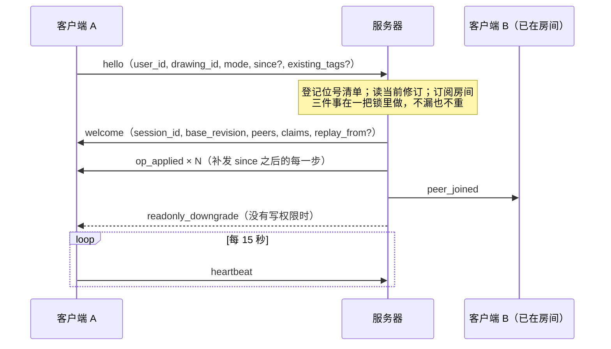
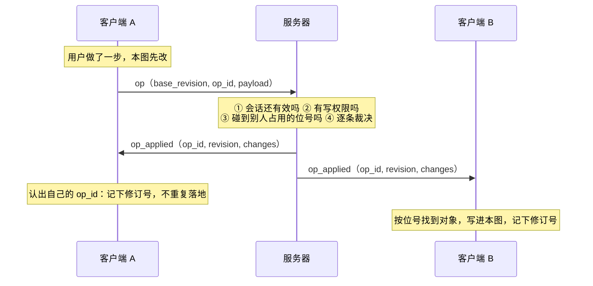
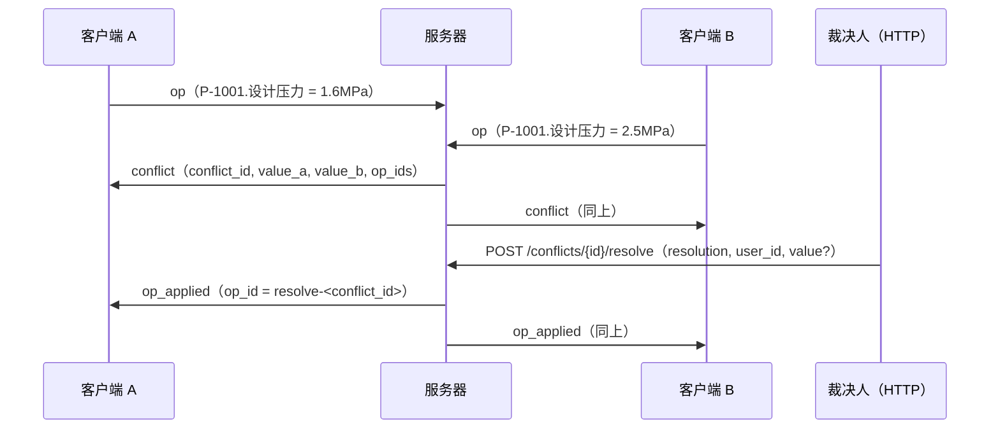

# SPEC：协同协议（`collab-protocol`）

> 状态：**已建成，按现状记录**。基线 `main @ 9b5327f96`。以代码为准，每项标了出处。
> 本文的 JSON 例子按字段定义手写，不是抓包记录。共用约定见 `01-shared-conventions.md`。
> 2026-11-17：离线使用与上线后同步要加的可选键和错误码写在 `SPEC-collab-offline-sync.md` §4.2、§4.3，**已确认**（2026-11-17）。本文与它不一致的地方以它为准，受影响的地方各加了一句指向它（都以「2026-11-17：」开头）。

## 1. 目标

定义桌面客户端与协同服务器之间每一帧的形状。服务器只懂 P&ID 的语义（位号、属性、管路组成），不看 DWG 字节；客户端之间不直连，所有东西都经服务器裁决后再广播。

代码：`crates/ocs_collab/src/protocol.rs`（消息与错误码）、`conflict.rs`（变更的读法与裁决）、`link.rs`（跨图联动的字段）。客户端一侧的写法在 `src/app/collab/broadcast.rs`、`pipes.rs`、`connectors.rs`。

## 2. 传输

- WebSocket，地址 `ws://<主机>:<端口>/ws`，默认端口 3240。只支持 `ws://`。
- 每一帧是一个 JSON 对象的文本，用 `type` 区分消息种类，取值小写下划线。
- 连上后先发 `hello`：在它之前发别的消息得到 `HELLO_REQUIRED`，10 秒内没有 `hello` 连接被关闭。一条连接只能 `hello` 一次，再发得到 `INVALID_MESSAGE`。
- 消息里的 `session_id` 只作核对用：服务器认的是这条连接握手时建立的会话，对不上得到 `SESSION_UNKNOWN`。所以猜到别人的会话编号也冒充不了。
- 服务器另有一组 HTTP 接口（权限检查、审计、冲突裁决等），见 `SPEC-collab-server.md`。

## 3. 消息

### 3.1 客户端 → 服务器（六种）

| `type` | 字段 | 说明 |
|---|---|---|
| `hello` | `user_id`、`drawing_id`、`mode`；可选 `client_version`、`workspace`、`since`、`existing_tags` | 开会话。`mode` 取 `协同编辑` / `单人编辑` / `只读`。`since` 是本图上次跟到的修订号，有它服务器会补发之后的每一步。`existing_tags` 是本机这份图里已有的位号清单，服务器登记后不会把其中任何一个发给别人新放的符号。两个可选项没有就不写 |
| `heartbeat` | `session_id` | 保活，每 15 秒一次 |
| `claim` | `session_id`、`tag` | 占用一个位号（独占） |
| `release` | `session_id`、`tag` | 主动放弃占用 |
| `op` | `session_id`、`base_revision`、`op_id`、`payload` | 提交一步编辑。`base_revision` 是做这一步时本图跟到的修订号；`op_id` 由客户端生成，形如 `op-<运行标识>-<序号>`：运行标识每次启动程序生成一个，序号在一次运行里从 1 递增，不带会话号，连没连上都一样生成（`SPEC-collab-offline-sync.md` §4.2）；对服务器是不透明的字符串；`payload` 见 §4。2026-11-20 起（`OFF-3`），之前是 `op-<session_id>-<序号>` |
| `attempt` | `session_id`；可选 `object_ref`、`text` | 报告一次被客户端自己拦下的写操作（会话只读，或位号被别人占用）。图不变，只留审计记录；记录里的原因是服务器自己判的，不采信客户端的说法 |

```json
{"type":"hello","user_id":"u1","drawing_id":"PID-1101","mode":"协同编辑",
 "since":42,"existing_tags":["P-1001","L-1001","L-1001-01"]}
```

### 3.2 服务器 → 客户端（十种）

| `type` | 字段 | 发给谁 | 说明 |
|---|---|---|---|
| `welcome` | `session_id`、`base_revision`、`peers`、`claims`；可选 `replay_from` | 发起者 | 会话建立。`peers` 是房间里的**其他人**；`claims` 是当前的占用。带 `replay_from` 表示紧跟其后补发修订 `replay_from + 1` 到 `base_revision` 的每一个 `op_applied` |
| `error` | `code`、`message`；可选 `level`、`holder`、`op_id`、`rejected` | 当事会话 | 结构化失败。`op_id` 指明答的是哪个 `op`；`rejected: true` 表示该 `op` 一点都没生效，发送者要把这一步撤回 |
| `claim_granted` | `tag`、`session_id` | 申请者 | 占用成功 |
| `claim_denied` | `tag`、`holder`、`expires_at` | 申请者 | 别人占着，到 `expires_at`（Unix 秒）为止 |
| `claim_released` | `tag`、`reason` | 房间 | 占用结束。`reason` 取 `released`（主动放弃）/ `expired`（到期、会话失效或被接管） |
| `op_applied` | `op_id`、`revision`、`changes` | 房间（含发送者） | 一步编辑生效，图到了修订 `revision`。`changes` 是生效的变更，每条的形状见 §4 |
| `peer_joined` / `peer_left` | `session_id`、`user_id`、`display_name` | 房间里的其他人 | 有人进出；自己的进出不会发给自己 |
| `readonly_downgrade` | `reason`、`holder`；可选 `level`、`code` | 当事会话 | 该会话不能写。`level` 取 `role` / `pbs` / `state`，`code` 是对应的 `PERM_DENIED_*`。图进入 `只读` 时 `holder` 是持有编辑权的会话，它自己也收到一份，由此知道编辑权在自己手里 |
| `conflict` | `conflict_id`、`object_ref`、`field`、`value_a`、`value_b`；可选 `op_ids` | 房间 | 两步编辑打平，进了冲突条目，等人裁决。`op_ids` 是打平的两个 `op` |

```json
{"type":"welcome","session_id":"s-7f3a…","base_revision":45,
 "peers":[{"session_id":"s-91c2…","user_id":"u2","display_name":"u2"}],
 "claims":[{"tag":"P-1001","session_id":"s-91c2…","user_id":"u2","expires_at":1794830000}],
 "replay_from":42}
```

## 4. `op` 的载荷与 `op_applied` 的变更

### 4.1 外层形状

出处：`broadcast::payload_for`、`conflict::Change::list`。

**一个撤销步就是一个 `op`**。载荷本身就是第一条变更，其余的放在 `changes` 数组里，接收方按顺序落地：

```json
{
  "kind": "set_tag", "object_ref": "P-1001", "field": "tag", "value": "P-1002",
  "old_value": "P-1001", "tag_source": "manual", "handle": "2A0",
  "changes": [
    { "kind": "set_property", "object_ref": "P-1002", "field": "名称", "value": "进料泵", "handle": "2A0" }
  ]
}
```

这样做的原因：服务器按整个 `op` 接受或拒绝；一步拆成几个 `op` 就可能只生效一半。

### 4.2 对象怎么指名

- **有位号的对象用位号**（`object_ref`）。改位号时 `object_ref` 是旧位号——房间里的人还只认识旧的。
- 句柄（`handle`、`handles`）只是给「持有同一个文件的人」的提示：接收方只在句柄指向的实体在本图里也带着这个位号时才采信。句柄不是共享身份，两个人各自插入过符号后，同一个句柄指的就不是同一个东西了。
- **没有位号的对象**（管段、打断符、连接符）在线上没有名字：管段和管件随所属管路的「账目」一起说（§4.5），按所属管路加位置认；连接符按「哪条线上、什么种类、在哪里」认（§4.6）。位置相差不超过 `1e-6` 算同一处。
- 已知的收窄：`object_ref` 只带位号，不带类型编码。两个不同类型的对象同名时，接收方分不清，按「找不到对象」处理。

### 4.3 十一种变更

| `kind` | 谁说 | 说的是什么 | 键（除 `kind` 外） |
|---|---|---|---|
| `set_property` | 客户端；服务器（裁决、跨图联动） | 一个属性的值 | `object_ref`、`field`、`value`；可选 `old_value`、`overrides`、`handle`、`handles` |
| `set_tag` | 客户端；服务器（裁决） | 改位号 | `object_ref`（旧位号）、`field` = `tag`、`value`（新位号）；可选 `old_value`、`tag_source`、`handle` |
| `insert_symbol` | 客户端 | 放了一个独立符号 | 见 §4.4 |
| `delete_object` | 客户端 | 删了一个有位号的对象（符号、整条管线、管路） | `object_ref`；可选 `handle`、`handles` |
| `create_pipe_line` | 客户端 | 一条管线或信号线有这些线段 | `tag`、`type`（`PIPE_LINE` / `SIGNAL_LINE`）、`pieces`、`props`、`tag_source`；线段首尾相接时另带 `points` |
| `add_pipe_run` | 客户端 | 管线上新增一条管路 | `tag`（管路位号）、`line_tag`、`run`；可选 `points` |
| `insert_fitting` | 客户端 | 管路上插了管件或打断符 | `run_tag`、`line_tag`、`run`、`fitting_type`、`at`；管件自己有位号时另带 `tag` |
| `update_pipe_run` | 客户端 | 管路的组成以别的方式变了（删了部件、撤销了一次插入） | `run_tag`、`line_tag`、`run` |
| `create_connector` | 客户端 | 线上放了一个页间连接符 | `line_tag`、`connector`、`at`；可选 `target_drawing`、`line_props` |
| `delete_connector` | 客户端 | 线上的连接符没了 | `line_tag`、`connector`、`at` |
| `pair_connector` | **只有服务器** | 连接符在另一张图上有了对端，或不再有 | `line_tag`、`connector`、`peer_drawing`、`peer_line_tag`、`peer_connector`（没有对端时三者为 `null`）；可选 `at` |

补充：

- `value` 一律是字符串。`set_property` 的 `value` 为空串表示清掉这个属性。
- `old_value` 是被替换的值，服务器写审计时用。
- `tag_source`（在 `set_tag` 上）说新位号是手工输入（`manual`）还是规则生成（`auto`），接收方照此记录；不带时接收方记为 `manual`。
- `overrides`（在 `set_property` 上）是这一步做完后该对象带覆盖标记的字段清单。接收方只动这条变更自己的那个字段：清单里有就打上，没有就摘掉。不带这个键时接收方不动自己的标记。
- `connector` 取 `pipe_in` / `pipe_out` / `signal_in` / `signal_out`；`at`、`points` 的每个点是 `[x, y]`；`pieces` 的每段是 `[x1, y1, x2, y2]`。
- `target_drawing` 是对端所在图的图号；`line_props` 是这条线当前带的、会沿连接符传递的那几个字段（管道五个管级属性，信号线 `起点仪表`、`终点仪表`）。

### 4.4 `insert_symbol`

这是唯一传几何的变更：一个插入点、一个转角、一个比例。符号自己的线条由各端的符号库给。

```json
{
  "kind": "insert_symbol", "object_ref": "P-1001", "tag": "P-1001",
  "field": "", "value": "",
  "type": "PUMP", "block": "PID_SYM_equipment_pump",
  "position": [120.0, 80.0, 0.0], "rotation": 0.0, "scale": 1.0,
  "ports": "in1,out1", "tag_source": "auto",
  "props": { "名称": "进料泵" },
  "handle": "2A0"
}
```

| 键 | 说明 |
|---|---|
| `tag` / `object_ref` | 发送者给这个符号的位号 |
| `type` | 类型编码 |
| `block` | 符号块名 `PID_SYM_<类别>_<id>` |
| `rotation` | 弧度 |
| `scale` | 等比 |
| `props` | 属性对象（不含 `__overrides`） |

这个位号在房间里已经有对象在用时，服务器给这个符号换一个：广播出去的变更里 `object_ref` 是新位号，另加 `reassigned_from` 说原来的。发送者收到后把自己图里那个符号改成新位号（位号来源不变）。管线、管路、管件不会被改号。

### 4.5 管路的账目（`run`）

出处：`src/app/collab/pipes.rs`（`RunState::to_json`）。

`add_pipe_run`、`insert_fitting`、`update_pipe_run` 都带一份「这一步做完之后这条管路是什么样」的完整账目。接收方把本图的这条管路**对齐**到账目：对得上的留着，缺的补上，多的删掉，然后重写拓扑表里这条管路的记录。对齐两次与对齐一次结果相同，所以插入、删除、撤销、重做走的是同一段代码。

```json
"run": {
  "start": [0.0, 0.0],
  "props": { "管道等级": "A1A", "公称直径": "80" },
  "overrides": [],
  "segments": [
    { "start": [0.0, 0.0],  "end": [40.0, 0.0],  "end_peer": "0:连接点1" },
    { "start": [40.0, 0.0], "end": [100.0, 0.0], "start_peer": "0:连接点2" }
  ],
  "fittings": [
    { "fitting_type": "gate_valve", "type": "VALVE", "at": [40.0, 0.0],
      "ports": { "连接点1": 0, "连接点2": 1 },
      "tag": "V-1001", "block": "PID_SYM_valve_gate_valve",
      "scale": 1.0, "rotation": 0.0, "props": {}, "tag_source": "auto" }
  ]
}
```

| 键 | 说明 |
|---|---|
| `start` | 管路本体所在的点 |
| `props`、`overrides` | 管路本体的属性与覆盖标记；`props` 为空表示取管线的值 |
| `segments[]` | 每段的两端；`start_peer` / `end_peer` 是所接管件端口，写成 `<管件在 fittings 里的序号>:<端口名>`，没接就不写 |
| `fittings[].ports` | 端口名 → 所接管段在 `segments` 里的序号，没接为 `null` |
| `fittings[].type` | 自己有位号的管件是 `VALVE`，否则 `FITTING` |
| 打断符 | `fitting_type` 为 `break`，带 `mark`（记号两端 `[[x1,y1],[x2,y2]]`），不带 `block`、`scale`、`rotation`、`props`、`tag_source` |

账目里只有序号和坐标，没有句柄。

### 4.6 连接符

```json
{ "kind": "create_connector", "line_tag": "L-1001", "connector": "pipe_out",
  "at": [200.0, 80.0], "target_drawing": "PID-1102",
  "line_props": { "管道等级": "A1A", "公称直径": "80" } }
```

```json
{ "kind": "pair_connector", "line_tag": "L-1001", "connector": "pipe_out",
  "peer_drawing": "PID-1102", "peer_line_tag": "L-2001", "peer_connector": "pipe_in" }
```

跨图配对不是客户端的事：客户端只说对端在哪张图（`target_drawing`），服务器找到那一端后向两个房间各发一条 `pair_connector`。此后流出侧那条线上会传递的字段每写一次，服务器就在流入侧那张图上提交一条普通的 `set_property`（提交会话的编号以 `link:` 开头）。客户端发来的 `pair_connector` 不算配对。

### 4.7 服务器广播时的改写

出处：`conflict::Change::broadcast_form`。

`op_applied.changes` 里的每一条是客户端发来的那条变更，原有的键都留着，另外：

- `object_ref` 改成对象**现在**的位号。变更是对着旧基线做的、其间对象被改过号，服务器顺着改号链找到它。
- `kind`、`field`、`value` 缺的补成 `null`。
- `insert_symbol` 被改号时加 `reassigned_from`。

## 5. 数据怎么传

### 5.1 加入与追平

> 2026-11-17：`hello`、`welcome` 另带库标识 `repo_id`；对不上时 `welcome` 带 `align_refused`，不补发，此后这个会话发来的 `op` 一律拒绝；同一个 `op_id` 第二次到达不再裁决。见 `SPEC-collab-offline-sync.md` §4.3、§5.2、§5.3，已确认。



- 首次加入不带 `since`：服务器把这份图当作「就是房间现在的样子」。两个人各开各的文件时这个假设不成立，`existing_tags` 就是用来让服务器至少知道哪些位号已经有人用了。
- 带 `since` 而日志里没有完整的一段（`since` 超前、为负、或中间有缺），服务器不补发，`welcome` 里也没有 `replay_from`。
- 同一用户在同一张图上再发 `hello`，新会话接管旧会话：旧会话的占用释放（`claim_released`，`expired`），旧连接收到 `error SESSION_TAKEN_OVER`（只发给它）。
- 图处于 `单人编辑` 且已有人在编辑时，另一位用户的 `hello` 被拒：`error PERM_DENIED_STATE`（`level: state`，`holder` 是正在编辑的那个会话），随后断开。
- 角色不能编辑的用户一律按 `只读` 加入，不占编辑名额。
- 心跳超时（默认 90 秒）：会话失效，它的占用释放，房间收到 `peer_left`。失效会话再发任何消息得到 `SESSION_EXPIRED`。
- 正常退出（发了关闭帧）：会话立即失效，占用立即释放，房间收到 `peer_left`。
- 网络断开（没有关闭帧）：房间收到 `peer_left`，但会话和它的占用留到心跳超时为止——断线的人重连回来前，他占用的位号不会被别人拿走。

### 5.2 一步编辑



### 5.3 服务器怎么裁决，发送者会收到什么

出处：`crates/ocs_collab_server/src/ops.rs`（`judge_and_commit`）、`conflict.rs`（`Verdict`）。

| 情形 | 发送者收到 | 发送者该做什么 |
|---|---|---|
| 写的字段在它的基线之后没人写过 | `op_applied`（即使基线已旧也合并） | 无 |
| 那个字段在基线之后被别人写成了别的值 | `error OP_SUPERSEDED` | 不重发；本图该字段取胜出的值 |
| 对象在基线之后被别人删了 | `error OBJECT_DELETED` | 不重发；删除成立 |
| 删一个仍被管路当作端点引用的对象 | `error OBJECT_REFERENCED` | 撤回这一步 |
| 改一条管线的连接，而别人在它的基线之后动过同一条线 | `error STALE_BASE_REVISION` | 撤回；看过线的现状后重做 |
| 同一条线在同一张图上的第二个流入连接符 | `error DUPLICATE_INFLOW_CONNECTOR` | 撤回 |
| 变更碰到别人占用的位号（对象本身、改号的目标、所属管线或管路） | `error CLAIM_HELD`，带 `holder` | 撤回 |
| 会话没有写权限 | `error PERM_DENIED_ROLE` / `_PBS` / `_STATE`，带 `level` | 撤回 |
| 服务器不认识的变更种类，且基线不是当前修订 | `error STALE_BASE_REVISION` | 追平后重发 |
| 两个 `op` 同基线、写同一字段、值不同、落在并列窗口内 | 房间收到 `conflict`，双方都没有 `op_applied` 也没有 `error` | 等人裁决（§5.4） |

整步还是逐条：

- **只写字段的 `op`** 逐条裁决，能生效的生效，被挡的那几条各回一个 `error`（不带 `rejected`）。一条都没生效时这些 `error` 都带 `rejected: true`。
- **带结构变更的 `op`**（新建、删除、改连接）要么整步生效要么整步不生效：有一条被挡，所有 `error` 都带 `rejected: true`。半步生效的图是谁也没画过的图。

并列窗口由服务器的 `--tie-window-ms` 配置，默认没有：此时先到者生效，后到者按「落后」处理，不会产生冲突条目。

### 5.4 冲突裁决



裁决取 `采用甲方` / `采用乙方` / `人工改值`（后者要给 `value`）。裁决结果作为服务器自己的一个 `op` 写回：修订号前进，房间收到 `op_applied`，不在线的人追平时也能拿到。一个条目只裁决一次。

### 5.5 占用

- `claim` → 成功则申请者收到 `claim_granted`；别人占着则申请者收到 `claim_denied`。放弃一个自己没持有的位号得到 `INVALID_MESSAGE`。
- 占用有期限（默认 300 秒），到期、主动 `release`、会话失效或被接管都会让**房间**收到 `claim_released`。
- 被占用的位号，其他会话对它的任何写入都会被 `CLAIM_HELD` 整步拒绝。
- 占用成功**不广播**：别人加入时从 `welcome.claims` 看到当时的占用，之后新增的占用要到自己撞上（`claim_denied` 或 `CLAIM_HELD`）才知道。这是现状，列在 §9。

### 5.6 只读

- 会话不能写时收到 `readonly_downgrade`。客户端此后在本地拦下写命令，并发 `attempt` 让服务器记一笔「谁想对哪个对象做什么」。
- 客户端的拦截只是礼貌：服务器对每个 `op` 自己再判一次，没有写权限的照样拒绝并记审计。

## 6. 错误码

> 2026-11-17：另加五个码。`REPO_MISMATCH`、`REVISION_AHEAD`、`REPLAY_GAP` 在那批没提交的离线改动里已经有；`NOT_ALIGNED`、`STORE_UNAVAILABLE` 是新加的。见 `SPEC-collab-offline-sync.md` §4.3，已确认。

出处：`protocol::codes`。

| 错误码 | 含义 |
|---|---|
| `HELLO_REQUIRED` | 第一帧不是 `hello` |
| `UNKNOWN_MESSAGE_TYPE` / `INVALID_MESSAGE` | 不认识的 `type` / 帧缺字段或不是合法 JSON |
| `UNKNOWN_DRAWING` / `UNKNOWN_USER` | 没有这张图 / 这个用户 |
| `SESSION_UNKNOWN` / `SESSION_EXPIRED` / `SESSION_TAKEN_OVER` | 会话不存在 / 心跳超时失效 / 被同一用户的新连接接管 |
| `PERM_DENIED_ROLE` / `PERM_DENIED_PBS` / `PERM_DENIED_STATE` | 权限链三层分别拒绝：角色、PBS 节点授权、图纸状态 |
| `PERM_UNKNOWN_SUBJECT` / `PERM_UNKNOWN_OPERATION` / `PERM_INVALID_STATE` | 权限检查的入参不对 |
| `INVALID_STATE_TRANSITION` | 图纸状态不能这样转 |
| `STALE_BASE_REVISION` | 基线已旧且服务器无法合并：追平后重发 |
| `OP_SUPERSEDED` | 字段写入落后，别人的值留下：不要重发 |
| `OBJECT_DELETED` | 对象已被别人删除 |
| `OBJECT_REFERENCED` | 对象还被引用，不能删 |
| `CLAIM_HELD` | 位号被别的会话占用 |
| `DUPLICATE_INFLOW_CONNECTOR` | 同一条线同图的第二个流入连接符 |
| `CONFLICT_UNKNOWN` / `CONFLICT_ALREADY_RESOLVED` | 没有这个冲突条目 / 已经裁决过 |

## 7. 兼容规则（改协议时必须遵守）

1. **只加可选键，不加新的消息种类。** 新键在序列化时「没有就不写」，反序列化时「没有就取默认值」。`since`、`existing_tags`、`replay_from`、`op_id`、`rejected`、`tag_source`、`overrides` 都是这样加进来的。
2. 旧客户端不带新键时，行为与加键之前完全一样。
3. 客户端读不懂的那一项变更（种类不认识、缺关键值）不落地一半：这一项跳过，同一个 `op` 里读得懂的其余变更照常落地；同时把本图标为「与房间不一致」，在命令行和状态接口里说明，不静默放过。位号在本图里对不上对象（没有，或有好几个）的变更同样处理（`src/app/collab/apply.rs` 的 `apply_remote_changes`）。
4. 错误码只增不改。拼写以 `protocol::codes` 的常量为准，客户端与服务器共用。

## 8. 成功标准（已满足）

- 每种消息序列化再反序列化后相等；可选键缺省时不出现在线上（`protocol.rs` 的测试）。
- 裁决是纯函数：不读时钟、不做 I/O，同样的输入总是同样的结论（`conflict.rs` 的测试）。
- `cargo test --offline --locked -p ocs_collab -p ocs_collab_server` 全绿（基线：`ocs_collab` 95，`ocs_collab_server` 159 + 12）。

## 9. 不在范围与已知限制

- **已有对象的几何不在协议里。** 移动符号或连接符、拖动或拉伸管段和管件、只删管线的一部分线段，都不会广播（`docs/plans/2026-11-12-collab-completion.md`）。要支持就得加新的变更种类，本轮不做。
- 不加密（只有 `ws://`），没有登录验证：`user_id` 由客户端自报。适用于内网试用，上生产前必须补。
- `object_ref` 不带类型编码（§4.2）。
- **属性超过 2 KB 的对象说不全。** 这类对象的属性存在扩展字典里，不在实体本身：新建时 `insert_symbol.props` 发出去是空对象，之后改它的属性也不会发 `set_property`（改位号照常发）。协议本身不用改，要改的是客户端怎么收集，见 `SPEC-collab-client.md` 的剩余任务。
- 占用成功不广播（§5.5）：已在房间里的人看不到别人新占用了什么。

## 10. 待决问题

无。协议在阶段 3 不需要改动：规则检查、材料清单、快照、发布都在桌面端本地完成，不经服务器。

附：已批准计划（`2026-11-16-pid-platform-next-steps-plan.md`）的文字里提到的 `SyncSince` / `SyncOps` 两种消息没有建。实际做法是在已有消息上加可选键：补发走 `hello.since` → `welcome.replay_from` 加一串 `op_applied`（§5.1）。功能与计划一致，以本规格和代码为准。
