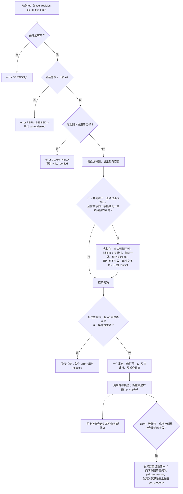

# SPEC：协同服务器（`collab-server`）

> 状态：**已建成，按现状记录**。基线 `main @ 9b5327f96`。以代码为准，每项标了出处。
> 线上消息的形状见 `SPEC-collab-protocol.md`，这里只写服务器自己的：怎么跑、存什么、HTTP 接口、一个 `op` 在服务器里怎么走。
> 2026-11-17：离线同步对服务器的要求（库标识、加入时核对、没对上的会话不收 `op`、按编号去重、库打不开时不接受会话、换库标识）写在 `SPEC-collab-offline-sync.md` §4.3、§5.2、§5.3、§6，**已确认**（2026-11-17）。本文与它不一致的地方以它为准，受影响的地方各加了一句指向它（都以「2026-11-17：」开头）。

## 1. 目标

一个独立进程，替一组桌面客户端做四件事：管会话和在场名单；裁决每一步编辑并按顺序广播；判权限；记审计。它**不存图纸**，只存它应用过的编辑（操作日志），并从日志推出每张图的语义状态。

代码：`crates/ocs_collab_server/src/`（`main.rs` 启动、`ws.rs` WebSocket、`ops.rs` 裁决与提交、`http.rs` HTTP 接口、`store.rs` SQLite、`perm.rs` / `access.rs` 权限、`bus.rs` 房间广播）。纯逻辑在 `crates/ocs_collab/src/`（`conflict.rs`、`permission.rs`、`session.rs`、`occupancy.rs`、`link.rs`）。

验收状态：

- `VAL-SRV` 30/30、`VAL-INFRA` 14/14、`VAL-PERM` 32/32 已验过（状态文档 `docs/plans/2026-11-10-mission-p1-collab-status.md` §3）。
- 冲突（`VAL-CONF`，18 条）与跨区流程（`VAL-CROSS`，12 条）里服务器这一侧的行为都已实现并有单元测试；冲突的三个端到端场景（61 项）在 `ea7f4357b` 上全过。
- 状态文档停在 `ea7f4357b`，之后的提交（离线对账、管线广播、跨图连接符、上报位号）还没有写进去。全量端到端复验、把状态文档更新到 228/228，是阶段 2 剩下的任务（T2.4 ④，见 `SPEC-collab-client.md`）。
- 单元测试：`ocs_collab` 95，`ocs_collab_server` 159 + 18，全绿（`CC-3` 之前是 159 + 12）。

## 2. 怎么跑

```powershell
cargo run --offline --locked -p ocs_collab_server -- --port 3240 --db <库文件> --seed <种子 JSON>
```

| 参数 | 默认 | 说明 |
|---|---|---|
| `--port` | `3240` | 监听端口。端口被占用时以非零码退出并报错，绝不悄悄换端口 |
| `--bind` | `127.0.0.1` | 监听地址。只接受 IP 地址（IPv4 或 IPv6），不接受主机名。默认只有本机能连；要让别的机器连，写这台机器在那个网段上的地址，或 `0.0.0.0`（本机所有 IPv4 地址）。**监听非回环地址只适合可信内网**，见表后的说明 |
| `--db` | `%APPDATA%\OpenCADStudio\collab.db` | SQLite 库文件，就是协同的账本（§2.1）。打不开时进程仍然监听，`GET /health` 报 503，但不接受会话：每个 `hello` 得到 `error STORE_UNAVAILABLE` 后连接被关闭（`OFF-11`） |
| `--new-repo-id` | 不带 | 不带值。给库换一个新的库标识后照常启动。只在从备份恢复库文件之后用一次（§2.1 第 4 条）；每次带它启动都会再换一次，所以不要写进常用的启动命令 |
| `--heartbeat-timeout` | `90`（秒） | 这么久没心跳，会话失效。必须大于 0 |
| `--claim-ttl` | `300`（秒） | 一次占用的有效期。必须大于 0 |
| `--seed` | 无 | 启动时导入的种子文件（§3.2），重复导入不出错 |
| `--tie-window-ms` | `0` | 并列窗口（§5）。**`0` 表示不等**：每个 `op` 到了就判，两人改同一字段时先到的生效、后到的让路，不会产生冲突条目 |

参数写错（含不认识的参数）打印用法并以退出码 2 结束。

**默认只监听本机回环地址 `127.0.0.1`**，别的机器连不上。要让别的机器上的人一起协同，用 `--bind` 换地址（`CC-3`，实现记录见 §9.1）：

```powershell
cargo run --offline --locked -p ocs_collab_server -- --bind 0.0.0.0 --port 3240 --db <库文件>
```

- 别的机器上的客户端用 `PIDCOLLAB SERVER ws://<服务器所在机器的地址>:3240/ws` 指过来。
- **监听非回环地址之前要知道**：服务器没有登录验证，也不加密（§7）。`user_id` 是客户端自报的，HTTP 接口同样只认请求里写的 `user_id`。所以能连到这个地址和端口的任何人，都能以任意用户的身份加入图纸、提交编辑、改图纸状态、裁决冲突、读审计日志。只适合可信内网，不要监听公网地址。这一条写在用法说明里；监听的不是回环地址时，启动还会在标准错误上打印一行提醒。
- 启动时打印的「监听 `http://<地址>:<端口>`」是绑定之后从套接字读回来的，不是照抄命令行。`--bind 0.0.0.0` 时打印的就是 `0.0.0.0:<端口>`，别的机器要用这台机器的实际地址来连。
- 地址绑不上（比如写了一个不属于这台机器的地址）和端口被占一样处理：报错并以非零码退出，不换地址、不换端口，也不去碰库。
- 一次只监听一个地址。系统防火墙开着时，还要放行这个程序或端口，别的机器才连得上。

启动顺序是「先占端口，再开库」：开库时会清掉上一次运行留下的会话和占用，顺序反了的话，一个注定因端口被占而失败的启动会把正在服务的那个实例的会话清掉。

### 2.1 运行说明：库文件、库标识与备份

离线工作（`SPEC-collab-offline-sync.md`）靠服务器这边的五条前提。这五条在离线规格 §6 定下（2026-11-17，已确认），这里写成运行时照着做的规定（`OFF-11`）。

1. **账本就是库文件。** `--db` 指定，默认 `%APPDATA%\OpenCADStudio\collab.db`。同一个库文件，就是同一个库标识（`meta.repo_id`）加同一份操作日志（`ops` 表）。换了库文件就是换了一个库：所有带同步记录的图纸加入时都得到 `REPO_MISMATCH`。搬服务器或做备份时先停服务器再复制库文件；旁边要是还有同名的 `-wal` 文件，一起复制。
2. **库打不开时不接受会话。** 进程照常监听，`GET /health` 报 503；每个 `hello` 得到 `error STORE_UNAVAILABLE`，随后连接被关闭；`POST /session` 照旧回 503「数据库不可用」。启动时标准错误上有「数据库初始化失败：……」和「不接受会话：……」两行。修好库文件（路径、权限、磁盘）后重启服务器。以前这种情况下会话照常接受，但什么都不落盘，每次启动还换一个库标识：在上面做的修改重启就没了，图纸却记下了一个再也对不上的库标识。代码里直接建、不带库的服务器（测试用的内存模式）不受这一条影响。
3. **操作日志不清理。** 现在没有清理的代码，这里写成规定：只要日志在，离线多久都能补齐。将来要清理，先定「最长离线时间」；落后太多的客户端得到 `REPLAY_GAP`。
4. **从备份恢复之后必须换库标识。** 恢复备份等于修订号回退。比备份新的图纸会得到 `REVISION_AHEAD`，这是对的；危险在恢复之后房间又往前走过了那些修订号，这时旧副本会被当成一致（服务器只比库标识和修订号）。所以恢复库文件之后，带 `--new-repo-id` 启动一次（如 `cargo run --offline --locked -p ocs_collab_server -- --port 3240 --db <库文件> --new-repo-id`）。启动输出里有「库标识已换成 <新标识>」。只换库标识，操作日志和其余数据都不动；之后照常不带它启动，新标识保持不变。记着旧标识的图纸加入时都得到 `REPO_MISMATCH`：所有人取同一份图纸重新开始（离线规格 §5.5 的后一种办法）。每次带 `--new-repo-id` 启动都会再换一次，它不能留在常用的启动命令或脚本里。换标识失败时服务器按第 2 条处理，不拿旧标识接着服务。
5. **一个库文件同一时间只给一个服务器进程用。** 这是现状的假设，代码不检查。两个进程开同一个库文件，后启动的那个会清掉前一个的会话和占用记录（见上面的启动顺序），两边内存里的图纸状态也各管各的。

审核意见第 10 条说的「必须带库文件运行」不准确：不带参数时默认就有库文件（第 1 条），只有库打不开时才会没有库，而那时服务器不接受会话（第 2 条）。

## 3. 数据格式

### 3.1 SQLite 库：十张表

出处：`store.rs` 的建表语句。时间列都是 Unix 秒。

| 表 | 列 | 说明 |
|---|---|---|
| `users` | `user_id`（主键）、`display_name`、`role`、`company` | `role` 取五个角色名之一（§3.3） |
| `pbs_nodes` | `node_id`（主键）、`name`、`node_type`、`parent_id` | PBS 树 |
| `pbs_acl` | `node_id`、`subject`、`permission`、`allowed`；主键是前三列 | `subject` 是用户号或角色名；`permission` 取 `查看` / `编辑` / `导出` / `删除`；`allowed` 取 1 / 0 |
| `drawings` | `drawing_id`（主键）、`file_name`（唯一）、`pbs_node_id`、`state`、`lifecycle`（默认 `设计中`）、`revision`（默认 0） | `state` 取 `单人编辑` / `协同编辑` / `只读`；`revision` 每应用一个 `op` 加 1 |
| `sessions` | `session_id`（主键）、`drawing_id`、`user_id`、`mode`、`status`、`base_revision`、`last_heartbeat`、`created_at`、`workspace` | 重启时清空 |
| `claims` | `tag`（主键）、`drawing_id`、`session_id`、`user_id`、`expires_at` | 重启时清空 |
| `conflicts` | `conflict_id`（主键）、`drawing_id`、`object_ref`、`field`、`value_a`、`value_b`、`base_revision`、`status`、`resolution`、`resolved_value`、`resolved_by` | `status` 取 `待裁决` / `已裁决`；`resolution` 取 `采用甲方` / `采用乙方` / `人工改值` |
| `audit_log` | `seq`（自增主键）、`module`、`action`、`at`、`object_ref`、`user_id`、`company`、`ip`、`workspace`、`change_text` | 只追加：库里有触发器拒绝改和删 |
| `ops` | `drawing_id`、`revision`（两列主键）、`op_id`、`session_id`、`user_id`、`base_revision`、`at`、`changes` | 操作日志。`changes` 是当时广播出去的 `op_applied.changes` 的 JSON 文本 |
| `reported_tags` | `drawing_id`、`tag`（两列主键）、`revision` | 客户端在 `hello.existing_tags` 里报上来的位号，以及服务器听到它时图所在的修订 |

`ops` 加 `reported_tags` 就是服务器对一张图的全部认识。重启后按修订顺序重放这两张表，就恢复出内存里的图纸模型（§3.5）。

### 3.2 种子文件

出处：`store.rs` 的 `SeedDoc`。四段都可省。下面的例子按字段定义手写。

```json
{
  "users": [
    { "user_id": "u1", "display_name": "张工", "role": "工艺设计人员", "company": "设计院" }
  ],
  "pbs_nodes": [
    { "node_id": "plant", "name": "全厂", "node_type": "项目", "parent_id": null },
    { "node_id": "unit-11", "name": "11 单元", "node_type": "装置", "parent_id": "plant" }
  ],
  "pbs_acl": [
    { "node_id": "plant", "subject": "工艺设计人员", "permission": "编辑", "allowed": true }
  ],
  "drawings": [
    { "drawing_id": "PID-1101", "file_name": "PID-1101.dwg", "pbs_node_id": "unit-11",
      "state": "协同编辑", "lifecycle": "设计中" }
  ]
}
```

### 3.3 权限：三层链

出处：`crates/ocs_collab/src/permission.rs` 的 `decide`，`crates/ocs_collab_server/src/perm.rs` 的 `evaluate`。三层依次判，第一个拒绝的层说了算，返回它的层名和错误码。

**第一层，角色 × 操作**（`role_allows`）：

| 操作 | 系统管理员 | 项目管理员 | 工艺设计人员 | 校对人员 | 只读查看者 |
|---|---|---|---|---|---|
| 查看图纸 | ✓ | ✓ | ✓ | ✓ | ✓ |
| 编辑图纸 | ✓ | ✓ | ✓ | | |
| 导出图纸 | ✓ | ✓ | ✓ | ✓ | |
| 删除图纸 | ✓ | ✓ | | | |
| 发布签核 | ✓ | ✓ | | | |
| 授权配置 | ✓ | ✓ | | | |
| 规则检查 | ✓ | ✓ | ✓ | ✓ | ✓ |
| 主数据维护 | ✓ | | | | |

**第二层，PBS 节点授权**（`lookup_acl`）：八个操作折成四种授权（查看图纸、规则检查 → `查看`；编辑图纸、发布签核、授权配置、主数据维护 → `编辑`；导出图纸 → `导出`；删除图纸 → `删除`）。从图纸所在节点沿父链往上找，最近的一条配置说了算；同一节点上用户行优先于角色行；一路都没有配置就是拒绝。

**第三层，图纸状态**：`只读` 拒绝所有写操作（编辑图纸、删除图纸、发布签核、授权配置、主数据维护）；`单人编辑` 在已有**别的用户**的编辑会话活着时拒绝写操作，并报出那位编辑者的会话号 `holder`；`协同编辑` 放行。三个状态可以任意互转。

判定结果（`PermissionDecision`）：

```json
{ "allowed": true, "denied_level": null, "code": null,
  "effective_node_id": "plant", "effective_node_path": ["plant", "unit-11"], "inherited": true }
```

`denied_level` 取 `role` / `pbs` / `state`，`code` 是对应的 `PERM_DENIED_ROLE` / `_PBS` / `_STATE`。`effective_node_path` 是从根到图纸所在节点的整条链，`inherited` 说明起作用的配置是不是来自上级节点。

### 3.4 一个会话能不能写

出处：`access.rs` 的 `write_access`。它在三层链之上补了会话才有的几条，每个 `op` 到达时都判一次：

| 情形 | 结论 |
|---|---|
| 用户不在 `users` 表里，或图不在 `drawings` 表里，或图没有挂到任何 PBS 节点（`hello` 自动建出来的图就是这样） | **不受权限表约束，可以写。** 权限表是用来收紧的，一台没导入种子的服务器什么都不拦 |
| 会话是以 `只读` 方式加入的 | 不能写（层名 `role`），不论权限表怎么说 |
| 角色层或 PBS 层拒绝 | 不能写 |
| 图处于 `单人编辑`，图上有不止一个用户的编辑会话 | 只有最先加入的那个编辑会话能写 |
| 图处于 `只读` | 只有「编辑权持有者」能写：图被切成只读的那一刻，在图上时间最长、连着 WebSocket 的活跃编辑会话（按会话号认，同一用户的另一个会话不算）。当时没人在编辑，就谁也不能写。图离开只读时这条记录清除 |

「编辑权持有者」这条规则是实现时的选择，契约没有规定，见 §8 的 S2。

### 3.5 内存里的图纸模型

出处：`crates/ocs_collab/src/conflict.rs` 的 `DrawingModel`。每张图一份，首次用到时从 `ops` 与 `reported_tags` 重放而来（`ops.rs` 的 `DrawingOps::load`）。

| 内容 | 说明 |
|---|---|
| 当前修订号 | |
| 对象表 | 位号 → 每个字段的当前值，以及是哪个会话、哪个用户在哪个修订写的 |
| 改号记录 | `(旧位号, 新位号, 修订)`，让对着旧基线做的变更仍能找到对象 |
| 已删除对象 | 位号 → 谁在哪个修订删的、删时带着什么值，用来回答还在路上的变更 |
| 管线与管路 | 管线位号 → 它的管路；每条管路的点、两端所接对象、管件、管段 |
| 连接符 | 建它的那条变更原样，配对后加上对端三项 |
| 管线最近一次连接变更 | 管线位号 → 修订与会话，用来判「连接变更落后」 |
| 上报的位号 | 客户端自己那份图里有、但没有任何 `op` 提到过的位号 |

## 4. HTTP 接口

出处：`http.rs` 的 `router`。一般的错误体是 `{"code": "<错误码>", "message": "<中文说明>"}`；库不可用时各接口返回 503。

| 方法与路径 | 请求 | 应答 |
|---|---|---|
| `GET /health` | | 200 `{"ok":true,"db":"ok","version":"0.1.0"}`；库不可用时 503 `{"ok":false,"db":"error","version":"0.1.0"}` |
| `GET /ws` | WebSocket 升级 | 协同数据通道 |
| `POST /session` | `{user_id, drawing_id, mode?, workspace?}`，`mode` 默认 `协同编辑` | 201 `{session_id, base_revision}`；同一用户同一张图重复请求得到同一个会话号。图处于 `单人编辑` 且别人的编辑会话还活着：403 `{"code":"PERM_DENIED_STATE","message":"该图面已有活动的编辑会话","holder":"<会话号>"}` |
| `POST /permission/check` | `{user_id, drawing_id, operation}` | 允许 200、拒绝 403，正文都是 §3.3 的判定结果六个字段，`单人编辑` 被占时另带 `holder`。入参不对：缺字段 400 `INVALID_MESSAGE`；操作名不认识 400 `PERM_UNKNOWN_OPERATION`；用户不存在 400 `PERM_UNKNOWN_SUBJECT`；图纸不存在 404 `PERM_UNKNOWN_SUBJECT`；库里的图纸状态非法 500 `PERM_INVALID_STATE` |
| `POST /drawing/{id}/state` | `{user_id, state}`；调用者要有「授权配置」权限 | 200 `{drawing_id, state}`。无权限 403（判定结果）；状态值非法 400 `INVALID_STATE_TRANSITION`。切成 `只读` 时定出编辑权持有者，并向图上每个会话（含持有者本人）单独发 `readonly_downgrade` |
| `GET /drawing/{id}/objects` | 可选 `?object_ref=<位号>` | 200 `{drawing_id, revision, items, total, reported_tags}`，见下 |
| `GET /drawing/{id}/topology` | | 200 `{drawing_id, revision, pipe_lines, pipe_runs, connectors}`，见下 |
| `GET /audit` | 可选 `object_ref` 或 `tag`、`user_id`、`from`、`to`、`limit`、`offset` | 200 `{"items":[…],"total":N}`，按时间倒序 |
| `PUT` / `PATCH` / `DELETE /audit`，任意方法 `/audit/{seq}` | | 405 `{"code":"AUDIT_APPEND_ONLY","message":"审计日志只追加，不支持修改或删除"}` |
| `GET /conflicts` | 可选 `drawing_id`、`status` | 200 `{items, total}`，每条是 `conflicts` 表的一行 |
| `POST /conflicts/{id}/resolve` | `{resolution, resolved_by 或 user_id, value 或 resolved_value}`；裁决人要在那张图上有「授权配置」权限 | 200 `{conflict_id, status, resolution, resolved_by, resolved_value, object_ref, field, value, revision}`。无权限 403（判定结果，另带 `level`）；没有这个条目 404 `CONFLICT_UNKNOWN`；已裁决过 409 `{"ok":false,"code":"CONFLICT_ALREADY_RESOLVED","message":…,"conflict_id","status","resolution","resolved_by"}`；取值不合法 400 |

**对象读回**（`GET /drawing/{id}/objects`）——服务器对这张图的认识，可以拿来和客户端的图对账：

```json
{ "drawing_id": "PID-1101", "revision": 7,
  "items": [
    { "object_ref": "P-1001",
      "fields": { "公称直径": { "value": "DN80", "revision": 7, "user_id": "u1" } } }
  ],
  "total": 1,
  "reported_tags": ["E-1001", "V-1003"] }
```

`items` 只含被某个 `op` 写过的对象；图里原有、从没被改过的对象不在里面，只在 `reported_tags` 里占着位号。`total` 不计 `reported_tags`。

**拓扑读回**（`GET /drawing/{id}/topology`）：

```json
{ "drawing_id": "PID-1101", "revision": 12,
  "pipe_lines": [ { "tag": "L-1001", "runs": ["L-1001-01"] } ],
  "pipe_runs": [
    { "tag": "L-1001-01", "line_tag": "L-1001", "points": [[0,0],[100,0]],
      "from": "P-1001", "to": "E-1001", "fittings": [ … ], "segments": [ … ] }
  ],
  "connectors": [
    { "kind": "create_connector", "line_tag": "L-1001", "connector": "pipe_out", "at": [100,0],
      "peer_drawing": "PID-1102", "peer_line_tag": "L-2001", "peer_connector": "pipe_in" }
  ] }
```

`fittings` 与 `segments` 的每一项就是管路账目（协议规格 §4.5）里的那一项；没有客户端报过账目时 `segments` 是 `null`。只含已生效的 `op` 建出来的东西。

**审计的一条**：

```json
{ "seq": 128, "module": "协同编辑", "action": "set_property", "at": 1794830000,
  "object_ref": "P-1001", "user_id": "u1", "company": "设计院", "ip": "127.0.0.1",
  "workspace": "默认工作区", "change_text": "set_property P-1001.公称直径: DN50 -> DN80" }
```

| 字段 | 取值 |
|---|---|
| `module` | `协同编辑`（会话做的事）或 `冲突裁决`（裁决） |
| `action` | 生效的变更记变更种类（如 `set_property`）；没生效的记事件名：`write_denied`（无写权限或位号被别人占用）、`change_rejected_deleted`（对象已被删）、`delete_refused`（还被引用）、`connector_refused`（第二个流入连接符）；裁决记 `conflict_resolved` |
| `change_text` | 生效的写成 `<种类> <对象>.<字段>: <旧值> -> <新值>`（没有字段时只有 `<种类> <对象>`；删除另附「（删除前：字段=值；…）」）；没生效的写明想做什么、为什么没成 |
| 其余 | 九个字段都不会是空的：查不到时分别填 `未知`（单位）、`默认工作区`、`127.0.0.1`、`未知对象`、`未知用户` |

## 5. 数据怎么传：一个 `op` 在服务器里

出处：`ws.rs` 的 `op`，`ops.rs` 的 `receive` / `judge_and_commit` / `commit`。



B1、C1、D1 三种拒绝都带 `op_id` 与 `rejected: true`，发送者据此把那一步撤回。

逐条裁决的规则（`conflict.rs` 的 `judge`，纯函数，不读时钟）：

| 情形 | 结论 |
|---|---|
| 基线比当前修订还新 | `STALE_BASE_REVISION`，整步拒绝 |
| 写字段：基线之后没有别的会话写过这个字段 | 合并，生效 |
| 写字段：基线之后别的会话把它写成了别的值 | 让路：`OP_SUPERSEDED`，被挡的值记进审计。自己较早的写入不算「别人」，值相同也不算落后 |
| 写字段：对象在基线之后被别的会话删了 | `OBJECT_DELETED`，审计 `change_rejected_deleted` |
| 删对象：它还是某条管路的端点 | `OBJECT_REFERENCED`，审计 `delete_refused` |
| 改一条线的连接（加管路、插管件、建或删连接符、更新管路）：基线之后别的会话动过同一条线的连接 | 连接不按字段合并：`STALE_BASE_REVISION`，由发送者看过现状再做 |
| 建流入连接符：这条线在本图已有一个同类的流入连接符 | `DUPLICATE_INFLOW_CONNECTOR`，审计 `connector_refused` |
| 新放符号：位号已被占（对象表里有，或有人上报过） | 服务器换成下一个空闲的号，广播里用 `reassigned_from` 注明原号 |
| 服务器读不懂的 `op`（种类不认识） | 基线等于当前修订就原样记入并广播，否则 `STALE_BASE_REVISION` |

整步还是逐条：`op` 里只要有一条不是「写字段」的变更（新建、删除、改连接），就整步生效或整步不生效；纯写字段的 `op` 逐条判，生效的照常广播，被挡的各答一个不带 `rejected` 的 `error`，只有一条都没生效时才全部带上 `rejected`。

其余要点：

- **判定、提交、广播在同一把锁里完成**，所以房间听到的 `op_applied` 严格按修订号递增，不会两条共用一个修订号，也不会新的先到。客户端靠这一点发现自己漏了变更。
- **并列窗口只扣「可能并列」的 `op`**：删除和新放符号不争任何东西，到了就提交。扣住的 `op` 由一个定时任务到期提交（周期为窗口的四分之一，限在 5–50 毫秒）。
- **裁决结果也是一个 `op`**：会话号 `adjudication:<冲突号>`，`op_id` 为 `resolve-<冲突号>`，走同一条「事务 → 模型 → 广播」的路。
- **跨图联动的 `op`** 会话号以 `link:` 开头。会传递的字段：管道 `管道等级`、`公称直径`、`绝热等级`、`流体介质`、`管线类型`；信号线 `起点仪表`、`终点仪表`（`link.rs`）。配对关系不另存表，重启后从操作日志里那些 `link:` 会话的 `pair_connector` 恢复。

加入时的补发（`ws.rs` 的 `hello`）：读当前修订、订阅房间、读缺失的那段日志、登记上报的位号，四件事在同一把锁里做——每个 `op` 要么在补发里，要么经订阅送到，不会两边都有，也不会两边都没有。

定时清扫（每秒一次）：心跳超时的会话判失效、释放其占用并向房间发 `peer_left`；到期的占用回收并向房间发 `claim_released`。

## 6. 成功标准（已满足，改动时不得破坏）

- 两个 `op` 并发到达，广播出去的修订号各不相同且连续，`drawings.revision` 与之一致。
- 重启后，从 `ops` 与 `reported_tags` 重放出的模型与重启前一致（`GET /drawing/{id}/objects` 与 `/topology` 前后相同）。
- 审计表不能改、不能删（库触发器与 HTTP 两层都拒绝）。
- 不能写的会话，无论客户端怎么做都写不进，且每次尝试都有审计记录。
- `cargo test --offline --locked -p ocs_collab -p ocs_collab_server` 全绿。

## 7. 不在范围与已知限制

- 不存图纸文件，不做文件分发：每个人用自己手里的 DWG。新加入的人拿到的是「他的文件 + 补发的编辑」；两人的文件本来就不一样时，服务器只能靠上报的位号避开撞号，别的差异它不知道。
- 没有登录验证：`user_id` 由客户端自报。HTTP 接口（含改图纸状态、裁决冲突）同样只认请求里写的 `user_id`。
- 不加密。默认只监听本机；用 `--bind` 监听别的地址时，上一条和这一条对能连到那个地址的每个人都成立（§2）。
- 用户、PBS、授权、图纸只能靠种子文件导入，没有管理接口。
- 操作日志只增不减，没有归档或截断。
- 单进程、单库文件，不支持多实例。库文件、库标识与备份的运行规定见 §2.1（来自 `SPEC-collab-offline-sync.md` §6，2026-11-17 已确认；`OFF-11` 写入）。
- 「被引用」只算管路的端点：删一个管路上的管件不会被拦。
- 一个 `op` 里有两个同位号的新符号时，服务器不会给第二个改派（客户端的位号引擎不会在一步里产生这种 `op`）。

**与已批准计划（`2026-11-16-pid-platform-next-steps-plan.md`）文字的差别**：计划里写的 `connector_links` 表、`SyncSince` / `SyncOps` 消息、`room.rs` 文件都没有建。实际做法是：配对关系从操作日志推出；补发走 `hello.since` → `welcome.replay_from` 加一串 `op_applied`（只加可选键，不加消息种类）；房间逻辑在 `ops.rs` 与 `bus.rs`。功能与计划一致，以本规格和代码为准。

## 8. 待决问题

> **2026-11-16 已定**：两条都按「建议」一栏执行。S1 加 `--bind`（任务 `CC-3`）；S2 的四处都保留现状，结项时（任务 `CC-8`）在状态文档里写成已确认。汇总见 `plan.md` §3。
> **2026-11-17**：S1 已做完，见 §2 与 §9.1。

| # | 问题 | 建议 |
|---|---|---|
| S1 | 服务器只监听 `127.0.0.1`，两台机器上的人没法协同。迄今所有验证都是同一台机器上开两个客户端做的。要不要加一个 `--bind <地址>` 参数（默认仍是 `127.0.0.1`）？ | **加。** 改动很小（`main.rs` 一处），默认值不变，现有验证不受影响。代价：监听局域网地址就把「没有登录验证、不加密」暴露给同网段的人，只能用于可信内网，文档里要写明。列为阶段 2 收口里的一个独立小任务，做不做由你定 |
| S2 | 状态文档里记着、还没有得到确认的几处实现选择：① 图切成只读时，编辑权归「当时在图上最久的活跃编辑会话」（§13.4 之 2）；② 并列窗口默认 0，默认不产生冲突条目（§14.6 之 1）；③ 让路与过期分用两个错误码 `OP_SUPERSEDED` / `STALE_BASE_REVISION`（§14.6 之 3）；④「被引用」只算管路端点（§14.6 之 4） | **都保留现状。** 它们已经实现并通过了各自的场景；在 T2.4 ④ 更新状态文档时一并写成「已确认」。如果你希望默认就能出现冲突裁决，② 可以改成给一个几百毫秒的默认值，代价是每一步写字段的广播都晚这么久 |

## 9. 实现记录

实现与本规格、任务文字有出入的地方记在这里（`todo.md` §1 第 7 条）。

### 9.1 `CC-3`：`--bind <IP 地址>`（2026-11-17）

**做了什么**（都在 `main.rs`）：

- `Cli` 加 `bind`，默认 `127.0.0.1`。`--bind` 的值按 IP 地址解析，IPv4、IPv6 都行；解析不了时报「`--bind 需要一个 IP 地址，收到 <值>`」并带上用法，退出码 2。
- 监听地址由 `listen_addr` 用 `bind` 与 `port` 拼出，代替原来写死的 `127.0.0.1`。不带 `--bind` 时与原来相同。
- 用法说明加了第二行：默认值，以及「服务器没有登录验证、不加密，监听别的地址只适合可信内网」。
- 协议、HTTP 接口、库都没有动。

**任务文字没写到、一并做了的：**

1. **启动行里的地址改为从套接字读回。** 验收要求「打印的监听地址就是实际绑定的地址」。原来打印的是命令行拼出来的地址，两者在 `--port 0`（让系统挑端口）时不一样：打印的是 `:0`。现在绑定之后用 `local_addr()` 读回再打印（`bind`、`listening_line`）。
2. **监听非回环地址时，启动多打一行提醒**（标准错误，`exposure_warning`）。任务只要求写进用法说明和规格；加这一行是因为用 `--bind` 的人不一定看过用法，而启动输出他一定看得到。默认启动不打。
3. **先做了一步不改行为的拆分。** 门禁要求先看到测试因为断言失败、而不是编译不过。于是先把「算监听地址、绑定、拼启动行、要不要提醒」拆成四个函数，行为与原来一样（现有 12 个测试全过），再写新测试看它们失败，最后实现。
4. **两个已有测试各加了一行。** 它们逐字段构造 `Cli`，加了字段就得补 `bind: DEFAULT_BIND`；断言没有动。

**测试**（`main.rs`，12 → 18 个）：

| 新测试测什么 | 实现前 |
|---|---|
| 不带 `--bind`：监听地址是 `127.0.0.1:<端口>` | 过。它钉的是默认行为不变，改动前后都该过 |
| `--bind 0.0.0.0`、`--bind 192.0.2.20 --port 3241`、`--bind ::1`：解析成功，监听地址就是它 | 败：`--bind` 是未知参数 |
| `--bind` 后面是 `abc`、`localhost`、`127.0.0.1:3240`、`256.0.0.1`、空串：报错，说出收到的值并带用法；不带值也报错 | 败：报的是「未知参数」 |
| 用法说明里有 `--bind <IP 地址>`、默认值和三句提醒 | 败 |
| 绑定 `127.0.0.1:0`：报告的端口不是 0、等于套接字自己的地址、连得上；启动行里写的就是它 | 败：报告的端口是 0 |
| 非回环地址（`0.0.0.0`、`192.0.2.20`、`::`）有提醒，回环地址（`127.0.0.1`、`::1`）没有 | 败：没有提醒 |

单元测试不真去绑 `0.0.0.0`：那会让测试程序对外监听，开着防火墙的 Windows 上还可能弹窗询问。`0.0.0.0` 真的用于监听，由下面的手工验证覆盖。测试里的 `192.0.2.20` 取自文档专用地址段，不是哪台真机器的地址。

**手工验证**（2026-11-17，Windows，试验端口 3299，临时空库；访问都发自服务器所在的这台机器）：

| 启动参数 | 监听套接字 | 启动输出 | `GET /health` |
|---|---|---|---|
| `--bind 0.0.0.0` | `0.0.0.0:3299` | 「监听 `http://0.0.0.0:3299`」，标准错误上有提醒 | 经本机的局域网地址：200，`{"db":"ok","ok":true,"version":"0.1.0"}`；经 `127.0.0.1`：200 |
| 不带 `--bind` | `127.0.0.1:3299` | 「监听 `http://127.0.0.1:3299`」，没有提醒 | 经 `127.0.0.1`：200；经本机的局域网地址：连不上 |
| `--bind abc` | 没有监听 | 「`--bind 需要一个 IP 地址，收到 abc`」加用法，退出码 2 | |
| `--bind 10.255.255.1`（不属于这台机器） | 没有监听 | 「无法监听 `10.255.255.1:3299`」加系统错误，退出码 1；库文件没有建出来 | |

**没有验证的：**

- **没有从另一台机器连过。** 上面的访问都发自同一台机器，网络上的环节（防火墙、路由）没有覆盖。
- **没有跑过两台机器上的协同流程**（WebSocket、两个桌面端）。手工验证只访问了 `/health`；计划里的端到端场景（`CC-7`）也都在一台机器上跑。第一次真的两台机器一起用之前，这一条要补。

**限制：**

- 只接受 IP 地址，不解析主机名；一次只监听一个地址，比如不能同时监听一个 IPv4 地址和一个 IPv6 地址。
- `--bind 0.0.0.0` 时启动行打印的是 `0.0.0.0`，不会列出这台机器有哪些地址。

**对上文的影响。** §2 的参数表和监听地址的说明、§7 的「只监听本机」、§8 的 S1 都已按现状改过；`SPEC-collab-client.md` §9 末尾提到 S1 的那一句也改了。当初 mission 定的「服务只监听 `127.0.0.1`」由此放宽：默认行为不变，是否对外监听由启动的人决定。

### 9.2 `OFF-11`：库打不开时不接受会话，`--new-repo-id`（2026-11-20）

记在 `SPEC-collab-offline-sync.md` §11.14。本规格里改了 §2 的参数表，新加了 §2.1，§7 「单进程、单库文件」一条改为指向 §2.1。
