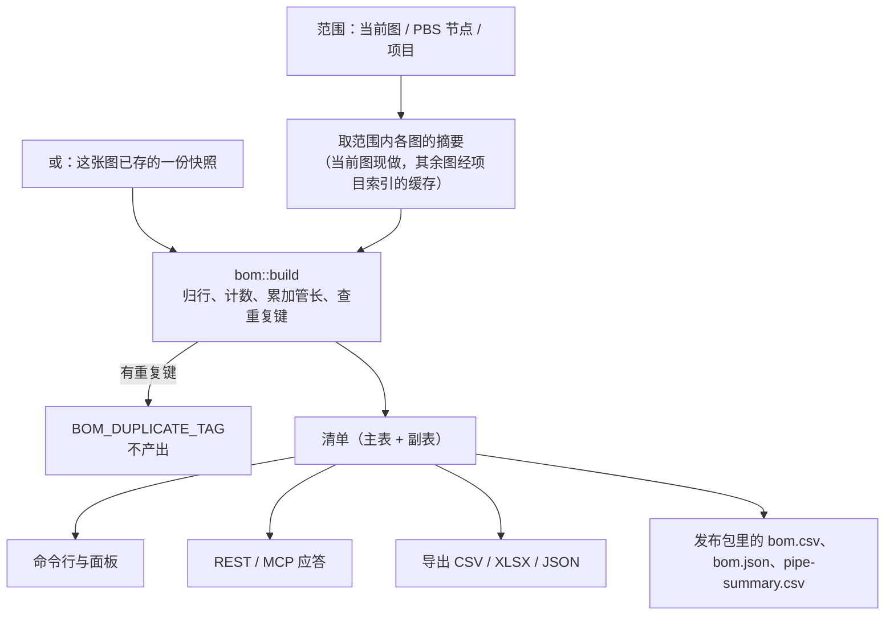

# SPEC：材料清单（`pid-bom`）

> 状态：**待建；规格已确认**（2026-11-16，§9 的待决问题都按「建议」定）。基线 `main @ 9b5327f96`。
> 依据：已批准计划 T3.3 第 1 项；需求 `REQ-DELV-001`–`005`（`docs/pid-platform/requirements/60-deliverables-and-publish.md`）。
> 共用约定见 `01-shared-conventions.md`；输入数据见 `SPEC-pid-project-index.md`（图纸摘要）。

## 1. 目标

从图纸算出一份材料清单：每台设备、每个阀门、每台仪表一行，每条管路上的管件合成一行，每条管线一行管长。可以按一张图、一个 PBS 节点、整个项目来算，导出 CSV、XLSX、JSON。硬性保证：**同一个（类型编码，位号）在一份清单里至多一行**。

## 2. 现状

- 没有材料清单功能。P&ID 外壳里的「材料清单」屏是空的占位（`src/app/pid_shell/bom.rs`）。
- 写表格文件有现成的 `write_extraction_file(path, rows)`（`src/app/annotation_data.rs`），按扩展名写 `.xlsx` / `.csv` / `.txt`。它写的 CSV 没有 BOM 头。
- 不单独编号的管件，记录里的位号就是所在管路的位号（`PIDFITTING`），与需求「管件继承所属管路的位号」一致。
- 管长只有图面上的几何长度，没有「实际长度」属性。图纸长度单位在图纸头变量 `INSUNITS` 里。

## 3. 数据格式

### 3.1 哪些对象出行、怎么算数量

输入是范围内各图的摘要。按对象种类：

| 种类 | 行键（类型编码，位号） | 数量 | 单位 | 说明 |
|---|---|---|---|---|
| 设备 | 自己的类型编码与位号 | 1 | 台 | 每个位号一行，不合并 |
| 仪表 | 同上 | 1 | 台 | 同上 |
| 阀门 | 同上 | 1 | 个 | 同上 |
| 其他（有自己编号的） | 同上 | 1 | 个 | 同上 |
| 管件（不单独编号） | `FITTING` 与所在管路的位号 | 这条管路上的管件个数 | 个 | 同一条管路上的合成一行 |
| 管线 | `PIPE_LINE` 与管线位号 | 名下所有线段的长度之和 | m | 管路的管段和管线自己的线都算 |
| 管路、管段、打断符、页间连接符、信号线 | — | — | — | 不出行。管路的位号只用来归拢管件 |

细则：

- **管长**：每根线段的图面长度按图纸单位换算成米（`mm` ×0.001，`cm` ×0.01，`m` ×1，`in` ×0.0254，`ft` ×0.3048），先累加再四舍五入到 2 位小数。舍入前加 `1e-9`，避免 24.505 因为浮点误差被舍成 24.50（需求的例子：10.005 + 8.5 + 6 显示 24.51）。
- **图纸没设单位**（`unitless`）：按毫米算，清单的 `length_unit_assumed` 置真，并给一条提示。范围里各图单位不同时各自换算后再累加。
- **位号为空的设备、阀门、仪表**：不出行，列在 `skipped` 里（原因 `empty_tag`）。清单照常产出。
- **重复位号**：设备、阀门、仪表、其他这四类里，同一个（类型编码，位号）有两个以上实例——不论在同一张图还是范围内的不同图——整份清单不产出，返回 `BOM_DUPLICATE_TAG` 并列出这些键和各自的位置。不合并、不相加、也不各占一行。类型编码不同而位号相同的（泵 `P-1001` 与阀门 `P-1001`）各占一行，不算重复。
- **同一条管线画在几张图上**（经页间连接符延续）：合成一行，长度相加，`drawings` 列出各图。不同图上管路位号相同的管件行同样合并。
- **名称**：对象的 `名称` 属性；没填就用类型的显示名。管件行写各种符号及个数，如 `弯头×2、三通×1`（符号库里的显示名，没有就用符号 id）。
- **规格**：`型号`、`规格` 两个属性里非空的，用空格连起来。管线行写 `<管道等级> DN<公称直径>`，缺的部分省略。
- **行序**：先按种类（管线、设备、阀门、仪表、管件、其他），再按位号。`序号` 从 1 连续编。同样的图两次算出的清单相同。

### 3.2 清单 JSON

```json
{
  "ok": true,
  "version": 1,
  "generated_at": 1794800000,
  "scope": { "kind": "drawing", "drawing_id": "PID-1101", "pbs": null },
  "source": "live",
  "snapshot_seq": null,
  "length_unit_assumed": false,
  "rows": [
    { "seq": 1, "kind": "管线", "type_code": "PIPE_LINE", "tag": "L-1001", "name": "工艺水进料管线",
      "spec": "A1A DN50", "quantity": 24.51, "unit": "m", "instances": 3, "drawings": ["PID-1101"] },
    { "seq": 2, "kind": "设备", "type_code": "PUMP", "tag": "P-1001", "name": "离心泵",
      "spec": "", "quantity": 1, "unit": "台", "instances": 1, "drawings": ["PID-1101"] },
    { "seq": 3, "kind": "阀门", "type_code": "VALVE", "tag": "V-1001", "name": "闸阀",
      "spec": "", "quantity": 1, "unit": "个", "instances": 1, "drawings": ["PID-1101"] },
    { "seq": 4, "kind": "仪表", "type_code": "INSTRUMENT", "tag": "TI-1001", "name": "温度变送器",
      "spec": "", "quantity": 1, "unit": "台", "instances": 1, "drawings": ["PID-1101"] },
    { "seq": 5, "kind": "管件", "type_code": "FITTING", "tag": "L-1001-01", "name": "弯头×3",
      "spec": "", "quantity": 3, "unit": "个", "instances": 3, "drawings": ["PID-1101"] }
  ],
  "pipe_summary": [
    { "pipe_class": "A1A", "nominal_diameter": "50", "insulation_class": "", "length": 24.51, "unit": "m", "lines": ["L-1001"] }
  ],
  "skipped": [
    { "reason": "empty_tag", "kind": "仪表", "type_code": "INSTRUMENT", "drawing_id": "PID-1101", "at": [300.0, 40.0], "handle": "2E0" }
  ],
  "totals": { "rows": 5, "by_kind": { "管线": 1, "设备": 1, "阀门": 1, "仪表": 1, "管件": 1 } },
  "notices": []
}
```

| 字段 | 说明 |
|---|---|
| `scope` | 范围：`kind` 取 `drawing` / `pbs` / `project` |
| `source`、`snapshot_seq` | `live`：从当前图纸算的，`snapshot_seq` 为 `null`。`snapshot`：从这张图已存的某份快照算的，`snapshot_seq` 是快照序号（只支持单图范围，见 `SPEC-pid-snapshot.md`） |
| `rows[].instances` | 这一行由几个实例算出：管线行是线段条数，其余是对象个数 |
| `rows[].quantity` | 管线行保留 2 位小数，其余是整数 |
| `pipe_summary[]` | 副表「管道汇总」，见 §3.3 |
| `skipped[]` | 没出行的对象及原因；目前只有 `empty_tag` |
| `notices[]` | `{code, message}`；取值 `LENGTH_UNIT_ASSUMED`、`LENGTH_FROM_DRAWING`（管长是图面长度，见待决问题 B1） |

### 3.3 副表：管道汇总

计划里要求「按（管道等级，公称直径，绝热等级）累加管长」。它与需求的「每条管线一行」不是同一张表，做成副表：

- 每根线段按它的主人取三个值：管段取所属管路的当前值（管路可以覆盖管线的直径），管线自己的线取管线的值。
- 三个值都相同的归成一行，长度相加（米，2 位小数），`lines` 列出涉及的管线。没填的值记空串，单独成组。
- 各行长度之和等于主表管线行长度之和（允许每行 0.005 米以内的舍入差）。

### 3.4 导出文件

**列**。默认九列，前六列就是需求定的标准表头，顺序不变：

| 序号 | 类型 | 位号 | 名称 | 数量 | 单位 | 规格 | 类型编码 | 图纸 |
|---|---|---|---|---|---|---|---|---|
| 1 | 管线 | L-1001 | 工艺水进料管线 | 24.51 | m | A1A DN50 | PIPE_LINE | PID-1101 |
| 2 | 设备 | P-1001 | 离心泵 | 1 | 台 | | PUMP | PID-1101 |

可以用 `columns` 参数选列、排列（写列名）；写了不认识的列名报 `BOM_COLUMN_UNKNOWN`。「图纸」一格里有多张图时用分号隔开。

| 格式 | 怎么写 |
|---|---|
| CSV | UTF-8，文件头带 BOM（否则 Excel 打开中文乱码）；第一行是列名；逗号分隔；含逗号、引号、换行的格子加双引号，引号成双。由本模块写，转义复用 `rows_to_csv` |
| XLSX | 一个工作表，第一行列名，用 `write_extraction_file`。没有样式 |
| JSON | §3.2 的对象，缩进 2 格 |

副表另导一个文件（列：管道等级、公称直径、绝热等级、长度、单位、管线），JSON 里则随主表一起。格式由文件扩展名决定，其它扩展名报 `BOM_FORMAT_UNSUPPORTED`。

### 3.5 错误码

| 码 | 何时 | HTTP |
|---|---|---|
| `BOM_DUPLICATE_TAG` | 范围内有重复的（类型编码，位号）；应答带 `duplicates`（键和各处位置）；清单不产出，文件不写 | 409 |
| `BOM_SCOPE_INCOMPLETE` | 范围内有图读不出来；应答列出这些图。少算的清单比没有清单更糟，所以不产出 | 409 |
| `SCOPE_NOT_SELECTED` | 范围是 PBS 节点而没给节点号 | 400 |
| `PBS_NODE_UNKNOWN` | 节点号不在主数据里 | 404 |
| `INDEX_NO_PROJECT_DIR` | 要项目或节点范围而当前图没保存过 | 409 |
| `BOM_COLUMN_UNKNOWN`、`BOM_FORMAT_UNSUPPORTED` | 列名不认识；导出文件扩展名不支持 | 400 |
| `SNAPSHOT_NOT_FOUND` | 指定序号的快照不存在（沿用快照模块的码） | 404 |

## 4. 数据怎么传



- 清单是算出来的，不存进图，没有「改写一份清单」这回事：图改了就重新算。
- `bom::build` 只吃摘要，不碰图纸和文件；写文件在命令层。
- 发布时的清单从发布那一刻的快照算，所以发布包里的清单与快照是对得上的。

## 5. 对外接口

### 5.1 模块接口（`src/pid/bom.rs`）

```rust
pub struct BomOptions { pub scope: BomScope, pub source: BomSource /* Live | Snapshot(seq) */ }

/// 算清单。纯函数。有重复键返回 BomError::DuplicateTag(…)。
pub fn build(drawings: &[DrawingSummary], options: &BomOptions) -> Result<Bom, BomError>;
/// 主表转成「第一行列名，其后每行一条」的文本表，给 CSV / XLSX 用。
pub fn rows(bom: &Bom, columns: Option<&[String]>) -> Result<Vec<Vec<String>>, BomError>;
/// 副表同理。
pub fn pipe_summary_rows(bom: &Bom) -> Vec<Vec<String>>;
/// CSV 字节（带 BOM 头）。
pub fn csv_bytes(rows: &[Vec<String>]) -> Vec<u8>;
```

### 5.2 命令（`src/app/commands/pidbom.rs`）

| 命令 | 做什么 |
|---|---|
| `PIDBOM` | 算当前图的清单，输出：各类几行、管长合计、跳过了几个对象 |
| `PIDBOM PROJECT` / `PIDBOM PBS <节点号>` | 按项目 / 按节点算 |
| `PIDBOM EXPORT <文件> [PROJECT \| PBS <节点号>]` | 导出主表；扩展名定格式。另在同目录写副表 `<文件名>-pipe-summary.<扩展名>`（JSON 除外） |
| `PIDBOM SNAPSHOT <序号> [EXPORT <文件>]` | 从这张图已存的一份快照算 |

都不改图，`PIDBOM` 整个加进只读会话的允许名单（导出写的是本机文件，不是图纸）。目标文件已存在时覆盖。

### 5.3 自动化操作与 REST

| 操作 | REST | 读写 | 请求 | 应答 |
|---|---|---|---|---|
| `pid_bom` | `GET /api/v1/pid/bom` | 读 | `scope`（默认 `drawing`）、`pbs`、`snapshot`（快照序号） | §3.2 的清单；项目扫描没做完时 `{"ok":true,"status":"scanning","done":12,"total":40}` |
| `pid_bom_export` | `POST /api/v1/pid/bom/export` | 写（本机文件） | `path`，及上面的范围参数，可选 `columns` | `{"ok":true,"path":"…","format":"csv","rows":5,"bytes":412,"pipe_summary_path":"…"}` |

MCP：`pid_bom` 进 `READ_OPS`，`pid_bom_export` 进 `EXECUTE_OPS`。

### 5.4 权限

没连协同不设限；只读会话可以算、可以导出。协同权限表里的「导出图纸」这一项，客户端目前无从得知自己有没有，本期不按它鉴权。

## 6. 成功标准

1. 阀门 `V-1001`、`V-1002` 各一行、数量各为 1；管路 `L-1001-01` 上三个管件合成一行、数量 3；泵 `P-1001` 与阀门 `P-1001` 各占一行。
2. 同一类型下两个实例同位号 → `BOM_DUPLICATE_TAG`，没有清单，没有写文件。
3. 三根线段 10.005、8.5、6 米 → 管线行数量 24.51。一条管线跨多段、跨两条管路、连同它自己的线，合成一行。
4. 图纸单位是毫米时 24510 个图纸单位显示 24.51 m；没设单位时按毫米算并有提示。
5. 任意一份产出的清单里，（类型编码，位号）没有重复——在 `build` 的出口做断言，测试里用随机输入验证。
6. 副表各行长度之和与主表管线行长度之和一致（舍入差以内）。
7. 范围三选一：项目范围的行数等于各图对象归并后的行数；节点范围不给节点报 `SCOPE_NOT_SELECTED`。
8. 导出的 CSV 以 BOM 头开始、用 Excel 打开中文正常；XLSX 能被 `calamine` 读回且内容相同；JSON 能解析回同一份清单。
9. 性能：2,000 个对象的图算一份清单（含做摘要）不超过 300 ms。

## 7. 测试

| 层 | 测什么 |
|---|---|
| 单元（`src/pid/bom.rs`） | §3.1 表的每一行；舍入边界（24.505、24.504999、0.005）；五种单位换算与未设单位；空位号跳过；重复键报错；跨图合并；行序稳定；副表分组与合计；选列与未知列 |
| 不变量 | 随机生成摘要（含重复位号、空位号、多图），断言：要么报 `BOM_DUPLICATE_TAG`，要么产出的清单键不重复 |
| 命令与操作 | 用命令建图（泵、容器、带阀门的管路、仪表），`PIDBOM` 与 `pid_bom` 的结果；三种格式导出后读回比对；只读会话里能导出 |
| REST | 两个路由、状态码（`BOM_DUPLICATE_TAG` → 409）、`rest_openapi.json` 一致、MCP 名单与摘要值 |

要动的文件：新建 `src/pid/bom.rs`、`src/app/commands/pidbom.rs`；改 `src/pid/mod.rs`、`src/app/annotation_data.rs`（把 `rows_to_csv` 放宽到模块外可用）、`src/app/commands/mod.rs`、`src/app/command_driver/utilities.rs`（整行名单）、`src/app/collab/apply.rs`、`src/app/control/mod.rs`、`src/rest.rs`、`src/rest_openapi.json`、`src/mcp.rs`。

## 8. 不在范围与已知限制

- 报表模板（`REQ-DELV-004`、`005`：模板 JSON、字段映射、模板选择、`TEMPLATE_NOT_SELECTED`）不做。本期是固定的列加选列参数。
- 清单不导出 PDF。
- 信号线不进清单。
- 没有人工改清单数量的入口：数量只从图上来。
- 两条线画重叠了，管长会重复计算；规则 `DR-110` 会提示重叠。

## 9. 待决问题

> **2026-11-16 已定**：本节各条都按「建议」一栏执行。汇总见 `plan.md` §3，对应的任务见 `todo.md`。

| # | 问题 | 建议 |
|---|---|---|
| B1 | **管长用的是图面长度。** P&ID 通常是示意图，不按比例画，图上一根线的长度不等于实际管长。计划和需求都要求「累加管段长度」，而图里只有几何长度这一个来源 | 照计划做，按图面几何长度算；清单里带一条说明「管长为图面长度」。要真实管长得另有数据来源（人工填写或来自配管模型），不在本期 |
| B2 | **管线按什么归行。** 需求：每条管线一行。计划：按（管道等级，公称直径，绝热等级）累加 | 主表照需求（它保证了「每个键至多一行」），计划的口径做成副表「管道汇总」，两张表都导出 |
| B3 | **报表模板不做**（§8）。计划里的「报表列模板筛选」 | 用选列参数满足；模板留给平台服务端 |
| B4 | **范围内有图读不出来时不出清单。** 也可以出一份并标明「不完整」 | 不出。材料清单是拿去采购和核算的，少算了不容易被发现 |

## 10. 需求对照

| 需求 | 本期 | 说明 |
|---|---|---|
| `REQ-DELV-001` 聚合键与唯一性不变量 | 覆盖 | 行键、管件合并、`BOM_DUPLICATE_TAG`。「已删除实例不计入」在桌面端自然成立：删掉的对象不在图里 |
| `REQ-DELV-002` 数量公式与计量单位 | 覆盖 | 管长累加与舍入、按类型的默认单位 |
| `REQ-DELV-003` 聚合范围与快照绑定 | 部分 | 三种范围、`SCOPE_NOT_SELECTED` 已做。清单不是可改写的存储对象，所以没有 `SNAPSHOT_IMMUTABLE` 的场景；从快照算的清单带快照序号，发布包里的清单绑定发布时的快照 |
| `REQ-DELV-004`、`005` 报表模板 | 不做 | 见 B3 |
| 计划 T3.3「按（类型编码，位号）去重聚合，任意键最多 1 行」 | 覆盖 | §3.1、成功标准 5 |
| 计划 T3.3「汇总型号规格与所在图号」 | 覆盖 | `规格`、`图纸` 两列 |
| 计划 T3.3「按（管道等级，公称直径，绝热等级）累加管长」 | 覆盖 | 副表，见 B2 |
| 计划 T3.3「列模板筛选，导出 UTF-8 CSV 与 JSON」 | 覆盖 | 选列参数；CSV、JSON，另加 XLSX |

## 11. 实现记录

实现与本规格、任务文字有出入的地方，以及规格没写到、实现时定下的读法，记在这里（`todo.md` §1 第 7 条）。

### 11.1 `BOM-1`：归行与计数（2026-11-21）

**做了什么**（新文件 `src/pid/bom.rs`，`src/pid/mod.rs` 登记一行）：

- §5.1 的 `BomOptions`、`build`，和清单的数据对象 `Bom`、`BomRow`、`Quantity`、`PipeSummaryRow`、`Skipped`、`SkipReason`、`Totals`、`ByKind`、`Notice`、`BomScope`（及 `ScopeKind`）、`BomSource`、`SourceKind`、`BomError`。这一步只出设备、阀门、仪表、其他和管件的行；管线行、管长、副表和两条提示是 `BOM-2` 的，在那之前 `pipe_summary`、`notices` 总是空的，`length_unit_assumed` 总是假。`rows`、`pipe_summary_rows`、`csv_bytes` 是 `BOM-3` 的。
- 另外公开的：格式版本 `BOM_VERSION`（1）、错误码 `BOM_DUPLICATE_TAG`、管件行的类型编码 `FITTING_ROW`（`FITTING`）、`symbol_labels`（由符号库得出「块名 → 显示名」）、范围的三个构造函数 `BomScope::drawing` / `pbs` / `project`。

**与规格写法不同的：**

1. **`BomOptions` 多两项。** `generated_at`：`build` 是纯函数，不读时钟，生成时间（Unix 秒，同项目索引的 `generated_at`）由调用方给。`symbol_labels`：管件行的名称要用符号库里的显示名，摘要里只有块名，`build` 又只吃摘要（§4），所以由调用方把符号库换成「块名 → 显示名」的表传进来（`symbol_labels(&SymbolLibrary)`）。两项都由 `BOM-4` 的入口函数填。
2. **`Bom` 里没有 `ok`。** §3.2 例子开头的 `"ok": true` 由应答那一层加（同规则检查的结果），清单对象从 `version` 开始，其余字段和顺序照 §3.2。
3. **重复键还包括「撞上管件行」的。** §3.1 只说了四类之间的重复。一个「其他」对象的类型编码是 `FITTING`、位号又恰好是一条有管件的管路的位号时，它的行与那条管路的管件行键相同；这种也按重复报 `BOM_DUPLICATE_TAG`，`places` 里两边的位置都列。不这么做，「每个键至多一行」就保证不了。
4. **位号为空的「其他」不列进 `skipped`。** 任务文字写的是「位号为空的不出行，列进 `skipped`」，没分种类；这里照 §3.1 的细则只列设备、阀门、仪表。表里出行的是「其他（有自己编号的）」，没编号的其他对象不是清单里的东西，列出来只会淹没真要补位号的那几个。

**规格没写到、这里定下的：**

1. **位号为空**按去掉两头空白以后为空算；不空的位号按原样做键。
2. **管件属于哪条管路**：摘要里的归属（`owner`）；没有就用记录里的位号（不单独编号的管件记的就是管路的位号）。两样都空的管件不在任何管路上，按 `empty_tag` 列进 `skipped`（`type_code` 是 `FITTING`），清单照常产出。打断符不是管件，不出行也不列。
3. **管件行的名称**：各种符号按个数从多到少，一样多的按显示名的字节序；显示名取符号库的，库里没有的写块名，不是块插入（摘要里 `symbol` 为空）的写类型的显示名。各项之间用「、」，个数前用「×」；规格是空串。
4. **名称、规格**用的属性值去掉两头空白，只有空白的算没填。
5. **行序里的「按位号」**是字节序；同一种类里位号相同的（阀门 `VALVE` 与 `VALVE_GATE` 都叫 `V-1001` 这类）再按类型编码的字节序。
6. **排序**：`skipped` 和重复键的 `places` 按图号、定位点（先 x 后 y）、句柄排，与项目索引里「出现处」的排法相同；各重复键按（类型编码，位号）排。传进来的图谁先谁后，结果都一样。
7. **范围**写成结构体 `BomScope { kind, drawing_id, pbs }`（即 §3.2 的 `scope`）。`build` 不按范围筛图：传进来的摘要就是范围内的，按范围取摘要是命令层的事（§4）；范围和来源只照抄进清单。
8. **数量** `Quantity` 有两种：个数（整数）和长度（米，留给 `BOM-2`）；JSON 里直接是数，个数写成整数。
9. **`by_kind`** 按行序的种类写，没有的种类不写（§3.2 的例子就是这样）。
10. **出口断言**：`build` 返回前对排好的行再查一遍键不重复，查到就 panic——重复的键前面已经拦下了，走到这里是程序错，不是输入错。

**测试**（同文件，7 条）：§3.1 表里设备、阀门、仪表、其他、管件各行（名称取属性或显示名、规格去空白、管件行名称的排法、库里没有的符号与不是符号的管件、管路管线打断符信号线不出行）、行序与 `seq`、`totals`；跨图合并管件行、范围与来源照抄、图的先后不影响结果；重复键（跨图、同图、撞上管件行）报 `BOM_DUPLICATE_TAG` 并列出各处；空位号进 `skipped`、清单照常产出；JSON 字段与顺序、读回相同；`symbol_labels` 与内置符号库一致；随机摘要的不变式（600 轮，每轮 1–3 张图，含重复位号、空位号、同一条管路的管件、键撞上管件行的；报不报、报哪些键与照定义另算的一致，产出的键不重复，同样的输入两次结果相同，图倒过来结果也相同）。先放空壳，7 条都编得过、都败在断言上；实现后全过。

### 11.2 `BOM-2`：管线行、管长与副表（2026-11-21）

**做了什么**（只动 `src/pid/bom.rs`）：

- 管线行：每个管线位号一行，类型编码 `PIPE_LINE`。名下的线段（管路的管段和管线自己的线）按各自图纸的单位换算成米，先累加再留 2 位小数（舍入前加 `1e-9`）；`instances` 是线段条数，`drawings` 是画了这条管线的对象或线段所在的图；规格写 `<管道等级> DN<公称直径>`，缺的部分省略。
- 副表 `pipe_summary`（§3.3）；两条提示 `LENGTH_UNIT_ASSUMED`、`LENGTH_FROM_DRAWING`；`length_unit_assumed` 照实填。
- 另外公开的：管线行的类型编码 `PIPE_LINE_ROW`（`PIPE_LINE`），两条提示的码 `LENGTH_UNIT_ASSUMED`、`LENGTH_FROM_DRAWING`。

**与规格写法不同的：**

1. **§3.2 的例子里有管线行，`notices` 却是空的。** 按 §9 B1 的决定（清单里带一条「管长为图面长度」的说明），只要有管线行，`notices` 里就有一条 `LENGTH_FROM_DRAWING`；没有管线行时不带。例子与 B1 不一致，这里以 B1 为准。
2. **撞上管线行的也算重复键。** 与 §11.1 第 3 条同理：四类对象里类型编码是 `PIPE_LINE`、位号又恰好是一条管线的位号时，它的行与那条管线的管线行键相同，也按重复报 `BOM_DUPLICATE_TAG`。`places` 列出那条管线的管线对象；一个管线对象也没有（只画了管段）时列出它的线段，位置是线段起点。

**规格没写到、这里定下的：**

1. **单位**：摘要里的单位不是 `mm`、`cm`、`m`、`in`、`ft` 这五种的——`unitless`，以及 `km`、`yd` 这类五种之外的——一律按毫米算，同样把 `length_unit_assumed` 置真并给 `LENGTH_UNIT_ASSUMED`，提示里按图号列出这些图和摘要里写的单位（如 `PID-6（unitless）、PID-7（km）`）。只看真有线段算进管长的图：单位是假定的、但没有线段算进来的图不提示。
2. **线段归哪条管线**：看摘要里线段的 `line`（管段记的是它所在管路的管线，管线自己的线记的是那条管线的位号）。去掉两头空白后为空的——管段不在任何管路上、管路不在任何管线名下、管线没有位号——不算进管长，也不进副表（这样两张表的合计才对得上），按 `empty_tag` 列进 `skipped`：种类记管线，`type_code` 是 `PIPE_LINE`，位置是线段起点，句柄是线段的句柄。位号为空的管线对象本身不列，它的线段已经列了。
3. **哪些管线出行**：有管线对象或有线段的每个管线位号都出一行；只有管线对象、没有一根线段的（比如画成了摘要读不出两端的图元）数量是 0、实例数是 0。管线行的类型编码总是 `PIPE_LINE`，不看管线对象自己记的类型编码。
4. **管线行的名称、规格**：每一项取第一个填了这一项的管线对象（按图号，同一张图按摘要里的顺序），属性值去掉两头空白。名称都没填时用第一个管线对象的类型显示名；一个管线对象也没有（只画了管段）时用「管线」。公称直径本来就以 `DN` 开头（不分大小写）的照写，不再加 `DN`。
5. **副表里线段的主人**：管段取这张图上位号是它所在管路的那个管路对象。这张图上没有那个管路对象的管段，和管线自己的线一样，取这张图上的管线对象；这张图上也没有，就取这条管线的第一个管线对象；都没有时三个值都是空串。三个值去掉两头空白后逐字比，`DN50` 与 `50` 不归一组。
6. **副表的行序**：按（管道等级，公称直径，绝热等级）的字节序，没填的空串排在前面；`lines` 按字节序。
7. **累加的顺序**：`build` 先把传进来的图按图号排好；每根线段先按它那张图的单位换算成米，再按「图号、摘要里的线段顺序」累加，最后舍入。管线行和副表各自这样算，所以传进来的图谁先谁后，结果都一样；两张表的合计之差不超过各行舍入差之和。

**测试**（同文件，新增 3 条，改了 4 条，共 10 条）：新增的——管线自己的线 10.005 米加两条管路上的 8.5、6 米合成一行 24.51、实例数 3，舍入边界 24.505、24.504999、0.005，名称与规格，管线行排在最前，`LENGTH_FROM_DRAWING`，JSON 与 §3.2 例子的管线行相同、读回相同；五种单位各一例（毫米图上 24510 → 24.51），`unitless` 与 `km` 按毫米算并提示，同一条管线跨两张单位不同的图各自换算后相加，图倒过来结果相同；副表按主人取值（管路覆盖了直径的单独成组、找不到管路的取管线的、没填的单独成组、`DN80` 照写），行序、`lines`、两表合计相同、JSON。改了的——第一条去掉管线对象（管线现在出行，另有专门的测试）；重复键加上撞上管线行的两例（有管线对象的、只有线段的）；空位号加上两根管线位号为空的线段；随机不变式加上各图单位不同的线段和 `PIPE_LINE` 类型，另查副表与管线行的合计相差不过每行 0.005 米、管线行实例数合起来是有管线位号的线段数、两条提示与 `length_unit_assumed` 和有没有管线行对得上。先只放三个常量的空壳，10 条都编得过，6 条败在断言上（另 4 条不涉及管线）；实现后 10 条全过。

### 11.3 `BOM-3`：选列、CSV 字节与性能预算（2026-11-21）

**做了什么**（动了 `src/pid/bom.rs`、`src/app/annotation_data.rs`、`src/app/mod.rs`）：

- `rows(bom, columns)`：主表转成「第一行列名，其后每行一条」的文本表，默认九列照 §3.4；`columns` 选列、排列，写了不认识的列名返回 `BomError::ColumnUnknown`（码 `BOM_COLUMN_UNKNOWN`），不出表。
- `pipe_summary_rows(bom)`：副表六列，照 §3.4（管道等级、公称直径、绝热等级、长度、单位、管线）。
- `csv_bytes(rows)`：文件头 `EF BB BF`，其后是 `rows_to_csv` 写的 UTF-8 文本；`rows_to_csv` 放成 `pub(crate)`。
- 性能预算测试 `bom_build_2000_objects_within_300_ms`（`#[ignore]`，3 次取中位数），用 `IX-4` 的合成图。
- 另外公开的：错误码 `BOM_COLUMN_UNKNOWN`。

**与规格写法不同的：**

1. **多动了 `src/app/mod.rs` 的一个词。** §7 只说把 `rows_to_csv` 放宽到模块外可用，但它所在的 `annotation_data` 是 `app` 的私有模块，只把函数放成 `pub(crate)`，`pid` 还是用不到；把 `mod annotation_data;` 改成 `pub(crate) mod annotation_data;`（同文件里 `control`、`commands` 等也这样写）。没有另加一行转出，免得这个文件后面的行号都变、clippy 告警的位置对不上。

**规格没写到、这里定下的：**

1. **「类型」一列**写种类名：管线、设备、阀门、仪表、管件、其他，与 `totals.by_kind` 的写法一样。
2. **数量和长度的写法**：个数写整数；米数写满两位小数（`24.50`、`0.00`），副表的长度也是。JSON 里照旧是数（§3.2）。
3. **分号**用半角 `;`，前后不留空格；副表「管线」一格有几条管线时也这样隔开。
4. **列名**：只认 §3.4 的九个中文列名，去掉两头空白再比；同一列可以要几次；`columns` 给了空表等于没给，是默认九列。不认识的按给的先后全部列出，错误信息里每个加「」，后面附上可用的列名。
5. **空清单**也有列名那一行，主表、副表都是。
6. **CSV 的换行**照 `rows_to_csv` 用 `\n`，最后一行后面也有；含回车的格子也加引号（`rows_to_csv` 原本如此）。
7. **预算计时的范围**：做摘要、取符号的显示名（`symbol_labels`）、算清单——`BOM-4` 的入口函数每算一次都做这三件事；转文本表、写 CSV 不算在内。按 `cargo test` 的默认配置量（本 crate 不优化）。合成图每组 20 个对象出 14 行（2,000 个对象出 1,400 行），没有跳过的。

**测试**（同文件，新增 5 条、改了 1 条，共 15 条，其中预算一条默认不跑）：新增的——默认九列（列名与先后，前两行就是 §3.4 的例子；米数写满两位；「图纸」一格分号隔开；空的选列等于默认）；选列、换序（去空白、同一列两次）与 `BOM_COLUMN_UNKNOWN`（不认识的全列出、错误信息）；副表六列，空清单只有列名；CSV 以 `EF BB BF` 开始，逗号、引号、换行、回车的转义，默认列的整份 CSV 逐字节对；2,000 个对象的预算（各种类行数、没有跳过的）。改了的——随机不变式加上：默认列的文本表比清单多一行、每行九格、序号一列就是行序，副表的文本表多一行，CSV 行数与文本表相同；对结果的 `match` 补上别的错误直接判失败的分支。先只放错误码、`ColumnUnknown` 和三个返回空值的函数，第一次没编过（那个 `match` 没覆盖新变体），补上分支后默认跑的 14 条里 5 条败在断言上（4 条新的和随机不变式），另 9 条过；预算一条只用到 `build`，那时就过（中位数 71.10 ms）。实现后 14 条全过，预算一条中位数 76.01 ms（其中做摘要约 70 ms）。

### 11.4 `BOM-4`：命令 `PIDBOM`（2026-11-21）

**做了什么**（新建 `src/app/commands/pidbom.rs`；动了 `src/app/commands/mod.rs`、`src/app/command_driver/utilities.rs`、`src/app/collab/apply.rs`，另有两个文件见下）：

- 入口函数 `OpenCADStudio::pidbom_compute(Sheets)`：`Sheets::Current(i)` 现做第 `i` 个标签页的图的摘要（默认连接容差；图号、PBS 的取法同 `PIDINDEX`），`Sheets::Scanned` 取项目扫描扫好的摘要里在范围内的图；填好 `BomOptions`（`source` 是 `live`，`generated_at` 取系统时钟的 Unix 秒，`symbol_labels` 取当前的符号库）交给 `bom::build`，得到清单和算进去的图数，不碰命令行。算不出来时是 `BomFailure`，三种：读不了当前图（索引的错误码）、范围内有图读不出来（`BOM_SCOPE_INCOMPLETE`，带着这些图）、清单本身的错（`BOM_DUPLICATE_TAG`）。`BOM-5` 的两个操作、以后的面板和发布都从这里算。
- 命令的四种写法（§5.2）。按项目、按节点算借 `PIDINDEX` 的后台扫描：扫描后接着做的事多一种 `Then::Bom`，用默认连接容差和同一份缓存，扫完接着算；只算当前图时不扫项目，当场算。
- 导出（§3.4）：CSV 的主表、副表都用 `csv_bytes`；XLSX 两份都用 `write_extraction_file`；JSON 是带 `ok` 的整份清单，缩进 2 格，副表在里面、不另写文件。
- 登记：命令表加 `PIDBOM`；登记成整行命令（命令行上的 `PIDBOM PROJECT` 不会先拿裸动词算一遍当前图）；整个进只读会话的允许名单。
- 另外公开的（`pub(in crate::app)`）：错误码 `BOM_FORMAT_UNSUPPORTED`、`BOM_SCOPE_INCOMPLETE`、`SCOPE_NOT_SELECTED`。

**与规格写法不同的：**

1. **多动了两个文件。** 任务只列了上面三个。项目扫描在 `src/app/commands/pidindex.rs` 里，扫完做什么由它的 `Then` 决定，按项目、按节点算要在那里加 `Then::Bom` 和起扫描的 `pidindex_bom`（与 `PIDCHECK PROJECT` 的接法相同）；当前图的图号和 PBS 用它的 `drawing_meta`，位置的写法用它的 `point`，这两个放成 `pub(super)`。节点号认不认照 `PIDCHECK PBS`，用 `src/app/commands/piddrc.rs` 的 `pbs_known`，也放成 `pub(super)`。都没有另写一份。

**规格没写到、这里定下的：**

1. **范围的写法**：命令名和 `PROJECT`、`PBS`、`EXPORT` 不分大小写；`PROJECT` 后面不再跟别的，`PBS` 后面只跟一个节点号。`PBS` 后面没写节点号报 `SCOPE_NOT_SELECTED`；别的写错的说怎么写，不带错误码（不是 §3.5 的那几种错）。
2. **导出的文件名**：有空格时加双引号，没写文件名或引号没配对时说怎么写。不是完整路径的从当前图所在目录算起，没存过的图从程序的当前目录算起。扩展名不分大小写（`.XLSX` 也认）；副表的扩展名照主表的写法。
3. **先认文件再算**：扩展名不支持时在算清单、扫项目之前就报 `BOM_FORMAT_UNSUPPORTED`；文件名是项目文件 `pid-project.json`（不分大小写）的不写——它的扩展名是 `.json`，不拦就会被清单盖掉。
4. **不出清单时**：§3.5 那几种错都连同错误码说，不写文件。重复的键逐个列出各在哪张图的哪里；读不出来的图逐个列出文件和原因。`BOM_SCOPE_INCOMPLETE` 只看范围内的图：按节点算时，归在节点以外的图读不出来不影响。没存过的图要按项目、按节点算报 `INDEX_NO_PROJECT_DIR`，节点号不认识报 `PBS_NODE_UNKNOWN`，这两种都在扫项目之前报。
5. **说法**：先一行，说范围（当前图，有图号的说图号；节点及其图数；全项目及其图数）、几行（各种类几行，按行序，0 的不说）、管长合计（两位小数）、跳过几个；再逐个列出跳过的对象（种类、类型编码、哪张图的哪里、句柄、原因）；每条提示一行，带码。导出成功时再说写了几行、写成什么格式的哪个文件，副表几行、写在哪。逐个列的都最多 10 个，多的说还有几个没列出。
6. **写文件出错**（目录不存在、文件被占用等）说写不了哪个文件和原因，不带错误码。先写主表后写副表，副表写不了时已写的主表留着。
7. **JSON 文件**：§3.2 的对象带 `"ok": true`，清单对象本身不带（`BOM-1` 定的），写文件时加上；末尾一个换行。

**测试**（`pidbom.rs` 里新增 8 条；`src/app/collab/apply.rs` 只读名单那条测试加了 5 种写法）：用命令建图——泵、容器、不在线上的阀门、管线、带阀门和管件的管路、两台仪表（前一台手填位号 PT-1001，后一台位号是空的）——`PIDBOM` 说的各种类行数、管长合计、跳过的对象和提示与入口函数算的一样，前后「已修改」、撤销栈、编辑修订号都不变；两张图的项目，全项目 3 行（同一根管线合成一行、两张图都列上），按节点只算归在节点及其下级的图；三种格式导出后读回（CSV 逐字节对、XLSX 用 `calamine` 读回、JSON 解析回同一份清单），目标已存在时覆盖，选列与不认识的列；不写文件的三种情形（重复位号、扩展名不支持、项目文件）；范围出错的四个码；只读会话里能算、能导出；登记了，写错时说用法；命令行上的 `PIDBOM PROJECT` 只算一次。先放空壳（模块和入口函数在，入口函数总得 `BOM_SCOPE_INCOMPLETE`，命令还没接上、没登记），8 条都编得过、都败在断言上，只读名单那条败在 `PIDBOM` 不在名单里。实现后 6 条过、2 条败：用命令插的仪表没有 `仪表功能` 属性，默认位号模板编不出位号，两台都被跳过，清单少了仪表那一行；测试图里给前一台手填位号后 8 条全过。

### 11.5 `BOM-5`：操作 `pid_bom`、`pid_bom_export`（2026-11-21）

**做了什么**（动了 `src/app/control/mod.rs`、`src/rest.rs`、`src/rest_openapi.json`、`src/mcp.rs`，另有两个文件见下）：

- 两个操作的入口写在 `src/app/commands/pidbom.rs`，和命令一样从 `pidbom_compute` 算。`pid_bom`（查询）照 `scope` 算，应答是 §3.2 的清单带 `ok`，与同一张图上 `PIDBOM` 算的一样；`pid_bom_export`（写操作）照 `path` 的扩展名写文件，用命令的那一份写法（`write_bom`），结果是 `path`、`format`（`csv`、`xlsx`、`json`）、`rows`、`bytes`（主表文件的字节数）、`pipe_summary_path`（JSON 没有副表文件，是 `null`）。要写的文件怎么定（相对路径、扩展名、项目文件）拆成命令和操作共用的 `export_target`，命令说的话不变。
- 按项目、按节点算用 `PIDINDEX` 的项目扫描（`op_scan`，同 `pid_check`）：要读的图缓存里没有时应答 `{"ok":true,"status":"scanning","done":…,"total":…}` 并在后台读，同样的请求再发才是结果。导出照 `pid_locate` 的接法，在登记写操作以前先看（`control_pid_bom_export_waits`）：请求写错了、当前图没存过、节点号不认识、要等扫描，都在这里应答，不登记成操作。
- 接线（共用约定 §7.6 第 3–5 处）：`pid_bom` 进查询类名单，`pid_bom_export` 进改图分发，能力清单加 `pid_bom`；REST 的 `GET /api/v1/pid/bom`（查询参数 `scope`、`pbs`、`snapshot` 原样带上）走 `Plan::Run`，`POST /api/v1/pid/bom/export`（请求体就是参数）走 `Plan::Mutate`；`map_status` 里 `BOM_DUPLICATE_TAG`、`BOM_SCOPE_INCOMPLETE` 是 409，`BOM_IO_ERROR` 是 500，`SCOPE_NOT_SELECTED`、`BOM_COLUMN_UNKNOWN`、`BOM_FORMAT_UNSUPPORTED` 照默认是 400（`PBS_NODE_UNKNOWN` 的 404、`INDEX_NO_PROJECT_DIR` 的 409 原来就有）；`rest_openapi.json` 加两条路径；MCP 的 `pid_bom` 进 `READ_OPS`、`pid_bom_export` 进 `EXECUTE_OPS`，读门面 `scope`、`pbs` 的说明带上 `pid_bom`，`TOOL_SCHEMA_DIGEST` 跟着更新。
- 另外公开的（`pub(in crate::app)`）：错误码 `BOM_IO_ERROR`。

**与规格写法不同的：**

1. **多动了两个文件。** 任务只列了上面四个。操作的入口照共用约定 §7.6 第 1 处写在命令那一份 `src/app/commands/pidbom.rs` 里，和命令共用算法、定文件、写文件；`src/mcp_ops.rs`——执行门面要求写操作登记参数表（同 `MD-4`），`pid_bom_export` 的 `path` 必给、`scope` 三选一、`columns` 是文本数组，别的参数不收。
2. **导出的结果在 `result` 里。** §5.3 的表把 `path`、`format`、`rows`、`bytes`、`pipe_summary_path` 写在应答的顶层；导出是写操作，走改图分发，写操作的结果照惯例放在应答的 `result` 里（同 `plot`、`pid_check_waive`），REST 也一样。
3. **新错误码 `BOM_IO_ERROR`（500）。** §3.5 没有写文件出错的码；操作要给调用方一个码，照 `MASTERDATA_IO_ERROR`、`RULESET_IO_ERROR` 定成 500。命令那边仍照 §11.4 第 6 条说原因、不带码。
4. **`snapshot` 还不认。** §5.3 列了 `snapshot`（快照序号）；快照要等 `SNAP-*` 做好，从快照算是 `BOM-6` 的。现在带了 `snapshot`（不是 `null`）报 `invalid_request`，不按当前图算，免得调用方以为拿到的是快照的清单；MCP 读门面也还没有这个参数。

**规格没写到、这里定下的：**

1. **请求的写法**（两个操作一样）：`scope` 不分大小写，默认 `drawing`，写别的或不是文本报 `invalid_request`；`scope: pbs` 时 `pbs` 没给或是空的报 `SCOPE_NOT_SELECTED`（同命令），别的范围带了 `pbs` 报 `invalid_request`。导出的 `path` 必给、不空；`columns` 写列名的数组，不是的报 `invalid_request`；`path` 是项目文件报 `invalid_request`（命令那边不带码）。
2. **先认请求再算**：请求写错、扩展名不支持、当前图没存过、节点号不认识，都在扫项目、算清单之前报；列名不认识在算出清单以后、写文件以前报，一个文件也不写。
3. **算不出来时**：失败应答带上清单不产出的原因——`BOM_DUPLICATE_TAG` 带 `duplicates`（每个键的类型编码、位号和各处：图号、位置、句柄，写法同项目索引），`BOM_SCOPE_INCOMPLETE` 带 `drawings`（读不出来的图，写法同项目索引里的图纸条目，带 `error`）。都全部列出（命令说的话最多列 10 个）。
4. **导出只对当前标签页**：`pid_bom_export` 不进“可以改后台标签页的图”的名单（`background_mutation`），同 `pid_locate`、`plot`；不进批处理（`batchable: false`，同 `pid_locate`）——批处理里没有等扫描的那一步。
5. **只读会话**：两个操作都不改图，不查会话可不可写（同命令，§5.4）。
6. **相对路径**同命令：从当前图所在目录算起，没存过的图从程序的当前目录算起；应答的 `path`、`pipe_summary_path` 是实际写的路径。

**测试**（`pidbom.rs` 里新增 5 条，`src/rest.rs`、`src/mcp.rs` 各新增 1 条，名字都带 `pid_bom`）：`pid_bom` 的应答与入口函数在同一张图上算的清单一样，`scope` 不分大小写，不带 `request_id` 也能发，前后「已修改」、撤销栈、编辑修订号不变，能力清单里有 `pid_bom`；按项目先应答 `scanning`、扫着时再发不再起一次扫描、读完是 3 行，按节点 2 行；范围、请求写错的各种码，重复位号带 `duplicates`、读不出来的图带 `drawings`、范围外的坏图不影响；导出 CSV（绝对路径，逐字节对，应答五项都对）、JSON（相对路径，读回同一份清单，副表是 `null`）、XLSX（选列），写不成的九种都不写文件；按项目导出先应答 `scanning`、读完再发才写，只读会话里能导出；REST 两条路由、实测的状态码、各错误码的状态码、OpenAPI 两条路径的各状态；MCP 两份名单、执行门面的参数校验。先只放测试和 `BOM_IO_ERROR`，7 条都编得过、都败在断言上（操作不认识、查询要 `request_id`、不在名单里、路由不是读、能力清单里没有）。实现后 7 条第一次就全过；新加两个操作改了工具清单，`tool_schema_digest_is_pinned` 照预期败在摘要值上，换上它给的新值后过；格式检查查出 `pidbom.rs` 里 9 处长行的排法，照 `rustfmt` 改了（不改行为）再跑两条验证，都过。

**手工**：调试版 `--http`（令牌只经环境变量）走了 35 步。空白图的清单是 0 行；没存过的图按项目算是 409，`pbs` 不给节点号、不认识的 `scope`、带 `snapshot`、扩展名不支持、不给 `path` 都是 400，不带令牌是 401。用命令画泵、阀门、容器、管线和管路，存进临时目录后清单 4 行（管线 1、设备 2、阀门 1），图号取文件名；三种格式导出都是 200，应答的路径、格式、行数、字节数与盘上的文件对得上（CSV 主表 5 行、副表 2 行，各含列名一行；JSON 用相对路径写，读回是同一份清单；XLSX 选列）。不认识的列是 400 且没写文件，写不了的路径是 500，不认识的节点号是 404。按项目算先应答 `scanning`（HTTP 200），读完是 4 行，按项目导出也是 4 行。同一张图另存一份后按项目算是 `BOM_DUPLICATE_TAG`（409，带 3 个重复的键；同一根管线不算重复），导出也是、没写文件，当前图自己的清单照旧。第一遍脚本漏画了管线（管路要画在管线上），清单没有管线行、副表是空的，补上后重走了一遍。
