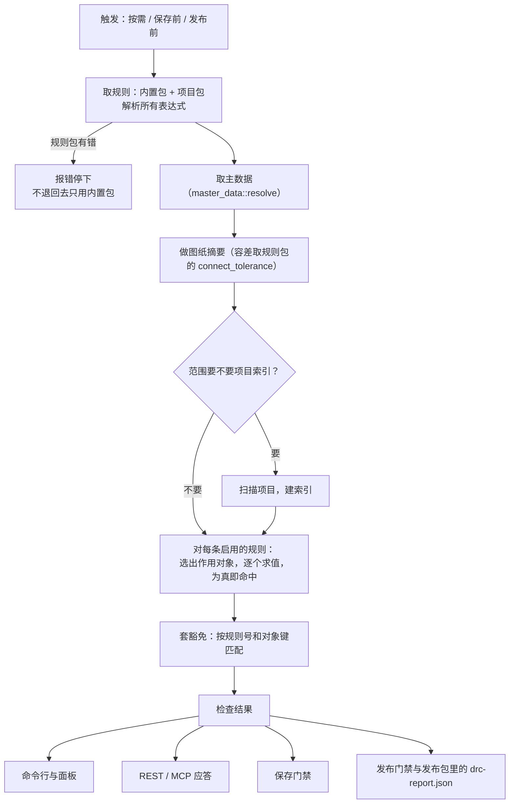

# SPEC：设计规则检查（`pid-drc`）

> 状态：**待建；规格已确认**（2026-11-16，§9 的待决问题都按「建议」定）。§4.3 里拆任务时补的一条（不含 P&ID 对象的图保存时不检查）也已确认。基线 `main @ 9b5327f96`。
> 依据：已批准计划 T3.2；需求 `REQ-DATA-007`、`010`–`016`（`docs/pid-platform/requirements/50-data-and-rule-engine.md`）。
> 共用约定见 `01-shared-conventions.md`；输入数据见 `SPEC-pid-project-index.md`（图纸摘要、项目索引）与 `SPEC-pid-master-data.md`。

## 1. 目标

按一套可以改的规则检查图纸，给出一份「哪个对象违反了哪条规则、多严重、怎么改」的清单。规则写在 JSON 文件里，增删改不用重新编译。三个时机会跑：用户主动发起、保存时、发布前。发布前有错误级结果就不让发布。

## 2. 现状

- 没有规则检查。保存时只有一道闸：图里有重复位号就拒绝（`propagate::gate_save`，调用点在 `src/io/mod.rs` 第 2991、3232 行和 `src/app/automation.rs` 第 2880 行）。
- 类型库没有「必填」标志（`SPEC-pid-author-store.md` §2.5）。
- 位号规则只能生成位号，没有「这个位号合不合规则」的判断函数（`src/pid/tag_rule.rs`）。
- 规则要用的数据，图里有的和没有的：

| 数据 | 状况 |
|---|---|
| 对象的类型、位号、属性 | 有，实体记录里 |
| 管线 → 管路 → 管段的归属，管段接管件 | 有，拓扑表里 |
| 线接设备、线接线、线接连接符 | 没有记录，由图纸摘要按坐标现算 |
| 管口 | 没有独立对象；用设备符号的端口代替，端口没有位号 |
| 仪表回路 | 没有对象；用仪表的 `仪表回路` 属性值分组代替 |
| 标注对象 | 没有 |
| 异径管、单向阀、调节阀符号 | 符号库里没有（只有 7 个符号） |
| 管道等级、公称直径等的合法取值 | 本期新增，来自项目主数据 |

## 3. 数据格式

### 3.1 规则包文件

规则按需求的三级组织：**规则**是一条检查条件；**规则集**是一组规则，可以整组启停；**规则包**是一个文件。有两个规则包：

- 内置包：`assets/pid-drc-rules.json`，编进程序。
- 项目包：图纸所在目录下的 `pid-drc-rules.json`，可以没有。有就叠在内置包上面（§3.2）。

两个文件同一种格式：

```json
{
  "version": 1,
  "pack": "内置规则包",
  "rule_set_version": "1.0.0",
  "legend_standard": null,
  "save_gate": "warn",
  "connect_tolerance": 0.000001,
  "required_fields": { "EQUIPMENT": ["名称"], "PIPE_LINE": ["流体介质"] },
  "loop_roles": { "控制器": ["controller"], "测量元件": ["transmitter", "indicator"] },
  "sets": [
    { "name": "基础规则", "enabled": true },
    { "name": "工程扩展", "enabled": true }
  ],
  "rules": [
    {
      "id": "DR-001", "name": "管线缺管道等级", "set": "基础规则",
      "category": "设计类", "target": "管线", "severity": "错误",
      "expr": "管道等级 = NULL",
      "message": "管线 {位号} 没有管道等级",
      "fix": "给管线填写管道等级：PIDSETPROP {位号} 管道等级 <值>",
      "scope": "项目", "scope_ref": null,
      "enabled": true, "source": "内置", "params": {}
    }
  ]
}
```

**文件一级**

| 字段 | 说明 |
|---|---|
| `version` | 文件格式版本，现为 1；不认识的版本报 `RULESET_VERSION_UNSUPPORTED` |
| `pack` | 规则包名称 |
| `rule_set_version` | 规则内容的版本号，人来维护。进检查结果，用来对账 |
| `legend_standard` | 这包规则是为哪套图例标准写的；`null` 表示不限。本期只记录，不校验（见 §8） |
| `save_gate` | 保存时怎么办：`off` 不检查 / `warn` 检查后只提示（默认）/ `block` 有错误就拒绝保存。见 §4.3 |
| `connect_tolerance` | 判断两点重合的容差，图纸单位，默认 `1e-6`。做图纸摘要时用 |
| `required_fields` | 必填字段：类型编码 → 属性名列表。沿类型树往下继承（给 `EQUIPMENT` 写的，泵和容器也要填） |
| `loop_roles` | 仪表回路里的角色：角色名 → 符号 id 列表。只有 `DR-113` 用 |
| `sets[]` | 规则集：`name`、`enabled`。停用一个规则集，它下面的规则下一次检查都不出结果 |
| `rules[]` | 规则，见下表 |

**规则**

| 字段 | 需求里的名字 | 必填 | 说明 |
|---|---|---|---|
| `id` | 规则 ID | 是 | 两个大写字母、连字符、三位数字，如 `DR-001`。`DR-001`–`DR-199` 留给内置规则 |
| `name` | 名称 | 是 | 不超过 64 字 |
| `set` | 规则集 | 是 | 必须是 `sets[]` 里有的 |
| `category` | 规则类别 | 是 | `设计类` / `配置类`；别的值报 `RULE_KIND_INVALID`。本期只求值设计类 |
| `target` | 作用对象 | 是 | §3.4 的对象种类之一，或一个类型编码（含它的下级类型） |
| `severity` | 严重度 | 是 | `错误` / `警告` / `提示`；别的值报 `SEVERITY_INVALID` |
| `expr` | DSL 表达式 | 是 | §3.3 的文法。读文件时就解析，解析不过整个文件拒收 |
| `message` | — | 否 | 结果里的消息模板；不写就用「`<名称>`：`<位号或位置>`」 |
| `fix` | — | 否 | 建议修复的模板 |
| `scope` | 作用域 | 是 | 这条规则在哪里生效：`项目`（处处生效）/ `PBS 节点` / `图纸` / `类型` |
| `scope_ref` | 作用对象实例 | 条件 | `scope` 不是 `项目` 时必填：节点号 / 图号 / 类型编码。只在那个节点及其下级的图纸、那张图、那个类型及其下级的对象上求值 |
| `enabled` | 启用状态 | 是 | 默认真 |
| `source` | 来源 | 是 | `内置` / `复制修改` / `新建` |
| `params` | — | 否 | 这条规则的参数，表达式里用 `参数.<名>` 取 |

必填字段缺一个，报 `REQUIRED_FIELD_EMPTY` 并指出是哪条规则的哪个字段。

消息模板里可以写 `{位号}`、`{类型}`、`{图号}`、`{所属}`，以及 `{<属性名或事实名>}`；没有值的填空串。生成的消息和修复建议各不超过 200 字，超出截断。

### 3.2 项目包怎么叠在内置包上

| 项目包里写了 | 效果 |
|---|---|
| `save_gate`、`connect_tolerance`、`loop_roles` | 取代内置的值 |
| `required_fields` 里的某个类型编码 | 取代内置里这个类型的列表；写空列表等于取消 |
| `sets[]` 里与内置同名的规则集 | 只取它的 `enabled`（整组启停） |
| `sets[]` 里的新名字 | 新增规则集 |
| `rules[]` 里 `id` 与内置相同的条目 | 只能带 `id`、`enabled`、`params` 三个键：启停这条内置规则、改它的参数。带了别的键报 `RULE_BUILTIN_READONLY` |
| `rules[]` 里的新 `id` | 新增规则，`source` 写 `复制修改` 或 `新建`；`id` 落在内置号段里报 `RULE_ID_RESERVED`，文件内重复报 `RULE_ID_DUPLICATED` |

- 内置规则不能删、不能改条件和严重度；要改就复制成一条新规则，再把内置的那条停用。
- 项目包读不出来或校验不过时**不退回去只用内置包**：检查报错并停下，说明文件哪里不对。静默退回会让人以为自己的规则在生效。
- 生效规则的版本：没有项目包时是内置包的 `rule_set_version`；有项目包时是 `<内置版本>+<项目包版本>`。另算一个 `rule_set_digest`：生效规则全集（含启停与参数）的 SHA-256 前 16 位十六进制。版本号靠人维护，摘要值不靠人。

### 3.3 规则表达式

文法照需求逐字采用：

```ebnf
expression    = or_expr ;
or_expr       = and_expr { "OR" and_expr } ;
and_expr      = not_expr { "AND" not_expr } ;
not_expr      = [ "NOT" ] atom ;
atom          = "(" expression ")" | comparison ;
comparison    = path operator operand ;
operator      = "=" | "!=" | ">" | "<" | ">=" | "<="
              | "IN" | "NOT IN" | "MATCH" | "NOT MATCH" ;
operand       = value | path | "(" operand { "," operand } ")" ;
value         = string | number | enum_ref | boolean | "NULL" ;
path          = segment { "." segment } ;
segment       = identifier ;
identifier    = letter { letter | digit | "_" } ;
string        = '"' { character } '"' ;
character     = ? 除双引号外的任意字符 ? ;
number        = [ "-" ] digit { digit } [ "." digit { digit } ] ;
enum_ref      = "#" identifier ;
boolean       = "TRUE" | "FALSE" ;
letter        = "A".."Z" | "a".."z" | "一".."鿿" ;
digit         = "0".."9" ;
```

求值规则（需求没写细的地方，在这里定死）：

- **值都是文本**。属性没有或为空串，就是 `NULL`。`""` 等同 `NULL`。`#蒸汽` 就是文本 `蒸汽`。
- **三值逻辑**：真 / 假 / 未知。`AND` 遇假为假，`OR` 遇真为真，`NOT 未知` 仍是未知。**只有求值为真才算命中**，未知不命中。
- `x = NULL`：`x` 没有值时为真，否则为假。`x != NULL` 相反。
- `=`、`!=`：两边都能读成数就按数比，否则按文本逐字比（区分大小写，先去掉首尾空白）。任一边没有值（且另一边不是字面的 `NULL`）→ 未知。
- `>`、`<`、`>=`、`<=`：只按数比；任一边不是数或没有值 → 未知。
- `IN (…)`：左边等于列表里任一个就为真。列表里可以写一个能解析成列表的路径（`项目.管道等级表`、`参数.允许图层`）。左边没有值、或列表取不出来（主数据没配置）→ 未知。`NOT IN` 是它的反面，未知仍是未知。与主数据表比对时用主数据规格 §3.5 的比对规则（公称直径 `DN50` 与 `50` 算同一个，隐藏的规格算没有）。
- `MATCH "…"`：Rust `regex` 库的正则语法，不自动加首尾锚点。左边没有值 → 未知。正则本身写错算解析错误。
- **路径**：
  - 单段名字：先看是不是这种对象的派生事实（§3.4），不是就当属性名，属性没有就是 `NULL`。
  - 多段路径：第一段必须是这种对象认识的关系或根（§3.4），否则是解析错误——比如 `所属泵.位号`，没有 `所属泵` 这个关系。沿途某一段取不到对象时整条路径是 `NULL`。
- 属性名里有文法不允许的字符（空格、`&`、括号）的，表达式里引用不到。

解析错误统一报 `DSL_PARSE_ERROR`，带 `rule_id`、`offset`（出错处在表达式里的字符偏移，从 0 数）和 `expected`（这里本该出现什么）。规则包里只要有一条解析不过，整个文件拒收，不存在「半解析」的规则。

两个例子：

- `管道等级 ==` → `DSL_PARSE_ERROR`，`offset` 为 6（第二个 `=` 处），`expected` 为「值或路径」。
- 自定义规则「公称直径超出管道等级允许的范围」：`公称直径 < 管道等级.公称直径下限 OR 公称直径 > 管道等级.公称直径上限`，作用对象「管线」。

### 3.4 对象种类与可用的事实

规则的 `target` 取下表的种类名，或一个类型编码。对象全部来自图纸摘要。

| 种类 | 是什么 | 派生事实（属性之外可以直接写的名字） | 关系（可以接 `.` 往下取） |
|---|---|---|---|
| `对象实例` | 摘要 `objects[]` 的每一项 | `位号`、`位号合规`、`位号来源`、`独立编号`、`种类`、`类型编码`、`类型`、`图层`、`必填项缺失数`、`未连接端口数` | `位号.长度`、`位号.同类型重复数`、`位号.跨图重复数`；`所属管路`、`所属管线`（线上的阀门、管件） |
| `设备` | 种类为设备的对象 | 同上，另有 `管口数`、`设备类别`（类型的显示名，如 `储罐`） | 同上 |
| `阀门`、`管件`、`仪表` | 同名种类的对象 | 同 `对象实例`；阀门另有 `流向相反` | 同 `对象实例` |
| `管线` | 种类为管线的对象 | 同 `对象实例`，另有 `端口未连接数`、`长度`、`管路数` | `管道等级.<扩展属性>` 等（见表后） |
| `管路` | 种类为管路的对象 | 同 `对象实例`，另有 `后缀`、`端口未连接数`、`长度`、`管段数`、`直连异径管路数`、`未标记覆盖数` | `所属管线` |
| `管段` | 摘要 `segments[]` 的每一项（含管线自己的线） | `长度`、`端口未连接数`、`重叠管段数`、`图层` | `所属管路`、`所属管线` |
| `管口` | 设备符号的每个端口（摘要 `ports[]` 里属于设备的） | `名称`、`方向`、`连接状态`（`已连接` / `未连接`）、`位号前缀`（本期恒为 `NULL`） | `所属设备` |
| `信号线` | 种类为信号线的对象 | 同 `对象实例`，另有 `起点仪表`、`终点仪表`、`端口未连接数`、`接到设备管口数` | — |
| `页间连接符` | 摘要 `connectors[]` 的每一项 | `连接符种类`、`对端图纸`、`对端位号`、`配对状态` | `所在线`、`对端线` |
| `仪表回路` | `仪表回路` 属性值相同的一组仪表 | `回路号`、`仪表数`、`控制器数`、`测量元件数` | — |
| `图纸` | 每张图一个 | `图号`、`图例标准`、`PBS`、`对象数` | — |
| `符号实例` | 带符号的对象 | 同 `对象实例` | `符号.状态`（`有效` / `缺失`，缺失指当前符号库里没有这个块） |
| `标注` | 本期没有这种对象 | — | — |

所有种类都能用的根：`项目.管道等级表`、`项目.公称直径表`、`项目.绝热等级表`、`项目.流体介质表`、`项目.图例标准`；`图纸.图号`、`图纸.PBS`；`参数.<名>`。

属性值指向主数据表的三个属性可以继续往下取：`管道等级.<扩展属性>`、`绝热等级.<扩展属性>`、`流体介质.<扩展属性>`——按属性值在主数据里找到那一行，再取它的扩展属性。关系可以连用，如 `所属管线.管道等级.最大公称压力`。

几个事实的确切算法：

| 事实 | 算法 |
|---|---|
| `位号.同类型重复数` | 本图里与它类型编码、位号都相同的对象个数，含自己。位号引擎已把它标成重复（`tag_status` 为 `duplicated`）而这样数出来不足 2 的，按 2 算。位号为空、或没有自己编号的（`own_tag` 为假）是 `NULL` |
| `位号.跨图重复数` | 项目索引 `duplicates[]` 里这个 `(类型编码, 位号)` 出现在几张别的图上。要项目索引 |
| `位号合规` | 位号能按本类型的位号规则模板对上就是 `TRUE`，对不上是 `FALSE`；位号为空、没有自己编号、或这个类型没有位号规则的是 `NULL`。模板里的字面部分逐字比，`{序号}`、`{后缀}` 对一串数字，其余占位符对同名属性的当前值（属性为空时对任意非空文本）。这是新增函数 `tag_rule::matches` |
| `必填项缺失数` | `required_fields` 里这个类型及其上级类型列出的属性中，值为空的个数。结果消息里列出缺的字段名 |
| `端口未连接数`（管线、管路、管段、信号线） | 名下线段端点里接点为空的个数（图纸摘要 §3.2）。接到打断符不算悬空 |
| `未连接端口数`（符号） | 这个符号的端口里 `joined` 为假的个数 |
| `管口数` | 设备符号的端口个数 |
| `后缀` | 管路位号去掉「管线位号 + `-`」之后剩下的部分；管路位号不是这个形状的是 `NULL` |
| `长度` | 管段：两端距离，不超过容差的算 0。管路、管线：名下线段长度之和。单位是图纸单位 |
| `重叠管段数` | 与它共线、且重叠长度超过容差的其他线段条数 |
| `直连异径管路数` | 端点对端点直接接着（中间没有管件）、而 `公称直径` 与它不同的其他管路条数；任一方没填直径的不算 |
| `未标记覆盖数` | 五个管级属性里，管路的值与所属管线不同、却不在覆盖标记里的个数 |
| `起点仪表`、`终点仪表` | 属性里有就用属性。两个都没有时，看这条线的两个端点各接在哪个仪表的端口上：接着两个仪表则两个都有值，只接着一个则 `终点仪表` 为 `NULL` |
| `接到设备管口数` | 信号线端点里接在设备端口上的个数 |
| `对端图纸` | 连接符记了对端就有值：`target`、`server` 时是对端图号，`local` 时是文本 `本机配对`；`none` 时 `NULL` |
| `对端位号` | `upstream`、`downstream` 都有时，流出连接符取 `downstream`，流入连接符取 `upstream`；否则 `NULL`（刚建的连接符 `upstream` 里是本侧线号，不能当对端） |
| `配对状态` | 项目索引给的 `paired` / `one_sided` / `target_missing` / `unpaired` / `ambiguous`。要项目索引 |
| `所在线`、`对端线` | 连接符所在的管线或信号线；配对的另一个连接符所在的线（在另一张图上，要项目索引） |
| `控制器数`、`测量元件数` | 回路里符号 id 落在 `loop_roles` 对应列表里的仪表个数 |
| `流向相反` | 本期恒为 `NULL`：符号库里没有带方向的阀门 |
| `图例标准` | 主数据的 `legend_standard`；主数据没配置时 `NULL` |

用到 `位号.跨图重复数`、`配对状态`、`对端线` 的规则是**项目级规则**：解析时自动认出，没有项目索引的检查里跳过它们（计入 `rules_skipped`）。

### 3.5 内置规则

**基础规则（25 条）**——编号、名称、作用对象、严重度照需求 `REQ-DATA-016`；表达式有三条与需求不同，已标出。

| ID | 名称 | 作用对象 | 严重度 | 表达式 | 本期数据从哪来 |
|---|---|---|---|---|---|
| `DR-001` | 管线缺管道等级 | 管线 | 错误 | `管道等级 = NULL` | 属性 |
| `DR-002` | 管线缺公称直径 | 管线 | 错误 | `公称直径 = NULL` | 属性 |
| `DR-003` | 设备无位号 | 设备 | 错误 | `位号 = NULL OR 位号 = ""` | 实体记录 |
| `DR-004` | 位号重复 | 对象实例 | 错误 | `位号.同类型重复数 > 1` | 现算，只看本图 |
| `DR-005` | 仪表未分配回路 | 仪表 | 警告 | `仪表回路 = NULL` | 属性 `仪表回路` |
| `DR-006` | 页间连接符对端缺失 | 页间连接符 | 错误 | `对端图纸 = NULL OR 对端位号 = NULL` | 拓扑表里的连接符记录 |
| `DR-007` | 阀门压力等级高于管道等级 | 阀门 | 错误 | `压力等级 > 所属管线.管道等级.最大公称压力` | 属性 + 主数据 |
| `DR-008` | 管口未连接 | 管口 | 提示 | `连接状态 = #未连接` | 现算 |
| `DR-009` | 图纸未设图例标准 | 图纸 | 错误 | `图例标准 = NULL` | 主数据；主数据没配置时命中 |
| `DR-010` | 属性必填项为空 | 对象实例 | 错误 | `必填项缺失数 > 0` | `required_fields` |
| `DR-011` | 管路位号后缀缺失 | 管路 | 错误 | `后缀 = NULL OR 后缀 = ""` | 现算 |
| `DR-012` | 管段长度非法 | 管段 | 警告 | `长度 <= 0` | 现算 |
| `DR-013` | 仪表回路仪表数不足 | 仪表回路 | 提示 | `仪表数 < 2` | 现算 |
| `DR-014` | 管线端口未闭合 | 管线 | 错误 | `端口未连接数 > 0` | 现算 |
| `DR-015` | 信号线端点缺失 | 信号线 | 错误 | `起点仪表 = NULL OR 终点仪表 = NULL` | 属性，没有就看端点 |
| `DR-016` | 标注文字为空 | 标注 | 提示 | `文字 = NULL OR 文字 = ""` | **本期没有标注对象，不出结果** |
| `DR-017` | 阀门开度越界 | 阀门 | 警告 | `开度 > 100 OR 开度 < 0` | 属性 |
| `DR-018` | 位号格式不符 | 对象实例 | 警告 | `位号合规 = FALSE` **（改）** | 现算，按各类型自己的位号规则 |
| `DR-019` | 位号长度超限 | 对象实例 | 提示 | `位号.长度 > 32` | 现算 |
| `DR-020` | 管口位号前缀不继承设备 | 管口 | 错误 | `位号前缀 != 所属设备.位号` | **本期管口没有位号，不出结果** |
| `DR-021` | 介质与管道等级材质不兼容 | 管线 | 错误 | `流体介质 IN (#氯气, #氢氟酸) AND 管道等级.材质 = #碳钢` **（改名）** | 属性 + 主数据 |
| `DR-022` | 管道等级不在项目主数据 | 管线 | 错误 | `管道等级 NOT IN (项目.管道等级表)` | 主数据 |
| `DR-023` | 设备管口数不足 | 设备 | 警告 | `管口数 < 2 AND NOT (设备类别 = #储罐)` | 现算 |
| `DR-024` | 符号实例状态非法 | 符号实例 | 提示 | `符号.状态 != #有效` | 现算 |
| `DR-025` | 高温管线缺绝热等级 | 管线 | 警告 | `(设计温度 > 200 OR 流体介质 = #蒸汽) AND 绝热等级 = NULL` **（改名）** | 属性 |

与需求不同的三处：

- `DR-018`：需求给的是一条固定正则 `^[A-Z]{1,2}-[0-9]{4}$`。管路位号 `L-1001-01`、信号线位号、仪表位号都不是这个形状，照搬会把它们全判成不符。改成「位号不符合本类型的位号规则」。
- `DR-021`、`DR-025`：需求写的属性名是 `介质`，图里实际的属性名是 `流体介质`（五个管级属性之一）。规则用实际的名字。

**工程扩展（16 条）**——计划 T3.2 列的 24 条里，基础规则没有覆盖到的。

| ID | 名称 | 作用对象 | 严重度 | 表达式 | 备注 |
|---|---|---|---|---|---|
| `DR-101` | 仪表或阀门无位号 | 对象实例 | 错误 | `种类 IN (#仪表, #阀门) AND (位号 = NULL OR 位号 = "")` | |
| `DR-102` | 跨图纸位号重复 | 对象实例 | 错误 | `位号.跨图重复数 > 0` | 项目级 |
| `DR-103` | 公称直径不在项目主数据 | 对象实例 | 错误 | `种类 IN (#管线, #管路) AND 公称直径 NOT IN (项目.公称直径表)` | |
| `DR-104` | 流体介质不在项目主数据 | 管线 | 错误 | `流体介质 NOT IN (项目.流体介质表)` | |
| `DR-105` | 管径突变处没有异径管 | 管路 | 警告 | `直连异径管路数 > 0` | 符号库暂无异径管，所以只定为警告 |
| `DR-106` | 阀门公称直径与所在管路不一致 | 阀门 | 警告 | `公称直径 != 所属管路.公称直径` | 阀门没填直径时不命中 |
| `DR-107` | 阀门或管件的管道等级与所在管线不一致 | 对象实例 | 警告 | `种类 IN (#阀门, #管件) AND 管道等级 != 所属管线.管道等级` | |
| `DR-108` | 信号线接到了设备管口 | 信号线 | 警告 | `接到设备管口数 > 0` | |
| `DR-109` | 单向阀或调节阀流向与管路相反 | 阀门 | 错误 | `流向相反 = TRUE` | **本期没有这两种阀门，不出结果** |
| `DR-110` | 管段重叠 | 管段 | 警告 | `重叠管段数 > 0` | |
| `DR-111` | 阀门或管件有端口没接上 | 对象实例 | 警告 | `种类 IN (#阀门, #管件) AND 未连接端口数 > 0` | |
| `DR-112` | 配对连接符两侧管道等级或公称直径不一致 | 页间连接符 | 警告 | `对端线.管道等级 != 所在线.管道等级 OR 对端线.公称直径 != 所在线.公称直径` | 项目级 |
| `DR-113` | 仪表回路缺控制器或测量元件 | 仪表回路 | 警告 | `控制器数 = 0 OR 测量元件数 = 0` | 按符号 id 认角色，见 `loop_roles` |
| `DR-114` | 对象不在受控图层 | 对象实例 | 提示 | `图层 NOT IN (参数.允许图层)` | **默认停用**：目前没有约定 P&ID 图层，参数 `允许图层` 为空 |
| `DR-115` | 管路属性与管线不同却没有覆盖标记 | 管路 | 警告 | `未标记覆盖数 > 0` | |
| `DR-116` | 连接符的对端在项目里找不到 | 页间连接符 | 错误 | `配对状态 IN (#one_sided, #target_missing)` | 项目级 |

两个规则集都随程序内置、默认启用，合计 41 条；其中 `DR-016`、`DR-020`、`DR-109` 本期不出结果，`DR-114` 默认停用。

### 3.6 检查结果

```json
{
  "ok": true,
  "version": 1,
  "rule_set_version": "1.0.0",
  "rule_set_digest": "9f2c41d07a3be518",
  "checked_at": 1794800000,
  "trigger": "按需",
  "scope": { "kind": "drawing", "drawing_id": "PID-1101", "pbs": null, "cross_drawing": false },
  "elapsed_ms": 42,
  "summary": { "错误": 2, "警告": 1, "提示": 3, "已豁免": 1, "objects": 420, "rules_run": 32, "rules_skipped": 8 },
  "blocked": true,
  "results": [
    {
      "rule_id": "DR-001", "rule_name": "管线缺管道等级", "severity": "错误",
      "object": { "kind": "管线", "type_code": "PIPE_LINE", "tag": "L-1003", "drawing_id": "PID-1101",
                  "owner": null, "port": null, "at": [0.0, 20.0], "handle": "2D4" },
      "object_key": "PIPE_LINE|L-1003",
      "message": "管线 L-1003 没有管道等级",
      "fix": "给管线填写管道等级：PIDSETPROP L-1003 管道等级 <值>",
      "points": [], "fields": ["管道等级"],
      "waived": false, "waiver": null
    }
  ],
  "notices": [
    { "code": "MASTERDATA_NOT_CONFIGURED", "message": "项目主数据没有配置，用到主数据的 5 条规则没有执行" },
    { "code": "PROJECT_RULES_SKIPPED", "message": "只检查了当前图，3 条项目级规则没有执行" }
  ],
  "stale_waivers": []
}
```

| 字段 | 说明 |
|---|---|
| `rule_set_version`、`rule_set_digest` | 用的是哪一版规则（§3.2） |
| `checked_at` | 检查时间，Unix 秒 |
| `trigger` | `按需` / `保存前` / `发布前` |
| `scope` | 查了哪些图：`kind` 取 `drawing` / `pbs` / `project`；`cross_drawing` 表示项目级规则有没有跑 |
| `summary` | 三个严重度各有多少条**没被豁免**的结果；`已豁免` 另计；`rules_skipped` 是没执行的规则数（停用的不算，指缺项目索引、缺主数据、配置类） |
| `blocked` | 没被豁免的错误数大于 0。发布门禁和 `block` 档的保存门禁看的就是它 |
| `results[]` | 每条结果。需求要求的五个字段是 `rule_id`、`object`、`severity`、`message`、`fix` |
| `results[].object` | 对象引用：类型编码、位号、图号三样定位一个对象；没有位号的（管段、管口、连接符）靠 `owner`、`port`、`at` 补足。`handle` 只用来在图上定位 |
| `results[].object_key` | 豁免用的对象键，见 §3.7 |
| `results[].points` | 一条结果涉及多个位置时（一条管线有三个悬空端点）逐个列出坐标 |
| `results[].fields` | 这条结果涉及对象自己的哪些属性，给属性表高亮用。`DR-010` 是缺的那些字段名（需求里的「缺失字段名」）；其他规则是表达式里直接写在对象身上的属性名（单段、不是派生事实），用到位号的加 `位号`；沿关系取的不算；没有就是空列表。按在表达式里出现的先后排，去重 |
| `results[].waived`、`waiver` | 是否豁免；豁免记录 `{reason, by, at}` |
| `notices[]` | 不是违规、但用户该知道的事，见下 |
| `stale_waivers[]` | 图里记着、但这次没有对应结果的豁免（问题已经改掉了，或对象改了位号） |

结果按严重度（错误、警告、提示）、规则号、图号、对象键排序，同样的图和规则两次检查的 `results` 完全相同。

`notices[].code` 取值：`MASTERDATA_NOT_CONFIGURED`、`MASTERDATA_UNREADABLE`（取值合法性规则没执行）、`PROJECT_RULES_SKIPPED`（没有项目索引，项目级规则没执行）、`INDEX_INCOMPLETE`（有图读不出来，跨图结论不完整）、`CONNECTOR_AMBIGUOUS`（有连接符分不出对端）、`RULE_SCOPE_UNKNOWN`（某条规则的 `scope_ref` 指的节点或图不存在）。

### 3.7 豁免

豁免是「这个对象违反这条规则，已知，理由如下」。记在图里，图级记录 `PID_AUTHOR_DRC_WAIVERS`（经 `graph_data::store`，与主数据记录同一种布局），每条：

```json
{ "rule_id": "DR-014", "object_key": "PIPE_LINE|L-1003", "reason": "放空管，端部通大气", "by": "zhangsan", "at": 1794800000 }
```

- `reason` 必填，不超过 200 字；空的报 `WAIVER_REASON_REQUIRED`，超长报 `WAIVER_REASON_TOO_LONG`。
- `by`：连着协同时取协同的用户号，否则取操作系统的账户名。`at`：Unix 秒。
- 对象键的写法：
  - 有自己编号的对象：`<类型编码>|<位号>`。
  - 管口：`<设备类型编码>|<设备位号>#<端口名>`。
  - 仪表回路：`仪表回路|<回路号>`；图纸：`图纸|<图号>`。
  - 其余（管段、连接符、没有位号或没有自己编号的对象）：`<类型编码>|<所属或所在线>|<x>,<y>`，坐标保留 3 位小数。
- 匹配按 `(rule_id, object_key)`。对象改了位号、或没位号的对象挪了位置，豁免就对不上了，会出现在 `stale_waivers` 里，由人决定删掉还是重新豁免。不自动删除。
- 被豁免的结果仍在 `results` 里，`waived` 为真，不计入三个严重度的计数，不拦发布；发布包的检查报告里照样列出。
- 豁免或取消豁免成功后，就地改留着的那份检查结果（那一条的 `waived` 与 `waiver`、三个严重度的计数、`blocked`），不重新检查。
- 只能豁免当前图上的对象（豁免要写进那张图）。写豁免是改图：先记撤销快照，可以撤销；只读会话里拒绝。协同中不广播（图级记录都不在协同报文里），随文件保存。

### 3.8 错误码

| 码 | 何时 | HTTP |
|---|---|---|
| `DSL_PARSE_ERROR` | 表达式解析不过；带 `rule_id`、`offset`、`expected` | 400 |
| `RULESET_SCHEMA_ERROR` | 规则包不是合法 JSON 或字段类型不对；带路径 | 400 |
| `RULESET_VERSION_UNSUPPORTED` | `version` 不认识 | 400 |
| `REQUIRED_FIELD_EMPTY` | 规则缺必填字段，或 `scope` 不是 `项目` 而没写 `scope_ref` | 400 |
| `RULE_KIND_INVALID` | `category` 不是两个合法值之一 | 400 |
| `SEVERITY_INVALID` | `severity` 不是三个合法值之一 | 400 |
| `RULE_BUILTIN_READONLY` | 项目包想改内置规则的条件、严重度等 | 409 |
| `RULE_ID_RESERVED`、`RULE_ID_DUPLICATED` | 新规则的号落在内置号段；文件内规则号重复 | 409 |
| `RULE_NOT_FOUND` | 启停、豁免时指的规则号不存在 | 404 |
| `RULE_BLOCKED` | 保存门禁为 `block` 且有未豁免的错误；文件没有写 | 409 |
| `WAIVER_REASON_REQUIRED`、`WAIVER_REASON_TOO_LONG` | 豁免理由为空、超过 200 字 | 400 |
| `WAIVER_TARGET_NOT_FOUND` | 要豁免的 `(规则号, 对象键)` 不在当前图最近一次检查的结果里 | 404 |
| `PBS_NODE_UNKNOWN` | 按 PBS 节点检查时节点号不在主数据里 | 404 |
| `INDEX_NO_PROJECT_DIR` | 要项目范围而当前图没保存过（沿用项目索引的码） | 409 |

## 4. 数据怎么传

### 4.1 一次检查



- 每次检查都重新取规则、主数据和摘要，不留中间状态。结果只在内存里留最近一份（给面板、`EXPORT` 和豁免用），不写进图：范围是当前图的跟着那张图，范围是全项目或 PBS 节点的跟着项目目录，细则见 `SPEC-pid-verify-deliver-panel.md` §3.1。
- 检查本身**不改图**。只有豁免写图。

### 4.2 范围

| 范围 | 查哪些图 | 项目级规则 |
|---|---|---|
| `drawing`（默认） | 当前图 | 默认不跑；请求里带 `cross_drawing: true` 时扫描项目并跑，但只报当前图上的对象。发布前检查用的就是这一种 |
| `pbs` | 项目文件里归在这个节点及其下级的图 | 跑 |
| `project` | 项目目录里的全部图 | 跑 |

### 4.3 三个触发时机

| 时机 | 范围 | 拦不拦 |
|---|---|---|
| 按需（命令、面板、接口） | 任选 | 不拦 |
| 保存前 | 当前图，只跑单图规则 | 看 `save_gate`：`off` 不检查；`warn` 照常保存，保存后在命令行给一句汇总（错误、警告、提示各几条）；`block` 有未豁免的错误就拒绝，返回 `RULE_BLOCKED`，文件不写，消息列出前 5 条 |
| 发布前 | 当前图 + 项目级规则 | 有未豁免的错误就不发布（`PUBLISH_BLOCKED`，见 `SPEC-pid-publish.md`）。发布时**一律重新检查**，不采信之前的结果 |

保存门禁接在哪里：

- `block` 档的闸放在保存函数里、重复位号那道闸的旁边（`src/io/mod.rs` 的两处和 `src/app/automation.rs` 的一处），这样从界面、命令、接口发起的保存都绕不过。这一层没有程序对象，符号库用 `SymbolLibrary::load_from_env()`，规则包和主数据按图纸所在目录取。
- `warn` 档在保存成功之后由程序层跑一次检查并显示汇总，保存函数里不检查。两档都是每次保存恰好检查一次。
- **自动保存和备份副本不过规则闸**：规则闸只拦人发起的保存。实施时先查清自动保存（`src/app/update/file.rs` 的 `on_autosave`）走的是哪个保存函数，必要时给保存函数加一个「过不过规则闸」的参数。
- **不含 P&ID 对象的图不过规则闸，也不出汇总**（2026-11-16 拆任务时补，已确认）：图里没有任何 P&ID 记录时，三档都不检查。否则 `DR-009`（图纸未设图例标准，错误级，主数据没配置时命中）会让每一张普通 CAD 图在 `warn` 档下每次保存都报一条错误，在 `block` 档下存不了。判断要便宜：先看图里有没有 P&ID 记录，没有就直接放行，不做摘要。按需检查（`PIDCHECK`、`pid_check`、面板）不受这一条影响，照常报。
- 已有的重复位号闸不变，与 `save_gate` 无关，始终生效。

## 5. 对外接口

### 5.1 模块接口（`src/pid/drc/`）

```rust
// model.rs：RuleSet、Rule、Severity、CheckReport、CheckResult、Waiver……
// dsl.rs
pub fn parse(expr: &str, target: &Target) -> Result<Expr, DslError>;   // DslError { offset, expected }
// builtin_rules.rs
pub fn builtin() -> RuleSet;                                           // 编进程序的 assets/pid-drc-rules.json
pub fn load(drawing_dir: Option<&Path>) -> Result<RuleSet, DrcError>;   // 内置包 + 项目包
pub fn validate_project_pack(value: &serde_json::Value) -> Result<(), DrcError>;
// facts.rs：§3.4 的事实表
// runner.rs
pub struct CheckInput<'a> {
    pub rules: &'a RuleSet,
    pub master: &'a master_data::Resolved,
    pub drawings: &'a [DrawingSummary],          // 范围内的图
    pub index: Option<&'a ProjectIndex>,         // 有它才跑项目级规则
    pub others: &'a [DrawingSummary],            // 索引涉及的其余图，给 对端线 用
    pub waivers: &'a [(String, Vec<Waiver>)],    // 图号 → 该图的豁免
    pub trigger: Trigger,
    pub scope: Scope,
}
pub fn check(input: &CheckInput) -> CheckReport;                       // 纯函数，不碰文件和图纸
// mod.rs
pub const PID_AUTHOR_DRC_WAIVERS: &str = "PID_AUTHOR_DRC_WAIVERS";
pub fn waivers(doc: &Document) -> Vec<Waiver>;
pub fn set_waivers(doc: &mut Document, waivers: &[Waiver]);
/// block 档保存门禁：取规则、主数据、摘要，跑单图规则。save_gate 不是 block 时直接放行。
pub fn gate_save(doc: &Document) -> Result<(), PidError>;
```

`check` 只吃摘要、索引、主数据和规则，所以单元测试可以手写摘要来测每一条规则，不必建图。

### 5.2 命令（`src/app/commands/piddrc.rs`）

| 命令 | 做什么 | 只读会话 |
|---|---|---|
| `PIDCHECK` | 检查当前图，输出一句汇总和前 10 条结果 | 允许 |
| `PIDCHECK PROJECT` | 检查整个项目目录 | 允许 |
| `PIDCHECK PBS <节点号>` | 检查一个 PBS 节点下的图 | 允许 |
| `PIDCHECK RULES` | 列出生效的规则：号、名称、严重度、启停、来源；项目包有错时在这里报出来 | 允许 |
| `PIDCHECK EXPORT <文件>` | 把最近一次检查结果写成 JSON 文件 | 允许 |
| `PIDCHECK ENABLE <规则号>` / `DISABLE <规则号>` | 启停一条规则：改写项目包（没有就新建） | 拒绝 |
| `PIDCHECK WAIVE <规则号> <对象键> <理由>` | 豁免当前图上的一条结果；理由取到行尾 | 拒绝 |
| `PIDCHECK UNWAIVE <规则号> <对象键>` | 取消豁免 | 拒绝 |

`PIDCHECK` 加进只读允许名单；后三行的子命令在 `readonly_refuses_command` 里按子命令词拒绝，写法照 `PIDLEGEND`。增改规则本身没有命令：直接编辑项目包文件，再用 `PIDCHECK RULES` 验证。

### 5.3 自动化操作与 REST

| 操作 | REST | 读写 | 请求 | 应答 |
|---|---|---|---|---|
| `pid_check` | `POST /api/v1/pid/check` | 读（不改图） | `scope`（`drawing` / `pbs` / `project`，默认 `drawing`）、`pbs`、`cross_drawing`、`include_waived`（默认真） | §3.6 的检查结果；项目扫描没做完时 `{"ok":true,"status":"scanning","done":12,"total":40}` |
| `pid_check_rules` | `GET /api/v1/pid/check/rules` | 读 | — | `{"ok":true,"rule_set_version":…,"rule_set_digest":…,"project_pack":"<路径或 null>","save_gate":…,"sets":[…],"rules":[…]}` |
| `pid_check_rules_set` | `PUT /api/v1/pid/check/rules` | 写（项目包文件） | `pack`：整个项目包对象。先校验，全部通过才写（临时文件再改名） | `{"ok":true,"rule_set_version":…,"rule_set_digest":…}` |
| `pid_check_waive` | `POST /api/v1/pid/check/waivers` | 写（图） | `rule_id`、`object_key`、`reason` | `{"ok":true,"waivers":<条数>}` |
| `pid_check_unwaive` | `DELETE /api/v1/pid/check/waivers` | 写（图） | `rule_id`、`object_key` | 同上 |

MCP：`pid_check`、`pid_check_rules` 进 `READ_OPS`，其余三个进 `EXECUTE_OPS`。`RULE_BLOCKED`、`RULE_BUILTIN_READONLY` 等在 `map_status` 里按 §3.8 的状态码登记。

### 5.4 权限

- 没连协同：不设限。
- 只读会话：可以检查、看规则、导出结果；不能豁免、不能改规则包。
- 协同的权限表里有「规则检查」这一项操作，但客户端目前只知道会话可不可写，不知道自己有哪些操作权限（`SPEC-collab-client.md`）。本期不按这一项单独鉴权。

## 6. 成功标准

1. 内置 41 条规则都能解析；基础规则恰好 25 条，编号 `DR-001`–`DR-025` 连续。
2. 每条规则有一个命中的例子和一个不命中的例子（本期没有对象的三条，用手写的摘要来测）。
3. `管道等级 = NULL` 解析成功；`管道等级 ==` 报 `DSL_PARSE_ERROR` 且 `offset` 正确；`所属泵.位号` 报 `DSL_PARSE_ERROR` 并指向 `所属泵`。
4. 需求给的例子：管线 `设计温度` 260、`流体介质` 工艺水、没有绝热等级 → `DR-025` 命中一条。
5. 停用 `DR-016` 后结果里没有它，其余规则照常；重新启用后恢复。停用整个规则集同理。（`DR-016` 本期没有对象，这一条用手写的摘要测；命令层的启停测试换一条在真图上会命中的规则，如 `DR-014`。）
6. 项目包想改内置规则的表达式 → `RULE_BUILTIN_READONLY`；项目包有错时检查报错，不静默退回。
7. 同一张图、同一版规则检查两次：`rule_set_version`、`rule_set_digest`、`results` 相同，`checked_at` 不同。
8. 主数据没配置：用到主数据的五条（`DR-007`、`DR-021`、`DR-022`、`DR-103`、`DR-104`）不出结果并计入 `rules_skipped`，`notices` 里有一条说明，`DR-009` 命中。
9. 豁免：空理由被拒；豁免后那条结果 `waived` 为真、不计入错误数、`blocked` 随之变化；存盘再打开豁免还在；撤销能退回。
10. `save_gate` 三档：`off` 不检查；`warn` 保存成功并有汇总；`block` 有错误时返回 `RULE_BLOCKED`、磁盘上的文件一个字节不变，改完或豁免完能存。自动保存在 `block` 档下照常工作。不含 P&ID 对象的图在三档下保存都不检查、不出汇总。
11. 只读会话：`PIDCHECK` 能跑，`PIDCHECK WAIVE` 被拒。
12. 性能：2,000 个对象的图，单图全量检查（含做摘要）不超过 500 ms。

## 7. 测试

| 层 | 测什么 |
|---|---|
| 单元（`dsl.rs`） | 文法每个产生式；优先级与括号；`NOT IN`、`NOT MATCH`；三值逻辑真值表；数值与文本比较；`NULL` 与空串；错误偏移；未知关系；坏正则 |
| 单元（`facts.rs`） | §3.4 每个事实一组用例，输入是手写的摘要 |
| 单元（`runner.rs`） | 41 条规则逐条正反例；作用域四种；规则集启停；项目级规则在没有索引时被跳过；豁免匹配与失效；结果顺序稳定 |
| 单元（`builtin_rules.rs`） | 内置包能读、条数与编号；叠加规则的每一行；各错误码 |
| 命令与操作 | 用命令建一张有若干缺陷的图，`PIDCHECK` 与 `pid_check` 的结果；启停命令改写项目包；豁免的写入、撤销、存盘往返；只读会话的放行与拒绝 |
| 保存门禁 | 三档各一例；`block` 档下文件不变；自动保存不受影响 |
| REST | `POST /api/v1/pid/check` 与其余四个路由；状态码映射；`rest_openapi.json` 与路由一致；MCP 的操作名单与摘要值 |
| 性能预算 | 2,000 对象合成图全量检查 ≤ 500 ms（`#[ignore]`，3 次取中位数） |

要动的文件：新建 `src/pid/drc/{mod,model,dsl,facts,builtin_rules,runner}.rs`、`assets/pid-drc-rules.json`、`src/app/commands/piddrc.rs`；改 `src/pid/mod.rs`、`src/pid/tag_rule.rs`（新增 `matches`）、`src/io/mod.rs` 与 `src/app/automation.rs`（保存门禁）、`src/app/update/file.rs`（`warn` 档的汇总）、`src/app/commands/mod.rs`、`src/app/command_driver/utilities.rs`（整行名单）、`src/app/collab/apply.rs`、`src/app/control/mod.rs`、`src/rest.rs`、`src/rest_openapi.json`、`src/mcp.rs`。

## 8. 不在范围与已知限制

- 没有规则编辑界面。改规则靠编辑项目包文件；启停有命令。
- `配置类` 规则可以写进文件，但本期不求值。
- 规则包的图例标准版本校验（`RULEPACK_VERSION_MISMATCH`）不做：现在只有一套图例标准，也没有版本号，等阶段 4 有了多套标准再做。
- 需求 `REQ-DATA-007` 说必填项为空时保存直接被拒（`REQUIRED_FIELD_EMPTY`）。本期必填项只经 `DR-010` 报出来，拦不拦保存由 `save_gate` 决定。
- 豁免没有审计日志：谁、何时、为何记在图里和发布包的检查报告里，没有独立的、不可改的日志。
- 通大气、排净这类本来就敞口的管端，`DR-014` 会报错误，只能逐个豁免。符号库有了盲板、管帽符号后（阶段 4）自然解决。
- 连通性按坐标现算，没用对象捕捉画的线会被报成悬空（图纸摘要规格 §8）。
- 属性名里带空格或符号的，表达式引用不到。

## 9. 待决问题

> **2026-11-16 已定**：本节各条都按「建议」一栏执行。汇总见 `plan.md` §3，对应的任务见 `todo.md`。

| # | 问题 | 建议 |
|---|---|---|
| D1 | **严重度几级。** 计划写两级（严重违规 / 警告），需求写三级（错误 / 警告 / 提示）且写明「无第四级」 | 三级，照需求。「错误」就是计划里的严重违规，拦发布 |
| D2 | **内置多少条。** 需求说内置规则恰 25 条；计划列了 24 条，其中 16 条不在需求的 25 条里 | 两个规则集：「基础规则」恰好是需求的 25 条，「工程扩展」放计划多出的 16 条（`DR-101` 起）。都内置、都默认启用，共 41 条。需求的「恰 25 条」按基础规则集验收 |
| D3 | **保存时拦不拦。** 需求说保存前有错误就拒绝保存；计划说「可配置是否阻断」 | 默认只提示（`warn`），项目可改成 `block`。画到一半的图总有错误，默认拦等于不让存盘；发布前那道门禁不受影响，始终拦 |
| D4 | **豁免做不做、谁能豁免。** 计划没提豁免；需求要求有 | 做最小版：记在图里，有写权限的人都能豁免，含错误级。不做的话发布门禁没有出口（比如通大气的管端）。按角色限制谁能豁免错误，要等客户端知道自己的操作权限之后 |
| D5 | **`DR-018` 改了判法**（§3.5） | 按各类型自己的位号规则判。要需求里那条固定正则的，可以在项目包里加一条自己的规则 |
| D6 | **默认哪些字段必填。** 需求和计划都没列 | 设备必填 `名称`，管线必填 `流体介质`（管道等级、公称直径已由 `DR-001`、`DR-002` 管）。项目包里可改 |
| D7 | **属性名 `介质` 还是 `流体介质`**（§3.5） | 用图里实际的 `流体介质` |
| D8 | **没有对象的规则要不要内置。** `DR-016`、`DR-020`、`DR-109` 本期不会出结果 | 内置，保持编号连续，文档和 `PIDCHECK RULES` 里标明「本期没有对象」。对象有了之后不用改规则 |

## 10. 需求对照

| 需求 | 本期 | 说明 |
|---|---|---|
| `REQ-DATA-007` 必填属性为空的拦截 | 部分 | `DR-010` 报出来并列出缺的字段；保存是否被拒由 `save_gate` 决定；属性表高亮在面板规格 |
| `REQ-DATA-010` 规则模型与规则集 | 覆盖 | 三级：规则、规则集（可整组启停）、规则包（文件）；八个元数据字段齐备 |
| `REQ-DATA-011` 作用域与规则包 | 部分 | 作用域四选一已做；图例标准版本校验延后 |
| `REQ-DATA-012` 规则语法与解析错误 | 覆盖 | 文法逐字采用；错误带偏移；未知关系报错 |
| `REQ-DATA-013` 三种触发时机 | 部分 | 三种都有；保存前默认不拦（D3） |
| `REQ-DATA-014` 结果字段与严重度 | 覆盖 | 五个字段、三级严重度、外层的规则版本与检查时间 |
| `REQ-DATA-015` 分组、定位、豁免 | 部分 | 豁免已做，无审计日志；分组与点击定位在面板规格 |
| `REQ-DATA-016` 内置规则清单与启停 | 覆盖 | 基础规则 25 条、可逐条启停；三处表达式有调整（D5、D7） |

计划 T3.2 的 24 条各落在哪条规则上：

| 计划里的规则 | 规则号 |
|---|---|
| 位号为空 | `DR-003`（设备）、`DR-101`（仪表、阀门） |
| 位号不符合类型位号规则 | `DR-018` |
| 同图重复位号 / 跨图纸重复位号 | `DR-004` / `DR-102` |
| 设备必填属性缺失 / 管线必填属性缺失 | `DR-010`（另有 `DR-001`、`DR-002`） |
| 公称直径不在主数据 / 管道等级未定义 / 流体介质未定义 | `DR-103` / `DR-022` / `DR-104` |
| 管径突变未插异径管 | `DR-105` |
| 在线阀门公称直径不一致 / 管件管道等级不一致 | `DR-106` / `DR-107` |
| 信号线误接工艺管口 | `DR-108` |
| 单向阀、调节阀流向相反 | `DR-109`（本期没有对象） |
| 管段端点悬空 / 设备管口未连 / 零长度管段 | `DR-014` / `DR-008` / `DR-012` |
| 重叠共线管段 / 孤立管件端口 | `DR-110` / `DR-111` |
| 流出连接符无配对 | `DR-006`（图里没记对端）、`DR-116`（记了但项目里找不到） |
| 配对连接符两端等级或直径不一致 | `DR-112` |
| 仪表回路缺主控制器或测量元件 | `DR-113` |
| 对象在非受控图层 / 覆盖属性未标记来源 | `DR-114`（默认停用）/ `DR-115` |

计划要求的退出指标：可配置规则不少于 20 条（本期 41 条）；2,000 对象全量检查不超过 60 秒（本期目标 500 ms）；严重违规拦截率 100%（发布门禁，见发布规格）。

## 11. 实现记录

实现与本规格、任务文字有出入的地方，以及规格没写到、实现时定下的读法，记在这里（`todo.md` §1 第 7 条）。

### 11.1 `DRC-1`：规则表达式的解析与求值（2026-11-21）

**做了什么**（新目录 `src/pid/drc/`：`mod.rs`、`model.rs`、`dsl.rs`；`src/pid/mod.rs` 登记一行）：

- `model.rs`：规则的作用对象 `Target`（§3.1 的 `target`：种类名，或类型编码）、15 种对象 `Kind`，和 §3.4 的名字表：每种对象的派生事实、关系（关系后面能接什么：表里列出的名字之一、任意一个名字、或另一种对象），以及三个根 `ROOTS`。
- `dsl.rs`：`parse(expr, target) -> Result<Expr, DslError>` 和 `Expr::eval(&dyn Facts) -> Truth`。`DslError { offset, expected }`，`code()` 恒为 `DSL_PARSE_ERROR`。求值时取值都经事实提供者 `Facts`：一条路径在当前对象上取到一个值（`Fact::Value`）或一张表（`Fact::List`，表里的值怎么跟左边比由 `Matching` 说）；事实怎么从摘要算出来是 `DRC-3` 起的事。
- §5.1 没列、另外公开的：语法树（`Expr`、`Comparison`、`Op`、`Operand`、`Literal`、`Path`、`Pattern`），`Truth` 的 `and`、`or`、`!`，`Comparison::eval`，名字表的查询（`Kind::name`、`from_name`、`facts`、`has_fact`、`relations`、`relation`，`model::root`）。

**规格没写到、这里定下的：**

1. **作用对象写类型编码时，按「符号实例」认关系名。** 解析时还不知道这个类型的对象是设备还是阀门，只知道它们都带符号；所以写类型编码的规则能用对象实例和符号实例的关系，不能用 `所属设备`（那是管口的关系）。
2. **对象实例那一行各类对象都有。** §3.4 把 `位号`、`所属管路`、`所属管线` 和主数据的三个关系（`管道等级.…`、`绝热等级.…`、`流体介质.…`）写在对象实例一行；设备、阀门、管件、仪表、管线、管路、信号线、符号实例都有这一行的派生事实和关系（`DR-007` 在阀门上写 `所属管线.管道等级.最大公称压力`，`DR-021` 在管线上写 `管道等级.材质`）。管段、管口、页间连接符、仪表回路、图纸、标注只有自己那一行。
3. **根只能写在路径开头。** `项目.…`、`图纸.…`、`参数.…` 哪种对象都能用，但沿关系走到别的对象以后不能再接根：`所属管线.项目.管道等级表` 报错，指向 `项目`。
4. **关系后面接什么。** `位号`、`符号`、`项目`、`图纸` 后面只能接 §3.4 列出的名字；`参数` 和主数据的三个关系后面接任意一个名字。这些后面都只能接一段，再接就报错，指向多出来的那段，`expected` 是「运算符（位号.长度 不能再往下取）」这样的话。走到另一个对象的关系（`所属管路`、`所属管线`、`所属设备`、`所在线`、`对端线`）后面按那种对象接着认；`所在线`、`对端线` 可能是管线也可能是信号线，两者的关系相同，按管线认。单段的名字不查：不是派生事实就当属性名，属性名不限。
5. **`IN` 的列表。** 一项一项比，按三值逻辑的 `OR` 合起来：有一项相等为真；都不相等为假；有说不准的项（取不到值的路径、取不出来的表）又没有相等的，为不知道。列表里写 `NULL` 不等于任何值。`IN` 后面也可以不加括号直接写一条路径。表里的值跟左边怎么比由事实提供者说：一般和 `=` 一样；公称直径表按主数据规格 §3.5 读成数再比（`DN50`、`dn 50` 与 `50` 相同）；隐藏的条目由提供者不放进表。只有跟表比时才这样读直径，`公称直径 = 50` 仍按 `=` 比（`DN50` 不是数，逐字比为假）。
6. **列表只能跟在 `IN`、`NOT IN` 后面。** 别的运算符后面写多项的列表报错，位置在左括号，`expected` 是「单个值或路径（只有 IN、NOT IN 后面能写列表）」；只有一项的括号当分组拆掉（`开度 > (100)` 就是 `开度 > 100`）。
7. **正则。** `MATCH` 后面写死的字符串在解析时编译，写错报 `DSL_PARSE_ERROR`，位置在字符串开头，`expected` 是「合法的正则表达式」。写成路径的，求值时取到值再编译，写错或取不到值为不知道；写 `NULL` 或空串为不知道。左边去掉首尾空白再找。
8. **什么算数。** 只认文法里数的写法：可有一个负号，整数部分必有，小数点后必有数字；`1e3`、`+5`、`.5`、`1.` 都不算数，按文本比。属性值先去掉首尾空白再看（` 1.60 ` 是 1.6），前导零照常读（`01001` 等于 `1001`）。
9. **什么算空。** 属性值、写在表达式里的字符串，去掉首尾空白后为空都当 `NULL`。`=`、`!=` 只在右边写的是 `NULL`（或空串）时看左边有没有值；右边是取不到值的路径不算，结果仍是不知道。`>` 等四个跟 `NULL` 比为不知道。一张表取不出来、或没有非空的项，也算没有值；有内容的表在比较的左边只能跟 `NULL` 比（为假），跟值比为不知道。
10. **数、`TRUE`、`FALSE`、枚举引用在语法树里都是文本**（`#蒸汽` 是 `蒸汽`，`TRUE` 是 `TRUE`），当不当数按第 8 条。`流向相反 = TRUE`、`位号合规 = FALSE` 这样的比较，要事实提供者给出 `TRUE`、`FALSE` 这两个文本，`DRC-3` 起的事实照这个给。
11. **偏移和报错。** 偏移按字符数，不按字节数（§3.3 的例子 `管道等级 ==` 是 6）。只报第一处。关键字只认大写，`and` 是名字（`开度 = 1 and 位号 = 2` 报在 `and` 上，`expected` 是「AND、OR 或结尾」）。没收尾的字符串报在表达式结尾，`expected` 是「右引号」。各处的 `expected` 见 `dsl.rs` 开头的常量；多段路径的第一段认不得时，`expected` 列出这里能写的关系和根（如「关系或根：位号、所属管路、…、参数」）。

**测试**（`drc::` 下 12 条：`dsl` 11 条，`model` 1 条）：先只放类型和空壳函数（`parse` 总是成功、求值总是不知道、名字表是空的），12 条都编得过、都败在断言上；实现后全过。§3.5 的 41 条内置表达式写在测试里，在各自的作用对象上都能解析；`DR-025` 用需求的例子求值命中。任务写的验证命令是 `drc::dsl`，名字表那条在 `drc::model` 下，所以用 `drc::` 跑。

### 11.2 `DRC-2`：规则包——内置 41 条与项目包叠加（2026-11-21）

**做了什么**（新文件 `assets/pid-drc-rules.json`、`src/pid/drc/builtin_rules.rs`；改 `src/pid/drc/model.rs`、`src/pid/drc/mod.rs`）：

- `assets/pid-drc-rules.json`：§3.5 的 41 条，§3.1 的每个键都写出来。两个规则集 `基础规则`（`DR-001` – `DR-025`）、`工程扩展`（`DR-101` – `DR-116`）都启用；`DR-114` 停用，`params` 是 `{"允许图层": []}`。文件级：`save_gate` 为 `warn`，`connect_tolerance` 为 `0.000001`，`legend_standard` 为 `null`；`required_fields` 写了 `EQUIPMENT` → `名称`、`PIPE_LINE` → `流体介质`；`loop_roles` 写了 `控制器` → `controller`，`测量元件` → `transmitter`、`indicator`。每条都写了 `message` 和 `fix`：模板里只用 §3.1 的四个占位符和 §3.4 的事实名、属性名，`fix` 里只提程序里已有的命令。
- `model.rs`：规则包读出来的数据——`Severity`、`Category`、`Source`、`RuleScope`、`SaveGate`、`Rule`（表达式原文和解析好的语法树都留着）、`RuleGroup`、`RuleSet`（`rule(id)`；`is_enabled(rule)`：规则自己启用，且所在的规则集有、也启用）；规则包类的错误 `DrcError`（`code()`、`at()`、`rule_id()`，显示成「码: 路径 说明（规则 id）」）。
- `builtin_rules.rs`：`builtin()`、`load(drawing_dir)`、`validate_project_pack(value)`、`rule_set_digest(rules)`，常量 `PROJECT_PACK_FILE`、`PACK_VERSION`。内置包和项目包用同一个读法；内置包读不过时 `builtin()` 直接 panic，测试保证它读得过。

**规格没写到、这里定下的：**

1. **`enabled` 可以不写，不写为真。** §3.1 的表对它既写了「必填」又写了「默认真」，这里取默认真；规则集的 `enabled` 同样。内置包每条都写了。
2. **文件级的键。** `version` 和 `rule_set_version` 必填：`version` 只认 `1`，更大报 `RULESET_VERSION_UNSUPPORTED`，其余的值报 `RULESET_SCHEMA_ERROR`。别的键都能不写：内置包不写时 `save_gate` 为 `warn`、`connect_tolerance` 为 `1e-6`，其余为空。项目包写了 `legend_standard` 就取代内置的值，写成 `null` 等于没写。
3. **项目包给内置规则的 `params` 按名字合并**：写到的名字取代内置的值，没写到的保留。
4. **项目包里写内置规则的条目只能带 `id`、`enabled`、`params`**，多带别的键（值跟内置的一样也算）报 `RULE_BUILTIN_READONLY`，路径指向多出来的键里按字典序最小的一个。
5. **`RULESET_SCHEMA_ERROR` 还包括**：`id` 不是「两个大写字母-三位数字」，`name` 超过 64 个字，`set` 在内置包和项目包的 `sets` 里都没有，`scope`、`source` 的值认不得，项目包新加的规则 `source` 写 `内置`、内置包的规则 `source` 不是 `内置`，规则集名为空或重复，`connect_tolerance` 是负数。这类错误只带路径，不带 `rule_id`。
6. **`REQUIRED_FIELD_EMPTY`**：必填的键没写、写成 `null` 或只有空白；缺的是 `id` 时没有 `rule_id`。`message`、`fix` 写空串等于没写。
7. **重复编号先查。** 同一个 `id` 在项目包里写两次报 `RULE_ID_DUPLICATED`，写内置规则的条目也算在内；内置包没有的新号落在 `DR-001` – `DR-199`（如 `DR-150`）报 `RULE_ID_RESERVED`。
8. **读不出来的项目包。** 图纸目录里没有 `pid-drc-rules.json` 就只用内置包；有但读不出来（比如同名的是个目录），`load` 报 `RULESET_SCHEMA_ERROR`，路径是这个文件；内容有错报对应的码。都不退回内置包。文件开头的 BOM 认。
9. **摘要值**是规范化 JSON（对象的键按字典序、紧凑写法）的 SHA-256 前 16 位十六进制。算进去的是会改变检查结果的：每条规则的全部字段（含停用的规则和 `params`）、规则集和它们的启停、`required_fields`、`loop_roles`、`connect_tolerance`。`rule_set_version`、`save_gate`、`legend_standard`（只记录，见 §3.1）和项目包的路径不算。
10. **`loop_roles` 里写的是符号库的符号 id**（`controller`），图纸摘要里符号实例的 `symbol` 是块名 `PID_SYM_<类别>_<id>`；怎么对上留给 `DRC-4` 的事实。
11. **`DrcError` 放在 `model.rs`**，和规则包的数据放在一起。

**测试**（`drc::builtin_rules` 下 11 条）：先放数据类型、错误码和空壳函数（内置包读出来没有规则，叠项目包、校验项目包都不报错），11 条都编得过、都败在断言上；实现后第一次就全过。§3.5 的 41 条（编号、名称、作用对象、严重度、表达式）抄在测试里，逐条对照内置包；§3.2 的六行各有用例，`load` 用临时目录里的项目包测；§3.8 规则包类的七个码各有反例，另有 `RULE_BUILTIN_READONLY` 和 `DSL_PARSE_ERROR`（报在规则的 `expr` 上，带 `rule_id`、偏移和 `expected`）。

### 11.3 `DRC-3`：检查器骨架与结果格式（2026-11-21）

**做了什么**（新文件 `src/pid/drc/runner.rs`、`src/pid/drc/facts.rs`；改 `src/pid/drc/model.rs`、`src/pid/drc/mod.rs`）：

- `model.rs`：§3.6 的检查结果——`CheckReport`、`CheckResult`、`ObjectRef`、`Summary`、`Scope`（`ScopeKind`）、`Trigger`、`Waiver`、`Notice`，常量 `REPORT_VERSION`；`Severity` 能写成 JSON（`错误`、`警告`、`提示`）。
- `runner.rs`：`CheckInput`、`check(input)`。对每条启用的设计类规则，在范围内每张图上选出作用对象，逐个求值，为真即命中，不知道不算；结果按严重度、规则号、图号、对象键排，三个严重度各自计数，有错误即 `blocked`。
- `facts.rs`：选作用对象（`subjects`），和作用对象上的事实（`SubjectFacts`：表达式里的名字、消息模板里的 `{名字}`、结果里的对象引用和对象键）。

**规格没写到、这里定下的：**

1. **`CheckInput` 比 §5.1 多一个 `types`（类型库）。** 作用对象写类型编码时含它的下级类型（`VESSEL` 含 `TANK`，不含 `PUMP`），上下级要靠类型库认；`DRC-4` 的必填项和位号规则也要用它。
2. **标注**：本期图里没有标注，摘要里类型编码为 `ANNOTATION` 的对象当标注检查（`facts::ANNOTATION_TYPE`）。真图的摘要里没有这种对象，`DR-016` 在真图上还不会出结果；测试用手写的摘要让它命中。
3. **这一步只从摘要的 `objects[]` 里选作用对象**：对象实例、七种对象、符号实例（带符号的对象）、写类型编码的、标注。管段、管口、页间连接符、仪表回路、图纸在 `DRC-4` – `DRC-8` 接上之前没有作用对象，作用于它们的规则不出结果。
4. **还没算出来的派生事实、关系和根都当没有值**（按 `DRC-1` 的求值，没有值时 `= NULL` 为真、`!= NULL` 为假，和值比较为不知道）。所以在 `DRC-5`、`DRC-6` 接上之前，`DR-011`（管路后缀）和 `DR-015`（信号线两端的仪表）会在每条管路、每根信号线上命中。这两条和其余还没有正反例的规则都列在测试的未覆盖名单里（共 33 条），名单到 `DRC-8` 清空。
5. **这一步取得到的事实**：对象的属性；派生事实 `位号`（摘要里的位号原样，管件是所在管路的位号）、`位号来源`、`独立编号`（`TRUE` / `FALSE`）、`种类`（摘要的种类名，含 `打断符`、`其他`）、`类型编码`、`类型`、`图层`。单段的名字是作用对象那种对象的派生事实就按事实取，否则当属性名。
6. **对象引用**：`tag` 是去掉首尾空白后不空的位号，否则为 `null`；`owner` 取摘要里的所属；`handle` 总有；`port` 这一步总为 `null`。
7. **对象键**：有自己编号、位号不空的是 `<类型编码>|<位号>`；否则是 `<类型编码>|<所属>|<x>,<y>`，坐标保留 3 位小数，没有所属时中间为空（如 `PUMP||12.346,-7.000`）。
8. **`fields`**：表达式里出现的单段名字（比较的左边、右边和列表的各项都算），不是作用对象那种对象的派生事实的，算属性名；以 `位号` 开头的路径（`位号`、`位号.长度`）算用到位号，记 `位号`；沿关系取的（`所属管路.公称直径`）和根下的（`项目.…`、`参数.…`）不算。按出现的先后，不重复。
9. **消息与修复建议**：`{位号}`、`{类型}`、`{图号}`、`{所属}` 取作用对象的；别的 `{名字}` 按单段的名字取事实或属性，取不到填空串；没有配对 `}` 的 `{` 照原样留着。没写 `message` 时消息是「`<名称>：<位号>`」，没有位号时用 `x,y`；没写 `fix` 时修复建议是空串。两者都截到 200 字。
10. **计数**：`summary.objects` 是范围内各图 `objects[]` 的条数之和；`rules_run` 是跑了的设计类规则数；启用的配置类规则不跑，计入 `rules_skipped`；停用的规则（自己停用或所在规则集停用）两边都不算。
11. **写成 JSON**：字段名和顺序照 §3.6；应答外层的 `ok` 由接口层加；`results[].waiver` 写成 `{reason, by, at}`，没有豁免时为 `null`。
12. `checked_at` 取系统时钟的秒数，`elapsed_ms` 是这次检查用的毫秒数。
13. **还没做的**：豁免（`waived` 总为假，`stale_waivers` 总为空，`DRC-9`），按 `scope` 筛规则和项目级规则（`DRC-8`），`notices`（`DRC-7`、`DRC-8`）。`CheckInput` 的 `master`、`index`、`others`、`waivers` 这一步还没用到。

**测试**（`drc::runner` 下 11 条）：先放结果类型、`CheckInput` 和空壳函数（`check` 只回空报告，`fields` 回空表，选不出作用对象），11 条都编得过、都败在断言上；实现后第一次就全过。内置 41 条逐条表驱动（`every_builtin_rule_has_a_hit_and_a_miss`）：有正反例的 8 条（`DR-001`、`002`、`003`、`005`、`016`、`017`、`025`、`101`）命中的例子出一条、不命中的不出，其余 33 条在未覆盖名单里。另有：需求的例子（设计温度 260、工艺水、没有绝热等级的管线命中 `DR-025` 一条）；§3.6 的结果例子逐字段对照；模板填值、默认消息和截断；`fields` 的四种情形；停用 `DR-016` 和停用整个规则集；同一份输入检查两次；排序、计数和 `blocked`；类型编码含下级；配置类跳过、停用的不计；写成 JSON 的样子和字段顺序。

### 11.4 `DRC-4`：事实之一——位号、必填项、设备、符号、图纸、仪表回路（2026-11-21）

**做了什么**（改 `src/pid/drc/facts.rs`、`src/pid/drc/runner.rs`、`src/pid/tag_rule.rs`；另改 `src/pid/tag_engine.rs` 一处可见性、`assets/pid-drc-rules.json` 里 `DR-010` 的消息）：

- `tag_rule.rs`：新函数 `matches(rule, tag, props) -> Option<bool>`，判位号是不是照位号规则的模板写的。
- `facts.rs`：检查前每张图先数一遍（`Sheet`：同类型同位号的对象数、设备数、设备的管口数、仪表回路）；作用对象加上仪表回路和图纸（`Subject::Loop`、`Subject::Drawing`）；`SubjectFacts` 取得到任务列的事实和三个根。各张图共用的规则包、主数据、类型库放在 `Context` 里。
- `runner.rs`：检查前建好各图的 `Sheet`；`fields` 里的 `必填项缺失数` 出结果时换成缺的属性名。
- `tag_engine.rs`：`resolve_rule` 改成 crate 内可见，位号合规和位号引擎用同一条规则。

**规格没写到、这里定下的：**

1. **位号合规用哪条规则**：和位号引擎生成位号时一样（`tag_engine::resolve_rule`）。类型库里有的类型按类型树往上找，第一条有规则的为准（`PUMP`、`VESSEL`、`TANK` 用 `EQUIPMENT` 的 `P-{序号}`）；类型库里没有的按默认表（`VALVE`、`INSTRUMENT`、`PIPE_LINE`、`PIPE_RUN`）；都没有的（如 `VALVE_GATE`）就是「这个类型没有位号规则」，不知道。模板为空也当没有规则。
2. **`tag_rule::matches` 的细节**：位号和属性值都去掉首尾空白再比；`{序号}`、`{后缀}` 对一个或多个 ASCII 数字（全角数字不算）；别的占位符按名字取对象的属性，不限于规则的 `join`；各段之间按回溯找，所以属性为空时 `{仪表功能}-{序号}` 对 `A-B-1001` 也成立（`A-B` 是任意非空文本）。后缀不递增时，位号引擎把 `{后缀}` 连同紧挨在前面的分隔符（`-`、`_`、`.`、`/`）一起去掉，所以这时带不带后缀都算；后缀递增时必须带。没有配对 `}` 的 `{` 当字面。
3. **`位号.长度`** 是去掉首尾空白后的字符数（一个汉字算一个）。**`位号.同类型重复数`** 是同一张图上类型编码相同、位号（去掉首尾空白）相同、有自己编号的对象数，含自己；位号引擎标了重复（`tag_status` 为 `duplicated`）而数出来不足 2 的按 2。这两个和 `位号合规` 一样，没有自己编号或位号为空时不知道：管件、打断符记的是所在管路的位号，不在它们身上报。`位号.跨图重复数` 留给 `DRC-8`。
4. **`必填项缺失数`**：类型库里有的类型取自己和全部上级类型在 `required_fields` 里列的属性名，库里没有的只取自己的；只有空白的值算缺；同名的只算一次。缺的属性名按从根类型到自己的顺序排，同一个类型里按规则包写的顺序。消息模板加一个占位符 `{缺失字段}`：缺的属性名用顿号连起来。内置 `DR-010` 的消息改为「{类型} {位号} 有 {必填项缺失数} 个必填属性没填：{缺失字段}」：§3.4 要求消息列出缺的字段名，原来的模板只写了个数。规则包的摘要值随之变了。结果的 `fields`：作用对象是对象实例一类、表达式里用到 `必填项缺失数` 的，这个名字换成这个对象缺的属性名（§3.6）。
5. **`管口数`** 是摘要 `ports` 里属主是设备、类型编码和位号（去掉首尾空白）都跟这台设备一样的端口数。同一张图上同类型同位号的设备不止一台（含都没有位号的）时分不清端口是谁的，不知道。**`设备类别`** 取类型的显示名（摘要的 `type_label`）。
6. **`符号.状态`**：对象带符号块、当前符号库里有这个块是 `有效`，没有是 `缺失`（摘要的 `symbol_known`）；不带符号的不知道，它也不是符号实例。
7. **仪表回路**：种类为仪表、`仪表回路` 属性去掉首尾空白后不空的对象，按这个值分组；回路按第一个仪表在摘要里出现的先后排，回路里的仪表按摘要顺序。`回路号` 是这个值，`仪表数` 是组里的仪表数。`控制器数`、`测量元件数` 数符号在 `loop_roles` 给这个角色列的符号里的仪表：块名 `PID_SYM_<类别>_<id>` 去掉前缀和第一段类别名就是符号 id（符号库的类别名不含下划线）；规则包没写这个角色时不知道。
8. **图纸**：每张图一个作用对象。`图号` 是摘要的 `drawing_id`，`PBS` 是摘要的 `pbs`，`对象数` 是 `objects[]` 的条数，`图例标准` 取项目主数据的：配好了才有，没配置、读不出来、配了没写都是空。所以没配主数据时 `DR-009` 在每张图上命中一条。
9. **仪表回路和图纸的结果**：对象引用的 `kind` 是 `仪表回路` / `图纸`，`type_code` 是空串；回路的 `tag` 是回路号，`at` 是回路里第一个仪表的位置；图纸的 `tag` 为 `null`，`at` 为 `[0, 0]`；两者的 `handle` 都为 `null`。对象键照 §3.7。模板里 `{类型}` 填种类名，回路的 `{位号}` 填回路号、图纸的填空串；没写模板时的「位号或位置」分别是回路号和图号。
10. **根**：`图纸.图号`、`图纸.PBS` 取这张图的。`参数.<名>` 取这条规则的 `params`：文本、数、真假（写成 `TRUE` / `FALSE`）是一个值；数组是一张表，跟 `=` 一样比，只收文本、数、真假。没有这个参数、写成 `null` 或对象、数组里没有非空的项，都取不到。所以 `DR-114` 照默认的空表启用时是「不知道」，不会在每个对象上命中。
11. **`DR-009` 还在未覆盖名单里**：表驱动的例子都在没配主数据时跑，`DR-009` 在那里只能命中。它的命中与不命中另有测试（`drawings_and_roots_read_the_summary_master_data_and_params`）；表驱动里的例子跟 `DRC-7` 的主数据规则一起补。

**测试**（新加 9 条：`tag_rule` 4 条，`drc::runner` 5 条；`drc::runner` 原有 3 条改了预期）：先只放 `tag_rule::matches` 的空壳（总是不知道），事实和检查器不动，新旧测试都编得过；`drc`、`tag_rule` 一起过滤出 55 条（1 条默认不跑），10 条败在断言上：`tag_rule` 3 条，`drc::runner` 新加的 5 条和改了预期的 2 条；新加的「位号或模板为空时不知道」和写成 JSON 那条空壳也过。实现后 54 条全过。表驱动里 `DR-004`、`010`、`013`、`018`、`019`、`023`、`024`、`113`、`114` 有了正反例（`DR-114` 先启用，给 `允许图层`），未覆盖名单从 33 条缩到 24 条。新加的五条分别测：位号的合规、长度、同类型重复数按类型和它的位号规则判，没有位号规则的类型和管件不报；必填项含上级类型，消息和 `fields` 列出缺的属性名；设备只数自己的管口，同类型同位号的设备不止一台时不知道；仪表回路按回路号分组，结果的对象引用、对象键和消息，规则包没写角色时不知道；图纸的事实读摘要和主数据（`DR-009` 没设图例标准命中、设了不命中），根 `图纸.图号`、`图纸.PBS`，`参数.<名>` 的数、真假、没有的参数和空表。原有三条改的预期：表驱动给 `DR-114` 参数；排序计数那条多出 `DR-009`、`DR-010`、`DR-023` 的结果，计数随之变；`the_report_serializes_to_the_shape_of_section_3_6` 给了主数据和流体介质，仍只出 `DR-001`。

### 11.5 `DRC-5`：事实之二——管线、管路、管段（2026-11-21）

**做了什么**（改 `src/pid/drc/facts.rs`、`src/pid/drc/runner.rs`）：

- `facts.rs`：管段成了作用对象（`Subject::Segment`，摘要 `segments[]` 的每一项）；检查前每张图另外数好按位号找的管线和管路、管线的管路数、管线和管路名下的线段；取得到任务列的管线、管路、管段的事实和关系 `所属管路`、`所属管线`；新函数 `SubjectFacts::points` 给出结果的 `points`。
- `runner.rs`：结果的 `points` 按表达式里用到的 `端口未连接数`、`直连异径管路数` 取；遍历表达式里路径的函数合成一个（`visit_paths`），`fields` 和 `points` 共用。

**规格没写到、这里定下的：**

1. **管段**：摘要 `segments[]` 的每一项是一个作用对象，管路的线和管线自己的线都算。类型编码照拓扑：管路的线是 `PIPE_SEGMENT`，管线自己的线是 `PIPE_LINE`。对象引用的 `kind` 是 `管段`，`tag` 为 `null`，`owner` 是管路位号（管线自己的线是管线位号），`at` 是起点，`handle` 是这根线的句柄；对象键照 §3.7 没有位号的写法，是「类型编码|所属|起点」。模板里 `{类型}` 填 `管段`，`{所属}` 填管路或管线位号；没写模板时的「位号或位置」是起点坐标。摘要里的线段不记图层，管段的 `图层` 不知道。
2. **名下的线段**：管路名下是摘要里 `run` 记着它位号的线段；管线名下是 `line` 记着它位号的线段，它的管路的也算。位号都去掉首尾空白再比。管线、管路的位号为空，或者同一张图上同种同位号的不止一条时，分不清线段是谁的，`端口未连接数`、`长度`、`管段数`、`管路数`、`直连异径管路数` 都不知道。
3. **`端口未连接数`** 是名下线段（管段是它自己）两端里什么都没接的个数，接到打断符的不算悬空。**`长度`**：管段是两端距离，不超过容差（`1e-6`）的算 0；管线、管路是名下线段长度之和，没有线段的是 0。**`管路数`** 是属主（去掉首尾空白）为这条管线位号的管路数，**`管段数`** 是管路名下的线段数。
4. **`后缀`**：管路位号（去掉首尾空白）去掉开头的「属主 + `-`」后剩下的部分；没有属主、位号不以属主开头或接着不是 `-` 的不知道。所以 `L-1001-` 的后缀是空串，`L-100103` 和没有属主的管路不知道，`DR-011` 在这几种上都命中。
5. **`重叠管段数`**：同一张图上别的线段两端离这段所在直线都不超过容差、在直线上与这段的公共部分长于容差的条数；首尾相接、平行错开的不算，长度为 0 的线段定不出方向，是 0。两段互相重叠时各出一条结果，所以表驱动里 `DR-110` 命中的例子出两条。
6. **`直连异径管路数`**：只看这条管路名下线段两端记的接点。接在另一条管路的线段端点上（接点是线段、不是接在中间、那根线记着管路）才算直接相接；隔着管件、接在中间、接到管线自己的线上的都不算。对面是自己、图上找不到或同位号的不止一条的不算。两边的公称直径都读得出数时比数（`DN80` 与 `80` 相同，读法照主数据 §3.5），不然比去掉首尾空白的文本；任一方没填的不算不同。数的是不同的管路条数。摘要里相接的两根线互相记着，两条管路各出一条结果；表驱动的例子只在一侧记，只出一条。
7. **`未标记覆盖数`**：五个管级属性（`管道等级`、`公称直径`、`绝热等级`、`流体介质`、`管线类型`，与属性传播用的同一张表）里，管路的值与所属管线的不同、又不在覆盖标记里的个数；值去掉首尾空白再比，没填当空串，所以管线填了、管路没填也算不同。所属管线图上找不到或同位号的不止一条时不知道。
8. **关系**：`所属管路` 从管段走到它记的管路，从别的对象（线上的阀门、管件、打断符）走到属主；`所属管线` 从管段走到它记的管线，从管路走到属主，从别的对象先走到所属管路、再走到那条管路的属主。都按位号在同一张图上找，找不到或同位号的不止一条时走不到，后面的名字取不到值。关系可以连用（`所属管路.所属管线.管道等级`）。管线、管路自己没有 `所属管路`，管线没有 `所属管线`。经关系取属性的阀门、管件规则（`DR-106`、`DR-107` 等）的正反例留给 `DRC-6`。
9. **`points`**：表达式里单独用到、又是作用对象这种对象的派生事实的 `端口未连接数`、`直连异径管路数` 才给位置：前者是没接上的端点，后者是与异径管路相接的地方；按名字、再按线段的先后，不重复。沿关系取的不算；别的规则的 `points` 仍是空表，`重叠管段数` 也不给（结果已经指到那根线）。

**测试**（`drc::runner` 新加 5 条，表驱动改了预期）：先只改测试，事实和检查器不动，都编得过；过滤 `drc` 出 44 条，6 条败在断言上：新加的 5 条和表驱动（`DR-011` 的后缀取不到，不命中的例子也命中）。实现后第一次跑 43 条过、1 条败：没有线段的管路 `长度` 写成了 `-0`（浮点数的 `sum` 对空表得负零），改成从 0 加起后 44 条全过。表驱动里 `DR-011`、`012`、`014`、`105`、`110`、`115` 有了正反例，未覆盖名单从 24 条缩到 18 条；`DR-110` 命中的例子出两条（`MUTUAL`）。新加的五条分别测：管线、管路的长度、管段数、管路数和没接上的端点（接到打断符和接在别的线上的不算），`DR-014` 一条管线出一条结果、`points` 里三个坐标，`DR-011` 在后缀为空、位号不带 `-`、没有属主时命中；管段的长度（不超过容差算 0）、重叠（部分重叠、首尾相接、平行错开），`DR-012`、`DR-110` 的消息、对象引用和对象键；`直连异径管路数` 只数直接相接、直径不同的（`DN80` 与 `80` 相同；接在中间、隔着管件、没填直径的不算），`points` 是相接的地方；`未标记覆盖数` 有覆盖标记的不算、没填当空、去掉首尾空白再比、别的属性不看、所属管线不在图上时不知道；`所属管路`、`所属管线` 从管段、管路、阀门走，可以连用，走不到时不知道。

### 11.6 `DRC-6`：事实之三——符号端口、管口、信号线、线上的阀门与管件（2026-11-21）

**做了什么**（改 `src/pid/drc/facts.rs`、`src/pid/drc/runner.rs` 的测试）：

- `facts.rs`：管口成了作用对象（`Subject::Port`，摘要 `ports[]` 里属主是设备的每一项）；检查前每张图另外收好按类型编码和位号找的设备、按属主种类、类型编码和位号找的端口、带符号的对象数、按位号找的信号线和信号线的两端；取得到任务列的管口事实和关系 `所属设备`、信号线的事实、对象实例的 `未连接端口数`。`管口数` 改从新收的端口里数，读法不变。
- `runner.rs`：只改测试。

**规格没写到、这里定下的：**

1. **管口**：摘要 `ports[]` 里属主种类是设备的每一项是一个作用对象，仪表、阀门、管件的端口不算。`名称` 是端口名；`方向` 是符号库给这个端口定的流向，写成 `流入`、`流出`、`双向`，没定的不知道；`连接状态` 按摘要的 `joined` 是 `已连接` 或 `未连接`。对象引用的 `kind` 是 `管口`，`type_code` 是设备的类型编码，`tag` 为 `null`，`owner` 是设备位号，`port` 是端口名，`at` 是端口的位置，`handle` 是那台设备的句柄，同一张图上类型编码和位号都一样的设备没有或不止一台时为 `null`。对象键照 §3.7 是「设备类型编码|设备位号#端口名」。模板里 `{类型}` 填 `管口`，`{所属}` 填设备位号，`{位号}` 填空串；没写模板时的「位号或位置」是「设备位号#端口名」。
2. **`所属设备`**：从管口走到类型编码和位号（去掉首尾空白）都对上的那台设备；图上没有或不止一台时走不到，后面的名字取不到值。
3. **`位号前缀`、`流向相反` 照 §3.4 恒为 `NULL`，`DR-020`、`DR-109` 本期不出结果**。阀门不按端口方向推流向：符号库里闸阀这些普通阀门的 `in1`、`out1` 也带方向，拿它判会在照常画的图上误报。表驱动里这两条列在「本期不出结果」名单里（`SILENT`），例子是手写的摘要、写的是要查的那种情形（设备带管口；止回阀两头的管段反着接），预期 0 条；另有一条测试用命令建图（泵、容器、管线、管路、闸阀），确认 `DR-008` 照样查得出没接上的管口，`DR-020`、`DR-109` 不出结果。**与 §6 第 2 条、`DRC-8` 验收的出入**：两处都要求每条规则有命中的例子（§6 写着「本期没有对象的三条，用手写的摘要来测」），可这两条的事实恒为 `NULL`，手写的摘要也命中不了。本期按事实表做；`DRC-8` 的「对 41 条全部成立」里这两条按「不出结果」核对，等管口有了位号、符号库有了带流向的阀门再补命中的例子。
4. **`未连接端口数`**：对象带符号块时，是摘要 `ports[]` 里属主种类、类型编码、位号（去掉首尾空白）都和它一样、`joined` 为假的端口数；不带符号的不知道。同一张图上同种、同类型、同位号的带符号对象不止一个时分不清端口是谁的，不知道：管件记的是所在管路的位号，同一条管路上两个同类型的管件就是这样。属主种类也要对上，设备的端口不会算到类型编码和位号碰巧一样的阀门头上。`DR-111` 只在阀门、管件上判（表达式里的 `种类 IN (#阀门, #管件)`）。
5. **信号线的两端**：摘要 `signal_ends[]` 里位号（去掉首尾空白）和这根信号线一样的那些，按摘要里的顺序。同一张图上同位号的信号线不止一根时分不清，`端口未连接数`、`接到设备管口数` 不知道，属性也没填时 `起点仪表`、`终点仪表` 不知道，`DR-015` 在这几根上各命中一条。
6. **`起点仪表`、`终点仪表`**：属性里填了任一个就都按属性，另一个没填就是 `NULL`。两个都没填时看两端接在哪些仪表的端口上：接点是符号的端口，而且图上有属主种类为仪表、类型编码、位号和端口名都对上的端口；按两端的先后取第一个、第二个仪表的位号，只接着一个时 `终点仪表` 为 `NULL`。接在设备上的、接到打断符的、悬空的都不算接着仪表。
7. **信号线的 `端口未连接数`** 是两端里什么都没接的个数，接到打断符的不算悬空，结果的 `points` 是这些端点；**`接到设备管口数`** 是两端里接在设备端口上的个数，认端口的办法同上。
8. **线上的阀门和管件**：`DR-106`、`DR-107` 经 `DRC-5` 做好的 `所属管路`、`所属管线` 取属性，这次没改实现，只补了例子：阀门的公称直径与所在管路不同、阀门或管件的管道等级与所在管线不同才命中；阀门没填直径（`!=` 遇到 `NULL` 不知道）、不在线上的不命中。

**测试**（`drc::runner` 新加 5 条，表驱动改了预期）：先只改测试，事实不动，都编得过；过滤 `drc` 出 49 条，5 条败在断言上：表驱动（`DR-008` 不命中）、管口、信号线、符号的未连接端口数、命令建图（`DR-008` 查不出没接上的管口）；线上的阀门与管件那条已经过（`DRC-5` 的关系就够）。实现后 49 条全过；用 rustfmt 排好长行、把几处链式调用改短后，`drc` 再跑一遍 49 条全过。表驱动里 `DR-008`、`015`、`106`、`107`、`108`、`111` 有了正反例，`DR-020`、`109` 进了 `SILENT`，未覆盖名单从 18 条缩到 10 条。新加的五条分别测：管口的名称、方向、连接状态，`所属设备` 只走到唯一的那台设备（同类型同位号的不止一台、图上没有时走不到），结果的对象引用、对象键和消息，仪表的端口不算管口；信号线的起点、终点仪表按属性或两端，悬空端点和 `points`（接到打断符的不算），接到设备管口数，同位号的信号线不止一根时不知道；`未连接端口数` 按种类、类型编码、位号认端口，不带符号的、同一条管路上两个同类型的管件不知道，`DR-111` 只查阀门和管件；线上的阀门、管件比所在管路的直径、所在管线的管道等级，阀门没填直径、不在线上的不命中；用命令建的图上 `DR-008` 查出没接上的管口，`DR-020`、`DR-109` 不出结果。

### 11.7 `DRC-7`：事实之四——主数据（2026-11-21）

**做了什么**（改 `src/pid/drc/facts.rs`、`src/pid/drc/runner.rs`；另改 `src/pid/drc/dsl.rs`，加一种比法）：

- `facts.rs`：取得到根 `项目` 下的四张表和 `项目.图例标准`，以及按主数据找的关系 `管道等级.<扩展属性>`、`绝热等级.<扩展属性>`、`流体介质.<扩展属性>`，它们可以接在 `所属管路`、`所属管线`、`所属设备` 后面；新加 `reads_master`，判断一条路径要不要读主数据的表。图纸自己的 `图例标准` 读法不变。
- `runner.rs`：`CheckInput` 的 `master` 用上了。主数据没配置或读不出来时，用到主数据的规则不跑，计入 `rules_skipped`，`notices` 里给一条说明。
- `dsl.rs`：`Matching` 加 `Exact`，见下第 1 条。

**规格没写到、这里定下的：**

1. **名称表逐字比**：主数据规格 §3.5 要求管道等级、绝热等级、流体介质与 `name` 逐字相等、区分大小写，可 `IN` 原有的比法 `Equal` 遇到两边都读得成数时按数比（`01` 会等于 `1`）。所以在 `dsl.rs` 的 `Matching` 里加了 `Exact`：两边去掉首尾空白后逐字比，不当数读。`dsl.rs` 不在任务的「文件」栏里，只加了这一种比法和它的测试。
2. **四张表里放什么**：`管道等级表`、`绝热等级表`、`流体介质表` 放各表的名称，按表里的顺序，逐字比；`公称直径表` 放没隐藏的 `dn`，按公称直径比（`DN50`、`dn 50`、`50` 都算 50，读不出数的不在表里）。主数据没配置或读不出来时，表取不出来（`IN` 为不知道），`项目.图例标准` 是 `NULL`。**配好了而表是空的**，取得到一张空表，什么值都不在表里。这和 `参数` 不同：数组里没有非空项的参数取不出来，因为参数写空了多半是没填；主数据配好了却一条都没有，说的就是这一类没有可选的值。
3. **按主数据找的关系**：取对象自己的同名属性，去掉首尾空白，在对应的表里找名称逐字相同的那一行，取它的扩展属性（`attrs`）。属性没填、主数据没配好、表里没有这一行、这一行没有这个扩展属性，都取不到。这三个关系只有对象实例有（§3.4）；管段、管口要经 `所属管线`、`所属设备` 走到对象再取。
4. **哪些规则算「用到主数据」**：表达式里（比较的左边、右边、列表里）有一条路径是 `项目` 下的四张表之一，或者 `管道等级`、`绝热等级`、`流体介质` 后面还接着名字，也就是按关系取扩展属性。只取 `管道等级` 等属性本身的不算。`项目.图例标准` 和图纸的 `图例标准` 也不算：主数据没配置时它们是 `NULL`，规则照样下得了结论，`DR-009` 照样命中。照这个认法，内置的正好是 §6 第 8 条列的五条（`DR-007`、`021`、`022`、`103`、`104`）。
5. **跳过的先后**：停用的不算；配置类的照旧先按类别跳过；剩下的设计类规则里，用到主数据的在主数据没配好时跳过。一条规则只计一次 `rules_skipped`。
6. **说明怎么写**：只在这次确实有规则因此没跑时给，只给一条。主数据没配置是 `MASTERDATA_NOT_CONFIGURED`，文字是「项目主数据没有配置，用到主数据的 N 条规则没有执行」，同 §3.6 的例子。读不出来是 `MASTERDATA_UNREADABLE`，文字是「项目主数据读不出来（原因），用到主数据的 N 条规则没有执行」，括号里是读主数据时报的码和说明，如 `REQUIRED_FIELD_MISSING: pipe_classes[0].name 不能为空`；§3.6 没有给这一条的写法。
7. **测试夹具**：测试里配好了的主数据（`master`）原来每张表都是空的，现在放了两个管道等级（带 `材质`、`最大公称压力`）、一个绝热等级（带 `厚度`）、三种流体（带 `相态`）和三个公称直径（一个隐藏）。表驱动的例子改在配好了的主数据下跑，`DR-009` 命中的那次用没写图例标准的主数据。停用规则那条也改在配好了的主数据下跑：没配置时用到主数据的规则本来就不跑，停用前后的计数对不上。`results_are_sorted_and_counted` 用的是没配置的主数据，预期从执行 40 条、跳过 0 条改成 35 条、5 条，并多一条 `MASTERDATA_NOT_CONFIGURED`。

**测试**（`drc::runner` 新加 3 条，表驱动和 `results_are_sorted_and_counted` 改了预期，停用规则那条换了主数据；`drc::dsl` 的 `IN` 那条加了情形）：先只改测试，`dsl.rs` 的 `Exact` 先放空壳（总是不等），事实和检查器不动，都编得过；过滤 `drc` 出 52 条，6 条败在断言上：名称表逐字比、表驱动（`DR-007` 不命中）、排序计数（跳过数和说明）和新加的三条。实现后 52 条全过。表驱动里 `DR-007`、`009`、`021`、`022`、`103`、`104` 有了正反例，未覆盖名单从 10 条缩到 4 条（`DR-006`、`102`、`112`、`116`）。新加的三条分别测：主数据没配置、读不出来时内置的五条不出结果并计入 `rules_skipped`，`DR-009` 照样命中，说明的码和文字；自定规则里经表、经关系、经 `所属管线` 再经关系取值的算用到主数据，只用 `项目.图例标准` 的和停用的不算，没有规则用到主数据时没有说明；四张表的比法（名称表去掉首尾空白、区分大小写、不当数读，公称直径表读成数，隐藏的、读不出数的不在表里），配好了而表是空的时什么都不在表里，`项目.图例标准` 配了、没写、没配置三种情形；三个关系取扩展属性，经 `所属管线` 取，属性值去掉首尾空白再找，表里没有这一行、属性没填、没有这个扩展属性时取不到。

### 11.8 `DRC-8`：事实之五——连接符与项目级规则；检查范围（2026-11-21）

**做了什么**（改 `src/pid/drc/facts.rs`、`src/pid/drc/runner.rs`）：

- `facts.rs`：页间连接符成了作用对象（`Subject::Connector`，摘要 `connectors[]` 的每一项），取得到 `连接符种类`、`对端图纸`、`对端位号`、`配对状态` 和关系 `所在线`、`对端线`；对象实例取得到 `位号.跨图重复数`。检查上下文 `Context` 多了 `project`（`Project`）：带着项目索引查时，按图号找得到的图（查的和只用来找对端的）、索引里每个连接符的配对（配上的对端，或没配上的原因）、跨图重复的位号落在哪些图上。新加 `reads_index`，判断一条路径要不要读项目索引；作用对象加了 `type_code`，给按类型的作用域用。
- `runner.rs`：`CheckInput` 的 `index`、`others` 用上了。没有项目索引时项目级规则不跑，计入 `rules_skipped`，`notices` 里给一条说明；规则的作用域（`scope`、`scope_ref`）挑图、挑对象；结果的 `scope.cross_drawing` 按有没有项目索引填；索引里有读不出来的图、查的图上有连接符分不出对端、规则的作用域指的东西不在项目里时，各给一条说明。

**规格没写到、这里定下的：**

1. **页间连接符**：摘要 `connectors[]` 的每一项是一个作用对象。对象引用的 `kind` 是 `页间连接符`，`type_code` 是它那一族线的类型编码（管道连接符 `PIPE_LINE`、信号连接符 `SIGNAL_LINE`，种类认不出时是摘要里记的种类），`tag` 为 `null`，`owner` 是所在线的位号，`at` 是连接符的位置，`handle` 是连接符自己的句柄。对象键是「类型编码|所在线位号|x,y」。模板里 `{类型}` 填 `页间连接符`，`{所属}` 填所在线位号，`{位号}` 填空串；没写模板时的「位号或位置」是连接符的位置。
2. **四个事实**照 §3.4：`连接符种类` 是摘要里记的种类（`pipe_in`、`pipe_out`、`signal_in`、`signal_out`）；`对端图纸` 在 `target`、`server` 时是记着的对端图号，`local` 时是 `本机配对`，`none` 时 `NULL`；`对端位号` 两侧线号都记着时才有，流出的取 `downstream`、流入的取 `upstream`。`配对状态` 照项目索引，按（图号，句柄）认：在 `links[]` 里的是 `paired`，在 `unresolved[]` 里的是那一项的 `status`；没有项目索引、索引里没有这个连接符时不知道。
3. **`所在线`、`对端线`**：`所在线` 按连接符记的线号在同一张图上找，管道连接符找管线，信号连接符找信号线；图上没有或同位号的不止一条时走不到。`对端线` 只有配上了的连接符有：到对端那张图上，按对端连接符记的线号找同一族的线（索引只把同一族的配成对，对端只记了线号）；那张图要在这次查的图里或 `others` 里，不然走不到。走不到时后面的名字取不到值。
4. **`位号.跨图重复数`**：项目索引 `duplicates[]` 里类型编码、位号和它都一样的那一组落在几张别的图上：数图不数对象，同一张图上的几个算一张，它自己所在的图不算。位号逐字比（索引里的位号没去掉首尾空白）。不在 `duplicates[]` 里的是 0：索引只收设备、阀门、仪表和其他这四种有自己编号、出现在不止一张图上的，所以本来就跨图的管线是 0。没有自己编号、位号为空（同 `位号.同类型重复数`）或没有项目索引时不知道。
5. **哪些规则算项目级**：§3.4 说「解析时自动认出」，这里在检查时按语法树认（和「用到主数据」的认法一样），规则包里不另存标记。表达式里有一条路径是这三种之一就算：作用对象是页间连接符时单独的 `配对状态`、以 `对端线` 开头的，或者任何位置有 `位号.跨图重复数`（如 `所属管线.位号.跨图重复数`）。别的种类上叫 `配对状态` 的是属性，不算；`所在线` 不要项目索引，也不算。照这个认法，内置的正好是 `DR-102`、`112`、`116`。
6. **跳过的先后**：停用的不算；配置类的先按类别跳过；主数据没配好时用到主数据的跳过；没有项目索引时项目级的跳过。一条只计一次 `rules_skipped`。
7. **说明怎么写**：§3.6 列了码，文字这里定下。只在确实有这回事时给，前三种各一条。任务只提了前两种，后两种是 §3.6 列的，一起做了。
   - `PROJECT_RULES_SKIPPED`：检查范围是 `drawing` 时是「只检查了当前图，N 条项目级规则没有执行」，同 §3.6 的例子；`pbs`、`project` 而没给项目索引时是「没有项目索引，N 条项目级规则没有执行」。
   - `INDEX_INCOMPLETE`：项目索引 `drawings[]` 里有带 `error` 的图，「项目里有 N 张图读不出来，跨图的结论不完整」。
   - `CONNECTOR_AMBIGUOUS`：这次查的图上有连接符在索引里是 `ambiguous`，「有 N 个页间连接符分不出对端是哪一个，跨图的结论不完整」。`others` 上的不算。
   - `RULE_SCOPE_UNKNOWN`：跑了的规则里，作用域指的 PBS 节点不在主数据里、图纸不在项目索引里、类型不在类型库里的，每条规则一条，按规则的先后：「规则 XY-006 的作用域是 PBS 节点 9999，项目主数据里没有这个节点」「……是图纸 PID-9999，项目里没有这张图」「……是类型 NOPE，类型库里没有这个类型」。§3.6 只说节点和图，类型写错同样查不出东西，一并说。主数据没配好时不知道有哪些节点、没有项目索引时不知道有哪些图，这两种不说。
   - 先后是：主数据的、`PROJECT_RULES_SKIPPED`、`INDEX_INCOMPLETE`、`CONNECTOR_AMBIGUOUS`、`RULE_SCOPE_UNKNOWN`。
8. **检查范围**（§4.2）：检查器不按范围挑图。`drawings` 就是要查的图，由调用方按范围放（`drawing` 放当前图，`pbs` 放归在这个节点及其下级的图，`project` 放全部）；`others` 是范围以外、只拿来找对端的图，只在有项目索引时用。结果只报 `drawings` 里的对象，所以 `drawing` 范围带项目索引时只报当前图上的：`DR-102` 只报当前图上的那个位号，`位号.跨图重复数` 仍照整个项目数。配成对的两个连接符都在查的图里时（如项目范围），`DR-112` 两边各出一条。结果的 `scope.cross_drawing` 不照输入写的，按这次有没有项目索引填，和 §3.6「项目级规则有没有跑」对得上。
9. **规则的作用域**（§3.1 `scope`、`scope_ref`）：`项目` 不挑；`PBS` 只查图纸 PBS 是这个节点或它下级节点的图，没挂 PBS 的图不查，主数据没配好时不知道下级，只查挂在这个节点自己上的；`图纸` 只查图号相同的那一张；`类型` 只查这个类型和它下级类型的对象（按类型库），对象的类型编码同对象引用里的 `type_code`，没有类型编码的仪表回路和图纸不查。作用对象和作用域两样都要对上。
10. **测试的写法**：`runner.rs` 的测试加了几个帮手：`with_connectors`、`connector`、`served` 造连接符，`index_of` 用 `build_index` 从手写的摘要建项目索引，`inspect` 指定索引、`others` 和范围跑检查，`run_with`、`run_across` 是不带索引和带索引的两种简写。表驱动的例子可以是几张图（`across`）：第一张是查的图，其余作 `others`；每个例子都用自己这几张图建项目索引来跑，项目级规则在表驱动里都跑。原有测试改了预期：`results_are_sorted_and_counted`（没有索引）从执行 35 条、跳过 5 条改成 32 条、8 条，写成 JSON 那条从 40 条、0 条改成 37 条、3 条，两条都多一条 `PROJECT_RULES_SKIPPED`；主数据没配好那条改用带索引的跑法，不然三条项目级规则也跳过，计数对不上。

**测试**（`drc::runner` 新加 4 条，表驱动和两条原有测试改了预期，主数据那条换了跑法）：先只改测试，事实和检查器不动，都编得过；过滤 `drc` 出 56 条，7 条败在断言上：新加的四条、表驱动（`DR-006` 不命中）、排序计数和写成 JSON 那条（跳过数和说明）。实现后第一次跑 56 条全过。表驱动里 `DR-006`、`102`、`112`、`116` 有了正反例，未覆盖名单清空、删掉了，表驱动对 41 条全部成立（`DR-020`、`109` 仍照 §11.6 第 3 条在 `SILENT` 里按不出结果核对）。新加的四条分别测：没有项目索引时内置的三条和自定的项目级规则跳过，计数和说明（`drawing` 范围和别的范围两种文字），有索引时都跑、没有说明，`cross_drawing` 照有没有索引填，经 `所属管线` 的 `位号.跨图重复数`、连接符的 `配对状态` 和 `对端线` 算项目级，`所在线` 和管线上叫 `配对状态` 的属性不算；`drawing` 范围带索引时 `DR-102` 只报当前图上的对象、项目范围两张图都报，`位号.跨图重复数` 数别的图的张数（同一张图上的几个算一张，管线是 0），索引里有读不出来的图时给 `INDEX_INCOMPLETE`；连接符的四个事实（服务器配的对、只指了目标图、本机配对而候选不止一个、对端图不在项目里、对端图上没有对得上的、刚建的六种）、对象引用和对象键、`CONNECTOR_AMBIGUOUS`，`所在线` 走到同一张图上同一族的线、`对端线` 走到对端图上的线，走不到时不知道；规则的四种作用域（PBS 含下级节点、图纸、类型含下级类型、项目），作用对象写图纸而作用域写类型时什么都不查，作用域指的节点、图、类型不存在时的说明，主数据没配好、没有索引时 PBS 只认挂在节点自己上的图，也不说节点、图不存在。
