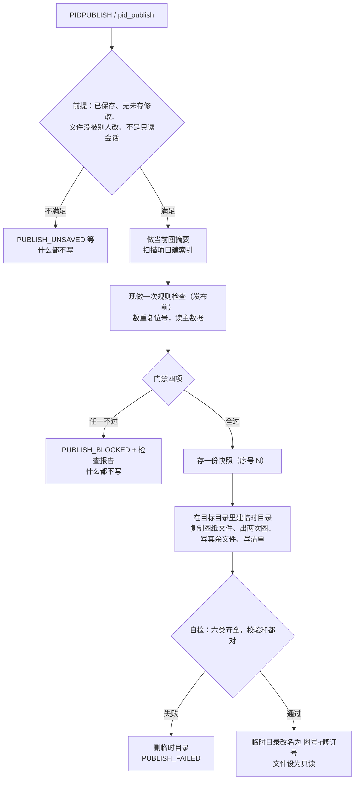

# SPEC：发布包（`pid-publish`）

> 状态：**待建；规格已确认**（2026-11-16，§9 的待决问题都按「建议」定）。基线 `main @ 9b5327f96`。
> 依据：已批准计划 T3.3 第 3 项；需求 `REQ-DELV-008`、`009`，参考 `006`、`010`、`011`（`docs/pid-platform/requirements/60-deliverables-and-publish.md`）。
> 共用约定见 `01-shared-conventions.md`；用到 `SPEC-pid-project-index.md`、`SPEC-pid-drc.md`、`SPEC-pid-bom.md`、`SPEC-pid-snapshot.md`、`SPEC-pid-master-data.md`。
> 2026-11-17：发布加三项协同前提（队列里有没提交的修改、标着不一致、没对过账），清单加一段 `collab`，写在 `SPEC-collab-offline-sync.md` §5.7，**已确认**（2026-11-17；定为默认拒绝，明确带上「允许未对账」才放行，见该规格 §10 第 3 条）。受影响的地方各加了一句指向它（都以「2026-11-17」开头）。

## 1. 目标

把当前这张图打成一个可以交出去的目录：图纸文件、出图、材料清单、连接关系、主数据、检查报告，外加一份带校验和的清单。两条硬规矩：

1. **有问题就不出包。** 有未豁免的错误级检查结果、或有重复位号，一个文件都不写。
2. **要么完整，要么没有。** 包先在临时目录里写齐、自检通过，再改名到位；中途失败不留半成品。

**发布不改图。** 不往图里写记录，不保存图纸；包里的图纸文件就是磁盘上那份文件的原样复制。

## 2. 现状

- 没有发布功能。
- 出图有现成的 `plot` 操作（`control_plot`，`src/app/control/actions.rs:607`）：对当前标签页同步写出 PDF 或 SVG，按扩展名定格式，可选 `layout`、`paper`、`orientation`、`scale` 等参数；默认模型空间、按图形范围、布满图纸。
- 标签页记着文件路径 `current_path`、有没有未保存修改 `dirty`、以及上次读写时的文件指纹 `disk_fingerprint`（`src/app/tab_document.rs:145`–`163`）。保存时用这个指纹发现「文件被别的程序改过」。
- 协同服务器的权限表把「发布签核」归为写操作，只读状态下拒绝（`SPEC-collab-server.md`）。

## 3. 数据格式

### 3.1 包的目录

```text
<目标目录>/                    ← 默认 <图纸所在目录>/pid-publish/
  PID-1101-r003/               ← 包名：<图号>-r<三位修订号>
    manifest.json              ← 发布清单
    PID-1101.dwg               ← 图纸文件，源文件的原样复制（扩展名跟源文件）
    PID-1101.pdf               ← 出图
    PID-1101.svg               ← 出图
    bom.csv                    ← 材料清单主表
    bom.json                   ← 材料清单（含副表）
    pipe-summary.csv           ← 管道汇总（材料清单的副表）
    topology.json              ← 连接关系
    snapshot.json              ← 发布时的快照
    master-data.json           ← 项目主数据
    drc-report.json            ← 规则检查报告
```

十一个文件，对应需求要求的六类内容：

| 需求里的类别 | 包里的文件 | 来源 |
|---|---|---|
| 图纸文件 | `<图号>.dwg`、`<图号>.pdf`、`<图号>.svg` | 源文件复制；`plot` 操作出两次图 |
| 材料清单 | `bom.csv`、`bom.json` | `SPEC-pid-bom.md` §3.2、§3.4，范围是这一张图，从发布时的快照算 |
| 报表 | `pipe-summary.csv`、`topology.json`、`snapshot.json` | 材料清单副表；§3.3；`SPEC-pid-snapshot.md` §3.2 |
| 项目主数据快照 | `master-data.json` | 主数据全文；没配置时写 `{"version":1,"configured":false}` |
| 校验结果报告 | `drc-report.json` | 发布时现做的那次检查的完整结果（`SPEC-pid-drc.md` §3.6），含已豁免的 |
| 发布清单 | `manifest.json` | §3.2 |

- 包名里的图号按快照目录同样的规则去掉不能做文件名的字符。
- 修订号是正整数。不指定时取「目标目录里这张图已有的最大修订号 + 1」，没有就从 1 起；可以指定，但必须大于已有的最大值。包目录已存在时拒绝（`PUBLISH_TARGET_EXISTS`），**从不覆盖已发布的包**。
- 项目索引不扫子目录，所以包里的 DWG 不会被当成项目图纸。
- 包写成后，里面的文件设为只读。

### 3.2 发布清单 `manifest.json`

> 2026-11-17：清单另加一段 `collab`（图里没有同步记录时是 `null`），见 `SPEC-collab-offline-sync.md` §5.7，已确认。

```json
{
  "version": 1,
  "kind": "pid-publish-manifest",
  "package_id": "PID-1101-r003",
  "project": { "id": "CDU-01", "name": "常减压装置" },
  "drawing_id": "PID-1101",
  "revision": 3,
  "published_at": 1794800000,
  "published_by": "zhangsan",
  "generator": "OpenCADStudio 0.9.0",
  "source": { "file": "PID-1101.dwg", "bytes": 482133, "sha256": "…" },
  "snapshot_seq": 7,
  "snapshot_body_sha256": "…",
  "rule_set_version": "1.0.0+2",
  "rule_set_digest": "a1b2c3d4e5f60718",
  "master_data_revision": 3,
  "gates": {
    "drc_errors": 0, "drc_warnings": 4, "drc_hints": 2, "waived": 1,
    "duplicate_tags": 0, "master_data": "configured", "index_complete": true,
    "result": "放行"
  },
  "contents": [
    { "kind": "图纸文件", "path": "PID-1101.dwg", "bytes": 482133, "sha256": "…" },
    { "kind": "图纸文件", "path": "PID-1101.pdf", "bytes": 96410, "sha256": "…" },
    { "kind": "图纸文件", "path": "PID-1101.svg", "bytes": 201877, "sha256": "…" },
    { "kind": "材料清单", "path": "bom.csv", "bytes": 2210, "sha256": "…" },
    { "kind": "材料清单", "path": "bom.json", "bytes": 9034, "sha256": "…" },
    { "kind": "报表", "path": "pipe-summary.csv", "bytes": 310, "sha256": "…" },
    { "kind": "报表", "path": "topology.json", "bytes": 15220, "sha256": "…" },
    { "kind": "报表", "path": "snapshot.json", "bytes": 512044, "sha256": "…" },
    { "kind": "项目主数据快照", "path": "master-data.json", "bytes": 4102, "sha256": "…" },
    { "kind": "校验结果报告", "path": "drc-report.json", "bytes": 7710, "sha256": "…" }
  ]
}
```

| 字段 | 说明 |
|---|---|
| `package_id` | 包名，与目录名相同 |
| `project` | 项目文件里的项目号与名称；没有项目文件时为 `null` |
| `published_at`、`published_by` | Unix 秒；发布人的取法与快照的生成人相同 |
| `source` | 被复制的那个图纸文件：文件名、字节数、SHA-256。与 `contents` 里图纸文件那一项的校验和相同——以后拿任何一份 DWG 算一下校验和，就能判断它是不是这次发布的那一份 |
| `snapshot_seq`、`snapshot_body_sha256` | 发布时存的那份快照的序号和正文校验和 |
| `rule_set_version`、`rule_set_digest` | 检查用的规则集版本与摘要值（`SPEC-pid-drc.md` §3.2） |
| `master_data_revision` | 主数据的修订号；没配置时为 `null` |
| `gates` | 门禁的计数和结论，见 §3.4。写进包里的 `result` 恒为 `放行`（不放行就没有包） |
| `contents[]` | 除清单自己以外的每个文件：类别、相对路径、字节数、SHA-256。按上表的顺序 |

### 3.3 连接关系 `topology.json`

```json
{
  "version": 1,
  "drawing_id": "PID-1101",
  "nodes": ["PIPE_LINE|L-1001", "PIPE_RUN|L-1001-01", "PUMP|P-1001", "VALVE|V-1001", "connector|L-1001|pipe_out"],
  "edges": [["PIPE_LINE|L-1001", "PIPE_RUN|L-1001-01"], ["PIPE_RUN|L-1001-01", "PUMP|P-1001#out1"]],
  "connectors": [
    { "kind": "pipe_out", "line": "L-1001", "status": "paired",
      "peer_drawing": "PID-1102", "upstream": "L-1001", "downstream": "L-2001" }
  ]
}
```

`nodes`、`edges` 就是连通图（`SPEC-pid-project-index.md` §3.3），与 `snapshot.json` 里的 `graph` 相同，单独成一个文件是为了下游不必解析整份快照。`connectors[].status` 是项目索引给的配对结论：`paired` / `one_sided` / `target_missing` / `ambiguous` / `unpaired`。

### 3.4 前提与门禁

**前提**（不满足直接拒绝，不做检查）：

| 前提 | 不满足时 |
|---|---|
| 图纸保存过，且没有未保存的修改 | `PUBLISH_UNSAVED` |
| 磁盘上的文件就是本程序上次读写的那一份（现取的文件指纹与标签页记的 `disk_fingerprint` 相同；标签页没记到指纹时按「无法确认」处理） | `PUBLISH_FILE_CHANGED` |
| 不是协同的只读会话 | `COLLAB_READONLY` |
| 2026-11-17 加，已确认：图里有同步记录时，队列是空的、没有标不一致、正连着服务器并且已经补齐（`SPEC-collab-offline-sync.md` §5.7） | `COLLAB_UNSYNCED` / `COLLAB_DIVERGED` / `COLLAB_OFFLINE` |
| 目标目录能建、能写；包目录不存在；指定的修订号合法 | `PUBLISH_TARGET_INVALID` / `PUBLISH_TARGET_EXISTS` / `PUBLISH_REVISION_INVALID` |

要求「先保存」是为了让包里的图纸文件、清单、报告说的是同一份东西：图纸文件从磁盘复制，其余从程序里的图算，两者一致的保证就是「没有未保存的修改，文件也没被别人动过」。

**门禁**（四项全过才出包）：

| 门禁 | 怎么算 |
|---|---|
| 未豁免的错误为 0 | **现做一次**规则检查：范围是当前图，项目级规则也跑（`scope: drawing`、`cross_drawing: true`、触发时机 `发布前`）。不采信之前的检查结果。警告、提示、已豁免的不拦，但都写进报告 |
| 重复位号为 0 | **不经过规则**，直接数：本图里同一个（类型编码，位号）出现两次以上，或本图的某个（类型编码，位号）在项目的另一张图上也有。只算有自己编号的设备、阀门、仪表、其他。项目规则包把 `DR-004`、`DR-102` 停用了也照拦 |
| 主数据读得出 | 配了但读不出（文件坏了）就拦，因为此时取值合法性的规则都没跑。没配置不单独拦，由 `DR-009` 管 |
| 项目里的图都读得出 | 有图读不出来时，「别的图上有没有同号」无法确认，拦（待决问题 P3） |

任一项不过：返回 `PUBLISH_BLOCKED`，应答带 `gates`（各项计数）和完整的检查报告；目标目录里一个文件都不写，也不存快照。

```json
{
  "ok": false, "code": "PUBLISH_BLOCKED", "message": "2 条错误、1 个重复位号，没有发布",
  "gates": { "drc_errors": 2, "drc_warnings": 4, "drc_hints": 2, "waived": 1,
             "duplicate_tags": 1, "master_data": "configured", "index_complete": true,
             "result": "PUBLISH_BLOCKED" },
  "duplicates": [ { "type_code": "PUMP", "tag": "P-1001",
                    "places": [ { "drawing_id": "PID-1101", "at": [120.0, 80.0] }, { "drawing_id": "PID-1102", "at": [40.0, 60.0] } ] } ],
  "report": { "说明": "SPEC-pid-drc.md §3.6 的检查结果全文" }
}
```

`gates.master_data` 取 `configured` / `not_configured` / `unreadable`。

### 3.5 校验一个包

`verify_package(目录)` 检查：清单能解析；六类内容每类至少一个文件；清单里列的每个文件都在，字节数和校验和都对。

```json
{ "ok": true, "package_id": "PID-1101-r003", "revision": 3, "files": 11,
  "missing": [], "mismatched": [], "extra": [] }
```

`files` 是包里的文件数，含清单自己。

- 缺类别或缺文件 → `PACKAGE_INCOMPLETE`，应答列出 `missing`。
- 校验和或字节数不对 → `PACKAGE_CORRUPT`，应答列出 `mismatched`。
- 包里多出清单没列的文件：不算失败，列在 `extra` 里。

发布时在改名到位之前先对临时目录跑一遍这个校验。

### 3.6 错误码

| 码 | 何时 | HTTP |
|---|---|---|
| `PUBLISH_BLOCKED` | 门禁没过（§3.4） | 409 |
| `PUBLISH_UNSAVED` | 图没保存过，或有未保存的修改 | 409 |
| `PUBLISH_FILE_CHANGED` | 磁盘上的文件被别的程序改过 | 409 |
| `COLLAB_UNSYNCED`、`COLLAB_DIVERGED`、`COLLAB_OFFLINE` | 2026-11-17 加，已确认：协同前提不满足（`SPEC-collab-offline-sync.md` §5.7） | 409 |
| `PUBLISH_TARGET_EXISTS` | 包目录已存在 | 409 |
| `PUBLISH_REVISION_INVALID` | 指定的修订号不是正整数，或不大于已有的最大修订号 | 400 |
| `PUBLISH_TARGET_INVALID` | 目标目录建不出来或不可写 | 400 |
| `PUBLISH_FAILED` | 出包过程中某一步失败（出图、写文件、自检）；应答带 `step`；临时目录已删 | 500 |
| `COLLAB_READONLY` | 只读会话（沿用现有的码） | 403 |
| `PACKAGE_NOT_FOUND` | 要校验的目录不存在，或里面没有 `manifest.json` | 404 |
| `PACKAGE_INCOMPLETE`、`PACKAGE_CORRUPT` | 见 §3.5 | 409 |
| `INDEX_DRAWING_ID_DUPLICATED` | 项目里两个文件图号相同（项目索引报的，原样透出） | 409 |

## 4. 数据怎么传



- **顺序与来源**：摘要做一次，检查、快照、材料清单、连接关系都用这同一份摘要，互相对得上。
- **临时目录**建在目标目录里面（名字以 `.` 开头、带随机后缀），与最终位置在同一个盘上，改名是一步到位的。任何一步失败就删掉它。上次崩溃留下的临时目录，在下次往同一目标目录发布时清掉。
- **快照**在门禁通过后才存，原因写「发布前自动快照（修订 3）」。之后出包失败的话快照留着，它如实记了那一刻的图。
- **项目扫描**可能要几秒：命令会先扫、扫完自动接着做；操作在扫描期间返回 `{"ok":true,"status":"scanning","done":12,"total":40}`，调用方稍后用同样的请求再发一次（与 `pid_check` 相同）。
- **不改图**：发布前后图纸的「已修改」状态、撤销栈、磁盘上的文件都不变。发布不经协同服务器。（2026-11-17：仍然不经服务器；协同前提只读本机的同步状态来判，见 `SPEC-collab-offline-sync.md` §5.7，已确认。）

**这张图发布到哪一版了**：不在图里记，由目标目录里的包推出。取这张图修订号最大的包，比它的 `source.sha256` 与当前图纸文件的校验和：

| 情况 | 显示 |
|---|---|
| 目标目录里没有这张图的包 | 未发布 |
| 校验和相同，且没有未保存的修改 | 已发布，修订 N |
| 其余 | 修订 N 之后有改动 |

## 5. 对外接口

### 5.1 模块接口（`src/pid/publish_pkg.rs`）

```rust
pub fn package_name(drawing_id: &str, revision: u32) -> String;                  // "PID-1101-r003"
pub fn next_revision(target_dir: &Path, drawing_id: &str) -> u32;
pub fn duplicate_tags(current: &DrawingSummary, index: &ProjectIndex,
                      others: &[DrawingSummary]) -> Vec<Duplicate>;
pub fn gates(report: &CheckReport, duplicates: usize, master: &Resolved, index_complete: bool) -> Gates;

pub struct PackageInput<'a> { /* 图号、修订号、项目、时间、发布人、源文件路径、快照文件与序号、
                                 材料清单、连通图与连接符状态、主数据、检查报告、门禁 */ }
/// 往 staging 里写除两张出图以外的文件（出图由调用方先放进去），最后写 manifest.json。
pub fn write_package(staging: &Path, input: &PackageInput) -> Result<Manifest, PublishError>;
/// 自检后改名到位；目标已存在则拒绝。
pub fn commit(staging: &Path, final_dir: &Path) -> Result<(), PublishError>;
pub fn verify_package(dir: &Path) -> Result<VerifyReport, PublishError>;
pub fn list_packages(target_dir: &Path, drawing_id: &str) -> Vec<PackageInfo>;
```

流程编排（前提、取摘要、扫描、检查、出图、存快照）在 `src/app/commands/pidpublish.rs`，因为出图和标签页状态只有应用层拿得到。

### 5.2 命令

| 命令 | 做什么 | 只读会话 |
|---|---|---|
| `PIDPUBLISH [<目标目录>] [REV <修订号>]` | 发布当前图。成功输出包路径、修订号、文件数；被拦输出各项门禁的计数和前若干条错误 | 拒绝 |
| `PIDPUBLISH CHECK` | 只过一遍前提和门禁，不写任何东西 | 允许 |
| `PIDPUBLISH LIST [<目标目录>]` | 列出这张图已发布的各版，以及「发布到哪一版了」 | 允许 |
| `PIDPUBLISH VERIFY <包目录>` | 校验一个包（§3.5） | 允许 |

### 5.3 自动化操作与 REST

| 操作 | REST | 读写 | 请求 | 应答 |
|---|---|---|---|---|
| `pid_publish_check` | `GET /api/v1/pid/publish/check` | 读 | `dir`（可选） | 见下 |
| `pid_publish` | `POST /api/v1/pid/publish` | 写（本机文件） | `dir`、`revision`、`plot`（都可选） | `{"ok":true,"package_id":"PID-1101-r003","path":"…","revision":3,"snapshot_seq":7,"files":11,"bytes":1331200,"gates":{…}}`，状态 201 |
| `pid_publications` | `GET /api/v1/pid/publications` | 读 | `dir`（可选） | `{"ok":true,"target_dir":"…","state":"修订 3 之后有改动","packages":[{package_id, revision, path, published_at, published_by, current}]}` |
| `pid_publish_verify` | `POST /api/v1/pid/publish/verify` | 读 | `path` | §3.5 |

`pid_publish_check` 的应答：

```json
{
  "ok": true, "can_publish": false,
  "preconditions": { "saved": true, "clean": false, "file_unchanged": true, "writable_session": true },
  "gates": { "drc_errors": 0, "drc_warnings": 4, "drc_hints": 2, "waived": 1,
             "duplicate_tags": 0, "master_data": "configured", "index_complete": true, "result": "放行" },
  "target_dir": "D:/proj/cdu/pid-publish", "next_revision": 3
}
```

- `plot`：可选对象，字段与现有 `plot` 操作相同（`layout`、`paper`、`orientation`、`scale` 等，不含 `path`），PDF 和 SVG 都用它。不给就是模型空间、按图形范围、布满图纸。本期一次只出一个布局。
- MCP：`pid_publish_check`、`pid_publications`、`pid_publish_verify` 进 `READ_OPS`；`pid_publish` 进 `EXECUTE_OPS`。

### 5.4 权限

没连协同不设限。协同中：可写会话可以发布，只读会话不能（与服务器把「发布签核」算作写操作一致）。客户端只知道会话可写不可写，不知道自己有没有「发布签核」这一项，所以本期做不到按角色细分。（2026-11-17：图里有同步记录而没连着服务器时，默认不让发布，明确带上「允许未对账」才放行，见 `SPEC-collab-offline-sync.md` §5.7，已确认。）

## 6. 成功标准

1. 图上有一条未豁免的错误 → `PUBLISH_BLOCKED`，目标目录里没有新增任何文件或目录，也没有新快照。用一组各带不同错误的图验证：**有错误的图 100% 被拦**。
2. 图上有重复位号，即使项目规则包停用了 `DR-004` → 仍是 `PUBLISH_BLOCKED`。另一张图上有同类型同位号 → 同样被拦。
3. 把错误改掉（或豁免）后再发布 → 成功；包里恰好十一个文件，`PIDPUBLISH VERIFY` 通过；警告和已豁免的都在 `drc-report.json` 里。
4. 包里的图纸文件与源文件逐字节相同；`bom.json` 的 `snapshot_seq` 等于清单里的 `snapshot_seq`；`topology.json` 的边与 `snapshot.json` 里的 `graph.edges` 相同。
5. 有未保存的修改 → `PUBLISH_UNSAVED`；只读会话 → `COLLAB_READONLY`；都不写任何东西。
6. 连发两次 → 修订号 1、2，两个包都在；往已有的包目录发布 → `PUBLISH_TARGET_EXISTS`，原包不变。
7. 出包中途失败（测试里让某一步报错）→ `PUBLISH_FAILED`，目标目录里既没有包也没有残留的临时目录。
8. 改动包里任一文件的一个字节 → `PACKAGE_CORRUPT`；删掉任一文件 → `PACKAGE_INCOMPLETE`。
9. 发布前后，图纸的「已修改」状态、撤销栈、源文件的校验和都没有变化；发布后 `PIDPUBLISH LIST` 显示「已发布，修订 N」，改图并保存后显示「修订 N 之后有改动」。
10. 性能：2,000 个对象的图，门禁部分（不含项目扫描）不超过 1 秒。整次发布不设硬指标（耗时主要在出图），应答里带各步耗时。
11. 从命令行执行 `PIDPUBLISH <目录>` 只发布一次、只发到给定的目录：默认目录里没有多出一个包（命令行不会先拿不带参数的 `PIDPUBLISH` 试跑一遍，见共用约定 §7.6）。

## 7. 测试

| 层 | 测什么 |
|---|---|
| 单元（`src/pid/publish_pkg.rs`） | 包名与修订号推算；重复位号的数法（本图内、跨图、不同类型同号不算、没有自己编号的不算）；门禁四项的组合；清单内容与顺序；校验的三种结果；改名前目标已存在；失败后不留临时目录 |
| 命令与操作（临时目录里的真实图纸） | 成功标准 1–9 的全流程：用命令建图 → 保存 → 被拦 → 整改 → 发布 → 校验；另一张图制造跨图重号；成功标准 11（带目录的命令经命令行只发布一次） |
| 一致性 | 图保存后重新读回，摘要与保存前相同（这是「从磁盘复制的图纸文件」与「从程序里算的清单」说的是同一份东西的依据） |
| REST | 四个路由、状态码（`PUBLISH_BLOCKED` → 409，`PUBLISH_FAILED` → 500）、`rest_openapi.json` 一致、MCP 名单与摘要值 |

要动的文件：新建 `src/pid/publish_pkg.rs`、`src/app/commands/pidpublish.rs`；改 `src/pid/mod.rs`、`src/app/commands/mod.rs`、`src/app/command_driver/utilities.rs`（整行名单）、`src/app/collab/apply.rs`、`src/app/control/mod.rs`、`src/rest.rs`（含 `map_status`）、`src/rest_openapi.json`、`src/mcp.rs`。

已核对的两个接入点：`disk_fingerprint` 在打开文件后（`src/app/update/file.rs:2188`）和保存后（`2280`）赋值，新建的图为空；`control_plot` 是同步写文件的，它设置的操作应答只在有操作在等时生效（`set_control_result`），发布在它之后写自己的应答即可，所以可以直接调用。

## 8. 不在范围与已知限制

- **发布状态流转**（草稿、待审、已发布、已撤回，`STATE_FORBIDDEN`）和**发布后图纸转只读**不做（P1）。
- 一次只发布当前这一张图（P2）。
- 包里不含 DXF；要 DXF 用现有的另存。
- 导出任务排队、失败重试、完成通知（`REQ-DELV-011`）不做：那是平台服务端的事，桌面端的发布是当场做完的。
- 按复选框树选范围批量出图、输出到项目文档库（`REQ-DELV-007`）不做。
- 修订号是按目标目录推的：换一个空的目标目录，编号会从 1 重新开始，除非用 `REV` 指定。
- 项目规则包可以停用规则，停用的规则不会拦发布（重复位号除外）。发布清单记了规则集版本和摘要值，检查报告记了跑了多少条、跳过多少条，可以事后核对。

## 9. 待决问题

> **2026-11-16 已定**：本节各条都按「建议」一栏执行。汇总见 `plan.md` §3，对应的任务见 `todo.md`。

| # | 问题 | 建议 |
|---|---|---|
| P1 | **发布状态和发布后锁图不做。** 需求要四个状态和「已发布后图纸只读、改动走新修订」；计划里没有 | 本期不做。状态流转和锁定要有人审、有地方记，适合放在协同服务器上（它已经有图纸状态和「发布签核」权限项）。本期用「已发布，修订 N / 修订 N 之后有改动」这个推出来的状态代替 |
| P2 | **一次只发布一张图。** 整个项目或一个 PBS 节点一起发布没做 | 本期只做单图。批量发布就是逐张调用，可以以后加，不影响包的格式 |
| P3 | **项目目录里有图读不出来时不让发布。** 这样最稳，但一个无关的坏文件会挡住所有图的发布 | 拦。读不出来就确认不了「别的图上没有同号」。报错里列出是哪个文件，把它移出目录即可 |
| P4 | **发布前必须先保存。** 另一种做法是不要求保存、直接把程序里的图另存进包里 | 要求先保存。这样包里的图纸文件与工作文件校验和相同，以后能证明「这个包就是从这份文件出的」；发布也完全不碰图 |
| P5 | **包内文件比计划多三个**（`pipe-summary.csv`、`snapshot.json`、`master-data.json`），目录是平铺的 | 按 §3.1。需求要求六类内容，计划列的八个文件里没有项目主数据快照；另外两个是顺手带上的，下游用得到 |

## 10. 需求对照

| 需求 | 本期 | 说明 |
|---|---|---|
| `REQ-DELV-008` 发布包构成与发布状态 | 部分 | 六类内容、`PACKAGE_INCOMPLETE`、修订号递增已做；四个状态、`STATE_FORBIDDEN`、发布后只读不做（P1） |
| `REQ-DELV-009` 发布门禁与校验阻断 | 覆盖 | 有错误不出包、只有警告和提示放行、已豁免不拦但列入报告。需求说读「最近一次」检查结果，本规格更严：每次发布都重新检查 |
| `REQ-DELV-006` 四格式图纸输出 | 部分 | 包里有 DWG、PDF、SVG；DXF 用现有的另存，不进包 |
| `REQ-DELV-010` 导出矩阵 | 部分 | 包里用到 DWG、PDF、SVG、CSV、JSON；XLSX 在材料清单的单独导出里 |
| `REQ-DELV-007`、`011` | 不做 | 见 §8 |
| 计划 T3.3「前置执行 DRC Blocker == 0 与 重复位号 == 0 硬门禁」 | 覆盖 | §3.4 前两项；另加两项（主数据读得出、项目里的图都读得出），否则前两项的结论不可靠 |
| 计划 T3.3「在目标目录原子生成标准发布包」 | 覆盖 | 临时目录 + 自检 + 改名；计划列的八个文件都在，另多三个（P5） |
| 计划 T3.3 测试「严重违规时 100% 拒绝写出发布包、整改清零后完整产出发布包」 | 覆盖 | 成功标准 1–3 |

## 11. 实现记录

实现与本规格、任务文字有出入的地方，以及规格没写到、实现时定下的读法，记在这里（`todo.md` §1 第 7 条）。

### 11.1 `PUB-1`：包名、修订号、重复位号、门禁（2026-11-22）

**做了什么**（新文件 `src/pid/publish_pkg.rs`，`src/pid/mod.rs` 登记一行）：

- §5.1 的 `package_name`、`next_revision`、`list_packages`（每项是 `PackageInfo`：包名、修订号、路径）、`duplicate_tags`、`gates`（结果 `Gates`，字段和顺序照 §5.3 的 `gates`，另有 `passed()`；主数据那一项是 `MasterDataState`，由 `master_data::Resolved` 转来）。
- 离线规格 §5.7 的协同前提 `collab_preconditions`：输入 `CollabInput`（图里有没有同步记录、队列条数、有没有标不一致或这次连接对不上、是不是连着并且补齐、有没有带「允许未对账」），结论 `CollabVerdict` 三种：不查（没有同步记录，清单的 `collab` 写 `null`）、放行（带 `reconciled`）、拦（带码）。
- 常量 `PASSED`（`放行`）、`PUBLISH_BLOCKED`、`COLLAB_UNSYNCED`、`COLLAB_DIVERGED`、`COLLAB_OFFLINE`。写包、落位、校验是 `PUB-2` 的。

**与规格写法不同的：**

1. **重复位号沿用项目索引的 `Duplicate`。** 出现处除了 §3.4 写的 `drawing_id`、`at`，还多一个 `handle`（与项目索引的 `duplicates[].places[]` 相同），在图上定位用。

**规格没写到、这里定下的：**

1. **`duplicate_tags` 的三个参数各管什么**：本图以 `current` 为准；别的图上的出现处从项目索引 `index` 的 `duplicates` 和别的图的摘要 `others` 里都找，两处都有的同一处（图号、句柄都相同）只记一次；索引里图号与本图相同的出现处不看，因为索引可能是本图改动之前建的。所以只给索引、或者只给别的图的摘要，跨图重号都数得出来。
2. **位号去掉首尾空白再比**，只有空白的不数，与规则检查数本图重号的口径相同；列出来的是去掉空白以后的位号。项目索引的跨图重号按原样比，这里拿索引里的位号来对时也先去掉空白。
3. **包名的换字符**直接调快照目录的 `dir_for` 取最后一段，同一条规则只有一份，没有改快照模块。所以设备名（`CON` 之类）前面也加 `_`，包名其实用不着，但无害。修订号不足三位补零，超过三位照写（`r1234`）。
4. **哪些目录算这张图的包**：名字恰好等于 `package_name(图号, n)` 的目录，n 从 1 起。`r08`、`r0005`、`r+06`、`r000` 这样的写法不算，同名的文件不算，临时目录不算，别的图不算（图号是本图图号加上 `-r001` 的图也分得开）。目标目录不存在或读不了时列表是空的、`next_revision` 是 1，目录本身有问题留给写包那一步报 `PUBLISH_TARGET_INVALID`。修订号到了 `u32` 的上限不再加一。
5. **门禁**：未豁免的错误数取检查报告的 `summary.错误`（检查报告的 `blocked` 与它同真假）；`result` 只有 `放行` 和 `PUBLISH_BLOCKED` 两个值。
6. **协同前提的顺序**照离线规格 §5.7 表里的顺序查：队列、不一致、连接，几条同时不满足时报排在前面的那条。「允许未对账」只放过最后一条；连着并补齐时带不带它都是 `reconciled: true`。
