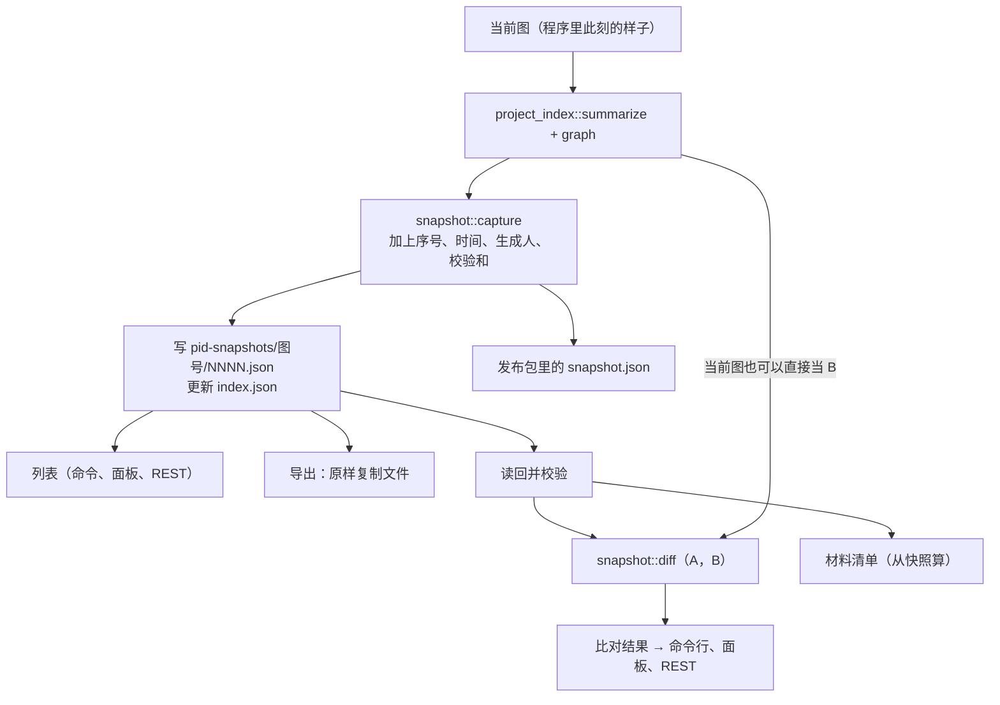

# SPEC：快照与比对（`pid-snapshot`）

> 状态：**待建；规格已确认**（2026-11-16，§9 的待决问题都按「建议」定）。基线 `main @ 9b5327f96`。
> 依据：已批准计划 T3.3 第 2 项；需求 `REQ-DRW-009`、`REQ-DRW-010`（`docs/pid-platform/requirements/40-drawing-and-drafting.md`）。
> 共用约定见 `01-shared-conventions.md`；输入数据见 `SPEC-pid-project-index.md`（图纸摘要、连通图）。

## 1. 目标

1. **快照**：把一张图此刻的语义内容（有哪些对象、各有什么属性、怎么连、在哪）存成一个文件。序号递增，写下后不再改。
2. **比对**：任选两份快照（或一份快照与当前图），列出新增了什么、删了什么、改了什么。

快照只记语义内容，不是图纸文件的备份，不能拿它把图恢复回去。

## 2. 现状

- 没有快照与比对功能。
- 图纸摘要（`project_index::summarize`）和连通图（`project_index::graph`）由项目索引模块提供，本模块直接用。
- 图级记录（`graph_data::store`）每 2000 字节切一条，适合几千字节的小表。2,000 个对象的快照在 1–2 MB，放进图里会让图纸文件和每一步撤销都背上它，所以快照做成文件（计划原文也是「轻量快照文件」）。
- 项目里已有 `sha2`（算校验和）。

## 3. 数据格式

### 3.1 放在哪

```text
<图纸所在目录>/
  pid-snapshots/
    <图号>/
      index.json      ← 目录清单
      0001.json       ← 快照，文件名是四位序号（超过 9999 自然加位）
      0002.json
```

- `<图号>` 与图纸摘要的 `drawing_id` 相同；用作目录名时，Windows 文件名不允许的字符（`< > : " / \ | ? *`）和首尾空格、句点换成 `_`。
- 项目索引只扫图纸目录这一层，不进子目录，所以这里的文件不会被当成图纸。
- 图纸还没保存过（没有目录）时不能存带序号的快照，只能直接写到指定的文件（§5.2 的 `FILE` 形式，序号为 `null`）。

### 3.2 快照文件

```json
{
  "version": 1,
  "kind": "pid-snapshot",
  "seq": 3,
  "drawing_id": "PID-1101",
  "created_at": 1794800000,
  "created_by": "zhangsan",
  "reason": "送审前",
  "generator": "OpenCADStudio 0.9.0",
  "dirty": true,
  "counts": { "objects": 420, "segments": 610, "connectors": 4, "ports": 880, "edges": 705 },
  "body_sha256": "9f2c4e…（64 位十六进制）",
  "summary": { "version": 1, "drawing_id": "PID-1101", "objects": [], "segments": [], "signal_ends": [], "connectors": [], "ports": [] },
  "graph": { "nodes": [], "edges": [] }
}
```

| 字段 | 说明 |
|---|---|
| `version` | 格式版本，现为 1。读到更高的版本报 `SNAPSHOT_VERSION_UNSUPPORTED` |
| `kind` | 恒为 `pid-snapshot`，用来认文件 |
| `seq` | 序号，从 1 起；直接写到指定文件的快照为 `null` |
| `created_at`、`created_by`、`reason` | 时间（Unix 秒）、生成人、原因。生成人的取法与规则检查的豁免人相同：连着协同时取协同的用户号，否则取操作系统的账户名。原因可以为空，不超过 200 字 |
| `generator` | 程序名和版本 |
| `dirty` | 做快照时图里有没有未保存的修改。快照取的是程序里此刻的图，不要求先保存 |
| `counts` | 各类条数，列表里不用打开正文就能显示 |
| `summary` | 图纸摘要全文（`SPEC-pid-project-index.md` §3.1）。材料清单可以直接从它算 |
| `graph` | 做快照时算出的连通图（同上 §3.3）。存下来而不是比对时再算，这样以后算法改了，旧快照的连接关系不会跟着变 |
| `body_sha256` | 把 `summary` 和 `graph` 两个值按「键名排序、不带空白」序列化后拼起来算出的 SHA-256。读快照时重算，对不上报 `SNAPSHOT_CORRUPT` |

文件是 UTF-8、不带 BOM、不缩进的 JSON。摘要里的句柄照常保留，只用来在图上定位，比对不用它认对象。

### 3.3 目录清单 `index.json`

```json
{
  "version": 1,
  "drawing_id": "PID-1101",
  "last_seq": 3,
  "snapshots": [
    { "seq": 1, "file": "0001.json", "created_at": 1794700000, "created_by": "zhangsan", "reason": "",
      "objects": 400, "bytes": 512044, "sha256": "…整个文件的 SHA-256…" }
  ]
}
```

- 它只是为了列表快（不用打开每个快照）和记住用过的最大序号。**有哪些快照以目录里的文件为准**：清单丢了、坏了或与目录对不上，就读文件补齐重写；清单里有而文件已不在的，列表里标 `missing`。
- `last_seq` 只增不减。删掉最新的快照文件后，它的序号不会被再用。

### 3.4 写入规则

1. 新序号 = max(`last_seq`，目录里文件名的最大序号) + 1。
2. 快照文件用「只在不存在时创建」的方式写（`create_new`）。文件已存在说明另一个程序刚用了这个序号，换下一个序号再试，最多三次；仍不行报 `SNAPSHOT_IMMUTABLE`。**任何情况下都不覆盖已有的快照文件。**
3. 写完把文件设成只读，再更新目录清单（先写临时文件再改名）。
4. 没有改写和删除快照的入口。模块层面往已有的序号写返回 `SNAPSHOT_IMMUTABLE`。

### 3.5 比对：谁和谁是同一个对象

比对按下面的键认对象，**不看句柄**（同一个对象在两台机器的副本里句柄不同）：

- 有自己编号且位号不空的对象（设备、阀门、仪表、管线、管路、信号线、其他）：`<类型编码>|<位号>`，如 `PUMP|P-1001`。
- 位号为空的对象：`<类型编码>|<所属>|<x>,<y>`，坐标保留 3 位小数（与规则检查的对象键写法相同）。它没有别的身份，所以挪了位置会被报成删一个、增一个。
- 页间连接符：`connector|<线号>|<种类>`。
- 不单独编号的管件：不逐个比，算作所在管路的一项内容——比这条管路上每种符号各有几个。打断符不比。
- 线段：不逐根比（插一个阀门就会把一根切成两根），算作主人的长度——管路比名下管段长度之和，管线比它自己的线（不含管路）长度之和。
- 同一个键在一份快照里出现多次（重复位号，或一条线上多个同种连接符）：两边各自按坐标排序后逐个配对，多出来的算新增或删除。

### 3.6 比对：比什么

两边都有的对象逐项比，每一处不同记一条 `changes`：

| `what` | 比什么 | 记什么 |
|---|---|---|
| `属性` | `props` 的每个键；另加四个固定项：`图层`、`符号`、`所属`、`覆盖标记`（字段名用顿号连起来） | `field`、`old`、`new`；一边没有这个键记 `null` |
| `位置` | 符号类对象比定位点 `at`；管线、管路、信号线比包围盒 `bbox`。任一坐标差超过容差才算（默认 0.001 图纸单位，可传参） | `old`、`new` |
| `长度` | 管路、管线的线段长度之和（§3.5），差超过同一个容差才算 | `old`、`new`（图纸单位） |
| `管件` | 管路上每种不单独编号的管件的个数 | `symbol`、`old`、`new` |
| `连接` | 连通图里与这个对象有关的边 | `change`（`新增` / `删除`）、`with`（边的另一头）、`port`（这一头的端口名，没有则省略） |
| `对端` | 连接符的 `peer_kind`、`peer_drawing`、`upstream`、`downstream` | `field`、`old`、`new` |

- 位号状态、位号来源、句柄、类型显示名不比：它们要么是推出来的，要么不是内容。
- 一条边的增删记在它两头的对象上；某一头本身就是新增或删除的对象时，只记在另一头。例如往管路里插了一个阀门：阀门出现在「新增」里，管路出现在「修改」里，带两条 `连接` 新增。

### 3.7 比对结果

```json
{
  "ok": true,
  "version": 1,
  "a": { "ref": "2", "seq": 2, "drawing_id": "PID-1101", "created_at": 1794750000, "objects": 419 },
  "b": { "ref": "live", "seq": null, "drawing_id": "PID-1101", "created_at": 1794800000, "objects": 420 },
  "identical": false,
  "summary": {
    "新增": 1, "删除": 0, "修改": 2,
    "by_what": { "属性": 1, "位置": 1, "长度": 0, "管件": 0, "连接": 1, "对端": 0 },
    "edges_added": 2, "edges_removed": 0
  },
  "added": [
    { "key": "VALVE|V-1003", "kind": "阀门", "type_code": "VALVE", "tag": "V-1003", "at": [160.0, 80.0], "handle": "2F1" }
  ],
  "removed": [],
  "modified": [
    { "key": "PUMP|P-1001", "kind": "设备", "type_code": "PUMP", "tag": "P-1001", "at": [120.0, 80.0], "handle": "2A4",
      "changes": [
        { "what": "属性", "field": "名称", "old": "离心泵", "new": "进料泵" },
        { "what": "位置", "old": [100.0, 80.0], "new": [120.0, 80.0] }
      ] },
    { "key": "PIPE_RUN|L-1001-01", "kind": "管路", "type_code": "PIPE_RUN", "tag": "L-1001-01", "at": [134.0, 80.0], "handle": "2A6",
      "changes": [
        { "what": "连接", "change": "新增", "with": "VALVE|V-1003#连接点1" },
        { "what": "连接", "change": "新增", "with": "VALVE|V-1003#连接点2" }
      ] }
  ],
  "edges": {
    "added": [["PIPE_RUN|L-1001-01", "VALVE|V-1003#连接点1"], ["PIPE_RUN|L-1001-01", "VALVE|V-1003#连接点2"]],
    "removed": []
  },
  "notices": []
}
```

| 字段 | 说明 |
|---|---|
| `a`、`b` | 比的是哪两份；`ref` 是请求里写的（序号、文件路径或 `live`）。「新增」指 `b` 有而 `a` 没有 |
| `identical` | 四类（新增、删除、修改、边的增删）都为空时为真，界面显示「无差异」 |
| `summary.新增/删除/修改` | 三组各有多少个对象（需求要的三组计数） |
| `summary.by_what` | 「修改」组里，有这一种变化的对象各有多少个 |
| `added[]`、`removed[]` | 对象的键、种类、位置；`handle` 取自它所在的那一份，只供定位 |
| `modified[]` | 对象及其 `changes`；`at`、`handle` 取自 `b` |
| `edges` | 连通图里增加和去掉的边（计划里的「拓扑变更」清单） |
| `notices[]` | `{code, message}`：`DRAWING_ID_DIFFERS`（两份不是同一张图）、`LENGTH_UNIT_DIFFERS`（两份的图纸单位不同，长度和位置没有换算） |

各列表按键排序，`changes` 按 `what`、`field` 排序；同样的两份快照两次比对结果相同。

### 3.8 错误码

| 码 | 何时 | HTTP |
|---|---|---|
| `SNAPSHOT_IMMUTABLE` | 往已有的序号写 | 409 |
| `SNAPSHOT_NOT_FOUND` | 序号或文件不存在 | 404 |
| `SNAPSHOT_CORRUPT` | 正文校验和对不上，或文件与目录清单里记的校验和不同 | 409 |
| `SNAPSHOT_FORMAT_INVALID` | 不是快照文件（JSON 坏了、缺字段、`kind` 不对） | 400 |
| `SNAPSHOT_VERSION_UNSUPPORTED` | `version` 比程序认识的高 | 400 |
| `SNAPSHOT_REASON_TOO_LONG` | 原因超过 200 字 | 400 |
| `DIFF_SAME_SNAPSHOT` | 比对的两份是同一份 | 400 |
| `INDEX_NO_PROJECT_DIR` | 图纸没保存过，没有目录可放带序号的快照 | 409 |

## 4. 数据怎么传



- 做快照只读图，不往图里写任何东西：不产生撤销步骤，图纸不会变成「已修改」。
- 快照是本机的文件，不经协同服务器。协同中各人的快照在各自的目录里。
- `capture`、`diff` 都是纯函数；读写文件在 `snapshot::store` 里；取当前图、定目录在命令层。

## 5. 对外接口

### 5.1 模块接口（`src/pid/snapshot.rs`）

```rust
pub struct SnapshotMeta { pub created_at: u64, pub created_by: String, pub reason: String,
                          pub generator: String, pub dirty: bool }

/// 由摘要做一份快照（序号暂空）。纯函数。
pub fn capture(summary: DrawingSummary, graph: Graph, meta: SnapshotMeta) -> Result<Snapshot, SnapshotError>;
/// 解析并校验一份快照的字节。
pub fn parse(bytes: &[u8]) -> Result<Snapshot, SnapshotError>;
/// 比对。纯函数。
pub fn diff(a: &Snapshot, b: &Snapshot, move_tolerance: f64) -> Diff;

pub mod store {
    /// 分配序号并写入；返回序号、文件路径、字节数、校验和。
    pub fn save(dir: &Path, snapshot: Snapshot) -> Result<Saved, SnapshotError>;
    /// 不分配序号，直接写到指定文件（文件已存在则拒绝）。
    pub fn save_to_file(path: &Path, snapshot: &Snapshot) -> Result<Saved, SnapshotError>;
    pub fn list(dir: &Path) -> Result<Vec<SnapshotInfo>, SnapshotError>;
    pub fn load(dir: &Path, seq: u64) -> Result<Snapshot, SnapshotError>;
    pub fn load_file(path: &Path) -> Result<Snapshot, SnapshotError>;
    /// 原样复制到 to。
    pub fn export(dir: &Path, seq: u64, to: &Path) -> Result<u64, SnapshotError>;
    /// 某张图的快照目录：<图纸目录>/pid-snapshots/<图号>。
    pub fn dir_for(drawing_dir: &Path, drawing_id: &str) -> PathBuf;
}
```

### 5.2 命令（`src/app/commands/pidsnapshot.rs`）

| 命令 | 做什么 |
|---|---|
| `PIDSNAPSHOT` 或 `PIDSNAPSHOT SAVE [<原因>]` | 给当前图存一份快照，输出序号和文件路径 |
| `PIDSNAPSHOT LIST` | 列出当前图的快照：序号、时间、生成人、原因、对象数 |
| `PIDSNAPSHOT EXPORT <序号> <文件>` | 把某一份原样复制出去 |
| `PIDSNAPSHOT FILE <文件> [<原因>]` | 不分配序号，直接把当前图的快照写到指定文件（没保存过的图也能用） |
| `PIDDIFF <甲> [<乙>]` | 比对。甲、乙可以是序号或快照文件路径；不写乙就是与当前图比。输出三组计数和前若干条明细 |
| `PIDDIFF <甲> <乙> EXPORT <文件>` | 把比对结果（§3.7）写成 JSON 文件。要与当前图比时乙写 `LIVE` |

两个命令都不改图，整个加进只读会话的允许名单。

### 5.3 自动化操作与 REST

| 操作 | REST | 读写 | 请求 | 应答 |
|---|---|---|---|---|
| `pid_snapshots` | `GET /api/v1/pid/snapshots` | 读 | — | `{"ok":true,"drawing_id":"…","dir":"…","snapshots":[{seq, created_at, created_by, reason, objects, bytes, status}]}`，`status` 取 `ok` / `missing` |
| `pid_snapshot` | `GET /api/v1/pid/snapshots/{seq}` | 读 | — | §3.2 的快照全文 |
| `pid_snapshot_save` | `POST /api/v1/pid/snapshots` | 写（本机文件） | `reason`（可选）、`path`（可选，给了就是 `FILE` 形式） | `{"ok":true,"seq":3,"path":"…","objects":420,"bytes":512044,"sha256":"…"}`，状态 201 |
| `pid_snapshot_export` | `POST /api/v1/pid/snapshots/{seq}/export` | 写（本机文件） | `path` | `{"ok":true,"path":"…","bytes":512044}` |
| `pid_diff` | `GET /api/v1/pid/diff?a=2&b=3` | 读 | `a`、`b`（序号、文件路径或 `live`；`b` 默认 `live`）、`move_tolerance`（可选） | §3.7 的比对结果 |

MCP：`pid_snapshots`、`pid_snapshot`、`pid_diff` 进 `READ_OPS`；`pid_snapshot_save`、`pid_snapshot_export` 进 `EXECUTE_OPS`。

### 5.4 权限

没连协同不设限。只读会话可以存快照、比对、导出：写的是本机文件，不是会话那张图。

## 6. 成功标准

1. 连存三次，列表里序号是 1、2、3；删掉 `0003.json` 后再存，序号是 4。
2. 任何路径都不会覆盖已有的快照文件；模块层面往已有序号写返回 `SNAPSHOT_IMMUTABLE`。
3. 导出序号 2 得到一个文件，与 `0002.json` 逐字节相同。
4. 改动快照文件正文里任一字符后再读，报 `SNAPSHOT_CORRUPT`。
5. 同一张图不动，连着做两份快照，比对结果 `identical` 为真、三组计数全为 0。
6. 五类变化各做一处（新增一个阀门、删一台仪表、改一个属性、挪一台设备、改一处连接），比对结果里每一处都在对应的组里，属性变化带旧值和新值。
7. 比对不依赖句柄：把图另存、重新打开后再做快照，与之前的比对仍是「无差异」。
8. 做快照前后图纸的「已修改」状态和撤销栈都没有变化。
9. 性能：2,000 个对象的图存一份快照（含做摘要）不超过 300 ms；两份 2,000 对象的快照比对不超过 200 ms（不含读文件）。

## 7. 测试

| 层 | 测什么 |
|---|---|
| 单元（`src/pid/snapshot.rs`） | 校验和的算法与篡改检测；版本与格式错误；§3.5 每种键；§3.6 每种变化；重复键的配对；边的增删记在哪一头；容差边界；结果顺序稳定 |
| 存取（临时目录） | 序号分配（含删文件后不复用）；已存在时不覆盖；目录清单丢失、损坏、与目录不一致时的重建；文件缺失标 `missing`；导出逐字节相同 |
| 命令与操作 | 用命令建图 → 存快照 → 改图 → `PIDDIFF 1`；没保存过的图报 `INDEX_NO_PROJECT_DIR`，`FILE` 形式可用；只读会话里可用；图的「已修改」状态不变；从命令行执行 `PIDSNAPSHOT SAVE <原因>` 只存出一份（命令行不会先拿不带参数的 `PIDSNAPSHOT` 试跑一遍，见共用约定 §7.6） |
| REST | 五个路由、状态码、`rest_openapi.json` 一致、MCP 名单与摘要值 |

要动的文件：新建 `src/pid/snapshot.rs`、`src/app/commands/pidsnapshot.rs`；改 `src/pid/mod.rs`、`src/app/commands/mod.rs`、`src/app/command_driver/utilities.rs`（整行名单）、`src/app/collab/apply.rs`、`src/app/control/mod.rs`、`src/rest.rs`、`src/rest_openapi.json`、`src/mcp.rs`。

## 8. 不在范围与已知限制

- **不能恢复图纸。** 快照里没有图形，只有语义内容。要留图纸本身的版本，用另存或发布包里的冻结副本。
- **改位号会被报成删一个、增一个。** 比对按位号认对象，句柄不可靠，所以认不出「这是同一个对象改了号」。
- 没有位号的对象挪了位置同样报成一删一增。
- 信号线只比属性、包围盒和连接，不比长度。
- 图改了名（图号跟着变）之后，旧快照留在旧图号的目录里，列表里看不到；可以用文件路径比对。
- 不自动清理旧快照，没有删除入口；要删去目录里删文件。
- 不做定时或保存时自动快照；发布时会自动存一份（`SPEC-pid-publish.md`）。

## 9. 待决问题

> **2026-11-16 已定**：本节各条都按「建议」一栏执行。汇总见 `plan.md` §3，对应的任务见 `todo.md`。

| # | 问题 | 建议 |
|---|---|---|
| N1 | **快照放在图纸目录下的文件里，不放进图纸文件。** 好处：图纸不变大，做快照不改图，不受撤销影响。代价：只拷走 DWG 时快照不跟着走 | 按文件做（计划原文是「快照文件」）。2,000 个对象的快照有 1–2 MB，放进图里不合适 |
| N2 | **快照不含图纸本身，不能「回到那个版本」。** 需求里的「数据回溯」要求能查看和导出，没有要求恢复 | 本期照计划只做轻量快照。确实需要的话，可以加一个选项：存快照时在旁边另存一份 DWG |
| N3 | **旧快照不自动清理，也没有删除入口。** 需求文档注明保留策略未定义 | 不清理。文件就在目录里，用户自己能删；程序不替用户删历史 |

## 10. 需求对照

| 需求 | 本期 | 说明 |
|---|---|---|
| `REQ-DRW-009` 版本快照生成与数据回溯 | 部分 | 序号递增、写后不改、`SNAPSHOT_IMMUTABLE`、列表、按序号导出、生成人与原因都有。快照内容是语义数据而不是整张图（N2）。需求里「改写请求返回 `SNAPSHOT_IMMUTABLE`」：对外没有改写入口，这个码在模块层面有测试 |
| `REQ-DRW-010` 任意两版本两两比对 | 覆盖（数据） | 新增、删除、修改三组及计数、明细、「无差异」。勾选两个版本才能点「比对」是界面行为，见 `SPEC-pid-verify-deliver-panel.md` |
| 计划 T3.3「位号集合、属性键值、拓扑边与几何包围盒固化为轻量快照文件」 | 覆盖 | `summary`（位号、属性、包围盒）+ `graph`（拓扑边） |
| 计划 T3.3「新增对象 / 删除对象 / 属性修改（旧值→新值）/ 位置移动 / 拓扑变更」 | 覆盖 | `added`、`removed`；`modified` 里的 `属性`、`位置`；`edges`。另多三种明细：`长度`、`管件`、`对端`，都归在「修改」组里 |

## 11. 实现记录

实现与本规格、任务文字有出入的地方，以及规格没写到、实现时定下的读法，记在这里（`todo.md` §1 第 7 条）。

### 11.1 `SNAP-1`：内容与校验（2026-11-21）

**做了什么**（新文件 `src/pid/snapshot.rs`，`src/pid/mod.rs` 登记一行）：

- §5.1 的 `SnapshotMeta`、`capture`、`parse`，快照 `Snapshot`（字段和顺序照 §3.2）、条数 `Counts`、错误 `SnapshotError`。错误只有 §3.8 里属于这一层的四个码：`SNAPSHOT_CORRUPT`、`SNAPSHOT_FORMAT_INVALID`、`SNAPSHOT_VERSION_UNSUPPORTED`、`SNAPSHOT_REASON_TOO_LONG`。`store` 是 `SNAP-2` 的，`diff` 是 `SNAP-3` 的。
- 另外公开的：格式版本 `SNAPSHOT_VERSION`（1）、`SNAPSHOT_KIND`（`pid-snapshot`）、原因的字数上限 `MAX_REASON_CHARS`（200）、四个错误码的常量，以及写成文件内容的 `Snapshot::to_bytes`（§5.1 没列；`SNAP-2` 写文件、算整个文件的 SHA-256 都用它）。

**与规格写法不同的：**

1. **做快照也可能报 `SNAPSHOT_FORMAT_INVALID`。** §3.8 里这个码只说了读文件的情形。摘要里有 NaN 或无穷大的数时（比如退化的图元算出无穷大的包围盒），JSON 写不出这种数，`serde_json` 会写成 `null`，这份快照以后读回来必然报 `SNAPSHOT_FORMAT_INVALID`。所以 `capture` 先把摘要从写出的 JSON 读一遍，读不回来就当场报这个码，说明多半是 NaN 或无穷大，不留一份读不回来的快照。
2. **任务文字的「改动任一字符」按「改动正文里任一个值」做。** 校验和照 §3.2 按值算（键名排序、不带空白），所以只改写法、不改值的不算改动：缩进、键的先后、等价的转义（`\u4e2d` 与 `中`）、数的等价写法（`1.0` 与 `1.00`）。改了值的都报 `SNAPSHOT_CORRUPT`：字符串里任一字符、数里任一位、`true` 与 `false`、`null`，键名也算。

**规格没写到、这里定下的：**

1. **键名排序**按 UTF-8 字节序（也就是码点序）。字符串和数照 `serde_json` 的写法：非 ASCII 字符不转义，小数取能原样读回的最短写法。`serde_json` 在本项目里开着 `preserve_order`（对象按插入顺序写），所以键名要自己排。这份写法在 `snapshot.rs` 里单独有一份，不复用规则检查算规则包摘要的那份：它是快照文件格式的一部分，不能跟着别处改。
2. **小数要一位不差地读回来**，读文件时重算的校验和才对得上。这靠 `serde_json` 的 `float_roundtrip` 功能，本项目没有直接打开它，是依赖 `jsonschema` 带开的。测试 `numbers_come_back_exactly` 盯着它（1,500 个以上随机双精度数，外加十个难写的数）：哪天依赖变了，这条测试会先红。
3. **`parse` 的顺序**：去掉开头的 BOM → JSON 语法 → 最外层是对象 → `kind` → `version` → `body_sha256`、`summary`、`graph` 都在 → 重算校验和 → 按字段读 → 原因的字数 → 序号 → `drawing_id`、`counts` 与正文一致。校验和在按字段读之前算，所以正文里改了键名、改出了不认识的取值（比如种类），也报 `SNAPSHOT_CORRUPT`，不报 `SNAPSHOT_FORMAT_INVALID`。
4. **`version`**：比 1 高时只看 `kind` 和 `version`，别的字段缺了、错了都不管，报 `SNAPSHOT_VERSION_UNSUPPORTED`。不是从 1 起的整数（0、小数、字符串）报 `SNAPSHOT_FORMAT_INVALID`。
5. **与正文对不上的外层字段**：`counts` 与正文的条数不同、`drawing_id` 与 `summary.drawing_id` 不同，都报 `SNAPSHOT_CORRUPT`：这两项由正文算出，对不上说明文件被改过。`seq` 为 0 报 `SNAPSHOT_FORMAT_INVALID`（§3.2：序号从 1 起）。原因超过 200 字报 `SNAPSHOT_REASON_TOO_LONG`，做快照和读文件都查。
6. **原因的字数**按字符算，一个汉字、一个字母都算一个：200 个汉字（600 字节）可以。
7. **读的时候宽松的三处**：开头的 UTF-8 BOM 不算错（Windows PowerShell 5.1 存 UTF-8 文件时会加，同规则检查读规则包）；外层多出来的字段不认、也不报错（同一版本以后加了字段，旧程序照样能读）；`body_sha256` 不分大小写比。写出去的文件照 §3.2：UTF-8、不带 BOM、不缩进，校验和是小写十六进制。
8. **读回来的快照再写出去**：文件是本模块写的，就与原文件逐字节相同。外层或正文里有本程序不认识的字段时，按字段读会丢掉它们，再写出去就不同了，正文的校验和也会对不上。所以存快照用 `capture` 出来的，不用读回来的；导出照 §5.1 原样复制文件，不受影响。

**测试**（同文件，7 条）：做快照、写文件、读回来与原来相同，再写一遍逐字节相同，同样的输入两次写出的文件相同，§3.2 的字段和顺序、不缩进，`counts` 与正文一致（40 个对象的合成图）；校验和与另一种写法（重新按键排好再用 `serde_json` 写）算的相同，一段带引号、反斜杠和中文键的值写出来与手写的文字相同，缩进的文件、键倒过来的文件、开头带 BOM 的文件都读得回来；正文逐字符地改（字符串里每个字符、数里每位数字、`true` 与 `false`、`null`，一千处以上；摘要只取合成图各列表的前几项，连通图用整张图的，快照不核对两者是否相配），每一处都报 `SNAPSHOT_CORRUPT`，校验和本身改任一位也是；26 种坏文件各报各的码，`seq` 为 3 的、外层多一个字段的照常读；原因 200 字可以、201 字报 `SNAPSHOT_REASON_TOO_LONG`、可以空；1,500 个以上随机双精度数和十个难写的数（`0.1+0.2`、最小的次正规数、`f64::MAX` 等）写出去再读回来逐位相同；摘要里有 NaN、正负无穷时做快照报 `SNAPSHOT_FORMAT_INVALID`。先放类型、错误码和空壳函数，7 条都编得过、都失败；实现后全过。逐字符改的那条起初用整张 20 个对象的合成图，7 条跑了 12.9 秒，改成截取以后 1.8 秒。
