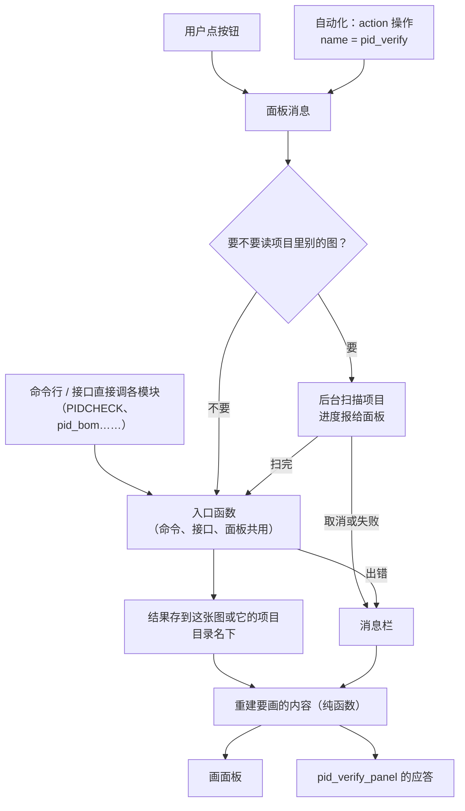
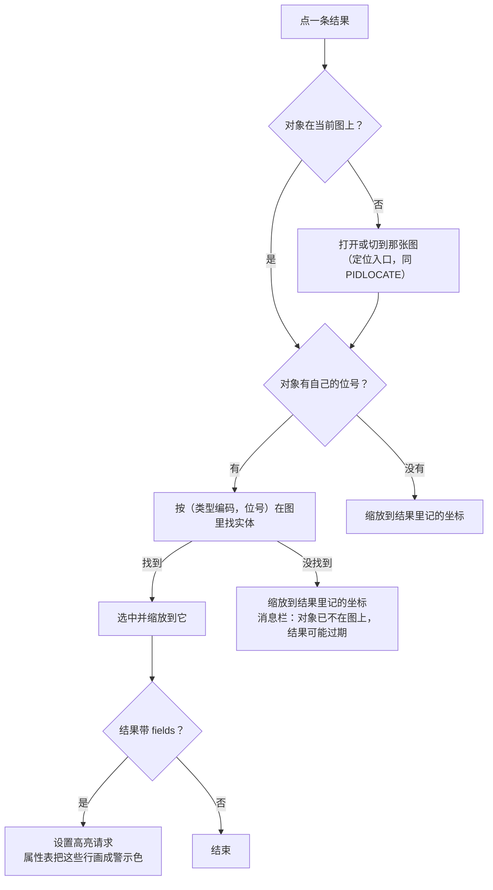

# SPEC：校验与交付面板（`pid-verify-deliver-panel`）

> 状态：**待建；规格已确认**（2026-11-16，§9 的待决问题都按「建议」定）。基线 `main @ 9b5327f96`。
> 依据：已批准计划 T3.4、计划决议 D5（校验与交付合成一个多页签停靠面板，面板数 21 → 22）；需求 `REQ-DATA-015`、`REQ-DATA-007`（`docs/pid-platform/requirements/50-data-and-rule-engine.md`）、`REQ-DRW-010`（`40-drawing-and-drafting.md`）、`REQ-DELV-008`、`REQ-DELV-009`（`60-deliverables-and-publish.md`）。
> 共用约定见 `01-shared-conventions.md`。面板显示的数据全部来自 `SPEC-pid-drc.md`、`SPEC-pid-bom.md`、`SPEC-pid-snapshot.md`、`SPEC-pid-publish.md`、`SPEC-pid-project-index.md`，本文不重复它们的格式。

## 1. 目标

1. 加一个停靠面板「校验与交付」，三个页签：**规则检查**、**材料清单**、**快照与发布**。把前面几个模块的结果摆到界面上，能筛、能点、能定位到图上的对象。
2. 面板不带自己的业务逻辑。每个按钮调的都是命令和自动化操作在用的那个入口函数，从面板做和从命令行做结果一样。
3. 面板能被接口驱动和读取（切页签、触发检查、读结果列表、导出），端到端测试不用模拟鼠标、不靠截图。

## 2. 现状

- 停靠面板现有 21 个（`src/ui/dock.rs` 的 `PanelId::ALL`）。最新加的是「协同」（`PidCollab`），它的接入点就是本面板要照做的清单（§7）。停靠只有左右两侧。
- 「协同」面板的画法是：程序先把要显示的内容整理成一份纯数据（`CollabView`），视图函数 `view(&CollabView, width, chrome)` 只管画。本面板沿用这个分法。
- 新界面外壳里有「规则检查」「材料清单」「图纸」三个占位屏（`src/app/pid_shell/validation.rs`、`bom.rs`、`drawings.rs`，各约 1 KB 的静态文字），没有功能。停靠面板在外壳的编辑屏里照常显示（外壳只隐藏了「特性」面板）。
- 属性表每一行有固定的行号：`pid_tag`、`pid_props_<属性名>`（`src/app/commands/pidprops.rs`；外壳的属性编辑器 `src/app/pid_shell/editor.rs` 用同一套行号）。对象身上有哪些属性键就画哪些行。**没有「高亮某一行」的机制**；往一个还不存在的键提交值是可以的，提交时会把键建出来。
- 自动化接口已有两样可用：
  - `action` 操作（请求带 `name` 与 `value`）用来替人按界面上的东西。符号面板就是这么驱动的：`name` 为 `pid_palette`，`value` 形如 `tab=…`、`insert=…`（`src/app/control/actions.rs` 的 `control_ui_action`）。REST 上是 `POST /api/v1/action`。
  - `ui_bounds` 操作按标识前缀返回控件在屏幕上的位置；「协同」面板的行就报了位置（`pid-collab-row-<位号>`）。
- 每张打开的图有一个只增不减的改动计数 `edit_revision`（每次提交的编辑、撤销、重做都加一；`src/app/tab_document.rs`），可以用来判断结果是不是在图改动之前算的。
- 文字：绘图侧的面板（「协同」）直接写中文字面量。`tests/pid_panel_localization.rs` 测的是另一件事：属性组的 6 个标题在 12 种语言里都有翻译。
- 程序里不引日期库，现有界面显示日期用的是手写的换算，按 UTC（`src/ui/window/xref_manager.rs` 的 `format_date`）。

## 3. 数据格式

### 3.1 面板在内存里存什么

面板不落盘任何业务数据。内存里有两类东西。

**界面状态**（整个程序一份）：

| 项 | 内容 | 初值 |
|---|---|---|
| 当前页签 | `check` / `bom` / `deliver` | `check` |
| 规则检查的筛选 | 严重度（多选）、对象种类（多选）、是否显示已豁免 | 三个严重度全选；种类不筛；不显示已豁免 |
| 材料清单的筛选 | 关键字、哪些组折叠着 | 空；全部展开 |
| 输入框 | 豁免理由、快照原因、发布目录 | 空（发布目录为空表示用默认目录） |
| 勾选的快照 | 序号的集合，另加「当前图」这一项 | 空 |
| 进行中的事 | 在做什么、进度、能不能取消 | 无 |
| 最近一条消息 | 上一次操作的结果或错误：错误码加一句话 | 无 |

**结果**。范围只有当前图的结果跟着那张图走；范围是全项目或一个 PBS 节点的结果跟着项目目录走，这样点一条结果跳到另一张图之后，列表还在：

| 结果 | 存在哪 | 何时显示 |
|---|---|---|
| 当前图范围的检查结果、材料清单 | 那张图的标签页状态；关掉图就没了 | 当前标签页是这张图 |
| 全项目 / PBS 范围的检查结果、材料清单 | 按项目目录各存一份（程序级） | 当前标签页的图在这个目录里 |
| 快照列表、比对结果、发布条件、发布记录 | 那张图的标签页状态 | 当前标签页是这张图 |

- 检查结果是 `SPEC-pid-drc.md` §3.6 的全文，材料清单是 `SPEC-pid-bom.md` §3.2 的全文（或它的错误），比对结果是 `SPEC-pid-snapshot.md` §3.7，发布条件与发布记录是 `SPEC-pid-publish.md` §5.3 两个操作的应答。面板不另造格式。
- 当前图范围和项目范围的结果都有时，显示时间较新的那一份。
- 每份结果旁边记着算它时的改动计数。**过期**的判断：
  - 当前图范围：记的计数与图现在的 `edit_revision` 不同。
  - 项目范围：项目目录里任何一张打开着的图在那之后有过改动（当时没打开、之后才打开的图，从打开那一刻算起）。
  - 过期只是在结果上方显示「图纸已改动，结果可能过期」，**不自动重查**。
- 命令、接口、面板触发的检查都更新同一份结果。规则检查规格里说的「结果只在内存里留最近一份」指的就是这里显示的这一份；`PIDCHECK EXPORT` 导出的、豁免时查找的也是它。
- 快照列表、发布记录在切到「快照与发布」页签时、存快照后、发布后重读磁盘。比对结果在勾选变化时清掉。

### 3.2 面板状态（给接口读）

操作 `pid_verify_panel` 返回面板此刻显示的内容，测试靠它断言。面板没显示时也能读（数据都在，只是没画）。

```json
{
  "ok": true,
  "visible": true,
  "tab": "check",
  "document_id": 1,
  "drawing_id": "PID-1101",
  "writable": true,
  "busy": null,
  "notice": null,
  "buttons": {
    "check_drawing": true, "check_project": true, "check_export": true,
    "bom_drawing": true, "bom_project": true, "bom_export": false,
    "snapshot_save": true, "diff": false, "diff_export": false,
    "publish_check": true, "publish": false
  },
  "check": {
    "has_result": true,
    "stale": false,
    "scope": "drawing",
    "checked_at": 1794800000,
    "rule_set_version": "1.0.0",
    "counts": { "错误": 1, "警告": 1, "提示": 0, "已豁免": 1 },
    "filters": { "severity": ["错误", "警告", "提示"], "kinds": [], "show_waived": false },
    "kinds": ["仪表", "管线"],
    "notices": [],
    "stale_waivers": 0,
    "total": 2,
    "rows": [
      { "index": 0, "rule_id": "DR-001", "severity": "错误", "object_key": "PIPE_LINE|L-1003",
        "drawing_id": "PID-1101", "label": "L-1003", "message": "管线 L-1003 没有管道等级",
        "fields": ["管道等级"], "waived": false, "can_waive": true },
      { "index": 1, "rule_id": "DR-005", "severity": "警告", "object_key": "INSTRUMENT|FT-1001",
        "drawing_id": "PID-1101", "label": "FT-1001", "message": "仪表 FT-1001 没有分配回路",
        "fields": ["仪表回路"], "waived": false, "can_waive": true }
    ],
    "located": null
  },
  "bom": {
    "has_result": false, "stale": false, "scope": null, "search": "",
    "error": null, "total": 0, "groups": [], "rows": []
  },
  "deliver": {
    "snapshots": [],
    "picked": [],
    "diff": null,
    "publish": {
      "state": "未发布",
      "target_dir": "D:/proj/pid-publish",
      "next_revision": 1,
      "preconditions": { "saved": true, "clean": false, "file_unchanged": true, "writable_session": true },
      "checked": false, "stale": false, "can_publish": null, "gates": null,
      "packages": [],
      "last_package": null
    }
  }
}
```

例子里这张图保存过、之后又改了没存：所以能查全项目、能存快照，但「发布」是灰的；检查结果里有一条错误、一条警告、一条已豁免（没开「显示已豁免」，所以列表是 2 行）。

| 字段 | 说明 |
|---|---|
| `visible`、`tab` | 面板是否显示着；当前页签 |
| `document_id`、`drawing_id` | 面板此刻显示的是哪张图（当前标签页） |
| `writable` | 会话是否可写。为假时豁免和发布的按钮是灰的 |
| `busy` | 没事时是 `null`；有事时如 `{"what":"scan","then":"check","text":"正在读项目图纸","done":12,"total":40,"cancellable":true}` |
| `notice` | 最近一条消息，如 `{"level":"error","code":"BOM_DUPLICATE_TAG","text":"…"}`；`level` 取 `info` 或 `error`；没有时是 `null` |
| `buttons` | 各个按钮此刻能不能点（§4.8）。行上的按钮看行里的 `can_waive` |
| `check.counts` | 三个严重度各有多少条没被豁免的结果，加已豁免的条数；取自检查结果的 `summary`，不受筛选影响 |
| `check.kinds` | 结果里出现过的对象种类，就是「对象种类」筛选能选的那些 |
| `check.total`、`check.rows[]` | 筛选之后的行数和行，按显示顺序排。`index` 是这一行在检查结果 `results[]` 里的下标，驱动面板时用它指行 |
| `check.rows[].label` | 行上显示的对象名：有位号用位号；没有的写「种类（所属）」，如 `管段（L-1003-01）` |
| `check.rows[].fields` | 这条结果涉及的属性名（§3.5） |
| `check.rows[].can_waive` | 这一行现在能不能点「豁免」 |
| `check.located` | 最近一次点击定位的行下标 |
| `bom.groups[]` | `{kind, rows, collapsed}`，按清单的种类顺序 |
| `bom.rows[]` | 搜索之后的行，字段同材料清单的 `rows[]`，另带 `index` |
| `bom.error` | 清单没出来时的错误：`{code, text, duplicates[]}` |
| `deliver.snapshots[]` | 快照列表的行（`pid_snapshots` 应答里的那些字段），另带 `picked` |
| `deliver.picked` | 勾选的项：序号或 `"live"`（当前图） |
| `deliver.diff` | 最近一次比对的摘要 `{a, b, identical, 新增, 删除, 修改}`；没有时是 `null` |
| `deliver.publish.state` | 发布规格的三种状态之一：`未发布` / `已发布，修订 N` / `修订 N 之后有改动` |
| `deliver.publish.preconditions` | 四个前提，随时重算 |
| `deliver.publish.checked`、`stale`、`can_publish`、`gates` | 最近一次「检查发布条件」的结果；没查过时 `checked` 为假，后两项是 `null` |
| `deliver.publish.packages[]`、`last_package` | 发布记录；本次运行里最近一次发布出的包目录 |

`rows` 默认最多返回 200 行，请求里可带 `limit`、`offset` 翻页。时间一律是 Unix 秒。

### 3.3 驱动面板的动作

用现有的 `action` 操作，`name` 固定为 `pid_verify`，`value` 是一个「键」或「键=值」：

| `value` | 等同于 |
|---|---|
| `show`、`hide` | 显示、隐藏面板 |
| `tab=check`、`tab=bom`、`tab=deliver` | 点页签 |
| `check=drawing`、`check=project` | 点「检查当前图」「检查全项目」 |
| `severity=错误` | 点一下严重度筛选（开变关、关变开）；`警告`、`提示` 同 |
| `kind=管线` | 点一下对象种类筛选；`kind=` 是清空种类筛选 |
| `show_waived=1`、`show_waived=0` | 显示、隐藏已豁免的结果 |
| `locate=3` | 点下标为 3 的结果行（定位） |
| `waive=3:放空管，端部通大气` | 对下标 3 的结果点「豁免」、填理由、确认。第一个冒号之后都是理由 |
| `unwaive=3` | 取消下标 3 的豁免 |
| `check_export=D:/out/drc.json` | 导出检查结果，不弹对话框 |
| `bom=drawing`、`bom=project` | 点「当前图」「全项目」生成清单 |
| `bom_search=P-10` | 在搜索框里输入 |
| `bom_group=阀门` | 点一下分组标题（折叠变展开、展开变折叠） |
| `bom_locate=5` | 点清单里下标 5 的行 |
| `bom_export=D:/out/bom.csv` | 导出清单，格式看扩展名，不弹对话框 |
| `snapshot_save=送审前` | 填原因并点「存快照」；`snapshot_save=` 是不填原因 |
| `pick=3`、`pick=live` | 勾选或取消勾选一份快照、「当前图」 |
| `diff` | 点「比对」 |
| `diff_locate=modified:0` | 点比对明细里的一项；组名取 `added`、`removed`、`modified` |
| `diff_export=D:/out/diff.json` | 导出比对结果 |
| `publish_dir=D:/out` | 填发布目录；`publish_dir=` 是回到默认目录 |
| `publish_check` | 点「检查发布条件」 |
| `publish` | 点「发布」并确认 |
| `package_verify=3` | 对修订 3 的包点「校验」 |
| `cancel` | 取消进行中的事 |
| `more=check` | 点「再显示 200 条」；`bom`、`diff` 同 |

- 动作只是替人按按钮。应答 `{"ok":true}` 表示按下去了，**做的结果看面板状态**（`notice`、各页签的内容）——要直接拿结果的脚本应当用各模块自己的操作（`pid_check`、`pid_bom`、`pid_publish`……）。
- 按钮是灰的，动作就失败，返回 `PANEL_ACTION_UNAVAILABLE` 并带 `reason`。行下标或快照序号不在面板当前的列表里，返回 `PANEL_ROW_NOT_FOUND`。键不认识或值的格式不对，返回现有的 `invalid_value`。

### 3.4 控件位置标识

给 `ui_bounds` 用，前缀统一是 `pid-verify-`：

| 标识 | 是什么 |
|---|---|
| `pid-verify-panel` | 面板主体 |
| `pid-verify-tab-check`、`pid-verify-tab-bom`、`pid-verify-tab-deliver` | 三个页签 |
| `pid-verify-check-drawing`、`pid-verify-check-project` | 两个检查按钮 |
| `pid-verify-check-row-<下标>` | 结果行 |
| `pid-verify-bom-row-<下标>` | 清单行 |
| `pid-verify-snapshot-row-<序号>` | 快照行；「当前图」那一行是 `pid-verify-snapshot-row-live` |
| `pid-verify-diff`、`pid-verify-publish` | 「比对」「发布」按钮 |
| `pid-verify-busy` | 进度条，有事在做时才有 |

只有画出来的控件才有位置。面板关掉时清掉所有 `pid-verify-` 开头的位置记录（写法照 `src/app/dock/update.rs` 里清「协同」面板的那一段）。

### 3.5 检查结果多带一项：涉及哪些属性

要在属性表里高亮字段，就得知道一条结果说的是哪些属性。给检查结果的每一条加一个键 `fields`（已同步写进 `SPEC-pid-drc.md` §3.6）：

```json
{ "rule_id": "DR-001", "object_key": "PIPE_LINE|L-1003", "fields": ["管道等级"] }
```

- `DR-010`（必填项为空）：缺的那些属性名。这就是需求 `REQ-DATA-007` 里的「缺失字段名」。
- 其他规则：表达式里直接写在对象自己身上的属性名（单段的名字，且不是派生事实）。`管道等级 = NULL` 得到 `["管道等级"]`；`(设计温度 > 200 OR 流体介质 = #蒸汽) AND 绝热等级 = NULL` 得到 `["设计温度", "流体介质", "绝热等级"]`。
- 表达式用到位号的（`位号`、`位号.长度`、`位号合规`、`位号.同类型重复数` 等）：列表里加 `位号`，对应属性表的位号那一行。
- 沿关系取的属性（`所属管线.管道等级`）不算，那是别的对象的字段。不涉及属性的规则是空列表。
- 按属性名在表达式里出现的先后排，去重。

### 3.6 属性表高亮

程序里留一份「高亮请求」，至多一份：

```json
{ "document_id": 1, "handle": "2D4", "fields": ["管道等级"] }
```

- 点一条带 `fields` 的结果时设置（§4.3），新的顶掉旧的。
- 属性表画行时，行号是 `pid_props_<属性名>`（属性名在列表里）或 `pid_tag`（列表里有 `位号`）的，用警示底色画。不改属性行的数据结构，画的时候按行号查这份请求。两处都要改：经典界面的「特性」面板和外壳的属性编辑器。
- 列表里的属性对象身上还没有（必填项为空往往正是这种情况）：属性表临时补一个空行，可以直接填；填了就照常提交（现有的提交路径会把键建出来），不填不写图。
- 何时清掉：选中的对象变了；那个字段被填上了（只清这一个字段）；设置了新的请求；那张图关了。
- 读属性的 `properties` 操作里，被高亮的行多一个键 `"highlighted": true`，测试用它断言。

### 3.7 错误码

| 码 | 何时 | HTTP |
|---|---|---|
| `PANEL_ACTION_UNAVAILABLE` | 动作对应的按钮此刻是灰的。`reason` 取 `busy`（有事在做）、`readonly`（只读会话）、`no_result`（还没有结果）、`no_project_dir`（图没保存过）、`not_two_picked`（勾的不是两项）、`precondition`（发布的前提没满足）、`not_on_this_drawing`（这条结果不在当前图上）、`already_waived` | 409 |
| `PANEL_ROW_NOT_FOUND` | 行下标、快照序号、修订号不在面板当前的列表里 | 404 |
| `invalid_value`（现有） | `value` 的键不认识，或值的格式不对 | 400 |

按钮按下去之后各模块报的错（`PUBLISH_BLOCKED`、`BOM_DUPLICATE_TAG`、`WAIVER_REASON_REQUIRED`、`INDEX_NO_PROJECT_DIR`……）不经动作的应答返回，显示在面板的消息栏里，接口从 `notice` 读。

## 4. 数据怎么传

### 4.1 总的走向



- 面板的每个按钮只发一条消息。处理消息的地方调入口函数，把结果存好，再重建面板要画的内容。
- 重建是一个纯函数：输入界面状态、这张图的结果、项目目录的结果和几个现状（会话可不可写、有没有事在做、图保存过没有），输出「要画什么」——哪些行、各组计数、哪些按钮是灰的。画面板和回答 `pid_verify_panel` 用的是同一份输出，所以接口读到的就是人看到的。
- 命令行或接口触发的检查、清单、快照、发布，同样更新结果，面板跟着变。
- 切换图纸标签页：面板改显示那张图的内容；页签和筛选不变；勾选的快照清空。

### 4.2 规则检查页签

从上到下：

1. 两个按钮：【检查当前图】【检查全项目】。
2. 状态行：范围、检查时间、规则版本、耗时；过期时显示「图纸已改动，结果可能过期」。
3. 严重度筛选：三个可开关的标签，各带没被豁免的条数；另有开关「显示已豁免（N）」。
4. 对象种类筛选：结果里出现过的种类各一个标签（设备、阀门、管线……），一个都不选等于全选。
5. 提示行：结果的 `notices[]` 逐条显示（如「项目主数据没有配置，用到主数据的 5 条规则没有执行」）。`stale_waivers[]` 不为空时显示「有 N 条豁免已经对不上」，展开后逐条列出，可以逐条删除。
6. 结果列表：按严重度分三组（错误、警告、提示），打开「显示已豁免」时多一组「已豁免」。组标题带筛选后的条数，可以折叠。每组先画 200 行，底下有【再显示 200 条】。

每一行：

- 第一行：规则号、对象名。全项目检查时，对象不在当前图上的，后面带图号。
- 第二行：结果消息。第三行（浅色）：修复建议。
- 已豁免的行另显示豁免理由、豁免人、豁免时间。
- 行尾按钮：【豁免】，已豁免的行是【取消豁免】。

几种没有列表的情况：

| 情况 | 显示 |
|---|---|
| 这张图还没检查过 | 「还没有检查过。点上面的按钮开始。」 |
| 检查过，没有结果 | 「没有发现问题。」，状态行和提示行照常 |
| 有结果，但都被筛掉了 | 「没有符合筛选条件的结果。」 |
| 规则包有错（`DSL_PARSE_ERROR`、`RULESET_SCHEMA_ERROR` 等） | 消息栏显示错误码、哪条规则、出错位置；原来的结果不动 |

计划里写的「类别筛选」，本文落成「对象种类」：规则的类别只有「设计类」「配置类」两个值，本期只求值设计类，按它筛没有意义。

### 4.3 点一条结果：定位与高亮



- 定位用的是项目索引规格里的定位入口（`PIDLOCATE`、`pid_locate` 背后的那个函数），面板不另写。它按（类型编码，位号）现找，不用结果里的句柄。
- 一条结果带多个位置的（`points[]`，如一条管线有三个悬空端点），缩放到这些点的外包范围。
- 需求说的「定位并高亮」分两层：图上是选中并缩放居中（选中的实体本来就高亮显示）；属性表里是把 `fields` 对应的行画成警示色（§3.6）。
- 跳到另一张图之后，全项目范围的结果还在（§3.1），可以接着点下一条。

### 4.4 豁免

1. 点行尾的【豁免】，行下面展开一个理由输入框和【确认】【取消】。
2. 【确认】调豁免的入口函数（`PIDCHECK WAIVE`、`pid_check_waive` 用的那个）。理由为空或超过 200 字由入口拒绝（`WAIVER_REASON_REQUIRED`、`WAIVER_REASON_TOO_LONG`），错误显示在消息栏，输入框留着。
3. 成功后入口函数**就地**改掉留着的结果：那一条 `waived` 变真并带上豁免记录，三个严重度的计数和 `blocked` 重算。不重新检查。面板上这一行从原来的组挪到「已豁免」组。
4. 写豁免是改图：记一步撤销。撤销之后图里的豁免没了，而留着的结果不会跟着变回去，所以会显示「过期」，重新检查即可。

能点【豁免】的条件：会话可写；这条结果的对象在当前图上（豁免要写进那张图）；还没被豁免。【取消豁免】同理。全项目结果里别的图上的条目，要先跳过去（点一下那一行），再豁免。

### 4.5 材料清单页签

从上到下：

1. 两个按钮：【当前图】【全项目】，点了就生成（或重新生成）清单。
2. 状态行：范围、生成时间、行数；过期时显示「图纸已改动，清单可能过期」。
3. 搜索框：按子串筛，不分大小写，比对位号、名称、规格、类型编码四栏。
4. 提示行：清单的 `notices[]`（长度单位按毫米假定、管长是图面长度）。`skipped[]` 不为空时显示「有 N 个对象没有位号，没有计入」，展开后逐个可定位。
5. 分组列表：按清单自己的种类顺序分组（管线、设备、阀门、仪表、管件、其他），组标题带行数，可以折叠。每行：位号、名称、数量加单位；第二行（浅色）：规格；全项目范围时带所在图号。每组先画 200 行。
6. 「管道汇总」折叠区：清单的副表，按（管道等级，公称直径，绝热等级）汇总的长度。
7. 底部：各种类的行数合计，和一个【导出…】按钮。

- **导出**：弹系统的保存对话框，文件类型可选 CSV、XLSX、JSON，默认文件名 `<图号>-bom.csv`，默认目录是图纸所在目录。选好之后调导出的入口函数（`PIDBOM EXPORT`、`pid_bom_export` 用的那个）。导出的是整份清单，不受搜索和折叠影响。接口驱动时直接给路径，不弹对话框。
- **点一行**：定位到这个对象。一行对应几张图的（同一条管线画在几张图上），优先当前图，其次 `drawings[]` 里的第一张。没有自己编号的管件那一行，定位到它所在的管路。
- **清单出不来**：
  - `BOM_DUPLICATE_TAG`：不显示表，显示「有重复位号，清单没有生成」和重复的（类型编码，位号）列表，逐个可定位。
  - `BOM_SCOPE_INCOMPLETE`：列出读不出来的图。
  - 其他错误显示在消息栏。

### 4.6 快照与发布页签

**上半：快照与比对**

1. 原因输入框（可以不填，最多 200 字）和【存快照】。
2. 快照列表，新的在上：勾选框、序号、时间、生成人、原因、对象数。文件丢了的行标「文件缺失」，不能勾。列表最上面固定有一行「当前图（未存快照）」，也能勾。
3. 【比对】：**恰好勾了两项才可用**；勾 0 项、1 项、3 项及以上都是灰的。两项里旧的是甲、新的是乙：两份快照时序号小的是甲；有「当前图」时它是乙。
4. 比对结果：一行摘要「新增 N，删除 N，修改 N」；完全相同时显示「无差异」。下面三组明细（新增、删除、修改），组标题带对象数。修改的每个对象下面逐条列出变化，如「属性 设计压力：1.6MPa → 2.5MPa」「位置」「长度：12.5 → 14.0」「连接：新增，接到 V-1002」。结果的 `notices[]` 逐条显示。
5. 点明细里的一项：对象在当前图上就选中并缩放；已经删掉的，缩放到它原来的位置。
6. 【导出比对结果】：弹保存对话框，写成 JSON（`PIDDIFF … EXPORT` 用的入口）。
7. 图没保存过：这一半显示「图纸还没有保存，不能存带序号的快照」，【存快照】是灰的。

**下半：发布**

1. 状态行：`未发布` / `已发布，修订 N` / `修订 N 之后有改动`。
2. 发布目录输入框和【浏览…】。空着就是默认目录 `<图纸目录>/pid-publish/`。旁边显示「下一个修订号：N」，只读；要指定修订号用命令 `PIDPUBLISH <目录> REV <修订号>`。
3. 条件清单，八项，每项显示「满足」「不满足」或「未检查」：
   - 四个前提，不用读别的图，切到页签、保存之后、点按钮之前都会重算：已保存；没有未存的修改；文件没有在别处被改过；会话可写。
   - 四道门禁，点【检查发布条件】才算：没被豁免的错误为 0（带条数）；重复位号为 0（带个数）；主数据读得出来；项目里的图都读得出来。
   - 门禁没过时，「错误」那一项可以点：切到规则检查页签，筛选只留「错误」。「重复位号」那一项展开重复列表，逐个可定位。
4. 【检查发布条件】【发布】。点【发布】先在面板里问一句「把 PID-1101 发布为修订 3 到 D:\out？」，下面是【确认】【取消】。
5. 发布之后：
   - 成功：消息栏「已发布：<包目录>」；状态行、发布记录、快照列表都刷新（发布会自动存一份快照）。
   - 被门禁拦下（`PUBLISH_BLOCKED`）：条件清单按返回的 `gates` 更新；返回的检查报告成为这张图的检查结果，规则检查页签里能直接看到是哪些错误。
   - 其他失败：消息栏显示错误码和停在哪一步。
6. 发布记录：这张图在目标目录里的包，新的在上：修订号、时间、发布人；与当前文件一致的那一个标「当前」。每行有【校验】，结果显示「完好」，或者缺了哪些文件、哪些文件的校验和不符。

【发布】按钮只看四个前提，不看门禁：发布时本来就会把门禁重查一遍（发布规格 §3.4），之前查的结果不作数。

### 4.7 进行中的事

- 只读当前图的事（检查当前图、当前图清单、存快照、比对）在界面线程同步做完，不显示进度。
- 要读项目里别的图的事（检查全项目、全项目清单、检查发布条件、发布）先在后台扫描项目（项目索引规格 §4），面板显示进度条「正在读项目图纸 12 / 40」和【取消】。扫完回到界面线程把剩下的做完。
- 同一时刻只做一件。有事在做时，会启动新事的按钮都是灰的；筛选、折叠、定位照常可用。
- 取消：扫描停下，原来的结果不动，消息栏显示「已取消」。
- 这件事是哪张图发起的，结果就记到那张图（或它的项目目录）名下。期间那张图被关掉了，结果丢弃。
- 发布的后半段（出两份图、写文件）是同步做的，这一小段界面不响应。

### 4.8 按钮什么时候是灰的

| 按钮 | 灰的条件（任一） |
|---|---|
| 检查当前图、当前图清单 | 有事在做 |
| 检查全项目、全项目清单 | 有事在做；图没保存过（没有项目目录） |
| 豁免 | 只读会话；这条结果不在当前图上；已经豁免 |
| 取消豁免 | 只读会话；这条结果不在当前图上 |
| 导出（检查结果、清单、比对结果） | 还没有对应的结果 |
| 存快照 | 有事在做；图没保存过 |
| 比对 | 勾选的不是恰好两项 |
| 检查发布条件 | 有事在做；图没保存过 |
| 发布 | 有事在做；四个前提有一个不满足 |
| 校验（某个包） | 有事在做 |

灰的按钮上有提示文字说明原因。置灰只是方便人看：入口函数自己照样把关，只读会话里即使绕过界面，豁免和发布也会被拒。

## 5. 对外接口

### 5.1 模块接口（`src/ui/window/pid_verify_deliver.rs`）

```rust
pub enum Tab { Check, Bom, Deliver }

/// 面板上每个按钮、输入框、行点击各一个；另有后台扫描的进度与完成。
pub enum PidVerifyMsg { /* … */ }

pub struct VerifyUi { /* §3.1 的界面状态 */ }
pub struct DrawingResults { /* §3.1 里跟着图走的结果，放在该图的标签页状态里 */ }
pub struct ProjectResults { /* §3.1 里跟着项目目录走的结果 */ }
pub struct Context<'a> { /* 当前图号、图纸目录、改动计数、会话是否可写、图保存过没有 */ }

/// 要画的内容：页签、各组的行、计数、哪些按钮可用、消息。纯数据。
pub struct VerifyView { /* … */ }

/// 纯函数：界面状态 + 结果 + 现状 → 要画的内容。筛选、分组、行名、按钮可用性都在这里算。
pub fn build_view(ui: &VerifyUi, drawing: Option<&DrawingResults>,
                  project: Option<&ProjectResults>, ctx: &Context) -> VerifyView;

/// 画面板。签名照 pid_collab::view。
pub fn view<'a>(view: &'a VerifyView, width: f32, chrome: Chrome) -> Element<'a, Message>;

/// §3.2 的面板状态。
pub fn panel_state(view: &VerifyView, limit: usize, offset: usize) -> serde_json::Value;

/// action 操作的 value → 面板消息；按钮是灰的返回 PANEL_ACTION_UNAVAILABLE。
pub fn parse_action(value: &str, view: &VerifyView) -> Result<PidVerifyMsg, PanelError>;

pub const PANEL_BOUNDS_ID: &str = "pid-verify-panel";
pub const BOUNDS_PREFIX: &str = "pid-verify-";
```

程序这一侧（`src/app/commands/pidverify.rs`）：`show_pid_verify_panel`（显示，第一次停在右侧）、`dispatch_pidverify`（命令）、`on_pid_verify`（处理面板消息，调各模块的入口函数）、`refresh_pid_verify_view`（重建要画的内容）。名字和分工照「协同」面板的 `show_pid_collab_panel`、`dispatch_pidcollab`、`on_pid_collab`、`refresh_collab_view`。

停靠面板的登记：`PanelId::PidVerifyDeliver`，标题「校验与交付」，默认宽度 360，图标新画一个（`assets/icons/ui/verify.svg`）。

### 5.2 命令

| 命令 | 做什么 |
|---|---|
| `PIDVERIFY` 或 `PIDVERIFY ON` | 显示面板（第一次停在右侧，之后跟着用户的停靠布局） |
| `PIDVERIFY OFF` | 隐藏面板 |
| `PIDVERIFY CHECK`、`PIDVERIFY BOM`、`PIDVERIFY DELIVER` | 显示面板并切到对应页签 |

命令不改图，加进只读会话的允许名单。面板也出现在停靠区通用的面板开关里，与其他面板一样。

命令带参数，要在命令行的「整行当一条命令」名单里登记（`src/app/command_driver/utilities.rs` 的 `run_command_line_impl`，照 `PIDCOLLAB` 那一行）——不登记的话，命令行会先拿不带参数的命令词试跑一遍。

### 5.3 自动化操作与 REST

| 操作 | REST | 读写 | 请求 | 应答 |
|---|---|---|---|---|
| `pid_verify_panel` | `GET /api/v1/pid/verify-panel` | 读 | `limit`、`offset`（可选） | §3.2 的面板状态 |
| `action`（现有），`name` 为 `pid_verify` | `POST /api/v1/action` | 看动作 | `name`、`value`（§3.3） | `{"ok":true}` 或 §3.7 的错误 |
| `ui_bounds`（现有） | `POST /api/v1/ui_bounds` | 读 | `prefix` 为 `pid-verify-` | 各控件的位置 |
| `properties`（现有） | 不变 | 读 | 不变 | 被高亮的行多一个键 `highlighted` |

MCP：`pid_verify_panel` 进 `READ_OPS`；`action` 已经在 `EXECUTE_OPS` 里。工具面变了，`TOOL_SCHEMA_DIGEST` 要同步更新。

### 5.4 权限

- 没连协同：不设限。
- 只读会话：能看面板、检查、生成和导出清单、存快照、比对、检查发布条件、校验发布包；不能豁免、不能发布（按钮是灰的，入口也会拒）。
- 面板不单独鉴权，各入口函数的权限规则就是面板的权限规则。

## 6. 成功标准

1. `PanelId::ALL` 有 22 项。`PIDVERIFY` 显示面板，`PIDVERIFY OFF` 隐藏；显示时 `ui_bounds` 按前缀 `pid-verify-` 能读到面板和三个页签的位置，隐藏后读不到。
2. 三个页签能切换，`pid_verify_panel` 的 `tab` 跟着变。经典界面和外壳的编辑屏里都能显示并操作。
3. 规则检查：一张有 1 条错误、1 条警告、1 条已豁免的图，点【检查当前图】后，三个计数与 `pid_check` 的 `summary` 一致，列表 2 行；关掉「警告」筛选剩 1 行；打开「显示已豁免」变 3 行。
4. 在命令行执行 `PIDCHECK` 之后，不点面板的按钮，面板显示的就是这次的结果。
5. 定位：点一条结果，被选中的就是那个对象（用 `get_selection` 验证），视图缩放到它；对象在另一张图上时先切到那张图，全项目结果的列表还在。
6. 高亮：点一条 `DR-010` 的结果，`properties` 的应答里缺的那个字段有一行、且带 `highlighted`；填上值之后这一行不再高亮，重新检查后这条结果没有了。
7. 豁免：理由为空被拒，消息栏显示 `WAIVER_REASON_REQUIRED`；填了理由后，这一行挪到「已豁免」组，计数立即更新且没有重新检查；撤销一步后图里的豁免没了。只读会话里 `can_waive` 为假，动作返回 `PANEL_ACTION_UNAVAILABLE`。
8. 材料清单：面板的行与 `pid_bom` 的 `rows` 一致；搜索 `P-10` 只剩位号、名称、规格或类型编码里含这段文字的行；从面板导出的文件与 `PIDBOM EXPORT` 导出的逐字节相同；有重复位号时不显示表，显示重复列表。
9. 快照：点【存快照】后列表多一行；勾 0、1、3 项时【比对】是灰的，恰好 2 项时可用；两份相同的快照比对显示「无差异」；点一项修改能定位到对象。
10. 发布：图有未存修改时【发布】是灰的；有没被豁免的错误时点【发布】，条件清单标出是哪一道门禁没过、几条，规则检查页签里能看到这些错误，目标目录里没有新增任何东西；都满足时发布成功，状态行变成「已发布，修订 1」；改图并保存后变成「修订 1 之后有改动」。
11. 过期：检查之后改一下图，`stale` 变真；重新检查后变假。
12. 进行中：全项目检查时 `busy` 里有 `done` 和 `total`；取消后原来的结果不动；有事在做时再点会启动新事的按钮，返回 `PANEL_ACTION_UNAVAILABLE`（`reason` 为 `busy`）。
13. 面板关掉时 `pid-verify-` 开头的位置记录全部清掉。
14. 性能：2,000 条结果时重建要画的内容不超过 50 ms；每组只画前 200 行。

## 7. 测试

| 层 | 测什么 |
|---|---|
| 单元（`build_view`） | 筛选与分组；组计数；行名的写法；每个按钮的灰与不灰（§4.8 逐条）；过期标记；两份结果取较新的；200 行的截断与「再显示」；清单的搜索；比对按钮的「恰好两项」 |
| 单元（`parse_action`） | §3.3 每个键；值格式不对；按钮是灰的；下标越界 |
| 单元（规则检查模块） | `fields` 的算法：`DR-010`、单属性、多属性、位号类、沿关系取的不算 |
| 程序级（经 `control_request`） | 成功标准 3–11 中只涉及当前图的部分：用命令建图 → 动作 → 读面板状态；豁免记一步撤销；属性行的 `highlighted` 与临时空行；只读会话 |
| 停靠（`dock::tests`） | `ALL` 为 22 项且包含 `PidVerifyDeliver`；标题、图标、默认宽度 |
| REST | `GET /api/v1/pid/verify-panel` 的路由与状态码；`rest_openapi.json` 一致；MCP 名单与摘要值 |
| 端到端（`--http`，起真实程序） | 计划点名的一条：切页签 → 触发检查 → 读违规列表 → 导出材料清单；另加一次全项目检查，验证进度与取消 |

要动的文件：

- 新建 `src/ui/window/pid_verify_deliver.rs`、`src/app/commands/pidverify.rs`、`assets/icons/ui/verify.svg`。
- 面板登记：`src/ui/dock.rs`（枚举项、`ALL` 由 21 改 22、标题、图标、默认宽度、测试里的个数）、`src/ui/window/mod.rs`、`src/app/mod.rs`（显示开关、要画的内容、消息类型）、`src/app/tab_document.rs`（跟着图走的结果）、`src/app/dock/update.rs`（打开、关闭时清位置记录、是否可见）、`src/app/dock/view.rs`（视图分发）、`src/app/update/mod.rs`（消息分发）。
- 命令：`src/app/commands/mod.rs`（分发链和命令名单）、`src/app/command_driver/utilities.rs`（整行名单）、`src/app/collab/apply.rs`（只读允许名单）。
- 接口：`src/app/control/actions.rs`（`control_ui_action` 里加 `pid_verify` 分支；`properties` 的行加 `highlighted`）、`src/app/control/mod.rs`（`pid_verify_panel`）、`src/rest.rs`、`src/rest_openapi.json`、`src/mcp.rs`。
- 属性表高亮：`src/app/commands/pidprops.rs`（属性组多画临时空行）、经典界面的「特性」面板和 `src/app/pid_shell/editor.rs`（按行号画警示底色）。
- 规则检查模块：结果里加 `fields`（`src/pid/drc/`）。

## 8. 不在范围与已知限制

- **面板里没有的入口**（命令行都有）：按 PBS 节点检查和出清单；按快照出清单；指定修订号发布；启停规则；编辑主数据。
- **不自动重查。** 图改了只标「过期」，要人点按钮。
- **别的图在磁盘上被改了，面板不知道。** 全项目结果的过期标记只看打开着的图。
- **别的图上的结果不能直接豁免**，要先跳到那张图。
- **时间按 UTC 显示**（`2026-11-16 08:30 UTC`）。标准库拿不到本机时区，项目里不引日期库。
- 外壳里「规则检查」「材料清单」「图纸」三个占位屏不动（V1）。
- 功能区没有按钮，入口是命令和停靠区的面板开关（V4）。
- 网页版没有本机文件系统：全项目范围、导出、快照、发布的按钮在网页版是灰的，只有当前图的检查和清单可用。
- 发布的后半段是同步做的，期间界面短暂不响应。
- 面板的筛选、折叠、输入框内容不跨运行保存；面板停在哪、显示与否由现有的停靠布局保存。

## 9. 待决问题

> **2026-11-16 已定**：本节各条都按「建议」一栏执行。汇总见 `plan.md` §3，对应的任务见 `todo.md`。

| # | 问题 | 建议 |
|---|---|---|
| V1 | **做成停靠面板，还是做进外壳的三个屏。** 计划决议 D5 定的是一个停靠面板；后来加的界面外壳里另有「规则检查」「材料清单」「图纸」三个占位屏 | 按计划决议做停靠面板，外壳三个屏不动。停靠面板在经典界面和外壳的编辑屏里都能用，而且查问题时要对着图看，放在图旁边更顺手。外壳的屏以后要做，可以直接复用这里的 `build_view` |
| V2 | **面板文字用中文字面量，还是走语言包。** 计划 T3.4 写的是「补中英文语言包并更新 `tests/pid_panel_localization.rs`」。走语言包的话，一条文字进了语言目录，哪种语言的 `.ftl` 里缺它，那种语言下就显示成原始编号（现有那条测试查的就是这个），所以面板约 60 条文字要给测试里列的 12 种语言各配一条；而绘图侧已有的「协同」面板，标题、面板文字和 `PIDCOLLAB` 的命令输出都是中文字面量（属性表里 P&ID 那一组的标题则是走语言包的） | 用中文字面量，与「协同」面板一致，不动 `tests/pid_panel_localization.rs`。这一点与计划的字面写法不同，所以单独请你确认。要走语言包的话，是另加约 60 条 × 12 种语言的译文 |
| V3 | **属性表高亮本期做不做。** 需求 `REQ-DATA-007` 和计划 T3.4 都要求；现在没有这个机制，要改检查结果（加 `fields`）、两处属性表的画法，并在缺字段时补临时空行 | 做，按 §3.6 的最小形式，排成面板的最后一个任务。它不挡其他任务，时间紧可以整块后移 |
| V4 | **功能区要不要加按钮。** 现在功能区里只有识图那一侧的几个命令（图例、位号、分组、出图）；绘图侧的插入、画线、协同都不在功能区，入口是命令和符号面板 | 本期不加，入口是 `PIDVERIFY` 命令和停靠区的面板开关。功能区按钮等绘图侧的入口统一规划时一起加 |

## 10. 需求对照

| 需求 | 本期 | 说明 |
|---|---|---|
| `REQ-DATA-015` 结果分组、定位、豁免 | 部分 | 三组及各组结果数、点击定位并高亮、豁免必填理由、显示是否豁免 / 豁免人 / 豁免时间都有。没有审计日志：桌面脱机没有日志服务，豁免记录本身（谁、何时、理由）记在图里 |
| `REQ-DATA-007` 缺失字段在属性表高亮 | 覆盖（V3） | `fields` 加属性表高亮；缺的字段补临时空行。保存是否被拒由规则包的 `save_gate` 决定（规则检查规格） |
| `REQ-DRW-010` 勾选两个版本比对 | 覆盖 | 恰好两项才可用；三组及对象数、差异明细；「无差异」 |
| `REQ-DELV-009` 发布门禁 | 覆盖（界面） | 条件清单逐项显示；被拦时能直接看到是哪些错误；已豁免的不拦 |
| `REQ-DELV-008` 发布 | 部分 | 一次发布一张图；状态是从目标目录推出来的三种，不是需求里的四个流转状态（发布规格 P1） |
| `REQ-DELV-001`、`REQ-DELV-003` 材料清单 | 部分 | 显示、搜索、导出、当前图与全项目两种范围；PBS 范围和按快照出清单只有命令 |
| 计划 T3.4「规则检查」页签 | 覆盖 | 两个按钮、严重度筛选、结果列表、点击选中缩放并高亮字段。「类别筛选」落成对象种类（§4.2） |
| 计划 T3.4「材料清单」页签 | 覆盖 | 分组、关键字搜索、导出 CSV / JSON（另多 XLSX） |
| 计划 T3.4「快照与发布」页签 | 覆盖 | 存快照、勾两份看差异、点击定位变更位号、填发布目录并执行带门禁的发布 |
| 计划 T3.4 测试 | 部分 | `dock::tests` 与 `--http` 端到端照做；`tests/pid_panel_localization.rs` 是否更新取决于 V2 |
| 计划决议 D5「顶层面板数仅 +1 至 22」 | 覆盖 | 一个面板，三个页签 |

## 11. 实现记录

实现与本规格、任务文字有出入的地方，以及规格没写到、实现时定下的读法，记在这里（`todo.md` §1 第 7 条）。

### 11.1 `PNL-1`：面板登记与空壳（2026-11-22）

**做了什么**（新文件 `src/ui/window/pid_verify_deliver.rs`、`assets/icons/ui/verify.svg`）：

- 停靠面板 `PanelId::PidVerifyDeliver`：标题「校验与交付」，默认宽度 360，图标 `verify.svg`（一张纸，右下角压一个蓝色对勾）。`ALL` 里排在「协同」后面，共 22 项；停靠布局存盘时它的名字是 `pid_verify_deliver`。
- 程序这一侧：显示开关 `show_pid_verify`、界面状态 `pid_verify_ui`、要画的内容 `pid_verify_view`，消息 `Message::PidVerify`。从停靠区的面板开关打开时，还没停过的停到右侧最上面（照「协同」）。
- 模块里：`Tab`（三个页签和页签名）、`PidVerifyMsg::Tab`、`VerifyUi`、`VerifyView`、纯函数 `build_view`、`view`。三个页签现在都只有一句空状态文字。

**与规格写法不同的**（都是分步做的过渡，后面的任务补齐）：

1. **`VerifyUi` 现在只有当前页签。** §3.1 的其余各项（筛选、输入框、勾选、进行中的事、最近一条消息）由用到它们的任务加。
2. **`build_view` 现在只收界面状态**：`build_view(ui)`。§5.1 的另三个参数 `drawing`、`project`、`ctx`，以及 `DrawingResults`、`ProjectResults`、`Context` 三个类型，由第一个要用结果的任务加。
3. **切页签的消息先在 `src/app/update/mod.rs` 里就地处理**：改界面状态，再用 `build_view` 重建要画的内容。PNL-2 建 `on_pid_verify`、`refresh_pid_verify_view` 时挪过去。
4. **这一步不报控件位置。** §3.4 的位置标识，和关面板时清掉 `pid-verify-` 开头的记录，都在 PNL-2。

**规格没写到、这里定下的：**

1. **三个页签的空状态文字**：规则检查「还没有检查过。」，材料清单「还没有生成材料清单。」，快照与发布「还没有快照和发布记录。」。§4.2 那句「还没有检查过。点上面的按钮开始。」的后半句等按钮出来（PNL-5）再加；另两句规格没写，先这样写，做那两个页签的任务按页签内容改。
2. **关面板只是隐藏。** 界面状态整个程序一份（§3.1），关面板不清它，再打开还是关之前的页签。
3. **测试怎么覆盖两种界面。** 程序级的真实界面测试在 `src/app/dock/tests.rs`（`the_verify_panel_opens_from_the_pallet_menu_and_switches_tabs_in_the_real_view`）：从停靠区的面板开关打开，在经典界面里逐个点三个页签，再切到外壳的编辑屏确认面板还在，最后关掉。外壳里只认空状态文字：外壳的导航里有一个同名的「材料清单」屏，按页签名找会找到那里。

### 11.2 `PNL-2`：命令 `PIDVERIFY` 与控件位置（2026-11-22）

**做了什么**（新文件 `src/app/commands/pidverify.rs`）：

- 程序这一侧的四个函数，名字和分工照「协同」：`show_pid_verify_panel` 先重建要画的内容，再走停靠区面板开关的打开路径（`dock_set_open`：第一次停到右侧最上面，之后在用户放的地方，并把它翻到前面）；`dispatch_pidverify` 是命令；`on_pid_verify` 处理面板消息，切页签从 `update/mod.rs` 挪到这里；`refresh_pid_verify_view` 重建要画的内容。
- 命令：`PIDVERIFY`、`PIDVERIFY ON`、`PIDVERIFY OFF`、`PIDVERIFY CHECK|BOM|DELIVER`，参数不分大小写。登记了分发链、命令行的自动补全名单、整行命令名单（`utilities.rs`，排在 `PIDPUBLISH` 后面）和只读允许名单（`apply.rs`，名单的说明里补了一句）。`OFF` 和标题栏的关闭按钮走同一条路（`DockMsg::Close`）。
- 控件位置：面板主体 `pid-verify-panel`（标题栏下面的整块）、三个页签 `pid-verify-tab-check`、`pid-verify-tab-bom`、`pid-verify-tab-deliver`。面板关掉时（不论是命令还是关闭按钮），`dock/update.rs` 的关闭分支清掉所有 `pid-verify-` 开头的记录。
- 模块里加了两个常量 `PANEL_BOUNDS_ID`、`BOUNDS_PREFIX`，和 `Tab::key`（`check`、`bom`、`deliver`，命令参数、§3.2 的 `tab`、§3.3 的 `tab=…` 共用）、`Tab::from_key`、`Tab::bounds_id`。

**与任务写法不同的：**

1. **多动了两个文件。** `src/ui/window/pid_verify_deliver.rs`：位置要在画面板的地方报，常量和页签名也在这里。`src/app/update/mod.rs`：把面板消息交给 `on_pid_verify`（§11.1 第 3 条预告过）。
2. **验证多跑了两组**：`pid_verify_deliver`（模块里新加的标识测试）和 PNL-1 的真实界面测试（确认切页签挪到 `on_pid_verify` 后照旧）。

**规格没写到、这里定下的：**

1. **命令每跑一次在命令行报一句**（照 `PIDSCREEN` 切屏时报一句）：显示时「PIDVERIFY: 已显示「校验与交付」面板，当前页签「材料清单」。」，隐藏时「PIDVERIFY: 已隐藏「校验与交付」面板。」。这样「`PIDVERIFY BOM` 只执行一次」才看得出来：不登记整行的话，命令行先拿不带参数的 `PIDVERIFY` 试跑一遍、再跑整行，最后停的页签一样，只是会多报一句。
2. **参数不认识就报错，不动面板**：「PIDVERIFY: 只接受 ON、OFF、CHECK、BOM、DELIVER 中的一个，实得 "…"。」。多给一个词（`PIDVERIFY BOM CHECK`）也一样。
3. **不带参数显示时停在原来的页签**，不回到规则检查，与关面板只隐藏一致。
4. **开始页上不能用。** 开始页不画停靠面板，命令不进 `start_allowed`，和别的要看图的命令一样被拒。
5. **「显示时读得到位置」这里先用无头渲染验一遍。** 任务把真实窗口里的读法留给 PNL-13；这里另有一条测试用 `iced_test::Simulator` 把真实视图画一遍，确认面板主体和三个页签的标识都在，关掉后不重画也读不到。

### 11.3 `PNL-3`：面板状态操作 `pid_verify_panel`（2026-11-22）

**做了什么：**

- 模块里（`pid_verify_deliver.rs`）：`Context`（面板显示着没有、当前图纸标签页的 `document_id` 和图号、会话可不可写）、`Buttons`（§3.2 的十一个按钮能不能点）、`ROWS_PER_PAGE`（200）。`VerifyView` 多了 `visible`、`document_id`、`drawing_id`、`writable`、`buttons`，`build_view(ui, ctx)` 从 `Context` 抄进来。`panel_state(view, limit, offset)` 把要画的内容转成 §3.2 的 JSON：公共字段，`check`、`bom` 两块「还没有结果」时的样子，`deliver` 一块的骨架；每块的 `rows` 从第 `offset` 行起留 `limit` 行，`total` 照旧数全部。
- 程序这一侧（`pidverify.rs`）：`refresh_pid_verify_view` 先从程序的状态取 `Context`（`pid_verify_context`）再重建；`show_pid_verify_panel` 改成先打开再重建，重建出来的 `visible` 才是真；`control_pid_verify_panel` 是接口的入口，先重建再答，所以读到的总是此刻的状态。
- 接线（共用约定 §7.6 第 3–5 处）：控制通道的查询名单、分发和能力清单（`control/mod.rs`）；REST 的 `GET /api/v1/pid/verify-panel`（`rest.rs`）和 OpenAPI 里这条路径；MCP 的 `READ_OPS`，`ocs_read` 的 `limit`、`offset` 加了说明，工具面摘要随之更新。

**与规格、任务写法不同的：**

1. **多动了一个文件** `src/app/commands/pidverify.rs`。图号、会话可不可写、面板显示着没有都要从程序这一侧取；接口的入口函数也照各模块的 `control_pid_*`，放在面板自己的命令文件里。
2. **`build_view` 现在收两个参数** `(ui, ctx)`。§5.1 的 `drawing`、`project` 和两个结果类型仍由第一个要用结果的任务加（§11.1 第 2 条）。
3. **`Context` 没有生命周期参数，内容也和 §5.1 不同**：现在是 `visible`、`document_id`、`drawing_id`、`writable` 四项。§5.1 的图纸目录、改动计数、图保存过没有由要用的任务加；`visible`、`document_id` 是 §3.2 要答的，也放在这里。
4. **`buttons` 现在全是假。** 按钮一个都还没画，都按不了；各页签带按钮进来时按 §4.8 算自己的那几个。
5. **`deliver.publish` 现在是 `null`。** §3.2 里那一块（状态、目标目录、下一修订、四个前提……）要读磁盘上的发布记录，没有「什么都没有」的样子，由发布那半页的任务（PNL-9）填。`check`、`bom` 两块和 `deliver` 的另三项都有空的样子，照 §3.2 给全。

**规格没写到、这里定下的：**

1. **开始页上也能读**：没有图，`document_id`、`drawing_id` 是 `null`，其余照常。
2. **图号照规则检查的取法**（`drc::drawing_of`：项目文件里登记的图号，项目文件读不出来时用文件名）。没存过的图没有文件，`drawing_id` 是空串，和检查结果里的图号一致。
3. **`writable` 用发布命令那道只读关口判**（`readonly_refuses_command("PIDPUBLISH")`）。§5.4 说面板不单独鉴权，豁免和发布走的都是这道关；它只关会话自己的那张图，旁边另开的、不在会话里的图照样可写。
4. **翻页**：`limit` 是正整数、`offset` 是不小于 0 的整数，没给时是 200 和 0，对每个列表各自生效；写得不对（0、负数、小数、文字）是 `invalid_request`（400），说明里写该怎么写。REST 的查询参数是数字就按数字传，不是就原样传，让操作去拒。
5. **自动化停用时也能读**：它在查询名单里，和别的读操作一样（测试里先发 `stop` 再读）。
6. **画面板的那份内容什么时候重建**：显示面板、切页签、处理面板消息时，以及每次回答这个操作之前。换图纸标签页、只读状态变了不会马上重建：现在画出来的东西还不看这几项，等第一个按图画内容的任务（PNL-5）在换标签页时补上。
7. **MCP 的 `limit`、`offset`**：§7.6 第 5 处要把参数补进门面的输入说明。`ocs_read` 原来就有这两个参数（别的分页读也在用），只是没有说明；这里各加了一句，说明对 `pid_verify_panel` 是每个列表的行数，没给时 200。

### 11.4 `PNL-4`：动作通道 `action` 的 `pid_verify`（2026-11-22）

**做了什么：**

- 模块里（`pid_verify_deliver.rs`）：`PidVerifyMsg` 多了 `Show`、`Hide`。`PanelError` 是 §3.7 的三种失败：`Unavailable { reason }`（按钮是灰的）、`RowNotFound`（行、快照、修订不在面板现在的列表里）、`InvalidValue`（键不认识或值写得不对）；`code()` 是接口答的码，`reason()` 只有第一种有，`Display` 是给人看的说明。`parse_action(value, view)` 把「键」或「键=值」读成面板消息，现在认 `show`、`hide`、`tab=check|bom|deliver`。
- 程序这一侧（`pidverify.rs`）：`on_pid_verify` 接上 `Show`、`Hide`。显示走 `show_pid_verify_panel`（停靠区面板开关的打开路径）；隐藏走标题栏关闭按钮那条路径（`DockMsg::Close`，控件位置记录一并清掉），再重建要画的内容。
- 接线：`actions.rs` 的动作名单加 `pid_verify`；`control_ui_action` 加这个分支：先重建要画的内容，再交给 `parse_action`，读出的消息照别的动作经 `update` 发出；读不出时答 `PanelError` 的码和说明，按钮是灰的再加 `reason`。`rest.rs` 的 `map_status`：`PANEL_ACTION_UNAVAILABLE` 是 409，`PANEL_ROW_NOT_FOUND` 是 404。

**与规格、任务写法不同的：**

1. **多动了两个文件。** `src/app/commands/pidverify.rs`：面板消息原来只有切页签，显示、隐藏要在 `on_pid_verify` 里接上。`src/mcp.rs`：动作名单也是 MCP 门面 `action` 的 `name` 的取值和校验名单，多一个名字工具面摘要就变；照例在摘要上面记一句、更新摘要，另加一条测试验 `ocs_execute` 收得下这个动作。
2. **「应答只是 `{"ok":true}`」读作不带面板内容的标准应答。** 动作和别的操作一样经控制通道答，`status`（`completed`）、`request_id`、`changes`、`state` 这些公共字段照有，`result` 是空对象。要看面板现在的样子，读 `pid_verify_panel`。

**规格没写到、这里定下的：**

1. **键是小写、一字不差**（`SHOW` 不认）；**页签名不分大小写**，和 `PIDVERIFY` 的参数一样（`tab=Deliver` 可以）。
2. **`show`、`hide` 不带值**：`show=1`、`hide=` 都是 `invalid_value`；`tab` 不带值、值为空、值里再有 `=`（`tab=bom=1`）也是。
3. **说明写该怎么写**：「tab 写 check、bom、deliver 中的一个，实得 "report"」「面板没有 "open" 这个键」「show 不带值，实得 "show=1"」。
4. **没给 `value` 或给了空串是 `invalid_request`**（400），和别的带值的动作一样（控制通道取参数那道检查），不是 `invalid_value`。
5. **面板隐藏着也能按**：隐藏时 `tab=…` 照切，再 `show` 就停在那个页签。§3.7 的 `reason` 不另加「面板没显示」一种。
6. **只读会话也能按**：`action` 操作本来不过只读关口（那道关只拦命令），这三个键也都不改图（撤销步数不变）。后面各页签带进会改东西的键时，按 §4.8 由按钮灰不灰（`readonly`）来拦。
7. **按之前先重建要画的内容**，所以 `parse_action` 看到的就是此刻的面板。现在的三个键还用不着它，`view` 参数留给后面各页签判按钮灰不灰、行在不在。
8. **REST** 走原有的 `POST /api/v1/action`，请求体要带 `document_id`（这个通用入口不替请求补图纸号，不带是 `document_required`）。
9. **MCP**：`ocs_execute` 的 `action` 只声明了 `name`，`value` 照样转给程序，但门面会附一条「unknown parameter 'value' ignored for op 'action'」的提醒。别的带值的动作（如 `pid_palette`）原来就这样，这里不改。
10. **两个新码现在还没有地方发出**，等后面各页签带按钮和行进来才发；这一步用 `PanelError` 的单元测试和 `map_status` 的测试盖住（任务验收第 3 条）。

### 11.5 `PNL-5`：规则检查页签（2026-11-22）

**做了什么：**

- 模块里（`pid_verify_deliver.rs`）：`build_view` 从标签页上留着的结果（`DrawingResults`）和项目目录的结果（`ProjectResults`）里取序号大的那份（§3.1），按界面状态算出规则检查页签要画的东西：严重度和种类筛选、按严重度分组（组标题带筛选后的条数，折叠的组不画行）、每组先画 200 行（每按一次【再显示 200 条】多 200 行）、行名（位号；没有位号时「种类（所属）」）、哪些按钮能按，以及没有列表时说什么（§4.2 那张表的前三种；第四种「规则包有错」走消息栏）。`Context` 多了 `saved`（图存过没有）和 `busy`（有没有扫描在跑）。`panel_state` 的 `check` 一块照 §3.2 给全。`parse_action` 加了 `check=drawing|project`、`severity=…`、`kind=…`、`show_waived=1|0`、`check_export=<文件>`、`more=check`，`PANEL_ACTION_UNAVAILABLE` 从这一步起真的发出（`PANEL_ROW_NOT_FOUND` 要等 PNL-6 的行动作）。画：两个检查按钮和【导出…】、消息栏、状态行、过期提示、严重度标签和「显示已豁免（N）」、种类标签、提示行、「有 N 条豁免已经对不上」、分组列表（点组标题折叠）；两个检查按钮和每一行报位置（`pid-verify-check-drawing`、`pid-verify-check-project`、`pid-verify-check-row-<下标>`）。
- 程序这一侧（`pidverify.rs`）：【检查当前图】走接口 `pid_check`（`scope: drawing`）那条路：取规则、查、结果记在标签页上。【检查全项目】走 `PIDCHECK PROJECT` 那条路：先扫项目目录，扫完再查，结果按项目目录记。【导出…】弹保存对话框，写出的文件与 `PIDCHECK EXPORT` 写的逐字节相同；动作键 `check_export=<文件>` 不弹框。面板开着时，每条消息处理完都看一眼面板依赖的几样东西变了没有，变了就重建（见下面「规格没写到」第 3 条）。
- `piddrc.rs`：结果（`Checked`）多记一份检查时各打开着的图的改动计数，用来判过期。从命令里拆出两个不碰命令行的函数：`pidcheck_prepare`（查全项目之前的准备）和 `pidcheck_write_export`（写导出文件）；命令照旧调它们，在命令行上说的话一字不变。豁免写完就把那一步撤销收口（原来要等下一次收口，改动计数到那时才加一），再把结果的改动计数跟着重记。
- 另有几处小改：`pidindex.rs` 加 `PidIndex::scanning()`；`app/mod.rs` 记下上次重建面板用的输入；`update/mod.rs` 在 `update` 的最后加一行重建面板的检查；`commands/mod.rs` 把 `pidverify` 模块改成 `pub(in crate::app)`（`app/mod.rs` 的那个字段要用它的类型）；`dock/tests.rs` 里没检查过时的空状态文字改成 §4.2 的整句（5 处）。

**与规格、任务写法不同的：**

1. **文件一栏多动了五个、少动了一个。** 多的是 `piddrc.rs`、`pidindex.rs`、`update/mod.rs`、`commands/mod.rs`、`dock/tests.rs`（为什么动见上面）。少的是 `tab_document.rs`：查当前图的结果 DRC-12 已经记在标签页上（`DocumentTab::pid_check`），改动计数跟着结果一起记，标签页上不用再加字段。
2. **按钮不直接调命令的函数。** 任务写的是「调 DRC-12 的入口函数」。那几个命令函数出错时写命令行，而控制通道只要看到这次处理里命令行报了错，就把 `action` 答成失败，与 §3.7「模块报的错显示在消息栏」不合。所以拆出两个不碰命令行的函数，命令和面板都调它们，各说各的；查当前图用接口 `pid_check` 那条路，它本来就不碰命令行。
3. **查全项目还有几句留在命令行上。** 扫描本身的进度和那句汇总（`PIDCHECK PROJECT: …`）照命令的样子说在命令行上；扫描中途出的少见错误（读不出文件之类）也还在命令行上，这时 `action` 会答失败。扫描的进度、取消和消息栏都在 PNL-10 做。
4. **`busy` 只做了一半。** 按钮灰不灰看「有没有扫描在跑」，`PIDINDEX`、`PIDBOM`、`PIDPUBLISH` 起的扫描也算；面板状态里的 `busy`（§3.2 的进度）仍是 `null`，进度条在 PNL-10。

**规格没写到、这里定下的：**

1. **怎么算过期。** 每份结果记下检查那一刻各打开着的图的改动计数（标签页编号和 `edit_revision`）。只查了当前图的，这张图的计数变了就过期；扫过项目的（查全项目、查 PBS 节点、接口的跨图检查），项目目录里任何一张打开着的图计数变了就过期（路径用 `same_file` 比），检查之后才打开的图从 0 算，打开以后改过就算。磁盘上没打开的图被别人改了，面板不知道（§8 已列）。
2. **豁免不算过期，撤销豁免算**（§4.4）。豁免、取消豁免写完后，原来没过期的结果把这张图的计数跟到写完以后（`Checked::restamp`）；撤销、重做不跟，所以撤销一条豁免以后显示过期。
3. **面板什么时候重建。** 除了 §11.3 第 6 条那些时候，面板开着时（`show_pid_verify`）每条消息处理完都比一次：显示着没有、前面是哪张图和它的文件、各标签页的改动计数、程序最近一次检查的序号、会话可不可写、有没有扫描在跑，有一样变了就重建（`sync_pid_verify_view`）。所以命令行上的 `PIDCHECK`、接口的 `pid_check`、换标签页、改图之后，不点面板也是新的；§11.3 第 6 条留下的「换标签页不马上重建」就此补上。比的这几样都不碰文件系统；面板关着时不比。
4. **`more` 什么时候归零**：改筛选、按两个检查按钮、程序又查了一次（不管从哪里查的）时归零；折叠、展开不归零。
5. **种类标签**：列的是这次结果里出现过的种类（已豁免的也算），按字排序；点一下开、再点一下关。开着的种类这次结果里没有的不算数：一个都没开，或者开的都不在这次结果里，就等于全选。动作键 `kind=` 清空种类筛选；界面上逐个点掉。
6. **严重度标签和「显示已豁免」各管各的**：「已豁免」一组只看「显示已豁免」开没开，不看严重度标签，但看种类。
7. **消息栏**：检查成功就清掉旧消息（结果本身显示在状态行和计数上）；规则包读不出来是一条错误，带错误码（`DSL_PARSE_ERROR` 等），留着的结果不动；导出成功是一条提示「已把…写到…」，失败是错误（不带码，和 `PIDCHECK EXPORT` 一样）。
8. **【导出…】**：弹系统的保存对话框，默认文件名 `<图号>-drc.json`（没有图号时 `PID-drc.json`），默认目录是图纸所在目录；取消就什么都不做。导出的是面板正显示的那份，和 `PIDCHECK EXPORT` 取的一样。动作键 `check_export=<文件>` 不弹框，相对路径从图纸所在目录算，和命令一样。
9. **动作键的细节**：
   - 键和值都一字不差（`check=Drawing` 不认）。
   - 一个值先看写法，再看按钮灰不灰，最后看说的东西在不在面板的列表里：有结果时 `kind=换热器` 是 `invalid_value`，说明里列出这次有的种类。
   - 没有结果时，`severity`、`kind`、`show_waived`、`check_export`、`more` 都是 `PANEL_ACTION_UNAVAILABLE`，`reason` 为 `no_result`。
   - `check=…` 被拒的原因依次是：开始页上 `no_drawing`（§3.7 的列表里没有「前面没有图」，这里新加）、在扫 `busy`、没存过的图按 `check=project` 是 `no_project_dir`。
   - 筛选、`more`、导出在扫的时候照样能按。
   - `more` 现在只认 `check`；`bom`、`diff` 由那两个页签的任务加。
   - 折叠只在界面上，没有动作键：它不改面板状态里的行。
10. **还没做的**：网页版上【检查全项目】和【导出…】是灰的（§8），这一步还没区分，留到 PNL-10 过 §4.8 那张表时一起做。「有 N 条豁免已经对不上」只显示条数，逐条列出、逐条删除在 PNL-6。

**另外发现的（本任务没改）：**

- **有窗口时另存到别的目录，图纸记的目录不跟着变。** 控制通道的 `save` 带新路径、`SAVEAS` 命令，有窗口时都排后台存盘（`queue_native_save`）；存完的收尾（`src/app/update/file.rs` 的 `on_save_finished`）只改标签页的 `current_path`，不调 `adopt_saved_path`，图纸记的 `source_path` 还是原来的文件（没窗口时走的同步存盘会调）。`crate::io::drawing_dir` 读的是 `source_path`，所以项目规则包、项目扫描这些按图纸目录找东西的功能，在重新打开这张图之前都还在原来的目录里找。真窗口验收时撞上：从 `.dxf` 另存为项目目录里的 `.dwg` 后，【检查当前图】跑的是内置规则（项目包没读到），【检查全项目】是 0 条。对话框那条路没核。验收脚本改成先存好、关掉，再在项目目录里打开那张 `.dwg`。要另起任务修。

### 11.6 `PNL-6`：点一条结果：定位与豁免（2026-11-22）

**做了什么：**

- 模块里（`pid_verify_deliver.rs`）：结果列表的每一行整行可点（发 `Locate(下标)`），最近点过的那一行画成选中的样子。行尾一个按钮：没豁免的是【豁免】，已豁免的是【取消豁免】，结果在前面这张图上、会话可写才能按（§4.8）。按【豁免】在这一行下面展开理由输入框（提示里写着必填和字数上限，打开时拿到焦点）和【确认】【取消】，回车同【确认】。「有 N 条豁免已经对不上」成了能点开的标题，点开逐条列出「规则号 对象键 · 理由（谁，什么时候）」，每条后面一个【删除】。`Context` 多了 `waivers`（前面这张图上记着的豁免），`panel_state` 的 `check` 一块多了 `located`（最近点过的那行的下标，没有是 `null`）。`parse_action` 加了 `locate=<下标>`、`waive=<下标>:<理由>`、`unwaive=<下标>`，`PANEL_ROW_NOT_FOUND` 从这一步起真的发出。
- 程序这一侧（`pidverify.rs`）：点一行，结果在前面这张图上就照 `PIDLOCATE` 的找法现找、选中、缩放；在别的图上，那张图开着就切过去再找，没开就打开、打开完再找，面板上全项目的结果还在。【确认】、【取消豁免】、【删除】调的是 `PIDCHECK WAIVE`、`PIDCHECK UNWAIVE` 用的那两个函数（`pidcheck_add_waiver`、`pidcheck_remove_waiver`）：写进图是一个撤销步，留着的结果就地跟上，不重新检查，也不算过期。定位、豁免成了什么样都说在消息栏里，不在命令行上说话。
- `pidindex.rs`：从定位入口拆出两个不碰命令行的函数：`pidlocate_result`（在一个标签页的图上按一条检查结果找、选中、缩放，回答找到了、对象不在了、没有位号三种之一）和 `pidlocate_result_elsewhere`（结果在别的图上：按图号在项目目录里找到文件，切过去或打开）。为定位打开一张图以后接着做的事从一种（找这个位号）变成两种（`Opened::Find`、`Opened::Result`），打开完、打开失败两个钩子各多一个分支。`piddrc.rs`：`pidcheck_add_waiver`、`pidcheck_remove_waiver`、`pidcheck_latest`、`pidcheck_drawing_id` 改成 `pub(super)`，给面板用。

**与规格、任务写法不同的：**

1. **文件一栏多动了两个**：`pidindex.rs`（IX-7 的定位入口找不到、打不开时写命令行，控制通道就会把 `action` 答成失败，与 §3.7 不合，所以拆出不碰命令行的函数；打开图以后接着做的事多一种）和 `piddrc.rs`（四个函数的可见性）。`update/mod.rs` 没动：打开完、打开失败的两个钩子原来就从那里调。
2. **任务「验证」一栏的过滤词只盖到一半**：`pid_verify` 跑的是模块（`ui::window::pid_verify_deliver`）的测试，加上 `mcp`、`rest` 里名字带它的几条；程序这一侧的测试在 `app::commands::pidverify`，名字里是 `pidverify`，要用这个词才跑得到。这次两个都跑。
3. **属性表里高亮 `fields` 不在这一步**：§4.3 说定位后在属性表里高亮结果的 `fields`，属性表那一侧在 PNL-11、PNL-12 做，这一步只选中、缩放。
4. **多一个拒绝原因 `not_waived`**：§3.7 的列表里没有。`unwaive=<下标>` 指的那行没豁免（【取消豁免】按不了）时用它。

**规格没写到、这里定下的：**

1. **三个行动作键依次看**：写法（`locate=x`、没有冒号的 `waive=0` 是 `invalid_value`，说明里写该怎么写）→ 有没有结果（`no_result`）→ 会话可不可写（`waive`、`unwaive` 在只读会话里是 `readonly`；`locate` 不改图，只读也能按）→ 下标在不在面板的列表里（不在是 `PANEL_ROW_NOT_FOUND`；筛掉的、没显示的已豁免结果都不算在列表里，说明里说了这一点）→ 这一行自己的按钮灰不灰（不在前面这张图上 `not_on_this_drawing`、已豁免的再豁免 `already_waived`、没豁免的取消豁免 `not_waived`）。
2. **理由为空交给豁免入口去拒**：`waive=<下标>:` 写法没错，交给 DRC-13 的入口，由它报 `WAIVER_REASON_REQUIRED`；动作答成功，码在消息栏里（§3.7「模块报的错显示在消息栏」）。入口拒了，理由框开着、留着刚才写的，改了再【确认】；成了收起理由框、清掉消息。【取消】只收起理由框，不动消息。
3. **对象不在了**：有自己的位号、现找不到的，缩放到结果里记的位置，消息栏一条错误「对象已不在图上，结果可能过期」，码 `LOCATE_NOT_FOUND`（与 `PIDLOCATE` 一样）。没有自己位号的结果不算找不到：缩放到记的位置，原来选中的清掉、什么也不选。找到了、没有位号的，都清掉消息。
4. **缩放到哪**：找到了、结果只记了一个位置的，缩放到那个对象（与 `PIDLOCATE` 一样）；结果记了多个位置的，缩放到这些位置的外包范围；找不到、没有位号的，缩放到记的位置。都照 IX-7 留边，缩放之前记下当前视图（与 `PIDLOCATE` 一样）。
5. **在别的图上**：按结果里的图号在项目目录里（`list_drawings`）找文件；那张图开着就切过去，没开就打开，打开完在它上面找。项目目录读不了、目录里已经没有这张图（带码 `LOCATE_NOT_FOUND`）、打开失败，都说在消息栏里。切过去以后那张图在同一个项目目录里，面板显示的还是这份全项目结果（§3.1 取较新的）。
6. **点中的那一行**：面板记下（检查序号, 下标），程序又查了一次就不再标；豁免、取消豁免是就地跟上结果，不换序号，标记留着。理由框也跟着检查序号，又查了一次就不再显示。
7. **对不上的豁免**：点开逐条列出；只有前面这张图上记着的、会话可写时才能【删除】（结果里对不上的豁免没记是哪张图的，全项目结果里别的图上的要到那张图上删）。删和取消豁免走同一条路，一个撤销步。§3.7 没给它动作键，只在界面上。
8. **【取消豁免】能不能按只在界面上算**：面板状态的行照 §3.2 只有 `can_waive`，没加 `can_unwaive`；接口上看 `unwaive=<下标>` 的回答。
9. **焦点**：按【豁免】时理由框拿到焦点（`iced::widget::operation::focus`）；测试里的无头驱动不跑这类任务，单元测试只看框开没开。

**还没做的：**

- 只读会话没在真窗口里验：真窗口里只有以查看者身份加入协同才是只读。这一项由程序测试盖住，走的是真的动作通道：只读时每行 `can_waive` 都是假，`waive=…` 是 `PANEL_ACTION_UNAVAILABLE`（`readonly`）。

**另外发现的（本任务没改）：**

- **刚打开的图，第一帧画出来以前的缩放按 16:9 算。** 缩放用的宽高比（`src/scene/camera_ops.rs` 的 `active_camera_aspect`）取绘图区的尺寸，这个尺寸要到这张图画第一帧时才记下；之前用的是新视图的初值 16:9（`src/scene/mod.rs` 里 `last_render_aspect` 的初值）。IX-7 的 `PIDLOCATE` 打开一张图后当场定位（`pidindex.rs` 的 `on_pid_locate_opened`），这里点另一张没打开的图上的结果走的是同一个钩子，都受影响。真窗口验收时看到（客户区 2048×1080，面板开着）：面板打开 PID-1102 后定位、新会话里手敲 `PIDLOCATE P-1001 PID-1102` 让它打开，缩放距离都是 51.81；图已经开着时面板定位、手敲 `PIDLOCATE`，都是 52.14；四次的视图中心和选中都相同。这个窗口离 16:9 不远，差 0.6%；绘图区越偏离 16:9（比如竖长的窗口），刚打开时缩放得越不准，对象可能有一部分在视图外。验收脚本改成同条件对比（开着对开着、刚打开对刚打开）。要另起任务修（比如等那张图画出第一帧再缩放）。
