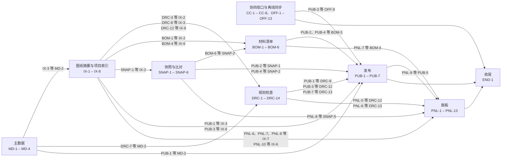

# P&ID 协同绘图开发方案 · 实施计划

> 日期：2026-11-16
> 状态：**已确认**（2026-11-16）。§11 的六件事都按建议定，从 `CC-1` 开始串行做。2026-11-17 加了离线使用与上线后同步（`OFF-1` – `OFF-13`，规格 `SPEC-collab-offline-sync.md`），这一部分也**已确认**（2026-11-17）：§12 的六件事都按建议定，那批没提交的离线改动交给我接着做，从 `OFF-1` 开始。
> 配套：`todo.md`（80 个任务，逐个写了做什么、验收、验证命令、依赖、文件、规模）。数据格式与数据怎么传在各模块的 `SPEC-*.md`，共用约定在 `01-shared-conventions.md`，模块怎么切在 `00-capability-map.md`。
> 基线：`main @ 9b5327f96`（本地，比 `fork/main @ 144d2c643` 多 31 个提交，未推送）。
> 已批准计划：`docs/plans/2026-11-16-pid-platform-next-steps-plan.md`。本文不推翻它，只把它的 T2.4 ③④ 和 T3.1 – T3.4 排成可以逐个执行的任务。

## 1. 总览

要做两件事：把协同这条链收干净（阶段 A）；新建「校验与交付」这条链（阶段 B – E）：主数据 → 图纸摘要与项目索引 → 规则检查、材料清单、快照 → 发布 → 面板。

| 阶段 | 内容 | 任务 | 做完能演示什么 | 对应已批准计划 |
|---|---|---|---|---|
| A | 协同收口，离线使用与上线后同步 | `CC-1` – `CC-8`、`OFF-1` – `OFF-13`，21 个 | 属性超过 2 KB 的对象两端一致；服务器能让别的机器连；断线改图、保存退出、重开连上后自动提交，被拒的撤回；228 条验收契约条条有证据 | T2.4 ③④；`OFF` 是 2026-11-17 加的，已批准计划里没有 |
| B | 主数据与项目索引 | `MD-1` – `MD-4`、`IX-1` – `IX-8`，12 个 | 读写项目主数据；报出跨图重号和连接符配对；按位号跳到另一张图上的对象 | T3.1 |
| C | 规则检查、材料清单、快照 | `DRC-1` – `DRC-14`、`BOM-1` – `BOM-6`、`SNAP-1` – `SNAP-6`，26 个 | 检查一张图或整个项目，豁免个别结果；导出材料清单；存快照，比对两个版本 | T3.2，T3.3 的前两块 |
| D | 发布 | `PUB-1` – `PUB-7`，7 个 | 带错误的图发布被拦并说明原因；整改后出一个十一个文件的发布包，能校验 | T3.3 的第三块 |
| E | 面板与收尾 | `PNL-1` – `PNL-13`、`END-1`，14 个 | 在一个面板里做完检查 → 定位 → 修改 → 清单 → 快照 → 发布 | T3.4 |

共 80 个任务（2026-11-17 从 67 个加到 80 个）。按规模：S（1–2 个文件）12 个，M（3–5 个文件）66 个，L 2 个（`OFF-1`、`PNL-1`，拆不开的原因写在任务里）。按类别：纯函数 25 个，接线 22 个，界面 10 个，协同 11 个，存盘 2 个，只加验收测试 1 个，脚本 6 个，文档 3 个。

阶段用字母，是为了不和已批准计划的「阶段 1–4」混：A 是它阶段 2 的收尾，B – E 合起来是它的阶段 3。

## 2. 做法上的几个决定

这几条决定了任务为什么这样拆。

1. **每个新模块分三层，从里往外做。** 纯函数（`src/pid/` 下模块自己的文件，进出都是数据，不碰界面）→ 命令（`src/app/commands/pid*.rs` 里一个薄入口）→ 自动化操作、REST、MCP。面板在最外面，按钮调的就是命令和接口在用的那个入口，不另写一份逻辑。这样每种口径只有一份实现，纯函数层可以脱离程序单独测。
2. **后面的模块都只吃「图纸摘要」**（`SPEC-pid-project-index.md` §3.1）。摘要不依赖句柄，同一张图做两次逐字节相同。规则检查、材料清单、快照、发布都不各自读图。所以摘要（`IX-1`、`IX-2`）是阶段 B – E 的地基，排在最前；其中按坐标判断线接到了什么（`IX-2`）最容易出错，先做。
3. **「纯」和「接线」拆成不同的任务。** 一个新能力接进程序固定要改五处（共用约定 §7.6），涉及七个所有模块共用的文件，其中 `src/mcp.rs` 里有一个钉死的摘要值。纯函数任务各改各的文件，可以同时做；接线任务一次只能一个会话做（§8）。
4. **先红后绿，一个任务一个提交。** 每个任务先写会失败的测试，再实现到通过。七条固定门禁写在 `todo.md` §1，每个任务都要过。
5. **不加依赖，不引入外部服务；协同协议只按协议规格 §7 加可选键和错误码，不加消息种类。** 要用的能力仓库里都有（共用约定 §1）。阶段 B – E 的功能都在桌面端本地完成，不经协同服务器。确实要加依赖时先停下来问。2026-11-17 改：这一条原来写的是「不改协同协议」；离线同步要加几个可选键和错误码（`SPEC-collab-offline-sync.md` §4.3），那批没提交的离线改动加的一种新消息要不要保留，等你定（§12）。

### 性能预算

都以 2,000 个对象的图为准。合成图由 `IX-4` 做一次，后面各模块共用。每条预算是一个标了 `#[ignore]` 的测试，取 3 次的中位数。

| 项目 | 预算 | 任务 |
|---|---|---|
| 主数据解析加校验（2,000 行管道等级） | ≤ 50 ms | `MD-1` |
| 一张图做一次摘要 | ≤ 150 ms | `IX-4` |
| 100 张图的项目，文件都没变时重扫 | ≤ 1 秒 | `IX-6` |
| 单图全量检查（含做摘要） | ≤ 500 ms | `DRC-10` |
| 算一份材料清单（含做摘要） | ≤ 300 ms | `BOM-3` |
| 存一份快照（含做摘要） | ≤ 300 ms | `SNAP-4` |
| 两份快照比对（不含读文件） | ≤ 200 ms | `SNAP-4` |
| 发布门禁（不含项目扫描） | ≤ 1 秒 | `PUB-3` |
| 面板在 2,000 条结果时重建要画的内容 | ≤ 50 ms | `PNL-13` |

产品需求的指标是「2,000 个对象全量检查不超过 60 秒」，这里的预算比它严得多。

## 3. 已定的决定

各规格末尾的待决问题共 39 条，2026-11-16 都按规格里「建议」一栏定下。编号是规格里的编号，与已批准计划的决议 D1–D5 不是一套。哪条不同意，报编号即可，我改规格和任务。

### 3.1 做法与已批准计划或需求文档的字面写法不同（12 条）

| 编号 | 模块 | 定下的做法 |
|---|---|---|
| D1 | `pid-drc` | 严重度三级：错误、警告、提示。计划写两级；「错误」就是计划里的严重违规，拦发布 |
| D2 | `pid-drc` | 内置 41 条：需求的 25 条作「基础规则」，计划多出的 16 条作「工程扩展」，都默认启用 |
| D3 | `pid-drc` | 保存时默认只提示、不拦（`save_gate: warn`），项目可改成拦。发布前的门禁始终拦 |
| D5 | `pid-drc` | 「位号格式不符」（`DR-018`）按各类型自己的位号规则判，不用需求里的固定正则 |
| D6 | `pid-drc` | 默认必填字段只有两个：设备的 `名称`、管线的 `流体介质`。项目可改 |
| D7 | `pid-drc` | 规则里的属性名用图里实际的 `流体介质`，不用需求写的 `介质` |
| I1 | `pid-project-index` | 跨图重号只查设备、阀门、仪表；管线、管路、信号线不查。代价：两张图误用同一个线号、又没有连接符相连的，查不出来 |
| B2 | `pid-bom` | 主表每条管线一行（照需求）；计划要的按「管道等级 + 公称直径 + 绝热等级」累加做成副表「管道汇总」，两张表都导出 |
| M4 | `pid-master-data` | 默认只预置 19 个公称直径；管道等级、绝热等级、流体介质留空 |
| P3 | `pid-publish` | 发布门禁四项：未豁免的错误为 0、重复位号为 0、主数据读得出、项目里的图都读得出。代价：目录里一个读不出来的图会挡住所有图的发布，要先把它移走 |
| P4 | `pid-publish` | 发布前必须先保存；包里的图纸文件是磁盘文件的原样复制；发布不改图 |
| V2 | `pid-verify-deliver-panel` | 面板文字直接写中文，与现有「协同」面板一致；不走语言包，不改 `tests/pid_panel_localization.rs` |

### 3.2 本轮加做的（6 条）

| 编号 | 模块 | 定下的做法 | 任务 |
|---|---|---|---|
| S1 | `collab-server` | 协同服务器加 `--bind <地址>`，默认仍只监听本机。监听局域网地址时，服务没有登录验证、不加密，只适合可信内网，文档里写明 | `CC-3` |
| C3 | `collab-client` | 属性超过 2 KB 的对象，之后改属性也广播，与「新建」一起补 | `CC-2` |
| C5 | `collab-client` | 协同的端到端脚本收进仓库 `scripts/collab-e2e/`，日志和截图不收 | `CC-5` |
| D4 | `pid-drc` | 规则检查带最小版豁免：记在图里，有写权限的人都能豁免，必须填理由 | `DRC-9`、`DRC-13`、`DRC-14`、`PNL-6` |
| V3 | `pid-verify-deliver-panel` | 点检查结果后在属性表里标出相关字段，排在面板的最后 | `PNL-11`、`PNL-12` |
| P5 | `pid-publish` | 发布包比计划多三个文件：管道汇总、发布时的快照、主数据 | `PUB-2`、`PUB-4` |

### 3.3 本轮不做或保持现状，记为已知限制（21 条）

| 编号 | 模块 | 限制 |
|---|---|---|
| C1 | `collab-client` | 本图与房间对不上时没有「重新同步」，只能所有人从同一份最新文件重新开始。写进阶段 4 提纲。2026-11-17 改：`OFF-9` 做完后，能列出、导出没同步上的修改，换一份最新图纸后照着重做；按清单自动重放、从服务器重建整张图仍不做，留在阶段 4 提纲 |
| C2 | `collab-client` | 一次运行里不能换会话、不能退出协同，要重启程序。写进阶段 4 提纲 |
| C4 | `collab-client` | 桌面端没有冲突裁决入口。写进阶段 4 提纲 |
| S2 | `collab-server` | 四处实现选择保持现状，结项时（`CC-8`）在状态文档里写成已确认：图切只读时编辑权归在图上最久的会话；默认不产生冲突条目；让路与过期用两个错误码；「被引用」只算管路端点 |
| M1 | `pid-master-data` | 主数据没有编辑界面，靠改项目文件或导出再导入。界面是可选任务（§10） |
| M2 | `pid-master-data` | 协同时主数据不经服务器分发，各人的项目文件自己保持一致。分发写进阶段 4 提纲 |
| M3 | `pid-master-data` | 不按角色判权，只在只读会话里拦 |
| I2 | `pid-project-index` | 同一进程里配对、同号线跨三张以上图时分不出谁对谁，如实报「有歧义」 |
| I3 | `pid-project-index` | 线接设备靠坐标现算，不在画图时记 |
| I4 | `pid-project-index` | 图纸摘要的缓存只放内存，程序重启后首次扫描要重读全部图 |
| D8 | `pid-drc` | 三条规则本期没有对应的对象，内置但不出结果：`DR-016` 标注文字为空、`DR-020` 管口位号前缀、`DR-109` 单向阀或调节阀流向 |
| B1 | `pid-bom` | 管长是图面长度，不等于实际管长，清单里注明 |
| B3 | `pid-bom` | 不做报表模板，用选列参数代替 |
| B4 | `pid-bom` | 范围内有图读不出来时不出清单 |
| N1 | `pid-snapshot` | 快照存成图纸目录下的文件，只拷走 DWG 时不跟着走 |
| N2 | `pid-snapshot` | 快照不含图形，不能用来恢复图纸 |
| N3 | `pid-snapshot` | 旧快照不自动清理，也没有删除入口 |
| P1 | `pid-publish` | 不做发布状态流转和发布后锁图；用「已发布，修订 N / 修订 N 之后有改动」这个推出来的状态代替 |
| P2 | `pid-publish` | 一次只发布一张图 |
| V1 | `pid-verify-deliver-panel` | 做成停靠面板，外壳里三个占位屏不动 |
| V4 | `pid-verify-deliver-panel` | 功能区不加按钮，入口是 `PIDVERIFY` 命令和停靠区的面板开关 |

## 4. 拆任务时补的内容

对着规格逐条排任务时发现下面几处，已经改进文档。第 1 条是新的口径，请你确认；其余三条不改口径。

1. **图里没有 P&ID 对象时，保存不检查**（`SPEC-pid-drc.md` §4.3，任务 `DRC-11`）。原规格没写这一条。不加的话，`DR-009`（图纸未设图例标准，错误级，主数据没配置时命中）会让每一张普通 CAD 图在默认的 `warn` 档下每次保存都报一条错误，在 `block` 档下存不了。按需检查（`PIDCHECK`、接口、面板）不受影响，照常报。**已确认（2026-11-16）。**
2. **`DR-016` 怎么测**（`SPEC-pid-drc.md` §6 第 5 条，任务 `DRC-3`、`DRC-13`）。这条规则本期没有对象，在真图上不会命中，而启停规则的成功标准原来拿它举例。现在注明：纯函数层用手写的摘要测它，命令层换一条在真图上会命中的规则（`DR-014`），否则断言是空的。
3. **面板规格 §3.5 的一个例子**把属性名写成了 `介质`，改成 `流体介质`（与 D7 一致）。
4. **格式检查脚本收进仓库**（任务 `CC-5`）。固定门禁第 4 条用的脚本在仓库外（`D:\scratch\ocs-main-20261116\fmt-newhunks.ps1`，35 行），那个目录一清，这条门禁就没法过。收端到端脚本时把它一并收成 `scripts/fmt-newhunks.ps1`。

## 5. 退出指标在哪里验

| 指标 | 出处 | 在哪里验 |
|---|---|---|
| 228 条协同验收契约全部闭环 | 已批准计划 T2.4 ④ | `CC-4` 逐条对照，`CC-7` 全量复验，`CC-8` 结项 |
| 离线使用与上线后同步的 21 条成功标准（OS-01 – OS-21，2026-11-17 加） | `SPEC-collab-offline-sync.md` §7；需求 `REQ-COLL-014`、`REQ-COLL-015` | `OFF-12`、`OFF-13` 的八个端到端场景；`OFF-7` 的单元测试（OS-16）；`PUB-4`（OS-20，发布闸）；`CC-7` 全量复验 |
| 内置规则不少于 24 条 | 已批准计划 T3.2；产品需求的退出指标是不少于 20 条 | `DRC-2`：41 条；到 `DRC-8` 为止，41 条逐条有命中和不命中的例子 |
| 2,000 个对象全量检查不超过 60 秒 | 产品需求的退出指标 | `DRC-10`：预算 500 ms |
| 材料清单每个「类型编码 + 位号」至多一行 | 产品需求的退出指标 | `BOM-1`：出口断言，加随机输入的不变量测试 |
| 严重违规 100% 拦截 | 产品需求的退出指标 | `PUB-7`：错误级规则 20 条，去掉本期不出结果的 2 条，其余 18 条各造一张违规图，发布全部被拦 |
| 经 `--http` 驱动面板：切页签、触发检查、读违规列表、导出清单 | 已批准计划 T3.4 | `PNL-13` 的端到端脚本 |

## 6. 依赖图

模块之间（箭头上写的是「谁等谁」）：

图里没有单独画的一条：`IX-4` 做的 2,000 对象合成图，`DRC-10`、`BOM-3`、`SNAP-4`、`PUB-3` 的性能测试都要用。

协同收口（阶段 A）与后面的模块原来没有依赖关系。先做它，是已批准计划决议 D1（先收官协同，再进阶段 3）定的顺序。2026-11-17 加了一处依赖：发布前要查这张图有没有没同步的修改，要读协同的状态，所以 `PUB-3` 等 `OFF-9`。

模块内部的先后：

- **CC**：`CC-1` → `CC-2`；`CC-4` → `CC-5` → `CC-6`（还要等 `CC-1`、`CC-2`）；`CC-7` 等 `CC-1`、`CC-2`、`CC-3`、`CC-6`、`OFF-13`；`CC-8` 等 `CC-7`。
- **OFF**（2026-11-17 加，排在 `CC-6` 与 `CC-7` 之间）：`OFF-1` 等 `CC-6`；`OFF-1` → `OFF-2` → `OFF-3` → `OFF-4`、`OFF-5`、`OFF-7`；`OFF-5` → `OFF-6`；`OFF-5` 加 `OFF-7` → `OFF-8` → `OFF-9` → `OFF-10`；`OFF-1` → `OFF-11`；`OFF-12` 等 `OFF-2` – `OFF-6` 和 `OFF-9`；`OFF-13` 等 `OFF-8` – `OFF-12`。
- **MD**：一条线，`MD-1` → `MD-2` → `MD-3` → `MD-4`。
- **IX**：`IX-1` → `IX-2` → `IX-3`、`IX-4`；`IX-3` → `IX-5` → `IX-6`、`IX-7` → `IX-8`。
- **DRC**：`DRC-1` → `DRC-2` → `DRC-3` → `DRC-4`、`DRC-5`、`DRC-6`、`DRC-7`、`DRC-9`；`DRC-4` – `DRC-7` → `DRC-8`；`DRC-8` 加 `DRC-9` → `DRC-10`、`DRC-11`、`DRC-12`；`DRC-12` → `DRC-13` → `DRC-14`。
- **BOM**：一条线，`BOM-1` → `BOM-2` → `BOM-3` → `BOM-4` → `BOM-5` → `BOM-6`。
- **SNAP**：`SNAP-1` → `SNAP-2`、`SNAP-3` → `SNAP-4`、`SNAP-5`；`SNAP-5` → `SNAP-6`。
- **PUB**：`PUB-1` → `PUB-2`、`PUB-3` → `PUB-4` → `PUB-5` → `PUB-6`；`PUB-7` 等 `PUB-4`。
- **PNL**：`PNL-1` → `PNL-2` → `PNL-3` → `PNL-4` → `PNL-5`、`PNL-7`、`PNL-8`；`PNL-5` → `PNL-6` → `PNL-11` → `PNL-12`；`PNL-5` 加 `PNL-8` → `PNL-9`；`PNL-5`、`PNL-7`、`PNL-9` → `PNL-10`；`PNL-10` 加 `PNL-12` → `PNL-13`。
- **END-1** 等前面全部。

每个任务完整的依赖写在 `todo.md` 该任务的「依赖」一项。几点说明：

- `todo.md` 里任务的先后就是一个可以照着做的顺序：每个任务依赖的任务都排在它前面（用脚本核过），没有环。
- 不依赖任何任务、随时可以开工的：`CC-1`、`CC-3`、`CC-4`、`MD-1`、`IX-1`、`DRC-1`、`PNL-1`。
- 最长的依赖链是 16 个任务（2026-11-17 加了 `OFF` 之后用脚本重算的，之前是 13 个）。后半段是固定的：`OFF-8` → `OFF-9` → `PUB-3` → `PUB-4` → `PUB-5` → `PNL-9` → `PNL-10` → `PNL-13` → `END-1`。前半段有四种走法，一样长：先是 `CC-4` → `CC-5` 或者 `CC-1` → `CC-2`，接 `CC-6` → `OFF-1` → `OFF-2` → `OFF-3`，再经 `OFF-5` 或者 `OFF-7` 到 `OFF-8`。链上哪个任务卡住，后面都得等；`OFF-1` – `OFF-8` 在 §9 里单列了风险（R15 – R17）。
- 原来最长的那条（13 个任务）没有变：后半段 `DRC-12` → `PUB-3` → `PUB-4` → `PUB-5` → `PNL-9` → `PNL-10` → `PNL-13` → `END-1`；前半段两种走法，`IX-1` → `IX-2` → `IX-3` → `IX-5` → `IX-6`，或者 `DRC-1` → `DRC-2` → `DRC-3` → `DRC-4` – `DRC-7` 中的任一个 → `DRC-8`。前头的 `IX-2`、`IX-6` 在 §9 里单列了风险。

## 7. 检查点

共 20 个（2026-11-17 加了 CP-A3、CP-A4）。每个检查点都要固定门禁全过，我汇报各项读数。标了「你确认」的 7 个停下来等你；其余 13 个我发一条进展就接着做。

| 检查点 | 位置 | 看什么 | 谁确认 |
|---|---|---|---|
| CP-A1 | `CC-1` – `CC-3` 之后 | 大属性对象新建、改属性、撤销重做三种情形两端一致；协同两个 crate 的测试全过 | 汇报 |
| CP-A2 | `CC-4` – `CC-6` 之后 | 脚本都在仓库里，按 `README.md` 能跑；对照表没有缺口 | 汇报 |
| CP-A3 | `OFF-1` – `OFF-6` 之后 | 对不上的图不再往房间里发修改，也不被房间改写；离线的修改不会因为编号重复被吞掉或生效两次；不一致的图重开后仍然不一致 | 汇报 |
| **CP-A4** | `OFF-7` – `OFF-13` 之后 | 演示：断线改图、保存退出、重开连上后自动提交；重开后被拒的一步撤回；不一致之后列出并导出没同步上的修改。汇报哪几种变更重开后撤不回 | **你确认**（2026-11-17 定的，见 §12） |
| **CP-A** | 阶段 A 结束 | 228 条契约和离线同步的成功标准全部有证据；状态文档结项 | **你确认**，并决定要不要推送 |
| CP-B1 | `MD-1` – `MD-4` 之后 | 命令行和 REST 都能建、读、改主数据 | 汇报 |
| CP-B2 | `IX-1` – `IX-4` 之后 | 摘要与索引的纯函数齐了，摘要性能达标。阶段 C 三个模块的纯函数任务从这里起可以开工 | 汇报 |
| **CP-B** | 阶段 B 结束 | 演示：两张图各有一台 `P-1001` 和一对连接符，报出一处跨图重号和一对配好的连接符，按位号跳到另一张图上的对象 | **你确认** |
| CP-C1 | `DRC-1` – `DRC-3` 之后 | 从表达式文本到检查结果整条跑通，第一批 7 条规则有正反例 | 汇报 |
| CP-C2 | `DRC-4` – `DRC-10` 之后 | 41 条规则逐条有正反例；豁免能记、能套、能往返；性能达标 | 汇报 |
| CP-C3 | `DRC-11` – `DRC-14` 之后 | 命令行和 REST 都能检查、启停规则、豁免；保存门禁三档可用 | 汇报 |
| CP-C4 | `BOM-1` – `BOM-5` 之后 | 能出清单、导出三种格式；有重复位号时不出清单；性能达标 | 汇报 |
| CP-C5 | `SNAP-1` – `SNAP-6`、`BOM-6` 之后 | 能存快照、列表、导出、比对；能按快照出清单；性能达标 | 汇报 |
| **CP-C** | 阶段 C 结束 | 演示：在一张有缺陷的图上检查并豁免一条；导出清单；存快照后改图再比对；同样的事经 REST 再做一遍 | **你确认** |
| CP-D1 | `PUB-1` – `PUB-2` 之后 | 给定摘要、检查报告、清单、快照，能在临时目录写出完整的包并校验通过 | 汇报 |
| **CP-D** | 阶段 D 结束 | 演示：带错误的图发布被拦并列出原因；整改后发布成功、校验通过；改包里一个字节再校验报错；拦截率读数 | **你确认** |
| CP-E1 | `PNL-1` – `PNL-4` 之后 | 面板能开关、切页签，能经接口读状态和驱动；还没有业务内容 | 汇报 |
| **CP-E2** | `PNL-5` – `PNL-6` 之后 | 规则检查页签可用：检查、筛选、点击定位、豁免 | **请你在界面上试一遍**；布局有意见这时提，后两个页签照这个样子做 |
| CP-E3 | `PNL-7` – `PNL-10` 之后 | 三个页签都可用，全项目的操作有进度、能取消 | 汇报 |
| **CP-E** | 阶段 E 结束 | 演示：全程在面板里完成检查 → 定位 → 修改 → 清单 → 快照 → 发布；阶段 3 结项报告 | **你确认**，并决定是否推送 |

## 8. 哪些能同时做

**默认：一个会话，按 `todo.md` 的先后串行做。** 这是已批准计划决议 D1 的做法，也最省事：不用合并，门禁读数始终在一条线上。

想更快做完，可以开多条线。能不能同时做，看任务的类别和它动的文件：

| 线 | 任务 | 说明 |
|---|---|---|
| 协同代码 | `CC-1` → `CC-2`；`CC-3` | 只动 `src/app/collab/`、`src/app/history.rs` 和服务器 crate。`CC-2` 要改 `src/app/collab/apply.rs`，与接线任务是同一个文件，做它的时候接线那条线要空着 |
| 离线同步的代码（2026-11-17 加） | `OFF-1` → … → `OFF-11`，串行 | 接在 `CC-6` 后面。好几个任务改 `src/app/collab/apply.rs`；`OFF-6` 改保存路径；`OFF-9` 可能改 `src/rest_openapi.json`；`OFF-10` 改 `src/app/update/mod.rs`。所以做这一组的时候，接线、存盘、面板三条线都要空着；纯函数那几条线不受影响 |
| 协同脚本与文档 | `CC-4` → `CC-5` → `CC-6` → `OFF-12` → `OFF-13` → `CC-7` → `CC-8` | 不动 Rust 代码。`CC-6` 起要等协同代码那条线；`OFF-12`、`OFF-13` 要等离线同步的代码那条线 |
| 纯函数，每个模块一条 | `MD-1` – `MD-2`；`IX-1` – `IX-4`；`DRC-1` – `DRC-10`；`BOM-1` – `BOM-3`；`SNAP-1` – `SNAP-4`；`PUB-1` – `PUB-2` | 模块之间各改各的文件，可以同时做。模块内部改的是同一个文件，只能串行（比如 `DRC-4` – `DRC-9` 都改 `src/pid/drc/facts.rs`）。每个模块的第一个任务要在 `src/pid/mod.rs` 登记一行，合并时两边都留 |
| 接线，全程只有一条 | `MD-3`、`MD-4`、`IX-5` – `IX-8`、`DRC-12` – `DRC-14`、`BOM-4` – `BOM-6`、`SNAP-5`、`SNAP-6`、`PUB-3` – `PUB-6`、`PNL-2` – `PNL-4` | 标【接线】的 22 个任务里的 21 个；另一个是 `OFF-9`，在离线同步那条线里做。大多要改那七个共用文件，`src/mcp.rs` 里钉死的摘要值两个会话同时改一定冲突；其余几个改的是同一个命令文件，也得排着来。**同一时间只让一个会话做** |
| 存盘 | `OFF-6`、`DRC-11` | 各自单独做。做的时候别的线不要动 `src/io/` 和保存相关的文件 |
| 面板 | `PNL-1`；`PNL-5` – `PNL-12` | `PNL-1` 不依赖别的模块，可以提前做；它和 `IX-6` 都可能动 `src/app/mod.rs`、`src/app/update/mod.rs`，不要同时做。`PNL-5` 起各任务都改 `src/ui/window/pid_verify_deliver.rs` 和 `src/app/commands/pidverify.rs`，只能串行；但它们不再碰七个共用文件，可以和接线那条线上剩下的接口任务（`DRC-14`、`BOM-5`、`BOM-6`、`SNAP-6`、`PUB-6`）同时做 |
| 其余 | `PUB-7`；`PNL-13`；`END-1` | `PUB-7` 只加测试，但要在 `src/app/commands/pidpublish.rs` 里挂一行，跟在 `PUB-4` 后面、与 `PUB-5` 错开做。`PNL-13`、`END-1` 排在最后，那时只剩一条线 |

开多条线时的规矩：

- 每条线一个独立的工作副本（`git worktree`）和分支。不要两个会话共用一个工作目录，否则门禁跑到的是对方做了一半的代码。
- 开工前对一下两条线手上任务的「文件」一项，有重叠就不要同时做。
- 到检查点时按依赖顺序合回 `main`，合完在 `main` 上把固定门禁全量重跑一遍，读数以合并后的为准。
- 代价：每个工作副本都要自己完整编译一遍，编译时间和磁盘占用按线数增加；`src/pid/mod.rs`、`src/app/mod.rs` 这类登记文件合并时会有小冲突。

我的建议：阶段 A 串行做完。到 `CP-B2` 再看要不要开第二条线（一条做纯函数，一条做接线）；超过两条，合并和重复编译的开销多半抵掉省下的时间。要不要放开由你定（§11）。

## 9. 风险与应对

| # | 风险 | 应对 | 落在哪里 |
|---|---|---|---|
| R1 | **`CC-2` 的前提没有跑过。** 改大属性对象的属性时，撤销步骤里是否带着溢出记录改前的内容，我只读了数据结构 | 第一步先写确认前提的测试。不成立就停下来报告：那说明这类对象的属性修改本身撤销不干净，要先商量 | `CC-2` |
| R2 | **按坐标判断线接到了什么**（七种情形）。判错会让规则检查误报或漏报悬空端、未接的管口，后面的模块全受影响 | 排在最前；七种情形各有例子；容差沿用协同里已有的 `1e-6`；`CP-B2` 过了后面的模块才开工；发现规格列的情形不够时停下来补规格 | `IX-2` |
| R3 | **改存盘路径。** 保存是最不能坏的功能 | 单独一个任务；默认档 `warn` 是保存成功之后才检查，不影响保存结果；自动保存和备份不过闸；不含 P&ID 对象的图直接放行；现有存盘测试必须全过；排在命令之前做，让后面每个任务的全量测试都经过它 | `DRC-11` |
| R4 | **后台扫描。** 进度、取消、缓存容易出时序问题 | 先在 `IX-5` 做成同步函数并测对，`IX-6` 只把它挪到后台；测试用一个慢的假读取函数；照程序里现有的后台任务写法，不引入异步运行时 | `IX-5`、`IX-6` |
| R5 | **七个共用文件和钉死的摘要值。** 每个模块的接线都要改，两个会话同时改一定冲突 | 接线任务一次只让一个会话做；每个接口任务的验证里都有 `tool_schema_digest_is_pinned` | §8 |
| R6 | **面板登记牵涉面广**（9 个文件）。面板枚举加一项，所有按面板分支的地方都要补 | 照「协同」面板逐处对照（面板规格 §7 的接入点清单）；这个任务只做登记和空壳，不带业务 | `PNL-1` |
| R7 | **属性表高亮要改两个很大的文件**（合计约 450 KB） | 只在画行的那一处加判断；判断函数单独可测、两处共用；没有高亮请求时与改动前完全相同。这一块不挡别的，必要时可以整块后移（`PNL-13` 的脚本没有用到高亮） | `PNL-11`、`PNL-12` |
| R8 | **端到端脚本换台机器跑不了，或者把敏感内容带进仓库。** 脚本里有写死的本机路径；证据日志里出现过服务器地址 | 路径改成参数或环境变量；日志、截图、数据库不收；收之前逐个文件检查；验收里有全文搜索 | `CC-5`、`PNL-13` |
| R9 | **协同复验的工作量说不准。** 对照表可能查出更多没有脚本的契约；全量复验可能跑出回归 | 缺的脚本超过 3 个先停下来说明再拆任务；不通过的不带过，能修的另开修复任务，修不了的记为已知限制并请你同意。阶段 A 的任务数可能因此增加 | `CC-4`、`CC-6`、`CC-7` |
| R10 | **性能预算达不到** | 合成图在 `IX-4` 一次做好共用；达不到就在那个任务里优化，不放宽预算、不往后拖 | §2 的预算表 |
| R11 | **规格是读代码写的，没有跑过。** 实现时可能发现规格的假设不对（拆任务时已经发现两处，见 §4） | 出入记进该规格的「实现记录」；影响数据格式或口径的先停下来问，不悄悄改 | 固定门禁第 7 条 |
| R12 | **基线上本来就有 4 条失败的测试**（比对设计文件的，因为那份不提交的 `.pen` 有改动），新的失败容易混在里面 | 门禁按「失败的仍只是这 4 条」判，每次核对失败的测试名，不只看条数 | 固定门禁第 2 条 |
| R13 | **所有工作只在这一台机器上。** 本地已比 `fork/main` 多 31 个提交，本轮还要再加 80 来个（2026-11-17 加了 13 个任务） | 每个阶段检查点问你一次要不要推送；建议最晚在 `CP-A` 推一次 | §11 |
| R14 | **格式检查脚本在仓库外**，那个目录一清，固定门禁第 4 条就没法过 | `CC-5` 把它收进仓库；在那之前不要清 `D:\scratch\ocs-main-20261116\` | `CC-5` |
| R15 | **离线同步的几处结论是读代码得出的，没有跑过**（2026-11-17 加）。离线规格的 G1 – G8、各种拒绝原因下本图的样子、管线这一类修改的反向修改算不算得出来 | 对应任务的第一步先写证实它的测试；证实不了的记进离线规格 §11 并停下来问。管线的反向修改算不出时，这一类修改重开后被拒就撤不回，改为标不一致并进未同步清单，在 CP-A4 说明 | `OFF-2` – `OFF-8` |
| R16 | **要接手一批没提交的改动**（19 个代码文件，2026-11-17 加）。它不是本清单的任务做出来的，没有按固定门禁验过；两条线同时改这批文件会互相覆盖 | 交给一条线做到底（2026-11-17 定为交给我，§12）；先核对、编过、测过再入库，行为不改；发现的问题记下来，由后面的任务修 | `OFF-1` |
| R17 | **离线同步改的是存盘、加入、提交这几条最要紧的路**（2026-11-17 加）。改坏了，在线协同也跟着坏 | 新加的键都是可选的，没有这些键的旧图和不带新键的客户端行为不变，每个任务的验收里都有这一条；`OFF-6` 单独做，现有存盘测试必须全过；八个新场景之外，原有场景在 `CC-7` 全量重跑 | `OFF-2` – `OFF-6`、`OFF-12`、`OFF-13`、`CC-7` |
| R18 | **阶段 A 多了 13 个任务，后面各阶段顺延**（2026-11-17 加） | 这是这次修订的直接代价。想早点进阶段 B，可以做到 CP-A3（`OFF-1` – `OFF-6`）就转去做阶段 B、C，剩下的（`OFF-7` – `OFF-13`、`CC-7`、`CC-8`）在阶段 D 之前回来做，因为发布要等 `OFF-9`。代价有两样：这期间重开后有一步被拒，整张图就停止同步；阶段 A 要到那时才能结项。没有定就按 `todo.md` 的次序做 | §12 |

## 10. 本轮不做的事与阶段 4 提纲

**已知限制**：§3.3 的 21 条，加上离线规格（`SPEC-collab-offline-sync.md`）§9 的 L1 – L12（2026-11-17 加）。`END-1` 的结项报告会把它们和实现中新发现的限制一起列出。

**可选任务**（不在 80 个里，要做就说一声，我先补规格再排进来）：

- 主数据的编辑界面和属性表里的下拉选择（M1）。排在阶段 E 之后。
- 退出程序时，协同队列里还有没提交的步骤就提示一次（C1 里最便宜的一手防护）。2026-11-17 起不再是可选的：并进了 `OFF-10`。
- 存快照时在旁边另存一份 DWG，用来回到那个版本（N2）。加在 `SNAP-5` 之后。

**阶段 4 提纲**（阶段 E 验收后另开方案，这里只列题目）：

1. 多图例标准与符号编辑器：内置 HG/T 20519、SY/T 0003、DIN、ISO 四套标准包，连接点可视化编辑；扩充类型库（现在类型树里只有四个设备类型）。
2. 存量 DWG 批量接管：100 张存量图批量识别转成智能图，位号解析率不低于 98%。
3. 标准交换与三通道验收：导出 ISO 15926 / CFIHOS 数据包，跑通 `--serve`、`--http`、`--mcp` 三条通道的自动化验收。
4. 从本轮转过来的协同补强：会话管理与重新同步（C1、C2），其中「列出、导出没同步上的修改」已提前到 `OFF-9`，留在这里的是按清单自动重放、从服务器重建整张图、多张图同时同步；桌面端的冲突裁决入口（C4）；主数据经服务器分发（M2）。
5. 规格里只写了「放到后续」、到时一起排的：按角色判权（M3，含谁能豁免错误级结果）；发布状态流转与发布后锁图（P1）；批量发布（P2）；功能区按钮（V4）。
6. CP-A（2026-11-20）裁决时留下的（`scripts/collab-e2e/README.md` 第 5.3 节）：服务器给发送方的回执单独发、不走广播队列（`VAL-SRV-030`，现在规模大时会丢通知）；放置请求答完之后程序还要忙几十毫秒，一个接一个发时放置用时约 113 毫秒，先查在忙什么（`VAL-DRAW-030`、`032`）；管线自己的线要不要随阀门断开，交给绘图那条线定（`VAL-PIPE-017`）。

**不在本方案范围**（能力地图 §6）：T1.3 的依赖升级；已有对象的几何修改进入协同；协同连接配置的图形界面。

## 11. 当时请你定的事（已定）

2026-11-16 答复「按推荐继续」，六件事都按建议定：

1. **这份计划和 `todo.md` 行不行。** 行，从 `CC-1` 开始做。
2. **保存门禁补的那一条**（§4 第 1 条）。同意，计入规格。
3. **文档什么时候提交。** 确认之后、动代码之前单独提交一次（只加 `docs/plans/2026-11-16-pid-dev-spec/`，不含 `.pen`），不推送。这样后面每个任务的提交里只有它自己的改动。
4. **什么时候推送。** 本地比 `fork/main` 多 31 个提交，都只在这一台机器上。推送前先汇报、经你确认：到 `CP-A` 问一次，之后每个阶段检查点问一次。在那之前不推。
5. **串行还是开多条线**（§8）。串行。
6. **可选任务要不要加**（§10）。不加。

## 12. 2026-11-17 的修订（已确认）

起因：2026-11-17 你要求「离线的情况下也要能使用，上线了之后要进行同步」，审核之后答复「按推荐方案继续」（审核意见的档 B）。这一节写这次修订改了什么、定了什么。修订本身只改了文档，没有动代码。

**加了什么**

- 一份新规格 `SPEC-collab-offline-sync.md`：离线使用与上线后同步的数据格式、流程、服务器这边的前提、21 条成功标准、8 个端到端场景、12 条已知限制。
- 13 个任务 `OFF-1` – `OFF-13`，排在 `CC-6` 与 `CC-7` 之间；任务总数 67 → 80。
- 2 个检查点：CP-A3（汇报）、CP-A4（离线同步验收）；检查点 18 → 20。
- 发布加协同前提：有没提交的修改、标着不一致、没对过账的图，默认不让发布（`PUB-1` – `PUB-4`、`PUB-6`；`PUB-3` 多等一个 `OFF-9`）。
- `CC-7` 的全量复验连 8 个离线场景一起跑；`CC-8` 结项时把离线这部分的限制写进状态文档。

**改了原来定下的什么**

- §2 第 5 条「不改协同协议」放宽成「只按协议规格 §7 加可选键和错误码，不加消息种类」。
- §10 的可选任务「退出时提示」原来定的是不加（§11 第 6 条），现在并进了 `OFF-10`。
- 阶段 A 从 8 个任务变成 21 个，最长依赖链 13 → 16 个任务，后面各阶段顺延（R18）。

**还没有证实的**

新规格是读文档和代码写的，没有编译，也没有跑测试。八个缺口（G1 – G8）、各种拒绝原因下本图的样子、管线这类修改能不能按反向修改撤回，都要等对应任务的第一步用测试证实（R15）。

**定下来的六件事**（细节在离线规格 §10）

2026-11-17 你的答复是「都按建议定，那批改动交给你接着做」。下表六条都按「建议」一栏办；第 1 条定为交给我，`OFF-1` 由我核对后入库。

| # | 事 | 建议 |
|---|---|---|
| 1 | 主目录里那批没提交的离线改动（19 个代码文件）谁接着做。`OFF-2` 起的任务都要等它入库 | 交给一条线做到底。原来那条线接着做，还是交给我，由你定 |
| 2 | 拒绝对账怎么告诉客户端：那批改动加了一种新消息，而 §2 第 5 条不让加消息种类 | 写进 `welcome` 的可选键，不破例 |
| 3 | 没对过账的图能不能发布 | 默认不许；明确带上「允许未对账」才放行，并记进包的清单 |
| 4 | CP-A4 要不要你确认 | 要 |
| 5 | 「离线」指哪几种，「同步」包括哪些 | 几种离线都管；只同步会话那张图上的 P&ID 对象，主数据、豁免、快照、发布包不同步 |
| 6 | 需求条文 `REQ-COLL-014` 要不要补两句 | 验收 2 现在补；验收 4 等 `OFF-7` 的结果 |

还开着的两件：

- **CP-A2 的裁决还开着**（100 毫秒按哪一种算等几处，见 `scripts/collab-e2e/README.md` §5.3）。裁决之前不开始 `CC-7`。`OFF` 这一组按依赖只等 `CC-6`（已提交）和上表第 1 条（已定），可以开始。
- **要不要做到 CP-A3 就先进阶段 B**（R18）。没有定就按 `todo.md` 的次序做。
