# OpenCADStudio 智能 P&ID 平台：下一步开发计划（2026-11-16 · 已批准）

> 日期：2026-11-16
> 仓库：`d:\work\plant-code\cad\OpenCADStudio`（分支 `main`，制定时基线 `51f400f03`）
> 关联规格与状态文档：
> - 产品与架构基线：`docs/pid-platform/PRD.md`、`docs/pid-platform/gap-analysis.md`、`docs/pid-platform/README.md`
> - P1+P3 协同交接记录：`docs/plans/2026-11-10-mission-p1-collab-status.md`（§0、§16–§18）
> - SmartPlant 备份包覆盖方案：`docs/plans/2026-11-10-pid-backup-ui-coverage.md`（关联 `happyrust/pid-parse`）
> 状态：**已批准**（2026-11-16 经 Plannotator 两轮审阅通过；五项关键决议 `D1–D5` 已锁定，见 §1.3）。

## 一句话

基于 `main @ 51f400f03` 基线与你在第 1 轮确认的五项决议，下一步开发严格按 **「阶段 1：合入上游新增 28 个提交并清理告警（保留 `pid-platform.pen` 未提交态，`pid-parse` 待其发布线合入 `main` 后一次性升级） → 阶段 2：完整补齐 P3 协同最后 3 条跨区域断言（`008`、`003`、`009`）及细节收口，达成 228/228 契约 100% 闭环 → 阶段 3：按桌面脱机优先 + 单一多页签交付面板落地 P2 设计规则检查（DRC ≥ 24 条规则）与唯一位号材料清单（BOM）/ 发布包 → 阶段 4：P4 存量批量接管与标准互操作」** 依序推进。

---

## 1. 当前基线、缺口与已拍板决议

### 1.1 已入库并验证的基线（`main @ 51f400f03`）

| 领域 / 阶段 | 当前状态 | 核心代码落点 | 已验证门禁读数 |
| --- | --- | --- | --- |
| **构建与上游合并** | 已合入 `HakanSeven12/OpenCADStudio` 至 `54e83c1a5`（806 个提交），禁用 `sccache` 与 `manifold-csg-sys` CMake 启动器，已推 `fork/main` | `.cargo/config.toml`、`src/io/plot*`、`src/scene/text/*`、`src/ui/dock.rs`（21 面板） | `cargo build --workspace --offline --locked` 零错误；`sccache` 请求数 `0`；GUI Vulkan + REST + CLI 验收通过 |
| **P0 规格与原型基线** | 20 份规格文档 + 14 屏可交互 HTML 原型全部交付；工作区保留 `pid-platform.pen` 本地设计更新（`+19,294 / -514` 行） | `docs/pid-platform/*`、`scripts/pid-platform/*` | `pytest scripts/pid-platform` **558 通过** |
| **P1 单机绘图闭环（M3–M5）** | 类型树、位号引擎、调色板插入、属性面板、管线/管路/管段拓扑、插阀自动断管、移动自动补位、页间连接符、DWG 往返无损已闭环 | `src/pid/{type_lib,symbols,tag_rule,tag_engine,topology,propagate,persist,dwg_roundtrip}.rs`、`src/app/commands/pid*.rs` | `VAL-SEM` **39/39**、`VAL-DRAW` **31/31**、`VAL-PIPE` **32/32** 全部通过 |
| **SmartPlant 备份包面板** | `PIDBACKUPOPEN` 支持目录/ZIP 还原、装置组与图纸树、`Export.dmp` 库表与枚举映射浏览、图纸体检与双击导图 | `src/io/pid_backup*`、`src/ui/window/pid_backup_browser*`、`src/app/commands/pidbackup*` | `pid_backup` **226 通过**、`pidbackup` **29 通过** |
| **P3 协同与三级权限（M1–M2、M6、M7 大部）** | 协同服务器（HTTP + WS + SQLite）、三级权限判定链、位号占用、字段合并与冲突裁决已上线；`cross-area-flows` 12 条中 **9 条成立** | `crates/ocs_collab`、`crates/ocs_collab_server`、`src/app/collab/*`、`src/ui/window/pid_collab.rs` | 全工作区 20 个测试程序 **6,789 通过 / 0 失败**；M6 八场景 **110 项**、M7 十一场景 **208 项**全过 |

### 1.2 执行路线图

```mermaid
flowchart LR
    subgraph S1["阶段 1：基线同步与卫生 (2 提交)"]
        T11["T1.1 合入上游新增 28 提交\n(54e83c1a5..67bfa5f10, v2026.46)"]
        T12["T1.2 消除 exp_views clippy 告警\n排除 .tgrep 保持工作区干净"]
        T13["T1.3 [待 pid-parse 合入 main 后触发]\n一次性升级 6 处同源 rev"]
    end

    subgraph S2["阶段 2：P3 协同 228/228 收官 (4 提交)"]
        T21["T2.1 被拒 op 本地撤回 + 离线队列重连对账\n(VAL-CROSS-008 + S3)"]
        T22["T2.2 管线/管路/管件新建删除广播与拓扑重放\n(VAL-CROSS-003)"]
        T23["T2.3 页间连接符广播与跨图房间属性传递\n(VAL-CROSS-009)"]
        T24["T2.4 建连上报既有位号 + N4 + 溢出属性\n跑齐 12/12 端到端取证"]
    end

    subgraph S3["阶段 3：P2 脱机 DRC 与 BOM 交付闭环 (4 提交)"]
        T31["T3.1 项目主数据与本地跨图位号/拓扑索引\n(src/pid/master_data & project_index)"]
        T32["T3.2 可配置 DRC 引擎 (≥24 条规则)\n保存/发布双触发门禁 (PIDCHECK)"]
        T33["T3.3 按 (类型编码, 位号) 唯一聚合 BOM\n快照差异比对与发布包 (PIDBOM / PIDPUBLISH)"]
        T34["T3.4 统一多页签「P&ID 校验与交付」面板\n(PidVerifyDeliver: 检查 / BOM / 发布)"]
    end

    subgraph S4["阶段 4：P4 存量迁移与互操作"]
        T41["T4.1 四套图例标准 + 可视化符号编辑器"]
        T42["T4.2 100 张存量 DWG 批量接管 (≥98%)"]
        T43["T4.3 ISO 15926 / CFIHOS + 三通道自动化"]
    end

    S1 --> S2 --> S3 --> S4
```

### 1.3 第 1 轮已拍板决议汇总

| 编号 | 议题 | 已锁定决议 |
| --- | --- | --- |
| **D1** | 主线推进顺序 | **先同步基线（阶段 1）→ 收官 P3 协同最后 3 条（阶段 2）→ 再进入 P2 设计规则检查 DRC 与材料清单 BOM（阶段 3）** |
| **D2** | 上下游同步节奏 | **阶段 1 立即合入 `OpenCADStudio` 上游 28 个提交（`54e83c1a5..67bfa5f10`）；`pid-parse` 等本机发布收尾分支并入 `main` 后再一次性升级** |
| **D3** | `pid-platform.pen` 处置 | **继续原样保留在工作区不提交**（合并上游前后用 `git stash` 保护并无损还原，代码提交绝不混入） |
| **D4** | P3 协同收官边界 | **完整做完 `003` + `008`（含被拒回滚 `S3`）+ `009` + 建连上报既有位号 + 审查 `N4` + XRecord 溢出属性携带**；连接配置保持 `PIDCOLLAB` 命令行方式 |
| **D5** | P2 底座与面板形态 | **桌面脱机优先（图内 XRecord + 本地项目目录跨图索引），UI 合并为单一「P&ID 校验与交付（`PidVerifyDeliver`）」多页签 Dock 面板**（顶层面板数仅 +1 至 22） |

---

## 2. 分阶段任务与设计细则

每个任务均遵循：**先写红灯测试 → 最小完整实现转绿 → `cargo clippy` 与相关回归套件 0 失败 → 独立原子提交（全程无 `sccache`）**。

### 阶段 1：基线卫生与上游同步

#### T1.1 合入上游 `origin/main` 新增 28 个提交（`54e83c1a5..67bfa5f10`）

- **操作步骤**：
  1. 建立合并前备份分支 `backup/main-before-upstream-20261116`（指向合并前基线），将 `docs/pid-platform/design/pid-platform.pen` 安全 `git stash push`；
  2. 执行 `git merge origin/main`，精确消解 `git merge-tree` 已探明的 **5 个冲突文件**：
     - `Cargo.toml` / `Cargo.lock`：同步上游 `v2026.46` 版本号与 `iced_renderer` `svg-text` 特性，完整保留本地 `ocs_collab`、`e3d-*`、`pid-parse` 依赖及无 `sccache` 构建约束；
     - `changelogs/unreleased.md`：按上游 `v2026.46` 归档切分未发布章节；
     - `src/io/pdf_export.rs`：融合上游 `0443df0d3`（嵌入 TrueType 真实字形宽度）与 `901213220`（圆弧填充边界按三次贝塞尔曲线输出），同时保留本地 `plot_emit` 与 P&ID PDF 导出入口；
     - `src/io/svg_export.rs`：融合上游 `901213220`（SVG 圆弧填充路径 `A` 段）与本地线宽/图层导出逻辑；
  3. 跑通无 `sccache` 全工作区构建与核心单测后提交合并，随后 `git stash pop` 原样恢复 `pid-platform.pen`。
- **验收门禁**：`cargo build --workspace --offline --locked` 退出码 0，`sccache --show-stats` 请求数 0，`pdf_export::tests`、`svg_export::tests`、`geopdf`、`dock::tests`、`mcp::tests`（含如有新命令的 `TOOL_SCHEMA_DIGEST` 校准）全绿。

#### T1.2 消除备份面板 `clippy` 告警与工作区忽略项整理

- **内容**：
  - 将 `src/io/pid_backup_browse/exp_views.rs` 中体积悬殊的枚举变体装箱（`Box<...>`），消除主程序新增的那 1 条 `clippy::large_enum_variant` 告警（对应状态文档 §18.6 之 5）；
  - 在 `.git/info/exclude` 登记本地索引目录 `.tgrep/`，使工作区除保留的 `pid-platform.pen` 外零杂项。
- **验收**：`cargo test --locked --lib pid_backup`（226 项）与 `pidbackup`（29 项）全绿，`exp_views.rs` 零 clippy 告警。

#### T1.3（事件触发）一次性升级 `pid-parse` / `pid-plot` 同源 `rev`

- **触发时机**：待本机 `d:\work\plant-code\cad\pid-parse` 当前发布收尾线（`export-closeout` / `publish-review-followup`）并入 `happyrust/pid-parse` 的 `main` 后执行，避免二次重编。
- **内容**：同步更新 `Cargo.toml` 中 `pid-parse`、`pid-plot`、`hayro`、`hayro-interpret`、`hayro-syntax`、`lopdf` 六处 `rev`，适配新增枚举级别或公开结构字段（如 `shortfalls`），复跑全厂备份包 53 张图走查验收。

---

### 阶段 2：P3 协同编辑收官——228 条契约 100% 闭环

#### T2.1 被拒 `op` 本地回滚 + 离线编辑队列与重连对账（`VAL-CROSS-008` + 审查 `S3`）

- **协议与服务端**（`crates/ocs_collab`、`crates/ocs_collab_server`）：
  1. 向后兼容扩展 `ServerMsg::Error`：增加可选字段 `op_id: Option<Uuid>`，服务器因 `CLAIM_HELD`、`STALE_BASE_REV`、`OBJECT_DELETED` 或只读权限拒绝客户端 `op` 时原样带回该 `op_id`；
  2. 新增重连增量拉取消息 `ClientMsg::SyncSince { since_rev: u64 }` → `ServerMsg::SyncOps { ops: Vec<AppliedOp>, latest_rev: u64 }`（底层直接复用 `Store::load_ops`）。
- **客户端**（`src/app/collab/{messages,transport,broadcast,apply,mod}.rs`）：
  1. 维护 `in_flight_ops: VecDeque<PendingLocalOp>`（记录 `op_id`、变更前实体/XRecord 逆向补丁）；收到带 `op_id` 的 `ServerMsg::Error` 时立即在本地回滚对应修改（不污染他人图形，不留脏状态）并在状态栏给出拒绝原因；
  2. 当连接处于断线/重连中（`Disconnected` / `Reconnecting`）且会话曾成功建立过时，本地编辑不再静默丢弃，而是推入 `offline_queue`（记录断线前确认的 `last_known_rev`）；
  3. 重连 `welcome` 成功后：先发 `SyncSince { since_rev: last_known_rev }` 按序回放断线期间房间内已生效的他方 `ops`，随后按 `last_known_rev` 基线依次提交 `offline_queue`——无冲突项直接广播 `op_applied`，同对象同字段并发项自然进入服务器既有冲突池生成 `conflict` 待裁决条目并通知面板。
- **先红后绿测试与取证**：
  - 单元测试：占用被拒自动撤回本地改值；断线改 `P-1001` `公称直径=DN80` → 60s 内重连 → 对端 `u2` 读回 `DN80`；断线期间双方同改一字段 → 重连生成 `conflict` 条目与审计日志；
  - 端到端取证：编写并跑通 `E7\x08_offline_reconcile.py`。

#### T2.2 管线、管路、管件的新建与删除协同广播（`VAL-CROSS-003`）

- **发送侧**（`src/app/collab/broadcast.rs`、`src/app/commands/pidpipe.rs`）：
  - 在 `push_undo_entry` 变更捕获钩子中识别管线新建（`PIDPIPE` → `create_pipe_line` / `add_pipe_run`，携带管线位号、折点序列、图层与初始属性）、管件沿线插入（`PIDFITTING` → `insert_fitting`，携带管件位号、`symbol_id`、插入坐标、旋转角、被拆分的原管段标识与拆分后两段端点及连接点映射）以及管线/管件删除（`delete_object`）。
- **服务端**（`crates/ocs_collab_server/src/room.rs`）：
  - 对并发新建管线位号（如双方同时画 `L-1001`）执行与 `insert_symbol` 一致的位号唯一检查与改派；维护房间拓扑对象记录以便后续属性修改正常校验基线。
- **接收侧**（`src/app/collab/apply.rs`、`src/pid/topology.rs`）：
  - 收到 `create_pipe_line` / `add_pipe_run` 时在本图分配新句柄生成 `LwPolyline` 实体、写入 `PID_AUTHOR` XDATA 并注册进 `PID_AUTHOR_TOPOLOGY`；
  - 收到 `insert_fitting` 时调用抽取出的纯几何拆段与端口绑定函数，在本图放置阀门/管件 `Insert`、将目标管段精确拆成两段并写入两端连接点拓扑关系。
- **先红后绿测试与取证**：
  - 单元测试：同句柄起点双图并发画管插阀后两侧 `PID_AUTHOR_TOPOLOGY` 段数（2 段）、阀门双连接点绑定、各段起止坐标完全相等；后续改 `L-1001` 属性双端正常同步；
  - 端到端取证：编写并跑通 `E7\x03_pipe_fitting_topology.py`。

#### T2.3 页间连接符协同广播与跨图房间属性传递（`VAL-CROSS-009`）

- **协议与客户端**（`src/app/commands/pidconnector.rs`、`src/app/collab/{broadcast,apply}.rs`）：
  - `PIDCONNECTOR` 新建流出/流入连接符与 `PIDPAIR` 配对操作进入协同广播（`create_connector`，含连接符位号、流向 `outflow`/`inflow`、本图关联管线位号、对端图纸编号 `target_drawing`）；
  - 同一目标管线尝试创建第二个流入连接符时，本地与服务器双端统一拦截并返回 `ok=false`、`code = DUPLICATE_INFLOW_CONNECTOR`。
- **服务端跨图转发**（`crates/ocs_collab_server/src/{store,room,ws}.rs`）：
  - SQLite 新增 `connector_links` 表持久化跨图配对关系 `(source_drawing, line_tag, outflow_tag, target_drawing, inflow_tag)`；
  - 当源图纸房间（如 `PID-1101`）成功应用关联管线 `L-1001` 的可传递属性变更（`管道等级`、`公称直径`、`绝热等级`、`流体介质`）时，服务器自动在目标图纸房间（`PID-1102`）追加一条派生的属性同步 `op` 并向在线客户端广播 `op_applied`（若目标图当时无人在线，后续打开连接时通过增量同步获得）。
- **先红后绿测试与取证**：
  - 单元测试：跨房间属性派生落库与实时推送、重复流入拒绝码 `DUPLICATE_INFLOW_CONNECTOR`；
  - 端到端取证：编写并跑通 `E7\x09_cross_drawing_connector.py`。

#### T2.4 协同细节收口与全量端到端门禁复验

- **四项收口**：
  1. **建连上报既有位号**：`ClientMsg::Hello` 新增可选 `existing_tags: Vec<String>`，客户端打开图纸建连时把图内 `PID_AUTHOR` 已有位号集合报给服务器房间，彻底杜绝异构基线图改派位号撞车（§18.6 之 1）；
  2. **修复审查 `N4`**：属性变更 `op` 同步携带 `__overrides` 覆盖字段列表；远端位号修改保留真实的 `tag_source`（`rule` / `manual`）；
  3. **大属性符号新建**：单实体属性超过 2 KB 溢出至扩展字典 XRecord 的符号，在 `insert_symbol` 广播中完整附带初始属性键值表，对端落地时按 2 KB 阈值一致分流写入 XDATA / XRecord；
  4. **全量复验与结项文档**：重跑工作区全部单元测试 + M6 八场景（110 项）+ M7 冲突三场景（61 项）+ `cross-area-flows` **全部 12 场景（12/12）**，更新 `docs/plans/2026-11-10-mission-p1-collab-status.md` 为 228/228 结项状态。
- **状态（2026-11-20）**：已完成。① `1682b84c3`、`93433f7d2`、`b34bccf7e`、`ecdd8dd91`、`adb4aed54`；② `9b5327f96`；③ `0744f67b2`、`e24b3f947`、`68f08721e`（任务 `CC-1`、`CC-2`：管线、管路、管件新建时也带全属性，之后改属性也广播）；④ 全量复验在 `3450558e6` 上做（任务 `CC-7`）：主程序库 7182 通过、55 默认不跑、2 失败（设计稿比对，与协同无关，记为已知问题），协同两个 crate 全过；端到端八组 46 个场景加收尾检查共 830 项全过，除了这里写的 M6、M7 与跨区流程的场景，还有后来加的脚手架、服务器进程、看图、计时和离线同步各组。状态文档在 §19 结项（任务 `CC-8`），断言是有证据的建议状态 228/228。2026-11-20 CP-A 后把本地 `main` 合进来，在合并提交 `3b047c7af` 上复验通过，推到 `fork/main`（状态文档 §19.7）。

---

### 阶段 3：P2 项目数据、设计规则检查（DRC）与材料清单（BOM）闭环

对齐 `docs/pid-platform/PRD.md` P2 退出指标：**可配置规则 ≥ 20 条（本计划内置 ≥ 24 条）；单项目 2,000 对象全量检查耗时 ≤ 60 秒（原生目标 < 500 ms）；材料清单每个 `(类型编码, 位号)` 至多 1 行；严重违规拦截率 100%**。

#### T3.1 项目主数据与本地跨图纸位号/拓扑索引

- **新增模块**：`src/pid/master_data.rs`、`src/pid/project_index.rs`
- **设计要点**：
  - `ProjectMasterData`：定义图例标准锁定标识、公称直径标准表（`DN15–DN600`）、管道等级表（如 `A1A`、`B1B` 等及允许公称直径范围）、绝热等级表、流体介质代码表与 PBS 装置分区节点树；单图存 `PID_AUTHOR_MASTERDATA` XRecord，多图项目目录可选共享 `pid-project.json`；
  - `ProjectIndex`：纯脱机扫描当前打开图纸及同项目目录 `.dwg` 文件，提取每张图的位号主数据摘要、管线拓扑摘要与页间连接符记录，构建全项目位号唯一性索引与跨图纸连通图，支撑跨图重号检测与一键开图定位。
- **验证**：多图扫描单测（跨图重复位号检出、页间连接符配对悬空检出、往返序列化无损）。

#### T3.2 可配置设计规则检查引擎 DRC 与 ≥ 24 条内置规则（`PIDCHECK`）

- **新增模块**：`src/pid/drc/{mod,model,dsl,builtin_rules,runner}.rs`、内置规则集 `assets/pid-drc-rules.json`、命令 `src/app/commands/piddrc.rs`（`PIDCHECK`）
- **设计要点**：
  - 规则模型支持 `enabled`、`severity`（`Blocker` 严重违规 / `Warning` 警告）、`scope`（单实体 / 管路拓扑 / 跨图纸项目级）与声明式谓词组合（无需重编译即可通过 JSON 增改规则或调整阈值）；
  - 内置 **24 条工程规则**，覆盖六大类：
    1. **标识与唯一性（4 条）**：位号为空、位号不符合类型位号规则正则、同图重复位号、跨图纸重复位号；
    2. **必填与主数据约束（5 条）**：设备必填属性缺失、管线必填属性缺失、公称直径不在项目主数据序列、管道等级未定义、流体介质代码未定义；
    3. **管路与管件一致性（5 条）**：管段两端公称直径突变但未插异径管（Reducer）、在线阀门公称直径与所在管段不一致、管件管道等级与所在管线不一致、信号线误接工艺管口、单向阀/调节阀流向与管段流向相反；
    4. **拓扑连通与完整性（5 条）**：管段端点悬空（未接设备管口/管件/连接符/封头）、设备管口未连任何管段、零长度退化管段、重叠共线管段、孤立管件端口未连通；
    5. **页间连接与回路（3 条）**：页间流出连接符无配对流入连接符、配对连接符两端管道等级或公称直径不一致、仪表回路缺少主控制器或测量元件；
    6. **图例与图形规范（2 条）**：P&ID 对象散落在非受控图层、覆盖属性未标记来源；
  - **双触发点门禁**：保存时自动运行快速检查并在状态栏汇总告警（可配置是否阻断保存）；执行发布（`PIDPUBLISH`）时强制运行全量检查，存在任何 `Blocker` 级严重违规即返回结构化拦截报告（拦截率 100%）；同步暴露 REST `/api/v1/pid/check` 与 MCP 工具。
- **验证**：24 条规则逐条正反例单测 + 2,000 对象合成工厂图性能基准测试（断言耗时 < 500 ms）。

#### T3.3 P&ID 语义材料清单（BOM）、版本快照比对与发布包组装（`PIDBOM` / `PIDPUBLISH`）

- **新增模块**：`src/pid/bom.rs`、`src/pid/snapshot.rs`、`src/pid/publish_pkg.rs`、命令 `src/app/commands/pidpublish.rs`
- **设计要点**：
  1. **语义材料清单（`PIDBOM`）**：遍历单图或项目索引内全部 P&ID 对象，严格按 `(type_code, tag)` 复合键去重聚合（硬断言：任意复合键最多 1 行）；设备/阀门/仪表/管件汇总型号规格与所在图号，管线/管段按 `(管道等级, 公称直径, 绝热等级)` 精确累加几何管长；支持报表列模板筛选并导出 UTF-8 CSV 与结构化 JSON；
  2. **图纸版本快照与差异比对（`PIDSNAPSHOT` / `PIDDIFF`）**：将当前图纸的位号集合、属性键值、拓扑边与几何包围盒固化为轻量快照文件，支持任选两份快照按位号输出「新增对象 / 删除对象 / 属性修改（旧值→新值）/ 位置移动 / 拓扑变更」清单；
  3. **发布交付包（`PIDPUBLISH`）**：前置执行 `DRC Blocker == 0` 与 `重复位号 == 0` 硬门禁；通过后在目标目录原子生成标准发布包（冻结 DWG 副本、PDF 与 SVG 出图文件、`bom.csv` / `bom.json`、`topology.json`、`drc-report.json` 与 `manifest.json` 校验和清单）。
- **验证**：单测覆盖跨多段同位号管线聚合为 1 行、重复位号 0 行不变量、严重违规时 `PIDPUBLISH` 100% 拒绝写出发布包、整改清零后完整产出发布包。

#### T3.4 统一多页签「P&ID 校验与交付（`PidVerifyDeliver`）」Dock 面板

- **新增模块**：`src/ui/window/pid_verify_deliver.rs`，接入 `src/ui/dock.rs`（`PanelId::PidVerifyDeliver`，`PanelId::ALL` 由 21 更新为 22）及中英文语言包 `locales/*/opencadstudio.ftl`
- **设计要点**：
  - 单个紧凑侧边/底部面板内设三个页签，避免顶层 Dock 面板膨胀：
    1. **「规则检查」页签**（对应原型 `validation` 屏）：顶部一键「检查当前图 / 检查全项目」按钮、严重度与类别筛选芯片；中部违规列表；点击任意违规行即刻在画布选中目标实体、`ZOOM` 定位并在属性面板高亮对应字段；
    2. **「材料清单」页签**（对应原型 `bom` 屏）：按设备 / 管线 / 阀门 / 仪表 / 管件分组汇总表、关键词搜索、一键导出 CSV / JSON；
    3. **「快照与发布」页签**（对应原型 `drawings` 发布区）：保存快照、选择两快照查看差异摘要并点击定位变更位号、填写发布目录并执行门禁发布。
- **验证**：更新 `dock::tests`、`tests/pid_panel_localization.rs` 以及通过 `--http` REST 通道驱动面板页签切换、触发检查、读取违规列表与导出 BOM 的端到端测试。

---

### 阶段 4：P4 存量迁移、多图例标准与互操作（后续承接概要）

阶段 3 验收通过后另开细化计划推进：

1. **多图例标准与可视化符号编辑器**：内置 HG/T 20519、SY/T 0003、DIN、ISO 四套标准包及连接点可视化编辑（`symbols`、`symbol-editor`、`color-rules` 屏）；
2. **存量 DWG 批量接管**：100 张存量图批量识别转 `PID_AUTHOR` 智能图，位号解析率 ≥ 98%；
3. **标准交换与三通道门禁**：对齐 `pid-parse` 发布管线导出 ISO 15926 / CFIHOS 数据包，跑通 `--serve`、`--http`、`--mcp` 全链路自动化验收。

---

## 3. 全局约束与风险护栏

- **无 `sccache` 铁律**：保持 `.cargo/config.toml` 中 `rustc-wrapper = ""` 与 `MANIFOLD_CSG_NO_SCCACHE = "1"`，每次构建核验 `sccache` 零调用。
- **只读依赖边界**：不修改 `../iced` 本地依赖仓库；不引入 Docker / Postgres / Redis 等外部服务。
- **工作区保护**：`docs/pid-platform/design/pid-platform.pen` 全程保留在本地工作区不提交，每次涉及分支合并操作前备份暂存并校验行数与哈希无损还原。
- **提交与推送节奏**：每个子任务 `T1.x / T2.x / T3.x` 独立红绿测试与原子提交；每完成一个大阶段向你汇报门禁读数，经确认后再推送到 `fork/main`。
