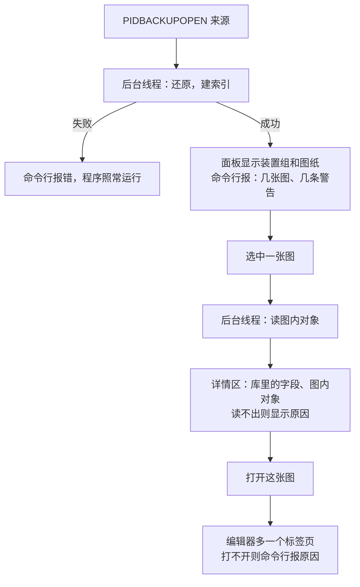

# SPEC：读取备份包（`sppid-read`）

> 状态：**已确认**（2026-11-18）：§9 的 R1、R2 都按建议定。同一天你定了验收标准（「能够正常打开备份数据包」「能够正确浏览PID文件，并能够正确显示出来」），据此加了成功标准 13 和 §9 的 R3，这两处随后也已确认（R3 按建议定）。基线 `main @ 5b4784058`。
> 依据：`00-capability-map.md` §4、§5 检查点 A；需求 `REQ-MIG-008`（这次新加的，`docs/pid-platform/requirements/90-migration-and-interop.md`）。
> 共用约定见 `01-shared-conventions.md`。前提：`SPEC-sppid-deps.md` 做完。

## 1. 目标

不加 `--classic` 启动，用命令就能走完：打开一个备份包（目录或 zip）→ 看到图纸清单 → 看一张图的属性和图内对象 → 把它打开成编辑器里的一个标签页。读不出的图给出原因。三个样本包的读数钉成能重跑、不对就报失败的验收。

读取的代码不重写，沿用经典界面那一套。本块做的是三件事：在新界面下验证过，有测试钉住，读数成为门禁。新画面是 `sppid-screen` 的事。

## 2. 现状

### 2.1 功能链（都已存在）

| 层 | 位置 | 管什么 |
|---|---|---|
| 还原 | `src/io/pid_backup.rs` 及子模块 | zip 解到缓存目录，解过的复用；目录来源只解图纸和参考数据，原目录不写 |
| 索引 | `src/io/pid_backup_browse.rs` 及子模块 | `BackupIndex`：清单的几个字段、包里的文件、装置组树、图纸（名字、文件、所在组、库里的字段）、参考数据树、警告 |
| 面板 | `src/ui/window/pid_backup_browser.rs` 及子模块 | 停靠面板的状态和画法 |
| 命令 | `src/app/commands/pidbackup.rs` | `PIDBACKUPOPEN` 和它的子命令；把面板要做的事落地（载入、读图内对象、打开图纸） |
| 走查 | `src/app/commands/pidbackup/audit.rs` | 手动跑的整包走查，出报告 |

### 2.2 新界面下的情况

下面是读代码得到的，没有测试，也没在真实窗口里看过。这是地图 §5「现在还不知道的」最后一件。

- 新界面的编辑器画面里，图面那一块用的就是经典界面的图面，只去掉了功能区、标签条、状态条、导航方块和起始页（`src/app/view/mod.rs` 的 `view_classic`，第 787 行起）。
- 停靠面板照画，只有特性面板被隐藏（`src/app/dock/update.rs` 的 `dock_panel_visible`，第 883–923 行）。命令行在图面底部。
- 所以敲 `PIDBACKUPOPEN` 之后，备份面板应当停在图面右侧，默认宽 340。
- 现有测试只证明了另一个面板（`PIDPALETTE`）在新界面下能停在图面旁边（`src/app/pid_shell/pid_shell_chrome.rs`）。没有一条测试在新界面下执行 `PIDBACKUPOPEN`。
- 走查建程序的办法不进新界面，所以它现在只覆盖经典界面。

### 2.3 上次读数

见共用约定 §3.2：图纸 53、7、12 张；读不出图内对象 2、1、11 张；打不开 1、1、2 张。

### 2.4 一个限制

仓库里没有真实的 `.pid` 文件。「打开一张图能看到图面」只能用样本包验证，进不了每次都跑的库测试。

## 3. 第一版在新界面下是什么样

- **入口**：图面底部的命令行，敲 `PIDBACKUPOPEN <路径>`。
- **面板**：就是经典面板，停在图面右侧。文字、布局、功能与 `--classic` 下相同，包括库表、枚举映射、参考数据、图纸体检。
- **打开图纸**：在面板里双击图纸，或者按详情区的打开按钮。编辑器多一个标签页。
- 面板的样子和新界面不一致，这是第一版已知的。样子一致、不用敲命令的画面在检查点 C。

## 4. 数据怎么传

本块不改这条链。

## 5. 对外接口

### 5.1 命令（都已有，本块不加也不改）

| 命令 | 做什么 |
|---|---|
| `PIDBACKUPOPEN` | 显示面板，询问来源 |
| `PIDBACKUPOPEN <来源> [<还原到的目录>]` | 打开一个 zip 或目录 |
| `PIDBACKUPOPEN Select <a > b > c>` | 选中树上的一个节点 |
| `PIDBACKUPOPEN Press [<序号>\|<按钮名>]` | 按详情区的一个按钮，比如打开图纸 |
| `PIDBACKUPOPEN Split <百分比>` | 调面板里上下两块的比例 |
| `PIDBACKUPOPEN Cache`、`Cache=<目录>`、`Cache=Default`、`Cache=Clear` | 看、改、清还原缓存 |

### 5.2 走查加两个开关（本块新增）

| 环境变量 | 作用 |
|---|---|
| `OCS_PID_BACKUP_AUDIT_SHELL=1` | 按「不加 `--classic` 启动」的办法建程序，再走查 |
| `OCS_PID_BACKUP_AUDIT_EXPECT=<图纸数>,<读不出上限>,<打不开上限>` | 走完后断言。不满足则测试失败，列出超出的图名和原因 |

已有的四个不变：`OCS_PID_BACKUP_AUDIT`（来源）、`OCS_PID_BACKUP_AUDIT_OUT`（报告目录）、`OCS_PID_BACKUP_AUDIT_LANG`、`OCS_PID_BACKUP_AUDIT_SKIP_IMPORT`。不给新开关时，走查的行为和现在完全一样。

### 5.3 一个脚本（本块新增）

`scripts/sppid/walk-samples.ps1`：对全厂包、小包（目录和 zip）、SQL Server 包各走查两遍，一遍经典界面，一遍新界面，都带期望值。汇总成一张表：包、哪个界面、图纸数、读不出、打不开、图元总数、耗时、过没过。任何一格不过，退出码非 0。样本的位置从参数取，默认值是共用约定 §2 的位置；报告写到仓库外。

## 6. 成功标准

1. 新界面下执行 `PIDBACKUPOPEN <目录>`：备份面板可见；当前画面仍是编辑器；载入完成后索引里的图纸数等于造的数；命令行里有一行报出图纸数。（快测试；「新界面下」指测试按不加 `--classic` 的办法建程序，照 `src/app/pid_shell/pid_shell_startup.rs` 里的建法。）
2. 新界面下面板打开时，特性面板仍然隐藏，编辑器的标签条还在；关掉面板后它不再可见。（快测试）
3. 新界面下激活一个图纸节点：发出打开这张图的请求，指向还原出来的那个 `.pid`。（快测试）
4. 新界面下给一个不存在的路径、一个不是备份的目录：命令行各有一条错误，程序继续运行；面板的状态和 `--classic` 下做同样的事之后相同。（快测试）（2026-11-18 实现时发现：不是备份的目录实际不报错，`--classic` 下也一样。`RD-1` 没有改程序；同日定下改成报错，在另加的任务 `EXP-1b` 里做，这后一半到那时才达到，见 §11。）（`EXP-1b`，2026-11-19：改了。既不像备份、里面也没有一张 `.pid` 的来源，命令行一条错误、点出它不是备份包，面板可见、没有载入、记着原因；新界面和 `--classic` 下相同。只有 `.pid` 的文件夹照旧就地浏览。见 §11 的 `EXP-1b` 一段。）
5. 三个样本包在新界面下走查：图纸数 53、7、12；读不出图内对象的不多于 2、1、11 张；打不开的不多于 1、1、2 张；报告里每张读不出或打不开的图都有一句原因。（上限随 `sppid-deps` 的结果下调，见 §9 第 2 问。）
6. 同一个包，新界面和经典界面两份走查的数字完全相同：图纸数、读不出的名单、打不开的名单、每张图的图元数。
7. 新界面下的走查里，打开一张图之后标签页数加 1，新标签页在最前，图里的图元数大于 0，当前画面仍是编辑器。（2026-11-18 实现时发现：「标签页数加 1」不是每次都成立。最前面是一张没动过的空白图时，打开的图占用这个标签页；这张图已经开着时，切到它的标签页。`RD-2` 没有改程序，走查按这条实际的规则判，见 §11。成功标准 9 的「多一个标签页」同理。）（同日 `RD-4` 在真实窗口里看到：「这张图已经开着时，切到它的标签页」在桌面版里不成立，从面板再开会多一个标签页。改成切过去是另加的任务 `RD-6`，见 §11 的 `RD-4` 一段。）（`RD-6`，2026-11-18：改了。面板开图之前先查这张图是不是已经在某个标签页里，在就切过去；附注开头写的几种落点在桌面版里都成立了。见 §11 的 `RD-6` 一段。）
8. 小包从 zip 打开和从目录打开，图纸名单相同（7 张），读不出和打不开的名单相同。
9. 真实窗口看一次：不加 `--classic` 启动 → 命令行打开全厂包 → 面板在图面右侧，列出 53 张 → 打开一张 → 多一个标签页并显示图面。截图留在仓库外，汇报里说明看到了什么。
10. `--classic` 下不变：`pid_backup`、`pidbackup` 现有的测试一条不改，全部通过。
11. `scripts/sppid/walk-samples.ps1` 一条命令跑完第 5–8 条，全部通过时退出码为 0。
12. 门禁不退步。
13. 显示对照（2026-11-18 加，已确认）：有厂商 PDF 的 11 张图，新界面下逐张打开，缩放到全图，取画布截图，和厂商 PDF 的页面图并排存到仓库外。从哪里打开：包里还原出来的 `.pid` 和厂商文件夹里的 `.pid` 校验和相同的，从备份面板打开；不同的直接打开厂商文件夹里的那个（已知全厂包里有 4 张和厂商的不是同一版），免得把版本的差别当成显示的差别。每张图给一句结论：看不出差别，或者差在哪里。清单写进 `readings.md`。有差别的图要不要修、在哪里修，检查点 A 时我逐项给处理意见和理由，你有不同意见就说（`plan.md` §5）。（`RD-4` 查实：和厂商的不是同一版的是 6 张，不是 4 张，见 §11。）

## 7. 测试

| 层 | 测什么 |
|---|---|
| 快测试（新文件 `src/app/pid_shell/pid_backup_in_shell.rs`，随库测试跑） | 成功标准 1–4。备份目录在测试里现造，照 `src/app/commands/pidbackup.rs` 现有测试的造法 |
| 真实包走查（手动，`--ignored`） | 成功标准 5–8，由脚本串起来 |
| 真实窗口 | 成功标准 9、13。厂商 PDF 的页面图用本机现成的办法取（比如用浏览器打开后截图），用了哪种办法写进 `readings.md` |

- 这些测试多半一写出来就是绿的，因为按代码看功能是通的。每条先用一个故意错的期望值看它失败，再改回来，两次的输出都留（共用约定 §7）。
- 如果成功标准 1–4 的测试是真的红，说明新界面下确实不可用。要改的地方预计在 `src/app/view/mod.rs`、`src/app/dock/update.rs` 或 `src/app/pid_shell/editor.rs`；改之前先报告是什么问题。

要动的文件：`src/app/commands/pidbackup/audit.rs`（两个开关）；新建 `src/app/pid_shell/pid_backup_in_shell.rs`，在 `src/app/pid_shell/mod.rs` 里登记；新建 `scripts/sppid/walk-samples.ps1`；`readings.md` 加一节。

## 8. 不在范围与已知限制

- 新画面、不敲命令的用法：`sppid-screen`，检查点 C。
- 读取那一层的行为不改。读不出的图不在本块修。（2026-11-18 定的一处例外：不是备份包的来源改成报错，在另加的任务 `EXP-1b` 里做，见 §11。）
- 显示上的差别也一样：本块只查出来、列清楚。修不修、在哪一层修，由你在检查点 A 定；要修就另加任务。
- 画布和 PDF 是两条路：画布上的图是本程序读 `.pid` 转出来的，PDF 是 `pid-plot` 从 `.pid` 直接出的（`SPEC-sppid-pdf.md`）。两边可能有差别。
- SQL Server 包：能按文件夹列出图纸，读不到库里的字段。维持现状。
- 只读的协同会话里，协同的那张图在最前时，`PIDBACKUPOPEN` 会被拒绝，因为它不在只读会话允许的命令名单里（`src/app/collab/apply.rs` 的 `READONLY_ALLOWED`）。维持现状。
- 读数的验收不进每次都跑的门禁，因为样本包不在仓库里。它在检查点、升级前后、动了读取代码之后手动跑。
- 网页版没有这个功能。

## 9. 待决问题

R1、R2、R3 已定（2026-11-18），都按建议。R3 是同一天后加的。

| # | 问题 | 建议 |
|---|---|---|
| R1 | **真实窗口那一次由谁看。** (a) 我来：启动真实程序，用它自己的自动化接口发命令、取截图，不占你的鼠标键盘。(b) 你照成功标准 9 的几步操作看一眼 | (a)。截图的位置写在汇报里，你想亲眼看再看 |
| R2 | **上限要不要随升级下调。** 升级后读不出的图如果变少，比如 `D03`、`D04` 读出来了 | 下调到新读数，写进 `readings.md` 和脚本。上限只降不升；要升必须有原因并经你同意 |
| R3 | **「正确显示」怎么验。** (a) 只看数字：每张能打开的图，图元数大于 0。(b) 加一套对照图：有厂商 PDF 的 11 张，画布截图和厂商 PDF 并排，我逐张看、列出差别，你抽看（成功标准 13）。(c) 再加自动比对：把画布的图面转成图片，和 PDF 逐块比，出一个覆盖率 | (b)。(a) 证明不了显示得对。(c) 要新做一个比对工具，门槛定多少现在没有依据；等 (b) 的清单出来、确实需要长期盯着时再做 |

## 10. 需求对照

| 需求 | 本块 | 说明 |
|---|---|---|
| `REQ-MIG-008` 打开备份数据包并浏览其中的图纸 | 部分 | 打开、列图纸、看属性和图内对象、打开图纸、读不出给原因，都用命令加经典面板做到。专用的画面在 `sppid-screen` |
| 地图检查点 A 第 1 条：用命令打开三个包，图纸数 53、7、12 | 覆盖 | 成功标准 1、5 |
| 地图检查点 A 第 2 条：每张图能看能开，或者给出原因，不超过现在的张数 | 覆盖 | 成功标准 5 |
| 地图检查点 A 第 4 条：打开一张图多一个标签页，有自动测试，真实窗口看一次 | 覆盖 | 成功标准 3、7、9 |
| 地图 §5「现在还不知道的」最后一件：新界面下 `PIDBACKUPOPEN` 是否可用 | 按代码看可用，本块用测试和真实窗口坐实 | §2.2、成功标准 1–4、9 |
| 你定的验收「能够正常打开备份数据包」 | 覆盖 | 成功标准 1、4、5、8 |
| 你定的验收「能够正确浏览PID文件，并能够正确显示出来」 | 浏览：覆盖。显示：数字加对照图，修不修另定 | 浏览是成功标准 1–3、5–7；显示是成功标准 7、9、13 和 R3 |

## 11. 实现记录

实现时和上文有出入、或者上文没写到的地方，记在这里。

### `RD-1` 新界面下的快测试（2026-11-18）

- **成功标准 4 的后一半没有达到，这一步程序也没有改。同日已定：改成报错，在 `EXP-1b` 做（本条最后一项）。** 那一条写「一个不是备份的目录：命令行有一条错误」。实际没有错误：命令行说 `PIDBACKUPOPEN: 0 drawing(s), 1 warning(s)` 和 `PIDBACKUPOPEN: the folder is used in place (read-only).`，面板列出一个没有图纸的备份，带一条警告 `no Export.dmp in the backup folder; drawings are listed by folder`。没有一句话告诉用户「这不是备份包」。
  - **原因在读取那一层，和新界面无关。** `src/io/pid_backup.rs` 的 `restore_in` 对目录一律不拒绝：里面有 `PlantData~` 压缩卷就解到缓存，没有就就地使用（这样一个只放了几张 `.pid` 的文件夹也能浏览）。`src/io/pid_backup_browse.rs` 的 `build_index_in` 之后也不判断它是不是备份。`--classic` 下完全一样。是写这条标准时对现状的假设错了。
  - **为什么不在这一步改。** §8 写了「读取那一层的行为不改」，成功标准 10 写了「`--classic` 下不变」，改成报错两条都要动。另外要先定什么算「不是备份」：现成的 `is_backup_folder`（有清单、有导出库文件、或有 `PlantData~` 开头的文件）加上往下找两层的 `find_backup_root` 可以当判断，但按它判断，一个只有 `.pid` 的文件夹也不是备份，而它现在是能就地浏览的。
  - **测试怎么写的。** 第 5 条测试钉住现在的行为：没有错误，报 0 张图和至少一条警告；新界面和 `--classic` 下命令行说的话、面板的状态完全相同；之后还能接着打开一个真的备份。以后谁改了这个行为，这条测试会失败，届时连这里的记录一起改。
  - **处理意见（当时写的是「检查点 A 请你定」）。** 建议改成报错，另加任务，和导出那一段一起做：`EXP-1` 本来就要「来源不是备份包」的前置检查，判断可以共用。只有 `.pid` 的文件夹算不算备份，到时一并定。
  - **已定（2026-11-18，没有等到检查点 A）。** `RD-1` 的汇报里写了上面这条处理意见，答复「按照推荐方案继续下一步。」：改成报错，任务记为 `EXP-1b`（`todo.md`，排在 `EXP-1` 之后）。这是 §8「读取那一层的行为不改」和成功标准 10（`--classic` 下不变）的一处例外，只此一处。只有 `.pid` 的文件夹怎么算，答复里没有单独说；我的建议写在 `EXP-1b` 里：它照旧能就地浏览，只拒绝既不像备份、里面也没有一张 `.pid` 的来源；做到那一步时你没有别的意见就照此做。`EXP-1b` 做完之前，程序的行为和第 5 条测试都不变。
- **成功标准 4 的前一半达到了。** 不存在的路径：命令行恰好一条错误 `PIDBACKUPOPEN: <路径> does not exist`（前面带命令行给错误加的标记）；面板可见，没有载入任何备份，记着这条原因；和 `--classic` 下相同；之后能接着打开一个真的备份。按代码看，给一个不是 zip 的文件走的是同一条报错的路（`… is not a zip file or a folder`），没有另写测试。
- **成功标准 3 的「激活」没有模拟双击。** 界面库判双击靠两次按下的时间间隔，全套测试并行跑时间隔不稳。改成三步：在窗口里画出来的那一行上按一下，选中的是那张图（证明新界面下鼠标点得到面板里的行）；用命令行按详情里的「打开图纸」按钮（`PIDBACKUPOPEN Press Open drawing`）；直接送双击会发出的那条消息。后两步都核对请求打开的文件就是还原出来的那个 `.pid`，并核对这个请求被接下、画面仍是编辑器。真实的双击留给 `RD-4` 的真实窗口。
- **除了状态，还画了一帧核对位置**（成功标准 1、2 没要求）。面板在图面那一格里、图面的右边，宽不小于 200；图面让出了面板的宽度；面板在模块自己的检查器左边。模块自己的工具条、图元栏、标签条、图面格、检查器五块和当前图的标签，面板打开前后、关闭之后位置都没变。只看状态证明不了面板真的画出来了。
- **「特性面板仍然隐藏」是对照着测的。** 同一个备份，在 `--classic` 的程序里打开，把特性面板设为显示，它可见；新界面下同样设，不可见。
- **关掉面板后备份还在。** 关的是面板，索引没有丢；再敲一次不带参数的 `PIDBACKUPOPEN`，面板带着原来的列表回来。
- **还原出来的文件放在测试自己的临时目录**（用设置缓存目录的那个函数，等于 `PIDBACKUPOPEN Cache=<目录>`），不往这台机器默认的缓存目录里写；测试结束时连同造的备份一起删掉，测试失败也删。
- **先红后绿。** 第一次跑是 3 过 2 不过：不过的一条是上面说的目录（按规格的写法期望一条错误），另一条是测试自己把错误行的文字写少了前缀，程序的行为是对的。改好测试后，5 条各换一个故意错的期望值跑了一遍，都在改错的那一处失败；改回后全过。三次的输出在 `D:\scratch\ocs-sppid\2026-11-18-rd1\`（`run1-first.log`、`run2-red.log`、`run3-green.log`）。

### `RD-2` 走查的两个开关（2026-11-18）

- **成功标准 7 的「标签页数加 1」不是每次都成立。走查按程序实际的规则判，程序没有改。** 从面板打开一张图，它落在哪里有三种情况，标签页数只有第三种加 1：
  - 这张图已经开着：切到它的标签页，不重新载入（`src/app/update/mod.rs` 里处理 `OpenRecent` 的那一支先查 `tab_showing`）。**这一条不对，`RD-4` 改正：** 先查 `tab_showing` 的是网页版那一段；桌面版那一段不查，从面板再开会多一个标签页。见下面 `RD-4` 的一段。`RD-6` 起这一条成立：查的地方在面板自己的出口，不在处理 `OpenRecent` 的那一支，见下面 `RD-6` 的一段。
  - 最前面是一张没动过的空白图（没有文件名、没改过、没有图元）：打开的图占用这个标签页（`src/app/update/file.rs` 的 `on_file_opened`）。新界面一启动就带着这样一张空白图，所以打开备份包之后开的第一张图总是这种情况。
  - 其余：新开一个标签页放到最前。
- **走查怎么判。** 打开之前先按上面三条判断这张图该落在哪里，打开之后核对四件事：标签页数是该有的数；最前面的标签页显示的就是这个文件；它里面的图元数大于 0；当前画面仍是编辑器。任何一条不符，报告里点名，测试失败。标签页数按新界面标签条上看得到的算：开始页那个标签页不算，标签条不显示它。
  - 走出来的结果：小包 6 张打得开的图，1 张占用空白图，5 张各开一个标签页；全厂包 52 张，1 张占用空白图，51 张各开一个标签页。四件事没有一张不符。
  - 按字面的规则（每次都加 1）判，小包的走查在第一张打得开的图上失败：`DWG-0201GP06-01: 1 tab(s) became 1 where 2 were due (a tab of its own)`。这一遍是故意跑的，输出留着（`walk-module-small-red\`），也证明走查里这几条断言确实接上了。
  - 「已经开着」那种情况走查里走不到：每张图只打开一次，新开的标签页核对完就关掉。它的判定有快测试。程序里「已经开着就切过去」有一条现成的测试（`src/app/automation.rs` 的 `handing_over_an_already_open_drawing_switches_to_its_tab`），走的是从程序外面递文件进来的入口；面板用的入口没有单独的测试。（`RD-6` 起：走查里每张打开了的图都再点一次，这种情况走得到了；面板的入口有了两条快测试。）
  - 成功标准 9 和检查点 A 第 4 条的「多一个标签页」照此看：`RD-4` 在真实窗口里，开的第一张图占用空白图，再开一张才多一个标签页。
- **新界面下，每张打得开的图都从面板打开一次。** 原来的走查只从面板打开一张图：第一张有文件的图，不管它打不打得开，结果只记进报告，不做判断（小包里这一张恰好是打不开的 `001`）。新界面下，导入能画出图元的每一张都打开、核对；新开的标签页核对完关掉，关掉之后标签页数要回到打开之前，回不去也算不符。原来那一步在 `--classic` 下原样留着，新界面下不重复做。
- **打不开的图也从面板打开一次**（规格没有写）。核对五件事：标签页数不变；最前面的还是原来那个标签页；命令行多出一条错误；当前画面仍是编辑器；这条原因里不带还原目录的路径。小包的 `001`、全厂包的 `D03` 是这样的图，命令行说的是「打开失败 : 001.pid 里没有可画的图形：解析器在里面没有找到图形」。
- **导入不报错、但一个图元也没画出来的图，不从面板打开，单独计数。** 小包和全厂包里现在没有这样的图。
- **两个开关认哪些值**（规格只写了 `=1` 和三个数）。`OCS_PID_BACKUP_AUDIT_SHELL`：`1` 是新界面；`0`、空、不设是 `--classic`；别的值测试直接失败并说明写法，免得走的是一种界面、报告归在另一种名下。`OCS_PID_BACKUP_AUDIT_EXPECT`：三个不带符号的整数，逗号隔开，数字两边可以有空格；少一个、多一个、空着一项、小数、负数都失败并给出用法。它不能和 `OCS_PID_BACKUP_AUDIT_SKIP_IMPORT` 一起给：跳过导入就没有「打不开」的名单。给了期望值而来源不存在，测试失败；不给期望值时照旧说一句 `skipped:` 后通过。新界面加 `OCS_PID_BACKUP_AUDIT_SKIP_IMPORT`：从面板开图那一段也跳过，报告里注明。
- **判定一次说全。** 图纸数不等、读不出超限、打不开超限同时出现时三样都列出来，后两样带图名和原因。用 `8,0,0` 走小包，三样都点到了：图纸数 8 对 7；读不出的 `001`（图纸里没有图号）；打不开的 `001`（没有可画的图形）。
- **报告多了什么。** 新界面下，`source:` 之后多一行 `interface: …`；「参考数据」那一行之后多一张表，每张图一行（打开前后的标签页数、落在哪里、标签页里的图元数、耗时），加一行合计。给了期望值，末尾多一节 `== expectation … : met ==` 或 `not met`，不满足时下面列出不符的项。报告在断言之前写出，测试失败也有报告。`scripts/sppid/compare_walks.py` 读的那几处没有动：新界面的报告、带 `not met` 的报告它都照常读。
- **表里「标签页里的图元数」比导入那张表里的数大，是数法不同，不是多画了。** 导入表数的是从图纸记录画出来的图元。标签页里还有图框模板的图元；模板没有盖住图纸边框、图纸又给了纸张大小的，再加一个代替的边框矩形（`src/io/pid/mod.rs` 的 `finish`）。两个包的差数都对得上：小包 6 张一共多 315，是模板的 309 加 6 个矩形；全厂包 52 张一共多 4404，是模板的 4366 加 38 个矩形。
- **不给新开关时没有变化。** 小包、`--classic`、两个新开关都不给：报告 489 行，除耗时和输出目录外和改动前逐行相同。
- **同一个包两种界面的报告只差该差的几处。** 小包：`--classic` 489 行，新界面 493 行，除耗时外 482 行逐行相同。不同的是界面那一行、从面板开图那一段（`--classic` 是原来那一步，新界面是一张表）和期望值那一行。`compare_walks.py` 比这两份报告，判「没有变化」。
- **观察到一件事，这一步没有处理：从面板打开一张图，常常比只导入它慢得多。** 打开包含一次导入，多出来的是导入之后的部分。
  - 小包：6 张的导入一共 0.42 秒，从面板打开一共 14.1 秒。其中 4 张各用 2.1 到 5.0 秒（它们的导入是 0.01 到 0.17 秒），另 2 张不到 0.04 秒。
  - 全厂包：52 张的导入一共 31.7 秒，打开一共 62.1 秒。15 张的打开比导入的两倍还多、且多出 0.5 秒以上。多得最多的是开的第一张 `D07`（191 个图元）：导入 0.04 秒，打开 3.8 秒。
  - 多出来的时间和图元数不成比例：一万个图元的图有的几乎不多；小包里 `002` 和 `222` 两张图差不多大，先开的 `002` 用 2.1 秒，后开的 `222` 用 0.03 秒。看起来像某种第一次用到才建的东西（比如字体），这一点没有查证。和图上有没有图框模板对不上：慢的 4 张里有一张没有模板，快的 2 张里有一张有。
  - 走查用的是测试构建：本程序自己的代码不开优化（`Cargo.toml` 的 `[profile.dev.package]` 里 `OpenCADStudio = { opt-level = 0 }`，测试构建沿用），依赖（解析库、界面库等）开到 2。这一句原来写的是「没有优化的测试构建」，不准，`RD-3` 时改正，依据写在下一段的最后一条。全厂包这一遍跑了两次，打开的总数是 71.9 秒和 62.2 秒。`--classic` 下一样，升级依赖之前也一样：`DEP-4` 留下的走查报告里，从面板打开全厂包的 `D07`，升级前 5.0 秒、升级后 5.2 秒；SQL Server 包的第一张图（125 个图元）是 3.5 秒和 3.4 秒。
  - `RD-4` 在真实窗口里量一次，慢的话在检查点 A 的汇报里给处理意见。
- **先红后绿。** 12 条快测试先写，判定的函数先留空，12 条都在断言处失败（`run1-red.log`，当时的源文件存为 `audit.rs.red`）；写好后全过（`run2-green.log`）。走查里的断言：按字面规则跑的那一遍失败（见上），`7,1,1` 通过，`8,0,0` 失败。输出都在 `D:\scratch\ocs-sppid\2026-11-18-rd2\`。
- **有一条和这次改动无关的测试，按耗时判，偶尔会失败。** 库测试的第一遍多出一条失败：`modules::insert::picker::tests::upper_cache_avoids_allocation_and_partial_sort_limits`，报 `too slow`。它要求五次筛选一共在 20 毫秒内做完，量的是实际经过的时间；整套库测试是并行跑的，轮到它时机器正忙就会超时。那一次具体是什么占了机器，没有记录。重跑一遍库测试，它通过，失败数回到 4。这次改动没有碰它测的代码。两遍的输出都留着（`gates\lib-test.log`、`gates2\lib-test.log`）。

### `RD-3` 走查脚本和读数（2026-11-18）

读数在 `readings.md` §4。这里记和上文有出入、上文没写到的地方。

- **脚本是三个文件，§5.3 和任务只写了一个。** `scripts/sppid/walk-samples.ps1` 只管跑：依次起 8 次走查，把每次的来源、界面、期望值、退出码、用时记进 `runs.json`。判定和出表在 `scripts/sppid/walk_summary.py`，它的测试是 `scripts/sppid/test_walk_summary.py`（42 条）。分开是为了让「什么算过」能拿造出来的报告测，不必每改一处都走 8 遍真包；读报告用的是 `compare_walks.py` 现成的解析，没有另写一份。python 本来就是门禁要用的（`scripts/arch_check.py`）。
- **汇总表是中文的，由 python 打印；`.ps1` 自己只打印英文的进度行。** `todo.md` §1 要求 PowerShell 脚本只用 ASCII 字符、表头用英文。表要直接抄进 `readings.md`，所以用中文；`.ps1` 文件本身仍然只含 ASCII，在 Windows PowerShell 5.1 下跑过。同一份文字另存为输出目录里的 `summary.md`（UTF-8）。
- **表比 §5.3 写的多四列。** 「目录或 zip」；「从面板打开（新界面）」，写打开的张数、不符的处数、合计用时；「走查用时」；「期望值」。§5.3 的「耗时」对应「全部导入用时」，是报告里的数，能和 `readings.md` §3.1 比；「走查用时」是走查这条测试自己报的。表下另有一句连 cargo 在内的总用时。
- **一次走查怎么算过**（§5.3 只写了「都带期望值」）。下面六条都满足才过；不过的那一格写明是哪一条。
  1. 走查的测试通过，退出码是 0。
  2. 有报告，读得出。
  3. 报告是这一次的：来源、界面、期望值都和这次要走的一致。每次开跑前先删掉输出目录里上一次的报告。
  4. 按报告里的名单重新数一遍：图纸数等于期望的，读不出、打不开的张数不超上限。报告自己写的 `met` 不拿来当结论。
  5. 读不出、打不开的每张图都有一句原因。
  6. 新界面：报告里有从面板开图的合计行，不符的处数是 0。
- **两种比较比的都是五样，比 §6 要的多。** 图纸数、图纸名单、读不出的名单、打不开的名单、每张图的四个数（画出的图元、解出的记录、没画出的记录、图纸层）。成功标准 6 要的是图纸数、两份名单和每张图的图元数；成功标准 8 只要三份名单。多比的几样是报告里现成的，不同就说明有问题。一共比 6 项：4 个来源各比两种界面，小包在两种界面下各比 zip 和目录。哪一边没有可用的报告，这一项算不过。
- **加了 `-Only`**（§5.3 没有写）：只走四个来源里的几个，试脚本和「把期望值改错」那一条用。汇总会在表前注明「这次只走了一部分样本包，不是完整的验收」。
- **退出码分三个。** 0：走查全过，比较全部相同。1：有一处不过。2：参数不能用、`-Out` 在仓库里、cargo 或 python 不在 PATH 里、测试程序编不出来、汇总没出来。样本不在时，它的两次走查记成「没有走查」，算不过（退出码 1），别的照走。
- **期望值的默认值写在脚本里**：`53,2,1`、`7,1,1`、`12,11,2`，是 `readings.md` §3.9 的上限，可用参数改。上限以后下调，这三个默认值要跟着改。
- **汇总里不出现用户目录。** 一律写成 `%USERPROFILE%`；分隔符是反斜杠、双写的反斜杠（走查报告里有的路径是这样写的）还是正斜杠，都认。走查报告的原件留在仓库外，没有动。
- **先红后绿。** 39 条测试先写，判定的函数留空，39 条都失败（`run1-red.log`，当时的两个文件存为 `walk_summary.py.red`、`test_walk_summary.py.red`）；写好后连同 `compare_walks.py` 原有的 24 条共 63 条全过。提交前复核时又补了 3 条：用户目录的另外两种写法，汇总文件写不了时报一句话并返回 2。这 3 条也是先失败（`run5-red.log`），改好后 66 条全过（`run6-green.log`）；用改后的脚本重新汇总下面三轮真实的走查，和原来的汇总逐字节相同。真包上：默认的期望值，8 次全过，退出码 0（`run1\`）；小包的期望值改成 `8,0,0`，小包两格标不过，退出码 1（`wrong-final\`）；只把 SQL Server 包的读不出上限从 11 改成 10，它的两格标不过，同一次里小包的两格照样过，退出码 1（`wrong-one\`）。都在 `D:\scratch\ocs-sppid\2026-11-18-rd3\`。
- **cargo 每走一次都把本程序重编一遍，这一步没有处理。** 8 次走查共 17 分 30 秒，其中编译 9 分 22 秒（每次 66 到 72 秒），走查自己 7 分 28 秒。
  - **原因查证过。** 让 cargo 自己说理由（`cargo test --offline --locked --lib --no-run -v`，源码没有动），它说本程序这个包要重编，因为 `the file packaging/windows/AppIcon.ico is missing`。`build.rs` 向 cargo 声明了盯着这个文件，声明之前没有看它在不在；它只在发布构建之前生成（`.github/workflows/release.yml`），平时不在，版本库里也没有。输出存为 `cargo-verbose.log`。
  - **不是新发现。** `scripts/collab-e2e/README.md` 和 `docs/plans/2026-11-10-pid-backup-ui-coverage.md` 都记过同一件事：前者写明没有改 `build.rs`，后者是直接跑编出来的测试程序绕过去的。
  - **脚本没有绕开它。** 照共用约定 §4 的走查命令走，和前几步是同一种跑法。
  - **处理意见（请你定）。** `build.rs` 不在这份计划里，没有改。建议改：图标不在时不盯这个文件，改盯它所在的文件夹，图标生成出来时构建脚本照样重跑；同一个文件里 `assets/icons` 已经是「在才盯」的写法。几行的改动，单独一个提交，还没有试。改了以后源码没变就不再重编，所有 cargo 命令都受益，8 次走查估计降到 8 分钟左右。不改 `build.rs` 的话，可以让走查脚本先编一次、再直接跑编出来的测试程序（`2026-11-10` 那份计划当时就是这么跑的），估计降到 9 分钟左右，但只对这个脚本有效。
  - **已定（2026-11-18）：改 `build.rs`，同日已改。** `RD-3` 的汇报里写了上面这条处理意见，答复「按你推荐的方案做。」。单独一个提交，排在 `RD-3` 之后。
    - **改了什么。** 只动 Windows 那一段。图标在：照旧盯图标，把它嵌进程序。图标不在：改盯离它最近的、存在的上级文件夹，平时就是 `packaging/windows`；图标生成出来时这个文件夹跟着变，构建脚本照样重跑。不盯包的根目录：`packaging/windows` 和 `packaging` 都不在时什么也不盯，不然仓库里任何改动都会引起重编。加 13 行，减 3 行。
    - **先红后绿，看 cargo 自己怎么说。** 还是上面那条 `--no-run -v` 的命令，每种状态连跑两次，源码不动。改之前：第二次仍然重编，理由是图标不存在，1 分 05 秒。改之后：第二次不重编（`Fresh`），2.5 秒。放进一个替身图标：重编一次，理由是 `packaging/windows` 变了，图标嵌进了程序；再跑一次不重编。这个替身图标的修改时间比上一次构建还早，cargo 照样发现了，因为文件夹自己的修改时间变了。删掉替身图标：重编一次，理由是图标不存在；再跑一次不重编。替身图标是临时做的，试完已删，没有进版本库。
    - **8 次走查重跑了一遍，读数没有变。** 8 次全过，6 项比较全部相同；和 `RD-3` 那一轮的 8 份报告逐份比（`compare_walks.py`），都是「两份报告没有变化（用时不算）」。共 9 分 1 秒，原来 17 分 30 秒，事先估的是 8 分钟左右。8 次都没有重编：cargo 每次 2.5 到 8.6 秒，合计 30 秒，原来合计 9 分 22 秒。走查自己 7 分 54 秒，原来 7 分 28 秒，各量了一次。数字也记在 `readings.md` §4.5。
    - **别的 cargo 命令也不再重编。** 库测试那道门禁，cargo 2.4 秒就开始跑测试。`cargo clippy --offline --locked --lib`：改完后的第一次 67 秒，源码不动再跑一次 7.4 秒，告警数相同（630）。
    - **门禁。** 库测试 6973 条：6920 过，49 忽略，4 失败（比对设计稿的那 4 条）。clippy 630 和 965。新增的行格式检查 0 处不合格。`arch_check` 和 `RD-3` 那一份逐行相同。
    - **留下的一点代价。** 图标不在的时候，`packaging/windows` 里的文件有改动（安装包用的那几个文件），构建脚本会重跑一次，本程序重编一次，之后恢复。这一条是按 cargo 盯文件夹的规则说的，试过的只有放进和删掉一个文件。
    - **没有加能重复跑的测试。** `scripts/test_release.py` 里有两条测试，是单独编译 `build.rs`、再看它盯了哪些文件的。它们在 Windows 上编不过（找不到 `winresource`），改之前、改之后都一样；CI 只在 Linux 上跑它，而这次改的这一段只在 Windows 上编译。所以依据是上面 cargo 的输出，没有一条测试守着它。
    - **两份旧文档没有改。** `scripts/collab-e2e/README.md` 和 `docs/plans/2026-11-10-pid-backup-ui-coverage.md` 里「每次都重编」写的是当时的情况。
    - 证据在 `D:\scratch\ocs-sppid\2026-11-18-buildrs\`：各次 cargo 的输出（`before-*`、`after-*`、`icon-*`、`noicon-*`）、门禁（`gates\`）、走查（`run1\`）、逐份比较（`cmp\`）。
- **改正了 `RD-2` 记录里的一句话。** 上一段原来写「走查用的是没有优化的测试构建」，不准。准确的是：本程序自己的代码不开优化，依赖开到 2。依据有两处。`Cargo.toml`：`[profile.dev]` 是 `opt-level = 2`，`[profile.dev.package]` 里单给 `OpenCADStudio` 定了 `opt-level = 0`，测试构建沿用这两条。cargo 打出来的编译命令：本程序这一条没有 `-C opt-level`（也就是 0），而 cargo 报这次构建是 `[optimized]`。从面板开图多出来的时间花在本程序自己的代码里还是依赖里，没有查；`RD-4` 在真实窗口里量的时候，写明用的是哪种构建。

### `RD-4` 真实窗口和显示对照（2026-11-18）

读数、截图和并排图的位置、逐张结论、差别清单都在 `readings.md` §5。这里记和上文有出入、上文没写到的地方。这一步没有改程序，也没有改测试。

- **成功标准 9 达到。** 不加 `--classic` 启动；命令行打开全厂包，报「53 张图纸，1 条警告」；面板在图面右侧，列出 53 张（`test > U01` 6 张，`00 > 00` 43 张，`00 > 02` 4 张）；开的第一张占用启动时的空白图，标签页 1 → 1；再开一张，标签页 1 → 2，图面显示出来。这两步和 `RD-2` 记的规则一致。
- **真实窗口走了两遍**（上文只要一遍）：调试版一遍，发布版一遍，为的是把用时分清楚。两遍看到的相同。
- **「图已经开着就切过去」在桌面版里不成立。成功标准 7 的附注和上面 `RD-2` 的记录写错了，已在原处注明。** 已经开着的图从面板再按一次「打开图纸」，标签页 2 → 3，又开了一份；程序的文档清单里两个标签页是同一个 `.pid`。
  - 查了代码。面板的「打开图纸」直接发「打开最近文件」的消息（`src/app/commands/pidbackup.rs` 的 `Effect::OpenDrawing`）。`src/app/update/mod.rs` 里处理这条消息的地方按编译目标分两段：网页版那一段先查 `tab_showing`，桌面版那一段不查。`RD-2` 当时看到的是网页版那一段。`OPEN` 命令（`open_from_command_line`）和图纸集的入口是自己先查的，没有这个问题。
  - 走查没有发现，是因为走不到这种情况：每张图只开一次。走查里预判「落在哪里」的函数是照「已经开着就切过去」写的，它的快测试测的是这个预判，不是程序。
  - 处理：另加任务 `RD-6`，面板开图之前先查，已经开着就切过去。做完以后，程序的行为、成功标准 7 的附注、走查的预判三者一致。（`RD-6` 已做完，三者一致了，见下面 `RD-6` 的记录。）
- **从面板开图的用时（`RD-2` 留下的问题）：不处理。** 发布版里，从面板开一张实际的图纸（A 井场）1.37 秒，其中解析 0.7 秒；`D07`（191 个图元）第一次开 0.82 秒。调试版同样的两次是 4.13 秒和 4.62 秒，多出来的时间在程序自报的 `wires` 一步（3.1 秒和 4.4 秒；发布版是 0.34 秒和 0.48 秒）。`RD-2`、`RD-3` 的走查跑的是测试构建，本程序自己的代码不开优化，和调试版是同一种；用户用的是发布版。两个版本里开的第一张都比后面的慢，原因没有查。各量了一次。
- **面板挡住刚打开的图的一部分**（上文没有写到）。面板浮在图面区右侧，盖住图面区宽度的 29%。刚打开的图按整个图面区摆放，右边约四成在面板下面；`ZOOM E` 会避开面板，执行之后整张图都露出来。开图时的摆放为什么没有避开，这一步没有查。另加任务 `RD-7`，第一步是查。（更正，2026-11-19：`RD-7` 查了，这一条里有三句不对。面板不盖画布，它排在画布右边，面板开着时画布变窄；刚打开的图不是右边在面板下面，是图幅的左右两边各有 9.1% 在画布外面；`ZOOM E` 不是避开面板，是把图上的东西重新摆进同一块画布。量的数和原因见下面 `RD-7` 的记录。）
- **成功标准 13 达到。** 11 张图都打开了，各有一张并排图和一句结论。共同的结论：管线、阀门、仪表、设备和图面上的文字都在，位置和厂商 PDF 重合，没有发现缺东西的图。差别 13 项，每项有处理意见和理由：现在修 4 项，以后修 4 项，不修 5 项。这一步没有修任何一项。
- **和成功标准 13 的写法有出入的地方。**
  - 校验和不同的是 6 张（04、05、06、07、09、11），不是 4 张。这 6 张包里的那一版也取了一套图，和厂商那一版的画布图逐像素比：5 张完全相同，07 只差一条 8 mm 长的线的颜色。从哪一版打开不影响结论。
  - 直接打开厂商 `.pid` 的 6 张，图框模板目录用 `PID_TEMPLATE_LIBRARY` 指到了全厂包还原出来的那一份。厂商文件夹里没有图框模板，不指的话这 6 张没有图框，和从包里打开的 5 张不在同样的条件下。不指的那一组图也留着。
  - 并排图用的不是「缩放到全图」的那一张截图。那一张（1158×1115）上细线和小字看不清，所以另按 4.5 像素/毫米分块取图，拼成和 PDF 页面图一样大的一张。缩放到全图的那一张每张图也取了，留着。
  - 多用了一份参照：厂商文件夹 `plot\` 里的 PDF，是同一批 `.pid` 经 `pid-plot` 出的。第 3、4、5、7、8 项都是两份 PDF 一致、只有画布不同，说明文件里的数据是够的，差别出在本程序这一边。第 12 项反过来：`plot\` 的 PDF 和画布一致、和厂商 PDF 不一致，由此认出是厂商的 PDF 和 `.pid` 不是同一版。
  - 为第 1 项做了一次试验：模板目录里只放文件引用的那两个模板，再开 01 和 08，标题栏和会签栏就和 PDF 对上了。原因由此查实。
- **检查的限度。** 差别是先用脚本列出该看的地方、再放大了看出来的，结论以看到的为准。04、07、10 三张「其他」一类的切图没有逐块看；04、05、07、10 的信号线斜短线没有逐处核对；毫米数是从放大的图上读的，误差约 0.5 mm。细节在 `readings.md` §5.2。
- **排了 6 个任务，其中 2 个不在差别清单里。** `plan.md` §5 写的是「判为要修、改的又是本程序的差别」排成新任务。差别清单里判为「现在修」的 4 项排成 `RD-5`、`RD-8`、`RD-9`、`RD-10`。另 2 个（`RD-6`、`RD-7`）是真实窗口里看到的两件事，不是显示对照的差别，一并排了，理由在 `readings.md` §5.5。`RD-5` – `RD-7` 排在第 2 段之前；`RD-8` – `RD-10` 的原因还没有查实，规模是估的，排在第 3 段之后、总验收之前。你有不同意见就改。（后来 `RD-5` 做完时，`RD-10` 改了范围并提前，另加 `RD-11`、`RD-12`，见下面 `RD-5` 的记录。再后来，2026-11-19：`RD-7` 查了原因，改排到 `EXP-3` 之后，见下面 `RD-7` 的记录。）
- **这一步的提交里不只有 `readings.md`。** 任务写的文件是 `readings.md`。实际还改了 `todo.md`（勾选、加任务）、`plan.md`（依赖图加上新任务）和本文件（这一段，以及成功标准 7、13 和 `RD-2` 记录里的三处注明）。没有改 Rust 文件，门禁按 `todo.md` §1 的规则不重跑。
- 证据在 `D:\scratch\ocs-sppid\2026-11-18-display\`。

### `RD-5` 图框按文件引用的模板套（2026-11-18）

规则、三个包改前改后的对照、图框上的字逐词比、8 次走查和门禁都在 `readings.md` §6。这里记和任务写法有出入、上文没写到的地方。

- **六条验收都达到。** 全厂包 53 张里 39 张的图框变了，从有图框变成没有图框的 0 张；对照过的 9 张，图框和标题栏上的字和 PDF 逐词相同；8 次走查全过，张数不变。
- **规则比任务写的多三处，都是照 `pid-plot` 实际的规则做的。** 任务写的是「改成 `pid-plot` 的规则」，接着列的几条比它实际的少。少哪一处，样本包里都有图套不上：
  - 指向模板 `.pid` 的链接也算点名。全厂包有 4 张图（`A井场`、`N井场`、两张稳定塔）的链接指向的是模板的 `.pid`，不算的话这 4 张没有图框。
  - 点了名的候选，核大小放宽到 10 mm（改前是 2 mm）。`N井场` 写的纸面是 843.46 × 596.71，稳定塔 `(1200td)` 是 843.09 × 596.09，模板是 841 × 594，都差 2 mm 多；按 2 mm 核，这两张套不上。
  - 链接把文件名整个写出来的，不核大小。小包的 `DWG-0201GP06-01` 点名 `XIONGANA2.igr`，这个模板的图框整个是一个符号，量不出和图纸对得上的大小；核大小的话它永远不合格。改前就是因为这个，把它顶替成了 `A2-W - New.igr`。
- **没有点名的图照旧不套模板。** 全厂包有 3 张图、小包有 2 张图的文件里没有指向模板的链接，改前改后都没有套模板。
- **有两张图换成点名的模板以后，画布上只剩 3 段字。** 小包的 `DWG-0201GP06-01` 和 SQL Server 包的模板图 `XIONGANA2`，点名的都是 `XIONGANA2.igr`。模板选对了，但它的图框线和标题栏是模板里的一个符号，程序套图框时不画模板里的符号。比改前少了一套看得见的图框，但少掉的那一套不是这两张图自己的。留给 `RD-10`。SQL Server 包的这一张，是走查报告和改前那一轮逐行比的时候才看到的，专门的那份对照只量了 `A01`。
- **这一步的提交里不只有 `template.rs` 和 `readings.md`。** 还改了 `src/io/pid/mod.rs`（调用那一处多传图纸的单位：没写纸面的图要把笔画范围换成毫米）、`src/io/pid/tests.rs`（一条旧测试随旧规则删掉，一条改成新的调用方式）、`todo.md`、`plan.md` 和本文件。
- **找模板目录的办法有隐患，这次没有改。** 程序从图纸所在的文件夹往上走 5 层，每一层里、每一层的 `Ref` 里，名字带 `template` 的文件夹都算模板目录（`template_roots`）。图纸在还原缓存里时，往上第 5 层是系统临时目录，那里任何名字带 `template` 的文件夹都会被算进去。这一步里撞上了一次：一条快测试留在系统临时目录里的假模板文件夹，让全厂包的日志多了 86 条「读不出」的警告；选中的模板没有受影响。文件夹删了，测试改成不再留下。要是那样的文件夹里有名字对得上、又读得出的模板，它会和包里自己的模板一起参加挑选。改前也是这个找法，符号库也是。处理意见：以后修，没有排任务；要改的是往上找时不越过还原缓存自己的那一层。经过在 `readings.md` §6.8（1）。
- **还原缓存被系统清理掉一部分，程序照用。排成 `RD-12`。** 缓存放在系统临时目录下。这一步做到一半，系统临时目录被清理过一次（推测是 Windows 的磁盘清理，没有坐实）：四个缓存各少了 0 到 6 个文件、4 到 12 个文件夹。少的文件都是用 `std::fs::copy` 放进缓存的，带着原文件的旧日期；少的文件夹是空文件夹和被清空的上一级。「已还原」的标记日期是新的，留了下来；程序复用缓存前只看标记，里面少了东西也照用，不报错。这一次的后果是面板里参考数据的目录数、文件数少了几个，别的读数没有变。这一步里的处理是删掉标记让程序重新还原，程序没有改。`RD-12` 改两处：复制进缓存的文件，修改日期改成当时；标记里记下文件数和文件夹数，复用前数一遍，对不上就重新还原。光改日期不够，空文件夹不看日期照样被删。缓存放在哪里不改，换默认位置要你定。经过在 `readings.md` §6.8（3）。
- **任务表改了三处。** `RD-10` 的范围从「11 号图的会签栏」改成「套图框时也画模板里的符号」，从第 3 段之后提到 `RD-7` 之后，编号不改：原因查实了，11 号图的会签栏、标题栏里的 `∽`、上面那两张图的整个图框是同一个原因（`readings.md` §6.6）。加 `RD-11`，文字按样式里的字宽比例画，排在 `EXP-3` 之后、`RD-8` 之前：08 的标题栏的字比 PDF 宽 1.21 到 1.25 倍，公司名出框、证书号叠字；用 `CPE-SQ` 模板的图有 37 张，按同一套模板推应当都这样（§6.5）。加 `RD-12`，见上一条，排在 `RD-10` 之后。`ACC-1` 的依赖跟着改成 `RD-8` – `RD-12`。你有不同意见就改。
- **检查的限度。** 没有核对的事列在 `readings.md` §6.8 最后，6 条。要紧的两条：全厂包变了的 39 张里，取图看过的是对照过的 9 张，其余 30 张的依据是程序报的模板文件名和图元数；SQL Server 包 `A01` 没有厂商 PDF，它的图框该是什么样没有核对过。
- **门禁。** 库测试 6991 条：6938 过，49 忽略，4 失败（比对设计稿的那 4 条，和改前相同）。比改前多 18 条：加 19 条 `pid_template_*`，删 1 条旧测试。clippy 630 和 965，和上限相等；新增行的格式检查 0 处；`arch_check` 逐行相同。第一遍 clippy 各多 1 条、格式多 1 处，改了以后从头重跑，记的是重跑的结果。
- 证据在 `D:\scratch\ocs-sppid\2026-11-18-rd5\`。

### `RD-6` 已经开着的图，从面板再开时切过去（2026-11-19）

改了什么、快测试、走查、真实窗口和门禁都在 `readings.md` §7。这里记和任务写法有出入、上文没写到的地方。

- **四条验收都达到。** 真实窗口里 `RD-4` 的步骤再走一遍，再选 `D07`、再选 `D06` 都是 2 → 2，不再读文件；`RD-4` 当时是 2 → 3、3 → 4。8 次走查全过。
- **程序只改了一处。** `src/app/commands/pidbackup.rs` 的 `run_pid_backup_effect`：面板要开图时先用 `tab_showing` 查，开着就发切换标签页的消息（`TabSwitch`），不在才发「打开最近文件」。查的地方在面板自己的出口，不在处理「打开最近文件」的那一段。新界面和 `--classic` 走的是同一段。
- **快测试用了代替的办法，和验收的写法有出入。** 验收写的是「从面板打开一张图，再从面板打开同一张」。测试里的备份是造的，里面的图导不进程序，仓库里也没有能导入的 `.pid`，快测试里开不出第一次。办法是把「已经开完」用它留下的那一样东西代替：给标签页填上这个文件的路径，`tab_showing` 只读这一样。之后的三种再点（双击、按按钮、已经在最前面时再点）是真的走面板的。真的开两次、数标签页，在走查和真实窗口里做。
- **走查多了两步，这一步的提交里不只有任务列的两个文件。** 还改了 `src/app/commands/pidbackup/audit.rs`（走查）、`scripts/sppid/test_walk_summary.py`（模仿汇总行的那一行跟着改）、`readings.md`、`todo.md` 和本文件。走查的两步：每张打开了的图在面板里再点，它在最前面时一次，从后面切回来一次；打不开的图留下的「打开失败」报告，关掉再开下一张。任务写的是「走查里判断开图落在哪个标签页的那一段对一遍」：那一段原来就是照改后的行为写的，逻辑没有改。加「再点一次」，是因为原来的走查里没有一步走得到「已经开着」这种情况（上面 `RD-4` 的一段说过）。
- **先红后绿两处。** 快测试：改程序之前，新加的 2 条不过，面板又要求打开同一个文件；改之后 7 条全过。走查：把程序换回改前的那一份，小包新界面的走查不过，6 张图 12 处不符，每张都是标签页多了一个、原来的标签页不在最前面。
- **走查第一遍没过，原因在走查自己。** 改程序以后第一遍 8 次走查，新界面的 4 次不过：排在一张打不开的图后面的图，「从后面切回来」之前要先切到别的图，这一下没有切成。原因：一张图打开失败，程序会开一份「打开失败」的报告；报告开着的时候，程序不切换标签页。走查从 `RD-2` 起没有关这份报告，带着它接着开后面的图；以前的步骤不切标签页，没有暴露。改的是走查：打不开的图，报告关掉再开下一张，关不掉算一处不符。程序没有因此再改。门禁和 8 次走查从头重跑，全过。
- **「打开失败」的报告开着时标签页切不了，没有改，你定。** 桌面版里这份报告开在它自己的窗口里，主窗口不变暗，照常能用；只是报告没关时程序不切标签页。这是程序本来就有的行为，点标签页、`OPEN` 一张已经开着的图都受它管。`RD-6` 以后面板也跟着它走：报告开着时在面板里再点一张已经开着的图，没有反应，也没有提示；改前这种情况是再开一份。关掉报告就正常。真实窗口里试了（`readings.md` §7.4 的最后一张表）。处理意见：这一块不改，面板和标签页、`OPEN` 一致；要改的是处理切换标签页的那一处，报告开着也让切，或者给一句提示。
- **别的入口也会把已经开着的图再开一份，没有改，你定。** 最近文件的几处列表、图纸集面板里资源图纸的「打开」、外部参照的「打开」，都直接发「打开最近文件」，自己不先查。这是按代码看的，没有在窗口里试。要统一的话，改的是桌面版处理这条消息的那一段，让它和网页版一样先查。清单在 `readings.md` §7.6。
- **检查的限度。** 没有核对的事列在 `readings.md` §7.6，6 条。要紧的三条：真实窗口里按的是详情里的按钮，没有用鼠标双击；真实窗口只跑了调试版，`--classic` 的真实窗口没有跑；报告窗口本身没有截图，报告开着时用鼠标点标签页没有试，试的是发同样的消息。
- **门禁。** 库测试 6994 条：6941 过，49 忽略，4 失败（比对设计稿的那 4 条，和改前相同）。比改前多 3 条：2 条快测试，1 条走查里判断用的。clippy 630 和 965，和上限相等；新增行的格式检查 0 处；`arch_check` 逐行相同。门禁跑了三遍，记的是对最终文件的第三遍：第一遍格式多 2 处；第二遍全过，但接着的走查没过，走查又改了一次。
- 证据在 `D:\scratch\ocs-sppid\2026-11-18-rd6\`。

### `RD-7` 查原因，没有改程序，改排到导出之后（2026-11-19）

怎么量的、量到的数、原因、和原来想的差在哪，都在 `readings.md` §8。这里记结论和处理。这一步没有改程序，也没有改测试。

- **原因和任务里想的不一样。** 任务是照上面 `RD-4` 记录里「面板挡住刚打开的图的一部分」那一条写的，第一步是查。查到的是三件事：
  - 面板不盖画布。面板排在画布右边，面板开着时画布从 1142.7 × 743.3 变成 771.7 × 743.3，宽高比从 1.54 变成 1.04。`RD-4` 当时把连面板在内的整块区域当成了画布。
  - 刚打开的图用的是导入时写进图里的视图，不是按画布现摆的。`src/io/pid/page.rs` 的 `frame_drawing` 写的是：中心在图幅中心，视图高度 = max(图幅高, 图幅宽 × 0.75) × 1.05。打开时原样恢复，只保高度；画布的宽高比不到 1.27，横向图幅的宽度就放不下。
  - `ZOOM E` 不是「避开面板」。它把图上所有的东西重新摆进同一块画布，视图拉远了，所以整张图露出来。它框的是图上的东西，不是图幅。
- **量到的数。** 面板开着时从面板开三张图（`D07`、`D06`、A 井场），图幅宽度都只看得到 81.8%，左右各缺 9.1%，不是右边约四成在面板下面。占用空白图的那一张（`D07`）和新开标签页的那一张（`D06`），视图的数相同。视图高度和上面的公式对得上：594.328 × 0.75 × 1.05 = 468.03，量到 468.034；1189.306 × 0.75 × 1.05 = 936.58，量到 936.578。
- **上面 `RD-4` 的记录里有一条写错了，已在原处注明。** 就是「面板挡住刚打开的图的一部分」那一条。`readings.md` §5.1、§5.5 里对应的几句也加了更正。当时是看截图估的，没有读程序的状态；这次读了程序报的画布大小和相机。
- **改排，照任务自己的条文。** 任务里写着「原因和想的不一样、改动超出一两个文件时，先报告，这个任务改排到 `RD-8` 那一组」。两个条件都成立：原因见上；要改的预计是 `src/io/pid/page.rs`（导入时记下要看全的宽度）、`src/app/update/file.rs`（打开以后按画布调整）、多半还有 `src/scene/camera_ops.rs`，加上测试。已经报告；`RD-7` 改排到 `EXP-3` 之后、`RD-11` 之前，题目改成「面板开着时从面板开图，整张图幅都在画布里」，内容和验收按查到的原因重写，规模从 S 改估成 M，编号不改。`RD-10`、`RD-11` 的依赖，`ACC-1` 的依赖（改成 `RD-7` – `RD-12`），`plan.md` 的图跟着改。它不挡出 PDF 和导出；改好之前，开图后发一次 `ZOOM E` 就能看全。你想现在就修，说一声就提到前面。
- **原来的验收也改了。** 原来写的是「视图和紧接着发一次 `ZOOM E` 之后相同」。`ZOOM E` 框的是图上所有的东西：A 井场有东西伸出图幅，`ZOOM E` 之后中心比图幅中心偏右 4.564；导入时特意没有用它（代码里的说明：离图很远的东西会被框进来）。新的验收是：整张图幅在画布里，中心在图幅中心；画布放得下时视图和改前相同。
- **打算怎么改（到时候做，现在没有改）。** 导入时把要看全的宽度（图幅宽 × 1.05）也记进图里存的视图；打开 `.pid` 时画布放不下这个宽度，就把视图拉远到刚好放下，中心不动；放得下时不动，面板关着时的视图和现在逐项相同。只管 `.pid` 导入的图，别的图纸恢复视图的办法不动。有两处要先定：宽度记在图里的哪一项；新开的标签页打开的那一刻还不知道画布多大。写在 `todo.md` 的 `RD-7` 和 `readings.md` §8.5。
- **检查的限度。** 没有核对的事列在 `readings.md` §8.6，5 条。要紧的：只量了一种窗口大小、一种缩放、调试版，只跑了一遍；面板关着时开图没有量，「面板关着时整张都在」是按公式推的；`--classic` 没有量；样本里没有竖向图幅；图幅的大小是按视图中心的两倍算的，没有从文件里读。两处要先定的事是读代码得出的，没有在窗口里验证。量的那一遍结束时，脚本的检查报「指针动过」，按它的判断是有人在用这台机器；程序在单独的桌面上跑，脚本自己不发鼠标和键盘输入。
- **这一步的提交只有文档。** `readings.md`、`todo.md`、`plan.md` 和本文件。没有改 Rust 文件，门禁按 `todo.md` §1 的规则不重跑。
- 证据在 `D:\scratch\ocs-sppid\2026-11-19-rd7\`。

### `RD-10` 套图框时也画模板里的符号（2026-11-19）

改了什么、快测试、三个包的对照、真实窗口、走查和门禁都在 `readings.md` §9。这里记和任务写法有出入、上文没写到的地方。

- **六条验收都达到，其中一条带说明。** 三个包里 68 处模板符号全部画出来了。11 号图的会签栏在了（30 条线、12 段字），图框上缺的词从 24 个降到 2 个，剩的 2 个是厂商 PDF 和 `.pid` 不是同一版；01–08、10 标题栏里的 `∽` 在了，和 PDF 的线差不到 0.12 mm；小包的 `DWG-0201GP06-01` 和 SQL Server 包的模板图 `XIONGANA2` 有了整套图框和标题栏。8 次走查全过，张数不变。上面 `RD-5` 记录里「有两张图画布上只剩 3 段字」那一条，到这里结了。带说明的是 11 号图的「位置一致」，见下一条。
- **11 号图的「位置一致」，是扣掉整个图框的错位以后说的。** 会签栏和图框上别的线错得一样多：厂商 PDF 的线在画布的线右边 0.21 mm、上面 0.55 mm。扣掉以后，符号画的 30 条线和 PDF 的差在 0.09 mm 以内：会签栏相对图框是对的。再量图面内容，算出来图框相对图面内容错开 0.37 和 0.56 mm。这个错位改前就有，这次没有修，见下面「加任务 `RD-13`」一条。
- **程序只改了一处。** `src/io/pid/template.rs` 的 `overlay_template`：原来碰到模板里的符号就跳过，现在和图纸里的符号走同一段代码（`build_entities`）画。`src/io/pid/summary.rs` 只改了一段说明：「模板记录没画的」那个数，现在把找不到图形的模板符号也计进去。这个文件不在任务列的文件里。
- **哪一类照旧不画，是核对以后定的。** 任务写的是先核对图纸自己填的标题栏文字会不会因此画两遍，会画两遍的那一类照旧不画。核对的结果：会重复的只有一种，标签符号、存的图形只有一个定位十字；它标的是填字的位置，字由图纸自己的记录画。三个包的 68 处里没有一处是这一种，也没有一处带来写重的字。规则留着（图纸里碰到这种符号用的也是这一条），真实包里没有走到，由一条快测试守着。
- **模板符号用的都是模板自己存的图形。** 68 处都是，符号库查了 0 次：模板里记的符号文件路径指向画模板的那台机器上的临时目录，符号库里本来也查不到。`pid-plot` 的测试在全厂包上数到的也是这样（64 处；本程序 61 处，少的 3 处在打不开的 `D03` 上）。「模板自己没存，再查符号库」这后一半，真实包里没有走到，快测试里也没有专门的一条；查符号库走的是和图纸里的符号同一段代码。
- **加任务 `RD-13`：图框按图纸里记的位置放。** 图纸文件里有一条图框记录，写着范围的原点、一个平移、一个比例；`pid-plot` 按它放模板，本程序没有用，模板按自己的坐标原样放。`pid-plot` 的测试列了全厂包里因此挪了位置的 15 张图，0.2 到 2.0 mm；11 号图是 (0.388, 0.566) mm，和量到的 0.37、0.56 对得上。量过的只有两张：这 15 张里的 11 号图，和不在里面、作对照的 08 号图；另外 14 张没有逐张量，其中 `D03` 本程序打不开。读取层已经给出这条记录，不用 `pid-parse` 改。只影响画布：出 PDF 用的是 `pid-plot`。没有在 `RD-10` 里修，是因为它要动所有带模板的图的图框位置，要另做一轮对照。排在「第 3 段之后」那一组的最后、总验收之前；`ACC-1` 的依赖跟着加上它，`plan.md` 的图跟着改。你有不同意见就改。
- **顺带看到、判为不修的 5 件，都是改前就有的。** 模板里的粗线，图元上记的线宽是 0.68 mm，厂商 PDF 里是 1.355 和 1.016 mm（转换时线宽只分三档）；`CPECCHB-SQ-A1.igr` 自己把 10 个词各写了两遍，叠在一起看不出来；图纸和模板用同一种字体时，样式表里多一个 `PID-宋体-2`；`XIONGANA2.igr` 的符号名在出处标记里是乱码，不显示；`CPECCHBA2.igr` 的外框线是红的、内框线是绿的，是模板文件里写的颜色。都没有排任务，逐件的现象和理由在 `readings.md` §9.9。你觉得哪一件该修，说一声。
- **SQL Server 包的模板图 `XIONGANA2` 导入慢，没有查。** 这一张的导入，经典界面的三轮走查都是 2.7 秒上下，新界面有时 2.7 秒、有时 0.03 秒。`RD-6` 那一轮就这样，那时模板里的符号还不画，所以不是这次带来的。画出来的东西相同。记在 `readings.md` §9.8。
- **检查的限度。** 没有核对的事列在 `readings.md` §9.9 最后。要紧的三条：「关着的图层上的东西不画」「只有定位十字的标签不画」「没有图形的符号计数」这三条规则，真实包里都没有碰到，只有快测试守着；位置和 PDF 比过的只有 01–08、10、11 这 10 张，小包和 SQL Server 包没有 PDF，靠的是和「模板当图纸打开」逐个图元比，加看图；真实窗口只跑了调试版。
- **门禁。** 库测试 6997 条：6944 过，49 忽略，4 失败（比对设计稿的那 4 条，和改前相同）。比改前多 3 条，是新加的 3 条 `pid_template_*`。clippy 630 和 965，和上限相等；新增行的格式检查 0 处；`arch_check` 逐行相同。门禁跑了两遍，记的是对最终文件的第二遍：第一遍格式多 1 处，在新加的测试里，改了以后门禁和 8 次走查从头重跑。真实窗口的证据是改排版之前编出的程序取的；用最终编出的程序重跑了走查（和第一轮只差图片的输出路径），又重取了 11 号图和 08 号图的全部图元，逐个相同；SQL Server 包 `XIONGANA2` 的图是最终的程序取的。
- **这一步的提交里不只有 `template.rs` 和 `readings.md`。** 还有 `src/io/pid/summary.rs`、`todo.md`、`plan.md` 和本文件。
- 证据在 `D:\scratch\ocs-sppid\2026-11-19-rd10\`。

### `RD-12` 还原缓存被系统清理掉一部分时不照用（2026-11-19）

改了什么、快测试、真实程序里走的一遍、三个包的缓存、走查和用时、门禁都在 `readings.md` §10。这里记和任务写法有出入、上文没写到的地方。

- **五条验收都达到。** 复制进缓存的文件，日期是还原当时；标记里记着文件数和文件夹数，复用之前数一遍，少了就清掉重做，日志里写少了几个；只有键的旧标记重做一次。四个真实缓存各重做了一次：文件 750、686、702、1339，文件夹 109、107、107、209，早于还原时刻的文件从 6、4、0、4 个变成 0 个。两轮 8 次走查全过，去掉用时和输出目录以后，报告和改前逐行相同。上面 `RD-5` 记录里「还原缓存被系统清理掉一部分，程序照用」那一条，到这里结了。
- **日期是换一种复制法得到的，不是复制完再改。** 任务写的是复制完把修改日期改成当时。实际把两处 `std::fs::copy` 换成共用的 `copy_file`：打开来源，新建目标，把内容写过去。新建的文件日期本来就是当时，和从 zip 解出来的文件一样，少一步。`std::fs::copy` 带过来的只读属性也不再带；这一点是按标准库的说明写的，没有另外测。
- **「对不上」定成「少了才重做」。** 文件数或文件夹数比标记里记的少，才清掉重做；多出来的不算。要防的是系统清理，它只删不加；缓存里多一个文件说明不了还原的东西坏了，为它清掉整个目录不值，文件正被别的程序占着时还清不掉。代价：少了又多了同样多，看不出来。你要「不相等就重做」，改 `reusable` 里的一处比较就行。
- **点名的还原目录不清。** 命令可以把备份还原到用户点名的文件夹。那是用户的文件夹：键对上就照旧用，少了东西只写一行警告，标记只有键也照旧用。任务没有分这两种目录；清掉重做只用在程序自己的缓存上。由一条快测试守着，它改前就过。
- **标记的格式变了，旧程序不认。** 标记从一行键变成三行。旧程序拿整个标记和键比，新标记对不上：缓存会被它清掉重做，留下只有键的标记，新程序再重做一次。新旧两版轮流开同一个包会这样来回；点名的还原目录更糟，旧程序会报目录不空。这是读代码得出的，没有拿旧程序试。只用一版程序没有这件事。缓存的键和目录名没有变（`RESTORE_LAYOUT` 没有加），改前留下的缓存在原地重做一次，不会留下没人管的旧目录。
- **以后系统每清理一次，下一次打开多半要重做一次。** `readings.md` §6.8（3）那次，空文件夹不看日期全被删了；四个缓存里都有空文件夹。重做在这台机器上是 0.6 到 1.6 秒。这是按那一次看到的规则推的，没有等到真的再清理一次。要不重做，得换缓存的位置，那件事仍等你定。
- **复用前多数一遍，多花的在十毫秒上下。** 程序自己报的打开用时，改后复用的 13 个数里 12 个比改前的中位数高 2 到 14 ms；改前各轮之间本来就差 5 到 96 ms，样本少，只能当大概。单独量把缓存列一遍，全厂包 4.4 ms（Python 列目录，不是程序自己的计时）。
- **检查的限度。** 列在 `readings.md` §10.6。要紧的：系统清理是模拟的（删一个文件、删一个空文件夹）；缓存里有文件被别的程序占着时，重做会报 `cannot clear`、备份打不开，这一条没有测，它和改前「备份变了要重做」走的是同一段代码；点名的还原目录只有快测试；真实窗口只跑了调试版、只跑了全厂包；用时只在这台机器上量过。
- **门禁。** 库测试 7006 条：6953 过，49 忽略，4 失败（比对设计稿的那 4 条，和改前相同）。比改前多 9 条，是新加的 9 条。clippy 630 和 965，和上限相等；新增行的格式检查 0 处；`arch_check` 逐行相同。格式检查先单独跑过一遍，报了 6 处：5 处在新加的测试里；1 处是 `cache.rs` 里一行旧代码，它后面一行改了，被算成新的，只改了排版。改完以后门禁整套跑的；真实窗口和两轮走查用的是门禁最后编出的程序。
- **这一步的提交里不只有任务列的四个文件。** 还有 `todo.md` 和本文件。任务表没有改，`plan.md` 没有动。
- 证据在 `D:\scratch\ocs-sppid\2026-11-19-rd12\`。

### `EXP-1b` 不是备份的来源在读取那一层报错（2026-11-19）

改了什么、先红后绿、故意改坏、三个样本包、门禁都在 `readings.md` §19。这里记和任务写法有出入、上文没写到的地方。

- **六条验收都达到，`RD-1` 没勾的那半条也勾上了。** 不像备份、也没有 `.pid` 的目录和 zip 各一条错误，句子是「<来源> is not a SmartPlant P&ID backup: no Manifest.txt, Export.dmp or PlantData~ archive in it, and no .pid drawing」，点的是用户给的那个来源；面板可见、没有载入、没有一行、记着这条原因；新界面和 `--classic` 下逐行相同；之后打开真的备份照常。只有 `.pid` 的文件夹照旧列出，没有错误。
- **判据用的是现成的两个函数，问的位置是实现时定的。** 「像不像备份」问的是包根目录：来源自己像就用来源，不像就 `find_backup_root` 往下两层，在找到的那一层问 `is_backup_folder`。这样 zip 里套一层、还原缓存里再套一层都认。「有没有图纸」看的是 `restore_in` 解出来的 `restored.drawings`，不是来源文件夹里现找的。任务写的是「`is_backup_folder`、`find_backup_root`」，没有说在哪一层问；问来源本身会把套了一层的真备份也拒掉。
- **删还原的范围是实现时定的。** 任务只说「缓存目录里不留下这次解出来的东西」。实际分三种：就地使用的（`extracted` 为假）什么都不删；缓存里的删，不管是不是这次解出来的（缓存是程序自己的，以前版本留下的还原也该走）；用户点名的还原目录只删这次新建的（`named` 且 `reused` 的留着，那是用户的文件夹）。删之前把来源和还原目录换成真实路径，来源在还原目录里面才删；换不成真实路径就不删。
- **句子进了翻译表。** 任务写的是「错误句子要进翻译表时连同翻译资源」。这个仓库的翻译表有三处：`locales\*\opencadstudio.ftl`（23 个语言）、`src/locale_catalog.rs` 的句子对照表、`src/i18n.rs` 测试里的属性名单。三处都加了；只加 `.ftl` 的话 `i18n::tests::the_pid_backup_panel_labels_are_chinese_in_simplified_chinese` 会红。23 个语言里只有 `zh-CN` 是中文，其余照这个块的其余句子（`.cannot-scan`、`.cannot-read-drawing` 等）的做法用英文原文。
- **多加了 5 条测试**（`pid_backup_browse` 里钉「有东西可看就照旧列」的四种摆法和删还原的边界）。任务只要求改 `pid_backup_in_shell` 那一条。不加的话，「拒绝的范围」没有测试钉住，28 处故意改坏里第 2、4、5、6、12–21 号就无从判。
- **靠「空目录也能打开」才过的现有测试，一条也没有。** `pid_backup`、`pidbackup` 里打开的都是带 `Manifest.txt` 或带 `.pid` 的来源，新的判据不拒绝它们；要改的只有 `pid_backup_in_shell` 那一条钉旧行为的（改名为 `a_folder_that_is_no_backup_is_refused_in_the_module_as_in_a_classic_window`）。
- **`--classic` 跟着变。** 这是 §8「读取那一层的行为不改」和成功标准 10（`--classic` 下不变）的一处例外，2026-11-18 经你同意，只此一处。
- **检查的限度。** 快测试里的来源都是现造的，没有用真实的「不是备份」的文件夹试过；「换不成真实路径就不删」只有快测试；缓存里同时开着别的还原时只删这一个，没有在真实缓存上试过多开几个包。只量了测试构建。
- **这一步的提交里不只有任务列的文件。** 还有 `src/i18n.rs`、`src/locale_catalog.rs`、23 个 `.ftl`、`readings.md` 和本文件。任务表没有改别的，`plan.md` 没有动。
- 证据在 `D:\scratch\ocs-sppid\2026-11-19-exp1b\`。

### `RD-7` 面板开着时从面板开图，整张图幅都在画布里（2026-11-19）

改了什么、先红后绿、故意改坏、真实窗口、走查、门禁都在 `readings.md` §22。这里记和任务写法有出入、上文没写到的地方。

- **六条验收都达到，第三条按 4/3 算。** 面板开着时从面板开 `D07`、`D06`、A 井场，不发 `ZOOM E`：看得到的半宽是 312.022、312.022、624.385，要求的图幅半宽 × 1.05 是 312.022、312.022、624.386（A 井场差在读数的第三位小数上，624.385 ÷ 594.653 = 1.049999）；改前是 242.937、242.937、486.139。中心都在图幅中心。面板关着时开 `D07`，视图高度 468.034，中心在图幅中心，和改前相同。8 次走查全过，去掉用时以后和 `EXP-1b` 那一轮的汇总逐行相同。上面 `RD-7`（查原因）记录里「打算怎么改」那一条，到这里做了；那里说的「改好之前，开图后发一次 `ZOOM E` 就能看全」，现在不用了。
- **那里两处要先定的事，这样定的。** 要看全的宽度记在图里存的视图（`*Active`）的宽高比上：宽高比 = 图幅宽 × 1.05 ÷ 视图高度。程序恢复视图时本来不读这一项，所以只有打开 `.pid` 的那一步用到它。新开的标签页在打开的那一刻还没排过版，不知道画布多大，就借前面那一页的画布：新的一页在同一块画布上顶替它。两边都不知道时（老界面从开始页打开），视图照旧。
- **1.27 和 4/3。** 任务第三条写「画布放得下时（宽高比 1.27 以上）视图和改前相同」。1.27 是图幅宽刚好放下、两边不留空的数；第二条要看全的是图幅宽 × 1.05，横向 A 系列图幅要到 4/3 才放得下。宽高比在 1.27 和 4/3 之间的画布，两条对不上，按第二条做：视图比改前拉远一点（高度最多大 5%），两边各留 2.5%。真实窗口里面板关着的画布，这次是 1.344，§8 那次是 1.537，都在 4/3 以上，不受影响。快测试按 4/3 写。这一点动手前已经报告。
- **只管 `.pid`，按扩展名认。** 别的图纸存的宽高比是存盘时画布的，不是要看全的宽度，不能按它调。任务写了「只管 `.pid` 导入的图」，验收里没有对应的一条；多加了一条测试钉住（不是 `.pid` 的图，面板开着时打开，视图和存盘时相同）。`.pid` 导入以后另存成 DWG 或 DXF，再打开时不调。
- **只在打开的那一刻调一次。** 打开以后再开关面板、改窗口大小，还是原来的做法（平移，图上的东西留在屏幕上原来的位置），不重新按宽度调。任务没有要求，没有做。
- **面板关着时开 `D07` 用的入口。** 任务说到时候定。用的是自动化接口的 `open`，它和双击文件、第二次启动时转交文件走同一条消息（`OpenExternal`）。量到的画布是 1142.7 × 850，不是任务写的 1142.7 × 743.3：这次的窗口比 §8 那次高（1706 × 996，那次 1706 × 889）。宽高比 1.344，在 4/3 以上，视图高度照旧是 468.03。
- **转换的测试名。** 任务说到时候定。三条的名字里都有 `opens_on_a_view`，验证可以写成 `cargo test --offline --locked --lib opens_on_a_view`。
- **检查的限度。** 列在 `readings.md` §22.6。要紧的：真实窗口只跑了一遍、一种窗口大小、一种缩放、调试版；`--classic` 的真实窗口没有跑；老界面从开始页打开时视图照旧，是读代码得出的；样本里没有竖向图幅和没写图幅的图，只有快测试。
- **门禁。** 库测试 7093 条：7036 过，55 忽略，2 失败。失败的两条是拿代码比设计稿的（网格的颜色、界面变量），在 `todo.md` §1 第 2 条说的那 4 条里。起点 `268fea286` 的干净检出上也是这两条失败（7086 条：7029 过）。原因是分支合进来的 `7d545f845` 加了界面变量，仓库里的设计稿没有跟着改，和这一步无关。比起点多的 7 条就是新加的 7 条。clippy 656 和 1051，和起点在同一个编译器上的读数相同；点到这次改的文件的警告，和起点逐条相同。新增行的格式检查 0 处；`arch_check` 和 §21 的报告逐行相同。格式检查先报过两处，都在新加的测试里，只改了换行；是在编出真实窗口用的程序之后改的，门禁和走查在那之后跑。
- **这一步的提交里不只有任务列的文件。** 还有 `src/io/pid/mod.rs`（只在测试里用的 `imported_sheet`）、`src/io/pid/tests.rs`、`todo.md` 和本文件。任务表没有改，`plan.md` 没有动。
- 证据在 `D:\scratch\ocs-sppid\2026-11-19-rd7-fix\`。

### `RD-11` 文字按样式里的字宽比例画（2026-11-19）

查实的三件事、改了什么、先红后绿、故意改坏、真实窗口、走查、门禁都在 `readings.md` §23。这里记和任务写法有出入、上文没写到的地方。

- **六条验收都达到。** 08 的标题栏 6 段字，在同一张放大的图里两边量墨迹，画布和 PDF 的比是 0.994 到 1.010（改前 1.21 到 1.25），没有超过 1.03 的；01 的是 0.986 到 1.009。公司名写到 822.80 mm，在右边线（831）以内；`A111001641` 和 `勘察证书号` 之间空 4.95 mm（PDF 5.22）。11 张图 7019 段字里变了 400 段，都是改前的 0.8 倍，变了的 10 组都放大看了。9 张图图框上的字仍然 0 缺 0 多。8 次走查全过，去掉用时以后和 `RD-7` 那一轮的汇总逐行相同。
- **第一次走查作废重走。** 第一次走的时候，另有一个走查从更早起就在往同一个证据目录里写，它走完以后同一条命令接着跑了库测试和 clippy，不是这一步的脚本起的，从哪里起的没有查清。两边的输出混在一起，那个目录不用；等它走完，查过工作树没变，在新目录里重走（`readings.md` §23.8）。
- **改了 5 个文件，不是 1 个。** 任务预计只改 `src/io/pid/text.rs`。图纸自己的字（`build.rs`）、套图框时模板的字（`template.rs`）、符号里的字（`symbols.rs`）是三处各自建文字图元，都要接上；换算放在 `text.rs`，测试在 `tests.rs`。
- **符号里的字也接了。** 任务只说文字样式。符号里电机、电动执行机构的 `M` 和电磁阀的 `S` 自己的记录写了 800，`pid-plot` 也按它压窄，一并接上（65 段）。改后宽高比和 PDF 对上了（0.763 对 0.760），整个字还比 PDF 大 1.24 倍、贴着圈的顶，是 `readings.md` §5.4 第 8 项，不在这一步。
- **§5.4 第 9 项的推测不对。** 任务写「图纸自己的文字样式也有这个值，可能是同一件事」。全厂包 53 张、厂商目录 11 张图纸自己的字，样式写的都是 0，这一步一段没变。第 9 项的字宽差重新量了：按中位数西文字体差 1% 以内，宋体、仿宋窄 1% 到 3%，原因没有查；比 PDF 高出约 1.2 mm 的照旧。处理意见不变（以后修，`RD-8` 顺带重新量）。
- **「画布宽度和 PDF 宽度的比」按墨迹比。** `readings.md` §6.5 那张表的「PDF 里的宽度」是 PDF 文字层给的一段字的宽，含两头字的空。照这个口径用画布的墨迹去比，6 段是 0.939 到 0.998，`制  图` 的 0.939 在 0.95 以下（文字层宽 11.17 mm，墨迹 10.49 mm）。字宽对不对要同一种量法比，所以在同一张放大的图里两边都量墨迹。
- **按写的比例画，不学 `pid-plot` 的取整。** `pid-plot` 按 Windows 打印时整像素的字体取整，模板宋体的 800 落在 0.742 到 0.797。画布没有这样的设备字体可以对，按 `w / 1000` 画，800 就是 0.8。任务没有要求哪一种。
- **只设图纸层（`LAYER_TEXT`）上的字**，和字高的做法一样。符号的标注字和隐藏层的字不设；样本里这些字的样式都是 0 或没写，现在没有差别，以后遇到写了值的要另看。
- **「每种样式抽看一处」只做全了变了的组。** 没变、和 PDF 配上 5 段以上的 14 组看了 7 组；另 7 组挑不出四周没有别的字的地方，没有放大看，它们改前改后逐段相同。
- **检查的限度。** 列在 `readings.md` §23.10。要紧的：真实窗口只跑了一遍、调试版、一种窗口大小；放大量的只有 08、01 的标题栏和 17 处抽看，其余是探针按画布的排字函数算的；样本里写了字宽比例的只有 800 和 1000。
- **门禁。** 库测试 7098 条：7041 过，55 忽略，2 失败。失败的是拿代码比设计稿的那两条，和起点 `8af114b96` 相同；多的 5 条就是新加的 5 条。clippy 656 和 1051，和起点相同，点到这次改的文件的 0 条。新增行的格式检查 0 处；`arch_check` 和 `EXP-3` 的报告逐行相同。
- **这一步的提交里不只有任务列的文件。** 还有 `src/io/pid/build.rs`、`template.rs`、`symbols.rs`、`tests.rs`、`todo.md` 和本文件。任务表只改了 `RD-11` 这一项和修订记录，`plan.md` 没有动。
- 证据在 `D:\scratch\ocs-sppid\2026-11-19-rd11\`。

### `RD-8` 文字框里的字靠边（2026-11-20）

查实的原因、改了什么、先红后绿、故意改坏、和 PDF 的比、真实窗口、走查、门禁都在 `readings.md` §24。这里记和任务写法有出入、上文没写到的地方。

- **六条验收都达到。** 01–10 以 `DWG-` 开头的 141 个字和 PDF 最多差 0.17 mm（改前 9.28 mm），11 号图的 4 处说明 0.19 到 0.24 mm（改前 10.35 到 12.21 mm）；真实窗口里放大量的 21 处，对齐那一端差 −0.12 到 +0.21 mm。11 张图 7019 段字里变了的正好是 127 段带框的记录，挪的量和规则算的差 0.0003 mm 以内，别的字一列都没变。第 9 项重新量了、量全了。8 次走查全过，去掉用时以后和 `RD-11` 那一轮的汇总逐行相同。
- **原因在转换，`pid-parse` 不用动。** 读取层给了每条文字记录的框宽，导入没有用。`pid-parse` 自己的字段说明还写着「带框的一律从框的左边起写」和竖直按 `% 3` 读，`pid-plot` 后来这两条都改了；本程序竖直那半照的是这条说明（后来 `RD-14` 改成照 `pid-plot`，见下一笔）。
- **改了 4 个文件，不是 1 个。** 规则在 `text.rs`；图纸自己的字（`build.rs`）和套图框时模板的字（`template.rs`）两处接上；测试在 `tests.rs`。符号里的字没有接，符号的文字记录没有框宽。
- **快测试 6 条，居中那条换了锚点码。** 任务写「框内靠左、靠右、居中各一条」。连接符图号的锚点码 `0x48` 配段落居中，插入点本来就在框的中间，挪 0，测不出；居中那条用 `0x05`（插入点在框的左边），字的中点应在插入点右边半个框宽。另加了转 90°、没写框宽、`pid-parse` 测试文件上的图号三条。
- **位置主要是算的。** 141 个图号和 4 处说明，是探针按画布的排字函数算位置、和 PDF 文字层比的；真实窗口里放大取图量了 21 处，和算的差 0.06 mm 以内。量取带是看了第一遍的结果以后收窄的，收了四次：带里先后混进了连接符的框线、画布上蓝色的一致性检查标记、PDF 上连线接头的圆点；前几遍的结果都留着（`readings.md` §24.7）。
- **转 90° 那条测试的容差放到 1e-3 mm。** 第一次写的 1e-9 mm，画布按 `f32` 转字，差 7.2e-7 mm。
- **不学 `pid-plot` 的 `hang_in_the_box`。** 它把框比字的格子高的字再往上抬，11 张图里只有 11 号图那 4 处，抬 0.173 mm；现在这 4 处的基线比 PDF 低 0.03、0.10 mm。
- **§5.4 第 9 项：量全了、原因查到了，没有改。** 一部分标注文字比 PDF 高 0.7 到 1.4 mm，按锚点码竖直那半的读法分三类：低半字节 2 的（等级分界的位号）本程序读成中线，高约 1.2 mm；1 的（报警值、管线号）读成上，高约 0.84 mm；0 的（等级分界位号的另一段）读成下，高约 0.77 mm。模板里读成下的栏名高约 0.65 mm，它们的锚点码没有核对。`pid-plot` 按两组旗标读，有做法可以对照。改它会动图纸的字五六百段、模板的字一百多段，要像这一步一样逐段重新比；要不要另排任务，在汇报里问你。（后来另排了 `RD-14`，改了，见下一笔。）
- **门禁第一遍作废。** 故意改坏那一轮用复制把 `text.rs` 改回，复制保留了备份的修改时间，比改坏时编出的测试程序早，cargo 没有重编，库测试和快测试跑的是改坏的程序（正好多红那两条）。clippy 两遍是重新检查过的。时间戳刷新以后整套重跑，走查前加了一道检查：测试程序要比改过的源文件新才走（`readings.md` §24.11）。
- **检查的限度。** 列在 `readings.md` §24.10。要紧的：真实窗口只跑了一遍、调试版；会动的带框记录只有 `0x48` 一种、都不转；模板那处接线没有测试能红。
- **门禁。** 库测试 7104 条：7047 过，55 忽略，2 失败。失败的是拿代码比设计稿的那两条，和起点 `f170fa934` 相同；多的 6 条就是新加的 6 条。clippy 656 和 1051，和起点相同，点到这次改的文件的 0 条。新增行的格式检查 0 处；`arch_check` 和 `EXP-3` 的报告逐行相同；快测试 6 条和 `io::pid::` 61 条全过；pytest 159 过。
- **这一步的提交里不只有任务列的文件。** 还有 `src/io/pid/build.rs`、`template.rs`、`tests.rs`、`todo.md` 和本文件。任务表只改了 `RD-8` 这一项和修订记录，`plan.md` 没有动。
- 证据在 `D:\scratch\ocs-sppid\2026-11-20-rd8\`。

### `RD-14` 标注文字的竖直位置（2026-11-20）

查实的原因、改了什么、先红后绿、改前改后的比、和 PDF 的比、真实窗口、走查、门禁都在 `readings.md` §25。这里记和任务写法有出入、上文没写到的地方。

- **六条验收都达到，11 号图模板上的字是例外，原因写明了。** 和 PDF 配上的 4285 段里，改了的各组中位数 −0.03 到 +0.01 mm（改前画布按「上」「下」放的三组 −0.65 到 −0.84，等级分界位号的上段 −1.17 到 −1.39），按中线对的那组 −0.04 → −0.03。11 张图 7019 段字里挪了位置的 1554 段分 13 组，挪的量都等于规则算的；2907 段只变了竖直对齐那一列；符号里的字一列都没变。8 次走查全过，去掉用时以后和 `RD-8` 那一轮的汇总逐行相同。
- **规则照 `pid-plot`，`pid-parse` 不用动。** 取哪条线照 `model.rs` 的 `TextLine::from_anchor_code`、`from_paragraph`：低半字节 0 基线，1 和 3 上伸线，2 字身的顶，8 配行距按上伸是半个上伸，其余中线。那条线在基线以上多远照 `write.rs` 的 `ScaleHeights::drop`，按段落的字体（宋体、仿宋、Arial、Arial Narrow 四种，别的按 Arial）和字高量法（字身或上伸）算。插入点和对齐点一起沿字自己的「下」挪，竖直对齐换成基线。上一笔记的 `pid-parse` 字段说明（竖直按 `% 3` 读）没有跟上 `pid-plot`，这一步不再照它。
- **改了 5 个文件，不是 1 个。** 规则在 `text.rs`；`build.rs`、`template.rs` 把段落样式传进来；`symbols.rs` 只改了注释；测试在 `tests.rs`。
- **快测试 5 条。** 任务写「低半字节 0、1、2 和按中线对的各一条；转过的字一条」。0、1、2 合在一条里，每种取两三个锚点码；中线那条按字体分；另加行距按上伸（`0x48`）和字高量上伸（`0x0C`）两条，`0x0C` 样本里没有。5 条都先红后绿：红的那一轮 `text.rs` 已经接上段落样式、竖直还按 `% 3` 读，红在旧规则的位置上。
- **11 号图模板上的字没有做到 0.3 mm 以内，是 `RD-13` 的事。** 配上 PDF 的 22 段改后低 0.51 到 0.64 mm、沿基线偏左 0.15 到 0.35 mm：厂商按图框记录把 `CPECCHB-SQ-A2` 平移了 (0.388, 0.566) mm，本程序还没用这条记录。扣掉以后 −0.06 到 +0.07 mm。改前这些字看着准，是两个差抵消了。`todo.md` 的 `RD-13` 补了一句，做 `RD-13` 时可以拿这一步的比对脚本照比。
- **11 号图会签栏的 12 段没有动。** 那是模板里符号（`hqz`、`A$C40D91A4B`）的字，走符号那条路，照旧按 `% 3` 读，归 `readings.md` §5.4 第 8 项。`pid-plot` 对符号的字另有读法（`from_symbol_anchor_code`），说明里点的正是这个会签栏；这一步没有学。
- **隐藏层上没有样式的 219 段也挪了**（−0.054 mm，按 Arial 算），看不见。
- **真实窗口量了 14 段字，其中两段是补量的。** 01 上的 `B2`、`B5` 墨迹下端从高 1.32、1.33 mm 变成差 −0.09、−0.10 mm；改了的每一类各一处，下端和 PDF 差 −0.12 到 +0.04 mm，和算的差 0.11 mm 以内；11 号图的 `制图` 低 0.60 mm，它的格子线一起低了这么多，是图框平移。挑点的脚本在 01 上挑到的模板的字是标题栏里印的编号，不是验收要的栏名；看了第一趟的结果以后，补量了标题栏的 `阶段`（−0.02）和会签栏里转 90° 的 `审核`（+0.04）。没挪的对照 `MOV`，上端量到的是 PDF 上粗黑的仪表圆圈，按下端判（−0.10，算的 −0.12）。
- **检查的限度。** 列在 `readings.md` §25.9。要紧的：真实窗口只跑了一遍、调试版；字体的几条线照的是 `pid-plot` 的表，没有自己量字体文件；低半字节 1 的模板的字和 `0x0C` 只有快测试；转过的字只核对了 90°。
- **门禁。** 库测试 7109 条：7052 过，55 忽略，2 失败。失败的是拿代码比设计稿的那两条，和起点 `dd96a50f7` 相同；多的 5 条就是新加的 5 条。clippy 656 和 1051，和起点相同，点到这次改的文件的 0 条。新增行的格式检查 0 处；`arch_check` 和 `EXP-3` 的报告逐行相同；快测试 5 条和 `io::pid::` 66 条全过；pytest 159 过。
- **这一步的提交里不只有任务列的文件。** 还有 `src/io/pid/build.rs`、`template.rs`、`symbols.rs`、`tests.rs`、`todo.md` 和本文件。任务表改了 `RD-14` 这一项、`RD-13` 的「做什么」补了一句和修订记录，`plan.md` 没有动。
- 证据在 `D:\scratch\ocs-sppid\2026-11-20-rd14\`。

### `RD-9` 符号里的圆弧（2026-11-20）

查实的原因、改了什么、先红后绿、改前改后的比、真实窗口、走查、门禁都在 `readings.md` §26。这里记和任务写法有出入、上文没写到的地方。

- **五条验收都达到。** 11 张图的 18 处在真实窗口里放大看，和 PDF 一致：流量计 15 处都是一下一上的 S 形，放空弯头 3 处都朝上弯。全厂包 53 张改前改后画法不同的圆弧 1992 段，都在三种符号里：DCS 的圆 1918 段（每个圆的两个半圆对换，画出来不变）、超声流量计 61 段、放空弯头 13 段；别的符号的圆弧一段没变；三种各在 01 上抽看了一处。8 次走查全过，去掉用时以后和 `RD-14` 那一轮的汇总逐行相同。
- **原因在转换，`pid-parse` 不用动。** 圆弧记录最后一个字节是方向（0 从起始角顺时针到终止角，1 逆时针），`pid-parse` 2026-10-23 的说明查实了，读取层也给了这个字段。本程序符号里的圆弧没有用它：照 `pid-parse` 更早的一份说明（2026-09-19）一律按顺时针读，再把超过半圈的折成短的一边。不到半圈的弧两种读法画在同一边，所以多数符号一直是对的；正好半圈的和超过半圈的画反了。现在照 `pid-plot` 的 `arc_shape`：照字节定方向，镜像的放置再反一次，不折。
- **只改了符号里的圆弧，图纸自己的和模板里的（`build.rs`）没有改。** `build.rs` 原来一律按逆时针读再折短，也没有用这个字节。照字节改过一遍、比了两种读法：11 张图和全厂包 53 张一段都不差，只有小包的 4 个图框模板（`A0-W` 到 `A3-W`）各有 5 段画在不同的边，共 20 段。SQL Server 包里也有这 4 个模板，和小包里的逐字节相同。小包没有 PDF，参考数据里也没有用这 4 个模板的图，定不了哪种对，就收回了。要不要另排任务，在汇报里问你。
- **快测试 2 条。** 同一对角度上方向相反的两个半圆（带镜像放置），和超过半圈的弧，都先红后绿。红的那一轮还有第三条测图纸自己的圆弧，收回 `build.rs` 时删了。旋转没有单写：转角只给两个角度加同一个数，竖放的流量计在真实窗口里看了。
- **原有两条测试改了造的数据。** `Parametric Manifold` 的左端盖和 `Parametric V Drum` 的左端头原来写的是逆时针（`clockwise: false`），原来的读法不看方向；样本里这两种的字节都是 0，改成顺时针。断言没动，`V Drum` 那条的说明删了讲折短的一句。
- **小包也比了改前改后。** 任务只要全厂包 53 张。字节普查里小包有两种符号用到半圈的弧，补比了：21 个 `.pid` 打开 18 个，变了的 6 段是 3 个 DCS 的圆两个半圆对换，画出来不变；`one-end connnection` 和 Manifold 端盖没变。
- **门禁第一遍作废。** 格式检查查出 `tests.rs` 里新写的两处不合 rustfmt（一个闭包、一个 `assert!` 的换行），停掉那一遍，改好以后整套重跑；只改了换行，测试的内容没变。真实窗口用的程序不编 `tests.rs`，没有重跑。作废那一遍的记录名字加了 `-void1` 留着（`readings.md` §26.10）。
- **检查的限度。** 列在 `readings.md` §26.9。要紧的：真实窗口只跑了一遍、调试版，放大看的只有挑的 19 处；DCS 的圆画出来不变是算的；不到半圈的弧两种读法相同是推出来的；镜像加旋转的组合快测试里没有；小包图框模板的 20 段哪种对没有定。
- **门禁。** 库测试 7111 条：7054 过，55 忽略，2 失败。失败的是拿代码比设计稿的那两条，和起点 `7922f0960` 相同；多的 2 条就是新加的 2 条。clippy 656 和 1051，和起点相同，点到这次改的文件的 0 条。新增行的格式检查 0 处；`arch_check` 和 `EXP-3` 的报告逐行相同；快测试 2 条和 `io::pid::` 68 条全过；pytest 159 过。
- **这一步的提交里不只有任务列的文件。** 代码改了 `src/io/pid/symbols.rs` 和 `tests.rs`，另有 `todo.md` 和本文件。任务表只改了 `RD-9` 这一项和修订记录，`plan.md` 没有动。
- 证据在 `D:\scratch\ocs-sppid\2026-11-20-rd9\`。

### `RD-13` 图框按图纸里记的位置放（2026-11-20）

查实的原因、三个包的图框记录、改了什么、先红后绿、改前改后的比、和 PDF 的比、真实窗口、走查、门禁都在 `readings.md` §27。这里记和任务写法有出入、上文没写到的地方。

- **六条验收都达到。** 三个包和厂商文件夹的 113 个文件，图框记录列成了表，`t − lo` 不是零的和 `pid-plot` 列的 15 张逐张相同。改前改后逐个图元比：挪了的 60 个文件，图框图层上的图元都正好挪了记录里的数；其余 53 个 0 处不同；个数都不变。11 号图相对图面内容的图框和 PDF 差 0.020、0.005 mm（改前 0.369、0.561），08 号图改前改后相同。9 张图图框上的字 0 缺 0 多。8 次走查全过，去掉用时以后和 `RD-9` 那一轮的汇总逐行相同。
- **规则照 `pid-plot`，`pid-parse` 不用动。** `page.rs` 的 `FramePlacement` 照 `pid-plot/src/model.rs` 的同名类型：只看写了纸面大小、原点和变换都有的记录；线性部分不是单位阵的不用；去重以后必须正好一种放法；各项绝对值不到 10 mm，缩放和 1 差不到 0.01。读取层已经给出这条记录（`decoded_igsmartframes`）。
- **`lo` 不是零的图，画布保留图纸自己的坐标。** 任务要定的两件事这样定：图纸自己的图元不动，模板放到 `s·q + t`；纸面边线和打开时的视图跟着挪，放到 `[lo, lo + 纸面]`。模板相对图纸墨迹、相对纸面的角，都和 `pid-plot` 的纸面相同，整张图只差一个平移 `lo`。三个包里这样的图有全厂包 `A井场`、`EF井场`、`N井场`，小包 `DWG-0201GP06-01`、`DWG-0202GP06-01`，和本程序打不开的小包 `001`。`pid-plot` 说明里点的 `工艺管道及仪表流程-1` 不在三个包里，是 `pid-parse` 测试用的样本，没有查。
- **改了 4 个代码文件。** 任务预计 `template.rs`，纸面边线和视图跟着挪时还有 `page.rs`。另外两个：`mod.rs` 把放法从读的地方传到套图框和 `finish`，`finish` 因此从 8 个参数变成 9 个；`tests.rs` 里原有的调用改参数，加一条测试。改动的性质和任务写的一样，没有先报告。
- **缩放是自己写的。** `acadrust` 的 `apply_transform` 把圆弧的角度经 `atan2` 重算一遍，等比缩放本来不该动角度。直线、圆、圆弧、多段线、文字、填充自己缩放，别的种类用 `apply_transform`。三个包里缩放不是 1 的只有小包 `DWG-0202GP06-01`（0.997902280）。平移用 `acadrust` 的 `translate`。
- **挪过的填充多一条 `ACAD` 扩展数据。** `acadrust` 平移填充时把图案的原点记成一条扩展数据（AutoCAD 的 1010 点，值就是挪的量），实心填充画出来不变，留着。改前改后逐个图元比的脚本按这个核对。
- **0.00003 mm 一级的平移也照用。** `pid-plot` 出图也照用，它测试里的 0.001 mm 只是列清单的门槛。全厂包 34 张和厂商文件夹里的 04–07 因此挪了这么多，画出来看不出；验收里「其余的图 0 处不同」说的是没挪的 53 个文件。
- **快测试 4 条。** 任务写的三件事各一条（写了平移时模板画出的图元都挪这么多，带缩放的一例；0、0、1 时逐位相同；说法不一致、不像偏移时不挪），另加纸面的角挪纸面边线和视图一条（`tests.rs`）。3 条先红后绿；「0、0、1 不动」那条改前也过，它守的是本来就成立的事。
- **11 号图模板上的 22 段字，竖直进了 0.1 mm，沿基线没有。** `RD-14` 做完时补在任务里的那句（去掉平移以后应在 0.1 mm 以内）不在验收项里，这里照比了：竖直从 +0.51 到 +0.64 mm 变成 −0.06 到 +0.07 mm；沿基线从 −0.35 到 −0.15 变成 +0.04 到 +0.24，12 段超过 0.1。图框的线已经对到 0.02 mm，剩下的是字和模板自己的线之间的差，改前就有，不是平移。原因没有查，没有排任务，在汇报里问你。
- **图是叠图。** 11、08 放大的 6 张是真实窗口导出的图元叠在 PDF 的线上画的；窗口的截屏是整张的并排图，那个比例上 0.4 mm 看不出。
- **真实窗口和探针用的程序是改换行之前编的。** 之后 `page.rs` 1 处只改了换行；`template.rs` 的测试里 4 处改换行、2 处改写法（下一条）。程序的内容没变，没有重跑。
- **门禁第一遍作废。** clippy 带测试的那一档 1053 条，比起点多 2 条，是新写的测试里两处 `&[x.clone()]`（`cloned_ref_to_slice_refs`）。停掉以后改成 `std::slice::from_ref(&x)`，整套重跑；作废那一遍的记录名字加了 `-void1` 留着（`readings.md` §27.12）。
- **检查的限度。** 列在 `readings.md` §27.11。要紧的：有厂商 PDF 的、带平移的图只有 11 号一张；`lo` 不是零的和缩放不是 1 的图没有参考图，只核了挪的量；真实窗口只跑了一遍、调试版。
- **门禁。** 库测试 7115 条：7058 过，55 忽略，2 失败。失败的是拿代码比设计稿的那两条，和起点 `d254f57ea` 相同；多的 4 条就是新加的 4 条。clippy 656 和 1051，和起点相同；点到这次改的文件的 1 条，是 `mod.rs` 的 `finish` 参数太多，起点就有（8 个，现在 9 个）。新增行的格式检查 0 处；`arch_check` 和 `EXP-3` 的报告逐行相同；快测试 `pid_template` 26 条和 `io::pid::` 72 条全过；pytest 159 过。
- **这一步的提交里不只有任务列的文件。** 代码改了 `src/io/pid/page.rs`、`template.rs`、`mod.rs`、`tests.rs`，另有 `todo.md` 和本文件。任务表只改了 `RD-13` 这一项和修订记录，`plan.md` 没有动。
- 证据在 `D:\scratch\ocs-sppid\2026-11-20-rd13\`。
