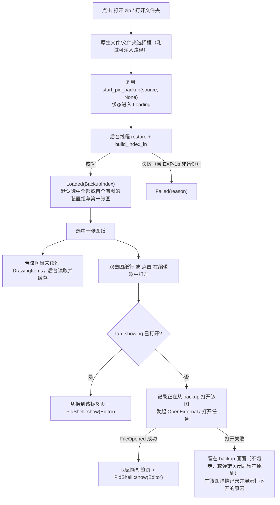

# SPEC：新版浏览画面（`sppid-screen`）

> 状态：**已确认**（2026-11-20，答复「按照推荐方案继续下一步。」，S1–S4 均按建议定；实施计划与任务见 `plan-checkpoint-c.md`、`todo-checkpoint-c.md`，界面实现待 Pencil 设计稿定稿）。检查点 B 与总验收（`ACC-1`）对应的读取、显示、PDF 导出、publish 导出均已落地验收，本规格定义检查点 C 的前半部分：新版 P&ID 界面里的「备份数据包」浏览画面。
> 依据：`00-capability-map.md` §4、§5 检查点 C、§8 第 1–2 问（已定：导航加「备份数据包」画面 `backup`；第一版只放图纸这条线，库表、枚举映射、参考数据文件、图纸体检留在经典面板）；`02-screen-content.md`；需求 `REQ-MIG-008`（`docs/pid-platform/requirements/90-migration-and-interop.md`）。
> 共用约定见 `01-shared-conventions.md`。前提：`SPEC-sppid-read.md` 已完成，且 Pencil 设计稿（`sppid-design`）定稿。

## 1. 目标

在新版 P&ID 外壳（`src/app/pid_shell/`，不加 `--classic` 启动的默认界面）中提供独立的「备份数据包」画面（`backup`），让用户**不敲命令**就能完成：

1. 选择一个 SmartPlant P&ID 备份包（`.zip` 或文件夹）并打开；
2. 按装置组树浏览图纸清单、按名字搜索过滤图纸；
3. 查看选中图纸的数据库字段、图纸对象属性与图内对象（或读不出时的明确原因）；
4. 双击或点按钮把图纸打开到「P&ID 编辑器」画面（若已打开则直接切换到该标签页，窄画布下整幅可见），切回本画面时之前打开的包与选中项保持不变。

三条硬规矩：

- **读取与开图完全复用现有层。** 还原、建索引、读图内对象走 `src/io/pid_backup*`；打开或切换标签页复用 `src/app/commands/pidbackup.rs` 已验证的路径，不在界面层另写第二套解析或缓存逻辑。
- **数据源与经典面板共享同一个打开状态。** 用户从本画面打开备份包，或从命令行敲 `PIDBACKUPOPEN` 打开备份包，操作的是同一份 `app.pid_backup` 状态，不会出现两边各持一份不同备份包的情况。
- **暗色与亮色双主题与设计稿一致。** 所有颜色、字号、圆角、间距取自 `src/ui/style/pid_tokens.rs`（默认亮色 `PidTheme::Light`，随 `COLORTHEME` 同步切换），并通过导航一致性测试。

## 2. 现状

### 2.1 新版外壳（`src/app/pid_shell/`）

- `PidScreen` 枚举列有现有设计稿的 14 个画面，目前只有 `PidScreen::Editor` 实现了 `VIEW = Some(view)`，其余 13 个 `VIEW = None`，导航 `nav()` 只列出已实现的画面。
- `pid_shell_startup::the_screens_are_the_ones_the_design_navigates_to` 会核对三处：`docs/pid-platform/design/pid-platform.pen` 的导航项、`docs/pid-platform/prototype/specs/screen-catalog.json`、`PidScreen::ALL`。三处必须同时加 `backup`，缺一处测试即红。
- 每个画面模块遵循固定契约：`pub struct State`、`pub enum Message`、`pub(crate) const VIEW: Option<ViewFn>`、`pub(crate) fn update(...)`、`pub(crate) fn view(...)`，画面外框上报 `PID_SHELL:backup`（`bounds_id`）。

### 2.2 已有的备份包状态与读取层

- 读取层：`src/io/pid_backup.rs`（还原与 `.ocs-restored` 文件/文件夹计数校验，`RD-12`）、`src/io/pid_backup_browse.rs`（`BackupIndex` 建索引，无备份且无 `.pid` 的来源返回 `not-a-backup` 错误，`EXP-1b`；按需读取单张图的 `DrawingItems`）。
- 应用状态：`app.pid_backup`（`PidBackupBrowser`，`src/ui/window/pid_backup_browser.rs`）已持有载入状态 `load: LoadState`（`Idle` / `Loading(PathBuf)` / `Ready(Arc<BackupIndex>)`）、失败原因 `error: Option<String>`、已缓存的各图 `items: HashMap<usize, ItemsState>`（`Loading` / `Ready(Arc<DrawingItems>)` / `Failed(String)`）及还原缓存目录配置 `cache` 等；只需补记一次 `loading_started_at: Option<Instant>` 即可显示载入中已用秒数。
- 开图路径：`run_pid_backup_effect` 已实现 `tab_showing` 查重切换（`RD-6`），`on_file_opened` 已实现 `.pid` 按图幅宽度自适应画布（`RD-7`）。

## 3. 画面与状态

对应 `02-screen-content.md` §2–§3，五个状态（暗色与亮色均走同一套 `PidTheme` 令牌）：

| 状态 | 判定依据 | 画面内容 |
|---|---|---|
| **没打开** | `LoadState::Idle` 且 `error.is_none()` | 说明文字 +「打开备份 zip」「打开备份文件夹」两个主入口按钮 |
| **载入中** | `LoadState::Loading(source)` | 来源路径、「正在还原并建立索引…」与自 `loading_started_at` 起的已用秒数（无百分比、无取消） |
| **出错** | `LoadState::Idle` 且 `error.is_some()` | 来源路径（若已记录）、`error` 原因全文、「重新选择 zip」「重新选择文件夹」按钮 |
| **已打开（图可读）** | `LoadState::Ready(index)`，选中图纸可读或已读出 `ItemsState::Ready` | 顶部包概要栏（含切换备份包、两项导出入口 `sppid-export-ui`、右上角次要操作「清理还原缓存」与「在经典面板中查看库表」（S3））+ 左侧装置组树（`Unregistered` 显示为「未登记图纸」，`(ungrouped)` 显示为「未分组」（S2））+ 中间图纸清单（含搜索框）+ 右侧详情区（「图纸属性」「图内对象」两栏或上下分区，按类型过滤与滚动）+「在编辑器中打开」按钮 |
| **已打开（图读不出 / 缺文件）** | 选中图纸 `entry.pid_path.is_none()`，或 `ItemsState::Failed(reason)`，或上次尝试打开该图失败 | 清单行带警示标记；「在编辑器中打开」对缺文件置灰并提示原因；右侧详情保留数据库字段，并在图内对象区或顶部提示条清晰显示读不出/打不开的那句原因（不显示空表；从本画面开图失败时不叠整窗恢复弹窗（S4）） |

## 4. 数据与消息流转



- **切屏保持状态**：`PidShell` 切到 `Editor` 再经左侧导航或 `PIDSCREEN backup` 切回时，`backup::State`（当前选中的装置组节点、搜索词、选中的图纸、详情区内当前页签与对象类型过滤词、滚动位置）完整保留。
- **与 `PIDBACKUPOPEN` 同步**：若用户在编辑器命令行敲了 `PIDBACKUPOPEN <新包>`，切到 `backup` 画面时直接看到这个包；若在 `backup` 画面打开了包，在编辑器里敲 `PIDBACKUPEXPORT` / `PIDBACKUPPDF` 导出的也是这个包。

## 5. 对外接口与代码布局

### 5.1 新增与修改文件

- 新建 `src/app/pid_shell/backup.rs`：`State`、`Message`、`VIEW = Some(view)`、`update`、`view`，内部部件边界前缀 `PID_BACKUP_SCREEN:<part>`（供 `ui_bounds` 与无窗口布局测试核对）。
- 修改 `src/app/pid_shell/mod.rs`：
  - `PidScreen` 新增 `Backup`（`id() == "backup"`，`title() == "备份数据包"`，`group() == NavGroup::Design`（`设计` 组，S1；若定稿 `.pen` 放在其他组则照 `.pen`），`needs_drawing() == false`）；
  - `PidShell` 新增 `pub backup: backup::State`；
  - `Message` 新增 `Backup(backup::Message)`；
  - `PIDSCREEN backup` 自动支持切换。
- 修改 `docs/pid-platform/prototype/specs/screen-catalog.json`：加入 `backup` 条目（`02-screen-content.md` §6）。
- 修改 `docs/pid-platform/requirements/00-overview.md`：将 `REQ-MIG-008`（及与 `sppid-export-ui` 一起上线时的 `REQ-MIG-009`、`REQ-MIG-010`）的「无界面」更新为 `backup`。
- 设计稿 `docs/pid-platform/design/pid-platform.pen`：由你在 Pencil 中定稿提交，实现前不改它。

### 5.2 画面自身状态（`src/app/pid_shell/backup.rs`）

```rust
pub struct State {
    /// 当前选中的装置组路径（None 表示「全部图纸」）。
    pub selected_group: Option<String>,
    /// 图纸清单的搜索过滤词。
    pub drawing_filter: String,
    /// 当前选中的图纸在索引中的序号。
    pub selected_drawing: Option<usize>,
    /// 右侧详情当前页签（属性 / 图内对象）。
    pub detail_tab: DetailTab,
    /// 图内对象的类型过滤（None 表示全部类型）与关键字过滤。
    pub item_type_filter: Option<String>,
    pub item_query: String,
    /// 正在从本画面打开图纸的路径，用于显示「正在打开…」并在失败时把原因记回本画面。
    pub opening_drawing: Option<PathBuf>,
    /// 本次会话中尝试打开失败的图纸及其错误原文。
    pub open_failures: HashMap<PathBuf, String>,
    /// 导出界面状态（由 `sppid-export-ui` 定义并挂载于此，见 `SPEC-sppid-export-ui.md`）。
}
```

> 注：备份包索引本身和已读出的 `DrawingItems` 不在 `backup::State` 重复存第二份，直接读 `app.pid_backup`（必要时把 `pid_backup_browser` 中与经典停靠面板 UI 无关的数据访问器提成 `pub(crate)` 只读方法）。

## 6. 成功标准

1. **导航三处一致**：设计稿、`screen-catalog.json`、`PidScreen::ALL` 均含 `backup`，`pid_shell_startup::the_screens_are_the_ones_the_design_navigates_to` 通过；左侧导航出现「备份数据包」，点击或执行 `PIDSCREEN backup` 能切过去。
2. **不敲命令走通读取闭环**（检查点 C 第 1 条前半）：从启动开始不敲命令，点击导航进入「备份数据包」→ 选择样本包（目录和 `.zip` 各验）→ 看到包概要与装置组树（图纸数 53、7、12，与 `RD-3` 一致）→ 点选装置组过滤清单 → 选中一张可读图纸看到数据库属性与图内对象 → 双击或点「在编辑器中打开」自动切到编辑器并显示该图（再次点同一张图直接切到原标签页，不重开）。
3. **异常与边界状态齐全**：
   - 未打开时显示空状态引导；
   - 打开非备份且无 `.pid` 的目录或空 `.zip` 时进入「出错」状态，显示原因并可重选；
   - 选中 `D04`（读不出图内对象但打得开）时，图内对象区显示读不出的原因，点打开仍能正常进编辑器；
   - 选中 `D03`（读不出也打不开）点打开时，留在「备份数据包」画面并显示打不开的原因，程序不崩、标签页不多出空白废页。
4. **切屏保持与双端共享**：切去编辑器再切回「备份数据包」，装置组、搜索词、选中图仍在；在编辑器用 `PIDBACKUPOPEN` 打开包后切到本画面也能直接浏览。
5. **双主题与布局**：亮色（默认）与暗色（`COLORTHEME 0`）均使用 `pid_tokens` 语义令牌，与设计稿各状态画框一致；经典界面（`--classic`）原有停靠面板不受影响，现有 `pid_backup*` 测试全部照过。

## 7. 测试

| 层 | 测什么 |
|---|---|
| 启动与导航快测试（`pid_shell_startup.rs`） | `the_screens_are_the_ones_the_design_navigates_to` 含 `backup`；`nav()` 列出 `Editor` 与 `Backup`；`PIDSCREEN backup` 切换与 `PID_SHELL:backup` 边界上报 |
| 画面无窗口快测试（新建 `src/app/pid_shell/pid_backup_screen.rs`） | 五种状态（没打开、载入中、出错、已打开可读、已打开读不出/缺文件）逐个在 `iced_test` 下渲染并核对部件和文字；装置组过滤、搜索过滤、对象类型过滤；开图成功切 `Editor`、已开图切原标签页、开图失败留在本画面显示原因；切屏往返状态保留；亮/暗主题切换无硬编码色值 |
| 真实样本与真实窗口验收 | 隐藏桌面启动真实程序（不加 `--classic`），经指针/界面动作走完打开全厂包与小包 zip、浏览属性与对象、打开图纸、切回本画面，暗色和亮色各截一套图对照设计稿 |

## 8. 不在范围与已知限制

- 库表、枚举映射、参考数据文件、图纸体检四个页签不搬进第一版新画面，留在经典面板（地图 §8 第 2 问）。
- 图纸缩略图、项目库版本/签核/PBS 树不在本画面（`02-screen-content.md` §5）。
- 网页版（`wasm32`）不提供本地备份包读写。

## 9. 已定问题（S1–S4）

2026-11-20 答复「按照推荐方案继续下一步。」，四项均按建议定（若后续 Pencil 设计稿定稿时画法另有调整，以设计稿为准）：

| # | 问题 | 定的结果 |
|---|---|---|
| S1 | **`backup` 在左侧导航放在哪一组。** 现有四组：`设计`、`配置`、`校验交付`、`平台` | **已定（2026-11-20）：放在 `设计` 组**（紧挨「图纸管理」和「P&ID 编辑器」）；若你在 Pencil 设计稿里画在别的组则照设计稿 |
| S2 | **两个特殊装置组的中文显示名**（`Unregistered`、`(ungrouped)`） | **已定（2026-11-20）：叫「未登记图纸」和「未分组」**；设计稿写了别的词就照设计稿 |
| S3 | **还原缓存管理与「打开经典面板」入口放不放** | **已定（2026-11-20）：放次要入口**——在包概要右上角提供「清理还原缓存」与「在经典面板中查看库表」（或收在次要菜单中），既不占主视觉，又让库表/枚举映射/体检在新界面下免记命令即可进入；若定稿设计稿明确拿掉则照设计稿 |
| S4 | **开 `D03` 这类打不开的图时，原有的全局「打开失败」恢复弹窗（`ModalKind::Recovery`）怎么处理** | **已定（2026-11-20）：收进本画面错误提示条并留在本画面**——从 `backup` 画面发起打开失败时不再额外叠整窗恢复弹窗；从编辑器命令行打开时维持原样 |

## 10. 需求对照

| 需求 | 本块 | 说明 |
|---|---|---|
| `REQ-MIG-008` 打开备份数据包并浏览其中的图纸 | 完整覆盖界面部分 | 从无界面命令版升级为 `backup` 专用画面，保留经典面板兼容 |
| 地图检查点 C 第 1 条（前半） | 覆盖 | 不敲命令完成打开备份包 → 按装置组看图纸 → 看属性和图内对象 → 打开图纸 |
| 地图检查点 C 第 2、3 条 | 覆盖 | 五个状态的暗色/亮色画框一致；导航三处核对测试通过 |

## 11. 修订记录

| 日期 | 改动 |
|---|---|
| 2026-11-19 | 初稿（建议稿，列 S1–S4 推荐选项） |
| 2026-11-20 | 答复「按照推荐方案继续下一步。」，状态改为已确认；S1–S4 全部按建议定（§3、§5.1、§9）；按 `src/ui/window/pid_backup_browser.rs` 实际类型对齐 §2.2 与 §3 的状态枚举写法 |
