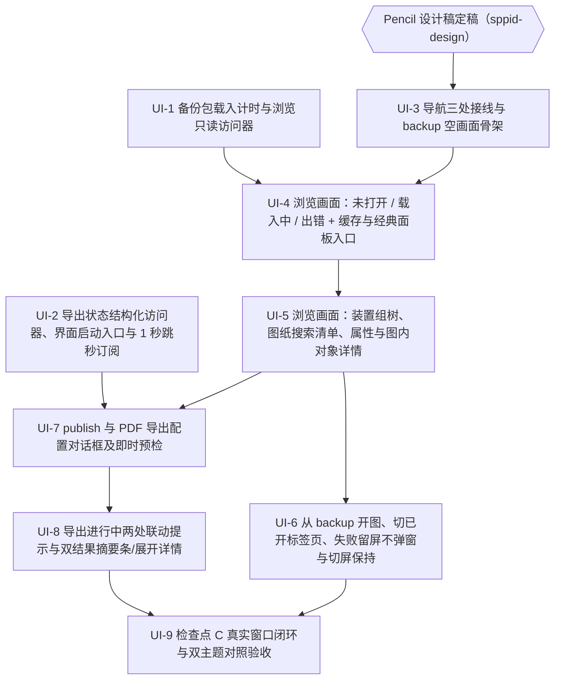

# SmartPlant 备份包：检查点 C（新版浏览与导出界面）· 实施计划

> 日期：2026-11-20
> 状态：**已完成**（2026-11-20，`UI-1` – `UI-9` 全部完成并通过隐藏桌面真实窗口 0 命令闭环与双主题对照验收；读数见 `readings.md` §32–§40）。此前于 2026-11-20 确认实施计划并完成第 1 段 `UI-1`、`UI-2`，随后按确认的方案 A1 同步 Pencil 设计稿（`Nav backup` 与 22 个暗亮双主题画框保留本地工作区不纳入 `git`）并依次完成第 2、3 段 `UI-3`–`UI-9`。两份前置规格 `SPEC-sppid-screen.md` 与 `SPEC-sppid-export-ui.md` 已于 2026-11-20 按推荐方案确认；引擎与命令层的检查点 A、检查点 B 及总验收 `ACC-1` 已全部合入 `main @ 51b654a87`。
> 配套：`todo-checkpoint-c.md`（9 个任务 `UI-1` – `UI-9`，逐个列出做什么、验收、验证命令、依赖、文件、规模）；`02-screen-content.md`（Pencil 画框内容清单，已同步 S1–S4 与 U1–U3）；共用约定见 `01-shared-conventions.md`，能力地图见 `00-capability-map.md` §4–§5。

## 1. 总览

检查点 C 的目标是把已通过命令验收的三块能力（打开浏览备份包、整包导出 publish 文件、整包导出 PDF）接入新版 P&ID 界面（`src/app/pid_shell/`，不加 `--classic` 启动的默认界面），做到**从启动开始不敲一条命令就能走完完整闭环**，且每个状态的暗色/亮色视觉与 Pencil 设计稿一致、导航三处核对测试通过。

按对 Pencil 设计稿（`docs/pid-platform/design/pid-platform.pen`）的依赖关系，9 个任务分成三段：

| 段 | 内容 | 任务 | 是否依赖 `.pen` 定稿 | 做完能验证什么 |
|---|---|---|---|---|
| 1 | 状态与导出底座 | `UI-1` – `UI-2`（2 个） | **不依赖**（可先行） | `PidBackupBrowser` 提供载入计时与分组/过滤纯函数；`BackupExport` / `BackupPdf` 暴露结构化状态与界面启动入口；导出/载入运行期挂载 1 秒计时订阅 |
| 2 | 浏览画面（`sppid-screen`） | `UI-3` – `UI-6`（4 个） | **依赖**（需 `.pen` 含 `Nav backup` 与浏览画框） | 左侧导航出现「备份数据包」，核对测试通过；五种浏览状态、装置组树、搜索过滤、属性与图内对象详情、双击/按钮开图、已开切标签页、开图失败留在本画面不叠恢复弹窗 |
| 3 | 导出界面与闭环验收（`sppid-export-ui`） | `UI-7` – `UI-9`（3 个） | **依赖**（需 `.pen` 含导出对话框、进行中与结果画框） | publish 与 PDF 两个配置对话框即时预检、两处联动进行中提示（画面内 + 外壳底栏）、三种结构化结果摘要条与展开明细、真实窗口不敲命令走完同目录成对导出与逐字节核对 |

共 9 个任务。按规模：S 4 个（`UI-1`、`UI-3`、`UI-6`、`UI-9`），M 5 个（`UI-2`、`UI-4`、`UI-5`、`UI-7`、`UI-8`），无 L 任务。

## 2. 架构与工程决策

1. **先把不碰 `.pen` 的底座拆成第 1 段（`UI-1`、`UI-2`）。**
   `src/app/pid_shell/pid_shell_startup.rs` 的 `the_screens_are_the_ones_the_design_navigates_to` 强校验 `docs/pid-platform/design/pid-platform.pen` 的 `component/App Shell -> Nav`、`docs/pid-platform/prototype/specs/screen-catalog.json` 与 `PidScreen::ALL` 完全一致。在你在 Pencil 中加入 `Nav backup` 并定稿之前，不能往 `PidScreen::ALL` 或 `screen-catalog.json` 注册 `backup`；但第 1 段只改动 `pid_backup_browser.rs`、`pidbackupexport.rs`、`pidbackuppdf.rs` 与 `view/mod.rs` 的计时订阅，既不碰 `.pen` 也不与并行工作树 `collab-off2` 正在改的 `collab/*`、`pid_shell_chrome.rs` 重叠，确认本计划后随时可以先落地。
2. **单一数据源，不复制第二套状态。**
   - 备份包索引、错误信息、各图 `ItemsState` 与还原缓存继续存放在 `app.pid_backup`（`PidBackupBrowser`），`backup` 画面与 `PIDBACKUPOPEN` 命令实时共享；
   - publish 与 PDF 的运行中状态及上次结构化结果继续存放在 `app.pid_backup_export`（`BackupExport`）与 `app.pid_backup_pdf`（`BackupPdf`），界面与 `PIDBACKUPEXPORT` / `PIDBACKUPPDF` 命令实时共享，且共用同一套忙碌拦截和导出期间禁清缓存保护。
3. **系统对话框与打开目录动作全部可注入替身。**
   选择 `.zip`、选择备份文件夹、选择导出输出目录/参考目录、在系统资源管理器打开输出目录或清单文件，在 `backup` / `backup_export_ui` 中统一走可替换的函数指针或消息钩子；无窗口快测试（`iced_test`）直接注入路径并记录外部打开调用，不弹真实系统原生对话框。
4. **先红后绿，一个任务一个提交，不推送。**
   固定门禁沿用 `todo.md` §1（见 `todo-checkpoint-c.md` §1）。

## 3. 已定的决定汇总

2026-11-20 答复「按照推荐方案继续下一步。」，两份界面规格的 7 个问题全部按建议定：

| 编号 | 事项 | 定的结果 |
|---|---|---|
| S1 | 左侧导航分组 | 放在 **`设计`** 组（`NavGroup::Design`），紧挨「图纸管理」和「P&ID 编辑器」；若定稿 `.pen` 放在别的组则照 `.pen` |
| S2 | 特殊装置组中文名 | `Unregistered` 显示为 **「未登记图纸」**，`(ungrouped)` 显示为 **「未分组」**；定稿 `.pen` 写了别的词则照 `.pen` |
| S3 | 缓存清理与经典面板入口 | 在包概要右上角放次要入口（**「清理还原缓存」** 与 **「在经典面板中查看库表」**） |
| S4 | 从 `backup` 开图失败的表现 | 原因收进 `backup` 画面当前图纸的错误提示条并留在本画面，不再额外叠整窗 `ModalKind::Recovery`；命令行开图维持原样 |
| U1 | 导出进行中提示位置 | **两处联动**：`backup` 画面内放完整进行中条，外壳底部状态栏右侧（`chrome::status_parts`）顺带显示简短全局提示（点击可切回 `backup`） |
| U2 | 专用自动化/REST/MCP 导出操作 | 与界面解耦，本次不动 `src/rest_openapi.json` 与 MCP 摘要；后续外部脚本确需非阻塞轮询时单独排任务 |
| U3 | 两次导出结果的摆放 | 包概要下方显示 publish 与 PDF 各自最近一次状态摘要条 + **「查看详情」「打开目录」「打开清单」** 按钮，点「查看详情」展开未写出名单、缺符号与参考比对明细 |

## 4. 依赖图

- `UI-1`、`UI-2` 不依赖 `PEN`，只动内部状态与命令访问器，确认本计划后可先做。
- `UI-3` 必须等 `PEN`（`docs/pid-platform/design/pid-platform.pen`）画入 `Nav backup` 与 `backup` 画框并由你定稿后再开始。

## 5. 检查点 C 验收（`UI-9` 做完时）

对照 `00-capability-map.md` §5 检查点 C 的三条硬标准：

1. **全程不敲命令走通完整闭环**：真实程序不加 `--classic` 启动 → 点击左侧导航「备份数据包」→ 打开全厂包目录（53 张）与小包 `.zip`（7 张）→ 点选装置组树过滤清单 → 选中可读图纸查看数据库属性与图内对象、选中 `D04` 看到读不出原因、选中 `D03` 点打开留在 `backup` 画面看到打不开原因 → 打开可读图纸自动切到「P&ID 编辑器」并整幅可见，再点同一张图直接切原标签页 → 切回「备份数据包」状态仍在 → 点「导出 publish 文件」选空交付目录完成导出 → 点「导出 PDF」点「使用上次 publish 输出目录」导出到同一目录，期间可见张数递增、切去编辑器底栏可见全局简短提示 → 结束后界面看到写出数、缺符号与比对统计，`scripts/sppid/check-pairs.ps1` 检查交付目录 53 对 / 7 对全部成对，且写出文件与 `a85fa10` 基线及 `PDF-5` 逐字节相同。
2. **暗色与亮色双主题与设计稿一致**：`02-screen-content.md` §7 列出的各状态画框（未打开、载入中、已打开可读、图读不出、出错、两个导出对话框、进行中、三种导出结果）在默认亮色（`PidTheme::Light`）和暗色（`PidTheme::Dark`）下各有一套真实窗口或无头渲染核对记录，零硬编码颜色。
3. **三处一致性门禁全绿**：`pid_shell_startup::the_screens_are_the_ones_the_design_navigates_to` 与 `docs/pid-platform/` 文档一致性检查在设计稿定稿提交后全部通过。

## 6. 风险与应对

| 风险 | 应对 |
|---|---|
| 设计稿尚未画入 `Nav backup` 时提前改 `PidScreen::ALL` 或 `screen-catalog.json` 会导致导航核对测试变红 | 严格把不依赖设计稿的改动收在 `UI-1`、`UI-2`；`UI-3` 必须在 `.pen` 已有 `Nav backup` 后三处同一个提交一起改 |
| 并行工作树 `ocs-sppid-exp2` 当前在 `collab-off2` 分支修改 `src/app/pid_shell/pid_shell_chrome.rs` 并运行编译门禁 | 1) 编译争抢避让：动代码跑门禁前先检查是否有并发 `cargo`/`rustc` 进程在跑，避免抢 `CARGO_TARGET_DIR` 锁；2) 文件避让：`UI-1`–`UI-7` 完全不碰 `chrome.rs` 与 `pid_shell_chrome.rs`，唯一涉及 `chrome.rs` 的 `UI-8` 排在后段，届时先合入或对齐 `collab-off2` |
| 从 `backup` 画面打开 `D03` 失败时，现有的异步 `FileOpenFailed` 路径默认弹全局 `ModalKind::Recovery` | 在 `UI-6` 中记录本次打开请求来源于 `backup` 画面（携带目标路径），`FileOpenFailed` 匹配该路径时把错误原文写入 `backup.open_failures`、清理 `opening_drawing`、保持当前画面为 `PidScreen::Backup`，不走 `ModalKind::Recovery`；从编辑器或命令打开仍走原路径 |
| 图内对象多（单图数百至上千个）或比对明细长时，界面每帧重算卡顿 | 装置组计数从 `BackupIndex` 直接读；当前选中图的过滤后对象列表按 `(drawing_idx, item_type_filter, item_query)` 派生，折叠分组不展开时不构建子行部件（沿用经典面板的按需展开原则） |
| 设计稿工作区当前有未提交的 28 个旧画框改动，导致库测试基线有 2 条设计稿核对失败、文档检查有 1 条失败 | 你在 Pencil 画完 `backup` 并一并定稿提交 `.pen` 后，核对这几条测试是否随之恢复全绿；若仍有历史画框差异，在 `UI-3` 汇报里逐条列出原因请你定 |

## 7. 需要你做的事

| 什么时候 | 什么事 | 说明 |
|---|---|---|
| 已办（2026-11-20） | 确认这份 `plan-checkpoint-c.md` 和 `todo-checkpoint-c.md`，并确认在等待 Pencil 设计稿期间**先推进不依赖设计稿的第 1 段（`UI-1`、`UI-2`）** | 答复：「按你推荐的方案做。没有明确推荐的，你结合当前情况选最合适的继续，并简要说明理由。」 |
| `UI-3` 之前 | 在 Pencil 中按 `02-screen-content.md` 画好 `Nav backup` 与 `backup` 浏览/导出的暗色和亮色画框并定稿（由你提交，或发话让我一并提交 `.pen`） | 在你发话前我不改 `docs/pid-platform/design/pid-platform.pen` |

## 8. 修订记录

| 日期 | 改动 |
|---|---|
| 2026-11-20 | 初稿（基于已确认的 `SPEC-sppid-screen.md` S1–S4、`SPEC-sppid-export-ui.md` U1–U3 及已合入 `main @ 51b654a87` 的检查点 A/B 与总验收底座编写） |
| 2026-11-20 | 计划与任务清单已确认（原话见文首），先行实施不依赖 `.pen` 的第 1 段 `UI-1`、`UI-2` |
