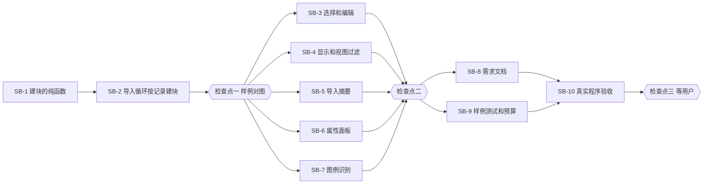

# 计划：`.pid` 图例导入成图块（`pid-symbol-block`）

> 日期：2026-11-19。
> 状态：**已确认，按此执行**。用户对规格的答复：「按你推荐的方案做。没有明确推荐的，你结合当前情况选最合适的继续，并简要说明理由。」按 `docs/plans/2026-11-17-sppid-backup-publish/plan.md` 的先例，这句话也算对本计划的确认：不逐关停下，只在 §6 列的情况停。
> 配套：规格 `SPEC-pid-symbol-block.md`（做成什么）、任务清单 `todo.md`（每个任务的验收和验证）；共用约定 `docs/plans/2026-11-16-pid-dev-spec/01-shared-conventions.md`。
> 基线：分支 `pid-symbol-block`，起点 `5171d197b`。在独立的工作目录 `ocs-pid-symbol-block` 里做，不动 `main` 的工作目录（那里有别的窗口没提交的改动）。基线读数见 `todo.md` §1。

## 1. 总览

分三段，十个任务，一个任务一个本地提交，不推送。执行中加了一个任务 SB-2b，排在 SB-2 和检查点一之间，见 §9。

| 段 | 任务 | 做完之后 |
|---|---|---|
| 一、建块 | SB-1 建块的纯函数；SB-2 导入循环按记录建块 | 打开 `.pid`，每个图例是一个块引用；样例出的图与基线相同（检查点一） |
| 二、跟着改的几处 | SB-3 选择和编辑；SB-4 显示和视图过滤；SB-5 导入摘要；SB-6 属性面板；SB-7 图例识别 | 点一下选中整个图例有测试钉住；图层和角色开关、摘要、属性面板、图例识别都按规格（检查点二） |
| 三、收尾 | SB-8 需求文档补一条；SB-9 样例测试和性能预算；SB-10 真实程序验收 | 验收报告，起好的程序给用户自己点（检查点三，等用户） |

规格 §6 的每条成功标准由哪个任务保证：

| 标准 | 内容 | 任务 |
|---|---|---|
| 1 | 块引用数等于画出的符号实例数；没有散着的图例笔画 | SB-2（单元）、SB-9（样例） |
| 2 | 点选、悬停、框选按整个图例 | SB-3 |
| 3 | 只有 `.pid` 时成立；带 `_Data.xml` 时四个键在引用上 | SB-2、SB-10 |
| 4 | 出图不变，取景范围不变 | SB-2（块里的坐标加插入点等于原坐标）、检查点一和 SB-10（SVG 对比） |
| 5 | 图层、角色开关，符号名跟着走 | SB-4、SB-3 |
| 6 | 属性面板 | SB-6 |
| 7 | 移动、复制、删除、撤销 | SB-3 |
| 8 | 另存 DWG 再打开 | SB-9、SB-10 |
| 9 | 图例识别不报未知块 | SB-7 |
| 10 | 摘要 | SB-5、SB-9 |
| 11 | 用时和文件大小 | SB-9（预算）、SB-10（实测） |
| 12 | 门禁不变差 | 每个任务 |

## 2. 做法上的几个决定

1. **在导入循环里按记录建块，不在加完之后再归并。** `build_document_entities` 处理一条符号实例时，手里正好是这个图例的全部图元；过了这一步就没有东西记着归属了。
2. **建块用文档一级的操作，步骤照 `src/scene/entity.rs` 的 `create_block_with_options`。** 导入器手里只有 `Document`，没有场景。顺序是：块记录 → BLOCK → 成员 → ENDBLK → 引用，这样 ENDBLK 的句柄在所有成员之后，和程序自己建的块一样。`src/io/xref.rs` 的 `ensure_block_entities` 不直接用：它先把 ENDBLK 建出来。
3. **定义能不能共用，用图元的 `Debug` 文本比。** 对平移后的块内图元取 `Debug` 文本，把引号外的小数统一写成 6 位，得到指纹；符号名和各图元的指纹都相同才共用。理由：逐类型写比较函数，漏比一个字段就会把两个不同的图例画成一样；用文本比，错了只会少共用，不会画错。指纹只在一次导入里用，不存盘，所以文本格式以后变了也没有兼容问题。
4. **平移用图形库自己的 `apply_transform`。** 不自己逐类型改坐标；用测试逐类型核对（线、圆、圆弧、多段线、样条、文字、填充）。
5. **不设临时开关。** SB-1 的模块先以只在测试里编译的方式入库（`#[cfg(test)] mod symbol_blocks;`），这样没有「未使用」的告警；SB-2 接线时改成常规模块。新旧两条路并存要维护两套期望值，不值得。
6. **既有测试的期望值随 SB-2 一起改。** 结构一变，数图元个数和类型的测试就会变红，不能留到下一个提交。每一处在提交说明里写原值、新值、原因；不删测试，不放宽断言。
7. **样例对图放在 SB-2 之后马上做（检查点一），不等到最后。** 画面变没变是这件事最大的风险，越早知道越好。
8. **视图过滤不改代码。** 理由见规格 §11 第 4 条。SB-4 只加测试；测试若查出行为与规格不符，在该任务里改代码并记进规格 §11。
9. **每个任务都做「故意改坏」核对。** 在新代码里留几处由环境变量 `OCS_MUTANT` 控制的改坏点，只编译一次，逐个打开，每一处都得有测试变红；核对完把改坏点删掉再提交。只加测试的任务（SB-3、SB-4）没有「先红」，靠这一条证明测试管用。

## 3. 已定的决定

- 规格 §9 的六项：分法二；块名带前缀 `SPPID_`；图例识别跳过；只画符号名的图例也成块；不做新命令；给 `REQ-MIG-008` 补一条验收标准。
- 规格 §11 的四处：图层规则；只画符号名的图例放 `PID-SYMBOL-LABEL` 层；边框模板里的符号实例不成块；视图过滤不改代码。
- **计划里没给建议的地方**：按当时的情况选最合适的继续，理由写进该任务的提交说明和 `todo.md` 的「做完」段；与规格不一致的记进规格 §11。
- 不推送。做完合回本地的 `main`（快进合并；`main` 在此期间有了新提交就改用普通合并，有冲突先问）。
- 不动：`docs/pid-platform/design/pid-platform.pen`、`../iced`、`pid-parse` 仓库、别的工作目录、正在运行的程序。不联网。

## 4. 依赖和顺序

只有一个工作目录，所以按编号一个一个做。SB-3 到 SB-7 互相不依赖，排在前面的是风险大的：选择是用户要的东西，显示最容易出意外。

## 5. 检查点

| 检查点 | 做什么 | 报告里有什么 | 用户要做什么 | 之后 |
|---|---|---|---|---|
| 一（SB-2 后） | 全部门禁；用分支编出的程序导入样例，数块引用，出 SVG 与基线程序的逐元素比 | 块引用数、定义数、SVG 对比结果、改了多少处期望值 | 无 | 对图不一致就留在 SB-2 查，不往后做 |
| 二（SB-7 后） | 全部门禁 | 各任务的读数、记进规格 §11 的偏差 | 无 | 接着做 |
| 三（SB-10 后） | 验收；起一个打开了样例图的程序 | 规格 §6 每条的结果和证据位置 | 可以自己在图例上点一下试；决定要不要推送 | 合回本地 `main`，清理临时目录 |

## 6. 什么时候停下来问

1. 只有用户能做的事。
2. 超出已经同意的范围的操作：推送、联网、改 `pid-parse` 仓库、动设计文件。
3. 约好的停点：检查点三。
4. 某条成功标准用我能选的办法都达不到。比如样例对图不一致，而原因出在规格已定的分法上。
5. 合回 `main` 时有冲突。

## 7. 风险

| 风险 | 后果 | 对策 |
|---|---|---|
| 平移对某类图元不完整（填充的边界、文字的对齐点） | 画面变 | SB-1 逐类型测试；检查点一对图 |
| 既有测试盯着图元个数、句柄或存盘字节 | SB-2 要改的期望值多 | 先跑一遍量出有多少个变红，再逐个改；每处写原值、新值、原因 |
| 块内关着的符号名被算进块的范围 | 窗口选择要框得比看到的大 | SB-3 有一条验收专门测；不符就在该任务里处理并记录 |
| 块内 0 层图元的取色、打印开关与散图元不同 | 颜色或出图变 | SB-4 测取色；检查点一和 SB-10 对图 |
| 块记录多了以后 `add_entity` 变慢（它按块记录逐个找归属） | 导入变慢 | SB-9 的预算测试盯住 1.1 倍；超了再查 |
| 别的窗口同时在编译，`cargo` 的全局缓存有锁 | 门禁慢 | 等，不动别人的进程和工具链配置 |
| `main` 的工作目录里有别的窗口没提交的改动 | 合回时可能冲突 | 合之前先看改了哪些文件；有重叠先问 |
| 指纹里混进每次不同的内容（句柄） | 该共用的没共用 | 指纹在加进文档之前取；SB-1、SB-2 各有一条「相同的两个图例共用」的测试 |

## 8. 要用户做的事

- 检查点三：看验收报告；愿意的话在起好的程序里自己点一下图例。
- 要不要推送、要不要重打发布包，由用户定；计划内不做。

## 9. 后来加的任务

| 任务 | 排在哪 | 为什么加 | 怎么定的 |
|---|---|---|---|
| SB-2b 块里的圆、圆弧、椭圆按块内次序叠放 | SB-2 之后，检查点一关掉之前 | 检查点一对图：两边的元素和笔都相同，但 `Set Fire Point` 的填充和圆轮廓先后对调了。原因在显示代码（块里的纯圆、圆弧、椭圆不带块内次序），不在导入器，导入器绕不过去 | §5 写的是「对图不一致就留在 SB-2 查，不往后做」，规格 §4.2 要「与基线逐笔相同」，所以修，不是只记一笔。这处代码不是本计划写的，改动影响所有图块（DWG、DXF 里的也在内），所以单独一个提交，要撤可以单独撤；全量测试里有既有用例因此变红，就说明旧行为是有意的，那样就撤掉改动、只记进规格 §11、停下来问（§6 第 4 条）。验收和读数见 `todo.md` 的 SB-2b |
