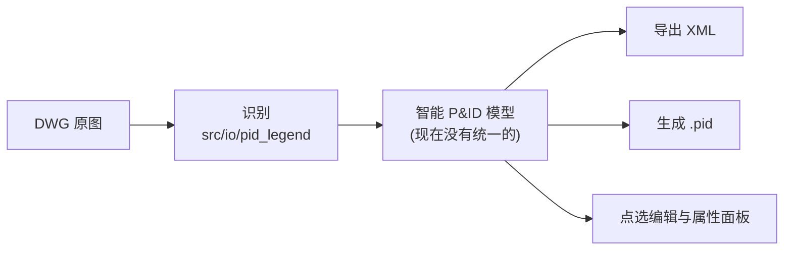
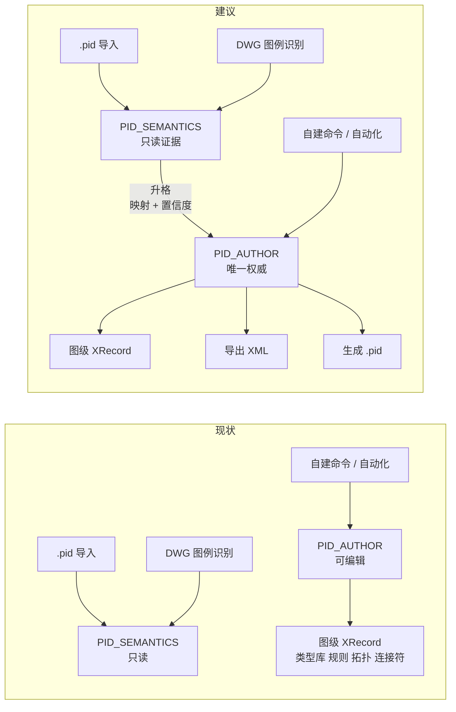

# 内部模型合一分析（路线 L2-1）

> 日期：2026-11-19 初拟；**2026-11-20 对齐 `main @ 6377fe233`、并行分支 `pid-symbol-identity` 与 `03-parse-answers.md` 更新**
> 所属目录：`docs/plans/2026-11-20-phase1-dwg-to-smart-pid/`（跟踪总单：[happyrust/pid-cad#106](https://github.com/happyrust/pid-cad/issues/106)）
> 目的：阶段一的主线是 DWG → 识别 → 智能 P&ID 模型 → 导出 XML 和 `.pid`。模型是中间的枢纽。仓库里现有两套语义载体（`PID_SEMANTICS` 与 `PID_AUTHOR`），本文弄清它们各存什么、哪里冲突、合一怎么做、以及如何与正在收口的 `pid-symbol-identity` 分支无冲突衔接。
>
> **状态与解决记录（可回溯日志）**：
> - `2026-11-20`（并行分支对齐）：确认活跃分支 `pid-symbol-identity` 正在将 `.pid` 导入符号建为图块（`INSERT`），直接经 `pid_parse::publish::pid_load::load_publish_from_pid` 从 `.pid` 自身读取类型与名称（53 图 `9,218 / 9,225` 命中，无需旁置 `_Data.xml`）、从备份库补全 `ItemTag`、经 `0x00FA` 6 字节成员配对散落标注文字并接入默认界面右侧检查栏。**决定：`L2-1`–`L2-6` 严格排在 `pid-symbol-identity` 合入 `main` 之后实施，直接承接其底座，避免 `src/io/pid/*` 与 `editor.rs` 合并冲突。**
> - `2026-11-20`（`L0-8` 源码核实，见 `03-parse-answers.md`）：第 8 节问题 1 所需的 XML 21 类接口与码表目录已在 `pid-parse/src/publish/{catalog,codelist_values}.rs` 核实完毕。

---

## 0. 结论（一页）

1. 仓库里有**两个 XDATA 应用名**：`PID_SEMANTICS` 和 `PID_AUTHOR`。它们各有自己的写入者、字段和读取者，互不相通。
2. **`.pid` 导入和 DWG 图例识别都写 `PID_SEMANTICS`**。特性面板的"P&ID"组读它，**所有行只读**。
3. **自建的 P&ID 对象写 `PID_AUTHOR`**。位号引擎、拓扑表、属性下传、协同、DWG 往返契约都建在它上面，可编辑。
4. 因此：**识别出来的符号不会变成可编辑的 P&ID 对象，识别出来的管线也不会进拓扑表。** 识别的产物停在"只读的证据"这一层。
5. 导出 XML 和 `.pid` 需要一个统一的、可编辑的、带来源和置信度的模型。**建议方案 A：以 `PID_AUTHOR` 为权威，识别和导入的结果"升格"写成 `PID_AUTHOR`，`PID_SEMANTICS` 保留为只读的来源证据。**
6. 动手前要先确认 4 个问题（第 8 节），其中一项需要 `pid-parse` 的源码才能回答。

---

## 1. 为什么要合一

阶段一的流水线是：

中间那一格，现在是两个互不相通的载体。不合一会出三类问题：

- **识别和编辑各说各话**：识别出的位号改不了，改了也不会进位号引擎的占用表。
- **导出没有单一数据源**：XML 和 `.pid` 要从哪里取对象、位号、拓扑，没有唯一答案。
- **验收没有统一口径**：置信度、来源、人工修正，没有地方存。

---

## 2. 现状：三个写入者，两个载体

### 2.1 写入者

| 写入者 | 位置 | 写到哪 | 写什么 |
|---|---|---|---|
| `.pid` 导入 | `src/io/pid/metadata.rs` 的 `attach_pid_metadata` | `PID_SEMANTICS`（实体 XDATA） | `role`、`style`、`sheet_layer`、`sheet_layer_oid`、`extent`、`driving`、`instance`；如果 `.pid` 旁边有 `<图名>_Data.xml`，再加 `class`（XML 元素名，如 `PIDPipeline`、`PIDProcessVessel`）、`label`（`ItemTag` 或 `Name`）、`oid`（`GraphicOID`）、`resolved`（`direct` 或 `dependency:<oid>`） |
| DWG 图例识别 | `src/io/pid_legend/xdata.rs` 的 `attach` | `PID_SEMANTICS`（实体 XDATA） | `class`（识别器给的人读类型名，如"蝶阀"）、`label`（位号，可多条）、`lines`（相连线号，逗号分隔）、`resolved`（`legend:block`、`legend:shape:<id>`、`legend:circle`、`legend:group:<名>`、`legend:pipe`）。管线 run 的每个图元写 `class=PIDPipeline`、`label=线号`、`resolved=legend:pipe` |
| 自建命令与自动化 | `src/pid/persist.rs` 的 `PidAuthor::store`；自动化在 `src/app/control/entities.rs` | `PID_AUTHOR`（实体 XDATA）加图级 XRecord | 九个键，见 2.3 |

导入侧的重要更新（**2026-11-20 对齐 `pid-symbol-identity` 分支**）：
- 在 `main @ 6377fe233` 旧路径上，`class` 与 `label` 只有在 `.pid` 旁边放有 `<图名>_Data.xml` 时才写入；
- 正在推进的并行分支 `pid-symbol-identity`（见 `docs/plans/2026-11-20-pid-symbol-identity/SPEC-pid-symbol-identity.md`）已打通**不依赖 `_Data.xml` 的直读路径**：直接调 `pid_parse::publish::pid_load::load_publish_from_pid` 读出 `.pid` 内置 `P&IDAttributes` 行的 `ModelItemType`、发布类 `class` 与 `IObject.Name`（从备份包打开时再用 `Export.dmp` 的 `T_PlantItem.ItemTag` 补全阀门位号），同时把散落标注文字（`0x004D`）经 `0x00FA` 依赖记录配对到所属图块，并在 `pid_shell/editor.rs` 右侧检查栏显示只读身份与标注。
- 但即便 `pid-symbol-identity` 合入后，导入与 DWG 识别结果仍落在只读的 `PID_SEMANTICS` 上，**要实现可编辑属性、位号查重占用、管线进拓扑以及统一导出 XML/`.pid`，仍须通过本文方案 A 的「升格（`promote`）」写入 `PID_AUTHOR`**。

### 2.2 读取者

| 读取者 | 位置 | 读哪个 |
|---|---|---|
| 特性面板"P&ID"组 | `src/scene/cache/properties.rs` 的 `pid_semantics_section` | `PID_SEMANTICS`；注释写明"Every row is read-only" |
| 视图过滤器 | `src/io/pid_view_filter.rs` | `PID_SEMANTICS` 的两个键 |
| P&ID 编辑器界面 | `src/app/pid_shell/editor.rs`、`pid_editor_screen.rs`、`pid_shell_startup.rs` | `PID_AUTHOR` |
| 位号引擎 | `src/pid/tag_engine.rs` | `PID_AUTHOR` 的 `type` 和 `tag`（序号占用必须来自文档本身） |
| 属性下传 | `src/pid/propagate.rs` | `PID_AUTHOR` |
| 自动化接口 | `src/app/control/entities.rs` | `PID_AUTHOR`（有按键改写的代码） |

### 2.3 `PID_AUTHOR` 的结构

**每实体九个键**（`src/pid/persist.rs`，`XDATA_KEYS`）：

| 键 | 含义 |
|---|---|
| `type` | 类型编码，大写，如 `EQUIPMENT` |
| `tag` | 位号 |
| `tag_source` | `auto` 或 `manual` |
| `tag_status` | `ok` 或 `duplicated` |
| `props` | 属性键值对，JSON 串；超过 2048 字节时溢出到 XRecord，实体里只留 `props_ref` |
| `ports` | 端口角色，逗号分隔 |
| `owner` | 宿主实体 handle |
| `topology` | 拓扑角色 |
| `connector_peer` | 页间连接符的对端；空则不落盘 |

**图级 XRecord**（挂在模型空间扩展字典下，`src/pid/graph_data.rs`）：类型库、位号规则表、拓扑表、连接符表；另有协同用的两条（`PID_AUTHOR_COLLAB` 及其队列，`src/pid/collab_state.rs`）。

拓扑表里有 `PipeLineRecord`、`PipeRunRecord`、`PipeSegmentRecord`、`FittingRecord`、`ConnectorRecord`（`src/pid/topology.rs`），用 handle 把线、路、段、管件、连接符串起来。

---

## 3. 两套模型对比

| 维度 | `PID_SEMANTICS` | `PID_AUTHOR` |
|---|---|---|
| 写入者 | 导入、识别 | 自建命令、自动化 |
| 类型 | `class`：自由文本（识别写人读名；导入写 XML 元素名） | `type`：类型库编码。内置类型库只有 4 个（`EQUIPMENT`、`VESSEL`、`TANK`、`PUMP`） |
| 位号 | `label`，可多条 | `tag` 加 `tag_source`、`tag_status` |
| 通用属性 | 没有；只有 `extent`、`driving`、`instance` 这类图形度量 | `props` JSON |
| 连接关系 | `lines`：相连线号的字符串 | `ports`、`owner`、`topology`、`connector_peer`，加图级拓扑表和连接符表 |
| 来源与置信度 | `resolved`（说明哪一跳找到，或哪条识别路径） | 只有位号来源；没有置信度 |
| 稳定标识 | `oid`（`GraphicOID`，来自 `_Data.xml`）、`sheet_layer_oid` | 没有；用 DWG handle |
| 可编辑 | 只读 | 可编辑 |
| DWG 往返 | 随 XDATA 保存，前提是 APPID 已登记（`styles.rs` 注释：DWG 写出会跳过 APPID 不在表里的 XDATA） | 有契约和测试（`dwg_roundtrip.rs`，七个 DWG 版本，位号和属性丢失 0） |
| 协同 | 无 | 有 |

**类型体系不一致的一个具体例子**：`assets/pid-symbols.json` 的 `symbol_type_map` 里有 `VALVE_GATE`、`VALVE_ISOLATION`、`INSTRUMENT` 这几个类型编码，而内置类型库只有上面 4 个。`src/pid/tag_rule.rs` 专门写了"库外的类型编码在解析位号规则时怎么办"的逻辑，说明库外编码是已知情况。

---

## 4. 必须保住的硬约束

这些是我在源码注释里读到的、合一时不能破坏的约束：

1. **两个 APPID 必须分开。** `io::pid_legend::xdata::purge` 只删 `resolved` 以 `legend:` 开头的 `PID_SEMANTICS` 记录；混用会把作者数据一并清掉（`persist.rs`、`xdata.rs` 的注释）。
2. **XDATA 里不许出现会随实体变换改写的五种变体**：`Position3D`、`Displacement3D`、`Direction3D`、`Distance`、`ScaleFactor`。否则一变换，原始记录被丢弃，往返不再无损（`persist.rs`、`dwg_roundtrip.rs`）。
3. **先判长度再落盘。** DWG 的扩展数据用 16 位长度前缀，超过的整条记录在写出时被静默丢弃。软上限 2048 字节，超了把 `props` 挪到 XRecord。
4. **写入一律走 `set_entity_xdata`。** 它负责登记 APPID、整条替换同一 APPID 的记录、作废原始 EED 块。
5. **图级数据整 key 重写，数据空了就删记录，不留空记录**（`graph_data.rs`）。
6. **不能改动自动化接口的对外面。** 仓库的门禁盯着 `src/rest_openapi.json` 和 MCP 的摘要值（`src/mcp.rs` 里有钉住摘要的测试），改了会变红。

---

## 5. 相对目标的缺口

| # | 缺口 | 证据 |
|---|---|---|
| 1 | 识别的符号不会成为可编辑对象：`class` 是自由文本，对不上类型库编码；没有 `ports`、`owner`；位号没有 `tag_source` | `xdata.rs` 只写 `class`、`label`、`lines`、`resolved` |
| 2 | 识别的管线不进拓扑表：`Recognition.pipes.runs` 只在内存里，落到实体上只是把图元标成 `PIDPipeline` | `src/io/pid_legend/mod.rs`、`xdata.rs` 的 `desired_records` |
| 3 | 导入的 `.pid` 对象只读，也没有 `type`、`ports` | 特性面板"每行只读" |
| 4 | 置信度、识别路径、判定依据、处置没有字段。需求 REQ-MIG-001 要求这四项；`Recognized` 里有 `known`、`source`、`tag_distance_mm`，但落盘只剩 `resolved` | `docs/pid-platform/requirements/90-migration-and-interop.md`；`pid_legend/mod.rs` |
| 5 | 没有 SPPID 侧的类名映射：XML 元素名只出现在导入侧的 `class`（而且只有旁边有 `_Data.xml` 时才有）；自建侧的 `type` 是自有体系 | `metadata.rs` 注释 |
| 6 | 没有稳定的对象标识：自建对象只有 DWG handle，`GraphicOID` 只在导入侧 | 同上 |
| 7 | 类型库太小：识别规则有块字典 15 条、圆规则 6 条、形状字典 49 条，而类型库只有 4 个类型 | 09-09 识别审核计划；`assets/pid-types.json` |

---

## 6. 方案对比与建议

| 方案 | 做法 | 优点 | 缺点 |
|---|---|---|---|
| **A（建议）** 以 `PID_AUTHOR` 为权威 | 识别和导入的结果"升格"写成 `PID_AUTHOR`；`PID_SEMANTICS` 保留为只读证据 | 编辑、位号引擎、拓扑、协同、往返契约都已经建在它上面，不用重做；有测试守着 | 要补类型映射；`PID_AUTHOR` 现有九键不够装来源和置信度 |
| B 新建第三套统一模型 | 两套都迁过去 | 干净 | 迁移成本最大，迁移期两套并存，所有现有契约和测试要重写 |
| C 以 `PID_SEMANTICS` 为权威 | 扩展它的键，让它可编辑 | 识别和导入已经在写它 | 编辑、位号引擎、拓扑、协同、往返契约要全部重建；`purge` 的隔离规则要重做 |

**建议 A，要点如下：**

- **升格是一步显式动作**，不是识别时自动覆盖。识别结果留在 `PID_SEMANTICS`；用户确认（或高置信自动接受，见 REQ-MIG-001 的三档阈值）后，才写 `PID_AUTHOR`。
- **升格要幂等**：重复升格不重复建对象；用户已手工改过的位号（`tag_source=manual`）不被覆盖。
- **管线要进拓扑表**：识别出的线号和 run 转成 `PipeLineRecord`、`PipeRunRecord`，端口和连通转成 `ConnectorRecord`。
- **新增信息（来源、置信度、证据、SPPID 类名、`GraphicOID`）怎么放**，有两条路：
  - (i) 放进 `props` 的保留键，**不动九键契约**；
  - (ii) 加新键，需改 `XDATA_KEYS`、编码解码和相关测试。
  
  建议先走 (i) 验证够不够用，再决定要不要 (ii)。
- **特性面板**：`PID_AUTHOR` 的行可编辑；`PID_SEMANTICS` 的行保留为"来源证据"组，仍只读。

现状与建议的对比：

---

## 7. 影响面

**会动的文件（按我读到的使用位置列出）：**

| 区域 | 文件 |
|---|---|
| 模型层 | `src/pid/persist.rs`、`tag_engine.rs`、`topology.rs`、`symbols.rs`、`propagate.rs`、`graph_data.rs`、`type_lib.rs`、`tag_rule.rs` |
| 识别和导入 | `src/io/pid_legend/xdata.rs`（及新增的升格步骤）、`src/io/pid_legend/mod.rs`、`src/io/pid/metadata.rs` |
| 界面 | `src/scene/cache/properties.rs`（面板分组）、`src/app/pid_shell/editor.rs`、`pid_editor_screen.rs` |
| 自动化 | `src/app/control/entities.rs`（注意不改对外面） |
| 规则与资源 | `assets/pid-legend.json`（加类型映射）、`assets/pid-types.json`、`assets/pid-symbols.json` |
| 协同（阶段一不做，但不能破坏） | `src/pid/collab_state.rs`、`src/app/collab/` |

**必须继续通过的测试（现有）**：`src/pid/dwg_roundtrip.rs` 的往返契约、`src/pid/persist.rs` 的测试、`src/io/pid_legend/xdata.rs` 的 `purge` 隔离测试、`tests/pid_import.rs`、`tests/pid_legend.rs`。

---

## 8. 动手前要先确认的问题

| # | 问题 | 为什么不能现在定 |
|---|---|---|
| 1 | 类型库要扩到多大，识别的类怎么映射到类型库编码和 SPPID 的类名？映射表放哪（建议放进规则文件，沿用"规则外置"） | **2026-11-20 已核实（见 `03-parse-answers.md` Q7/Q8）**：`pid-parse/src/publish/catalog.rs` 已定义全部 21 类发布对象与接口规则，`codelist_values.rs` 已内置 58 条类型分级链；样本实测共约 240 种「接口集 + 码表元组」变体（前 50 种覆盖管件/管线段 99%），外置放入 `assets/pid-class-map.json` |
| 2 | `props` 能不能带任意保留键？类型库的数据要素会不会校验 | 要读 `type_lib.rs` 的校验和 `propagate.rs` 的下传逻辑，设计阶段读 |
| 3 | 导入的 `.pid` 对象要不要也升格？（用于"改动已有 SPPID 图纸"） | 取决于阶段一要不要支持改已有图纸；路线里它排在"点选编辑"那一步 |
| 4 | 协同怎么兼容？ | `PID_AUTHOR` 的字段变化会影响协同消息；阶段一不做协同，但改动前要列清影响 |

---

## 9. 分步建议（供实施方案展开）

| 步 | 内容 | 产出 | 规模 |
|---|---|---|---|
| M1 | 类型映射：识别类 → 类型库编码 → SPPID 类名；规则文件加字段 | 映射表和读取代码，未映射类单列 | M |
| M2 | 升格：识别结果写成 `PID_AUTHOR`，带来源和置信度（先放 `props` 保留键） | 升格命令，幂等，不覆盖手工位号 | L |
| M3 | 管线进拓扑表：线号、run、端口、连通 | 拓扑表和识别报告能对上 | L |
| M4 | 面板：`PID_AUTHOR` 可编辑，`PID_SEMANTICS` 作证据组 | 点选符号出属性面板，改位号能保存 | M |
| M5 | 导出视图：从统一模型取数的接口，供 XML 和 `.pid` 共用 | 一个只读的"导出模型"结构 | M |

M1 的前置是资料清单里的 `pid-parse` 源码和真值配对样本。

---

## 附录：本文读过的仓库文件

`src/pid/persist.rs`、`graph_data.rs`、`dwg_roundtrip.rs`、`topology.rs`（常量与结构）、`type_lib.rs`（结构）、`mod.rs`；`src/io/pid_legend/xdata.rs`、`mod.rs`（`Recognized`、`Recognition`）；`src/io/pid/mod.rs`、`styles.rs`、`metadata.rs`；`src/scene/cache/properties.rs`；`src/scene/pid_refill.rs`；`assets/pid-types.json`、`pid-symbols.json`；`docs/pid-platform/requirements/90-migration-and-interop.md`；`docs/plans/2026-09-09-pid-legend-recognition-audit-and-next-steps.md`。

## 没有核实的地方

- 我没有运行任何测试，也没有试用这些命令。
- `src/app/control/entities.rs` 里改写 `PID_AUTHOR` 的具体范围，我只看到了函数名和一部分代码，没有读完。
- 特性面板里是否有针对 `PID_AUTHOR` 的可编辑属性界面，我只确认了 `pid_shell` 里有读取，没有逐行确认编辑路径。
- 协同对 `PID_AUTHOR` 字段的依赖程度，我没有读 `src/app/collab/`。
