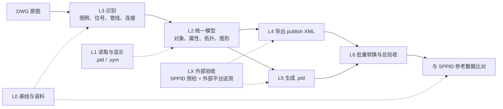

# 智能 PID 平台 · 阶段一实施方案（DWG 转智能 P&ID，导出 `.pid` 与 publish XML）

> 日期：2026-11-20
> 状态：**已确认并执行中**（2026-11-20 对齐当前 `main @ 6377fe233` 与 `pid-parse @ a85fa10` 修订）。按第 8 节"推进顺序"执行。
> 所属目录：`docs/plans/2026-11-20-phase1-dwg-to-smart-pid/`（跟踪总单：[happyrust/pid-cad#106](https://github.com/happyrust/pid-cad/issues/106)）。
> 依据：本仓库（`main @ 6377fe233`，解析库钉在 `pid-parse @ a85fa10285cc5379953495fa391f374981b9e587`，见 `Cargo.toml`）的代码、计划与读数；SPPID 样本（94 对 `.pid` + XML、11 对厂商参考样本、备份包、`.sym`）。样本细节见同目录《智能PID平台-样本分析-XML规格与pid结构》，源码问答见《03-parse-answers.md》，模型细节见《智能PID平台-内部模型合一分析》，资料清单见《智能PID平台-资料清单》，实测读数见《readings.md》。
> 写法约定：本文件只写项目本身。所有路径都是仓库相对路径；样本用逻辑名（`EXPORT_SET`、`SEED` 等）和环境变量引用，不写盘符、用户名、主机名。进行中与已完成的任务均在第 7 节对应任务下维护**「解决记录」**以便回溯。
> 全文分十一节：前三节交代目的、功能点、计划与路径；第四节到第七节是执行细则（约定、资料、问题、逐任务做法）；后四节是顺序、检查点、风险、文档分工。

---

## 1. 目的与终点

**目的。** 不依赖 SPPID 软件，把存量 DWG 格式的 P&ID 图纸转换成智能 P&ID（图形与数据成一块：类、位号、属性、管线、连通关系），并导出 `.pid` 与 publish XML（每张图一对 `<图名>_Data.xml`、`<图名>_Meta.xml`）。导出结果送**外部数字化交付平台**测试。协同、三维接入、规则检查、材料清单等留到后续阶段。

**终点（一句话）。** 对验收批次：程序批量识别并生成智能 P&ID；导出的 XML 与 SPPID 产出的参考 XML 在对象、位号、类、属性、关系上逐项比对，差异清单可解释且低于约定阈值；导出的 `.pid` 能被解析库重新读出、被本软件显示且与参考出图一致，并在 SPPID 里被打开；整批送外部平台测试有结论。

**不做（阶段一）。** 协同与离线同步；三维模型接入；设计规则检查、材料清单、快照、发布签核；多套图例标准的可视化编辑器；ISO 15926 / CFIHOS 交换；用户、角色、项目空间管理；PBS 树、Plant Explorer、报表、版本与 Workshare。

## 2. 功能点与优先级

### 2.1 七条工作线

| 线 | 功能 | 现状（依据仓库） |
|---|---|---|
| **L0 基线与语料** | 对应关系表、度量工具、现状基线、门禁基线、外部平台口径、解析库能力核实 | **已完成（检查点 A 达成）**：`L0-1`…`L0-9`（`#107`–`#109`、`#118`–`#122`）全部落盘并提交本地 `main`，详见 `readings.md` §1–§2、§4–§5、§8–§11 |
| **L1 读取与显示** | `.pid` 导入为图面；`.sym` 符号解析；与 SPPID 出图一致；`PIDPLOT`/`PIDBACKUPPDF` 出 PDF | **备份包收尾与 `.sym` 核查已完成**：记录族全覆盖、显示修正与总验收（`#112`）、检查点 C 新界面（`#115`）、缺失核查（`#113`，不在库符号 100% 带内嵌缓存）及 `.sym` 全量普查（`#114`，644/618 零失败）均已完成；仅剩扩面对比（`L1-2`）与耗时（`L1-5`） |
| **L2 内部模型与点选编辑** | `PID_SEMANTICS`（导入与识别写，只读）与 `PID_AUTHOR`（自建命令写，可编辑）合一；点选符号得到"图形加数据整块"；属性面板；位号标注随数据刷新 | 并行分支 `pid-symbol-identity` 正在落地 `.pid` 直读类型/名字、备份库补位号与 `0x00FA` 标注配对；**待该分支合入 `main` 后在其底座上实施升格合一** |
| **L3 DWG 识别** | 图例、位号、管线、连通；图例到 SPPID 类/码表值的映射；置信度与人工确认 | **主体识别与映射已打通**：`L3-0` 基线（`#122`）、`L3-1` 100% 业务图块映射（`#124`）及 `L3-2 / L3-7` 位号配对增强与三档置信度（`#125`）已完成，90 张有效 DXF 符号召回率达 `97.79%`、精确率 `99.89%`、位号一致率 `89.55%`（图面可见位号 `94.6%`） |
| **L4 publish XML** | 从统一模型导出 `_Data.xml`/`_Meta.xml`，格式与已通过样本一致 | **全线已完成（`L4-0`…`L4-7`）**：备份包导出、严格校验器（`#111`）、自有模型导出底座（`#123`）、管网合成与名称/公称直径规则（`#126`）及单图/整批转换入口与对账门禁（`#127`）全部落地；90 张真实 DXF 整批产出 `180` 份 XML `StrictVendor` 零违规、白名单外零未解释差异 |
| **L5 `.pid` 生成** | 种子加增补的写出器，分级验收 | `pid-parse::writer` 具备 CFB 容器流级替换底座，尚无高层图形/属性记录链生成能力 |
| **L6 整合与总验收** | 批量转换命令、交互编辑存回 `.pid`、总验收报告 | 未做 |
| **LX 外部验收** | SPPID 当裁判做预检；送外部平台的流程；"减法送测" | 未做 |

### 2.2 优先级

| 优先级 | 内容 | 对应工作线 |
|---|---|---|
| **首要** | `.pid` 显示与 `.sym` 元件解析，图纸按正确方式显示 | L1 |
| **首要，与上并行** | XML 导出与 `.pid` 导出，送外部平台测试 | L4、L5、LX |
| 其次 | 识别到导出先走通：用现有识别结果，经最小模型，走到 XML 和 `.pid`；准确率不设门槛 | L3 最小部分、L2 的 M1/M2/M5、L5-8 |
| 靠后 | 识别准确率与完整度；界面与点选编辑 | L3 深化、L2 其余 |

### 2.3 总路径



**一条硬约束贯穿 L4 与 L5：** XML 与 `.pid` 必须共用同一套 UID 与 `GraphicOID` 分配。样本分析证明，XML 里的对象 UID（表示、图纸、设备、仪表、管件、管线段等）都以 ASCII 文本出现在 `.pid` 的记录流里；两边各生成各的，对不上。

### 2.4 阶段划分

规模：**S** 约半天到一天，**M** 约一到三天，**L** 约一周以上（按本项目过去任务的粒度估，不是承诺）。

| 阶段 | 优先级 | 目标 | 包含任务 | 出口 | 规模 |
|---|---|---|---|---|---|
| **0 基线与语料** | 先行 | 知道"导出要过什么线"，能量出现状 | L0-1 … L0-9 | 对应表、度量工具、基线报告、门禁基线、外部平台口径、解析库能力核实结论 | M |
| **1 显示与 `.sym`** | 首要 | 图纸按正确方式显示，`.sym` 解析正确 | L1-1 … L1-6 | 显示对比报告；备份包计划的显示收尾完成 | M |
| **2 导出线** | 首要，与阶段 1 并行 | XML 与 `.pid` 导出，送外部平台 | L4-0 … L4-5、L4-7、L5-1 … L5-7、LX-1 … LX-9 | 预检三关通过；外部平台第一轮送测有回执 | L（风险最高） |
| **3 识别到导出走通** | 其次 | 一张简单图：DWG → 识别 → 最小模型 → XML 加 `.pid` → 送测 | L3-0、L3-1（高频子集）、L2-1 的 M1/M2/M5、L4-6、L5-8、L6-1（单图版） | 闭环走通；准确率不设门槛 | M |
| **4 识别准确率与界面** | 靠后 | 准确率与完整度；点选编辑；管线进拓扑；面板 | L3-1（全量）、L3-2 … L3-8、L2-1 的 M3/M4、L2-2 … L2-7 | 对真值的召回与精确达到约定阈值；点选出属性面板 | L |
| **5 整合与总验收** | 收尾 | 批量转换，总验收 | L5-9、L6-1 … L6-3 | 整批图跑通，出验收报告 | M |

**"走通"的最小闭环（阶段 3）。** 一张简单图，从 DWG 出发，用现有识别结果，生成最小模型（带位号和类的符号；管线和连通做到哪一步，由外部平台的最低要求决定），导出 XML 与 `.pid`，送测。识别不准的部分允许缺，但必须在覆盖报告里列出。

## 3. 验收口径

外部平台是其他单位的数字化交付平台，**没有它的代码，无法在本地复现它的检查**。已知 SPPID 自己产出的 `.pid` 与配套 XML 能通过它的测试；它的最低要求未知。所以：

1. **代理标准：与已通过的样本一致。** 我们导出的 XML 与 `.pid`，在结构与内容上与 SPPID 产出的、已知能通过的样本逐项一致；差异清单必须可解释。样本本身就是规格。
2. **日常门禁（每个任务都跑）：** `.pid` 的 a 级（解析器读回相等）、b 级（本软件显示与参考出图一致）；XML 的格式与结构校验器。
3. **送测前预检（三关，全过才送）：** ① XML 与已通过样本逐项对照；② `.pid` 在 SPPID 里能打开（c1，最小闭环的硬门槛）；③ SPPID 发布我们的 `.pid` 得到的 XML，与我们直接导出的 XML 一致（d）。c2（登记后能保存、发布）视实验结果。
4. **最低要求靠"减法送测"摸清：** 拿一对已通过的样本，去掉某一类内容再送，不通过的那份暴露一条硬要求。送测次数很少、一次反馈要几天，所以**每一轮一次送一组变体**（每份只去掉一类内容，另带一份原样已通过样本作对照）。
5. 汇报口径区分"我们的解析器认"和"SPPID 认"，两者不混。

参照指标：PRD 规定 P4 的存量图纸位号解析率 ≥ 98%（随机抽 100 张，解析出位号的符号实例数 ÷ 符号实例总数）。阶段一各项度量的具体阈值，由 L0-5 基线之后定。

## 4. 共用约定

### 4.1 叫法

| 叫法 | 指什么 |
|---|---|
| 智能 P&ID | 图形与数据成一块的 P&ID：每个符号、管线、连接符都有类、位号、属性，对象之间有连通关系 |
| `.pid` | SmartPlant P&ID 的图纸文件，复合文件（CFB）容器：图形记录、对象数据簇、属性行表、样式表、符号缓存 |
| publish XML | 每张图 `<图名>_Data.xml`（对象与关系）与 `<图名>_Meta.xml`（文档版本信封） |
| 备份包 | SPPID 的备份：目录或 zip，含 `Manifest.txt`、`Export.dmp`、`PlantData~*`（图纸）、`RefData~*`（参考数据） |
| `EXPORT_SET` | 一批 SPPID 产出的、已知能通过外部平台测试的 `.pid` + `_Data.xml` + `_Meta.xml`，可附同图 DXF 与 PDF。它就是规格与真值 |
| `SEED` | SPPID 新建的、没有或只有极少对象的 `.pid`，作为写出器的底 |
| 受控样本 | 在 SPPID 里只做一件事（加一个符号、改一个属性）前后的 `.pid` 对，用来定位"一件事改了哪些字节" |
| 预检三关 | 送外部平台前用 SPPID 验证：XML 对照样本、`.pid` 能打开、SPPID 发布一致 |
| 减法送测 | 每份变体去掉一类内容再送，用来摸外部平台的最低要求 |
| 类变体 | XML 里一个对象的"接口集 + 全部码表值"的组合，作为"图例 → SPPID 类"映射的最小单位 |
| 升格 | 把识别或导入的结果（`PID_SEMANTICS`）确认后写成可编辑对象（`PID_AUTHOR`） |

### 4.2 语料与证据目录

样本含客户数据，**不入库**。仓库只放工具、清单、规格摘要、合成或脱敏后的小 fixtures。各机器通过环境变量指向自己的目录。

| 环境变量 | 含义 | 未设置时 |
|---|---|---|
| `OCS_PID_CORPUS_DIR` | 语料根目录 | 依赖语料的测试与脚本一律跳过，打印"未设置语料目录" |
| `OCS_PID_EVIDENCE_DIR` | 证据与读数输出目录 | 系统临时目录下带日期的子目录 |
| `OCS_PID_PARSE_SRC` | `pid-parse` 源码检出目录（L0-8、构建对比用命令行程序） | 只做不依赖源码的部分 |
| `OCS_PID_SPPID_RUNNER` | SPPID 验收环境的运行器脚本 | LX 的验收类任务标"未执行"，不得标通过 |

语料根目录的约定布局（L0-2 的索引工具按此找；布局不同则在 `corpus.manifest.json` 里写映射）：

| 逻辑名 | 子目录 | 内容 |
|---|---|---|
| `EXPORT_SET` | `export-set/<批次>/` | 每张图三个文件：`<图名>.pid`、`<图名>_Data.xml`、`<图名>_Meta.xml` |
| `EXPORT_DXF`、`EXPORT_PDF` | `export-dxf/`、`export-pdf/` | SPPID 对同批图导出的 DXF 与 PDF |
| `SOURCE_DWG` | `source-dwg/` | 与 `EXPORT_SET` 对应的原始 DWG 或 DXF |
| `BACKUP_ORACLE`、`BACKUP_TABLES` | `backup-oracle/`、`backup-tables/` | 备份包；后者带数据库表文本导出 |
| `SYMBOLS` | `symbols/` | `.sym` 符号库与 `.igr` 图框模板 |
| `SEEDS` | `seeds/` | 种子 `.pid`，附说明：用哪个图框模板建、里面有什么 |
| `EXTERNAL` | `external-platform/` | 外部平台的交付规范、过往回执、已通过样本清单 |
| `CONTROLLED` | `controlled/` | 受控样本对，每对一个子目录，含说明 |

`corpus.manifest.json`（不入库，放语料根目录）：列出每个逻辑名对应的实际子目录，以及每个文件的 SHA-256。索引工具生成并校验它，用来保证"报告里的数字对应哪一批文件"。

### 4.3 SPPID 运行器契约

`OCS_PID_SPPID_RUNNER` 指向一个可执行脚本：

```text
<runner> open    --in <文件夹> --out <文件夹> --timeout <秒>
<runner> publish --in <文件夹> --out <文件夹> --timeout <秒>
<runner> restore
```

- 输入输出都是文件夹；运行器负责把文件搬进、搬出受控环境，仓库不知道环境在哪。
- `open` 的结果是 `<out>/open-result.json`：每个文件 `{ "file", "opened": true|false, "message", "seconds" }`。
- `publish` 的结果：每个 `.pid` 对应的 `_Data.xml` 与 `_Meta.xml`，以及 `<out>/publish-result.json`。
- 会改变文件字节的编辑动作**不由运行器自动做**，由人在环境里手工完成，前后文件放进 `CONTROLLED`。
- 运行器的实现、账号、快照名都在环境自己的说明里，不进本仓库。

### 4.4 固定门禁

命令在仓库根目录执行（Windows PowerShell 5.1；`&&`/`||` 不可用，用 `;` 与 `$LASTEXITCODE`）。

1. **先红后绿。** 先写测试，看到它因要测的断言失败（不是编译不过），再实现到通过。一写出来就绿的测试，先用故意错的期望值看它失败，再改回来。
2. `cargo test --offline --locked --lib`：失败条数不增加，测试条数不减少。基线读数由 L0-6 在当前 `main` 重量。
3. `cargo clippy --offline --locked --lib` 与加 `--profile test` 各跑一次：警告数不超过**改前在同一编译器上**的读数；每次读数同时记 `rustc -V`。
4. 改动文件不新增 `rustfmt` 不一致：`scripts\fmt-newhunks.ps1 <改前的副本> <改后的文件>`，新增 0。
5. 改了 `Cargo.lock` 的任务加跑 `cargo test --offline --locked -p ocs_collab -p ocs_collab_server`。
6. 动了 `src/io/` 或 `src/app/` 的任务，前后各跑 `python scripts/arch_check.py report`：`io` 开头各行数字不变大。
7. 动了 `docs/pid-platform/` 才跑 `python -m pytest scripts/pid-platform -q -p no:cacheprovider`。
8. **一个任务一个提交。** `git add` 只加本任务列出的文件，外加任务清单的勾选。不推送。设计稿 `docs/pid-platform/design/pid-platform.pen` 不进提交。
9. **样本和证据不进仓库。** 读数只记数字、结论和证据的文件名；每组读数带日期、提交号、`rustc -V`、`corpus.manifest.json` 的校验摘要。
10. 全程离线（`--offline --locked`）。需要联网的任务（升级 `pid-parse` 钉定版本）单独写明并先确认。
11. 实现与规格有出入时，在该规格末尾加一节"实现记录"，不悄悄改口径。
12. 只改文档的任务不必重跑第 2–4 条。

### 4.5 测试怎么写、放在哪

- 引擎测试写在同文件的 `#[cfg(test)] mod tests`。要读写文件的，用 `std::env::temp_dir()` 下带唯一后缀的目录，测完删。
- 依赖真实样本的测试标 `#[ignore]`，路径从环境变量取；未设置就跳过并说明，不报失败。它们由 `scripts/sppid/` 下的脚本串起来：一条命令出一张表，有一格不过退出码非 0。
- **小 fixtures 一律合成或脱敏**：由测试代码生成最小 XML 或最小 `.pid`，或手工删减后去掉所有客户信息；不复制客户文件。
- Python 脚本只用标准库；测试用 `python -m pytest scripts/sppid -q -p no:cacheprovider`。PowerShell 脚本要能在 Windows PowerShell 5.1 跑，脚本文件只用 ASCII 字符，表头用英文，路径都能用参数改。
- 读复合文件（CFB）与解码 `.pid`，走 `pid-parse` 的 Rust API，不在脚本里另造解析器。
- 不加新依赖；解析 PDF 用仓库已有的 `lopdf`。

### 4.6 新代码的位置（建议，实施时以任务为准）

| 内容 | 建议位置 |
|---|---|
| XML 规格摘要（类型、接口、属性、关系前缀、两端类型） | `assets/pid-publish-spec.json`（只含结构，不含客户数据） |
| XML 校验器 | `src/io/pid_publish_check.rs`，对外由 `scripts/sppid/xml_spec_check.py` 或测试调用 |
| 模型到 XML 的导出器 | `src/io/pid_publish/`（`mod.rs`、`model.rs`、`uid.rs`、`classes.rs`、`names.rs`、`relations.rs`、`write.rs`） |
| `.pid` 写出器 | `src/io/pid_write/`（`mod.rs`、`seed.rs`、`oid.rs`、`records.rs`、`verify.rs`） |
| 图例到 SPPID 类的映射规则 | `assets/pid-legend.json` 增字段，或 `assets/pid-class-map.json`（沿用"规则外置"） |
| 升格步骤 | `src/pid/promote.rs`（新），识别端接线在 `src/io/pid_legend/` |
| 度量与对比脚本 | `scripts/sppid/` |
| 批量转换命令 | `src/app/commands/pidconvert.rs`（新） |

分层：`src/io/` 不引用 `src/app/`、UI（`scripts/arch_check.py` 守着）。

## 5. 所需资料

可得性标记：**✔** 一般已具备；**⚠** 可能缺（不保证每台机器都有）；**✖** 需另行获取（缺则阻塞）。

| 编号 | 资料 | 可得性 | 阻塞哪些任务 | 优先级 |
|---|---|---|---|---|
| RES-01 | `pid-parse` 源码（钉定提交 `a85fa10`） | ✔ 已就位并核实 | 原阻塞 L0-8、L0-9、L4-1…L4-5、L5-1…L5-5、LX-6（现已解除，见 `03-parse-answers.md`） | A |
| RES-02 | 导出样本集：`.pid` + `_Data.xml` + `_Meta.xml`，另可附 DXF、PDF | ✔ | L0-2…L0-5、L3-0、L4-0、L4-7 | A |
| RES-03 | 符号库 `.sym` 与图框模板 `.igr` | ✔ | L1-3、L1-6、L3-1 | A |
| RES-04 | 小型与全厂备份包及其 publish 输出 | ✔ 已完成验收 | L0-5（备份包部分） | B |
| RES-05 | SPPID 侧信息：版本、数据库类型、图例标准名、工厂名 | ✔（版本已从样本 XML 容器读出） | L4-2、L3-2 | B |
| RES-06 | SPPID 验收环境（受控环境、快照、运行器） | ⚠ | LX-1…LX-5、LX-8、L5-2、L5-7 | A |
| RES-07 | 并行开发状态：备份包导出与并行工作树边界 | ✔ 已对齐 | L2 与 `pid-symbol-identity` 衔接 | B |
| RES-08 | 门禁基线读数 | ✔ 已完成（`#109`） | L0-6 | B |
| RES-09 | 以前"把 `.pid` 放回 SPPID 项目目录再打开"的实验记录 | ⚠ | LX-4（E0 可省） | B |
| RES-10 | 验收范围：哪一批图、多少张、几套图例 | ✖ | L0-5 阈值、L6-3 | B |
| RES-11 | 外部属性来源样例（设备表、线表） | ⚠ | 阶段一不做，只预留接口 | C |
| RES-12 | SPPID 界面截图：属性面板、符号选取面板、图框属性、点选后 | ⚠ | L2-2、L2-3 | C |
| RES-13 | SPPID 导出的 DWG（与样本同批） | ⚠ | L1-2、L3-0 的对照 | C |
| RES-14 | 种子：空白 `.pid` 与"只放一个设备"的 `.pid` | ⚠ | L5-2、L5-3、L5-8 | A |
| RES-15 | 外部平台信息：交付规范、过往回执（含被拒的报错原文）、已通过样本清单、收什么文件、一次送几份、是否逐份返回 | ✖ | L0-7、LX-9、L6-3 | A |
| RES-16 | 原始 DWG/DXF 与样本集的对应关系（含多页合并的拆分对照表） | ⚠ | L0-3、L3-0 | A |
| RES-17 | 位号与线号命名规则文档 | ⚠ | L3-2、L3-3、L3-6 | B |

**逐项要点与降级做法：**

- **RES-01**：完整检出，去掉 `target/`；若有尚未合入主线的导出/写出相关提交，连分支名一起给。缺则 L0-8 只出"问题清单 + 样本侧已能确认的部分"，L4-1 与 L5-4 的"转换还是新写"决策推迟；L4-0、L0-3/4/5、L1、L3-0 不受影响。
- **RES-02**：每张图三个同名文件，可附 DXF、PDF。已知一批 94 对、分 3 个批次子目录；`.pid` 332 KB–6.5 MB，`_Data.xml` 147 KB–3.7 MB，容器属性 94 份完全相同。缺则任务阻塞，无替代。样本"已通过外部平台"由使用者声明，报告里必须写"依据使用者声明"。
- **RES-03**：`.sym` 按子目录分类；图框模板 `.igr`。已知参考数据里有 728 个 `.sym`、12 个 `.igr`。缺则显示退回标记点；L3-1 只能对着 `.pid` 缓存的符号本体做。
- **RES-06**：需要能运行 SPPID、能打开与发布 `.pid` 的受控环境；有基线快照；有运行器脚本；知道 SPPID 版本、工厂名、项目名、打开图纸的入口。缺则预检只做第①关（静态对照），`.pid` 只验到 a/b 级，所有汇报写"SPPID 未验证"，L5-7、L5-8 的 c1 不得标通过。安全要求：实验前建快照；访客账号专用，密码不进文档与聊天；不开放对宿主机的写共享。
- **RES-14**：空白 `.pid` 1 份（注明用哪个图框模板建）；"只放一个设备"的 1 份。参考数据里通常有 12 个空白模板（28–118 KB）可作候选。缺则空白种子用模板；"只放一个设备"的由 LX-3 在验收环境里建；都没有则 L5-3 只能"取最小的一份当底并删对象"，风险高，须在汇报里注明。
- **RES-15**：已通过样本清单、交付规范、过往回执（通过和被拒都要，被拒的带报错原文）、收 XML 还是 XML 加 `.pid`、一次送几份、是否逐份返回、送测次数与反馈周期。缺则口径只能是"与已通过样本一致"，"减法送测"按"每轮一组变体、至多两三轮"做预案。**这是最大的不确定性。**
- **RES-16**：每个原始 DWG（或 DXF）对应样本集哪几张图；多页合并的拆分对照表。缺则 L0-3 先按图名相似度与文字匹配做候选、人工确认；无法确认的标"未对应"，不进识别度量的分母。
- **RES-17**：位号与线号格式规则；两套图例各自的写法（识别计划里出现过 5 位与 4 位线号序号两种写法）。缺则从样本反推，标注"反推，未经确认"。

**安全提示：** 备份清单（`Manifest.txt`）里含被编码的数据库连接信息，**不外传，不贴进任何文档或聊天**。客户数据不入库。

## 6. 对着 `pid-parse @ a85fa10` 源码回答的问题（Q1–Q13，已完成）

对应任务 L0-8。已在 `$OCS_PID_PARSE_SRC` 对照 `Cargo.toml` 钉定的提交（`a85fa10285cc5379953495fa391f374981b9e587`）完成全部 13 题核实，带精确源码路径与行号的全文见同目录 **`03-parse-answers.md`**。

| # | 问题 | 决定什么 | 阻塞 |
|---|---|---|---|
| Q1 | `pid-parse` 有没有从"文档模型"构造 `.pid` 的写出能力？现有写出器能写哪些（原样回写、元数据、摘要、整流替换、字节补丁）？每个的输入输出边界与测试覆盖？有没有"新增一个对象"的 API？ | L5 是扩现有写出器还是新写 | L5-1、L5-4 |
| Q2 | 对 `/Sheet#`、`/PSMcluster#`、`/Unclustered Dynamic Attributes`、`/PSMspacemap/*`、`/StyleCluster`、`/JSite#/*`、`/PSMroots`、`/PSMclustertable`、`/PSMsegmenttable`、`/DocVersion#`、`/JSitesList`、`/JTaggedTxtStgList`、`/AppObject`、`/Dynamic Attributes Metadata`、摘要信息，各自的解码状态（已解码、有类型的审计、探针、只识别、未知）？覆盖台账在哪？ | 写出面有多大 | L5-1 |
| Q3 | `/Unclustered Dynamic Attributes` 的行格式是否完全解码？行类与属性完整清单？哪些字段是连接 XML 的键？`GraphicOID` → `DrawingID` → 实体的"两跳"怎么走？有无不能唯一连接的情况？ | 对应表怎么建 | L0-9、L4-3 |
| Q4 | `PIDPipeline` 的 UID 在样本 `.pid` 里找不到（抽样 0/9），名称只有约 21% 能找到。如何合成管线的 UID、名称、与管线段的关系？输入字段是什么？与样本吻合率实测多少？ | 管线对象怎么生成 | L4-4 |
| Q5 | 仪表（形如 `PG-0401302`）、设备、管线段、管线（形如 `50 mm-CI-0602002-B2-EH40`）、控制功能的名称拼接规则？已知例外？实测吻合率？ | 名称拼接 | L4-5 |
| Q6 | 公称直径换算（`4"`、`100`、`1-1/2"` → `4 in`、`100 mm`、`1-1/2 in`）规则？单位如何决定？ | 属性值生成 | L4-5 |
| Q7 | 码表值（`@EE3F8` 等）从哪来？有没有"类目录"（符号到码表值元组）？位置、规模、来源？覆盖约 240 种变体里的多少？ | 映射表来源与规模 | L3-1、L4-2 |
| Q8 | XML 写出函数的输入是什么（`PublishDrawing` 一类）？能否脱离 `.pid` 和数据库直接吃我们造的结构？必填字段？最小示例？ | L4-1 是转换还是新写 | L4-1 |
| Q9 | `GraphicOID` 怎么分配？同一图内是否要求唯一（跨存储）？新增一个对象，哪些流必须同步改？ | 索引一致性 | L4-3、L5-5 |
| Q10 | 摘要信息里的 `_PIDTemplate`、`_PlantName`、`_SPID` 哪些必须设置？`_SPID` 是否图纸 UID？SPPID 打开时是否校验？ | 新图元数据 | L5-3 |
| Q11 | 94 个样本 `.pid` 都没有 `/TaggedTxtData/Drawing`、`/General`，只有大小为 0 的 `/Revision`。文档里的 Drawing/General 流是另一种版本吗？图号、模板等信息存在哪里？ | 避免按错误流结构写 | L5-1 |
| Q12 | `/JSite#/JProperties` 里的符号路径写成指向共享目录的 UNC 路径。SPPID 打开时是否要求该路径存在、可达？生成新 `.pid` 时写成什么形式才能打开？ | 符号路径怎么写 | L5-4 |
| Q13 | 有没有"受控样本"（只加一个符号、只改一个属性前后的字节对比）？现有哪些、在哪、是否可用？ | 要不要新采集 | L5-2、LX-3 |

**答案模板：**

```text
## Qn 标题
结论（一句话）：
证据：<源码路径:行号> / <测试名> / <复现命令与输出摘要>
状态：明确有 | 测试证明 | 文档说有但没找到实现 | 不知道
对计划的影响：（受影响的任务编号与要改的决策）
遗留：
```

## 7. 逐任务做法

每个任务统一格式：**目标与不做 / 做法 / 验收 / 依赖 / 资料 / 风险与降级 / 规模**。

### 7.1 L0 基线与语料

#### L0-1 资料清点与缺口登记（S）
- **目标**：把第 5 节每项资料核对到"有/无/部分"，形成一张现状表。
- **不做**：不整理内容，只登记。
- **做法**：按 RES-01…RES-17 逐项核对；记录路径（写进证据目录，不进仓库）、数量、格式、来源与日期；对每项标注可得性标记。
- **验收**：表里 17 项都有状态；标 ⚠/✖ 的每项写出"缺了会阻塞哪个任务"。
- **依赖**：无。**资料**：全部。

#### L0-2 语料约定与索引工具（M）— **已完成（[#107](https://github.com/happyrust/pid-cad/issues/107)）**
- **目标**：让"报告里的数字"能对应到具体文件。
- **做法**：① 定义 `corpus.manifest.json` 格式（逻辑名 → 实际子目录 → 文件清单与 SHA-256）；② 写 `scripts/sppid/corpus_index.py`（只用标准库），支持 `index`（生成）与 `verify`（校验）两个子命令；③ 写 `scripts/sppid/corpus-layout.md` 说明约定布局；④ 在 CI 或本地脚本里加一条"未设 `OCS_PID_CORPUS_DIR` 就跳过"的测试。
- **验收**：对一个真实语料目录跑 `index` 生成清单，再跑 `verify` 通过；故意改一个字节后 `verify` 失败并点名文件；未设环境变量时退出码为 0 且打印"未设置语料目录"。
- **依赖**：L0-1。**资料**：RES-02 ✔。
- **解决记录（2026-11-20）**：提交 `538ec0112` 落地 `scripts/sppid/corpus_index.py`、`scripts/sppid/corpus-layout.md`、`scripts/sppid/test_corpus_index.py`（先红 `8 failed` → 全绿 `167 passed`）；通过外置 `--manifest` 只读扫描真实语料 `1,115` 个文件（`manifest_sha256=487b320319a9dfad20b1f9b70c8647ad2885ece4d2f8d3a217f71c88b9112038`），`verify`、单字节篡改报错、未设环境变量退出码 `0` 及零绝对路径审计全部通过，详见 `readings.md` §2。

#### L0-3 对应关系表（M）— **已完成（[#120](https://github.com/happyrust/pid-cad/issues/120)）**
- **目标**：建立"原始图 ↔ 拆分图 ↔ `.pid` ↔ XML ↔ DXF/PDF ↔ 备份包内路径"的一一对应。
- **做法**：① 用文件名前缀做初配（`<图名>.pid` / `_Data.xml` / `_Meta.xml` 同名）；② 用图名与 DXF/PDF 匹配；③ 对多页合并的原图，用拆分对照表（若有）或按图名与文字相似度做候选；④ 输出 `corpus.manifest.json` 里的一张 `correspondence` 段，以及一份人可读的 CSV。
- **验收**：每张 `.pid` 都有 `_Data.xml` 与 `_Meta.xml`；无法对应的项单列并写明原因；数量对不上时（例如 `.pid` 数多于原图数）在报告里点名。
- **依赖**：L0-2。**资料**：RES-02 ✔、RES-16 ⚠（缺则按相似度候选，人工确认）。
- **解决记录（2026-11-20）**：落地 `scripts/sppid/{corpus_correspondence,test_corpus_correspondence}.py`（先红后绿，`pytest` `179 passed`）；全批 `94` 套 `.pid` + `_Data.xml` + `_Meta.xml` 100% 齐全，DXF/PDF 配对 `84` 张精确同名 + `10` 张近形字微差候选（相似度 `0.9286–0.9714`），并自动检出剔除 `4` 份 `0` 字节空 DXF，锁定 `90` 张有效非空识别分母，详见 `readings.md` §9。

#### L0-4 度量工具集（M）— **已完成（[#108](https://github.com/happyrust/pid-cad/issues/108)）**
- **目标**：把"像不像"变成可算的数字。
- **做法**：写三类脚本：① `xml_diff.py`：两份 `_Data.xml` 按对象 UID 对齐（合成管线默认按唯一 `Name` 对齐，支持 `--allowlist` 白名单），比对类型、接口集、属性集与取值、关系集合，输出差异清单（新增/缺失/属性不同/关系不同）；② `legend_vs_xml.py`：识别结果（`PIDLEGEND EXPORT` 的 JSON）对参考 XML，算符号召回与精确、位号配对准确率及可选管线连接比对；③ `render_vs_pdf.py`：本软件出的 PDF 对参考 PDF（支持纯标准库流/线条/文字比对与 `pid_plot_compare` JSON 对账），沿用仓库已有的"覆盖率、多画长度、文字对上条数"三项。
- **验收**：每类脚本对"同一份文件自己比自己"给出零差异；对一份故意改动过的样本给出预期差异（改一个属性、删一个对象、删一条关系各一条测试）；输出格式固定（表头固定、一行一个差异）。
- **依赖**：L0-2。**资料**：RES-02 ✔。
- **解决记录（2026-11-20）**：落地 `scripts/sppid/{xml_diff,legend_vs_xml,render_vs_pdf,test_metrics_108}.py`（先红 `5 failed` → 全绿 `176 passed`）；全批 `94` 份 `_Data.xml`（`16,390` 个可标记符号）、`94` 份 PDF 自检及 `11` 份厂商验收记录核对全部 `diffs=0`，详见 `readings.md` §5。

#### L0-5 现状基线报告（M）— **已完成（[#122](https://github.com/happyrust/pid-cad/issues/122)，检查点 A 达成）**
- **目标**：知道现在有多准，缺口在哪。
- **做法**：对验收批次全量跑 L0-4 的度量；出一份报告：符号召回/精确、位号配对准确率、类映射覆盖率、XML 逐项比对差异统计、显示对比三项指标；列出 Top N 缺口。
- **验收**：报告可复现（同一批次重跑数字相同）；每个数字都带"分母是什么、哪批文件、清单摘要"；未识别与未映射的项逐条列出。
- **依赖**：L0-3、L0-4。**资料**：RES-02 ✔、RES-03 ✔。
- **解决记录（2026-11-20）**：落地 `scripts/sppid/{legend_baseline,test_legend_baseline}.py`（先红后绿，`pytest` `181 passed`）；对 `90` 张有效非空导出 DXF 实跑 `dxf_legend` 并连续两轮验证结果 100% 相等：真值可标记符号 `15,957` 个（带位号 `9,536` 个），检出候选图块 `17,185` 个（净业务块 `16,426` 个），定位出旧消防水规则块名与本批 `.sym` 同名大写块（如 `BALL VALVE TYPE 2` `1,511` 次、`DCS FUNC ACCESS IN PRIME LOC` `1,653` 次）不重合及 7 位序号未放宽两大根因，直接给出 `L3-1`/`L3-2` 映射方案，详见 `readings.md` §11。

#### L0-6 门禁基线（S）— **已完成（[#109](https://github.com/happyrust/pid-cad/issues/109)）**
- **做法**：在当前 `main` 上量 `cargo test --offline --locked --lib`（过/忽略/失败条数）、clippy 两项警告数、`rustc -V`；记入读数文件。
- **验收**：读数文件里有这四组数字与日期、提交号；后续任务按它判"不增加"。
- **依赖**：无。**资料**：RES-08（运行时生成）。
- **解决记录（2026-11-20）**：提交 `9b5faf294` 写入同目录 `readings.md` §1。基线 `main @ 6377fe233`、`rustc 1.102.0-nightly (65ce8611f 2026-11-18)` 下：库测试 `7,145` 条（`7,089` 过 / `55` 忽略 / `1` 本地未提交 `.pen` 字重测试），`clippy --lib` `656` 条，`clippy --lib --profile test` `1,051` 条，并逐项写明与 `2026-11-18` 旧基线的差异归因。

#### L0-7 外部平台验收口径（S）— **已完成（[#121](https://github.com/happyrust/pid-cad/issues/121)）**
- **做法**：整理 RES-15；明确送测对象、收什么文件、一次送几份、是否逐份返回、通过标准、失败反馈形态；把"减法送测"排成不超过两三轮的变体清单（每轮一组：逐份去掉一类内容，另带一份原样样本）。
- **验收**：口径写成一页；每轮变体的"去掉什么、期望暴露哪条要求"逐条列出；缺信息的地方明确标"待补"。
- **依赖**：无。**资料**：RES-15 ✖（缺则按代理标准执行，并在报告里写明"最低要求未知"）。
- **解决记录（2026-11-20）**：落盘同目录 `04-external-platform-protocol.md`（并记入 `readings.md` §10），固化代理标准、`RES-15` 五项待补清单、标准送测包结构、三轮减法变体矩阵与 `receipt.json` 回执格式。

#### L0-8 `pid-parse` 能力核实（M）— **已完成（[#118](https://github.com/happyrust/pid-cad/issues/118)）**
- **做法**：按第 6 节 Q1–Q13 逐条查源码与测试，答案写进 `03-parse-answers.md`；每条带源码路径行号或复现命令。
- **验收**：13 条都有结论与证据；对 L4-1、L5-4 的"转换还是新写"给出明确建议。
- **依赖**：无。**资料**：RES-01 ✔。
- **解决记录（2026-11-20）**：对照 `pid-parse @ a85fa10` 源码与测试逐条核实 Q1–Q13，落盘同目录 `03-parse-answers.md`（并记入 `readings.md` §4）；锁定 `L4-1` 采用「转换至 `PublishDrawing`/`PidPublishDrawing` DTO + 严格厂商字节格式包装」，`L5-4` 采用「在 `PidPackage` + `PidWriter::stream_replacements` 之上编码记录链并同步 `/PSMspacemap` 与图层计数」。

#### L0-9 `.pid` 对象与 XML 对象的逐对象对应表（L，[#119](https://github.com/happyrust/pid-cad/issues/119)）— **已完成**
- **目标**：把"符号（图形）→ 类变体"的对应关系建起来，这是 L3-1 与 L4-2 的地基。
- **做法**：① 用 `pid-parse` 读 `.pid`，取出图形记录与属性行；② 按 Q3 的连接方式，把 XML 的每个对象连到 `.pid` 里的图形元素；③ 对每类对象统计"接口集 + 码表值"的变体，并把变体与符号（`.sym` 路径或缓存本体）关联；④ 输出变体目录（`assets/pid-class-map.json` 的初稿，只含结构，不含客户数据）。
- **验收**：任取一对样本，能列出该图所有对象及其图形；变体数与样本分析一致（管件、管线段各约 78 种）；无法连接的项单列并写明原因。
- **依赖**：L0-3、L0-8。**资料**：RES-01 ✔、RES-02 ✔。
- **解决记录（2026-11-20）**：落地 `src/io/pid_variant_map.rs` 并产出零客户数据的 `assets/pid-class-map.json`（先红后绿）；94 对样本共 `106,150` 个业务对象提取出 **`237` 种类变体**（管件 `78`、管线段 `78`、在线仪表 `15`、容器 `14`、机械设备 `10`、换热 `9`、管线 `7`、工艺设备 `5`、仪表 `4`、管口 `4`、管道端口 `3`），未直连根图元项逐类归因清晰，详见 `readings.md` §8。

### 7.2 L1 读取与显示

#### L1-1 显示修正五项与备份包计划收尾（L）— **已在基线完成（[#112](https://github.com/happyrust/pid-cad/issues/112)）**
- **目标**：图纸按正确方式显示，与参考出图一致。
- **做法**：按备份包计划里已排的五项逐一做：RD-7（面板开着时整张图幅在画布里）、RD-11（文字按样式里的字宽比例画）、RD-8（文字框里的字靠边）、RD-9（符号里的圆弧）、RD-13（图框按图纸里记的位置放）；再做 ACC-1（按四条验收走一遍）。
- **验收**：每项先红后绿；11 张厂商图的对比三项指标不退化；8 次走查全过；读数写进读数文件。
- **依赖**：无。**资料**：RES-02 ✔（对比用）、RES-13 ⚠。
- **解决记录**：已在 `main` 完成（含额外补充的 `RD-14` 标注竖直位置，`dd96a50f7..51b654a87`），实测记录见 `docs/plans/2026-11-17-sppid-backup-publish/readings.md` §22–§29，不再重复执行。

#### L1-2 一致性对比扩面（M）
- **做法**：把"覆盖率、多画长度、文字对上条数"三项跑到整批（而不是抽 11 张）；差异逐张列出，归因到"读取/转换/画布"哪一层。
- **验收**：整批都有读数；比基线差的图逐张点名并写原因；退化即失败。
- **依赖**：L0-3。**资料**：RES-02 ✔、RES-13 ⚠。

#### L1-3 符号缺失清单与补齐来源（S）— **已完成（[#113](https://github.com/happyrust/pid-cad/issues/113)）**
- **做法**：扫全批 `.pid` 里引用的 `.sym` 路径，对 `SYMBOLS` 求差集；输出缺失清单；对缺失项判断"能否用缓存本体代替"。
- **验收**：清单完整；每项标"有缓存本体/无"，无的写明补齐来源。
- **依赖**：L0-3。**资料**：RES-03 ✔。
- **解决记录（2026-11-20）**：落地 `src/io/pid_sym_missing.rs`（先红后绿）；全厂包 53 张图（`9,225` 次放置，去重 `142` 种，不在库 `9` 种）与 `EXPORT_SET` 94 张图（`18,373` 次放置，去重 `253` 种，对比 `644` 子集库差 `84` 种）中，不在库符号 **100% 均带图纸内嵌缓存本体（无缓存缺失 `0` 种）**，详见 `readings.md` §6。

#### L1-4 多样式字符 run 混排核验（S，原 M 缩窄）
- **现状对齐**：单样式字符 run 覆盖段落默认已在 `src/io/pid/styles.rs:101-136` 接通（原 106/155 偏差已修）；当前仅对同一条 `TEXT` 内出现多种字符样式（如上标 `m³`）按占多数字符的 run 展平并记录日志。
- **做法**：在 `L1-2` 整批出图对比中核查多样式展平是否产生可见字宽偏差，仅在存在实测偏差时做拆段或转 `MTEXT`。
- **验收**：核查表与结论写入读数文件。
- **依赖**：L1-2。

#### L1-5 批量打开性能（S）
- **做法**：量整批导入耗时；找热点；只做低风险优化。
- **验收**：整批耗时不超过基线的约定倍数；读数记录。

#### L1-6 `.sym` 解码状态普查（M）— **已完成（[#114](https://github.com/happyrust/pid-cad/issues/114)）**
- **做法**：对 `SYMBOLS` 里每个 `.sym` 跑一遍解码，统计成功/失败/部分；失败项分类（版本、加密、非标准）。
- **验收**：全量普查表；失败项逐条带原因；与样本分析里"618 个零失败"的口径对齐并说明差异。
- **依赖**：L0-2。**资料**：RES-03 ✔。
- **解决记录（2026-11-20）**：落地 `src/io/pid_sym_census.rs` 与 `scripts/sppid/sym-census.ps1`（先红后绿）；全厂包 `plant644` 库 `644` 个 `.sym`（`643` 可画 + `1` 空本体，`0` 失败）与解析库参考 `full618` 库 `618` 个 `.sym`（`618` 可画，`0` 失败）连续两轮普查逐项一致，并书面写清 `618` / `644` / `728` 三套来源口径差异，详见 `readings.md` §7。

### 7.3 L2 内部模型与点选编辑

#### L2-1 内部模型合一（L，分五步；前置：待并行分支 `pid-symbol-identity` 合入 `main` 后启动）
- **M1 类型映射**：识别类 → 类型库编码 → SPPID 类名；规则外置；未映射单列。依赖 L0-8、L3-1。
- **M2 升格**：识别结果写成 `PID_AUTHOR`，带来源与置信度（先放 `props` 保留键）；幂等，不覆盖手工位号。验收：重复升格不重复建对象；手工位号不被覆盖；`purge` 仍只清 `legend:` 来源。
- **M3 管线进拓扑**：识别出的线号与 run 转成拓扑表记录；端口与连通转成连接符记录。验收：拓扑表与识别报告逐项对得上。
- **M4 面板**：`PID_AUTHOR` 行可编辑，`PID_SEMANTICS` 作只读"来源证据"组。
- **M5 导出视图**：一个只读的"导出模型"结构，供 L4 与 L5 共用。
- **不做**：不改两个 APPID 的隔离规则；不改自动化接口对外面。
- **风险**：`PID_AUTHOR` 九键契约、XDATA 长度上限（2048 字节软上限）、变换敏感类型禁止落盘（`Position3D` 等五种）。
- **依赖**：M1 依赖 L0-8、L3-1；其余按步。

#### L2-2 点选整块（M）
- **做法**：点选一个符号时，按 handle 把图形与 `PID_AUTHOR` 记录作为一块选中；打开属性面板。
- **验收**：点选后属性面板显示该类对象的全部字段；选中态可撤销重做。
- **资料**：RES-12 ⚠（缺则按"属性按接口分组"自设计并注明未对照实物）。

#### L2-3 属性面板读写（M）
- **做法**：按接口分页签；写入走既有 `set_entity_xdata` 路径；改位号走位号引擎。
- **验收**：改一个属性后保存、重开，值不变；位号重复时给出提示且不写入。

#### L2-4 属性改动联动（M）
- **做法**：属性改动后刷新图上标注；位号唯一性校验。
- **验收**：改位号后图面标注跟着变；重复位号被拒并提示。

#### L2-5 几何改动联动（M）
- **做法**：移动、删除符号后，更新端口位置、连通关系、管线端点。
- **验收**：删除符号后，指向它的关系被清除且拓扑表无悬挂项；移动后端口坐标更新。

#### L2-6 导入的 `.pid` 对象进模型（M）
- **做法**：把 `.pid` 导入的对象按 M2 的方式升格（可批量、可选择性）。
- **验收**：导入的图能点选、能改、能保存回 DWG；`_Data.xml` 缺省时仍能显示基本身份。
- **资料**：RES-01 ⚠。

#### L2-7 保存回 `.pid`（M）
- **依赖**：L5-7。**做法**：复用 L5 的写出器，把当前模型写回 `.pid`。
- **验收**：写出后 `pid-parse` 重读相等；SPPID 能打开。

### 7.4 L3 DWG 识别

#### L3-0 识别基线（M）— **已完成（随 [#122](https://github.com/happyrust/pid-cad/issues/122) 一并完成）**
- **做法**：对验收批次的拆分图跑现有识别，输出 `PIDLEGEND EXPORT` 的 JSON；用 L0-4 的 `legend_vs_xml.py` 对参考 XML 求召回/精确/配对准确率。
- **验收**：整批有基线数字；未识别、未映射项逐条列出；报告可复现。
- **依赖**：L0-3、L0-4。**资料**：RES-02 ✔、RES-16 ⚠。
- **解决记录（2026-11-20）**：与 `L0-5` 合并由 `scripts/sppid/legend_baseline.py` 跑通 90 张有效 DXF 并输出可复现基线与 Top 15 缺口，见 `readings.md` §11。

#### L3-1 图例映射（L）— **已完成（[#124](https://github.com/happyrust/pid-cad/issues/124)）**
- **做法**：以 L0-9 的变体目录为基础，建立"DWG 块/图层/形状 → `.sym` 路径 → ModelItemType 与码表值元组"的规则；规则外置；先覆盖高频（管件与管线段前 50 种覆盖 99%）。
- **验收**：对验收批次，映射覆盖率与"未映射"清单；映射上的对象在 XML 里写出正确类型与码表值；每加一批规则，报告逐行 diff 可控。
- **依赖**：L0-9、L3-0。**资料**：RES-02 ✔、RES-03 ✔。
- **解决记录（2026-11-20）**：落地纯 ASCII 外置规则 `assets/pid-sppid-legend-map.json` 与独立转换模块 `src/io/pid_convert/class_map.rs`（先红后绿，零并行分支冲突）；对 90 张有效非空 DXF 全量实测：过滤 `1,326` 个非业务图框/说明框后，净业务图块 **`15,852 / 15,852`（100.00%）** 映射到 `assets/pid-class-map.json` 变体（未映射 `0`），详见 `readings.md` §13。

#### L3-2 位号识别增强（M）— **已完成（[#125](https://github.com/happyrust/pid-cad/issues/125)）**
- **做法**：多行位号、范围标注（`BUV-3101/3102`、`～`）、仪表圈内文字拼接、位号落在符号外的各种写法。
- **验收**：每类写法有最小例子（合成 fixture）先红后绿；整批配对准确率不退化。
- **资料**：RES-17 ⚠。
- **解决记录（2026-11-20）**：落地 `src/io/pid_convert/recognize.rs`（圈内双行拼接、带空格 7 位阀门位号归一化、二分图最小距离唯一配对、设备包围盒配对与图层 `10` 松散几何容器恢复、页间连接符 `DWG-*` / 走向配对及范围展开）；90 张有效 DXF 两轮复跑 100% 一致，召回率由 `0.000188` 升至 **`0.977941`**、精确率 **`0.998912`**、位号一致率 **`0.895546`**，详见 `readings.md` §14。

#### L3-3 管线识别增强（L）
- **做法**：线号（5 位与 4 位序号两种）、管线族、管段与管件断开、流向；补未覆盖的族。
- **验收**：每族有 run 数与端口数读数；断头逐条归因。
- **资料**：RES-17 ⚠。

#### L3-4 连通（L）
- **做法**：符号连接点与管线端点配对；页间连接符跨图配对（按文字与图号）。
- **验收**：配对结果对参考 XML 的连通关系逐项比对；错配与漏配逐条列出。

#### L3-5 设备与管口（M）
- **做法**：管口位号继承设备位号；管口与设备的组合关系。
- **验收**：管口位号与参考 XML 一致的比例；不一致的逐条说明。

#### L3-6 属性来源（M）
- **做法**：线号拆解（公称直径、介质、序号、等级）；图框标题栏读图号图名；预留外部表格接口（不做）。
- **验收**：拆解结果对参考 XML 的属性逐项比对；标题栏读出的图号与 XML 的图号一致。

#### L3-7 校核入口（M）— **引擎三档分桶已完成（随 [#125](https://github.com/happyrust/pid-cad/issues/125) 落地）**
- **做法**：置信度三档（高 ≥ 0.90 自动接受；中 0.60–0.89 进人工确认；低 < 0.60 默认不导入）；人工确认 6 步；识别报告（三档计数 + 未识别图元数，计数之和等于候选行数）。
- **验收**：三档阈值可配置；报告数字自洽；人工确认后结果进入模型。
- **解决记录（2026-11-20）**：引擎层可配置阈值 `ConfidenceThresholds` 与 `ConfidenceSummary` 已在 `src/io/pid_convert/recognize.rs` 落地并校验三档之和严格守恒（90 张 DXF `high=12,174`、`medium=3,736`、`low=0`，见 `readings.md` §14）；交互面板确认待 `L2` 合一后衔接。

#### L3-8 回归门禁（S）
- **做法**：每改一次规则，整批报告逐行 diff；差异只允许出现在预期行。
- **验收**：一条命令出 diff 与退出码。

### 7.5 L4 publish XML

#### L4-0 XML 规格摘要与校验器（M）— **已完成（[#111](https://github.com/happyrust/pid-cad/issues/111)）**
- **做法**：把样本归纳的规格写进 `assets/pid-publish-spec.json`（类型、必需接口、属性名、关系类型与两端类型、UID 前缀映射，纯 ASCII 零客户数据）；写 `src/io/pid_publish_check.rs` 与 `scripts/sppid/xml_spec_check.py` 做格式与结构校验，拆分为默认 `StrictVendor`（校验 UTF-8 BOM、CRLF、`version ="1.0"`、`0/3/6/3/2` 空格缩进、属性顺序 + 全量结构语义）与 `SchemaOnly`（兼容解析库 2 空格 LF 无 BOM 输出）两档模式，且 `Plant` 默认要求非空并支持按参数精确指定。
- **验收**：对已通过样本零违规；对故意改坏的样本（去 BOM、改 LF、错 UID、错前缀、关系两端类型不符、容器属性被改、首元素非 `PIDDrawing`）各报一条明确错误（指明文件、位置、期望与实际）；测试先红后绿。
- **依赖**：L0-2。**资料**：RES-02 ✔。
- **解决记录（2026-11-20，提交 `6fd58799c`）**：已落地 `assets/pid-publish-spec.json`、`src/io/pid_publish_check.rs`、`scripts/sppid/xml_spec_check.py` 与 `scripts/sppid/test_xml_spec_check.py`；Rust 与 Python 双端先红后绿，对全量 110 对（`220` 份）真实 SPPID `_Data.xml` / `_Meta.xml` 实测 `0` 违规，7 类故意改坏全部精确检出，详见 `readings.md` §3。

#### L4-1 统一模型到 XML 的输入（L）— **已完成（[#123](https://github.com/happyrust/pid-cad/issues/123)）**
- **做法**：按 `03-parse-answers.md` Q8 核实结论选定**方案 A**：编写「统一导出模型 → `pid-parse::publish` DTO」转换层（只做结构映射，复用解析库目录与转义），并在写出外层封装严格厂商字节格式化（UTF-8 BOM + CRLF + `0/3/6/3/2` 空格缩进）。
- **验收**：对一张图，转换产出的 XML 通过 L4-0 `StrictVendor` 校验器；与参考 XML 的差异清单可解释。
- **依赖**：L4-0、L0-8。**资料**：RES-01 ✔。
- **解决记录（2026-11-20）**：落地 `src/io/pid_publish/{model,write,mod}.rs`；合成复杂图纸与 `1,881` 对象真实单图回环重导出均通过 Rust / Python 双端 `StrictVendor` 校验（`0` 违规），对参考 `_Data.xml` 的差异清单（`4,632` 行表示临时 GUID + `188` 行默认变体可选接口补齐）100% 可解释，详见 `readings.md` §12。

#### L4-2 类映射与属性模板（L）— **已完成（[#123](https://github.com/happyrust/pid-cad/issues/123)）**
- **做法**：每类对象写哪些接口、哪些属性；码表值从变体目录取；必填属性不得为空（除样本里本身就为空的）。
- **验收**：每类对象的接口集与参考样本一致；属性集差异逐项列出并解释。
- **依赖**：L0-9、L4-0。**资料**：RES-01 ✔、RES-02 ✔。
- **解决记录（2026-11-20）**：落地 `src/io/pid_publish/classes.rs`，联合 `assets/pid-publish-spec.json`（21 类接口契约）与 `assets/pid-class-map.json`（237 种类变体码表元组）按 `variant_id` / `.sym` 相对路径或高频默认变体解析接口顺序（`IObject` 排首）与码表默认值，未映射项归入 `_Coverage.json`，详见 `readings.md` §12。

#### L4-3 UID 规则与 OID 分配（M）— **已完成（[#123](https://github.com/happyrust/pid-cad/issues/123)）**
- **做法**：主要对象 UID 生成（32 位大写十六进制，按图内唯一）；端口 `.序号`、分支点 `.BPT`、工艺点 `.PPT` 由父对象派生；关系 UID 由前缀与两端派生；`GraphicOID` 与 L5 共用一套分配器。
- **验收**：生成的 UID 全部通过校验器；同一对象在 XML 与 `.pid` 里是同一个 UID（抽样核对）。
- **依赖**：L0-8、L4-0。**资料**：RES-01 ✔。
- **解决记录（2026-11-20）**：落地 `src/io/pid_publish/uid.rs`（`UidAllocator` 确定性 `UUID v5` 主对象 UID 与单调 `GraphicOID` 分配器、端口 `.N` / `.BPT` / `.PPT` 派生、原生端复用 `pid_parse::publish::pipeline::pipeline_uid`、关系前缀拼接及 `AAAD...` `_Meta.xml` 信封 UID），全部通过 `#111` 严格语法校验，详见 `readings.md` §12。

#### L4-4 管线、端口、连通、工艺点、分支点、页间连接符的生成（L）— **已完成（[#126](https://github.com/happyrust/pid-cad/issues/126)）**
- **做法**：管线对象由线号与管段合成（Q4）；端口由管件的连接点生成；连通由拓扑表生成；页间连接符按文字与图号配对。
- **验收**：这些对象的数量与关系数对参考 XML 逐项比对；差异逐条解释。
- **依赖**：L4-3、L0-8。**资料**：RES-01 ✔。
- **解决记录（2026-11-20）**：落地 `src/io/pid_publish/relations.rs`（`synthesize_piping_network`：自动合成 `PIDPipeline`、`PIDPipingConnector`、`PIDProcessPoint` `.PPT`、`PIDPipingPort` `.1/.2`、三通 `PIDPipingBranchPoint` `.BPT`、管口挂设备 `EquipmentComponentComposition` 及 `PipingEnd1Conn`/`PipingEnd2Conn`），合成导出 100% 通过 `#111` `StrictVendor` 零违规校验，详见 `readings.md` §15。

#### L4-5 码表值、公称直径换算、名称拼接（M）— **已完成（[#126](https://github.com/happyrust/pid-cad/issues/126)）**
- **做法**：按 Q5、Q6 的规则实现；码表值取自变体目录；单位与写法严格照样本（`4 in`、`25 mm`）。
- **验收**：对整批逐条比对，吻合率与不一致项清单；不一致项归因（规则缺/数据缺）。
- **解决记录（2026-11-20）**：落地 `src/io/pid_publish/names.rs`（公制/英制公称直径格式化与整数编码换算、线号拆解、分段属性双向回填）；94 份真实 `_Data.xml` 全量核对：公称直径 `19,671 / 19,671`（`100.00%`）、仪表类名称 `99.48%`、设备类名称 `99.14%`、完整槽位管线名 `78.61%`（其余均为 Q5 记载的数据库历史缺省或手工 `ItemTag` 例外），详见 `readings.md` §15。

#### L4-6 导出命令与批量入口（M）— **已完成（[#127](https://github.com/happyrust/pid-cad/issues/127)）**
- **做法**：新增命令（建议 `PIDCONVERT` 或独立 CLI），输入 DWG/拆分图，输出 XML 与覆盖报告（写了什么、没写什么、为什么）。
- **验收**：一条命令对一张图产出 `_Data.xml` 与 `_Meta.xml`；覆盖报告列出未映射与跳过项；退出码反映成败。
- **依赖**：L4-1、L4-4。
- **解决记录（2026-11-20）**：落地 `src/io/pid_convert/export.rs` 与独立 CLI `examples/pid_convert.rs`（支持单文件与目录整批输入，自动跳过 0 字节空文件并产出 `_Data.xml`、`_Meta.xml`、`_Coverage.json`）；对全部 `90` 张真实有效 DXF 一键转换产出 `77,491` 个对象与 `71,415` 条关系（`failed = 0`），`180 / 180` 份 XML 通过 `#111` `StrictVendor` 零违规校验，详见 `readings.md` §16。

#### L4-7 参考 XML 比对门禁（M）— **已完成（[#127](https://github.com/happyrust/pid-cad/issues/127)）**
- **做法**：用 L0-4 的 `xml_diff.py` 对整批比对，门禁规则：不允许出现"无法解释"的差异；允许的差异要进白名单并写明理由。
- **验收**：白名单之外零差异；白名单本身进代码评审。
- **依赖**：L0-4、L4-0。**资料**：RES-02 ✔。
- **解决记录（2026-11-20）**：落地 `scripts/sppid/{convert_check,test_convert_check}.py` 与逐条写明技术原因的 `assets/pid-xml-diff-allowlist.json`；首次对账捕获并修复 `IsTypical`、`RepresentationsAreAllZeroLength` 与主工艺管段 `@EE690` 三处代码默认值（消除 `13,341` 条差异），修复后全批 `90` 张转换图纸对参考 `_Data.xml` 实测 `spec_violations=0`、`coverage_errors=0`、**`unexplained_diffs=0`**（退出码 `0`），详见 `readings.md` §16。

### 7.6 L5 `.pid` 生成

#### L5-1 写入面普查（M）— **已完成（[#128](https://github.com/happyrust/pid-cad/issues/128)）**
- **做法**：按 Q2 的答案，把"要写的流、记录族、必须同步的索引"列成清单，逐项对账解码状态；标出"能写/只能原样保留/未知"。
- **验收**：清单完整；每项有依据（源码或受控样本）。
- **依赖**：L0-8。**资料**：RES-01 ✔。
- **解决记录（2026-11-21）**：落地 `src/io/pid_write/surface.rs`（`inspect_write_surface`），将全部 18 个顶层流/存储划分为 `append_records`（`3`）、`sync_index`（`1`）、`clone_symbol_site`（`2`）、`rewrite_summary`（`2`）、`passthrough_preserve`（`10`），未知流 `0` 个，详见 `readings.md` §17。

#### L5-2 受控样本采集（M）
- **做法**：按既有采集协议，在 SPPID 里做单一原子编辑（改属性、加一条线、加一个符号、加文字），前后各存一份 `.pid`，配元数据；编辑动作手工。
- **验收**：每类编辑至少一组样本；能定位"这件事改了哪些字节"。
- **依赖**：LX-1、LX-3。**资料**：RES-06 ⚠、RES-14 ⚠。

#### L5-3 种子文件策略（M）— **已完成（[#128](https://github.com/happyrust/pid-cad/issues/128)）**
- **做法**：选定种子（空白模板，注明图框模板）；确定"保留项（容器、样式、页框、符号缓存）"与"增补项（记录、属性行、引用图、索引）"；未证实字段一律沿用种子。
- **验收**：种子清单与选择理由；对种子本身经 `PidWriter::write_to` 跑一遍原样回写往返，**CFB 容器内全部流字节与存储 CLSID 100% 相同（`diff_packages` 零流差异）且 `pid-parse` 重读相等**（注：`cfb::create` 会刷新容器时间戳并按路径字典序排列目录项，不按外层文件 SHA-256 判等，见 `03-parse-answers.md` Q1）。
- **资料**：RES-14 ✔（`RefData~4~682.zip` 内含 10 份空白模板 `.pid` 与配套 `.igr`）。
- **解决记录（2026-11-21）**：落地 `src/io/pid_write/{seed,verify}.rs`；选定标准空白模板 `A1-W-New.pid`（配 `A1-W - New.igr`）为主默认种子，并对 `RefData~4~682.zip` 全部 `10 / 10` 份空白模板实测 `PidWriter` 往返流字节与存储 CLSID 100% 无损一致（`lossless_passthrough = true`）及第 2 节 `_SPID` / `_PlantName` / `_PIDTemplate` 注入重读相等，详见 `readings.md` §17。

#### L5-4 写出器按族推进（L）— **已完成（[#129](https://github.com/happyrust/pid-cad/issues/129)）**
- **顺序**：线、圆弧、多段线 → 文字 → 符号放置 → 属性行与对象。
- **做法**：每族先写"最小增量"测试：在种子上加一个元素，`pid-parse` 重读能读到、本软件能显示；再逐族扩展。
- **验收**：每族有往返测试；字节覆盖（已解码字节占比）不退化；`pid-parse` 重读字段相等。
- **依赖**：L5-1、L5-3、L4-3。**资料**：RES-01 ✔。
- **解决记录（2026-11-21）**：落地 `src/io/pid_write/records.rs`（`0x0018 igLine2d`、`0x0084 igLineString2d`、`0x004D igTextBox`、`0x00CE igSymbol2d` 含 `.sym` 内嵌 `/JSite*` 缓存克隆、以及 `0x0089 FreeFormAttrSet` `P&IDAttributes`），合成与真实 `A1-W-New.pid` 空白模板往返测试均重读相等，详见 `readings.md` §18。

#### L5-5 索引一致性（L）— **已完成（[#129](https://github.com/happyrust/pid-cad/issues/129)）**
- **做法**：OID 分配、对象引用图、cluster 表、segment 表的同步更新；加一个对象时"要改哪些东西"按 Q9 的清单逐项落实。
- **验收**：每次写出后索引自检通过（无悬挂引用、无重复 OID）；新增对象后重读，引用图与表项齐全。
- **解决记录（2026-11-21）**：落地 `src/io/pid_write/{oid,index}.rs`（`SeedOidPool`、`apply_increments_to_seed` 与 `verify_package_index_consistency`），完整同步链头 `live_record_count`、`0x0081 JSheetLayer` `+12` 对象计数、`/JSitesList` 与 `/PSMspacemap/*` 反向入边槽（`190`/`181`/`182`），自检 100% 通过且能拦截故意注入的越界悬挂引用，详见 `readings.md` §18。

#### L5-6 往返验证（M）— **已完成（[#130](https://github.com/happyrust/pid-cad/issues/130)）**
- **做法**：写出 → `pid-parse` 重读相等；本软件显示与参考一致；PDF 对比三项指标。
- **验收**：三类验证都有读数；退化即失败。
- **解决记录（2026-11-21）**：落地 `src/io/pid_convert/export.rs::verify_dual_bundle`；在合成图与全部 `90 / 90` 张真实导出 DXF 生成的 `.pid` 上，`a` 级（`PidParser` 重读 `297,226` 条归一化实体 + `verify_package_index_consistency` 零故障）与 `b` 级（`io::load_file` 重载 `123,948` 个 CAD 实体 + `pid_pdf::plot_pdf` 写出 `90` 份有效 PDF，页内图元 `76,711`）全部一次通过，详见 `readings.md` §19。

#### L5-7 SPPID 打开验证（M）
- **做法**：把我们生成的 `.pid` 放进验收环境，用运行器 `open`；记录成功/报错；对报错归类（登记问题/内容问题）。
- **验收**：至少一张图能打开（c1）；不能打开的写明原因分类。
- **依赖**：L5-6、LX-4。**资料**：RES-06 ⚠（缺则本任务只能标"未执行"）。
- **现状说明**：当前环境未配置受控 SPPID 运行器（`OCS_PID_SPPID_RUNNER` 未设），按规程标为「未执行 / SPPID 原生打开 `c1` 未验证」。

#### L5-8 最小闭环（M）— **本地 `a/b` 与三关静态预检已完成（[#130](https://github.com/happyrust/pid-cad/issues/130)）**
- **做法**：一张简单图从 DWG 出发：识别 → 最小模型 → XML 与 `.pid` → 预检三关 → 送测。
- **验收**：三关预检结果齐备；第一轮送测有回执；覆盖报告列出缺失项。
- **依赖**：L5-7、L3-0。**资料**：RES-02 ✔、RES-06 ⚠。
- **解决记录（2026-11-21）**：打通单图/批量 `DWG/DXF -> _Data.xml + _Meta.xml + .pid + _Coverage.json` 全链路，跨文件 `GraphicOID` / `ModelID` / `DrawingID` / `_SPID` 100% 严格相等，XML 过 `StrictVendor` 零违规（外部送测回执待 `RES-06`/`RES-15` 到位后执行），详见 `readings.md` §19。

#### L5-9 扩到整批（M）— **已完成（[#130](https://github.com/happyrust/pid-cad/issues/130)）**
- **做法**：按批次逐图跑；按失败类型分组修复。
- **验收**：整批写出成功率与失败原因分类；不达标的逐图列出。
- **解决记录（2026-11-21）**：90 张有效非空真实 DXF 整批双产物写出 **`90 / 90` 成功（失败 `0`）**，总耗时 `148.9 s`（`1.65 s/图`），`42,861 / 42,861` 图元表示跨文件 100% 对齐，详见 `readings.md` §19。

### 7.7 L6 整合与总验收

- **L6-1 批量转换命令（M）— 已完成（[#130](https://github.com/happyrust/pid-cad/issues/130)）**：`examples/pid_convert.rs` 支持 `--seed-pid`、`--sym-dir`、`--verify-plot` 与 `--summary-json`，一条命令跑完整批并产出 XML、`.pid`、可选验证 PDF、覆盖报告与汇总 JSON，退出码严格反映成败（见 `readings.md` §19）。
- **L6-2 交互编辑后保存回 `.pid`（M）**：编辑 → 保存 → 重读 → SPPID 打开，全链路。
- **L6-3 总验收（M）**：整批跑通；出验收报告（对照第 3 节五条口径）；附外部平台回执。

### 7.8 LX 外部验收

- **LX-1 快照、专用账号、文件进出通道（S）**：建基线快照（由使用者建）；建专用来宾账号（密码不进文档）；确定文件进出方式；关闭对宿主机的写共享。
- **LX-2 "打开、另存、发布"自动化（M）**：实现第 4.3 节的运行器契约。
- **LX-3 受控样本采集（M）**：按协议执行，编辑手工。
- **LX-4 SPPID 接受度实验（M）**：E0 先找回旧结论；E1 字节相同副本放回原位；E2 改一处元数据；E3 外来 `.pid`。每步记录结果与报错原文。
- **LX-5 我们的文件在 SPPID 里验收（M）**：`.pid` 打开、发布；取回 XML 与我们导出的比对。
- **LX-6 未解字段补充分析（视情况）**：只针对 L5 写出所需。
- **LX-7 合规（S）**：授权确认、不分发厂商文件、样本保密。
- **LX-8 送测前预检三关（M）**：① XML 对照；② `.pid` 能打开；③ 发布一致。三关全过才允许送测。
- **LX-9 外部平台送测（M）**：每级送测，按固定格式回填；"减法送测"每轮一组变体，含原样样本作对照。

## 8. 推进顺序

1. **并行起步（互不依赖）：** L0-1、L0-6、L0-7、L0-8、LX-1、LX-7。
2. L0-2 → L0-3 与 L0-4（并行）→ L0-5。
3. 同时：L4-0（校验器，只依赖样本）、L1-1/L1-2/L1-6（显示线）。
4. L0-8 有结论后：**检查点 A**。定 L4-1 的决策；开 L4-3、L5-1、L0-9。
5. L4-2、L4-4、L4-5、L5-3、L5-4、L5-5、L5-6 推进；LX-2 → LX-3 → LX-4 → LX-5 并行准备。
6. **检查点 B**，做 LX-8，然后 LX-9 第一轮送测。
7. 等回执期间：做阶段 3（L3-0、L3-1 高频、L2-1 M1/M2/M5、L4-6、L5-8），**检查点 C**。
8. 阶段 4 按回执和基线缺口排序；阶段 5 总验收，**检查点 D**。

## 9. 检查点

| 检查点 | 时机 | 判据 | 如果不过 |
|---|---|---|---|
| **A 能认得** | L0-5、L0-8 完成 | 基线报告出了；13 个问题有回答；L4、L5 的"转换还是新写"决策已定（**2026-11-20 已通过**：见 `03-parse-answers.md` 与 `readings.md` §4、§11） | 先补问题回答，不开 L4-1、L5-4 |
| **B 能测** | L4-7、LX-8 完成 | 对一对样本：XML 校验器零违规；对照零未解释差异；`.pid` 在 SPPID 能打开；发布一致 | 不送外部平台，回到 L4/L5 |
| **C 走通** | L5-8、L4-6 完成 | 一张简单图 DWG → XML 加 `.pid`，三关预检过，第一轮送测有回执 | 缩小范围（去掉管线连通），再来 |
| **D 总验收** | L6-3 | 整批图跑通；验收报告；外部平台回执 | 按回执返工 |

## 10. 风险与对策

| 风险 | 影响 | 对策 |
|---|---|---|
| `.pid` 写出器难度超预期 | 阶段 2 拖长，甚至打不开 | 种子加增补，分级推进，每级预检；保守模式（未证实字段沿用种子）；兜底方案：只交 XML 与 DWG |
| 解析库源码或能力核实不到位 | L4、L5 无法分析 | L0-8 排第一批；其间做不依赖它的部分：L0、L1、L4-0、L3-0 |
| 外部平台最低要求未知 | 做完才发现不被接受 | 与已通过样本一致作代理；预检三关；"减法送测" |
| 外部平台反馈周期长 | 导出线被反馈拖住 | 每一级尽早送；每轮一组变体；回执按固定格式回填 |
| SPPID 验收环境不可用 | 没有"SPPID 认不认"的判据 | 先做 LX-1；退而求其次做静态比对，并注明"只做了静态比对" |
| 未解字段阻塞写出 | 写不全 | 受控样本加格式分析；先写最小闭环再扩 |
| 识别准确率不够 | XML、`.pid` 带错 | 度量先行；低置信度进校核，不硬写 |
| 图例映射工作量大 | 阶段 2/3 拖长 | 约 240 种类变体，前 50 种覆盖 99%；先做高频，其余归"未映射"并在报告里列出 |
| 过拟合主验收批次 | 换项目失效 | 另一套图例作回归；规则外置 |
| 并行开发冲突 | 重复劳动 | 开工前先看备份包计划进展（EXP-2/EXP-3）；每任务一个提交 |
| 编译器版本改变 clippy 读数 | 门禁误判 | 每次门禁先记 `rustc -V`；按"不超过同一编译器上改前读数"判 |
| 许可与合规 | 对外分发风险 | 本仓库 GPL-3.0；LX-7 |
| 样本含客户数据 | 泄露 | 样本不入库；入库 fixtures 一律合成或脱敏；备份清单里被编码的连接信息不外传 |

## 11. 本计划不改什么

- 不改 `src/rest_openapi.json` 与自动化接口的对外面（门禁盯着它与 MCP 摘要常量）。
- 不改备份包计划已完成的引擎行为；需要扩展时在其上加，不改已有逐字节相同的验收。
- 不提交客户样本与导出物；证据放语料与证据目录。

## 附：文档分工

| 文档 | 内容 |
|---|---|
| 本文件 | 阶段一实施方案：目的、功能点、计划、路径、约定、资料、问题、逐任务做法、顺序、检查点、风险 |
| 《智能PID平台-阶段一路线图-DWG转智能PID与pid导出》 | 路线图：为什么这样排、各工作线的取舍、决策记录 |
| 《智能PID平台-样本分析-XML规格与pid结构》 | 样本归纳出的 XML 规格与 `.pid` 结构、值覆盖率 |
| 《智能PID平台-内部模型合一分析》 | 两套语义载体的结构、冲突、合一方案与影响面 |
| 《智能PID平台-资料清单》 | 需要外部提供的资料、收到情况、搬运清单 |
| 《智能PID平台-阶段一Issue清单》 | 按本文件顺序拆分的问题单：现状问题、分析、方案、路径、缺什么资料 |
