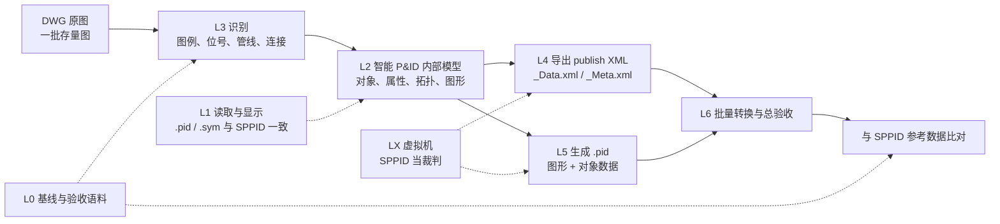
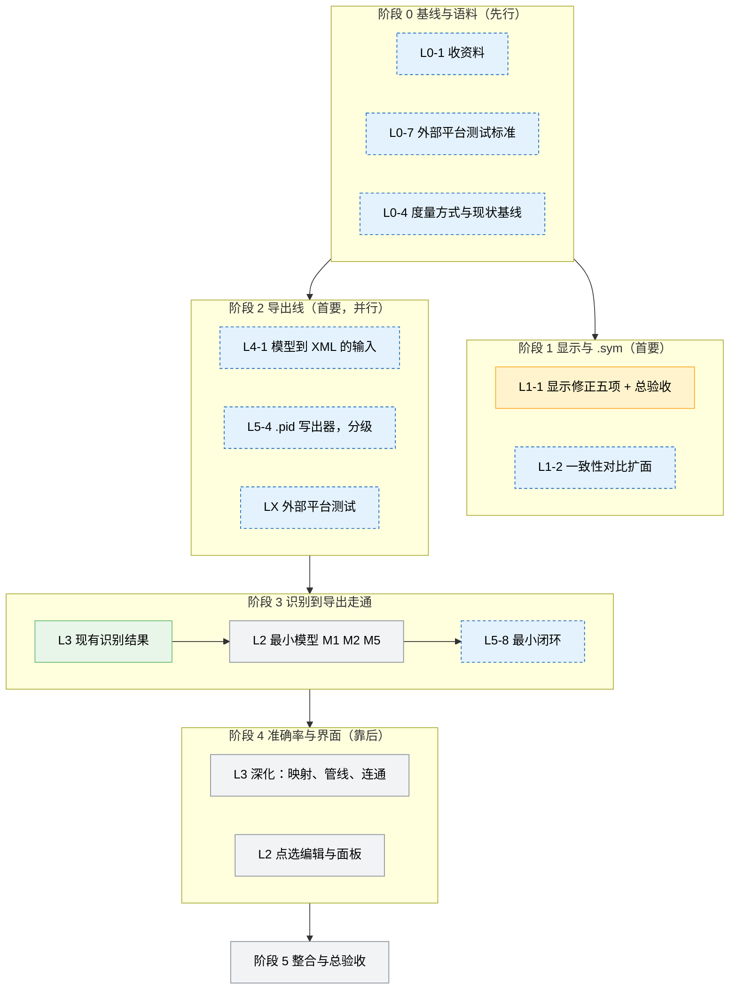

# 国产二维智能 P&ID 平台 · 阶段一路线图

> 日期：2026-11-19 初拟；**2026-11-20 对齐 `main @ 6377fe233`、`pid-parse @ a85fa10` 与阶段一进展更新**
> 所属目录：`docs/plans/2026-11-20-phase1-dwg-to-smart-pid/`（跟踪总单：[happyrust/pid-cad#106](https://github.com/happyrust/pid-cad/issues/106)）
> 范围：阶段一只做一件事——**把 DWG 格式的原 P&ID 图纸，转换成智能 P&ID 图纸，并导出 `.pid` 与 publish XML**，全程不依赖 SPPID 软件。协同、三维接入、规则检查、材料清单等都留到后面。
> 依据：仓库 `main @ 6377fe233`、`Cargo.toml` 钉定的 `pid-parse @ a85fa10` 源码与测试、以及 `$OCS_PID_CORPUS_DIR` 下的真值样本。
> 配套文档：同目录下的《智能PID平台-内部模型合一分析.md》《智能PID平台-资料清单.md》《智能PID平台-样本分析-XML规格与pid结构.md》《03-parse-answers.md》《智能PID平台-阶段一实施方案.md》《智能PID平台-阶段一Issue清单.md》《readings.md》。
>
> **状态与解决记录（可回溯日志）**：
> - `2026-11-20`（基线对齐）：确认备份包计划全部收尾项（`EXP-0..3`、显示修正 `RD-7/11/8/14/9/13`、`ACC-1` [#112](https://github.com/happyrust/pid-cad/issues/112)、新界面检查点 C `UI-1..9` + `6377fe233` [#115](https://github.com/happyrust/pid-cad/issues/115)）均已在 `main` 完成。
> - `2026-11-20`（提交 `9b5faf294`，[#109](https://github.com/happyrust/pid-cad/issues/109)）：完成 `L0-6` 当前 `main` 门禁基线实测（见 `readings.md` §1）。
> - `2026-11-20`（提交 `538ec0112`，[#107](https://github.com/happyrust/pid-cad/issues/107)）：完成 `L0-2` 语料索引与 SHA-256 校验工具 `scripts/sppid/corpus_index.py`（见 `readings.md` §2）。
> - `2026-11-20`（提交 `6fd58799c`，[#111](https://github.com/happyrust/pid-cad/issues/111)）：完成 `L4-0` publish XML 格式与结构校验器 `assets/pid-publish-spec.json` + `src/io/pid_publish_check.rs` + `scripts/sppid/xml_spec_check.py`（见 `readings.md` §3）。
> - `2026-11-20`（`L0-8`，[#118](https://github.com/happyrust/pid-cad/issues/118)）：完成 `pid-parse @ a85fa10` Q1–Q13 全部源码核实（见 `03-parse-answers.md`）。

---

## 已确认的决定（2026-11-19）

| # | 决定 |
|---|---|
| 1 | 路线文档只基于仓库重写；同时出内部模型分析和资料清单（已完成） |
| 2 | 资料清单里 **01（`pid-parse` 源码）和 02（真值配对样本）**均已到位，Q1–Q13 已在 `03-parse-answers.md` 核实完毕 |
| 3 | 备份包计划的 `EXP-0`、`EXP-2`、`EXP-3`、显示修正五项（`#112`）及新界面检查点 C（`#115`）均已在 `main @ 6377fe233` 完成 |
| D1（修订） | 真实验收是外部平台测试，我们无法本地复现。**送测前用 SPPID 预检**：XML 与已通过样本逐项一致；`.pid` 在 SPPID 里能打开（c1，最小闭环的硬门槛）；SPPID 发布我们的 `.pid` 得到的 XML 与我们导出的 XML 一致（d，升为预检项）；a、b 仍作每一步的日常门禁 |
| D2 | 受控虚拟机实验经 `$OCS_PID_SPPID_RUNNER` 契约隔离执行；实验前由使用者建基线快照、建专用来宾账号（密码不进仓库或聊天）、关闭对宿主机的共享写权限 |
| D3 | 界面复刻 15 项按建议通过（见 2.2） |
| D4 | 验证集以 94 对主验收批次为主，另一套图例作回归 |
| D5 | 内部模型阶段一沿用"图内扩展数据"，不上项目库 |
| D6 | 目标 SPPID 版本和数据库形态，以已通过样本为准 |
| D8 | 外部表格（设备表、线表）作属性来源：先不做，只预留接口 |
| 优先级 | 2026-11-19：首要是 `.pid` 显示和 `.sym` 解析（图纸按正确方式显示）；同步首要是 XML 导出和 `.pid` 导出；界面和识别准确率靠后；先把识别 → 导出走通，准确率慢慢调 |
| 验收方式 | XML 和 `.pid` 的导出要拿去**外部平台**（其他单位的数字化交付平台）测试；我们没有它的代码；已知 SPPID 产出的 `.pid` 和配套 XML 能通过；最低要求未知，用"与已通过样本一致"作代理标准 |
| 文档存放 | 阶段一全部规划、规格问答、问题清单与实测读数统一归口在 `docs/plans/2026-11-20-phase1-dwg-to-smart-pid/` 下随仓库维护，进行中与已完成项均在对应位置记录可回溯日志 |
| 逆向资料 | 分析和逆向时可以用 SPPID 的内容：SPPID 产出的备份包、`.pid`、XML、`.sym`，以及受控环境里的 SPPID；最终产品不依赖 SPPID |
| 样本方式 | SPPID 产出的资料置于仓库外 `$OCS_PID_CORPUS_DIR`（只读不改），由 `scripts/sppid/corpus_index.py` 生成相对路径与 SHA-256 清单 |
| 送测条件 | 外部平台送测**次数很少，一次反馈要几天**；因此送测前的 SPPID 预检必须全过，"减法送测"每一轮送一组变体，不逐个送 |

---

## 0. 一页看懂

**目标。** 做一个类似 SPPID 的二维智能 P&ID 平台。阶段一的终点：给一批 DWG 流程图，程序识别出图例、位号、管线和连接关系，生成带数据的智能 P&ID，再导出 `.pid` 和 publish XML，结果与 SPPID 自己产出的参考数据逐项比对。

**四个关键结论。**

1. **显示和编辑不需要数据库，仓库已经是这么做的。** 图形、符号、图层、样式都来自 `.pid` 本身；对象的类和位号来自 `.pid` 旁边的 `<图名>_Data.xml`，而且**只是增强，不是前提**；识别和自建的数据存在 DWG 的扩展数据里。`.pid` 里自己带多少对象数据、XML 里"数据库独有"的那部分从哪来，**仓库里看不出来**（解析库的源码不在仓库里，见资料 01）。SPPID 自己是不是必须靠数据库才能打开一个 `.pid`，也是未知，要在虚拟机里验证。详见 2.1。
2. **最大的短板是"写 `.pid`"。** 在仓库里 `.pid` 是**只读源**（`Ctrl+S` 改成另存 DWG），没有调用写出器的地方。写出能力在解析库里，这块能做到什么程度，要看它的源码。
3. **XML 导出只有外壳，没有来自我们自己模型的路径。** 仓库里的 EXP-1 是"备份包 → publish 文件"的外壳；XML 的内容由解析库决定。从识别出来的模型导出 XML，仓库里还没有。
4. **受控验收环境约定。** Windows 7 x64 受控 SPPID 虚拟机（VMware Tools 已装），实验前必须先建干净基线快照并关闭宿主机共享写权限（见 2.3）。

**你之前在做的事（已核实）。** 仓库里正在执行的计划是《SmartPlant 备份包：打开、浏览、导出 PDF 和 publish 文件》（`docs/plans/2026-11-17-sppid-backup-publish/`）。你定的四条验收是：能打开备份数据包；能正确浏览 `.pid` 并正确显示；能导出 PDF；能导出对应的 publish 文件。30 个任务做完 21 个；最近 120 个提交里，读取与显示（RD）9 个、导出 PDF 7 个、升级解析库 5 个、导出 publish 文件 2 个。所以"`.pid` 解析显示和 XML 导出"**是对的**，但有两条边界：

1. **这条线处理的是 SPPID 自己产出的备份包**：读它、显示它、把它的数据导成 XML 和 PDF。XML 的内容由解析库决定。
2. **从我们自己识别出来的模型导出 XML，以及导出（写）`.pid`，不在这份计划里**（`.pid` 在界面里是只读源）。这两件是新做的，也正是你现在要的首要任务。界面也明确不在那份计划里（"界面不在这份计划里"，检查点 B 之后才写规格）。

**优先级（2026-11-19 按你的要求）。**

| 优先级 | 内容 | 现状 |
|---|---|---|
| **首要** | `.pid` 显示和 `.sym` 元件解析，图纸按正确方式显示（L1） | 已很成熟，剩收尾和扩大对比 |
| **首要，与上同步** | XML 导出（L4）和 `.pid` 导出（L5），拿去**外部平台**测试（LX） | 仓库里只有备份包的 XML 外壳；从自己的模型导 XML、写 `.pid` 都要新做 |
| 其次 | **识别 → 导出走通**：用现有的识别结果，经最小的模型，走到 XML 和 `.pid`。准确率可以低，先通 | 识别内核已有；缺的是识别到导出这一段 |
| 靠后 | 识别的准确率和完整度（L3 深化）；界面和点选编辑（L2） | 准确率慢慢调；界面后做 |

**怎么验收（外部平台）。** 外部平台是其他单位的数字化交付平台，**我们没有它的代码，无法在本地复现它的检查**；已知 SPPID 自己产出的 `.pid` 和配套 XML 能通过它的测试，它的最低要求未知。所以验收口径是：

1. **代理标准：与已通过的样本一致。** 我们导出的 XML 和 `.pid`，要和 SPPID 产出的、已知能通过的样本在结构和内容上逐项一致；差异清单必须可解释。样本本身就是规格。
2. **送测前用 SPPID 预检**：XML 与已通过样本逐项比对；`.pid` 在 SPPID 里能打开（D1 的 c1）；SPPID 发布我们的 `.pid` 得到的 XML，与我们直接导出的 XML 一致（D1 的 d，现在从加分项升为预检项）。
3. **最低要求靠"减法送测"摸清**：拿一对已通过的样本，去掉某一类内容（例如连通关系、某类接口、某类对象）再送测，不通过的那份就暴露一条硬要求。**已知送测次数很少、反馈要几天，所以每一轮一次送一组变体**（每份只去掉一类内容，另带一份原样的已通过样本作对照），争取一两轮摸清多条要求；每次送测前，上面的三关预检必须全过。一次能送几份、是否逐份返回结果，见第 8 节。
**总路线（一张图）。**

**现在在哪。** 读取与显示（L1）已经很成熟；识别（L3）有一套能用的内核，但**还没有用 SPPID 的真值量过准确率**；XML 导出（L4）只有备份包的外壳；`.pid` 生成（L5）仓库里是空白；内部模型（L2）有两套互不相通的半成品。

---

## 1. 目标与范围

### 1.1 你的五点需求对应哪条工作线

| 你的要求 | 对应工作线 | 一句话 |
|---|---|---|
| 01 正确解析、识别、显示 `.pid` 和 `.sym`，效果和 SPPID 一致；数据是否必须依赖数据库 | L1；2.1 | 显示已很成熟，一致性要用参考数据量化 |
| 02 能点击改动图纸、几何、位号属性；界面先复刻 SPPID 的必要部分；用虚拟机逆向 | L2；2.2；LX | 图形和数据整体成块，点选出属性面板 |
| 03 不依赖 SPPID，自研产出 `.pid` 和 publish XML | L4、L5；2.4 | XML 有外壳可借，`.pid` 要新做 |
| 04 准确完整识别 DWG 的几何和数据，重点是流程图元件和位号 | L3 | 先把图例和位号做准，其余属性次之 |
| 05 第一目的：DWG → 智能 P&ID → `.pid` + XML；协同、三维后续 | L6 | 先识别、先导出走通 |

### 1.2 本阶段做什么、不做什么

| 做 | 不做（后续） |
|---|---|
| `.pid`、`.sym` 读取与显示，对齐 SPPID | 协同、离线同步 |
| 点选对象、属性面板、编辑位号和属性 | 三维模型接入 |
| DWG 识别：图例、位号、管线、连接关系 | 设计规则检查、材料清单、快照、发布签核 |
| 内部智能 P&ID 模型 | 多套图例标准的可视化编辑器 |
| 导出 publish XML、生成 `.pid` | ISO 15926 / CFIHOS 交换 |
| 批量转换与总验收 | 用户、角色、项目空间管理 |

### 1.3 阶段一终点（一句话版）

> 对你的验收批次：程序批量识别并生成智能 P&ID；导出的 publish XML 与 SPPID 导出的参考 XML 在对象、位号、类、属性、关系上逐项比对，差异清单可解释且低于约定阈值；导出的 `.pid` 能被解析库重新读出、被本软件显示且与参考出图一致，并在虚拟机里被 SPPID 打开（D1 的 c1）。

**外部平台测试。** 外部平台是其他单位的数字化交付平台，我们没有它的代码。已知 SPPID 产出的 `.pid` 和配套 XML 能通过它的测试，最低要求未知。验收口径见第 0 节"怎么验收"。

具体阈值在实施方案里定。仓库里已有的一个硬指标：PRD 规定 P4 的存量图纸位号解析率 **≥ 98%**（随机抽 100 张，解析出位号的符号实例数 ÷ 符号实例总数），可作为识别的参照。

---

## 2. 几个问题的分析

### 2.1 `.pid` 里到底存了什么，需不需要数据库（只依据仓库）

| 层 | 内容 | 仓库里的证据 |
|---|---|---|
| 图形 | 线、圆、弧、多段线、B 样条、椭圆弧、文字、符号放置、页框 | `src/io/pid/`；09-24 计划：五张图的记录族全覆盖，剩 13 条拒收和 1 条无解码器，全部点名 |
| 符号本体 | 每个符号放置带着图纸自己缓存的本体 | 09-24 计划：107/107 个放置解到缓存本体；`.sym` 库（618 个）只作补位。`src/io/pid/mod.rs` 注释：库里有的 97 个里只有 26 个和图纸逐笔相同，所以以缓存本体为准 |
| 样式 | 线宽、颜色、虚线、字高 | 09-24 计划：线宽、颜色、虚线四图 558/558 条解析；字高 184 条里 159 条取到真值，25 条指向 0.254 mm 哨兵样式、正确拒收 |
| 图层与显隐 | 图纸图层、显示状态 | `src/io/pid_view_filter.rs`；09-24 计划 |
| 对象的类、位号、线号 | 由 `GraphicOID` 两跳连到实体 | **来自 `.pid` 旁边的 `<图名>_Data.xml`**；没有它，导入的对象只带角色、样式、图纸图层身份（`src/io/pid/styles.rs` 注释："an enrichment, never a prerequisite"） |
| 管线对象、端口、连通关系等 | — | **仓库里看不到**；要看解析库的源码（资料 01） |
| 项目配置、参考数据 | 符号库、图框模板、代码表 | 外部文件（备份包里有） |

**结论，分四条：**

1. **读取与显示：不需要数据库。** 仓库现在就是这样做的。
2. **编辑与自有数据：不需要数据库。** 识别和自建的数据存在 DWG 扩展数据里，随图保存（见《内部模型合一分析》）。
3. **对象的类和位号，仓库的导入器要靠旁边的 XML**；`.pid` 本身带多少这类数据，仓库看不出来，要看解析库。
4. **SPPID 自己是否必须靠数据库才能打开 `.pid`，未知。** 按 SmartPlant 的一般架构，图纸要登记在 plant 库里才能打开，这是推断，要在虚拟机里验证（第一个实验见 2.3）。

### 2.2 要不要复刻 SPPID 的界面：必要清单（已按建议通过）

原则：先复刻"让用户能判断图对不对、数据对不对"的部分。

| # | 项 | 为什么需要 | 已定 |
|---|---|---|---|
| 1 | 画布显示：图层、线型、线宽、颜色、字体、图框 | 验收"效果和 SPPID 一样"的核心 | **必须复刻** |
| 2 | 点选对象 → 对象属性面板 | 图形和数据成一块 | **必须复刻** |
| 3 | 属性按分类分页签（按接口分组） | SPPID 属性多，分组才看得清 | 复刻形式，内容按我们的模型 |
| 4 | 位号和属性标注随数据刷新 | "图形是数据的外在表现" | **必须** |
| 5 | 管线、管路、管段，线号属性 | 导出 XML 的主要对象 | 数据必须；界面简化 |
| 6 | 符号连接点、端口、吸附 | 连通关系的来源 | 数据必须；吸附沿用上游 |
| 7 | 页间连接符 | 跨图连通靠它 | **必须** |
| 8 | 视图过滤器、图层显示状态 | 不复刻会和 SPPID 显示不一致 | 复刻显示结果即可 |
| 9 | 图框标题栏属性（图号、图名） | 写入 XML 的图号来源 | **必须读、能改** |
| 10 | 符号选取面板 | 编辑时放新符号 | 第二期；现有调色板先用 |
| 11 | 图纸列表 | 批量处理的入口 | 简版 |
| 12 | PBS 树、Plant Explorer、项目管理 | SPPID 的组织方式 | 阶段一不做 |
| 13 | 报表、Data Manager | 后续的材料清单 | 不做 |
| 14 | 版本、Workshare、签核 | 协同和发布范畴 | 不做 |
| 15 | 撤销重做、框选、捕捉、缩放平移 | 上游已有 | 沿用 |

SPPID 本身的界面是什么样，仓库里看不到，需要你提供截图（资料 12）。

### 2.3 逆向与虚拟机：能做什么，怎么做

**边界。** 这里的"逆向"，指读文件字节、对比样本、在虚拟机里观察 SPPID 的输入输出，用来弄清文件格式和行为、实现互操作。不绕过 SPPID 的许可或授权，不改动 SPPID 程序，不分发厂商文件。你是否有权做这类分析，请对照授权条款自行确认。

**资料来源（2026-11-19 补充）。** 最终产品不依赖 SPPID，但**分析和逆向时可以用 SPPID 的内容**：SPPID 产出的备份包、`.pid`、配套 XML、`.sym` 符号，以及虚拟机里运行的 SPPID（它能打开、保存、发布 `.pid`，可以用来产出对照样本、验证我们的输出）。这些内容是本路线里读取、解码、写出和对照的主要依据。

**仓库里能看到的基础：**

- 本仓库的注释和计划多处引用解析库的分析文档（例如 `GraphicOID` 两跳连接的分析），说明解析库那边有成体系的格式分析。具体做到哪一步，需要它的源码（资料 01）。
- `scripts/sppid/` 里有走查和 PDF 比对脚本；读取 SPPID 备份包、整包出 PDF 都已有（见 3.1）。

**受控虚拟机现状与准备要求：**

| 项 | 结果与要求 |
|---|---|
| 来宾系统 | Windows 7 x64（2 核，4 GB），已装 VMware Tools |
| 快照要求 | **实验前必须先建干净基线快照**（当前快照数为 0，未建前不执行自动实验） |
| 控制接口 | 由外部脚本 `$OCS_PID_SPPID_RUNNER` 封装 `vmrun` 的 `open` / `publish` / `restore`，虚拟机磁盘路径与访客账号留在本地环境配置中，不写入仓库 |
| 共享隔离 | 实验前关闭对宿主机磁盘的读写共享，统一走运行器显式拷入拷出文件夹 |

**能不能用 `vmrun` 控制：** 技术上可以：启动、关机、恢复快照、往里拷文件、从里面拷出来、在里面运行程序、截图。前提是给出来宾的账号。SPPID 是图形程序：**"打开 → 另存 → 发布"这类固定动作建议自动化；会改变文件字节的编辑动作建议手工做**，这样样本干净，是我的建议。

**三层方案，从便宜到贵：**

| 层 | 做什么 | 用到虚拟机吗 | 依赖资料 |
|---|---|---|---|
| 1 | 沿用解析库已有的格式分析，补上写出所需的未解字段 | 否 | 01 |
| 2 | 用手上现成的 SPPID 产出（`.pid`、XML、PDF）做对比，建真值 | 否 | 02、03、13 |
| 3 | 虚拟机当裁判：我们生成的文件在 SPPID 里打开、保存、发布，取回结果比对；再按需要采集受控样本 | **是** | 06 |

**第一批实验（便宜到贵，每个都先建快照）：**

| 实验 | 做什么 | 回答什么 |
|---|---|---|
| E0 | 先找回你们以前做过的"把 `.pid` 放回 SPPID 项目目录再打开"的结论（资料 09） | 可能省掉后面的实验 |
| E1 | 把 SPPID 自己保存的 `.pid`，换成**字节完全相同**的副本放回原位，用 SPPID 打开 | 登记机制是否和文件内容、时间戳有关（对照实验） |
| E2 | 在 E1 的基础上改一处元数据（例如图号），再打开 | SPPID 是否接受被改过的文件 |
| E3 | 把从未在 SPPID 里出现过的 `.pid`（我们生成的）放进去，看能不能打开、要不要登记 | 外来文件能不能被接受，D1 的 c1 能不能达成 |

**没有比这更好的方案。** 不接虚拟机，`.pid` 生成就没有"SPPID 认不认"的判据，只能做到"我们自己的解析器认"。

### 2.4 自研产出 XML 和 `.pid`

**publish XML。**

- 仓库里的 EXP-1（`src/io/pid_backup_export.rs`）只是"备份包 → publish 文件"的**外壳**：检查来源和输出目录、调用解析库的整包入口、读它写出的 `_Index.json`、整理每张图的结果。
- 输出文件固定为每张图三个（`_Data.xml`、`_Meta.xml`、`_Coverage.json`）加整包一个 `_Index.json`。**内容由解析库决定**，本仓库不改。
- 要从我们自己的模型导出 XML，有两种可能：(a) 解析库里有可复用的写出函数，把我们的模型转成它吃的结构；(b) 没有，需要新写。**判断要看解析库源码（资料 01）。**

**`.pid` 生成。** 方案对比：

| 方案 | 做法 | 优点 | 风险 |
|---|---|---|---|
| A 种子加增补 | 取一份 SPPID 建的空白图当底，复制容器，往里增补记录 | 容器、样式、图框都是 SPPID 自己的，兼容性最好 | 要写全记录、对象引用、索引表，一致性要求高 |
| B 从零构造 | 完全自己拼 | 不受种子限制 | 未解字段多，几乎必然打不开 |
| C 不生成 `.pid`，只给 XML 和 DWG，让 SPPID 导入 | 回避写出 | 工作量最小 | 违背"不依赖 SPPID"，只能作兜底 |

**建议 A，分级推进，每一级让 SPPID 验收（c1）：** 改一个属性 → 加一条线 → 加一个符号 → 加文字 → 加带属性的对象 → 整图。种子需要你提供（SPPID 新建的空白图，见资料 14）。

**一个耦合点要提前注意：** 仓库的导入器靠 `GraphicOID` 把 XML 里的对象连到 `.pid` 里的图形记录。所以**导出 XML 和生成 `.pid` 必须共用同一套 OID 分配**，不能各生成各的。

### 2.5 样本分析带来的新发现（2026-11-20，依据《智能PID平台-样本分析-XML规格与pid结构》）

资料已到位：94 对 SPPID 产出的 `.pid` + `_Data.xml` + `_Meta.xml`、94 个 DXF、94 个 PDF，以及两个备份包。对路线的影响：

| 发现 | 影响的工作项 | 调整 |
|---|---|---|
| XML 规格已可从样本直接归纳：21 类对象、15 种关系、容器属性 94 份全同、格式固定（UTF-8 带 BOM、CRLF、3 空格缩进、PIDDrawing 排第一） | L4-1、L4-2、LX-8 | L4 的"规格"不必等解析库源码，先用样本写**格式与结构校验器**，当作预检第一关 |
| UID 完全有规则：对象 32 位十六进制，端口 `.序号`，分支点 `.BPT`，工艺点 `.PPT`，关系 UID 由两端派生 | L4-3 | L4-3 可以直接开工；`PIDPipeline` 的 UID 在 `.pid` 里找不到，是合成的，算法要靠解析库源码确认（Q4） |
| 表示、图纸、设备、仪表、管件的 UID 都以 ASCII 出现在 `.pid` 的记录流里 | L4-3、L5-5 | **XML 和 `.pid` 必须共用同一套 UID 与 GraphicOID 分配**，这条从"建议"升级为硬要求 |
| 94 张图的"接口集 + 码表值"组合共约 240 种；管件和连接件各 78 种，前 50 种覆盖 99%，其余类型都不超过 15 种 | L3-1、L4-2 | "图例 → SPPID 类/码表值"映射表规模有限，可从样本整理，先做前 50 种 |
| 位号、设备序号、注释文字、页间连接符文字、保温规格在 `.pid` 里基本都有；码表引用、公称直径写法、仪表/管线/管线段的组合名称、流体系统在 `.pid` 里几乎没有 | L4-2、L3-4 | 这批值必须由"类 + 规则"生成，需要组合名称规则（Q5）和公称直径换算（Q6） |
| 备份包里有 12 个空白模板 `.pid`（28–118 KB）和对应 `.igr`，以及 728 个 `.sym` | L5-3、L1 | 资料 14 的"空白"那一半已有，可当种子候选；"放了一个设备"的那份仍缺 |
| 94 个 `.pid` 都没有 `/TaggedTxtData/Drawing`、`/General` 流，只有 0 字节的 `/Revision` | L5-1 | 与解析库文档里描述的流不同，写出面普查要先核实（Q11） |
| `.pid` 的符号缓存里 `JProperties` 含指向 `.sym` 的 UNC 路径 | L5-4、L1 | 生成 `.pid` 时这些路径怎么写要确认（Q12） |
| 备份包里的 RefData 映射是 SPPID 工厂间导入映射，不是外部平台规格 | 资料 15 | 外部平台规格仍然缺，口径仍以"与已通过样本一致"为代理 |

**样本分析没有做的**：没有把 `.pid` 里的对象与 XML 对象逐个对应（符号 → 类变体的映射还没建）；`.pid` 值覆盖率只抽了 3 个文件；没有读 `T_*.xml` 数据库表和 `Export.dmp`；94 个 `.pid` 与备份包里的 94 张是否同一批没有比对；DXF 和 PDF 没分析。

**必须在另一台机器上对 `pid-parse@96ee00c` 回答的 13 个问题**见样本分析文档第 6 节（Q1–Q13）。

---

## 3. 现状盘点（只依据仓库）

状态：**已有** = 在 `main` 上；**部分**；**未做**。

### 3.1 L1 读取与显示

| 点 | 状态 | 证据 |
|---|---|---|
| `.pid` 导入为图面（`.pid` 是只读源，`Ctrl+S` 另存 DWG） | 已有 | `src/io/pid/`；09-24 计划 |
| 记录族解码 | 已有 | 五张图全覆盖，剩 13 条拒收和 1 条无解码器，全部点名（09-24） |
| 符号本体 | 已有 | 107/107 个放置画的是图纸自己缓存的本体（09-24） |
| 线宽、颜色、虚线、字高 | 已有 | 线样式 558/558；字高 159/184（25 条正确拒收）（09-24） |
| **文字按 run 取样式** | **主路径已接线** | `src/io/pid/styles.rs:101-136` 已用字符 run 覆盖段落默认样式（解决此前 106/155 偏差）；同一条 `TEXT` 内多样式混排按多数字符 run 展平并记录日志 |
| 图框模板套用，模板里的符号也画 | 已有 | RD-5、RD-10 |
| `.pid` 出 PDF；备份包整包出 PDF；单张与整包逐字节相同 | 已有 | `PIDPLOT`、`PIDBACKUPPDF`；PDF-1 到 PDF-7 |
| 与厂商 PDF 的出图对比 | 部分 | 11 张厂商图的对比：10 张覆盖率 1.000（PDF-5）；范围待 `L1-2` 扩到 94 张整批 |
| 显示修正五项与总验收：图幅整张进画布、字宽比例、文字框对齐、标注竖直位置、符号圆弧、图框位置 + `ACC-1` | **已完成** | `RD-7`、`RD-11`、`RD-8`、`RD-14`、`RD-9`、`RD-13`、`ACC-1`（均已在 `main` 入库，对应 [#112](https://github.com/happyrust/pid-cad/issues/112)） |
| 备份包：打开、浏览、开图、新版「备份数据包」屏与导出弹窗 | **已完成** | 备份包计划 30/30 + 检查点 C `UI-1..UI-9` + 审核加固 `6377fe233`（对应 [#115](https://github.com/happyrust/pid-cad/issues/115)） |

### 3.2 L2 内部模型与点选编辑

详见《内部模型合一分析》。要点：

| 点 | 状态 |
|---|---|
| 自建模型（`PID_AUTHOR`）：类型库、位号引擎、符号库、拓扑、属性下传、DWG 往返 | 已有 |
| 导入和识别的语义（`PID_SEMANTICS`），特性面板"P&ID"组只读 | 已有，但**只读** |
| 两套模型没有合一 | **缺口** |
| 识别的符号不能成为可编辑对象；识别的管线不进拓扑表 | **缺口** |
| 点选一个导入的符号得到"图形加数据整块" | 未见 |
| 保存回 `.pid` | **未做** |

### 3.3 L3 DWG 识别

| 点 | 状态 | 证据 |
|---|---|---|
| 四路识别：块、图层前缀、圆、炸开形状；手工组合；位号配对（最大匹配、最短总距） | 已有 | `src/io/pid_legend/`；09-09 计划 W0–W8 已落地 |
| 范围标注、重复位号分流，鹤管整列配对 | 已有 | W1、W2 |
| 线号规则外置（覆盖 5 位和 4 位序号） | 已有 | W5 |
| WS02 族补齐；SP02 族管线拓扑 | 已有 | W6、W7（2026-09-11 落地） |
| 识别结果写进实体 `PID_SEMANTICS`；`PIDLEGEND EXPORT` 导出 JSON 和 CSV；自动化接口 `pid_legend` | 已有 | W8；`README.md` 的记录；`src/io/pid_legend/export.rs` 存在。W9 的逐项落地情况我没有核实 |
| 图例背书（图例张、说明书） | 缺 | W10 等外部输入；有 5 条块含义是中低可信度 |
| **识别准确率的度量** | **缺口** | 现有"数字"都是和自己以前的记录比，没有以 SPPID 导出数据为真值的召回和精确 |
| **图例到 SPPID 类和符号的映射** | **缺口** | 识别的"类"是我们自己的名字 |
| 置信度三档和人工确认 6 步 | 需求有，实现未见 | REQ-MIG-001、REQ-MIG-002 |
| 识别语料 | 部分 | 09-09 的 12 张 CPECC DXF（11 张可读）；你的主验收批次未见评估记录 |

### 3.4 L4 publish XML 导出

| 点 | 状态 | 证据 |
|---|---|---|
| 备份包导出的外壳、命令与新界面：检查、建目录、调解析库、读 `_Index.json`、8 种错误码、后台线程、`PIDBACKUPEXPORT`、导出配置弹窗 | **已完成** | `EXP-0`（`a85fa10`）、`EXP-1`、`EXP-1b`、`EXP-2`、`EXP-3`、`UI-1..9`、`6377fe233` |
| 真实包导出验证与比对 | **已完成** | `2026-11-17-sppid-backup-publish/readings.md` §21、§29、§30（7 组整包导出与 `pid_publish_xml` 逐字节一致，94 套单图验证集 `82 / 94` 一致） |
| publish XML 格式与结构校验器（`L4-0`） | **已完成** | `assets/pid-publish-spec.json` + `src/io/pid_publish_check.rs` + `scripts/sppid/xml_spec_check.py`（[#111](https://github.com/happyrust/pid-cad/issues/111)，220 份真实 SPPID XML 零违规） |
| 解析库内部 XML 写出器与目录 | **已核实可复用** | `pid-parse/src/publish/{model,xml_writer,pid_writer,catalog,codelist_values,pipeline,unit_values}.rs`（见 `03-parse-answers.md` Q4–Q8） |
| **从我们自己的统一模型导出 XML** | **未做（下一步 L4-1）** | 按 `03-parse-answers.md` Q8 方案 A：统一模型转 DTO + 严格厂商字节格式包装 |

### 3.5 L5 `.pid` 生成

仓库里**没有**调用 `.pid` 写出器的地方；`.pid` 在界面里是只读源。`L0-8` 源码核实确认（`03-parse-answers.md` Q1）：`pid-parse::writer::PidWriter` 支持基于 `PidPackage` 的 CFB 容器重打包与整流替换，但无高层图形/属性记录生成能力，需在阶段 2 按族编码记录链并同步 `/PSMspacemap` 与图层计数。

### 3.6 小结：最短的几块板

1. **`.pid` 写出**：仓库空白，且需要受控 SPPID 环境验收。
2. **识别准确率没有真值度量**：下一步由 `#108`（`L0-4`）与 `L0-5` 建起对参考 XML 的召回与精确。
3. **图例到 SPPID 类的映射**：需将约 240 种「接口集 + 码表元组」变体与 DWG 图例连起来（`L0-9`、`L3-1`）。

### 3.7 仓库与并行工作树状态（2026-11-20）

- 主工作树在 `main @ 6377fe233` 基础上持续推进阶段一任务（一任务一独立提交）；
- 并行活跃工作树：`ocs-pid-symbol-block`（分支 `pid-symbol-identity`，改 `src/io/pid/*` 与 `editor.rs`）及 `ocs-collab-off2`（分支 `pid-stage-b`，收口协同离线同步）；阶段一当前任务均严格避开上述文件。

---

## 4. 路线与阶段

规模：**S** 约半天到一天，**M** 约一到三天，**L** 约一周以上（按本项目过去任务的粒度估，不是承诺）。

### 4.1 阶段总览（按新优先级）

规模：**S** 约半天到一天，**M** 约一到三天，**L** 约一周以上（按本项目过去任务的粒度估，不是承诺）。

| 阶段 | 优先级 | 目标 | 前置 | 出口（一句话） | 规模 |
|---|---|---|---|---|---|
| 0 基线与语料（L0） | 先行 | 语料、度量方式、外部平台的测试标准 | 资料 01、02、03、15 | 知道"导出要过什么线"，能量出现状 | M |
| 1 显示与 `.sym`（L1） | **首要** | 图纸按正确方式显示，`.sym` 元件解析正确，与 SPPID 一致 | 0 | 显示对比报告；备份包计划的显示收尾完成 | M |
| 2 导出线（L4 + L5 + LX） | **首要，与阶段 1 并行** | XML 导出和 `.pid` 导出，交外部平台测试 | 0；资料 01、14 | 外部平台测试有结论：XML 过，`.pid` 分级过 | L（风险最高） |
| 3 识别 → 导出走通（L3 最小闭环 + L2 的 M1、M2、M5） | 其次 | 一张简单图：DWG → 现有识别 → 最小模型 → XML 加 `.pid` → 外部平台测试 | 2 的最小可测物 | 闭环走通；准确率不设门槛 | M |
| 4 识别准确率与界面（L3 深化 + L2） | 靠后 | 识别准确率、完整度；点选编辑；管线进拓扑（M3）、面板（M4） | 3 | 对真值的召回和精确达到约定阈值；点选出属性面板 | L |
| 5 整合与总验收（L6） | 收尾 | 批量转换、交互编辑存回 `.pid`、总验收 | 3、4 | 整批图跑通，出验收报告 | M |

**"走通"的最小闭环怎么定义（阶段 3）：** 一张简单图，从 DWG 出发，用现有识别结果，生成最小模型（带位号和类的符号；管线和连通能做到哪一步，取决于外部平台的最低要求，待你确认），导出 XML 和 `.pid`，送外部平台测试。**识别的准确率不设门槛**，识别不准的部分允许缺，但要在覆盖报告里列出。

**送测前的预检（用 SPPID）。** 导出线每一级（XML、`.pid` 各一级）送外部平台之前，先过三关：

| 预检 | 做法 | 通过的意思 |
|---|---|---|
| ① XML 对照 | 与已通过样本逐项比对（对象、接口、属性、关系） | 差异清单为空或可解释 |
| ② `.pid` 能打开 | 在虚拟机的 SPPID 里打开我们生成的 `.pid` | 能打开、不报错（D1 的 c1） |
| ③ 发布一致 | 让 SPPID 发布我们的 `.pid`，得到的 XML 与我们直接导出的 XML 比对 | 一致（D1 的 d） |

三关都过，不等于外部平台一定通过（它的最低要求未知），只是提高通过的可能性。
### 4.2 依赖与现状

浅绿 = 已有一部分；黄 = 正在做；灰 = 未开始；蓝色虚线 = 等你提供资料或确认。

### 4.3 为什么这样排

- **导出要拿去外部平台测试，所以导出线要尽早有"可测的东西"**，让外部平台的反馈尽早回来；反馈周期是这条线最大的不确定性。
- **导出线内部，XML 先于 `.pid`。** 仓库已有外壳，能最早产出可测的交付物；OID 规则、类映射、属性模板先定下来，`.pid` 也要用。
- **识别准确率不阻塞走通。** 先让"识别 → 模型 → 导出"整条管道通，再回头调准确率；这样每次调识别，都能立刻看到对导出的影响。
- **显示线首要，但已经成熟，不挡其他工作**，所以和导出线并行，不串行。
- **界面最后做。** 阶段 3 之前，点选编辑、属性面板都不是导出的前提。

---

## 5. 各工作线拆分

**优先级对应：** 首要是 L1、L4、L5、LX；L3 和 L2 里"识别到导出走通"需要的最小部分提前（阶段 3），其余（准确率、映射深化、管线和连通、点选编辑、面板）放阶段 4。

编号 `L<线>-<序>`，实施方案里一一展开。"依赖资料"是《资料清单》的编号。

### L0 基线与验收语料

| 编号 | 内容 | 规模 | 依赖资料 |
|---|---|---|---|
| L0-1 | 收齐资料，核对每项 | S | 全部 |
| L0-2 | 语料入库规则：客户数据不进仓库，只登记清单、哈希和路径 | S | — |
| L0-3 | 对应关系表：原始图 ↔ 拆分图 ↔ SPPID 的 `.pid` ↔ XML | M | 02 |
| L0-4 | 度量工具：识别 vs 参考 XML 的对象和位号；生成 XML vs 参考 XML；显示 vs 参考 PDF | M | 02 |
| L0-5 | 现状基线报告：当前识别对真值的召回和精确、显示覆盖率 | M | 02、03 |
| L0-6 | 在当前 `main` 上量门禁基线（库测试条数、clippy 两项、编译器版本） | S | 08 |
| L0-7 | 外部平台验收口径：已通过样本清单、平台的交付规范（如有）、一次能送几份与是否逐份返回；设计"减法送测"的变体清单，按"一轮一组变体"排成不超过两三轮 | S | 15 |

### L1 读取与显示

| 编号 | 内容 | 规模 | 依赖资料 |
|---|---|---|---|
| L1-1 | 收尾已排计划：RD-7、RD-11、RD-8、RD-9、RD-13、ACC-1（EXP-2、EXP-3 属备份包计划，在另一台） | L | — |
| L1-2 | 扩大一致性对比：以真值样本对 SPPID 出图，沿用"覆盖率、多画长度、文字对上条数"三项指标 | M | 02、13 |
| L1-3 | 符号缺失清单和补齐来源 | S | 03 |
| L1-4 | 文字按 run 取样式（09-24 记为最大可见偏差，是否已做待核实） | M | — |
| L1-5 | 批量打开性能 | S | 02 |

### L2 内部模型与点选编辑

| 编号 | 内容 | 规模 | 依赖资料 |
|---|---|---|---|
| L2-1 | **内部模型合一**（见《内部模型合一分析》M1 到 M5） | L | 01 |
| L2-2 | 点选一个符号得到"图形加数据整块"，打开属性面板 | M | 12 |
| L2-3 | 属性面板（按接口分页签）：读写位号和属性 | M | 12 |
| L2-4 | 属性改动联动标注刷新、位号唯一性提示 | M | — |
| L2-5 | 几何改动联动：移动、删除符号后端口、连通、管线更新 | M | — |
| L2-6 | 导入的 `.pid` 对象也装入统一模型 | M | 01 |
| L2-7 | 保存回 `.pid`（依赖 L5） | M | — |

### L3 DWG 识别

| 编号 | 内容 | 规模 | 依赖资料 |
|---|---|---|---|
| L3-0 | 在验收批次上跑现有识别，与参考 XML 对齐，得到基线 | M | 02 |
| L3-1 | **图例映射**：DWG 的块、图层、形状 → SPPID 符号 → 类；规则表外置；先覆盖高频图例 | L | 01、02、03 |
| L3-2 | 位号识别增强：多行位号、范围标注、仪表圈内文字拼接、位号在符号外的各种写法 | M | 05 |
| L3-3 | 管线识别增强：线号、管线族、管段与管件断开、流向 | L | 05 |
| L3-4 | 连通：符号连接点与管线端点配对；页间连接符跨图配对 | L | — |
| L3-5 | 设备与管口：管口位号继承设备位号 | M | — |
| L3-6 | 属性来源：线号拆解（公称直径、介质、序号、等级）；图框标题栏读图号图名 | M | 05 |
| L3-7 | 校核入口：置信度三档（REQ-MIG-001）、人工确认 6 步（REQ-MIG-002）、识别报告 | M | — |
| L3-8 | 回归门禁：每改一次规则，验收批次的报告逐行 diff | S | 02 |

### L4 publish XML

| 编号 | 内容 | 规模 | 依赖资料 |
|---|---|---|---|
| L4-1 | 统一模型 → XML 的输入（对象、表示、关系） | L | 01 |
| L4-2 | 类映射和属性模板：每类对象写哪些接口、哪些属性 | L | 01、02 |
| L4-3 | UID 规则，与 L5 共用 OID 分配 | M | 01 |
| L4-4 | 管线、端口、连通、工艺点、分支点、页间连接符的生成 | L | 01 |
| L4-5 | 代码表、公称直径换算、名称拼接规则 | M | 01、02 |
| L4-6 | 命令和批量入口，输出覆盖报告 | M | — |
| L4-7 | 参考 XML 比对门禁：对象、接口、属性、关系逐项 | M | 02 |

### L5 `.pid` 生成

| 编号 | 内容 | 规模 | 依赖资料 |
|---|---|---|---|
| L5-1 | 写入面普查：要写的流、记录族、必须一致的索引，逐项对账解析库的已解码状态 | M | 01 |
| L5-2 | 受控样本采集（经 LX） | M | 06、14 |
| L5-3 | 种子文件策略：选底、保留项、增补项 | M | 14 |
| L5-4 | 写出器，按族推进：线圆弧多段线 → 文字 → 符号放置 → 属性与对象 | L | 01 |
| L5-5 | 索引一致性：OID 分配、对象引用、各类索引表 | L | 01 |
| L5-6 | 往返验证：写出 → 重读相等；本软件显示；PDF 对比 | M | 02 |
| L5-7 | SPPID 打开验证；登记问题的结论 | M | 06 |
| L5-8 | 最小闭环：一张简单图从 DWG 走到 `.pid` | M | 02、06 |
| L5-9 | 扩到整个验收批次 | M | 02 |

### L6 整合与总验收

| 编号 | 内容 | 规模 |
|---|---|---|
| L6-1 | 批量转换命令：DWG → 识别 → 模型 → XML 加 `.pid` 加覆盖报告 | M |
| L6-2 | 交互编辑后保存回 `.pid` | M |
| L6-3 | 总验收：整批图全流程，出验收报告 | M |

### LX 虚拟机

| 编号 | 内容 | 规模 | 依赖资料 |
|---|---|---|---|
| LX-1 | 快照、专用账号、文件进出通道、关共享写权限 | S | 06 |
| LX-2 | "打开、另存、发布"自动化 | M | 06 |
| LX-3 | 受控样本采集，编辑动作手工 | M | 06、14 |
| LX-4 | SPPID 接受度实验 E0 到 E3（见 2.3） | M | 06、09 |
| LX-5 | 我们生成的 `.pid`、XML 在虚拟机里验收并取回结果 | M | 06 |
| LX-6 | 针对 L5 写出所需的未解字段，补充格式分析 | 视情况 | 01 |
| LX-7 | 合规：授权确认、不分发厂商文件、样本保密 | S | — |
| LX-8 | 送测前预检：XML 对照、`.pid` 能否在 SPPID 打开、SPPID 发布我们的 `.pid` 与我们的 XML 比对 | M | 06 |
| LX-9 | 外部平台送测：每一级送测，按固定格式回填；"减法送测"每轮一组变体，含原样已通过样本作对照 | M | 15 |

---

## 6. 验收依据（仓库里能看到的）

| 来源 | 内容 |
|---|---|
| REQ-MIG-001 | 识别置信度三档：高 ≥ 0.90 自动接受；中 0.60–0.89 进人工确认队列；低 < 0.60 默认不导入。字段：置信度、识别路径（块字典、图层前缀、形状哈希、几何相似）、判定依据、处置 |
| REQ-MIG-002 | 人工确认流程 6 步；识别报告含三档计数和未识别图元数，计数之和等于候选记录行数 |
| PRD 指标 | 存量图纸位号解析率 ≥ 98%（抽 100 张，解析出位号的符号实例数 ÷ 符号实例总数） |
| 导出规格 | 每张图三个文件加整包 `_Index.json`；包里每个 `.pid` 在 `_Index.json` 里恰好记一次；每张图都有交代 |
| 已有读数 | 三个样本包的图纸数 53、7、12；11 张厂商 PDF 的对比（10 张覆盖率 1.000） |

**阶段一建议的度量项**（具体阈值待资料 02 之后定）：符号召回与精确、位号配对准确率、类映射准确率、管线 run 和连通的正确率、XML 与参考逐项比对的差异清单、`.pid` 的 a 到 c1 三级门槛。

---

## 7. 风险

| 风险 | 影响 | 对策 |
|---|---|---|
| `.pid` 写出器难度超预期 | 阶段 4 拖长，甚至打不开 | 分级推进，每级 SPPID 验收；种子加增补；方案 C 兜底 |
| 解析库源码迟迟不到 | XML、`.pid` 两条线无法分析 | 资料 01 排第一；其间先做 L0、L1、L2、L3 里不依赖它的部分 |
| 外部平台的最低要求未知 | 导出做完才发现不被接受，返工 | 与已通过样本逐项一致作代理标准；送测前用 SPPID 预检；用"减法送测"尽早摸清硬要求，每级先拿最小样例去测 |
| 外部平台测试的反馈周期长 | 导出线被反馈拖住 | 每一级（XML、`.pid` 各一级）尽早送测；测试结果按固定格式回填 |
| 虚拟机不可用或授权受限 | 没有"SPPID 认不认"的判据 | 先做 LX-1；退而求其次只用现成产出做静态比对 |
| 未解字段阻塞写出 | 写不全 | 受控样本加格式分析；先写最小闭环再扩 |
| 识别准确率不够 | XML 和 `.pid` 带错 | 度量先行；低置信度进校核，不硬写 |
| 图例到 SPPID 类的映射工作量大 | 阶段 2 拖长 | 先覆盖高频图例；其余归"未映射"并在报告里列出 |
| 过拟合主验收批次 | 换项目就失效 | 另一套图例作回归；规则外置 |
| 两台电脑状态不一致 | 重复劳动、冲突 | 先收资料 07；EXP-2、EXP-3 归另一台 |
| 编译器版本变化改变 clippy 读数 | 门禁误判 | 每次门禁先记编译器版本（计划里已有做法） |
| 许可 | 对外分发的合规 | 本仓库是 GPL-3.0；对外分发前统一核对依赖的许可 |
| 逆向合规 | 法律与合同风险 | LX-7；只做互操作、不分发厂商文件 |

---

## 8. 还没定的事

| 项 | 内容 | 需要谁 |
|---|---|---|
| 资料 01 | 解析库源码：改为在另一台机器上回答样本分析文档的 Q1–Q13，本机不再等源码 | 另一台电脑 |
| 资料 02、03 | 真值配对样本和符号已到位（94 对 + 728 个 `.sym`）；仍缺：DWG 原图与 94 对的对应表、用了哪套图例 | 你 |
| 资料 06 | 虚拟机清单里的 6 项（同意启动、建快照、专用账号、关共享写权限、SPPID 信息） | 你 |
| 资料 14 | 空白种子：备份包里有 12 个空白模板，已够用；"只放了一个设备"的那份仍缺 | 你 |
| 内部模型 4 个设计问题 | 见《内部模型合一分析》第 8 节 | 收到资料 01 之后我提方案，你定 |
| 阈值 | 各项度量的通过线 | 收到资料 02、完成 L0-5 基线之后，我提建议，你定 |
| 外部平台 | **一次能送几份文件、是否逐份返回结果**；怎么送、失败时怎么反馈；平台的交付规范文档（如有）；过往送测的回执（通过和被拒的都要，含报错原文）；平台收 XML 还是 XML 加 `.pid`；已通过的样本清单。（已知：次数很少，反馈要几天） | 你 |
| 资料 15 | 外部平台测试信息（同上） | 你 |

---

## 9. 补充建议

1. **先定"内部权威模型"，其余都是它的视图。** DWG、`.pid`、XML 都从它生成。建议以 `PID_AUTHOR` 为权威（见《内部模型合一分析》）。
2. **把"真值"当产品资产管理。** 真值样本要有对照表、哈希、版本，度量自动出报告。
3. **识别要带置信度，低的进校核，不硬写。** 仓库的需求已经定了三档和人工确认 6 步。
4. **OID 分配统一。** XML 里的 `GraphicOID` 与 `.pid` 记录是连接键，两边共用一套。
5. **把 SPPID 当裁判的流程自动化。** 打开、另存、发布、取回全自动；编辑手工。
6. **先找回以前的"原地替换 `.pid`"实验结论。** 不要重做（资料 09）。
7. **样本和客户数据不入库。** 只留清单、哈希、路径。
8. **中文和编码要有专门测试。** 备份包里中文条目名、图名、位号都涉及编码。
9. **写出器要有"保守模式"。** 没被样本证实过的字段，一律原样沿用种子里的值，不猜。
10. **汇报口径区分"我们的解析器认"和"SPPID 认"。** 两者不要混为一谈。

---

## 10. 下一份文档（实施方案）怎么写

**这份实施方案要做成所有机器通用的文档（2026-11-19 要求）：**

- **写项目本身。** 只用仓库相对路径（`src/...`、`scripts/...`、`docs/...`）、命令名、函数名、规则文件名；不写盘符、用户名、本机目录、虚拟机的主机信息，也不出现"本机""另一台电脑"这类说法。
- **样本和证据用逻辑名引用。** 通过环境变量或清单文件指向样本，例如一个"语料目录"变量和一份写明需要哪些文件的清单；不写绝对路径。证据目录用可配置的位置，不写死某台电脑的目录。（对照：现有备份包计划里就有写死的盘符路径，新文档要避免。）
- **机器相关的内容只留在本机分析文档里。** 虚拟机的位置和账号、本机的登记信息、你的样本放在哪，都不进实施方案。
- **位置和格式。** 放进仓库 `docs/plans/<日期>-<主题>/`，沿用仓库已有的结构：`plan.md`、`todo.md`、`SPEC-*.md`、共用约定；随仓库提交，各机器拉取即得。
- **不依赖某台机器才有的资料。** 需要真实样本的验收，写成"有样本时才跑"的脚本，并说明样本的**形态**（需要哪些文件、什么格式），不说样本在哪。
- **外部平台测试也写成通用流程。** 说明送测什么文件、按什么格式回填结果、通过标准是什么；具体是哪个平台，写进配置或说明里，不绑定某台机器。
每个小点（`L<线>-<序>`）按同一格式：

- 目标和不做什么
- 输入、输出、涉及的文件和命令
- 具体做法（分步）
- 验收标准：可机器判定的数字和命令、对应的真值或参考数据、固定门禁
- 依赖和风险
- 规模和先后

建议先写**阶段 0 和 L3-0、L3-1**，它们决定后面所有数字；资料 02、03 已到位，**可以开写**（`.pid` 与 XML 的逐对象对应表仍要在实施中先建）。XML 校验器（L4-1 的一部分）和 UID 规则（L4-3）也已具备条件，可以并入第一份方案。**L2-1 的 M1、M2** 可以在收到资料 01 之后写。**L5 的实施方案等 LX-4 有结论后再写**，否则是空想。

---

## 附录 A：依据（仓库文件）

- 代码：`src/io/pid/`、`src/io/pid_legend/`、`src/io/pid_backup_export.rs`、`src/io/pid_publish_check.rs`、`src/pid/`、`src/scene/cache/properties.rs`、`src/app/pid_shell/`、`src/mcp.rs`
- 计划与读数：`docs/plans/2026-11-17-sppid-backup-publish/`、`docs/plans/2026-11-20-phase1-dwg-to-smart-pid/`（`03-parse-answers.md`、`readings.md`）
- 需求：`docs/pid-platform/requirements/90-migration-and-interop.md`、`docs/pid-platform/PRD.md`
- 资源：`assets/pid-types.json`、`assets/pid-symbols.json`、`assets/pid-publish-spec.json`

## 附录 B：没有核实的地方

- 所有测试数字、覆盖率、准确率都是引用，没有重跑。
- 文字按 run 取样式（09-24 记为未接线）此后是否做了，没有核实。
- 识别计划 W9（产品面）逐项落地情况没有核实，只确认了 `README.md` 里有 `PIDLEGEND EXPORT` 的说明、`export.rs` 文件存在。
- `.pid` 里自己带多少对象数据、XML 的"数据库独有"部分，仓库里看不出来，要看解析库源码。
- "SPPID 打开 `.pid` 是否必须登记在 plant 库里"是推断，未验证。
- 另一台电脑的 30 项未提交改动只依据你给的截图。
- 虚拟机里是否装有 SPPID，我只能从你的说明得知；来宾账号、共享文件夹是否真的生效，我没有进系统确认。
- 外部平台的最低要求未知；"已知 SPPID 产出的 `.pid` 和 XML 能通过"是你的说明，我没有验证。
- 逆向用的 SPPID 资料（备份包、`.pid`、XML、`.sym`、虚拟机）我还没有读，路线里的相关判断都标注为待验证。
